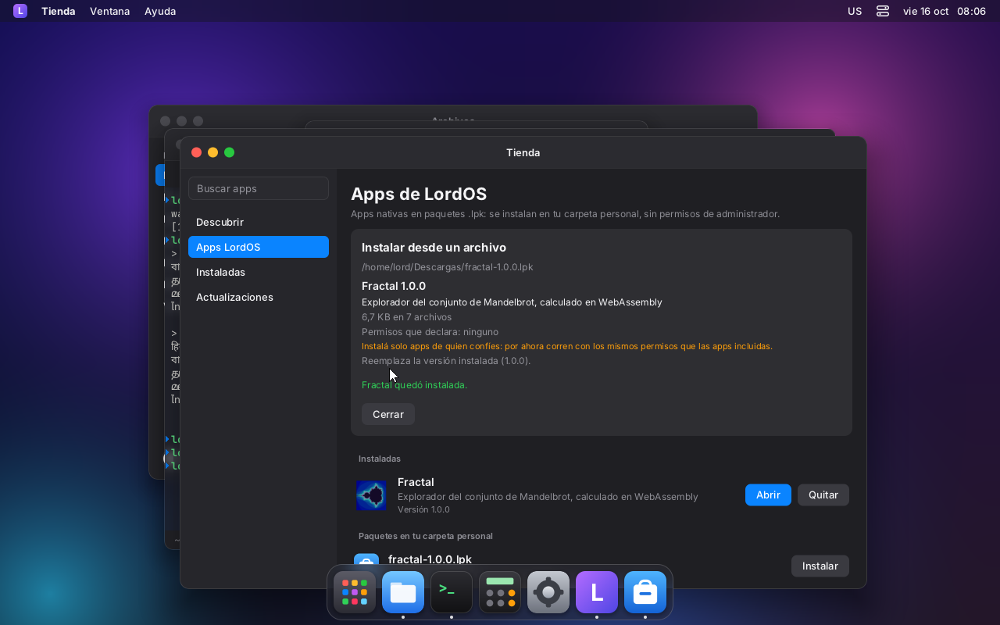
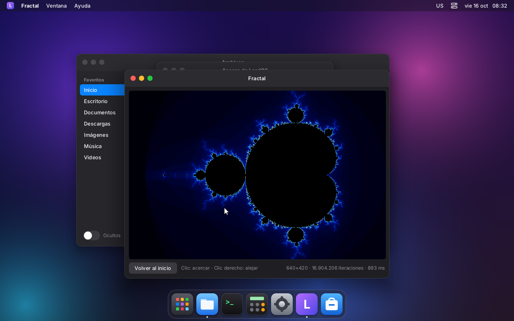

# Apps nativas instalables (.lpk)

Además de las apps incluidas en el tema (`apps/`), LordOS instala apps nativas de terceros en
paquetes **.lpk**:

- se instalan sin root, en la carpeta personal (`~/.local/share/lordos/apps/<id>/`);
- se abren como cualquier app de LordOS (Launchpad, Dock, menú de inicio);
- pueden traer módulos **WebAssembly** para el código que tiene que ser rápido (ver `WASM.md`).

Se instalan desde la Tienda, o con doble clic sobre el `.lpk` en Archivos.

| | |
|---|---|
|  |  |
| Fractal instalada desde la Tienda (un `.lpk` de 5 KB en `~/Descargas`) | Fractal abierta: Mandelbrot calculado en WASM (16,9 M de iteraciones en 0,9 s en la VM) y dibujado con `<Image pixels>` |

## Formato

Un `.lpk` es un tar (ustar), comprimido con gzip:

```
manifest.json      id, nombre, versión, ícono, tamaño de ventana, permisos
app.js             la app empaquetada (tools/lpk.mjs)
icon.png           obligatorio: el ícono propio de la app (PNG, 128×128 o más)
locales/<idioma>.json   textos de la app (opcional)
assets/…           lo que la app lee en tiempo de ejecución: .wasm, imágenes, datos (opcional)
```

**manifest.json**

```json
{
  "id": "fractal",
  "name": { "es": "Fractal", "en": "Fractal" },
  "description": { "es": "Explorador del conjunto de Mandelbrot", "en": "Mandelbrot set explorer" },
  "version": "1.0.0",
  "icon": "icon.png",
  "size": [660, 520],
  "minSize": [360, 300],
  "permissions": []
}
```

Reglas del manifest:

- `id`: de 2 a 40 caracteres, con a-z, 0-9 y `-`. Es también el espacio de los textos:
  `t('fractal.reset')` busca en `locales/<idioma>.json` del paquete.
- El id no puede ser uno de los de LordOS (`files`, `terminal`, `shell`, `store`…).
- `name` y `description` pueden ser un texto o un objeto por idioma.
- `version` empieza con un dígito.
- `icon` es obligatorio: toda app tiene su ícono propio. Sin él, `tools/lpk.mjs` no empaqueta y
  lord-server no instala.

Al instalar, lord-server rechaza el paquete si encuentra:

- enlaces simbólicos, enlaces duros o dispositivos;
- rutas absolutas, con `..` o con componentes que empiezan con `.`;
- caracteres fuera de `A-Za-z0-9._-`;
- más de 2000 archivos o más de 64 MB descomprimidos;
- un `manifest.json` inválido, o que falte `app.js`.

El paquete se escribe en una carpeta nueva y reemplaza a la versión anterior con un `rename`:
si algo falla a la mitad, la versión instalada queda como estaba. Código: `server/src/lpk.c`.

## Crear una app

Una app instalable es igual que una de `apps/`: una carpeta con `manifest.json` e `index.jsx`
que exporta el componente de la ventana y, opcionalmente, `Icon`. Se empaqueta con:

```sh
node tools/lpk.mjs examples/apps/fractal            # → fractal-1.1.0.lpk
```

`tools/lpk.mjs` empaqueta `index.jsx` con esbuild, pero **sin** React ni el SDK. La app usa los
del tema que está corriendo, que el SDK comparte en `globalThis.__lordos.require()`:
`react`, `react/jsx-runtime`, `@lordos/sdk` y `@lordos/runtime`. Así la app pesa poco (Fractal
pesa 5 KB) y comparte el estado del SDK: ventanas, idioma, portapapeles. Se agregan también
`icon.png`, `locales/` y `assets/`.

El ejemplo completo está en `examples/apps/fractal/`. Usa:

- un módulo WASM compilado desde C (`src/mandel.c`; el comando está en el archivo);
- `<Image pixels>` para dibujar.

## API para apps instaladas

| | |
|---|---|
| `loadWasm(appId, 'assets/x.wasm', imports)` | `WebAssembly.instantiate` de un archivo del paquete |
| `packageFile(appId, ruta)` | un archivo del paquete como `ArrayBuffer` (hasta 32 MB) |
| `<Image pixels={{ width, height, data }} />` | lienzo RGBA (`ArrayBuffer`, `Uint8Array` o `Uint8ClampedArray`, hasta 4096×4096); se redibuja cuando cambia el objeto |
| `packages.list()`, `packages.inspect(ruta)`, `packages.install(ruta)`, `packages.remove(id)` | para la Tienda |

El resto del SDK está igual que para las apps incluidas (ver `apps/README.md`).

## Permisos y confianza (M8)

Desde M8 hay **firma de paquetes** y un modelo de **permisos y aislamiento** (ver
[FIRMA.md](FIRMA.md) y [PRIVACIDAD.md](PRIVACIDAD.md)):

- **Firma**: cada `.lpk` puede ir firmado con Ed25519; LordOS verifica los hashes y la firma en C
  al instalar y detecta modificaciones. La Tienda y el diálogo de instalación muestran el nivel
  de confianza (LordOS / Autor verificado / Firmada por <nombre> / Sin firma), un paquete
  revocado no se instala, y están «Modificada por vos», «Restaurar original» y «Compartir mi
  versión».
- **Permisos**: `permissions` del manifest se declara y se muestra; el sistema pregunta la
  primera vez (estilo TCC de macOS) y guarda la decisión donde la app no puede escribirla; se
  revisan en Ajustes → Privacidad.
- **Aislamiento**: cada app instalada corre como **su propio proceso** (`lord-server --app <id>`),
  con la caja de arena propia (Landlock + seccomp + cgroup, `server/src/sec`). Se dibuja como un
  cliente Wayland con el marco del tema y habla con `lord-server` solo por el broker, que
  verifica cada permiso. La API del SDK es la misma: la app no cambia. Sus archivos viven en
  `~/.local/share/lordos/appdata/<id>`.

Lo que **siempre** limita a cualquier app (instalada o no): lord-server corre sin root, `lord.fs`
trabaja solo en la carpeta personal y no escribe en las carpetas de lanzamiento/instalación ni en
los ajustes ni en `permisos.json`, y desde JS no se pueden ejecutar comandos ni crear `.desktop`.

Pendiente:

- en el proceso aislado: el diálogo de archivos del sistema (powerbox), cámara y micrófono como
  fd/flujo, tokens del tema e idioma en vivo, y menús (ver `PRIVACIDAD.md`, «Estado»);
- un repositorio de apps LordOS para la Tienda, con el catálogo firmado (ver `FIRMA.md`).
