# Archivos (al estilo Finder)

`apps/files`. Explorador de la carpeta personal y de los discos montados del usuario, con lo
útil del Finder de macOS: pestañas, cuatro vistas, Papelera, Vista rápida, Ver información,
copiar/cortar/pegar, arrastrar y soltar, etiquetas de colores y búsqueda. Las operaciones de
disco son del servidor (`server/src/fsops.c`, `lord.fs` en `js_sys.c`); la app solo las pide.

## Capturas (VM 116, lord-server real)

| | |
|---|---|
| 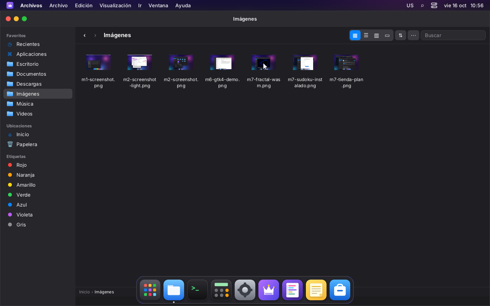 | 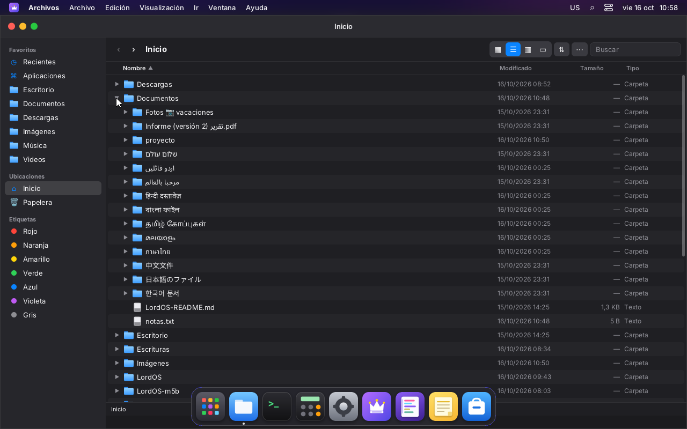 |
| Íconos con miniaturas reales de las imágenes | Lista: columnas, filas alternadas y carpetas que se despliegan en el lugar (nombres en varias escrituras) |
| 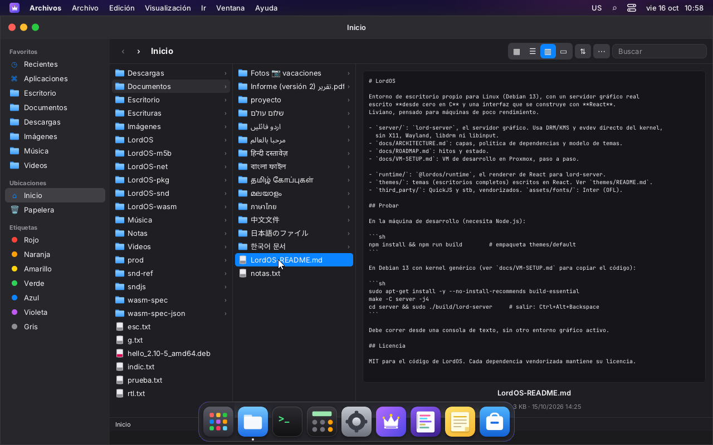 | 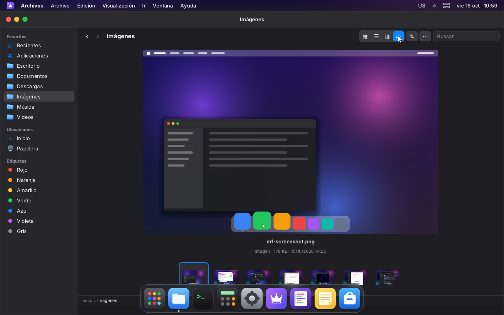 |
| Columnas (Miller) con la vista previa del texto | Galería: vista previa grande y la tira abajo |
| 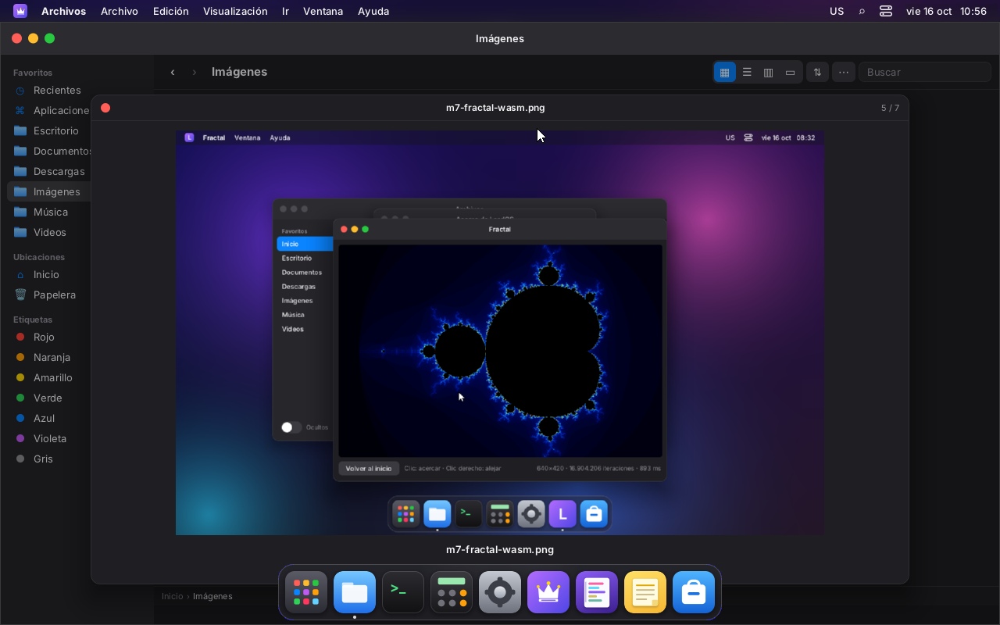 | 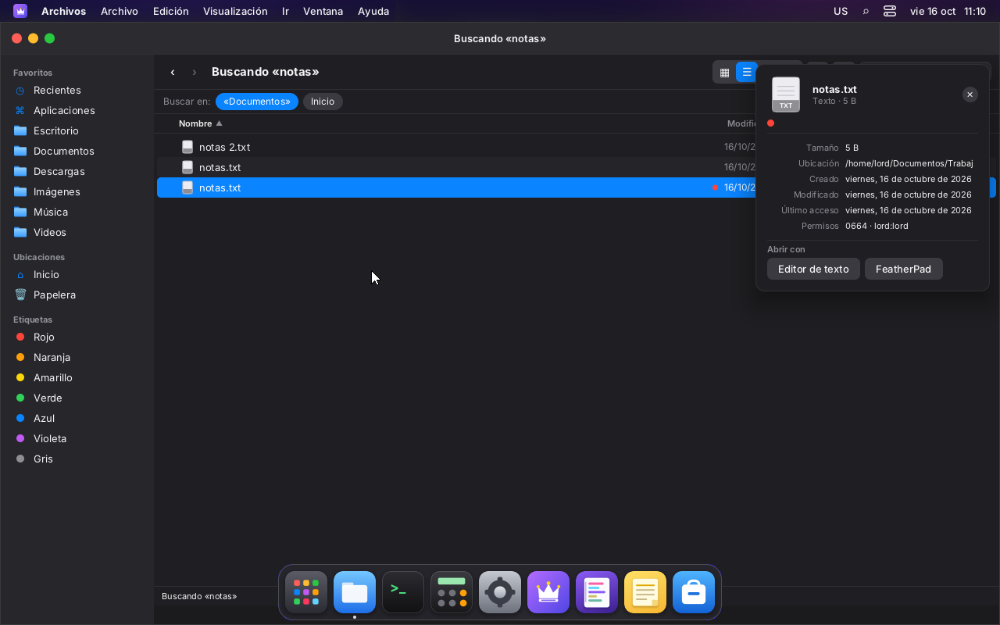 |
| Vista rápida (Espacio), 5 de 7; las flechas pasan a la siguiente | Ver información (❖I): tamaño, ubicación, fechas, permisos y «Abrir con» |
| 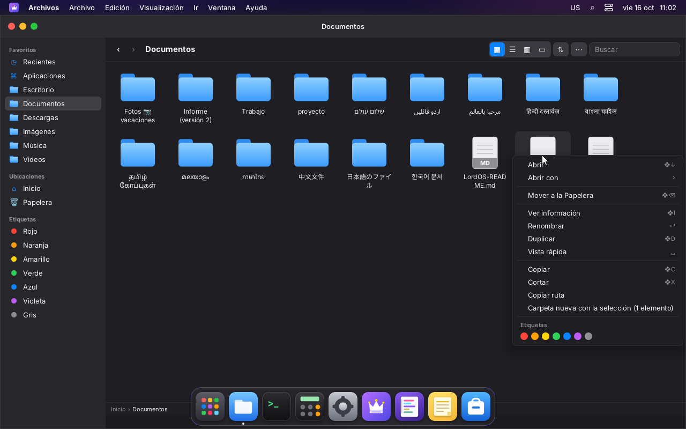 | 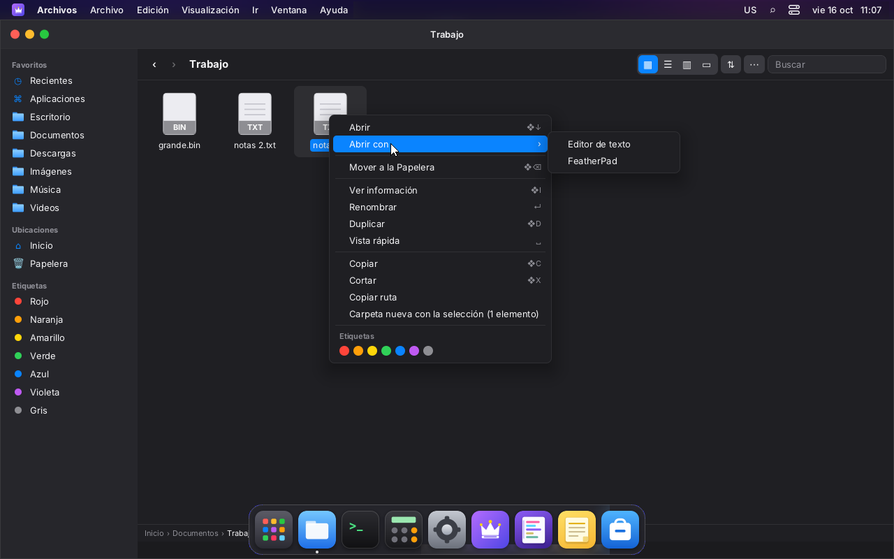 |
| Menú contextual de un archivo, con etiquetas | «Abrir con»: el Editor de texto o una app Linux que declare el tipo (FeatherPad) |
|  |  |
| `notas.txt` abierto en FeatherPad (Qt) desde «Abrir con» | Arrastrando a una carpeta (se resalta); con pestañas |
|  | 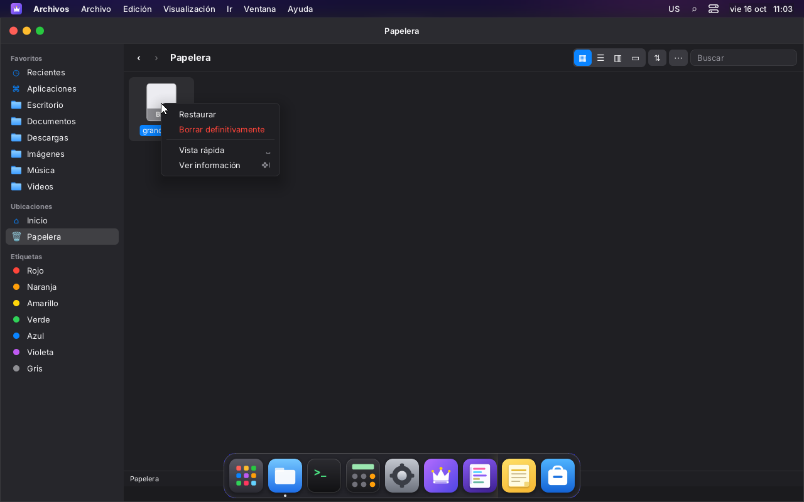 |
| Arrastrando a la Papelera de la barra lateral | En la Papelera: Restaurar o Borrar definitivamente |
| 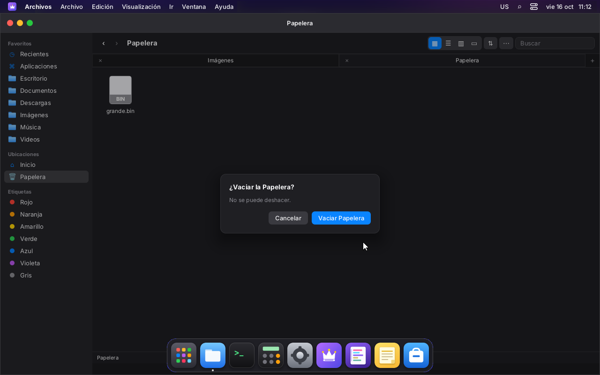 |  |
| Vaciar la Papelera pide confirmación | Etiqueta roja: el punto en el ícono y el filtro en la barra lateral |
|  | 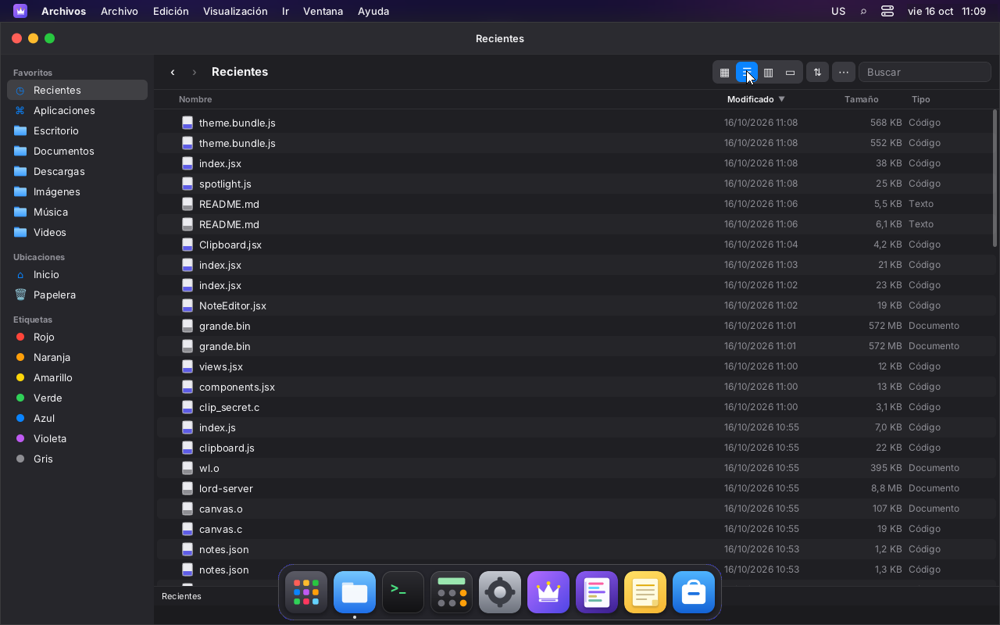 |
| Búsqueda en «Documentos» o en Inicio, con la carpeta de cada resultado | Recientes, por fecha |
| 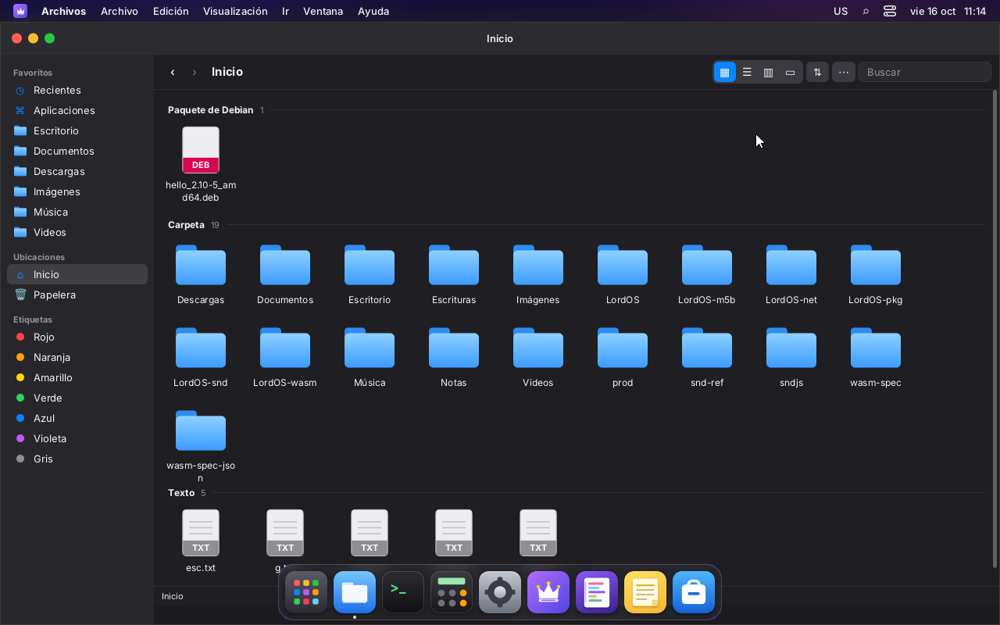 | 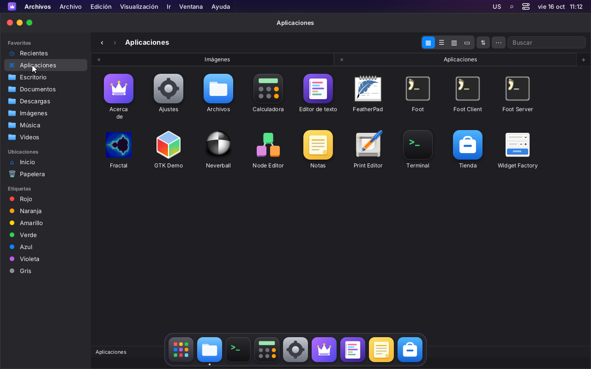 |
| Agrupado por tipo | Aplicaciones (LordOS, paquetes y Linux) |
|  |  |
| Tema claro | Lista en tema claro |
|  | 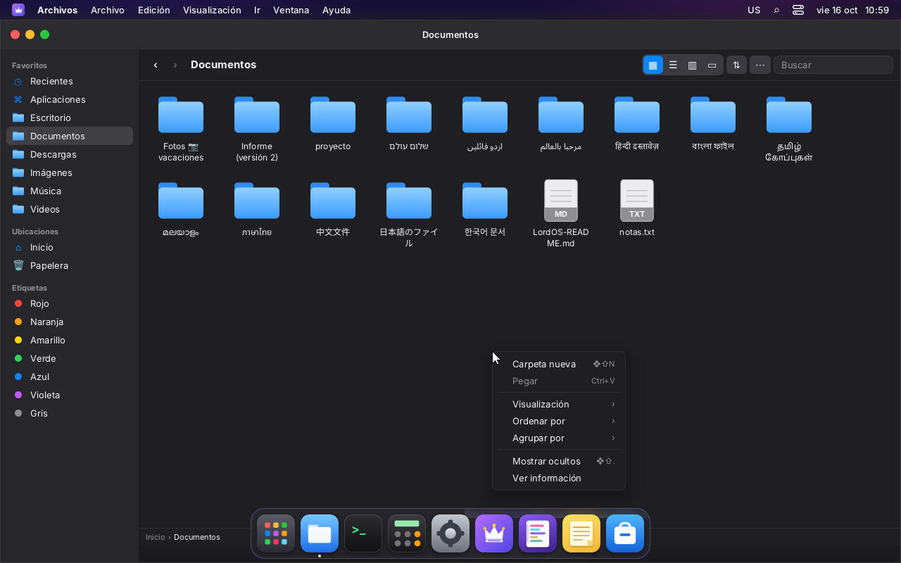 |
| En árabe: la barra lateral pasa a la derecha | Clic derecho en el vacío: Carpeta nueva, Pegar, Visualización, Ordenar, Agrupar, ocultos |

## Qué hay

- **Barra de herramientas:** atrás y adelante (historial por pestaña), el nombre del lugar, las
  cuatro vistas, Agrupar y Ordenar (⇅), acciones (⋯) y la búsqueda.
- **Pestañas** dentro de la ventana y **ventanas nuevas** (`wm.open('files', { new: true, args:
  { path } })`). Se puede soltar un archivo sobre la pestaña de una carpeta.
- **Barra lateral:**
  - Favoritos: Recientes, Aplicaciones y las carpetas del usuario (xdg-user-dirs);
  - Ubicaciones: Inicio, los discos y pendrives montados en `/media/$USER` o
    `/run/media/$USER` (se revisan cada 4 s) y la Papelera;
  - Etiquetas de colores (filtran).

  Las carpetas y la Papelera aceptan archivos arrastrados.
- **Vistas** (❖1 a ❖4):
  - íconos (tarjetas, con `flexWrap`; miniaturas de PNG/JPEG de hasta 24 MB);
  - lista (Nombre, Modificado, Tamaño y Tipo, con orden al hacer clic en el encabezado);
  - columnas (las últimas tres carpetas y la vista previa);
  - galería.

  En las búsquedas, Recientes y Etiquetas, la columna Tipo pasa a ser la carpeta.
- **Agrupar** por tipo (carpetas primero), fecha (hoy, 7 días, 30 días, este año, más antiguos)
  o tamaño, y **ordenar** por nombre (natural: «2» antes que «10»), tipo, fecha o tamaño. Las
  carpetas van primero. Recientes y la Papelera van por fecha.
- **Selección:** clic, ❖/Ctrl+clic, ⇧+clic (rango), ❖A, y escribir el comienzo de un nombre.
- **Renombrar en el lugar** (Enter): el nombre queda seleccionado y lo que se escribe lo
  reemplaza (`TextInput selectAll`, nuevo en el SDK). Las etiquetas siguen al archivo.
- **Copiar, cortar y pegar archivos:** es un portapapeles propio, aparte del de texto. Copiar en
  el mismo lugar duplica con nombre libre («notas 2.txt»).
- **Copiar y mover en segundo plano** (hilos del servidor): con progreso en la barra de estado
  y botón para cancelar. Si algo falla, no quedan copias a medias.
- **Arrastrar y soltar:** mueve a una carpeta, a la barra lateral, a una pestaña o a la
  Papelera; con ⌥ copia. Mientras se arrastra se ve el ícono, la cantidad y un «+» si copia.
  Si ya hay un archivo con ese nombre, se elige uno libre (no pisa nada).
- **Papelera** (freedesktop.org, la misma de GNOME y KDE):
  - lo de la carpeta personal va a `~/.local/share/Trash`, y lo de un disco montado, a
    `$montaje/.Trash-$uid`, con su `.trashinfo` (Path, DeletionDate);
  - se restaura a la ubicación original; si ahí ya hay otro archivo, no la pisa y avisa;
  - se vacía con confirmación;
  - borrar definitivamente existe solo adentro de la Papelera.
- **Vista rápida** (Espacio): la imagen, el texto (los primeros 64 KB, en monoespaciada), la
  primera página de un PDF, una muestra de una fuente, lo que hay adentro de un comprimido, un
  cuadro de un video (si está `media.poster`) o la ficha del archivo. Las flechas pasan al
  siguiente y Espacio o Esc la cierran. Ver `DOCUMENTOS.md`.
- **Comprimidos** (M9): doble clic los abre como una carpeta; «Extraer aquí» y «Comprimir» en
  el menú contextual, por el ayudante encerrado `lord-doc`, sin salir nunca de la carpeta de
  destino (`DOCUMENTOS.md`).
- **Ver información** (❖I): tamaño (en las carpetas se calcula acotado a 0,9 s), ubicación,
  enlace, fechas de creación, modificación y acceso, permisos y dueño, etiquetas y «Abrir con».
- **Abrir con:** el Editor de texto (texto y código), la Tienda (`.lpk`, `.deb`) y las apps
  Linux cuyo `.desktop` declara el tipo en `MimeType`. Esas últimas se lanzan con
  `lord.apps.launchWith(id, ruta)` (ver más abajo).
- **Recientes:** los archivos de la carpeta personal modificados en los últimos 30 días. Es un
  recorrido acotado: 5 niveles, 60.000 entradas, sin ocultos ni `node_modules`.
- **Aplicaciones:** las de `useLauncherApps()` (LordOS, paquetes y Linux); con doble clic se abren.
- **Etiquetas:** rojo, naranja, amarillo, verde, azul, violeta y gris, guardadas en
  `~/.local/share/lordos/tags.json` (ruta → colores).
- **Barra de ruta** abajo, con clic en cada tramo, y **barra de estado** («N elementos, X
  disponibles», «N de M seleccionados» o el progreso de una copia).
- **Menús de la app** en la barra del tema: Archivo, Edición, Visualización e Ir.

## Atajos

| Atajo | Qué hace |
|---|---|
| ❖N / ❖T / ❖W | Ventana nueva / pestaña nueva / cerrar pestaña |
| Ctrl+Tab, ⇧Ctrl+Tab | Pestaña siguiente / anterior |
| ❖1 ❖2 ❖3 ❖4 | Íconos / lista / columnas / galería |
| ❖[ / ❖] / ❖↑ | Atrás / adelante / carpeta de arriba |
| ❖↓ o doble clic | Abrir |
| Enter | Renombrar |
| ❖⇧N | Carpeta nueva |
| ❖D | Duplicar |
| ❖C / ❖X / Ctrl+V | Copiar / cortar / pegar archivos (también con Ctrl) |
| ❖⌫ o Supr | Mover a la Papelera (en la Papelera: borrar definitivamente, con confirmación) |
| ❖I | Ver información |
| Espacio | Vista rápida |
| ❖⇧. | Mostrar ocultos |
| ❖A | Seleccionar todo |
| Flechas, Inicio, Fin | Moverse por la selección (en la lista, → y ← despliegan y pliegan) |

## API (`lord.fs`, `sdk/fs.js`)

| | |
|---|---|
| `copy(de, a)`, `move(de, a)` | Tarea en un hilo del servidor; devuelve su id. Recursivo, conserva permisos y fechas, no pisa (O_EXCL) y copia los enlaces como enlaces. Mover en el mismo disco es un `rename` al instante; entre discos, copia y después borra el original. |
| `jobs()`, `cancelJob(id)`, `forgetJob(id)` | Progreso: `[{ id, src, dst, move, done, failed, error, bytes, total, files }]`. La app lo consulta cada 250 ms mientras hay tareas. |
| `trash(ruta)`, `trashList()`, `restore(id)`, `removeFromTrash(id)`, `emptyTrash()` | Papelera de freedesktop (`id` = ruta dentro de `…/Trash/files`). |
| `stat(ruta)` | `{ name, path, dir, link, target, size, mode, user, group, mtime, atime, ctime, btime, writable }` (statx, sin seguir el enlace) |
| `du(ruta, ms)` | `{ size, files, dirs, complete }`; corta a los `ms` (máx. 3000) |
| `free(ruta)` | `{ total, free }` del disco |
| `search(carpeta, texto, { limit, depth })` | Por nombre, sin distinguir mayúsculas y sin ocultos; acotada (hasta 1000 resultados, 16 niveles y 100.000 entradas) |
| `recent(limit, días)` | Lo modificado hace poco en la carpeta personal |
| `volumes()` | `[{ path, name, fs, total, free }]` de `/proc/mounts`, solo `/media/$USER/…` y `/run/media/$USER/…` |

**Seguridad:**
- Todo pasa por `resolve_target` / `resolve_in_home` (`js_sys.c`) y `fsops_allowed`: solo la
  carpeta personal y los montajes del usuario.
- Escribir, copiar hacia, mover y mandar a la Papelera rechazan las carpetas protegidas
  (`~/.local/share/applications`, `~/.config/autostart`, `~/.local/share/lordos/apps` y
  `~/.config/lordos/settings.json`). Copiar *desde* ellas sí se puede.
- No hay un `remove` general.

## «Abrir con» una app Linux: `lord.apps.launchWith(id, ruta)`

Es la misma excepción aprobada del lanzador (`server/src/apps.c`, ver `WAYLAND.md`), con un
archivo:
- solo apps cuyo `.desktop` tenga `MimeType` (las que declaran que abren archivos);
- la ruta se resuelve con `realpath` y tiene que estar en la carpeta personal o en un montaje
  del usuario;
- va como un único argumento en el primer `%f`/`%F` de su `Exec`, o en `%u`/`%U` como
  `file://…` (codificada);
- si el `Exec` no tiene código de archivo, no se lanza nada;
- sin shell, como siempre.

## Pruebas

- `make -C server build/fsops-test && build/fsops-test` sobre una carpeta personal temporal: 36/36. Cubre:
  - raíces y carpetas protegidas;
  - copia recursiva con enlace y permisos, y que no pise ni copie adentro de sí misma;
  - mover;
  - Papelera: nombres repetidos, restaurar sin pisar, borrar solo adentro y vaciar;
  - tamaño, búsqueda y recientes.
- En la VM 116 (capturas de arriba): carpeta nueva y renombrar, copiar y pegar (con un
  archivo de 600 MB en segundo plano, sin trabar la interfaz), duplicar, mover arrastrando a
  una carpeta, a la Papelera (con un `.trashinfo` válido), restaurar, vaciar con confirmación,
  Vista rápida con flechas, Ver información, las cuatro vistas, pestañas, búsqueda, etiquetas,
  Recientes, Aplicaciones, «Abrir con» el Editor y FeatherPad, tema claro y oscuro, y árabe.

## Pendiente

- Preguntar «¿Reemplazar?» al pegar o soltar sobre un nombre que ya existe: hoy se elige un
  nombre libre.
- Recuadro de selección arrastrando en el vacío.
- Miniaturas de PDF, video y SVG en la vista de íconos (el PDF ya se ve en la Vista rápida); íconos de las apps por tipo de archivo.
- Expulsar discos (necesita una acción de `admin.c` o udisks).
- Vigilar las carpetas con inotify: hoy la vista se recarga al volver a entrar o después de
  una operación propia.
- La barra de estado y la de ruta quedan detrás del Dock con la ventana maximizada, igual que
  en macOS cuando el Dock no se oculta.
- En la VM, ❖C abrió Ajustes, porque algún atajo ❖ del tema u otra parte del sistema se lo
  quedó. Con Ctrl+C/Ctrl+V anda.
