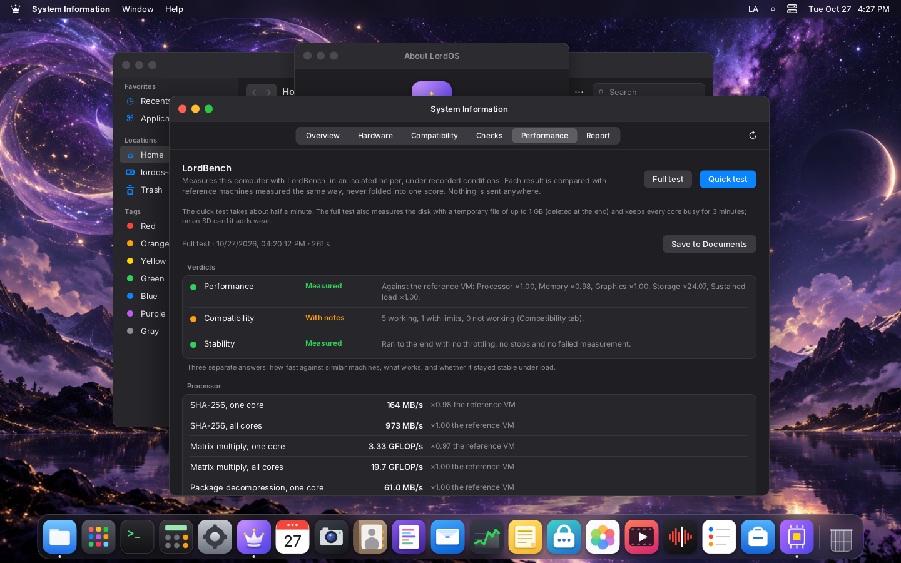
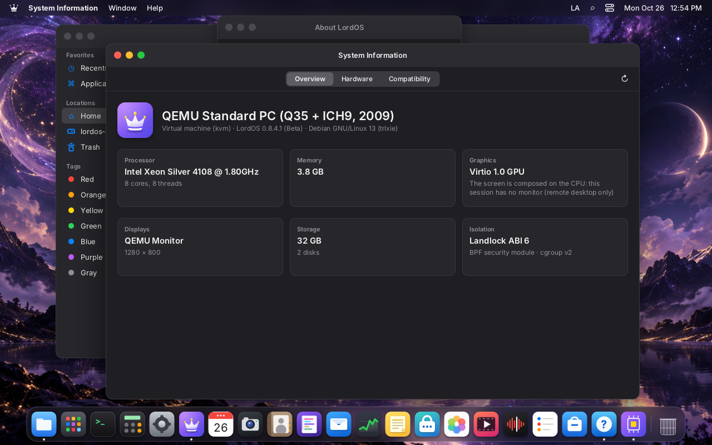
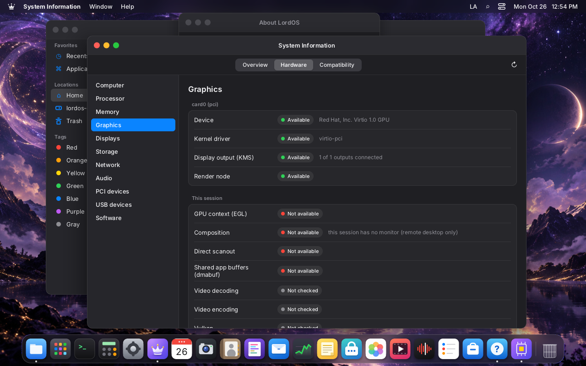
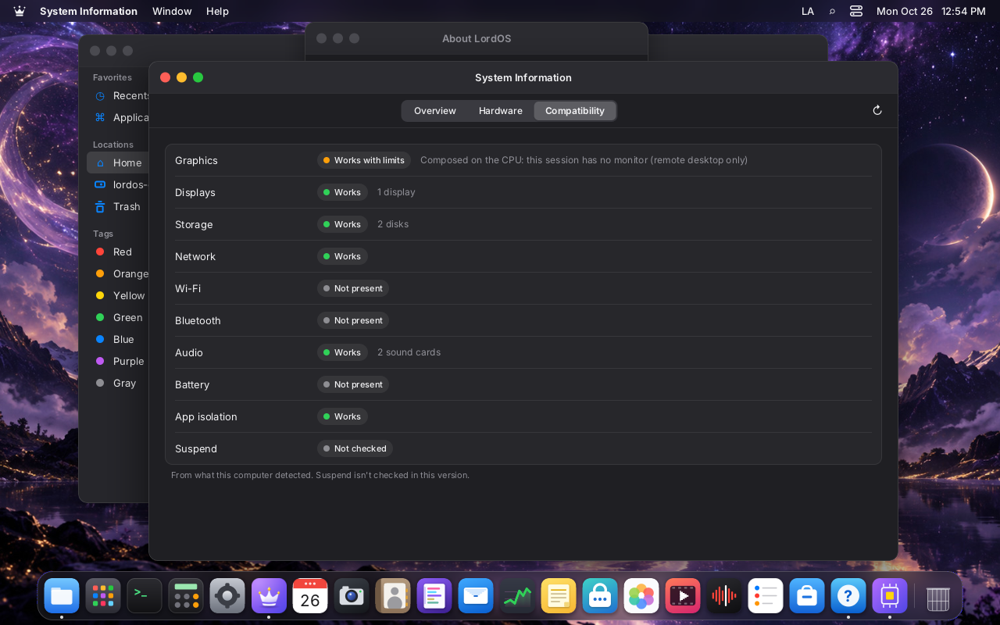
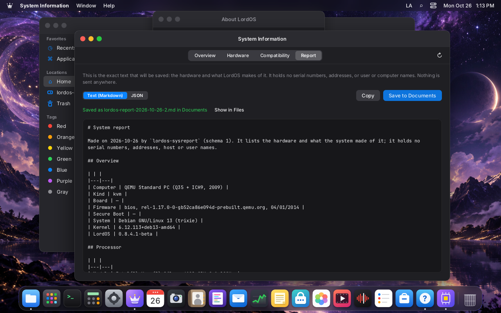
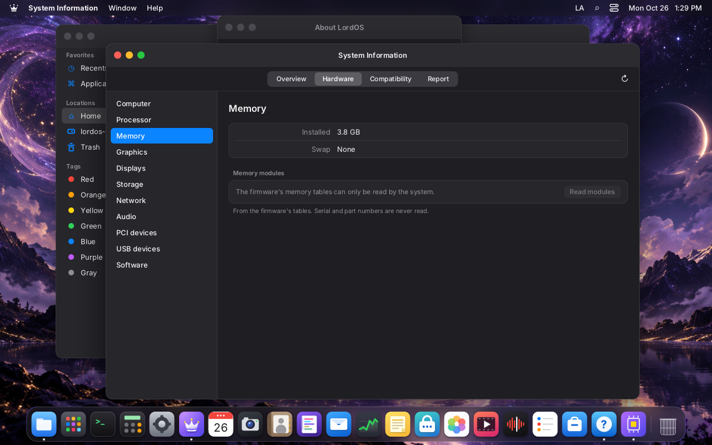
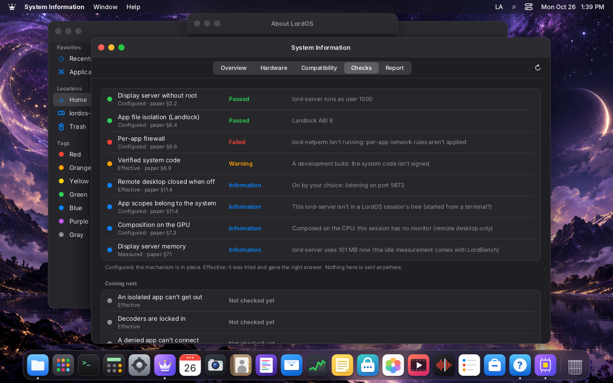
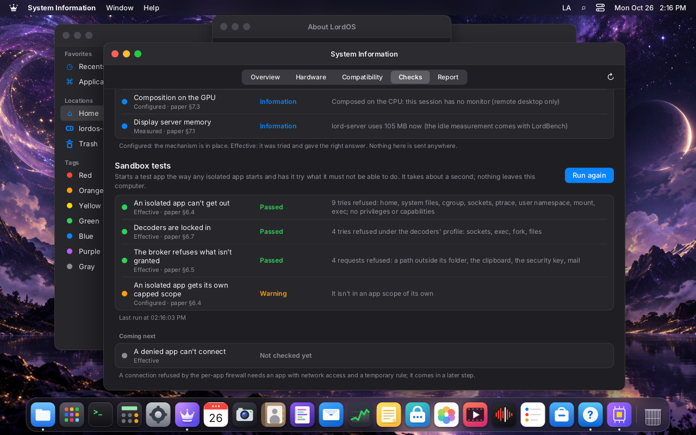

# System Information, LordBench and hardware reports (proposal)

**Status: design proposal. Built and released in 0.8.5-beta (2026-10-27; see "Work plan for 0.8.5" below): the collector, `lordos-sysreport report|fetch`, the System Information app (Overview, Hardware, Compatibility, Checks, Report), the Sandbox Probe and the shared measurement library `server/src/bench`. LordBench (0.8.6) is in development: the `lord-bench` helper, its CPU, memory, GPU, storage and sustained workloads, the guards and System Information's Performance tab are built (see "Built so far" under 0.8.6); the desktop-impact mode, the compositor and video workloads and two of the three reference machines are not. Community reports (0.8.7) and the `checks`/`bench` subcommands of `lordos-sysreport` are not built.** It plans three releases and a later stage:

| Release | What |
|---|---|
| **0.8.5 — System Information** | Every piece of hardware detected, what LordOS uses (above all the GPU), the services, the paper's claims checked on this machine, JSON/Markdown reports. |
| **0.8.6 — LordBench** | Measurements of CPU, memory, GPU, the compositor, video and storage under recorded, reproducible conditions, with versioned results. |
| **0.8.7 — Community hardware reports** | Publishing reports as GitHub issues, validating them, and a tested-hardware catalogue on lordos.org that the app also reads. |
| **Later — Lumo and AutoTune** | `ROADMAP.md`, "Lumo, the local assistant": explains a report and tunes settings from what the machine measured. |

Each claim of the paper, how it is checked today and what is still missing: `PAPER-VALIDATION.md`.

The aim is that every claim LordOS makes (memory at idle, GPU use, isolation) can be backed by a
reproducible report, not only a screenshot. Results must be technically defensible first and
attractive second.

## Architecture: the logic is not in the interface

The collector, the checks and the benchmark are native components with no UI, used by three
clients so no logic is duplicated:

```
server/src/sysreport/        collector + checks (library, read-only, no root)
server/src/bench/            LordBench workloads (library)
        │
        ├── lord-server: lord.sysinfo (js_hw.c) → apps/sysinfo        (the app)
        ├── lordos-sysreport  report | checks | bench [--quick|--full] --json  (CLI, runs as the user)
        └── tests (fake sysfs trees, fixtures) and, later, Lumo's tools
```

- **`lordos-sysreport`** is an ordinary user command in `/usr/bin` that the user or a test script
  runs; `lord-server` never runs it. It writes the same JSON as the app, so reports can be made on
  a machine without a session (a headless Pi, a VM over SSH, CI).
- **Shared with the Test Bench.** `lordos-testbench` (0.8.5, `src/testbench`, a Wayland client that checks
  the display server from the outside) and LordBench keep their own names and jobs, but the measurement
  pieces live once, in `server/src/bench/`, and both link them: `bench.c` (the clock; frame times with
  average, p50, p99 and frames that missed the refresh budget; presentation accounting with vblanks skipped
  and zero-copy frames; input-to-screen latency; the GL renderer's kind; JSON strings; the report written
  atomically to `~/.local/state/lordos/<name>.json`) and `glscene.c` (the fixed 3D scene, drawn with GLES2
  in whatever context is current: the bench's wayland-egl window, LordBench's offscreen context). Tested by
  `build/bench-test`. LordBench's workloads go next to them.
- **`lord-bench`** is the helper the app starts for workloads, launched like `lord-doc` and
  `lord-media`: fixed path (`<lord-server dir>/lord-bench`), no arguments, minimal environment,
  channel on fd 3, `sandbox_apply_helper()` before any work; it gets only the render node and a
  temporary file as fds. It links libc, Mesa's GBM/EGL/GLES (already used by the GPU path) and the
  vendored QuickJS (one of its workloads), nothing new. The CLI links the same library directly.

## 0.8.5 — System Information

One native app, **System Information** (`apps/sysinfo`), also opened from About LordOS →
**System Report…**. Tabs: **Overview**, **Hardware**, **Compatibility**, **Checks**, **Report**
(LordBench adds **Performance** in 0.8.6).

### Hardware

A sidebar tree and a detail pane, with vendor and device names from `pci.ids` and `usb.ids`:
hardware overview (model, vendor, firmware version and date, board, chassis type, Secure Boot),
CPU (cores, threads, frequencies, caches, SSE4.2/AVX/AVX2/AVX-512/FMA, NEON/SVE, governor,
microcode), memory (total, swap, zram; per module through the read-only admin action
`hw-memory-modules`), graphics, displays (monitor name and size from the EDID, mode, refresh,
scale, card, scanout), storage (interface and link speed, size, SMART health), USB and
Thunderbolt, PCI with drivers and missing firmware, audio, network, Bluetooth, power, thermal and
fans, cameras and input, Raspberry Pi (revision, bootloader, throttling and under-voltage flags,
fan header, kernel revision), software (Debian, kernel, the kernel options LordOS depends on, the
LordOS services and their state, the code manifest).

Serials, UUIDs, MAC addresses and EDID serials are shown only on screen, on request, and never
enter a report.

### The GPU as separate layers

"Is the GPU used" is not one answer. For every card the app shows each layer on its own, with
**Available**, **Not available**, **Not checked** or **Not measurable on this driver**:

| Layer | How it is known |
|---|---|
| Device detected | PCI or platform device, vendor and model |
| Kernel driver loaded | the device's `driver` link (`amdgpu`, `i915`, `xe`, `nouveau`, `nvidia-drm`, `v3d`/`vc4`, `virtio_gpu`…) |
| DRM/KMS available | a card node with connectors, modesetting working (`kms.c`) |
| Render node | `/dev/dri/renderD*` openable by the session |
| EGL context active | `lord-server` created one; the GL renderer string; hardware or software (llvmpipe) |
| Composition | the GPU path is on, or the exact reason it's off (the same one the log gives) |
| Direct scanout | seen during a fullscreen video or app, with the count since the session started |
| Video decode | VA-API profiles per codec (`MK_HWPROBE`); on the Pi 5 the HEVC V4L2 decoder |
| Video encode | the remote desktop's encoder when it's used |
| Vulkan | ICD files present only ("Not checked"); loading Vulkan belongs to stage 2 |

Live load is shown only where the driver exposes it (`amdgpu`: busy % and VRAM); elsewhere the app
says it isn't measurable instead of showing a zero. The Nvidia proprietary driver is shown as
**untested** with an invitation to send a report.

### Checks: configured versus effective

Each check says what it verified, at one of two levels, and never claims the stronger one without
the test:

- **Configured**: the mechanism is present (a kernel option, a service running, a flag in
  `/proc`).
- **Effective**: a probe tried something that must fail, and it failed.

| Id | Paper | Configured | Effective |
|---|---|---|---|
| `sec.server-user` | §2.2 | `lord-server`'s uid ≠ 0 | — |
| `sec.app-sandbox` | §6.4 | `Seccomp: 2`, `NoNewPrivs: 1` on an isolated app | a probe app (a system package started like any isolated app) tries to read a file outside its grant, open a socket, `ptrace`, create a user namespace and reach another app's scope; every attempt must be refused |
| `sec.helper-sandbox` | §6.7 | — | a child of the probe app that takes `sandbox_apply_helper()` checks that a unix socket, `exec`, `fork` and the app's data folder fail (0.8.5; `lord-bench` is planned to repeat it after its own lock-in in 0.8.6) |
| `sec.landlock` | §6.4 | Landlock ABI ≥ 6 | covered by the probe app |
| `sec.netperm` | §6.6 | `lord-netperm` running, programs attached, devices and Bluetooth programs loaded | the probe app, denied the network by a temporary rule, fails to connect to a local listener |
| `sec.code` | §6.9 | manifest present | every loaded bundle verified in this session |
| `sec.remote-closed` | §11.4 | remote desktop setting | nothing listens on 5673 when it's off |
| `sec.cgroups` | §11.4 | root-owned session tree, one scope per app | — |
| `perf.idle-memory` | §7.1 | — | memory used after 60 s idle at the desktop, with the session's resolution and number of displays recorded |
| `perf.idle-cpu` | §7.1 | — | CPU idle over 30 s with nothing open |
| `perf.boot` | §7.1 | — | systemd's firmware, loader, kernel and userspace times |
| `gpu.used` | §7.3 | hardware renderer exists | GPU path on, or a warning with the reason |
| `sys.time`, `sys.firmware`, `sys.fans`, `sys.memcg`, `sys.pi-bootloader`, `sys.updates` | various | as listed in the Hardware tree | — |

Thresholds are constants in `apps/sysinfo/checks.js`, signed with the theme bundle (the separate
`checks.json` first planned was not needed). A failed check offers **Report a problem** with the bug template.

### Compatibility

A panel per component (GPU, display, storage, network, Wi-Fi, Bluetooth, audio, power, suspend)
with its state: **Works**, **Works with limits** (and which), **Doesn't work**, **Not checked**. In
0.8.5 it comes only from this machine's detection and checks; from 0.8.7 it also shows what other
users confirmed for the same device and LordOS version, marked as community data.

### Reports

A versioned JSON (`schema: 1`) and a Markdown summary, saved to `~/Documents`:

- **Built from a fixed allow-list of fields.** Serials, UUIDs, MAC and IP addresses, host and user
  names, Wi-Fi network names and home-folder paths are never collected into it; a unit test feeds a
  fake system full of such values and checks none reaches the output.
- **Preview first**: the exact text that would be shared, field by field.
- **Explicit consent** for every share, never remembered.

## 0.8.6 — LordBench

### Two kinds of tests, kept apart

- **Peak performance**: the workload gets the machine. LordBench first waits for a quiet system (CPU
  idle above a threshold for 10 s) and refuses or marks the result if something else keeps the CPU
  busy; it records the load it saw.
- **Desktop impact**: the same workloads at low priority while the compositor animates a scripted
  scene, measuring the compositor's frame times and input latency. This answers "does the desktop
  stay smooth under load", a separate question with separate results.

### Workloads

| Category | Workloads |
|---|---|
| CPU, one core and all cores | SHA-256 (`pkg/crypto.c`), deflate, a matrix multiply; LordOS's own work: layout and paint of a fixed scene, shaping a fixed paragraph in several scripts, QuickJS running a fixed script |
| Memory | bandwidth (copy, triad) and latency (pointer chase) |
| GPU | offscreen GLES on the render node: fill rate, texture upload, composing N screen-size layers, timed with fences |
| Compositor | `lord-server`'s own frame counters during a scripted window drag, CPU path and GPU path |
| Video | short test clips we generate (H.264, HEVC, VP9, AV1; 1080p and 4K) decoded in `lord-media`, hardware and software; the remote desktop's encoders |
| Storage | sequential and random I/O on a size-limited temporary file (Full only, with a warning on SD cards) |
| Boot | the seconds from the kernel's start to the first frame on the monitor, recorded by `lord-sessiond` on every boot with the version and build (`/var/lib/lordos/boot-times.jsonl`, built in 0.8.5; [RESULTS.md](RESULTS.md), "Boot time"): LordBench reads that history, shows each version's median and spread over its boots (the first boot after an update apart: it builds caches), and with the user's consent can reboot N times in a row to measure it |
| Sustained | several minutes of all-core load (Full only) |

### Frame times against the refresh budget

The compositor results are reported as the **real time to build a frame** (paint plus present),
and separately as the share of the display's budget it uses (16.7 ms at 60 Hz, 8.3 ms at 120 Hz,
6.9 ms at 144 Hz) and the frames missed. No fixed threshold for every display: a check passes when
the 99th percentile fits the budget of the refresh rate actually in use.

### Thermal and power safety

- The limits come from the hardware: the thermal zones' passive and critical trip points, the
  CPU's own throttle state (cpufreq dropping below the requested frequency), the Pi's throttling
  and under-voltage flags. A run stops before the passive trip point and when throttling starts in
  a peak test; in the sustained test throttling is the result, recorded with its time and
  temperature.
- No run on battery below 30 %; a laptop on battery is recorded as such.

### Recorded conditions

Each result carries what affects it: resolution, scale and refresh rate of every display, GPU path
on or off, power source and profile, governor, temperatures at start and end, throttling seen, the
system load before starting, kernel, Mesa and LordOS versions, LordBench version. Two results are
compared only when the LordBench version matches; differing conditions are shown next to the
comparison.

### Results without one magic number

Three separate verdicts, never folded into one score:

- **Performance**: per category, normalized to a set of **reference machines** (initially a
  Raspberry Pi 5 8 GB, a modest x86 PC and a VM), shown as "×N of reference" for each, so a board
  and a workstation are each compared with something similar.
- **Compatibility**: from the Compatibility panel.
- **Stability**: errors and crashes during the run, frames missed under load, throttling.

### Built so far (in development for 0.8.6, 2026-10-27)

Unreleased; the latest release is 0.8.5-beta. Checked on VM 116 (Proxmox VE, 8 vCPU of a Xeon Silver
4108, 4 GB, virtio disk, no GPU passthrough: Mesa's llvmpipe) from a terminal (`build/lordbench-cli`) and
in an isolated headless session through System Information → Performance.

- **`lord-bench`** (`server/src/bench/lbmain.c`, `mk/lordbench.mk`): launched by lord-server
  (`bench/lbrun.c`) from its own folder only (owned by root or the user, not writable by others), no
  arguments, `LANG` only (and `LORDOS_SESSIOND` in a lord-sessiond session), the channel on fd 3. It
  receives one fixed-size request (`LbGo`, `bench/lbproto.h`) with at most two fds lord-server opened: the
  GPU's render node (`/dev/dri/renderD128…`) and, for Full, an unnamed scratch file (`O_TMPFILE` in
  `~/.cache`, at most 1 GB and a quarter of the free space). Then it locks itself in with
  `sandbox_apply_helper` before any work (scope `lordos-bench.scope`, 2 GB memory cap, read-only
  `/usr/lib`, `/usr/share`, `/sys/dev/char`, `/sys/devices` for Mesa, DRM and dma-buf ioctls only when
  it got the render node, no sockets, no exec, threads only). It answers only with fixed-size records
  (`LbMsg`: a measurement id, a value and its spread); lord-server checks each one (`lb_msg_valid`: the
  magic, a known kind and id, finite values in range) and writes the JSON itself. Stopping is a SIGKILL.
- **Workloads** (`bench/lbwork.c`, `bench/lbgpu.c`), each repeated three times and reported as the
  median with its spread (max − min), on one core and on all of them:
  - CPU: SHA-256 (`pkg/crypto.c`, with the CPU's SHA instructions when present); a 256×256
    double-precision matrix product; decompressing a fixed 2 MB text with the package engine's own xz
    decoder (`pkg/xz.c`; the text is generated at build time by `bench/lbcorpus.c` and compressed with
    `xz -9`), instead of the deflate in the design above; QuickJS running a fixed script (strings, JSON,
    sorting, objects, a regular expression), one runtime per thread. The layout, paint and shaping
    workloads are not built.
  - Memory: copy and triad bandwidth on all cores (32 MB arrays in Quick, 128 MB in Full) and the
    latency of a dependent pointer chase over 64 MB.
  - GPU: OpenGL ES 2 offscreen on the render node (GBM + EGL, a surfaceless context, a 1920×1080
    framebuffer object; every frame ends with `glFinish`): the 3D scene of the Test Bench
    (`bench/glscene.c`), fill rate with 16 blended full-screen quads, 1920×1080 RGBA texture uploads and
    8 blended screen-size layers.
  - Storage (Full only): sequential write with `fdatasync`, sequential read after dropping the page
    cache for that file, random 4 KiB reads for 3 s; the file is emptied at the end and, being unnamed,
    disappears with the fd.
  - Sustained (Full only, 3 minutes from the app): the matrix product on every core, a sample every
    10 s with the temperature lord-server read at that moment.
- **Guards and conditions** (`bench/lbcond.c`, read by lord-server, never by the helper): the hottest
  thermal zone (or the CPU's coretemp/k10temp/zenpower hwmon sensor) and the lowest passive and
  critical trip points; the x86 thermal throttle counters; the Raspberry Pi firmware's `get_throttled`
  flags and its `rpi_volt` under-voltage alarm; cpufreq, governor and ACPI platform profile; batteries
  (a device's own battery, such as a mouse's, is ignored) and mains. A run is refused on battery below
  30 %, waits for 10 s in a row below 15 % CPU (at most 30 s, then it runs marked "busy"), stops within
  2 °C of the passive trip point (or 10 °C of the critical one when there is no passive), and in the peak
  tests stops when the throttle counters grow or the Pi says it is throttling now; in the sustained test
  throttling is recorded with its time and temperature instead. The kind of disk under the scratch file
  is recorded (NVMe, SD/eMMC, SSD, HDD, USB, virtual, or RAM in the live session). Unit tests on fake
  sysfs trees (`tests/lordbench_test.c`, 260 checks): an x86 laptop on battery, a Raspberry Pi 5.
- **The result** (`~/.local/state/lordos/lordbench.json`, the previous one kept as
  `lordbench-prev.json`; a refused run keeps the last result): LordBench's version, the mode, status and
  stop reason, LordOS and kernel versions, live or installed, threads, the quiet wait, conditions before
  and after, the disk kind, the GPU kind (hardware, virtual or software), the sandbox mask, this
  session's composition and each active display's connector, mode, refresh, scale and rotation (no
  names, vendors or identities), every measurement with its unit, what was skipped and why, and the
  sustained samples. `lord.sysinfo.bench.boots()` groups lord-sessiond's boot history by version
  (median, range, the first boot after an update apart).
- **System Information → Performance** (`apps/sysinfo/performance.jsx`, model in `perf.js`, tested in
  `server/tests/sysinfo_perf_test.mjs`): Quick and Full, progress by measurement, then the three verdicts
  (performance as "×N" per category against each reference measured with the same LordBench version;
  compatibility counted from the Compatibility tab; stability from the status, failed measurements,
  throttling, under-voltage, a sustained drop above 10 % and a busy start), every measurement with its
  "×N" and its change against the previous run, the conditions that differ from the previous run, the
  conditions, the boot times per version, and **Save to Documents** (the JSON). Nothing is sent.
- **Reference machines** (`apps/sysinfo/references.js`): only VM 116 so far (a Full run with a 30 s
  sustained test, numbers below). The Raspberry Pi 5 8 GB and the modest x86 PC are added when measured.

VM 116, Full, LordBench 1 (2026-10-27): SHA-256 167 MB/s on one core and 977 MB/s on eight; matrix
product 3.4 and 19.7 GFLOP/s; xz 61 and 354 MB/s; QuickJS 58 and 336 runs/s; memory copy 20.2 GB/s,
triad 22.8 GB/s, latency 90 ns; llvmpipe: scene 794 fps, fill 395 Mpixel/s, upload 9,676 MB/s, 8 layers
22.6 fps; virtio disk: 219 MB/s write, 517 MB/s read, 5,619 random reads/s; sustained 19.8 GFLOP/s from
start to end. A Quick run took 33 s, a Full run with 30 s sustained 117 s.

The same Full run from System Information in the isolated headless session (3 minutes of sustained load;
its home is on tmpfs, so the storage test measured memory and says so, ×24 the reference's virtio disk):



Not built yet: the desktop-impact mode (the helper already takes the low-priority flag, `LB_GO_LOW`;
the scripted scene and the frame-time and input-latency measurement while it runs are missing), the
compositor workload (lord-server's own frame counters during a scripted window drag), the video
workload (clips decoded in `lord-media`, hardware and software, and the remote desktop's encoders),
rebooting N times for the boot time, repeating the helper-sandbox self-test inside `lord-bench` (`sec.helper-sandbox`), the Pi 5 and x86 PC references, and `lordos-sysreport bench`.

## 0.8.7 — Community hardware reports

- **Share on GitHub** saves the report as a small HTML page and opens it with the default browser
  (the existing `lord.apps.launchWith('', path)` rule). That page opens GitHub's new-issue form with
  the `hardware-report` template, title and summary filled in; the user attaches the JSON and
  submits it with their own account. LordOS sends nothing by itself and holds no token.
- A workflow validates each attached JSON against the schema, labels the issue by vendor and kind,
  and flags reports whose numbers are implausible for the hardware.
- **lordos.org/hardware**: the catalogue built from accepted reports: GPUs and drivers tested,
  boards, laptops with suspend, battery and Wi-Fi, known problems and the version that fixed them,
  real LordOS performance per device. The app's Compatibility panel reads a signed snapshot of it
  (downloaded with the package engine's checks), so it works offline.

## From the live USB, without installing

The app and LordBench are in the ISO, so anyone can start a PC from the LordOS USB stick, check
the machine and send a report without installing anything or touching its disks. This is likely
the main source of PC reports: it costs the tester nothing and answers "will LordOS work here"
before installing.

- **A boot menu entry**, *Check this computer*, starts the live session straight into System
  Information (0.8.5) and its Performance tab (0.8.6). The normal live session has it in the Dock.
- **The report says it was live**: boot medium (USB, its link speed), the overlay in RAM, no
  persistence. Live and installed results are kept apart in comparisons and in the catalogue.
- **Different references where live changes the numbers**: idle memory is compared with the
  paper's live figure (465 MB) and the overlay's size is subtracted and shown; boot time includes
  reading from the stick and is reported, not judged.
- **Nothing written to the computer's disks.** Internal disks are detected and their SMART health
  read; the storage test only runs on the live overlay in RAM and, read-only, on the USB stick, and
  says so. Measuring the internal disks waits for an installed system.
- **Where the report goes:** with no persistent home, the app saves it to a removable drive the user
  picks (a second stick, or a writable partition on the same one if present) or shares it directly
  through the browser when there is a network connection.
- **Missing firmware and drivers** are especially valuable here: the report lists what the ISO
  lacked for this machine (Wi-Fi, GPU firmware), which tells us what the ISO should carry.
- **The installer reuses the same checks** (`server/src/sysreport/`): before installing it shows
  the Compatibility summary (for example "GPU: not used, software renderer" or "Wi-Fi: firmware
  missing") so the user knows before replacing their system.
- **Limit:** machines with Secure Boot on can't start the stick until LordOS is signed for it
  (paper §10.2); the website's download page says so next to the *Check this computer* guide.

## New interfaces, all under the rules of `AGENTS.md`

- `lord.sysinfo` in `server/src/ui/js_hw.c`: `report()`, `markdown()`, `facts()`, `probe()` (built in
  0.8.5; the checks are evaluated in `apps/sysinfo/checks.js`); in 0.8.6
  `bench.start(kind)`, `bench.poll()`, `bench.cancel()`.
- `lordos-sysreport`, a user command (not started by `lord-server`).
- One read-only admin action, `hw-memory-modules` (anyone, no arguments): SMBIOS memory device
  entries parsed strictly in C, returning slot, size, type, speed and manufacturer only.
- The probe app for the effective checks: a signed system package started through the existing
  `lord.apps.launchPackage(id)`; no new launcher path.
- `lord-bench` (0.8.6), as above.
- Data packages `pci.ids` and `usb.ids` (Debian, architecture `all`), documented in `VM-SETUP.md`.

## Work plan for 0.8.5

**Built (2026-10-26):** `server/src/sysreport/` (the collector, `ids.c` for `pci.ids`/`usb.ids`, the JSON
and Markdown output), `lordos-sysreport report [--json | --markdown]` in `/usr/bin` (package `lordos`,
which recommends `pci.ids` and `usb.ids`), and `tests/sysreport_test.c`: five fake machines (AMD desktop,
Intel laptop, Nvidia desktop, Raspberry Pi 5, VM) full of serials, UUIDs, MAC addresses, a host name, a
user name, monitor serials and a MAC inside an interface name, none of which may reach a report
(`build/sysreport-test fixture <dir> <kind>` writes one for `--root`). Checked on VM 116 against the real
machine. `lordos-fetch` (the same binary under that name; `lordos-sysreport fetch`) shows the crown in
the brand colors beside a short summary (system, computer, kernel, uptime, packages, shell, display, CPU,
GPU, memory, disk, isolation); the user and host names appear only on screen and `--share` leaves them out
for a screenshot to post; `--color=auto|always|never`, `NO_COLOR` respected, true color when `COLORTERM`
says so, plain ASCII without color. **The app (2026-10-26):** `apps/sysinfo` (also About LordOS → System Report…) with Overview, Hardware and
Compatibility, from `lord.sysinfo.report()` (`ui/js_hw.c`): the same report plus `session`, how this
session composes the screen now (`lord_composition()` in `main.c`: `gpu`, `headless`, `no-display`,
`rotated`, `capture` or `gpu-off`) and the GPU context (`gpu_info()`: the last `gpu_init` outcome as a
fixed code, the renderer, render node, dmabuf import and direct scanouts since start). The layers and
the Compatibility panel are worked out in `apps/sysinfo/model.js` (`server/tests/sysinfo_model_test.mjs`).
Checked on VM 116 in an isolated headless session (own home, runtime folder and bus):







**Report tab (2026-10-26):** the exact text that would be saved, as Markdown (`lord.sysinfo.markdown()`:
`lordos-sysreport`'s text plus a "This session" section) or JSON (the report as `lord.sysinfo.report()`
gives it); **Copy** and **Save to Documents** (`lordos-report-<date>.md|json`, `-2`, `-3`… never over an
existing file), with **Show in Files**. Nothing is sent anywhere: publishing comes with 0.8.7.



**Memory modules (2026-10-26):** Hardware → Memory → **Read modules** runs the read-only admin action
`hw-memory-modules` (the SMBIOS type 17 entries only root can read, parsed in `sysreport/smbios.c`:
slot, bank, size, type, speeds, manufacturer; never serial, asset tag or part number). On VM 116 the
parser read `mem 4096|RAM|0|0|DIMM 0||QEMU` from QEMU's real tables (`build/sysreport-test smbios` as
root); the button itself was not exercised on screen (the isolated test session has no admin helper,
so it shows disabled):



**Checks, part 1 (2026-10-26):** what `lord-server` can see itself, evaluated in `apps/sysinfo/checks.js`
(the thresholds are constants there, so they are signed with the theme bundle instead of a separate
`checks.json`), from `lord.sysinfo.facts()` (`sysreport/facts.c`: lord-server's uid/euid from
`/proc/self/status`, its cgroup and who owns it, the app scopes beside it, and whether anything
listens on port 5673 in `/proc/net/tcp{,6}`): display server without root (§2.2), Landlock ABI ≥ 6
(§6.4), `lord-netperm` running with cgroup BPF and the BPF LSM (§6.6), verified system code
(effective: every bundle loaded this session matched; §6.9), remote desktop closed when off
(effective: nothing listens on its port; §11.4), the session's cgroup tree owned by root (only inside
`…/lordos-session-<uid>/server`; §11.4), composition on the GPU (§7.3) and lord-server's memory now
(measured, no pass or fail; §7.1). On VM 116 it found two real things: `lord-netperm` isn't installed
there (the unit doesn't exist), and the first run refused a stale `app-host.bundle.js` in the test
tree. Part 2 is below.



**Checks, part 2: the Sandbox Probe (2026-10-26, approved by the maintainer).** A system package,
`sysprobe` (`apps/sysprobe`, built into `assets/sysapps/sysprobe` like Passwords, hidden from the launcher
with the new manifest field `"hidden": true`), started with the existing `lord.apps.launchPackage(id)`
like any isolated app: no new argument, path or exec. In app mode (`app/appclient.c`), for that system
package only, `app/probe.c` runs instead of the app's code:

1. **Before the app's sandbox**, while the process is single-threaded and has loaded nothing, it forks a
   child that takes the decoding helpers' profile (`sandbox_apply_helper`, as `lord-doc` and `lord-media`)
   and tries a unix socket, exec, fork and the app's data folder.
2. It applies **the same sandbox as any isolated app** (same read-only folders, no network) and tries
   what must fail: the home folder, `/etc/passwd`, the root cgroup's `cgroup.procs`, an internet and a
   unix socket, `ptrace`, a user namespace, `mount`, `exec`. Its own data folder must work (the control:
   a probe that can't write there reports nothing it can be trusted for).
3. It asks its broker for what must be refused: a path outside its folder, the clipboard without
   permission, the FIDO2 device, `lord-maild`.
4. It sends the result as `BOP_PROBE` and exits, without a window. `brokersrv.c` takes `BOP_PROBE` only
   from that system package, validates the JSON (≤ 8 KB) and adds what only it can read: the process's
   `NoNewPrivs`, `Seccomp` and `CapEff` and its cgroup with `memory.max`. `lord.sysinfo.probe()` returns
   the last result; `apps/sysinfo/checks.js` (`evaluateProbe`) turns it into four rows: the app sandbox
   (§6.4), the helper sandbox (§6.7), the broker (§6.5) and the app's own capped scope (§6.4).

On VM 116, in the isolated headless session, every try was refused (9 + 4 + 4) and the process reported
no_new_privs, seccomp mode 2 and no capabilities; the scope row is a warning there because that session
isn't in a LordOS session tree (lord-sessiond refused the scope, as it must). Its first run also caught a
mistake in the probe itself: stacking the helpers' profile inside the app's sandbox is refused by the
app's seccomp (rightly), so the helper child now starts before it.



Not yet: a connection refused by the per-app firewall (it needs an app with network access and a
temporary rule), video decode and encode and Vulkan (shown as *Not checked*).

1. `server/src/sysreport/`: collector, GPU layers, `pci.ids`/EDID readers, fake-sysfs fixtures
   (AMD desktop, Intel laptop, Nvidia desktop, Raspberry Pi 5, VM), the anonymization test,
   `hw-memory-modules`, `lordos-sysreport report`.
2. The app: Overview, Hardware, Compatibility; About's button; en, es, pt; right to left.
3. Checks, configured and effective, the probe app, thresholds signed in `apps/sysinfo/checks.js` (built); `lordos-sysreport checks` (not built yet).
4. Reports with preview; docs; screenshots on VMs; the first real reports: the Raspberry Pi 5 with a
   monitor and the maintainer's PC (Core i9-10900, Radeon RX 580), the first real AMD data in the
   project.
