# Several displays and sharp HiDPI

LordOS drives every connected display at once, as one desktop (**extend**) or showing the same
picture (**mirror**), and draws each display at its own scale — 100, 125, 150, 175 or 200 % — with
text, vectors and images rasterized at the display's real resolution. A 4K panel at 150 % next to
a 1080p one at 100 % is sharp on both. Tested on VM 118 (`lordos-notes`) with two virtio-gpu heads
(1280×800 and 2560×1600), on the CPU path and on the GPU path (Mesa llvmpipe forced).

| | |
|---|---|
| 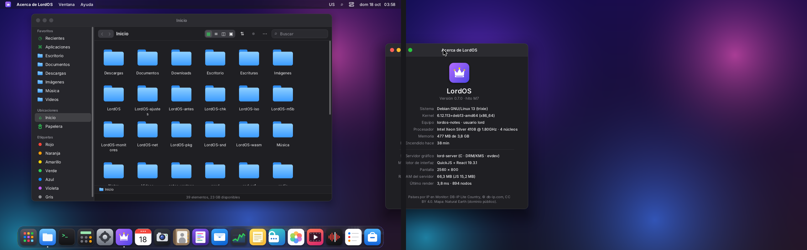 | 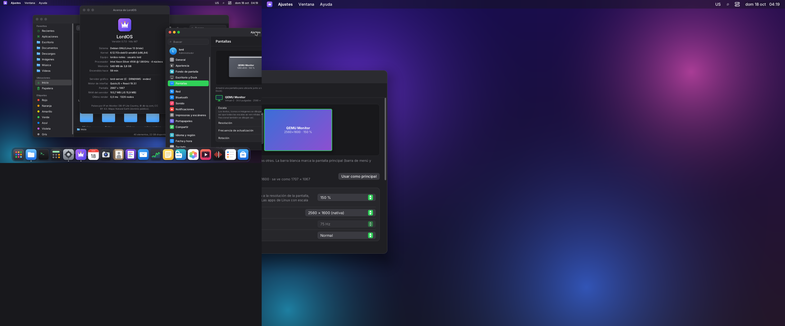 |
| Two displays extended: the About window spans both (100 % + 100 %) | Mixed DPI: Settings spans a 100 % display and a 150 % one; each half is drawn at its display's resolution |
| 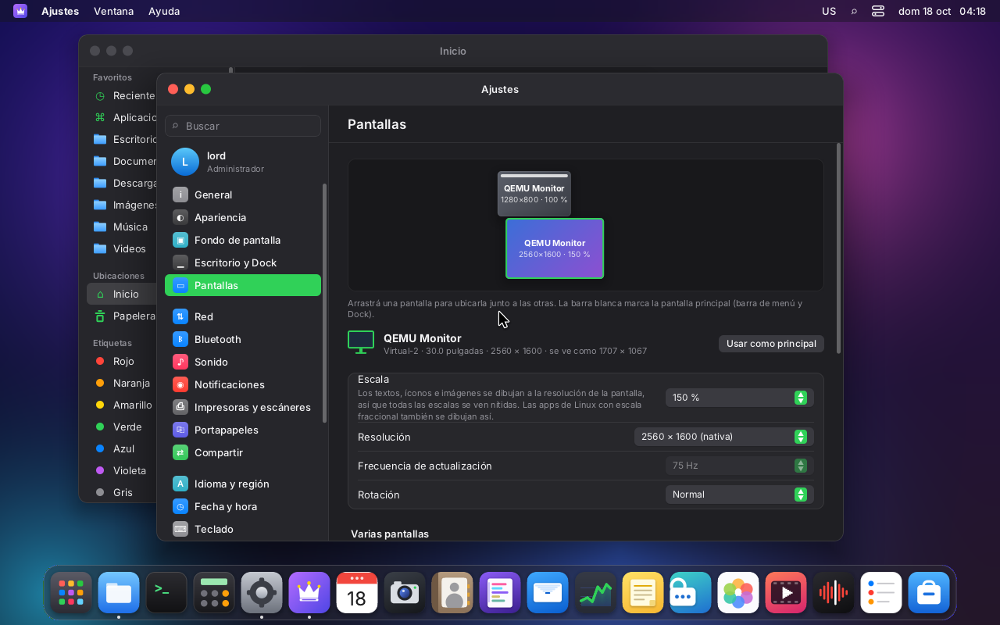 | 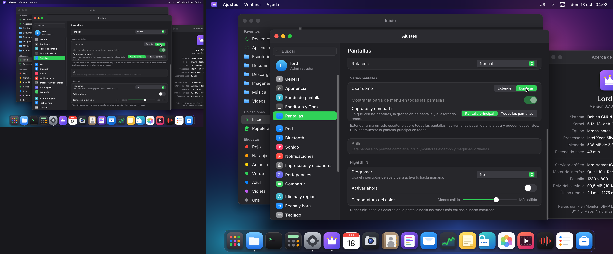 |
| Settings → Displays: the arrangement (drag a display; it snaps next to the other) | Mirror: the 2560×1600 display shows the main one at 200 % (fitted), sharp |
| 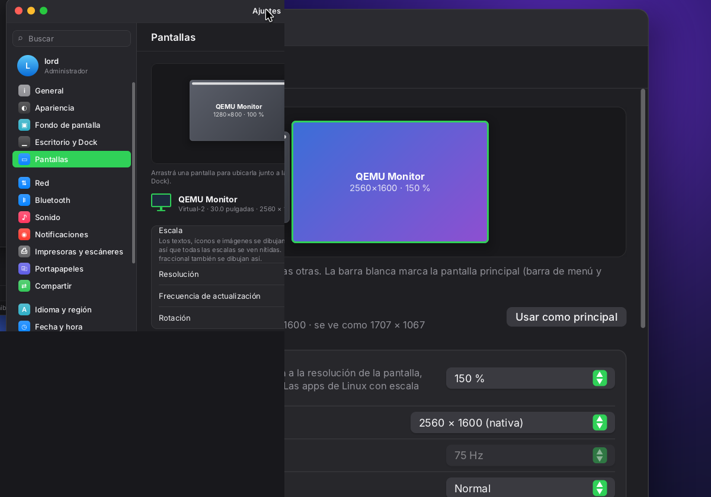 | 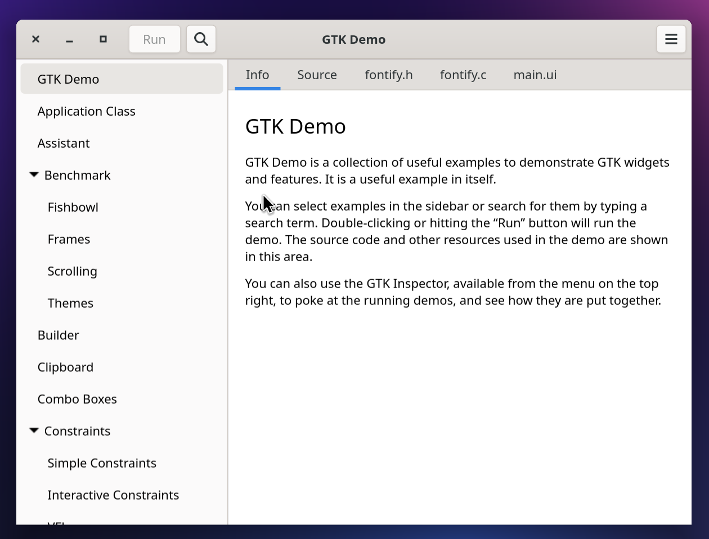 |
| 100 % (left) and 150 % (right) at native pixels: same UI, both sharp | GTK 4 on the 150 % display: it renders 1242×944 for 828×629 logical (fractional-scale-v1 + viewporter), copied 1:1 |
| 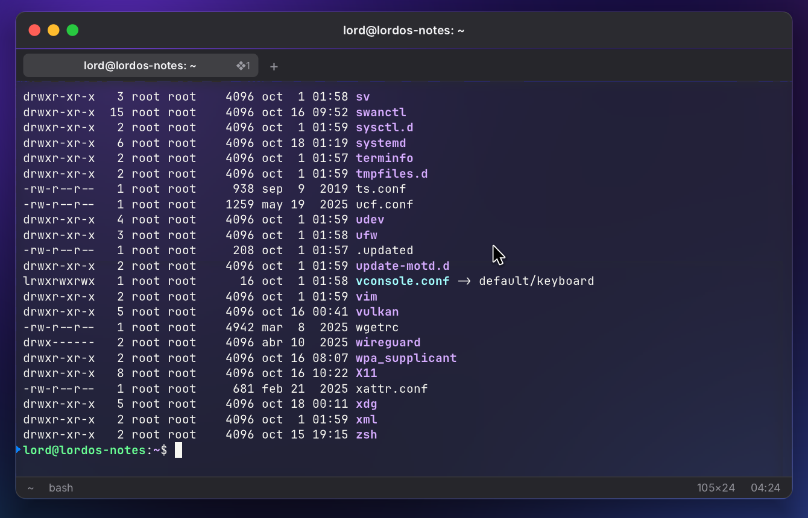 | 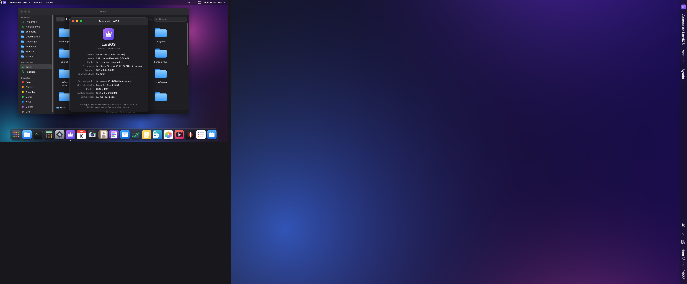 |
| The Terminal at 150 %: same 105×24 grid, glyphs rasterized at 1.5× | Per-display rotation: the second display at 90° (portrait, 150 %) |
| 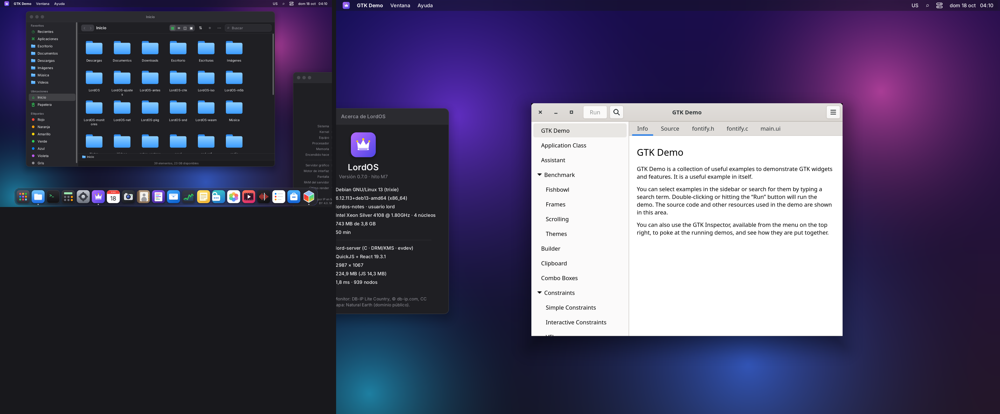 | 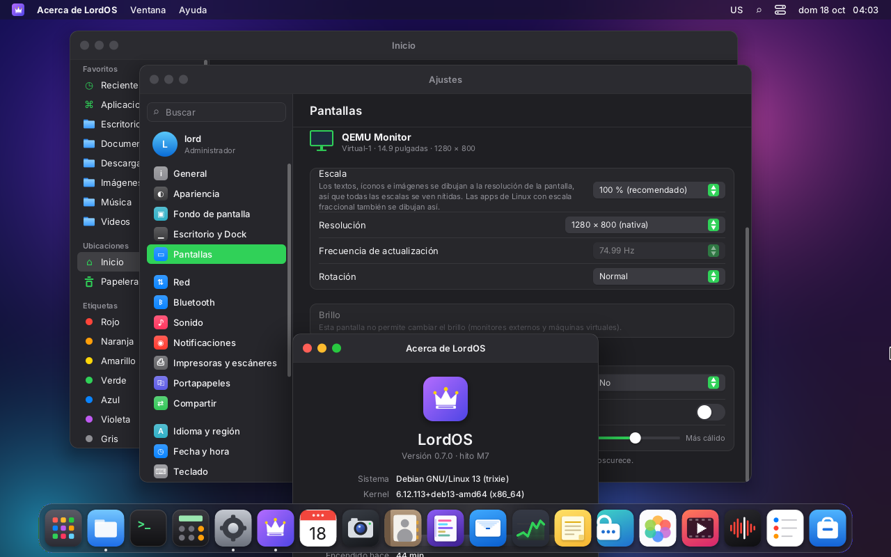 |
| GPU path (llvmpipe, `LORD_GPU=1`): two EGL surfaces on one context, GTK at 150 % | The second display unplugged: its window came back to the main one |
| 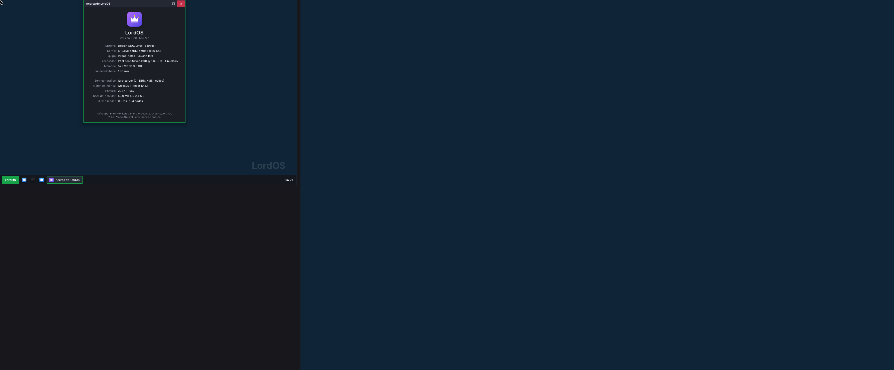 | |
| The Classic theme: its bar on the main display, the second one is all work area | |

The cursor plane is not in `screendump`; on the CPU path the cursor is drawn into the frame and
shows in the captures.

## The model

- **One logical space.** Layout, styles, the pointer, window frames, `getLayout`, hit testing and
  Wayland surface coordinates are in **logical px**. Every display shows a rectangle of that space
  (`x, y, w, h`) at its scale `k` (physical px per logical px). Its logical size is its mode
  (after rotation) divided by `k`: a 2560×1600 display at 150 % is 1707×1067 logical.
- **The arrangement** is saved by EDID identity, relative to the main display's top-left corner,
  and normalized so the space starts at (0, 0) (`ui.width × ui.height` is its bounding box; the
  theme's root covers it). Two monitors with the same EDID identity (no serial, or two virtual
  heads) get the connector appended (`RHT-1234-QEMU_Monitor@Virtual-2`).
- **Mirror**: every display shows the main display's logical rect, each one fitted at its own
  scale (`k = min(pw / w, ph / h)`) and centered (letterbox). Each is rendered, not copied, so a
  bigger mirror is sharp.
- The **main display** gets the menu bar and the Dock; with "Show menu bar on all displays" the
  menu bar is drawn on each one. The work area is per display.

The math is in `server/src/outputs.c` (pure functions, `build/outputs-test`, 119 checks): scale
rounding and the recommended scale, logical ↔ physical, damage rectangles, mirrored views,
snapping, fixing overlaps after a change, normalizing, the pointer across displays and the
display with most of a window.

## How it is drawn

```
 layout (once, logical) ─ paint_damage (once, logical damage)
        │
        ├─ display 0 (its flip done?) ── paint_out: damage → physical rect, paint_root with
        │                                  paint_view {x, y, k, dx, dy} into its own frame
        ├─ display 1 …                    (a display whose flip is pending keeps the damage)
        └─ capture view (only for "all displays" in remote desktop / recording)
```

- **`paint_view`** (`ui/paint.c`): every coordinate, radius, border width, shadow offset and
  blur, backdrop blur, padding and font size goes through `(logical − origin) · k`. Text is
  rasterized at `font_size · k`; line breaks and glyph positions come from the logical metrics
  (`text_paint_scale`, in `text.c` and `textlayout.c`), so text wraps exactly where layout
  measured it. Images are drawn from their source pixels into the physical box (a high-resolution
  icon is sharp at 200 %).
- **The Terminal** keeps its rows and columns from the logical cell; a scaled display draws its
  glyphs at `font_size · k` and places each cell at `round(col · cw · k)`, so rows land where
  the logical damage and the mouse expect them (`term/term_paint.c`, `COLX`/`ROWY`).
- **Per-display frames and flips.** Each display has its frame (`Out.scene`, physical size), its
  dumb buffers or GBM surface, its page flips (events routed by CRTC in `kms_dispatch_heads`) and
  its own vblank pacing: a frame is painted for a display only when its previous flip is done;
  until then its damage accumulates (`Out.pend`). Wayland frame callbacks and `wp_presentation`
  follow the main display.
- **CPU path, presenting**: unchanged per display — each KMS buffer gets only what changed since
  it was last drawn into (`stale`/`curs`), plus the cursor at that display's scale
  (`cursor_image_pct`: the vector shapes rasterized at 32 px × k).
- **GPU path**: one EGL context, one GBM/EGL window surface and one UI texture per display
  (`gpu_add_output`); app textures (shm and dmabuf) are shared and drawn per display at its scale
  (`wl_gpu_draw_layer` converts with `paint_view`). Direct scanout only with one display. The
  hardware cursor goes on the plane of the display under the pointer; the others hide theirs.
- **Rotation** is per display (the frame is composed upright and copied rotated). A rotated
  display turns the GPU path off, as before.
- **The window-drag layer** (`docs/WINDOWS.md`) belongs to the display with most of the window:
  its layer and "what is below" are in that display's physical pixels. On the other displays the
  window is painted normally while it crosses.

## Displays come and go

- **Hotplug**: a DRM uevent queues a resync; `main.c` builds the plan (`display_plan`) between
  frames, keeps `out[0]` (it owns the card's fd), opens a head on a free CRTC for a new display
  (`kms_head_open`), modesets the ones that changed and closes the ones that left. A plan
  identical to the current one does nothing (backlight uevents).
- **Unplugging**: the theme gets the new `lord.screen.displays`; the SDK moves windows that are no
  longer on any display to the main one (centered) and keeps the others inside their display's
  work area.
- **No free CRTC** (the card drives fewer displays than are connected): the display is listed as
  connected but not active, and Settings says so.
- **Settings** changes are live with the 15 s "Keep these display settings?" countdown (mode,
  rotation, scale); arrangement, mirror, main display and capture apply and are saved at once.

## The theme and the SDK

- `lord.screen.displays`: `[{ id, name, connector, x, y, w, h, pw, ph, scale, main }]`, and
  `lord.screen.mirror`; `__lordScreen` when they change. The runtime exports `displays()`,
  `mainDisplay()`, `displayAt(x, y)`, `displayFor(rect)` and `mainBox()` (the SDK re-exports them;
  `displays` as `screenDisplays`).
- `configureWindows({ workArea })` accepts a function `display → rect` (menu bar and Dock margins
  per display); an object is still the main display's area.
- New windows (LordOS and Linux) open on the display under the pointer; maximize uses the work
  area of the display with most of the window; `wm.beginMove` passes each display's top limit, so
  a window never goes under a menu bar but can go up to the top of a display without one.
- System dialogs (permission prompts, Spotlight, clipboard, keyring, print dialog, the display
  confirmation) go on the main display (`mainBox()`); fullscreen SDK windows cover their display.
- Both themes: wallpaper per display, menu bar (default) or taskbar (classic) and Dock on the main
  display, Launchpad and Control Center on the main display (or the menu bar's display).

## Wayland

| Protocol | Version | What it does |
|---|---|---|
| `wl_output` | 4 | one global per display: geometry with the logical position, physical mode, `scale` = the scale rounded up (legacy clients render at 2 for 150 % and LordOS downscales), name (connector) and description (EDID name); updated live, removed on unplug |
| `zxdg_output_manager_v1` | 3 | logical position and size of each output |
| `wp_fractional_scale_v1` | 1 | `preferred_scale` per surface (×120): the densest display it touches |
| `wl_surface` 6 | — | `enter`/`leave` per display, `preferred_buffer_scale`; `set_buffer_scale` is honored |
| `wp_viewporter` | 1 | now also on the CPU path: crop and scale with a bilinear blit (`canvas_blit_scaled`) |

A client's buffer is drawn into its logical box at the display's resolution: 1:1 when it rendered
at exactly that size (fractional-scale clients), scaled otherwise. lord-server logs how each app
renders, once per change:

```
wayland: org.gtk.Demo4: buffer 1242x944 for 828x629 logical (1.50x; buffer_scale 1, viewport yes, fractional yes, preferred 150%)
```

A fullscreen app covers the display its window was on, at that display's logical size; menus stay
inside their parent's display.

## Capture

Settings → Displays → "Screenshots and sharing": **main display** (default) or **all displays**.

- Main display: screenshots are painted at the main display's physical resolution (sharp at
  150 %); screen recording and the remote desktop get the main display's frame, and remote pointer
  coordinates are mapped back through its view.
- All displays: a capture view of the whole logical space at 100 % is painted only while someone
  watches or records (`Out cap` in `main.c`).

## Measurements (VM 118, CPU path, 4 vCPU)

Window drag (the About window, 6 s circles at 125 events/s with a uinput tablet; lord-server's
`drag:` line). "Work" is lord-server's time per rendered frame (JS of the pointer + layout +
paint + present).

| Setup | Work per frame | Paint | Present | Frames/s |
|---|---|---|---|---|
| One display 1280×800, the build before this change | 6.38–6.51 ms | 5.60–5.74 ms | 0.32 ms | 123 |
| One display 1280×800, this build | 6.73–6.94 ms | 5.89–6.02 ms | 0.38–0.43 ms | 120–121 |
| Two displays (1280×800 + 2560×1600 at 100 %), drag on the main one | 5.72–5.83 ms | 4.90–5.01 ms | 0.35 ms | 147 renders (700 moves) |
| Drag on the 2560×1600 display at **100 %** | 3.16–3.41 ms | 2.17–2.39 ms | 0.43–0.45 ms | 126 |
| Same window on the 2560×1600 display at **150 %** | 5.09–5.13 ms | 3.93–3.95 ms | 0.70 ms | 142–144 renders |
| Window spanning 100 % + 150 % | 5.98 ms | 4.52 ms | 0.66 ms | 60 (1.5 s line drag) |
| GPU path, two displays, llvmpipe (`LORD_GPU=1`) | 28.6 ms | 3.89 ms | 23.9 ms | 33 |

- With two displays a frame is rendered each time *either* display finishes its flip, so there
  are more (cheaper) renders than pointer moves; CPU per second of dragging went from ~822 ms/s
  (one display) to ~855 ms/s (two displays), about +4 %.
- 150 % paints 2.25× the pixels of 100 % for the same window; the paint time grew ×1.7.
- One display, this build vs. before: about +0.3–0.4 ms per frame (+5 %), from the per-display
  bookkeeping (damage per display, view transform, cursor per display). The drag layer keeps its
  behavior: one layer render at the start, then only copies (`capa: 1005 pintadas` = one "below"
  build + 5 layer renders, ~720 copies).
- llvmpipe composes two displays (one of them 2560×1600) in software: on a real GPU "present" is
  close to 0. This is why the GPU path stays off by default without 3D acceleration.

Scripts (scratchpad, one per VM): `uinput-monitors-118.py` (tablet; `move`, `drag`, `line`,
`wheel`, `size`), `measure-monitors-118.sh`, `head-monitors-118.sh` (plug or unplug the second
virtual monitor: an RFB `SetDesktopSize` to QEMU's VNC server of head 1), `shot-monitors-118.sh`.

## VM 118 setup for two displays

```
qm set 118 --args "-global virtio-vga.max_outputs=2 -vnc unix:/run/lord-vm118-head1.vnc,id=head1,display=vga,head=1"
```

(Proxmox has no `vga` option for it; `args` adds the QEMU flags.) The second head starts
disconnected; a VNC client asking for a desktop size (ExtendedDesktopSize) plugs it in with that
preferred mode, and size 0×0 unplugs it — real DRM hotplug events in the guest. Screendumps per
head: `screendump file.ppm vga 1` in `qm monitor 118`.

## Not done or untested

- **Real monitors and GPUs**: tested only with virtio-gpu (two virtual heads) and llvmpipe.
  Laptop panels with EDID sizes (the recommended scale), DisplayPort MST and cards with fewer
  CRTCs than connectors are untested.
- **Mirror with one CRTC driving two connectors** (hardware cloning) is not used: each mirrored
  display has its own CRTC and frame.
- **Screenshot and recording files** were not produced on VM 118 (its build has no `lord-media`);
  the capture paths ran (the permission prompt appeared on the main display). The remote desktop
  with two displays was not tested with a browser.
- **Legacy Wayland clients at 125/150/175 %** get `scale = 2` and are downscaled (bilinear): not
  pixel-exact. Xwayland is not part of LordOS.
- Apps' own cursor images (`wl_pointer.set_cursor`) are not scaled.
- Different refresh rates: each display flips on its own vblank, but `wp_presentation` and frame
  callbacks follow the main display.
- Per-display Night Shift: the temperature is the same for all; if any display lacks a gamma LUT
  the software tint is used for all of them.
