# Dock and taskbar

In **Settings → Desktop & Dock** you choose:

- where the Dock goes (bottom, left or right);
- its size, magnification and how much it magnifies;
- whether it hides automatically;
- whether it shows recent apps;
- **Reset Dock to defaults** (the theme's apps, after a confirmation in the page).

Which apps are in the Dock, and in which order, is up to you: see "Customizing the Dock" below.

In the Lord Classic theme, the same section chooses the taskbar position: bottom, top, left or right.
Everything is applied live, without restarting, and is saved in
`~/.config/lordos/settings.json`.

| | |
|---|---|
| 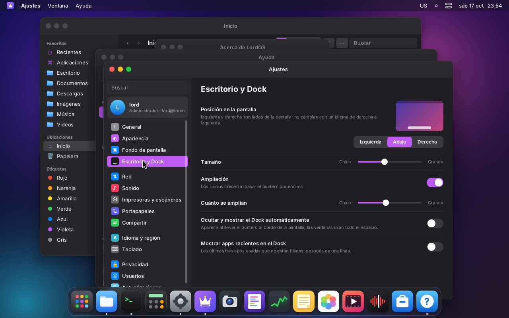 | 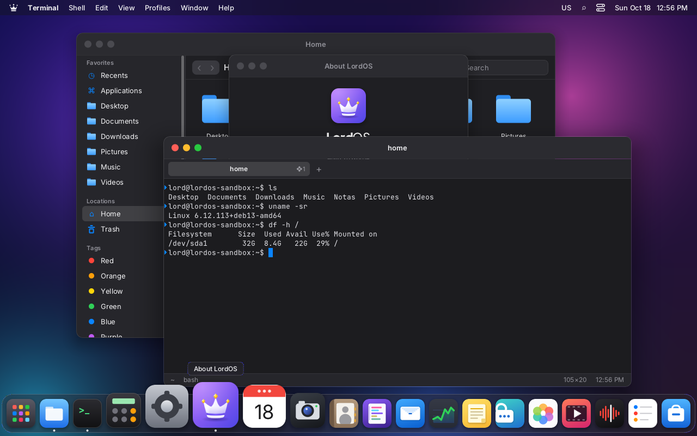 |
| Settings → Desktop & Dock | Bottom (as always), with magnification |
| 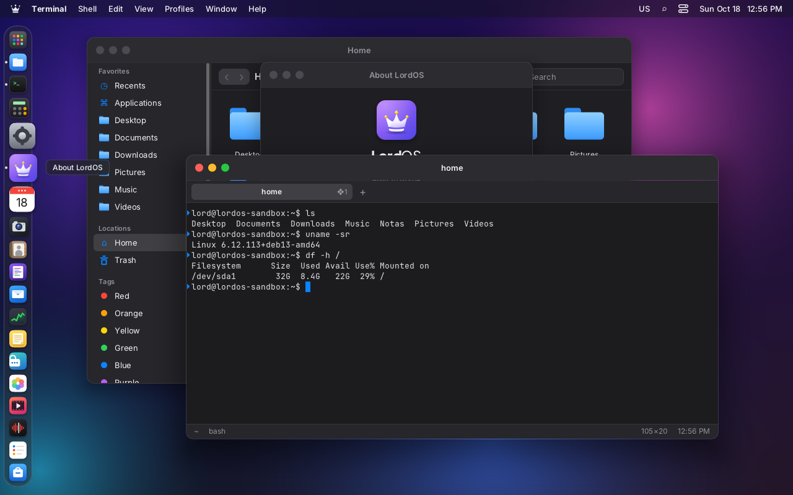 |  |
| On the left: magnification along the vertical axis, name to the side | On the right: the open-app dots go on the outer side |
| 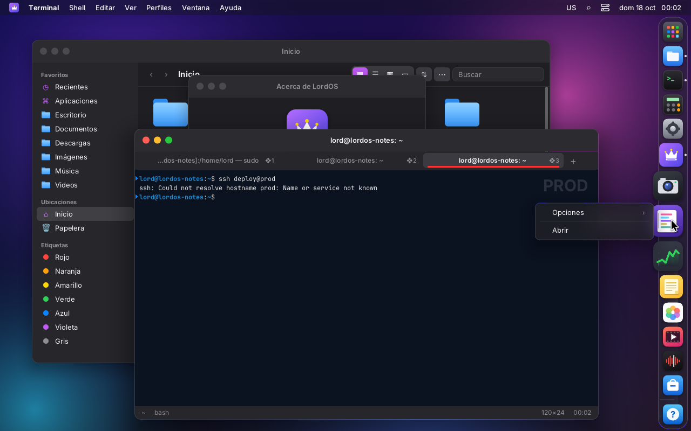 | 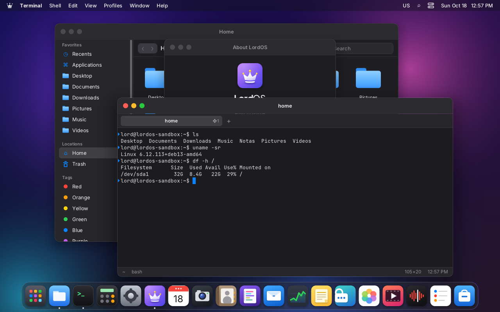 |
| Right click with the Dock on the right: the menu opens inward | Auto-hide: it appears when the pointer reaches the edge (without the Dock: [`dock-hidden.png`](dock-hidden.png)) |
| 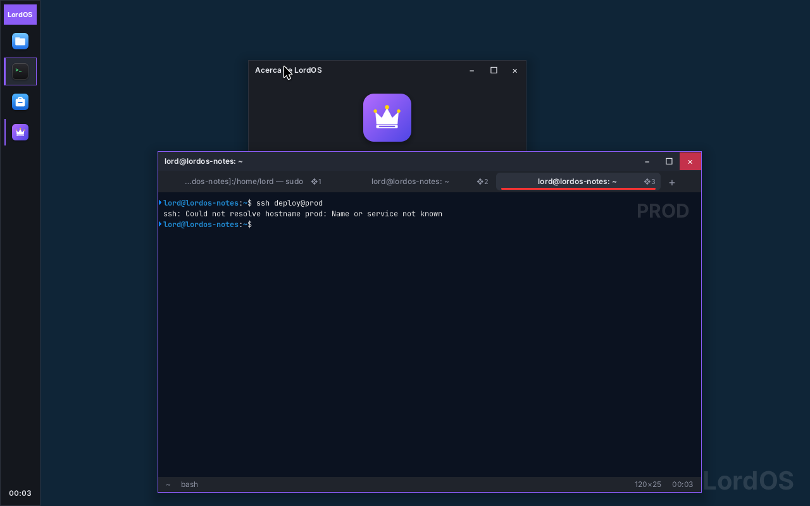 | 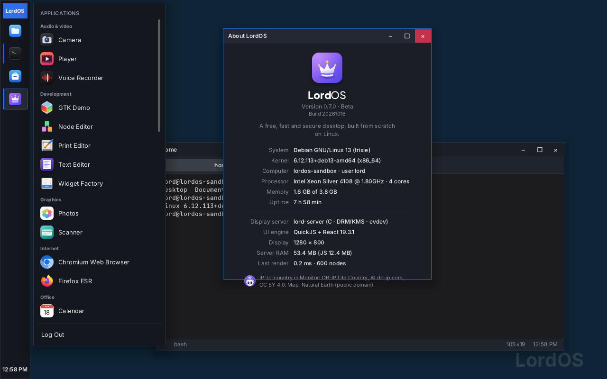 |
| Lord Classic theme with the bar on the left (only icons, and the time at the bottom) | Its start menu opens next to the bar |

## Settings (`sdk/dock.js`: `DOCK_DEFAULTS`, `dockPrefs(settings)`)

| Key | Values | Default |
|---|---|---|
| `dockPosition` | `bottom`, `left`, `right` | `bottom` |
| `dockSize` | 36–80 (px per icon) | 54 |
| `dockMagnify` | `true`/`false` | `true` |
| `dockMagnifySize` | from the size up to 128 (px of the largest icon) | 86 |
| `dockAutohide` | `true`/`false` | `false` |
| `dockRecents` | `true`/`false`: the last 3 used apps that are not pinned, after a separator line | `false` |
| `taskbarPosition` | `bottom`, `top`, `left`, `right` (Lord Classic theme) | `bottom` |
| `taskbarAlign` | `center`, `start`: where the taskbar's buttons go when it is at the bottom or top (Lord Classic theme, 0.8.3) | `center` |
| `loginApps` | Dock item ids opened when the session starts (Options › Open at Login, 0.8.5) | `[]` |
| `appDisplays` | app → display connector (`HDMI-A-1`, `DP-2`…) its new windows open on (Options › Assign To, 0.8.5) | `{}` |

The SDK records recent apps in `dockRecentApps` every time an app opens a window
(`useDockEntries(defaults, { recents: 3 })`).

## Customizing the Dock (0.8.1)

Every app can go in the Dock: LordOS apps, installed `.lpk` packages and Linux apps from their
`.desktop` files (Firefox, Chromium, GTK and Qt apps). The arrangement is saved per user in
`~/.config/lordos/settings.json` → `dockPinned`.

| | |
|---|---|
| 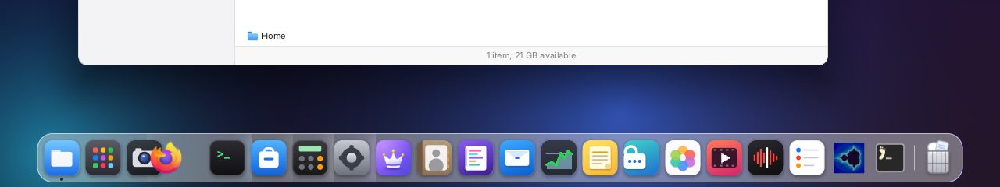 | 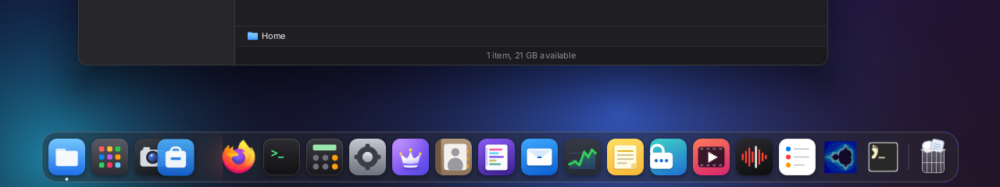 |
| Dragging Firefox: its neighbours slide aside to show where it lands | The same in dark mode |
| 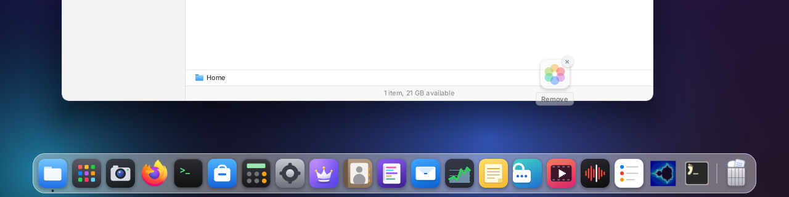 | 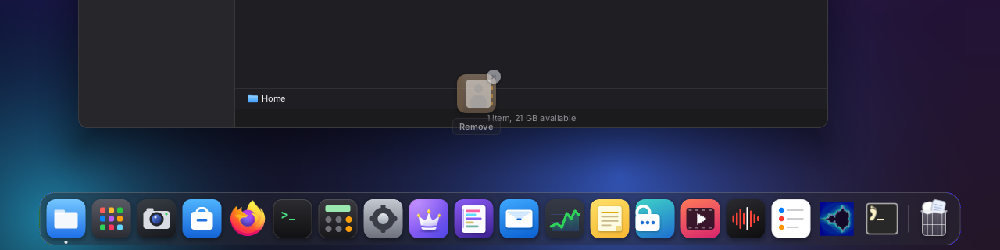 |
| Dragged out and held: the remove cue | Dark mode |
| 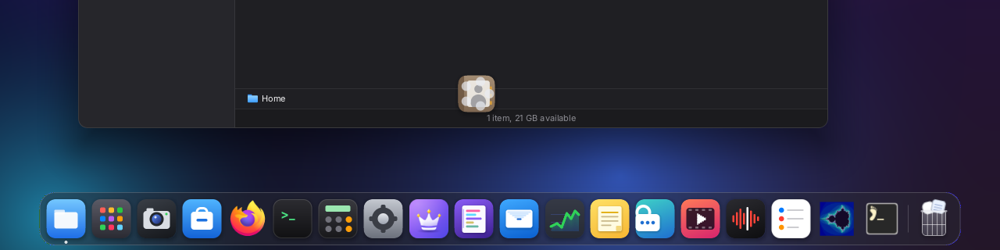 | 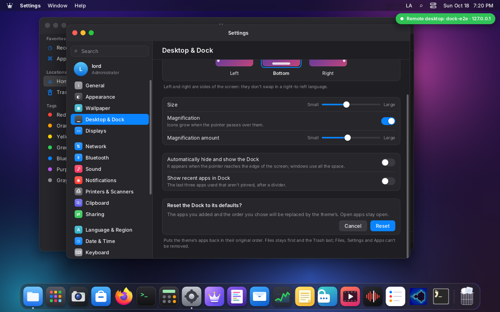 |
| Released: the «poof» | Settings → Desktop & Dock → Reset Dock to defaults, confirmed in the page |
| 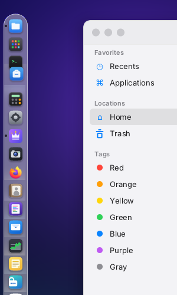 | 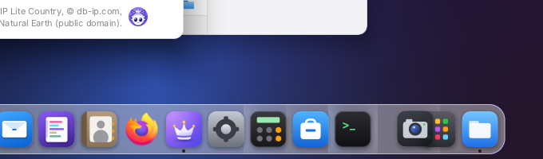 |
| Reordering with the Dock on the left | Arabic: the bottom Dock reads right to left (Files on the right, the Trash on the left) |
| 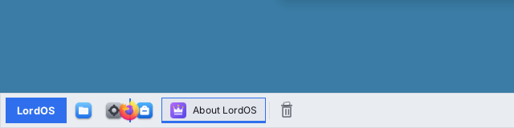 | |
| Lord Classic theme: Firefox dragged from the start menu, with the drop line | |

**Adding an app:**

- drag it from the app launcher onto the Dock: the launcher steps aside as soon as the drag starts,
  and the app lands exactly where it is dropped (the neighbours open a gap);
- right click in the app launcher → **Keep in Dock**;
- right click on a running app's icon → **Options › Keep in Dock**. A running Linux app is pinned
  through its `.desktop` id (the same match that groups its windows, `sdk/wayland.js`); a window
  with no `.desktop` can't be pinned;
- drag a running app's icon into the pinned part of the Dock.

**Reordering:** drag an icon along the Dock. Neighbours slide aside in 150 ms (instantly with
Settings → Appearance → Reduce motion). A drag starts after 6 px, so a click never moves anything,
and the click that ends a drag doesn't open the app. It works at the bottom, left and right, in
right-to-left languages, with magnification on (it pauses while dragging) and with a touchpad or a
touchscreen (they drive the same pointer). Escape cancels a drag.

**Removing:** drag the icon more than about 60 px away from the Dock and hold it there for a moment
(350 ms): the icon dims and shows «Remove». Releasing it then removes it with a short «poof»;
releasing before that, or back near the Dock, puts it back. Dropping it on the Trash, or right click
→ **Options › Remove from Dock**, does the same. A running app that is removed stays in the Dock as
an unpinned running item until it quits.

### Rules

- **Files** is always the first item: it can't be moved or removed.
- **The Trash** is always the last item, after a separator: it can't be moved or removed.
- **Settings** and the **app launcher** can't be removed (no «Remove from Dock»; dragging them out
  or onto the Trash puts them back) but move freely between Files and the Trash.
- Every other app is added, moved and removed freely.
- Nothing lands before Files or after the Trash: a drop there goes right after Files or right
  before the Trash. «First» and «last» follow the Dock's reading order (a bottom Dock is mirrored in
  right-to-left languages; on the sides it reads top to bottom).
- **Reset Dock to defaults** keeps these rules. An older settings file that lacks Files, Settings or
  the launcher gets them back on load.

### Data model (`sdk/dockmodel.js`, `sdk/dock.js`)

`dockPinned` holds **typed ids**, so the three kinds can never collide:

| Id | What | Opened with |
|---|---|---|
| `app:<id>` | a LordOS app bundled with the theme | `wm.open` (`launchApp`) |
| `lpk:<id>` | an installed `.lpk` package | `lord.apps.launchPackage(id)` |
| `desktop:<desktop id>` | a Linux app's `.desktop` | `lord.apps.launch(id)` |
| `shell:launcher` | the theme's app launcher | the theme |

Only these existing paths open a Dock item (`launchDockItem`): no new way to run anything, no
commands, no paths. Ids are validated with the server's rules (`lpk_valid_id`, `valid_id` in
`apps.c`). On load, lists written before 0.8.1 (untyped ids such as `"files"`) are migrated
(`lpk:` if a package with that id is installed, `app:` otherwise); malformed ids and windows without
a `.desktop` (`linux:…`) are dropped. An uninstalled app keeps its place hidden and comes back if it
is reinstalled; nothing broken is shown.

```js
dock.pin(id, index)     // index: position among the items the Dock shows (Files is 0)
dock.move(id, index)
dock.unpin(id)          // refused for Files, Settings and the launcher
dock.reset()            // the theme's defaults (dockPinned: null)
dock.isPinned(id) · dock.canRemove(id) · dock.canMove(id)
```

The methods take a typed id or a plain launcher id. Both themes use the same calls and the same
drag logic (`beginDockDrag`, `registerDockTarget`, `dockDrag`, `dockPoof`): the Dock draws the gap
and the poof; the Lord Classic taskbar draws a drop line, unpins with the same drag-out-and-hold, pins
from the start menu (drag, or right click → Pin to taskbar) and keeps its Start button fixed (the
launcher item isn't shown there). The model is tested by `server/tests/dock_model_test.mjs` (in
`make test` when node is installed).

## The Dock's menu: quick actions

| | |
|---|---|
| 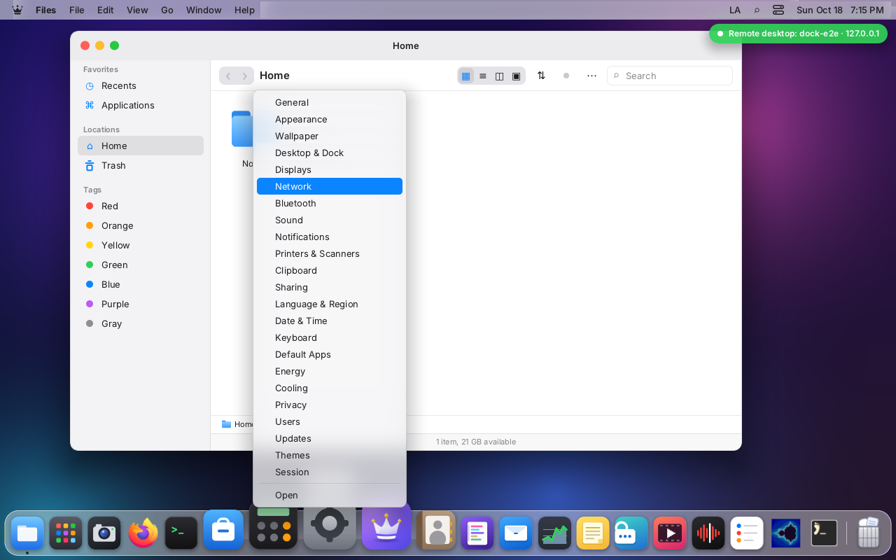 | 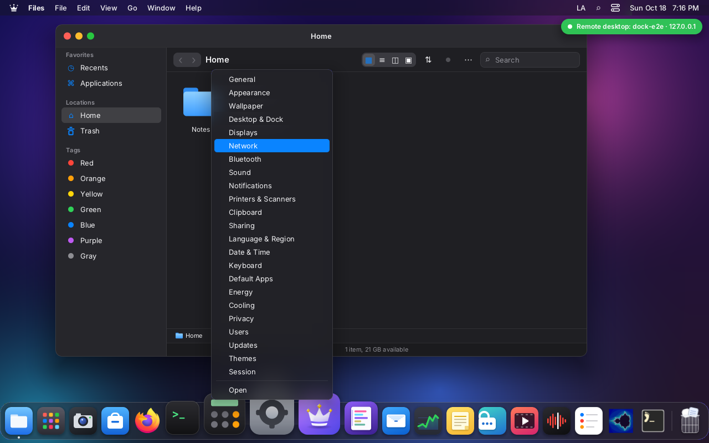 |
| Right click on Settings: every section, in the sidebar's order (here moved with the keyboard) | Dark mode |
| 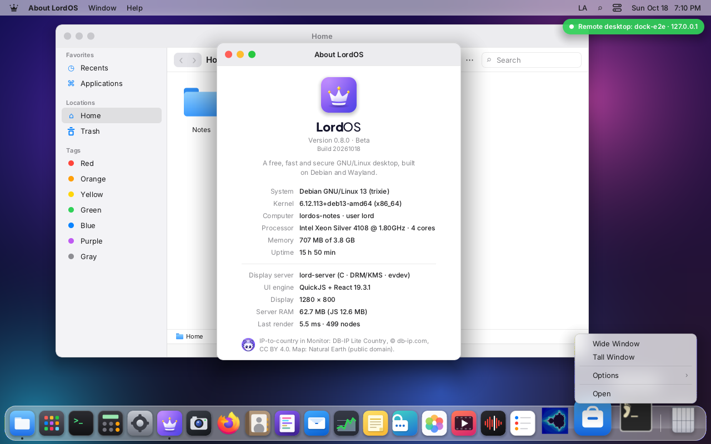 | |
| A Linux app's desktop actions (`Actions=` in its `.desktop`) | |

From the top: the app's **quick actions**, its windows (when it runs), the app's own items
(`registerDockMenu`, e.g. the Terminal's New Window and New Tab) or New Window, **Options ›**
(Keep in Dock / Remove from Dock; Show in Files for a `.lpk` and for the user's own `.desktop`
files; Open at Login and, with more than one display, Assign To, see below), then Show All Windows, Hide and Quit, or Open. The menu follows `DESIGN.md`'s look, is
keyboard navigable (↑ ↓ Home End, Enter or Space, → opens a submenu and ← closes it, Escape) and
scrolls when it is taller than the screen.

**Open at Login and Assign To (0.8.5).** Options › **Open at Login** (every item except the
shell's own) adds the item to `settings.loginApps`; once per session, about 3 s after it starts, each
one is opened through `launchDockItem`, the same paths as a Dock click (never in the live system's
first run, in the sign-in screen or in an isolated app's process; an uninstalled one is skipped).
With more than one display, Options › **Assign To** lists them ("None" follows the pointer): the
app's new windows open on that display, kept in `settings.appDisplays` by the display's connector
(`sdk/dock.js`, `assignedDisplay`; see `DISPLAYS.md`, "Assigning an app to a display").

Quick actions are generic. An app declares them in its manifest or from its module:

```js
// manifest.json: "dockActions": [{ "id": "new", "label": "myapp.newThing", "args": { "mode": "new" } }]
registerDockActions('settings', () => [{ id: 'network', label: 'settings.section.network', args: { section: 'network' } }]);
```

`label` is an i18n key; `args` (strings, numbers, booleans) reach the app as `useAppWindow().args`
(plus `action`), the app opening or coming to the front; `new: true` opens another window. Today:
Settings (one per section, built from its own section list so it never drifts), Files (Home,
Downloads, Documents, Trash), Mail (New Message), Monitor (Network, Cooling); the Terminal keeps its
own New Window and New Tab. A `.lpk` app gets none (it starts with `launchPackage(id)` and no
arguments). A Linux app shows its `.desktop`'s desktop actions, run through the same launcher (see
`WAYLAND.md`, "Desktop actions").

## The Trash

| | |
|---|---|
| 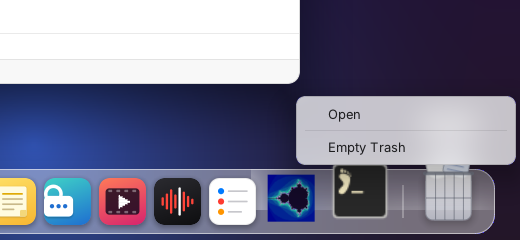 | 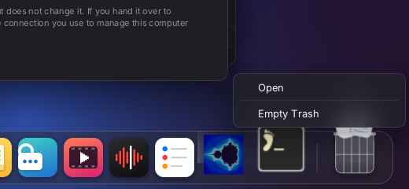 |
| The Trash, full, and its menu | Dark mode |
| 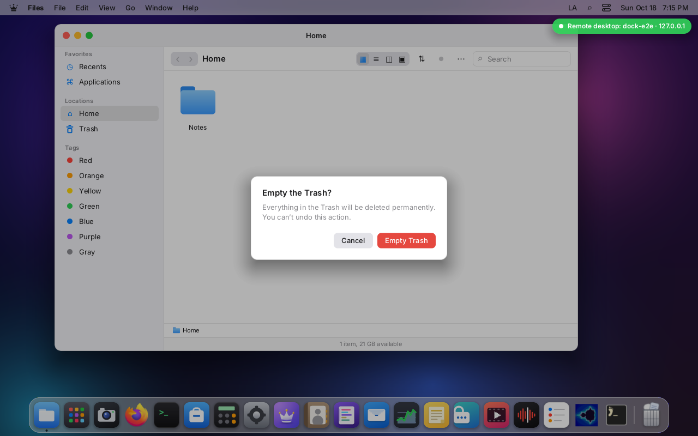 | 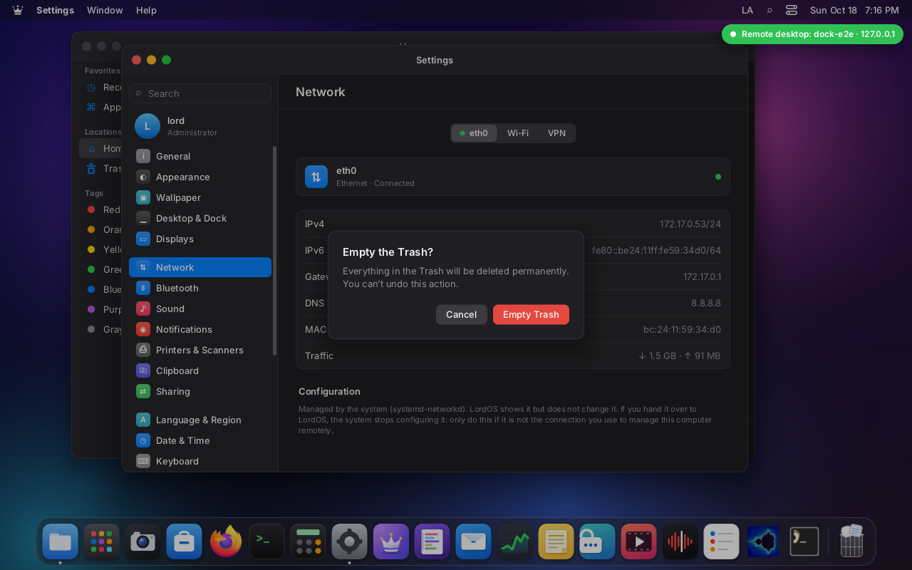 |
| Empty Trash asks first, in the desktop (never `alert()`) | Dark mode |

- Always the last item, after a separator; empty or full (papers in the basket), light and dark.
  The state comes from a `stat` of `~/.local/share/Trash/files` every 2 s while the Dock shows it,
  and the full list only when that changed or every 30 s (disks' trashes too): no busy loop.
- **Click:** opens Files on the Trash (`args.place = 'trash'`).
- **Drop files from Files on it:** they go to the Trash through Files' own `fs.trash` (the node
  carries `dropTrash`), with the same rules: the home and the user's mounts only.
- **Drop a Dock icon on it:** removes it from the Dock (not Files, Settings or the launcher).
- **Right click:** Open, and Empty Trash, which asks for confirmation and says that deleting is
  permanent and can't be undone.
- **Drives:** dropping a removable drive to eject it isn't supported: Files has no draggable drive
  items, so there is nothing to drop; eject stays in Files and Disks.
- **Lord Classic theme:** the Trash is the last button of the taskbar, with the same click, drop, menu
  and confirmation.

## Work area

Each theme calls `configureWindows({ apps, workArea })` again when the position, the size,
"auto-hide" or the screen changes. The area leaves out the side taken by the Dock or the bar. That way:

- maximized and new windows don't end up underneath it;
- notifications (`NotificationBanner`) adjust on their own.

With "auto-hide" the area is the whole screen minus the menu bar. Windows that were
already open don't move.

If there are many apps, the icons shrink so the Dock fits on the screen, counting how much it grows
with magnification.

## Auto-hide, at no cost

The Dock is not drawn while it is hidden. A pointer listener (`useAutohide` in
`themes/default/components/Dock.jsx`) only checks whether the pointer touched the edge of the chosen side:

1. when it does, it waits 120 ms and shows the Dock with a 180 ms animation;
2. if the pointer leaves the Dock (with an 8 px margin), it waits 500 ms and hides it;
3. with the right-click menu open or the pointer over an icon, it stays.

The state only changes when crossing those limits. Moving the mouse over the rest of the screen
doesn't redraw anything, and the animation redraws only the Dock, not the desktop. Magnification
already worked this way: its state belongs to the Dock component.

## Above and below

The Dock is in the `dock` layer: above the windows and under the menu bar. Its own menus are in
`popover` (above the windows and the menu bar), its name tooltip in `tooltip` (hidden while the
icon's menu is open) and the dragged icon and the «poof» in `drag`. Every other menu, popover and
the Control Center are above it whatever its side, auto-hide or magnification. See `LAYERS.md`.

## Right to left (Arabic, Hebrew)

**Left and right are physical sides of the screen**, as on popular desktop systems: with an RTL language a Dock on the
left stays on the left.

- The Dock is laid out with `direction: 'ltr'`.
- At the bottom, the icon order is reversed in RTL, as before.
- On the sides, the order is always top to bottom.
- The Dock's menus open toward the inside of the screen with `side` (in `Menu.jsx`), without the
  flip that other menus do in RTL.
- In the Lord Classic theme the bar is also physical; the start menu and the jump list stick to the
  side of the bar.

Settings says so below "Position on screen".

## Pending

- A genie minimize effect: the Lord Flow theme's is a scale towards the Dock (`useMinimizing` in
  `themes/default/index.jsx`, `transform: scale` from a cached raster; `DESIGN.md`).
- Auto-hide for the Lord Classic theme's bar.
- Dragging the Dock to another edge with the mouse (⇧ on the separator).
- Quick actions for `.lpk` apps (they would need to reach the isolated process through the broker).
- Ejecting a drive by dropping it on the Trash (Files has no draggable drive items yet).
- The Lord Classic taskbar shows a drop line, without the Dock's sliding neighbours.
