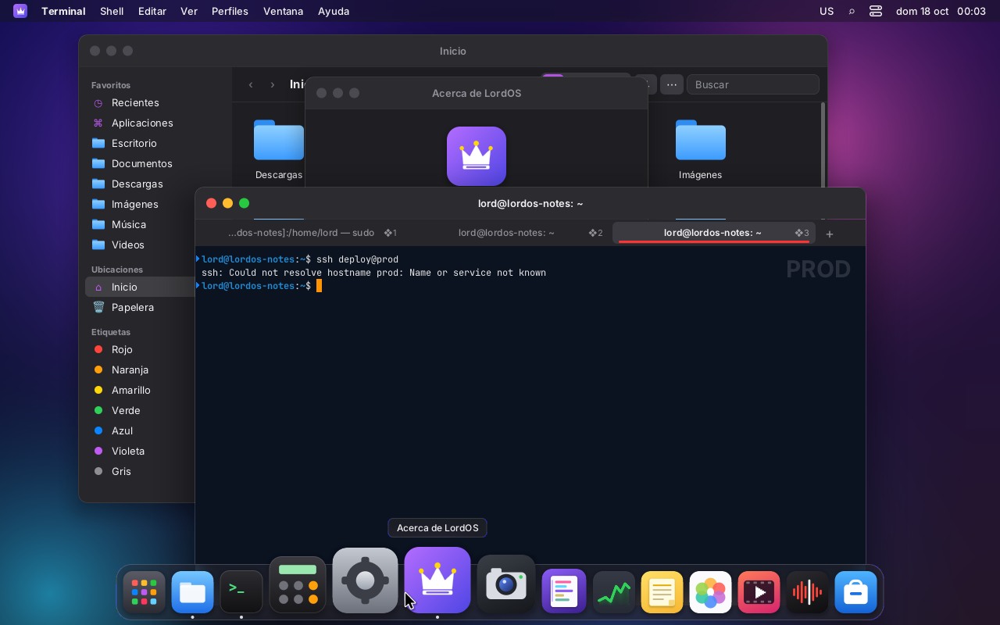
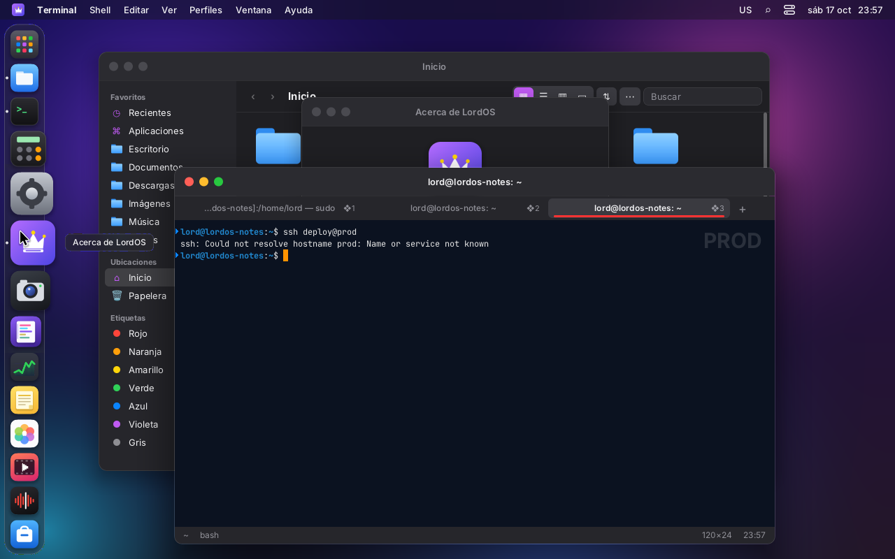
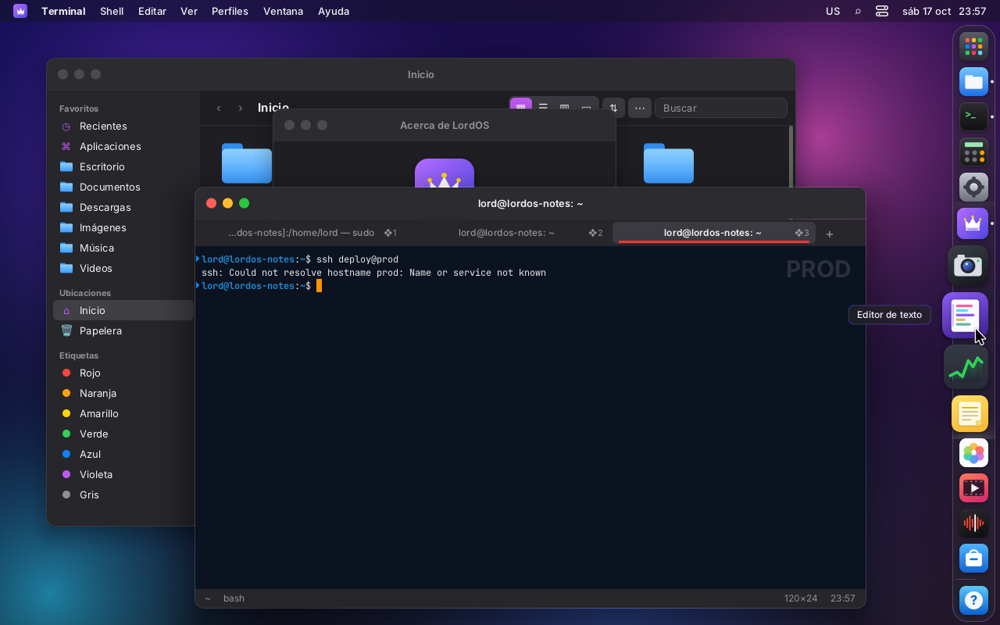
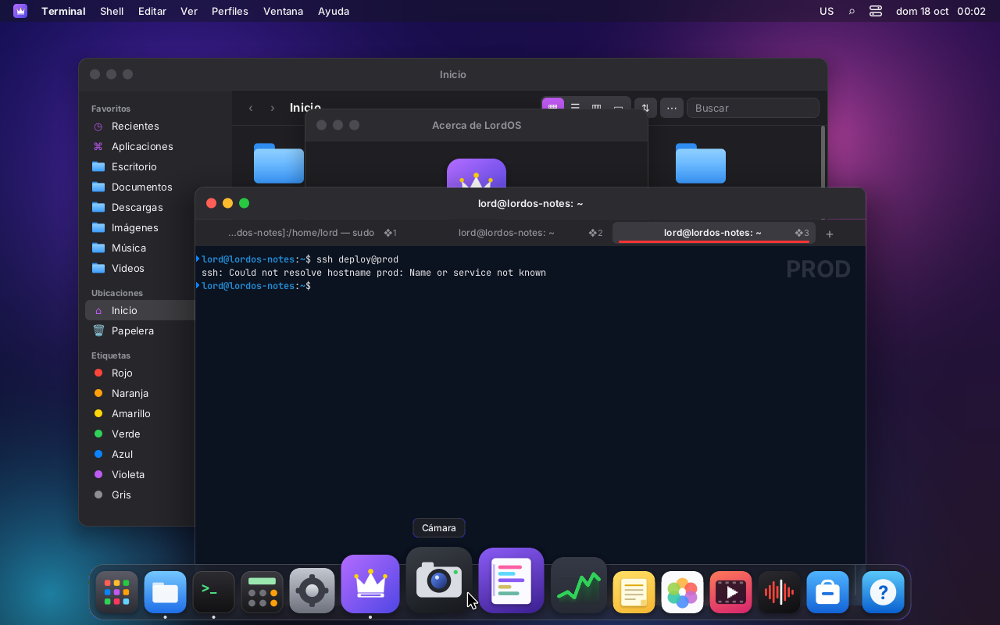
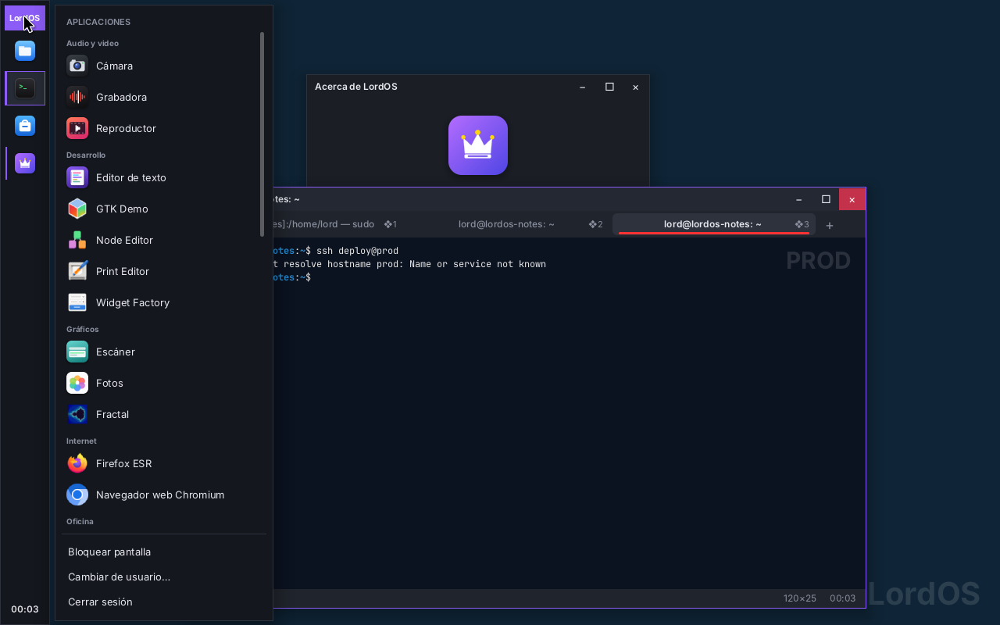

# Dock and taskbar

In **Settings → Desktop & Dock** you choose, as in macOS:

- where the Dock goes (bottom, left or right);
- its size, magnification and how much it magnifies;
- whether it hides automatically;
- whether it shows recent apps.

In the Classic theme, the same section chooses the taskbar position: bottom, top, left or right.
Everything is applied live, without restarting, and is saved in
`~/.config/lordos/settings.json`.

| | |
|---|---|
|  |  |
| Settings → Desktop & Dock | Bottom (as always), with magnification |
|  |  |
| On the left: magnification along the vertical axis, name to the side | On the right: the open-app dots go on the outer side |
|  |  |
| Right click with the Dock on the right: the menu opens inward | Auto-hide: it appears when the pointer reaches the edge (without the Dock: [`dock-oculto.png`](dock-oculto.png)) |
|  |  |
| Classic theme with the bar on the left (only icons, and the time at the bottom) | Its start menu opens next to the bar |

## Settings (`sdk/dock.js`: `DOCK_DEFAULTS`, `dockPrefs(settings)`)

| Key | Values | Default |
|---|---|---|
| `dockPosition` | `bottom`, `left`, `right` | `bottom` |
| `dockSize` | 36–80 (px per icon) | 54 |
| `dockMagnify` | `true`/`false` | `true` |
| `dockMagnifySize` | from the size up to 128 (px of the largest icon) | 86 |
| `dockAutohide` | `true`/`false` | `false` |
| `dockRecents` | `true`/`false`: the last 3 used apps that are not pinned, after a separator line | `false` |
| `taskbarPosition` | `bottom`, `top`, `left`, `right` (Classic theme) | `bottom` |

The SDK records recent apps in `dockRecentApps` every time an app opens a window
(`useDockEntries(fijadas, { recents: 3 })`).

## Work area

Each theme calls `configureWindows({ apps, workArea })` again when the position, the size,
"auto-hide" or the screen changes. The area leaves out the side taken by the Dock or the bar. That way:

- maximized and new windows don't end up underneath it;
- notifications (`NotificationBanner`) adjust on their own.

With "auto-hide" the area is the whole screen minus the menu bar, as in macOS. Windows that were
already open don't move.

If there are many apps, the icons shrink so the Dock fits on the screen, counting how much it grows
with magnification.

## Auto-hide, at no cost

The Dock is not drawn while it is hidden. A pointer listener (`useAutohide` in
`themes/default/components/Dock.jsx`) only checks whether the pointer touched the edge of the chosen side:

1. when it does, it waits 120 ms and shows the Dock with a 180 ms animation;
2. if the pointer leaves the Dock (with an 8 px margin), it waits 500 ms and hides it;
3. with the right-click menu open or the pointer over an icon, it stays.

The state only changes when crossing those limits. Moving the mouse over the rest of the screen
doesn't redraw anything, and the animation redraws only the Dock, not the desktop. Magnification
already worked this way: its state belongs to the Dock component.

## Right to left (Arabic, Hebrew)

**Left and right are physical sides of the screen**, as in macOS: with an RTL language a Dock on the
left stays on the left.

- The Dock is laid out with `direction: 'ltr'`.
- At the bottom, the icon order is reversed in RTL, as before.
- On the sides, the order is always top to bottom.
- The Dock's menus open toward the inside of the screen with `side` (in `Menu.jsx`), without the
  flip that other menus do in RTL.
- In the Classic theme the bar is also physical; the start menu and the jump list stick to the
  side of the bar.

Settings says so below "Position on screen".

## Pending

- Minimize effect (genie or scale): the engine doesn't have `transform: scale` yet.
- Auto-hide for the Classic theme's bar.
- Dragging the Dock to another edge with the mouse, like macOS with ⇧ on the separator.
