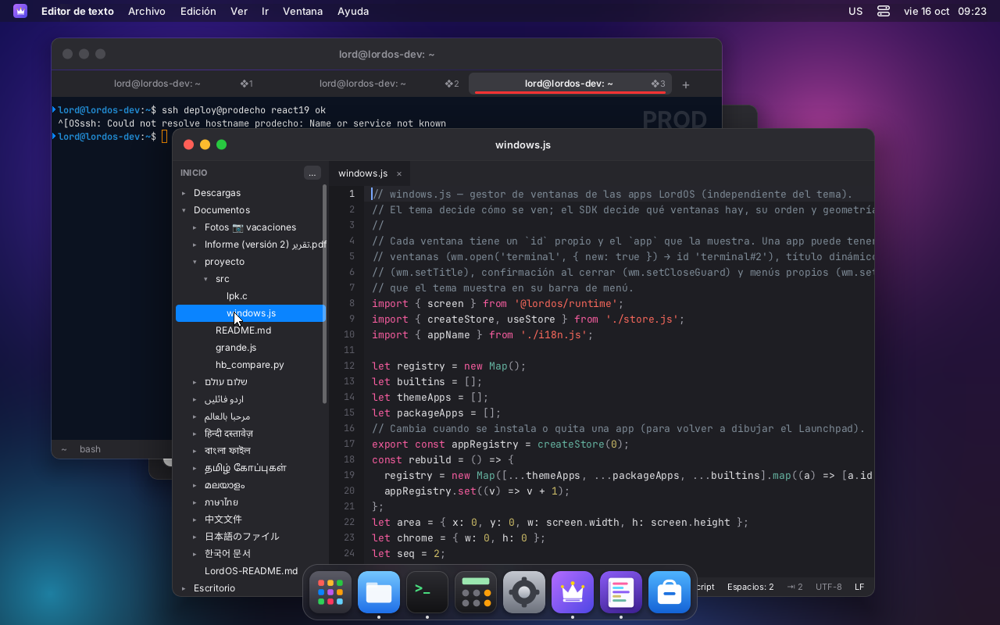
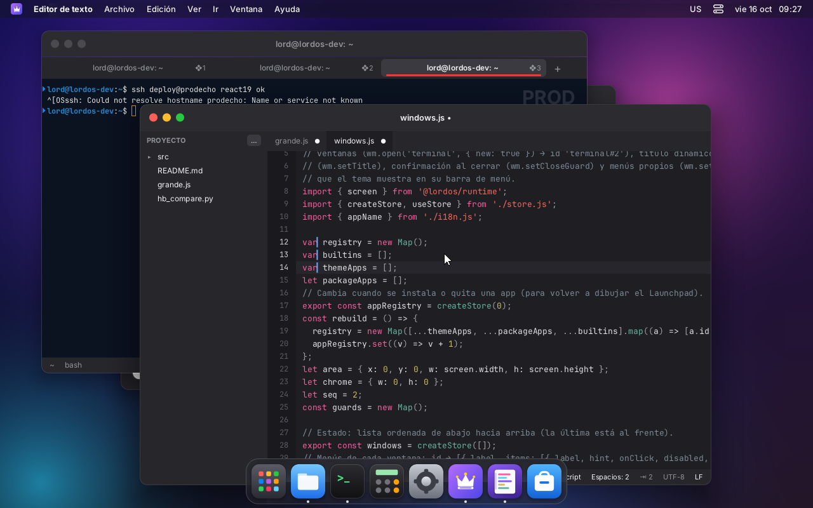
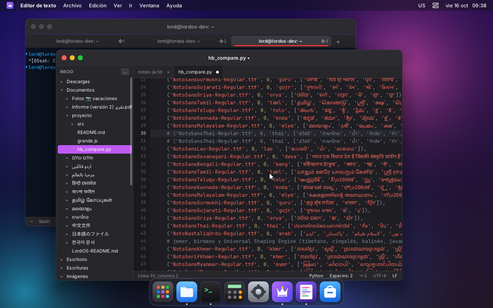
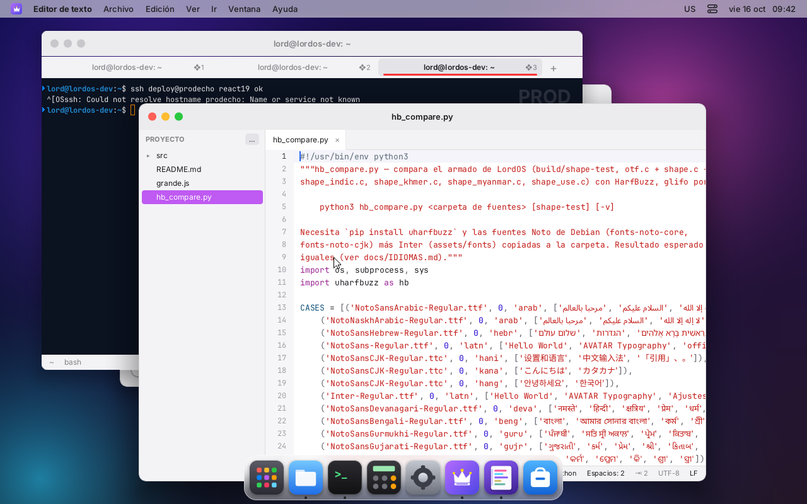
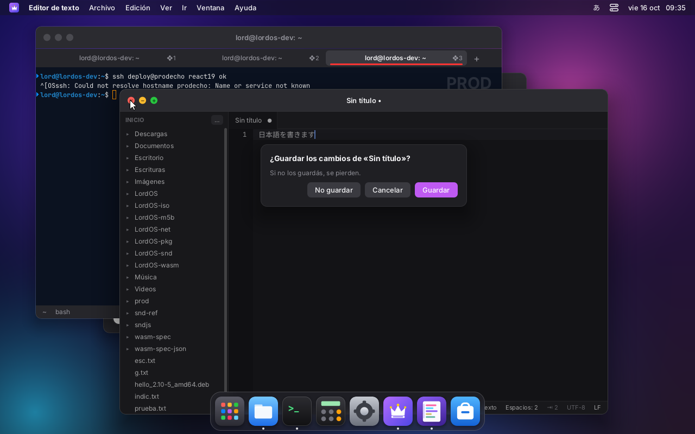
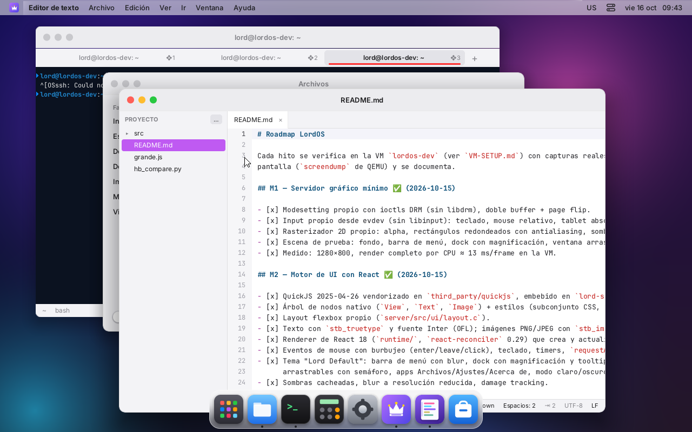

# Editor de texto

Editor de código propio, al estilo de TextMate (`apps/editor`). Es una app nativa de LordOS en
React sobre el SDK: no usa CodeMirror ni Monaco, ni gramáticas de TextMate vendorizadas.

| | |
|---|---|
|  |  |
| Proyecto a la izquierda, pestañas y resaltado (JavaScript) | Archivo de 10.001 líneas, al final y editando |
|  |  |
| Tres cursores con ❖D: «let» → «var» en las tres líneas a la vez | Buscar y reemplazar todo (con mayúsculas), «3 reemplazos» |
|  |  |
| ❖T: abrir un archivo del proyecto por letras en orden («wjs» → windows.js) | Japonés con el método de entrada de LordOS: 日本語を書きます |
|  |  |
| Python: comentar, duplicar y mover línea; las escrituras índicas van con el respaldo de fuentes | Modo claro (paleta tipo Xcode) |
|  |  |
| Cerrar con cambios sin guardar | Doble clic en Archivos: lo abre el editor, con la carpeta como proyecto |

## Qué tiene

- **Ventana:**
  - el proyecto a la izquierda: árbol de la carpeta (por defecto la carpeta personal, o la del
    primer archivo que se abre); se elige otra con «…» o ❖⇧O; ❖\ lo oculta;
  - pestañas con un punto cuando hay cambios sin guardar;
  - la barra de estado: línea y columna, cantidad de cursores y de caracteres seleccionados, el
    lenguaje (se cambia con un clic), espacios o tabs (clic para alternar) y el ancho (2, 4 u 8),
    UTF-8 y fin de línea LF o CRLF (clic para alternar).
- **Edición:**
  - Enter mantiene la sangría y la agrega después de `{ [ ( :`; entre `{}` deja la llave de
    cierre en su propia línea;
  - Tab y ⇧Tab: sangran o desangran las líneas seleccionadas;
  - borrar en una sangría de espacios va hasta la tabulación anterior;
  - pares automáticos `() [] {} "" '' ```; al escribir el cierre, lo saltea; con una selección,
    la envuelve;
  - deshacer y rehacer agrupados por palabra, como TextMate; deshacer hasta lo guardado deja la
    pestaña sin el punto.
- **Varios cursores:** ⌥clic agrega uno; ❖D o Ctrl+D selecciona la palabra y después la próxima
  aparición igual, cada una con su cursor; Esc vuelve a uno; ⌥arrastre selecciona por columnas.
  Copiar y pegar con varios cursores reparte una línea por cursor.
- **Buscar y reemplazar** (❖F): texto o regex (`.*`), mayúsculas sí o no (`Aa`), cantidad y
  posición («2 de 7»), siguiente o anterior (Enter, ⇧Enter, ❖G, ❖⇧G), reemplazar y reemplazar
  todo (un solo paso de deshacer). Con regex, el reemplazo entiende `$1`.
- **Saltos:** ❖L ir a línea (`120` o `120:8`); ❖T abrir un archivo del proyecto por letras en
  orden, como en TextMate (con ↑ y ↓ se elige).
- **Archivos:** ❖N nuevo, ❖O abrir (diálogo propio), ❖S guardar, ❖⇧S guardar como, ❖W cerrar
  pestaña. Desde Archivos, el doble clic en un archivo que no sea imagen, sonido, video ni
  comprimido lo abre acá (`wm.open('editor', { args: { path } })`). Al cerrar la ventana o una
  pestaña con cambios, pregunta. Rechaza archivos binarios y de más de 8 MB.
- **Menús de la app** (en la barra del tema): Archivo, Edición, Ver e Ir, con sus atajos.
- **Métodos de entrada:** el editor se registra con `ime.attach`, así que japonés, chino y
  coreano escriben en el cursor (la composición y los candidatos aparecen ahí).
- **Ícono propio:** una hoja con líneas de código de colores.

## Atajos

❖ es la tecla Super; casi todos funcionan también con Ctrl.

| Atajo | Qué hace |
|---|---|
| ❖N / ❖O / ❖⇧O | nuevo, abrir archivo, abrir carpeta como proyecto |
| ❖S / ❖⇧S / ❖W | guardar, guardar como, cerrar pestaña |
| ❖Z / ❖⇧Z (Ctrl+Y) | deshacer, rehacer |
| ❖X / ❖C / Ctrl+V | cortar, copiar, pegar (sin selección: la línea entera) |
| ❖A / ❖⇧L | seleccionar todo, seleccionar línea |
| ❖D / ⌥clic / Esc | próxima aparición con otro cursor, agregar cursor, un solo cursor |
| ❖/ | comentar o descomentar (según el lenguaje: `//`, `#`, `--`, `<!-- -->`…) |
| ❖⇧D | duplicar línea |
| ⌥↑ / ⌥↓ | mover línea |
| ❖] / ❖[ · Tab / ⇧Tab | sangrar, desangrar |
| Ctrl+← / Ctrl+→ (también ⌥) | palabra anterior o siguiente (con ⇧, selecciona) |
| Inicio / Fin | comienzo del texto de la línea (otra vez: columna 0), fin de línea |
| Ctrl+Inicio / Ctrl+Fin, ❖↑ / ❖↓ | comienzo o fin del archivo |
| RePág / AvPág | una pantalla |
| ❖F / ❖G / ❖⇧G | buscar y reemplazar, siguiente, anterior |
| ❖L / ❖T | ir a línea, ir a un archivo del proyecto |
| ❖\ | mostrar u ocultar el proyecto |
| Ctrl+Tab / Ctrl+⇧Tab | pestaña siguiente o anterior |

Mouse: clic ubica el cursor, arrastrar selecciona, doble clic selecciona la palabra (y arrastrar
sigue por palabras), triple clic la línea, ⇧clic extiende, la rueda desplaza (con ⇧, de costado).

## Resaltado

Es un tokenizador propio por estados (`apps/editor/syntax.js`):
- cada lenguaje es una lista de reglas `[regex, tipo, siguiente estado]`;
- se tokeniza línea por línea, y el estado al final de una línea (dentro de un comentario
  `/* */`, de un `"""` de Python o de un template de JS) pasa a la siguiente;
- al editar, se vuelve a tokenizar desde la primera línea que cambió y solo lo visible.

Lenguajes: JavaScript, JSX y TypeScript; C y C++; Python; Go; Rust; Shell (también Makefile y
Dockerfile); JSON; Markdown; HTML, XML y SVG; CSS, SCSS y Less; YAML; PHP; SQL; INI, TOML y
`.desktop`; diff y patch; texto. El lenguaje sale de la extensión, y también se elige en la barra
de estado. Los colores son una paleta tipo TextMate/Xcode, oscura o clara según el modo del tema.

## Cómo está hecho

- `buffer.js` — el documento:
  - el texto es un arreglo de líneas;
  - los cursores son una cabeza y un ancla, con la columna deseada para subir y bajar;
  - toda edición es una transacción de reemplazos ordenados que guarda su inversa: así deshacer
    y rehacer son otra transacción, y varios cursores editan en una sola pasada.
- `EditorView.jsx` — la vista:
  - **líneas visibles:** dibuja solo las que se ven, más 6 arriba y 6 abajo; cada línea es un
    componente memorizado que se vuelve a dibujar solo si cambian sus tokens;
  - **fuente:** monoespaciada (JetBrains Mono, `fontFamily: 'monospace'`, nueva en el motor);
  - **columnas:** se calculan con el ancho de una celda, medido con `lord.measureText`; los
    caracteres anchos (CJK, emoji) se miden de verdad;
  - **dirección:** el área de texto va con `direction: 'ltr'` aunque la interfaz esté en árabe o
    hebreo.
- `index.jsx` — la ventana: pestañas, proyecto, búsqueda, diálogos, menús y barra de estado.

Para el editor se agregaron al sistema:
- **`fontFamily: 'monospace'`** en el motor (`style.c` y `text.c`; JetBrains Mono se carga la
  primera vez que se usa). El runtime antes descartaba `fontFamily`.
- **`lord.fs.write`, `mkdir` y `rename`** (`server/src/ui/js_sys.c`):
  - solo dentro de la carpeta personal, con la carpeta de destino resuelta con `realpath`;
  - no siguen symlinks en el archivo final;
  - la escritura es atómica (temporal en la misma carpeta + `fsync` + `rename`) y conserva los
    permisos;
  - hasta 32 MB;
  - no pueden tocar `~/.local/share/applications`, `~/.config/autostart`,
    `~/.local/share/lordos/apps` ni `~/.config/lordos/settings.json`, tampoco a través de un
    symlink (probado): desde JS no se puede crear un `.desktop`, que es lo único que
    `lord.apps.launch` ejecuta.

## Rendimiento (medido)

- **Archivo de 10.001 líneas (448 KB, JavaScript):**
  - se abre en menos de un segundo;
  - con el cursor al final, una tecla tarda 4 ms de JS más 1 ms de layout y 1–2 ms de pintado
    (1.640 nodos en pantalla);
  - el primer salto al final del archivo tardó 67 ms, porque resalta lo que hay en el medio.
- **Fuera de la interfaz (Node, mismo código):** tokenizar las 10.001 líneas tarda 76 ms; una
  tecla en el documento, 0,004 ms.
- **Pruebas de `buffer.js` y `syntax.js`:** 28/28 en Node y en QuickJS (el mismo motor de
  lord-server; `/tmp/qjsrun` en la VM): varios cursores, deshacer agrupado, mapeo de posiciones, CRLF, «modificado»
  después de deshacer, y los estados de los lenguajes.

## Pendiente

- Ajuste de línea (*soft wrap*), plegado de código y minimapa.
- Gramáticas `.tmLanguage` de TextMate, *bundles* y *snippets* con tabulaciones.
- Buscar en todo el proyecto (⌘⇧F de TextMate).
- Codificaciones distintas de UTF-8.
- Recordar los archivos abiertos entre sesiones.
- Arrastrar y soltar texto.
