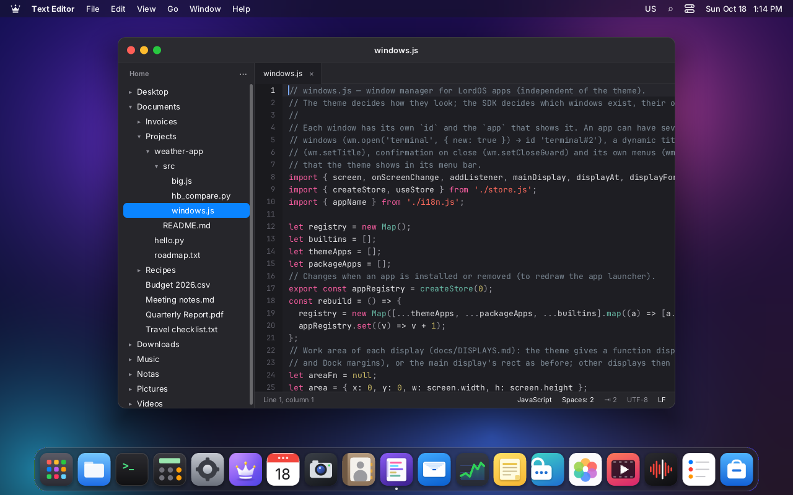
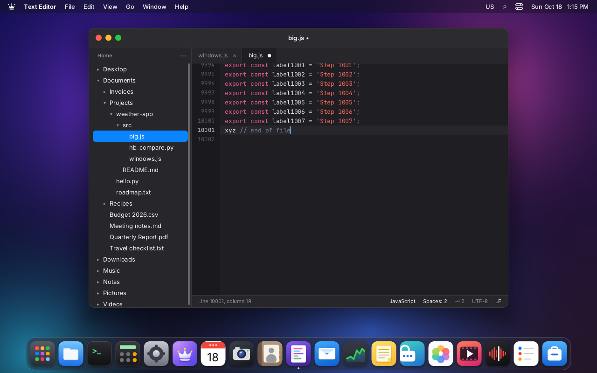
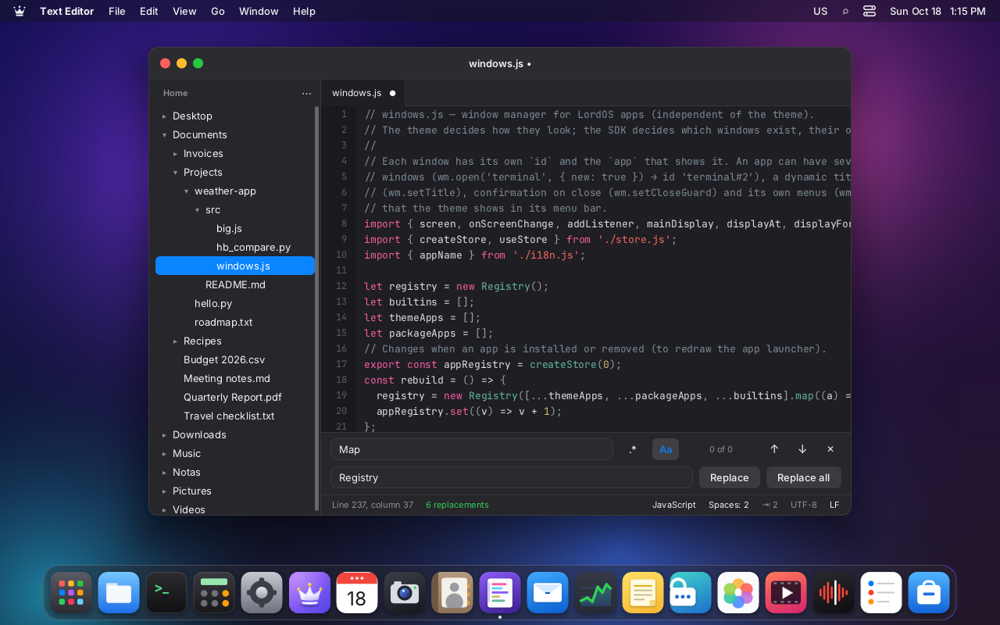
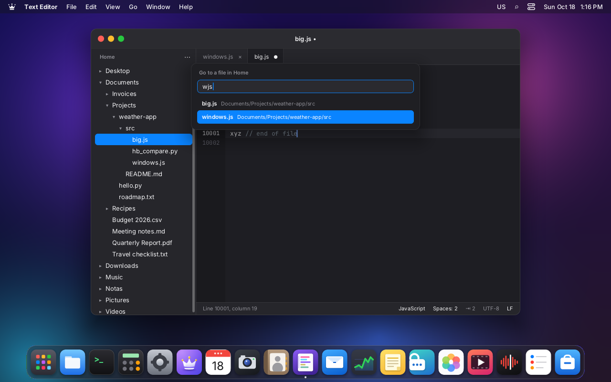
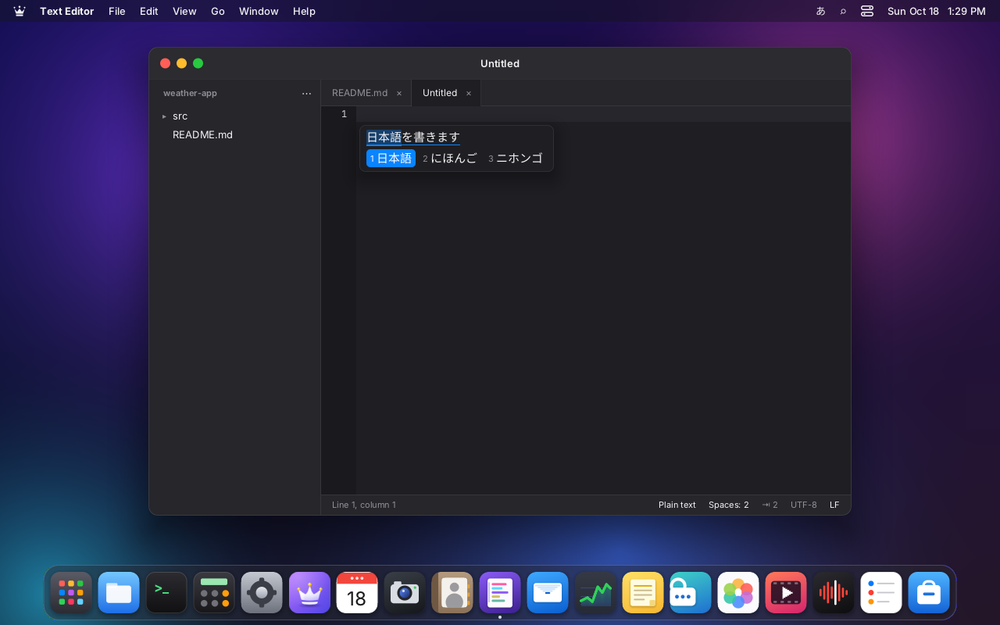
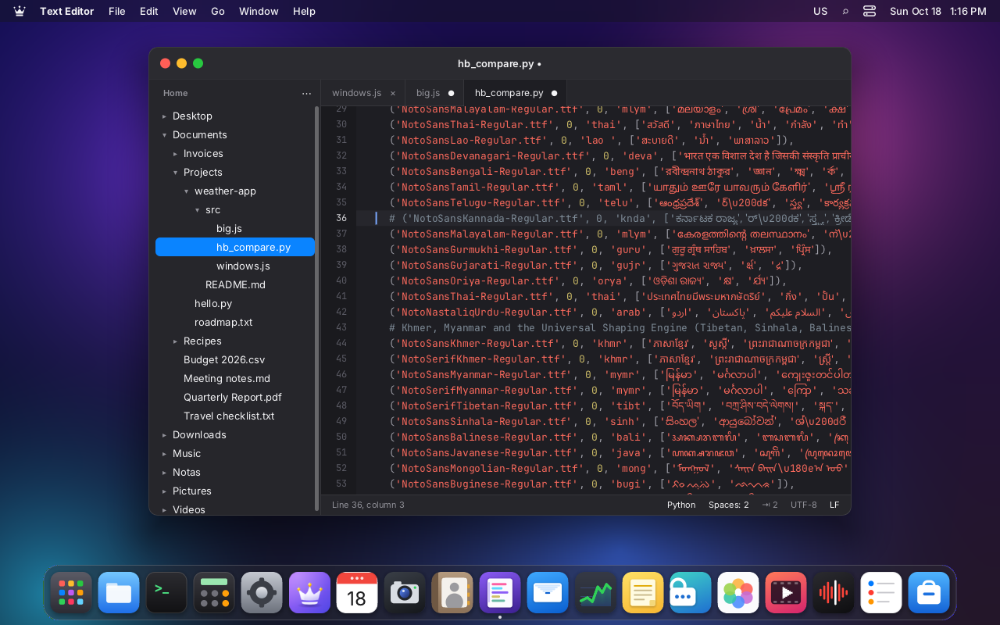
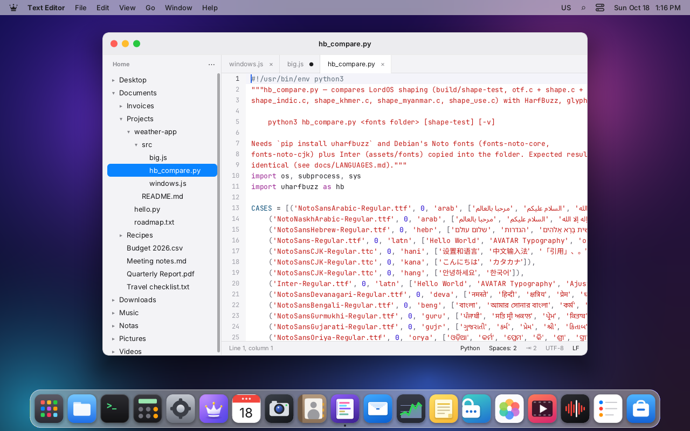
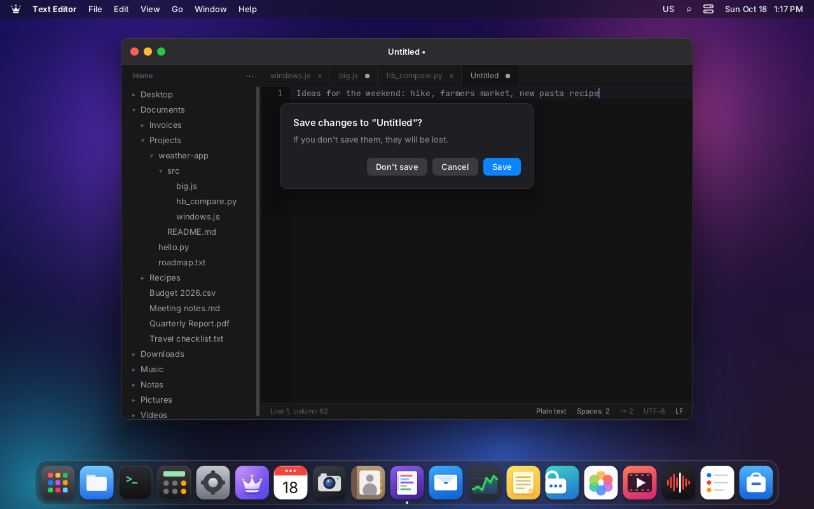

# Text Editor

LordOS's own code editor, TextMate-style (`apps/editor`). It is a native LordOS app in React on
top of the SDK: it doesn't use CodeMirror or Monaco, nor vendored TextMate grammars.

| | |
|---|---|
|  |  |
| Project on the left, tabs and highlighting (JavaScript) | A 10,001-line file, at the end and editing |
|  |  |
| Several cursors with ❖D: one word edited on several lines at once | Find and replace all (case-sensitive): «Map» → «Registry» |
|  |  |
| ❖T: open a project file by letters in order («wjs» → windows.js) | Japanese with LordOS's input method: 日本語を書きます |
|  |  |
| Python: comment, duplicate and move line; Indic scripts use the font fallback | Light mode (classic IDE-style palette) |
|  |  |
| Closing with unsaved changes | Double click in Files: the editor opens it, with the folder as the project |

## What it has

- **Window:**
  - the project on the left: the folder tree (by default the home folder, or the folder of the
    first file opened); pick another with «…» or ❖⇧O; ❖\ hides it;
  - tabs with a dot when there are unsaved changes;
  - the status bar: line and column, number of cursors and of selected characters, the language
    (changed with a click), spaces or tabs (click to toggle) and the width (2, 4 or 8), UTF-8 and
    LF or CRLF line endings (click to toggle).
- **Editing:**
  - Enter keeps the indentation and adds one after `{ [ ( :`; between `{}` it puts the closing
    brace on its own line;
  - Tab and ⇧Tab: indent or outdent the selected lines;
  - backspace in a space indentation goes back to the previous tab stop;
  - automatic pairs `() [] {} "" '' ```; typing the closing one skips over it; with a selection,
    it wraps it;
  - undo and redo grouped by word, like TextMate; undoing back to the saved state removes the
    tab's dot.
- **Multiple cursors:** ⌥click adds one; ❖D or Ctrl+D selects the word and then the next equal
  occurrence, each with its cursor; Esc goes back to one; ⌥drag selects by columns. Copying and
  pasting with several cursors hands one line to each cursor.
- **Find and replace** (❖F): text or regex (`.*`), case-sensitive or not (`Aa`), count and
  position («2 of 7»), next or previous (Enter, ⇧Enter, ❖G, ❖⇧G), replace and replace all (a
  single undo step). With regex, the replacement understands `$1`.
- **Jumps:** ❖L go to line (`120` or `120:8`); ❖T open a project file by letters in order, as in
  TextMate (↑ and ↓ choose).
- **Files:** ❖N new, ❖O open (own dialog), ❖S save, ❖⇧S save as, ❖W close tab. From Files, a
  double click on a file that isn't an image, sound, video or archive opens it here
  (`wm.open('editor', { args: { path } })`). Closing the window or a tab with changes asks first.
  It rejects binary files and files larger than 8 MB.
- **App menus** (in the theme's bar): File, Edit, View and Go, with their shortcuts.
- **Input methods:** the editor registers with `ime.attach`, so Japanese, Chinese and Korean
  type at the cursor (the composition and the candidates show up there).
- **Its own icon:** a sheet with colored lines of code.

## Shortcuts

❖ is the Super key; almost all of them also work with Ctrl.

| Shortcut | What it does |
|---|---|
| ❖N / ❖O / ❖⇧O | new, open file, open folder as project |
| ❖S / ❖⇧S / ❖W | save, save as, close tab |
| ❖Z / ❖⇧Z (Ctrl+Y) | undo, redo |
| ❖X / ❖C / Ctrl+V | cut, copy, paste (without a selection: the whole line) |
| ❖A / ❖⇧L | select all, select line |
| ❖D / ⌥click / Esc | next occurrence with another cursor, add cursor, single cursor |
| ❖/ | comment or uncomment (depending on the language: `//`, `#`, `--`, `<!-- -->`…) |
| ❖⇧D | duplicate line |
| ⌥↑ / ⌥↓ | move line |
| ❖] / ❖[ · Tab / ⇧Tab | indent, outdent |
| Ctrl+← / Ctrl+→ (also ⌥) | previous or next word (with ⇧, selects) |
| Home / End | start of the line's text (again: column 0), end of line |
| Ctrl+Home / Ctrl+End, ❖↑ / ❖↓ | start or end of the file |
| PgUp / PgDn | one screen |
| ❖F / ❖G / ❖⇧G | find and replace, next, previous |
| ❖L / ❖T | go to line, go to a project file |
| ❖\ | show or hide the project |
| Ctrl+Tab / Ctrl+⇧Tab | next or previous tab |

Mouse: click places the cursor, dragging selects, double click selects the word (and dragging
continues by words), triple click the line, ⇧click extends, the wheel scrolls (with ⇧,
sideways).

## Highlighting

It is our own state-based tokenizer (`apps/editor/syntax.js`):
- each language is a list of rules `[regex, type, next state]`;
- it tokenizes line by line, and the state at the end of a line (inside a `/* */` comment, a
  Python `"""` or a JS template) carries over to the next;
- when editing, it re-tokenizes from the first changed line and only what is visible.

Languages: JavaScript, JSX and TypeScript; C and C++; Python; Go; Rust; Shell (also Makefile and
Dockerfile); JSON; Markdown; HTML, XML and SVG; CSS, SCSS and Less; YAML; PHP; SQL; INI, TOML and
`.desktop`; diff and patch; plain text. The language comes from the extension, and can also be
chosen in the status bar. The colors are a classic TextMate/IDE-style palette, dark or light depending
on the theme's mode.

## How it's built

- `buffer.js` — the document:
  - the text is an array of lines;
  - cursors are a head and an anchor, with the desired column for moving up and down;
  - every edit is a transaction of ordered replacements that stores its inverse: so undo and redo
    are just another transaction, and several cursors edit in a single pass.
- `EditorView.jsx` — the view:
  - **visible lines:** it draws only the visible ones, plus 6 above and 6 below; each line is a
    memoized component that redraws only if its tokens change;
  - **font:** monospace (JetBrains Mono, `fontFamily: 'monospace'`, new in the engine);
  - **columns:** computed with the width of one cell, measured with `lord.measureText`; wide
    characters (CJK, emoji) are measured for real;
  - **direction:** the text area uses `direction: 'ltr'` even when the UI is in Arabic or Hebrew.
- `index.jsx` — the window: tabs, project, search, dialogs, menus and status bar.

For the editor, these were added to the system:
- **`fontFamily: 'monospace'`** in the engine (`style.c` and `text.c`; JetBrains Mono is loaded
  the first time it is used). The runtime used to drop `fontFamily`.
- **`lord.fs.write`, `mkdir` and `rename`** (`server/src/ui/js_sys.c`):
  - only inside the home folder, with the destination folder resolved with `realpath`;
  - they don't follow symlinks on the final file;
  - writing is atomic (temporary file in the same folder + `fsync` + `rename`) and keeps the
    permissions;
  - up to 32 MB;
  - they can't touch `~/.local/share/applications`, `~/.config/autostart`,
    `~/.local/share/lordos/apps` or `~/.config/lordos/settings.json`, not even through a symlink
    (tested): JS can't create a `.desktop` file, which is the only thing `lord.apps.launch` runs.

## Performance (measured)

- **10,001-line file (448 KB, JavaScript):**
  - it opens in under a second;
  - with the cursor at the end, a keystroke takes 4 ms of JS plus 1 ms of layout and 1–2 ms of
    painting (1,640 nodes on screen);
  - the first jump to the end of the file took 67 ms, because it highlights everything in
    between.
- **Outside the UI (Node, same code):** tokenizing the 10,001 lines takes 76 ms; a keystroke in
  the document, 0.004 ms.
- **Tests of `buffer.js` and `syntax.js`:** 28/28 in Node and in QuickJS (the same engine as
  lord-server; `/tmp/qjsrun` on the VM): multiple cursors, grouped undo, position mapping, CRLF,
  «modified» after undo, and the language states.

## Pending

- Soft wrap, code folding and a minimap.
- TextMate `.tmLanguage` grammars, bundles and snippets with tab stops.
- Find in the whole project.
- Encodings other than UTF-8.
- Remembering open files between sessions.
- Text drag and drop.
