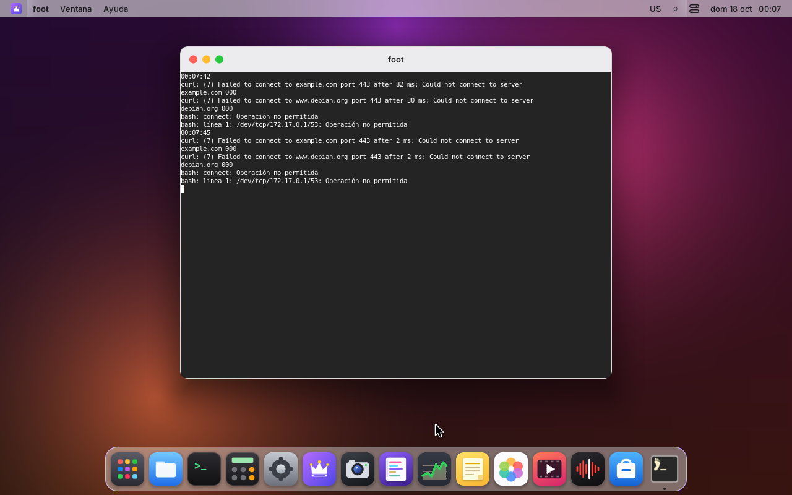
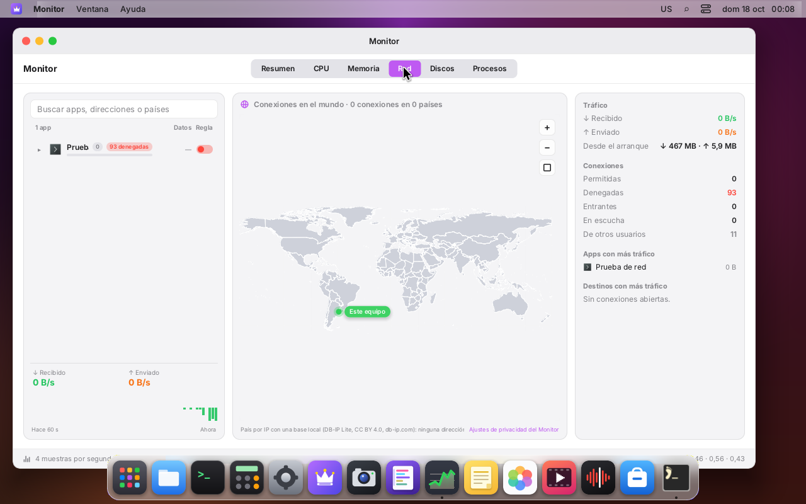
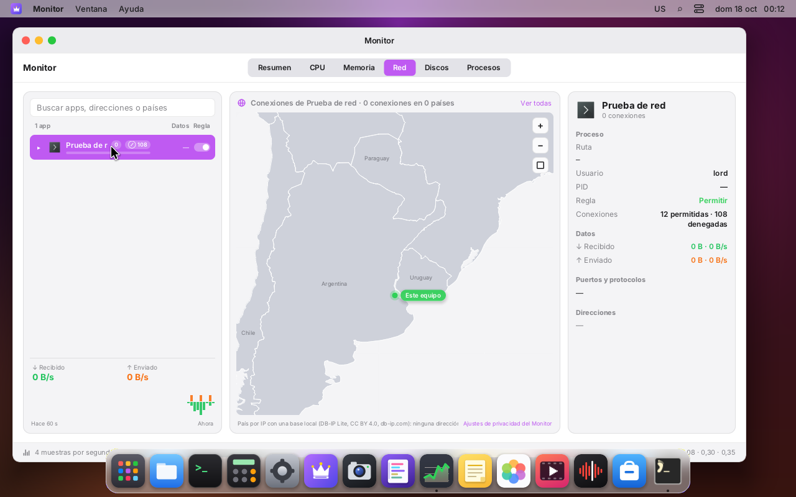
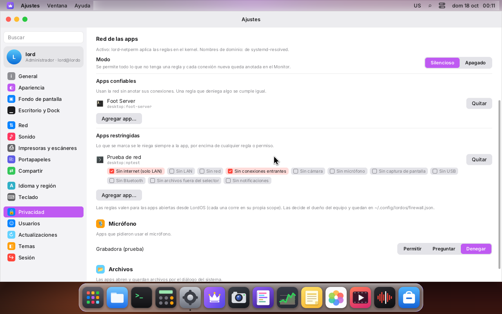

# Firewall por app

El dueño del equipo decide qué apps suyas pueden usar la red, igual que el permiso "acceso a la
red" de macOS o de Android. Se arma por pasos:

| Paso | Qué | Estado |
|---|---|---|
| 1 | Tienda de reglas, el que decide y los nombres aprendidos del DNS (`server/src/fw`), con pruebas | **hecho** |
| 2 | Aplicarlo en el kernel con ganchos de cgroup: el servicio root `lord-netperm` (`server/src/netperm`) | **hecho** (VM 122) |
| 3 | Monitor: la columna "Regla" y los contadores | **hecho**: interruptor por app y contadores; sin interruptor por destino |
| 4 | Ajustes: "Apps confiables" y "Apps restringidas" | **hecho**: listas y modo (silencioso / apagado) |
| 5 | Modo "preguntar" | planeado (ver "El modo preguntar") |

El paso 1 es solo código C, sin daemon y sin tocar el kernel ni la red (el paso 2, más abajo, es el
servicio que lo aplica):

```
server/src/fw/rules.{c,h}    reglas, listas, modo, fw_decide, JSON
server/src/fw/dnsmap.{c,h}   IP → nombres por app (LRU con TTL) y lector de respuestas DNS
server/src/fw/fwmap.{c,h}    tabla hash interna (semilla del proceso)
tests/fw_rules_test.c        build/fw-rules-test
tests/dnsmap_test.c          build/dnsmap-test
```

Las dos pruebas se compilan y se corren con `make -C server test`.

## Reglas

### Una regla

| Campo | Valores |
|---|---|
| app | id canónico de la app (ver abajo) |
| dirección | `out` (sale de la app) o `in` (entra a un puerto de la app) |
| destino | `any`; un dominio exacto (`ejemplo.com`) o con comodín (`*.ejemplo.com`); una dirección o red IPv4/IPv6 (`192.0.2.7`, `10.0.0.0/8`, `2001:db8::/32`); `lan`; `internet` |
| puertos | uno (`443`), un rango (`8000-8080`) o cualquiera |
| protocolo | `tcp`, `udp` o cualquiera |
| acción | `allow` o `deny` |
| duración | para siempre; hasta que la app se cierre; una sola vez |

Detalles del destino:

- **Comodín:** `*.ejemplo.com` cubre `ejemplo.com` y todo lo que termina en `.ejemplo.com`, a
  cualquier profundidad. No cubre `otroejemplo.com`.
- **Dominios:** se guardan en minúsculas y sin el punto final. Etiquetas de 1 a 63 caracteres de
  `[a-z0-9-_]` y hasta 253 en total. La última etiqueta no puede ser solo números, porque eso es
  una IP mal escrita. Los nombres internacionales van en punycode (`xn--...`).
- **Redes:** los bits fuera del prefijo tienen que estar en 0. Por ejemplo, `10.0.0.1/8` se
  rechaza. Además, `::ffff:a.b.c.d/n` (con n ≥ 96) se guarda como su red IPv4.
- **LAN** (`fw_addr_is_lan`):
  - IPv4: 0/8, 10/8, 100.64/10 (CGNAT, como en el Monitor), 127/8, 169.254/16, 172.16/12,
    192.168/16, 224/4 (multicast) y 255.255.255.255;
  - IPv6: `::`, `::1`, `fc00::/7` (ULA), `fe80::/10` y `ff00::/8`;
  - una IPv4 mapeada en IPv6 cuenta como su IPv4.

  **Internet** es todo lo que no es LAN.

- **Duración:** solo las reglas "para siempre" se guardan en el archivo.
  - "Hasta que se cierre": la borra `fw_app_quit(app)`.
  - "Una vez": `fw_decide` la borra en cuanto decide una conexión.

### Id de una app

`fw_app_canon` acepta:

- `lordos` (lord-server y sus apps internas);
- `desktop:<id>` (apps Linux con `.desktop`);
- `lpk:<id>` (apps `.lpk`);
- la ruta absoluta del ejecutable (lo que usa el Monitor cuando no encuentra un `.desktop`).

Las scopes de cgroup se traducen solas: `app-lordos-lpk-<id>.scope` → `lpk:<id>` y
`app-lordos-<id>.scope` → `desktop:<id>` (ver `server/src/sec/cgroup.h`). Así, el gancho del
kernel, que ve la scope, y el Monitor, que ve el `.desktop`, hablan de la misma app.

Un id válido:

- tiene hasta 127 bytes de `[A-Za-z0-9._:@+~-]`;
- puede llevar `/` solo en la forma de ruta, que no admite segmentos vacíos, `.` ni `..`;
- no puede ser `desktop:` ni `lpk:` sin el id.

### Listas

- **Apps confiables:** no se anotan ni se pregunta nada por ellas. Las reglas explícitas igual
  valen: un `deny` que el dueño puso para una app confiable se cumple.
- **Apps restringidas:** cada una tiene un conjunto de restricciones.

  | Restricción | En el JSON | Quién la aplica |
  |---|---|---|
  | sin internet | `no-internet` | `fw_decide` |
  | sin LAN | `no-lan` | `fw_decide` (también `127.0.0.1` y `::1`) |
  | sin red | `no-network` | `fw_decide` |
  | sin conexiones entrantes | `no-incoming` | `fw_decide` |
  | sin cámara | `no-camera` | quien da la cámara (`fw_blocks`) |
  | sin micrófono | `no-mic` | ídem |
  | sin captura de pantalla | `no-screen` | ídem |
  | sin USB | `no-usb` | ídem |
  | sin Bluetooth | `no-bluetooth` | ídem |
  | sin archivos fuera del selector | `no-files` | ídem |
  | sin notificaciones | `no-notifications` | ídem |

Una app está en una sola lista: confiar en ella la saca de las restringidas, y restringirla le
quita la confianza. Las restricciones que no son de red se consultan con `fw_blocks(app, flag)`.
Le ganan a un permiso TCC concedido en `permisos.json`: una app restringida sin cámara no la
recibe aunque alguna vez se le haya dado.

### Precedencia

`fw_decide` sigue este orden. La primera que aplica decide:

1. **Restricciones de la app.** Niegan siempre, antes que cualquier regla. Se miran en este
   orden: `no-network`, `no-incoming` (solo entrantes), `no-internet` (una conexión sin dirección
   conocida cuenta como internet) y `no-lan`.
2. **Reglas explícitas.** De todas las reglas de la app que coinciden en dirección, protocolo y
   puerto, gana la de **destino más específico**:

   | Destino | Especificidad |
   |---|---|
   | dominio exacto | la mayor |
   | comodín | más etiquetas, más específico: `*.cdn.ejemplo.com` > `*.ejemplo.com` |
   | dirección o red | prefijo más largo, más específico: `/32` > `/24` > `/8` > `/0` |
   | `lan` / `internet` | menor que cualquier red |
   | `any` | la menor |

   Si empatan, se desempata en este orden:
   1. el rango de puertos más chico (un puerto concreto le gana a "cualquiera");
   2. un protocolo concreto le gana a "cualquiera";
   3. **denegar le gana a permitir**;
   4. la regla más nueva.
3. **App confiable.** Se permite sin anotar (`record = 0`) y sin preguntar.
4. **Modo** (`fw_set_mode`, global para el usuario):

   | Modo | Resultado |
   |---|---|
   | silencioso (por omisión) | se permite y se anota (`record = 1`) para que el dueño la revise en el Monitor |
   | preguntar | `FW_V_ASK` (pendiente: hay que preguntarle al dueño) |
   | apagado | se permite sin anotar |

   El modo solo cambia este último paso: las reglas y las restricciones siguen valiendo con el
   modo apagado.

"Denegar > permitir" vale entre reglas igual de específicas. Entre reglas distintas manda la
especificidad. Por eso funciona el caso típico de "denegar todo, salvo api.ejemplo.com":

| Regla | Conexión a `api.ejemplo.com` | Conexión a `www.ejemplo.com` |
|---|---|---|
| `deny any` | coincide (especificidad mínima) | **decide: se niega** |
| `deny *.ejemplo.com` | coincide (comodín) | coincide |
| `allow api.ejemplo.com` | **decide: se permite** (exacto) | — |

En `www.ejemplo.com` coinciden `deny *.ejemplo.com` y `deny any`, y gana el comodín por ser más
específico. El resultado es el mismo: se niega.

- **Dos reglas con el mismo destino:** si coinciden en app, dirección, destino, puertos y
  protocolo, son la misma regla. Agregarla de nuevo reemplaza la decisión anterior y conserva el
  id. Por eso el interruptor del Monitor puede ir y volver sin acumular reglas.
- **Varios nombres para una IP:** cuando una IP tiene varios nombres (un CDN compartido), se
  evalúan todos. Gana el más específico y, si empatan, denegar.

`FwDecision` devuelve:

- `verdict`: permitir, denegar o preguntar;
- `reason`: qué paso decidió (restricción, regla, confiable o modo);
- `rule_id`: la regla que decidió;
- `flag`: la restricción que negó;
- `record`: si hay que anotarla.

### Estructuras y costo

Cada app tiene su propio índice. Encontrar la app es una búsqueda en una tabla hash (O(1)), y
adentro:

| Destino | Estructura | Costo de una búsqueda |
|---|---|---|
| dominio exacto | tabla hash nombre → reglas | O(1) por nombre |
| comodín | tabla hash sufijo → reglas, recorriendo las etiquetas del nombre de derecha a izquierda (`a.b.ejemplo.com`, `b.ejemplo.com`, `ejemplo.com`, `com`) | O(etiquetas), a lo sumo 127 |
| dirección o red | trie binario de prefijos por familia, con las reglas en cada nodo | a lo sumo 33 nodos (IPv4) o 129 (IPv6) |
| `lan`, `internet`, `any` | una lista por destino | O(reglas de ese destino) |

- **Listas por destino:** cada lista junta solo las reglas de ese destino exacto, que se
  diferencian en dirección, puertos o protocolo. Son listas cortas.
- **Ids de regla:** van en otra tabla hash (`fw_rule_get` y `fw_rule_remove` en O(1)).
- **Al borrar:** se podan los nodos del trie y las claves vacías, y se suelta la app cuando no le
  queda nada.
- **Hash:** FNV-1a con una semilla del proceso y la mezcla final de MurmurHash3. Las claves no son
  predecibles desde afuera.
- **Topes:** 65 536 reglas, 4096 apps con estado y un archivo de 4 MB.

En la prueba, con 50 000 reglas de 500 apps, una decisión con un nombre y una IPv4 tarda
0,17 µs en macOS (clang -O2) y 0,21 µs en Linux (gcc 14 -O2).

### Archivo

Va uno por usuario: `~/.config/lordos/firewall.json`. Es JSON compacto y lo lee el lector
estricto de `server/src/sec/json.c`. Por ejemplo:

```json
{"v":1,"mode":"ask","trusted":["lordos"],"restricted":{"lpk:juego":["no-internet","no-camera"]},
 "rules":[{"app":"desktop:org.chromium.Chromium","dir":"out","dst":"*.doubleclick.net","action":"deny","when":1760000000},
          {"app":"lpk:juego","dir":"in","dst":"lan","port":"27015","proto":"udp","action":"allow","when":0}]}
```

- **Al guardar** (`fw_save`):
  - la escritura es atómica: un `.tmp` con modo 0600 y `O_NOFOLLOW`, `fsync` y `rename`;
  - las apps y las reglas van en orden fijo, así que el mismo contenido da el mismo archivo;
  - solo se escriben las reglas "para siempre".
- **Al leer** (`fw_load` / `fw_from_json`) se valida todo, y cualquier error rechaza el archivo
  entero:
  - claves desconocidas o repetidas;
  - `v` distinto de 1;
  - ids, destinos, puertos (1–65535, `lo ≤ hi`, sin ceros a la izquierda), protocolos o acciones
    inválidos;
  - restricciones desconocidas o repetidas;
  - una app que está a la vez en las dos listas;
  - ids que no están en su forma canónica;
  - bytes 0 y archivos que no son comunes o pasan los 4 MB.

  La tienda solo cambia si todo validó: se arma una nueva y se intercambia. Si el archivo no
  existe, `fw_load` devuelve 1 y la tienda queda como estaba.

La ruta está en la lista de rechazo de `lord.fs` (`server/src/fsops.c`, como `settings.json` y
`permisos.json`, ver `AGENTS.md`): una app de LordOS no puede escribir sus propias reglas. Una app
Linux corre como el usuario y podría editar el archivo, igual que `permisos.json`; las `.lpk`
no, por Landlock.

### Nombres de una dirección (dnsmap)

Una conexión trae solo una IP. Para aplicar una regla de dominio hace falta saber qué nombre
resolvió esa app para esa IP. `dnsmap` lo aprende de las respuestas DNS que el resolvedor del
sistema ya recibió, sin preguntarle nada a nadie: ni DNS inverso ni servicios.

- **Por app:** la clave es (app, IP) → nombres. Lo que resolvió una app no le sirve a otra, así
  que una app no puede "prestarle" un nombre permitido a una IP para otra.
- **Cadenas de CNAME:** para `www.ejemplo.com → CNAME edge.cdn.net → CNAME a1.cdn.net → A
  203.0.113.10`, la IP queda con los tres nombres. El TTL es el más chico de la cadena.
- **Qué registros se usan:**
  - solo los A/AAAA cuyo dueño está en la cadena que sale de la pregunta (un registro suelto se
    ignora);
  - las cadenas en bucle se cortan;
  - la cadena tiene a lo sumo 16 saltos.
- **Tabla:**
  - es una LRU acotada (4096 pares por omisión) con 8 nombres por IP;
  - los TTL se llevan a [60 s, 1 día];
  - una consulta deja a esos nombres como los más recientes;
  - `dnsmap_lookup` devuelve los nombres vigentes del más reciente al más viejo, listos para
    `FwQuery.hosts`.
- **Lector** (`dns_parse_response`):
  - lee solo la sección de respuestas, clase IN, tipos A, AAAA y CNAME;
  - exige `QR = 1`, `OPCODE = 0` y una sola pregunta;
  - controla cada acceso: etiquetas de hasta 63, nombres de hasta 255 bytes, `rdlen` dentro del
    paquete, A de 4 bytes, AAAA de 16 y CNAME que ocupa justo su `rdata`;
  - los punteros de compresión solo pueden ir hacia atrás del tramo que se está leyendo, y cada
    salto baja ese límite, así que no hay bucles posibles; además hay un tope de 64 saltos;
  - los tipos de etiqueta 0x40 y 0x80 se rechazan;
  - un nombre que no es de host (espacios, bytes raros) invalida el registro, no el paquete.

**Regla para el paso 2:** a `dnsmap_learn` solo se le pasan respuestas que recibió el resolvedor
del sistema (`systemd-resolved` o el de LordOS), nunca paquetes que la app recibió por sus propios
sockets. Si no, una app con su propio servidor DNS podría decir que `permitido.com` es cualquier
IP y escaparse de una regla "permitir solo permitido.com".

### Pruebas

`build/fw-rules-test` cubre:

- ids canónicos y scopes;
- destinos válidos e inválidos, de ida y vuelta;
- LAN e internet;
- cada paso de la precedencia;
- dominio contra comodín, redes v4/v6 anidadas y la IPv4 mapeada;
- puertos y protocolos, y denegar contra permitir con el mismo nivel;
- las duraciones;
- cada restricción;
- JSON de ida y vuelta (texto idéntico), por archivo, y 40 entradas malas;
- 20 000 mutaciones al azar del JSON: nunca se cae, y lo que acepta lo vuelve a escribir igual;
- 30 000 operaciones al azar (agregar, borrar, decidir), comparadas contra una versión lineal
  obvia del que decide: 0 diferencias;
- una medición con 50 000 reglas.

`build/dnsmap-test` cubre:

- respuestas buenas, cortadas en cada byte, punteros a sí mismos y hacia adelante, nombres de
  más de 255 bytes, `rdlen` incorrectos, otras clases y nombres raros;
- la cadena de CNAME, los registros sueltos, el bucle de CNAME, el vencimiento y los topes de TTL;
- el tope por IP, la LRU global y las apps separadas;
- el uso con las reglas (`*.doubleclick.net` detrás de un CNAME);
- 200 000 paquetes al azar o mutados, cada uno en su propio bloque del montón.

En el desarrollo se corrieron también con `-fsanitize=address,undefined`, con clang en macOS y
con gcc 14 en Linux.

## Paso 2: `lord-netperm`, las reglas en el kernel

```
server/src/netperm/np_shared.h   tipos de los mapas y la decisión (np_decide), iguales en BPF y en C
server/src/netperm/np.bpf.c      los 7 programas BPF de cgroup (C restringido, clang -target bpf)
server/src/netperm/bpf2c.c       herramienta de compilación: el .o de clang → build/gen/np_bpf.h
server/src/netperm/bpfsys.{c,h}  syscall bpf() directo: mapas, cargar, bpf_link, anillo
server/src/netperm/npcompile.{c,h}  reglas → entradas de los mapas (C puro, con prueba)
server/src/netperm/npdns.{c,h}   nombres desde el resolvedor del sistema
server/src/netperm/npproto.h     el socket entre lord-server y lord-netperm
server/src/netperm/netperm.c     el servicio
server/src/ui/js_fw.c            lord.fw (lord-server)
tests/npcompile_test.c           build/npcompile-test (en make test)
tests/netperm_integration.sh     prueba con el kernel (en la VM)
tests/netperm_bench.c, netperm_measure.sh   mediciones
```

### El servicio

`lord-netperm` es un proceso root aparte, con su propia unidad de systemd (`lord-netperm.service`,
`Restart=always`, antes de `lordos.service`). No es parte de `lord-netd` ni de `lord-sessiond`.

- **Sin argumentos ni ejecución.** No lanza programas. Con argumentos, no arranca.
- **Sin red propia.** No crea sockets AF_INET ni AF_INET6. La unidad lo refuerza con
  `RestrictAddressFamilies=AF_UNIX AF_PACKET` y le deja solo `CAP_BPF CAP_NET_ADMIN CAP_PERFMON
  CAP_DAC_READ_SEARCH CAP_NET_RAW`. Tiene `ProtectSystem=strict`, `ProtectHome=read-only` y lo demás
  que figura en la unidad (`VM-SETUP.md`, paso 20).
- **Los programas van adentro del binario.** `clang -target bpf` compila `np.bpf.c` y `build/bpf2c`
  lo convierte en una cabecera C con las instrucciones y las reubicaciones a mapas, por nombre.
  `bpf2c` rechaza todo lo que el cargador no sabe resolver: funciones sin inline, datos globales y
  reubicaciones que no sean de mapas. No se lee ningún archivo ELF en tiempo de ejecución. No se
  usa libbpf ni bcc. Sin clang (`BPF=0`) se compila igual, y el servicio avisa "BPF no disponible"
  y no hace nada.
- **Dónde se engancha.** En la cgroup de `lordos.service`, con `bpf_link`, que contiene el
  subárbol de todas las sesiones. Un solo enganche cubre a todos los usuarios: cada scope tiene su
  propio id.
  - systemd borra y vuelve a crear esa cgroup cada vez que `lordos.service` reinicia. Por eso el
    servicio la vigila con inotify en `system.slice` y una vez por segundo, y se vuelve a
    enganchar si cambió el id.
  - Si el servicio se para, los links se cierran y todo queda permitido. El escritorio no depende
    de él.
  - **Also on `user@<uid>.service`** (closing the `systemd-run --user` escape, see
    [Escape via `systemd-run --user`](#escape-via-systemd-run---user-la-unión-de-user)): the same
    programs are attached a second time, with a `bpf_link` per session, to each LordOS session
    user's `user@<uid>.service` cgroup. Re-attached the same way when that cgroup changes (the user
    manager restarting) or disappears.
- **Las apps.** Lee las carpetas de las sesiones (`lordos-session-<uid>`) con inotify, más un
  repaso cada 5 s:
  - `server` es `lordos`;
  - `app-lordos-<id>.scope` es `desktop:<id>`;
  - `app-lordos-lpk-<id>.scope` es `lpk:<id>`.

  El id de cgroup sale de `name_to_handle_at`, que es lo mismo que ve el kernel.

### Los programas

| Gancho | Qué mira |
|---|---|
| `cgroup/connect4`, `connect6` | TCP y UDP conectado. Las IPv4 mapeadas en IPv6 cuentan como IPv4 |
| `cgroup/sendmsg4`, `sendmsg6` | UDP sin conectar (`sendto` con dirección) |
| `cgroup/bind4`, `bind6` | entrada: "sin conexiones entrantes" y reglas `in`. Un bind al puerto 0 (efímero, de cliente) no se mira |
| `cgroup/sock_create` | "sin red": la app no puede ni crear un socket AF_INET/AF_INET6, así que tampoco hace ping |

Cada programa hace lo siguiente:

1. Busca la app por el antepasado de su cgroup en el nivel de las scopes
   (`bpf_get_current_ancestor_cgroup_id`). Así, una cgroup que la app cree adentro de su scope
   sigue siendo la misma app.
2. Decide con `np_decide` (`np_shared.h`).
3. Devuelve 1, o 0. Con 0 la app recibe `EPERM` ("Operación no permitida").

Lo que no es de una app de sesión pasa enseguida: `lord-sessiond`, la pantalla de ingreso y el
resto del sistema.

#### Escape via `systemd-run --user` (la unión de `user@`)

Root-owned scopes (see `docs/PRIVACIDAD.md`) stop an app from writing `cgroup.procs` to leave its
scope, but an unsandboxed Linux app can still ask its own systemd **user manager** for a new unit:
`systemd-run --user --scope <cmd>` (a scope) or `systemd-run --user <cmd>` (a transient service).
The user manager has PID 1 do the move (`AttachProcessesToUnit`), which only checks the UID, not
the source cgroup, so the process lands in `user@<uid>.service/app.slice/…` — outside
`lordos.service`, where the programs above are not attached. A "no internet" app could reach the
internet from there.

**Chosen fix (option a): attach to `user@<uid>.service` + a per-user restriction union.** For each
LordOS session user, `lord-netperm` attaches the same cgroup programs a second time to that user's
`user@<uid>.service`. There the process is not in any app scope, so `find_app` (`np.bpf.c`) falls
back to `np_union`, keyed by the `user@<uid>` cgroup id (the ancestor at `cfg->user_level`). Its
value is the **strictest union** of the restrictions (the `NP_R_*` bits ORed) of all of that user's
currently-running restricted apps, with `trusted=1` so anything the union does not forbid is
allowed silently. If the user has no restricted app running, there is no entry and `user@` is fully
open (the user manager and its own services are untouched). `lord-netperm` rebuilds the union
whenever a scope or a rule changes (`sync_union`), and removes it when the user's session or user
manager goes away.

Why this and not the alternatives:

- A process escaping through a `systemd-run --user` **service** is forked by the user manager, not
  by the app, so its process lineage no longer reaches the restricted app. Carrying the app
  identity in BPF task-local storage and inheriting it across `fork` (option c) therefore cannot
  cover the service case — and it would also need a `BPF_PROG_TYPE_TRACING`/raw-tracepoint program
  plus a BTF-typed task-storage map, which our own `bpf()` loader (`bpfsys.c`) does not build.
  Kernel 6.12 has BTF and `bpf` LSM, but the loader would have to grow that machinery.
- Denying the app access to the user bus / `$XDG_RUNTIME_DIR/systemd/private` (option b) can't be
  enforced for unsandboxed Linux apps (Landlock is not applied to them).
- The union is **restriction-only**: it never grants access, so an escaped process is always at
  least as restricted as its own policy. The cost is that it is coarse — while a restricted app is
  running, every process under that user's `user@` is held to the union. That is acceptable because
  LordOS's own apps live under `lordos.service` (unaffected), and it activates only while a
  restricted app runs. A precise per-process identity (option c) is a possible future refinement if
  the loader gains tracing support.

`sock_create` ("no network") is **not** enforced through the union, so the user manager can still
create its own sockets; a "no network" escapee can open a socket but every `connect`/`sendmsg`/`bind`
is denied by the union all the same. The decision helper (`np_decide`) is unchanged, so
`tests/npcompile_test.c` still covers it.

**Mapas**

| Mapa | Tipo | Clave → valor |
|---|---|---|
| `np_cfg` | array | nivel de las scopes, encendido, nivel de `user@<uid>` |
| `np_apps` | hash | id de cgroup → restricciones, confiable, modo y lista genérica (lan / internet / any) |
| `np_union` | hash | id de `user@<uid>.service` → unión estricta de las apps restringidas del usuario |
| `np_lpm4`, `np_lpm6` | LPM trie | (índice de la app, red) → lista ordenada de reglas |
| `np_seen` | LRU | (cgroup, dirección, puerto, protocolo, dirección de la conexión, veredicto) → última vez avisada |
| `np_counts` | hash | id de cgroup → permitidas, denegadas |
| `np_events` | ring buffer | conexiones nuevas hacia el servicio |

**Lo que se cuenta y se avisa.** Se cuenta cada `connect()` de TCP y cada `bind()`. Un `sendto` de
UDP y un `connect()` de UDP cuentan solo la primera vez en 5 s, para no inflar los números:
getaddrinfo hace un connect de UDP por cada dirección para ordenarlas (RFC 6724).

El servicio recibe un aviso por conexión nueva, por el anillo, solo si esa misma conexión no se
avisó en los últimos 5 s. No hay nada por paquete: ningún gancho corre por paquete y en espacio de
usuario no se procesa ningún paquete. La excepción son las respuestas DNS de la fuente sin
resolved, más abajo.

### De reglas a mapas (`npcompile.c`)

En el kernel no hay tiempo para la precedencia completa de `fw_decide`, así que se precalcula:

1. **Restricciones, confiable y modo** van en `np_apps`. "Preguntar" se compila como silencioso
   (ver "El modo preguntar"). Las reglas "una sola vez" no se compilan.
2. **`lan`, `internet` y `any`** van en la lista genérica de la app, en orden de precedencia.
   - Hasta 16 reglas: `NP_GEN_MAX`.
   - Son las de menor especificidad, así que van al final.
3. **Una red por regla.** Cada red distinta es un nodo del trie. Su lista trae sus reglas y las de
   todas las redes que la contienen, ordenadas como en `fw_decide`:
   1. destino más específico;
   2. rango de puertos más chico;
   3. protocolo concreto;
   4. denegar;
   5. la más nueva.

   La coincidencia más larga del trie alcanza: gana la primera entrada que coincide en dirección,
   protocolo y puerto. Hasta 16 entradas por nodo (`NP_LIST_MAX`). Las que sobran se avisan en el
   registro.
4. **Dominios.** Por cada dirección que el resolvedor asoció con un nombre que coincide con una
   regla de dominio de la app, hay un nodo /32 o /128.
   - Su lista empieza por esas reglas de dominio, que son las más específicas.
   - Le siguen las redes que lo contienen.
   - Con varios nombres para una IP, gana el más específico y, si empatan, denegar, igual que en
     `fw_decide`.

Con cada respuesta DNS nueva se arman solo los nodos de esas direcciones, para las apps que tienen
reglas de dominio. Cada 30 s, y con cada cambio de reglas, se recompila la app entera y se borra
lo que venció o sobra (el mapa instalado se compara con el nuevo).

**La prueba** (`build/npcompile-test`) corre la misma `np_decide` del kernel con un trie simulado y
la compara contra `fw_decide`:

- 3000 tiendas al azar, con dominios, comodines, redes v4/v6 anidadas, lan/internet/any, puertos,
  protocolos, entradas, confiables, restringidas y los tres modos;
- 480 000 conexiones, con nombres aprendidos, binds y IPv4 mapeadas: **0 diferencias** en
  veredicto, motivo y regla;
- dos mutaciones a propósito del compilador: invertir "denegar gana" y quitar el largo del prefijo
  del orden. Las dos dan diferencias, así que la prueba las detecta;
- además, casos legibles, las claves de los tries, el tope de las listas y las dos fuentes de DNS
  (abajo);
- 401 reglas con 4000 direcciones aprendidas se compilan en 2200 nodos en 21 ms en la VM.

### De dónde salen los nombres

Solo de respuestas que dio el resolvedor del sistema (`npdns.c`):

1. **Con systemd-resolved** (Debian 13 y la ISO): la interfaz de monitoreo por varlink,
   `/run/systemd/resolve/io.systemd.Resolve.Monitor`, con `SubscribeQueryResults`. Solo root puede
   suscribirse.
   - Llega cada respuesta que resolved le dio a cualquier programa: por NSS (`nss-resolve`), por el
     stub 127.0.0.53 y por D-Bus.
   - Trae los registros en formato de red (`raw`). Con ellos se arma un mensaje DNS que pasa por el
     lector estricto de `dnsmap` (`dns_parse_response`).
   - **Por qué alcanza:** una app no puede escribir en la caché de resolved. Si usa su propio
     servidor DNS o DNS sobre HTTPS, esas respuestas no llegan acá. Con una regla "solo
     permitido.com", una IP que la app sacó de otro lado no está en el trie y se niega.
   - Si un servidor mentiroso mete un registro que no sale de la pregunta (`evil.example` → un A de
     otro nombre), `dnsmap` lo ignora. Hay prueba.
2. **Sin resolved:** `RED.md` dice que LordOS escribe `/etc/resolv.conf` (como root). Se toman las
   respuestas UDP que llegan **desde el puerto 53 de esos servidores**.
   - Las lee un socket AF_PACKET que solo recibe. Un filtro BPF clásico deja pasar solo UDP sin
     fragmentar con puerto de origen 53.
   - Los servidores salen de `resolv.conf`, que se relee cada 30 s.
   - Es lo más simple que sigue siendo confiable: lo que una app le pregunta a otro servidor no se
     aprende, y una app sin root no puede mandar un paquete "desde el puerto 53" del servidor.
   - Hay prueba del lector: otro servidor, otro puerto, fragmentos, largos mentirosos y cortes.

Los nombres son del sistema, no de cada app: `dnsmap` los guarda bajo una sola clave. resolved no
dice qué programa preguntó. No es un agujero, porque son respuestas reales: una app puede conectar
a las IP de `permitido.com` aunque las haya pedido otra.

**La carrera.** El nodo del trie tiene que estar antes de que la app conecte.

- En la VM, resolved le avisa al monitor entre 150 y 300 µs **antes** de que getaddrinfo vuelva en
  la app.
- `curl -4 https://example.com` recién lanzado, con "denegar todo, salvo example.com", anduvo
  **20 de 20 veces con la caché de resolved vacía** y 20 de 20 con caché.
- Si alguna vez llegara tarde, esa primera conexión se niega con EPERM y la siguiente anda.

### El socket

`/run/lordos/netperm.sock` es 0666: cualquiera puede conectarse.

- `lord-netperm` sabe quién es cada cliente por `SO_PEERCRED`. Hay hasta 4 conexiones por usuario
  y cada una ve solo las apps de su usuario.
- El protocolo está en `npproto.h`: `u32` de largo, `u8` de tipo y los datos.
- **De lord-server a lord-netperm** hay un solo mensaje, sin datos: `RELOAD`. Cualquier otra cosa
  corta la conexión.
- **Las reglas no viajan por el socket.** `lord-netperm` lee `~/.config/lordos/firewall.json` del
  usuario él mismo, con `CAP_DAC_READ_SEARCH`:
  - carpeta por carpeta con `openat`, `O_NOFOLLOW` y `O_NONBLOCK`;
  - cada carpeta y el archivo tienen que ser del usuario;
  - el archivo tiene que ser común y de hasta 4 MB;
  - lo valida el lector estricto de `fw_from_json`. Si no valida, quedan las reglas anteriores.

  Lo lee al aparecer la sesión y con cada `RELOAD`.
- **De lord-netperm a lord-server:**
  - `STATUS`: `{bpf, dns, error}`;
  - `EVENT`: `{app, v, dir, proto, addr, port, by, rule, flag, record}`, una conexión nueva;
  - `COUNTS`: `{app: [permitidas, denegadas]}`, cada segundo, solo si cambió.

  Si nadie lee, se descartan los avisos. Los contadores se vuelven a mandar al cambiar.

### `lord.fw` (lord-server, `js_fw.c`)

lord-server es el dueño de las reglas del usuario: las carga al arrancar, las cambia y las guarda
con `fw_save`. Después manda `RELOAD`. El socket no bloquea nunca. Se lee en `lord.fw.poll()`, que
el SDK llama una vez por segundo con la pestaña Red del Monitor abierta.

| Llamada | Qué hace |
|---|---|
| `status()` | `{ daemon, bpf, dns, error }` |
| `state()` | `{ mode, trusted, restricted: { app: [restricción] } }` |
| `appRule(app)` / `setAppRule(app, 'allow'\|'deny'\|null)` | la regla `{app, out, any}` del interruptor |
| `setTrusted(app, on)`, `setRestricted(app, [restricción])`, `setMode('silent'\|'ask'\|'off')` | listas y modo |
| `rules(app)`, `addRule({ app, dir, dst, port, proto, action })`, `removeRule(id)` | reglas (dominios, redes, puertos) |
| `poll()` | `{ counts, events }` |

Todo se valida en C:

- los ids con `fw_app_canon`;
- los destinos con `fw_parse_dest`;
- los puertos de 1 a 65535 (`lo ≤ hi`);
- los protocolos, las acciones y los nombres de restricción con sus listas cerradas.

Ninguna llamada recibe rutas. Las apps `.lpk` aisladas no tienen `lord.fw`.

En el SDK, `firewall` y `firewallState` de `sdk/monitor.js`, exportados en `@lordos/sdk`.

**El Monitor** también atribuye cada proceso a la scope en la que corre (`js_monitor.c`,
`scope_of`, que lee `/proc/<pid>/cgroup` con una caché). Así un `curl` dentro de `foot` es `foot`,
igual que en el kernel. Antes era el `curl` suelto, que no se puede filtrar.

### Los modos

| Modo | En el kernel |
|---|---|
| silencioso (por omisión) | se permite lo que no tiene regla, y cada conexión nueva se cuenta y se avisa al Monitor (`record`) |
| apagado | solo valen las denegaciones explícitas y las restricciones; lo demás se permite sin anotar |
| preguntar | por ahora, igual que silencioso |

### El modo preguntar (próximo paso)

Un gancho de `connect` no puede esperar al dueño, y retener la conexión en espacio de usuario
(como NFQUEUE) es trabajo por conexión fuera del kernel. Va a funcionar como un aviso de
"reintentar":

1. La primera conexión de una app a un destino que no tiene regla se **niega enseguida** (EPERM).
   El veredicto `ask` va en `np_apps`, y el aviso sale por el anillo con `record`.
2. lord-netperm se lo pasa a lord-server, y el SDK muestra un aviso del sistema
   (`PermissionPrompt`): «"App" quiere conectarse a ejemplo.com:443 — Permitir una vez / Siempre /
   Denegar».
3. La respuesta se vuelve una regla (una vez, hasta cerrar o para siempre) y lord-netperm la
   compila al instante.
4. La app reintenta: los navegadores y la mayoría de los clientes lo hacen solos, y el aviso
   ofrece "Reintentar" para los demás. La segunda conexión ya pasa.

Mientras el aviso esté abierto, las conexiones a ese destino se siguen negando sin repetir el
aviso: `np_seen` ya los agrupa por 5 s.

### Probado en la VM 122

`tests/netperm_integration.sh` arma una scope de app como el lanzador y escribe reglas: **18 de
18**, con `lord-netperm` como servicio de systemd endurecido.

| Caso | Resultado |
|---|---|
| sin reglas | TCP a la puerta de enlace: anda |
| denegar la app | TCP `EPERM`, UDP `sendto` `EPERM`, TCP por IPv6 `EPERM` |
| volver a permitirla | anda |
| "denegar todo, salvo example.com" | `https://example.com` 200; `https://www.debian.org` `EPERM`; la IP que dio el resolvedor anda; una IP que no dio, `EPERM` |
| "solo LAN" (`no-internet`) | la puerta de enlace anda; internet `EPERM` |
| `no-incoming` | `bind`+`listen` al 18080 `EPERM`; bind efímero y salida andan |
| `no-network` | `socket()` `EPERM` |
| apagado | la denegación explícita vale; lo demás anda |
| otro proceso fuera de la scope | anda |

**Con la interfaz**, la app "Prueba de red" es un `.desktop` que abre `foot` con un bucle de `curl`
y `/dev/tcp`:

- **Monitor → Red:** el interruptor de la columna Regla deniega la app. `curl` y bash reciben
  "Operación no permitida", y aparecen el contador de denegadas y el de la fila. Al volver a
  prenderlo, anda.
- **Ajustes → Privacidad → Red de las apps:** con "sin internet" marcado en Apps restringidas, la
  puerta de enlace anda e internet no.

**`systemd-run --user` escape (the `user@` union).** With a restricted app running
(`desktop:aisla`, "no internet"), from a `foot` terminal placed in `app-lordos-aisla.scope`:

| Escape attempt | Result |
|---|---|
| `curl https://example.com` (direct, in the app scope) | blocked — "Could not connect" (existing scope rule) |
| `systemd-run --user --scope curl https://example.com` | blocked — the scope lands in `user@1000`, `np_union` denies the connect |
| `systemd-run --user curl https://example.com` (transient service) | blocked — same, even though the user manager forks it |
| `setsid curl https://example.com` | blocked — `setsid` does not change the cgroup, stays in the app scope |

`lord-netperm` logs each `user@` denial as `uid 1000 user@: denegada … (unión de apps
restringidas no-internet)`. A normal process outside `user@`/`lordos.service` app scopes (e.g. an
SSH session scope) still reaches the internet while the restricted app runs, so normal apps are
unaffected. Cross-user: a restricted app for `bob` (uid 1001) blocks `bob`'s `systemd-run --user`
escape while `lord` (uid 1000, no restricted app) keeps full access — the union is per
`user@<uid>`, never leaking between users. The screenshot shows the four attempts blocked:


### Mediciones (VM 122, 4 vCPU Xeon Silver 4108, kernel 6.12)

`tests/netperm_measure.sh`: 3 corridas de 20 000 `connect()` a 127.0.0.1 adentro de una scope, y
3 GB por TCP en 127.0.0.1.

| | connect TCP (mediana) | connect UDP (mediana) | caudal |
|---|---|---|---|
| lord-netperm apagado | 13,9 / 13,7 / 16,7 µs | 2,1 / 2,0 / 2,5 µs | 842 MB/s |
| prendido, sin reglas (silencioso) | 13,7 / 17,4 / 17,4 µs | 2,4 / 2,5 / 3,0 µs | 818 MB/s |
| prendido, 402 reglas para la app | 13,7 / 13,8 / 17,7 µs | 3,1 / 2,6 / 2,5 µs | 829 MB/s |

- **El costo por conexión** se ve en UDP, porque su connect no hace un handshake: unos **0,5 µs**.
  En TCP queda dentro del ruido del loopback.
- **El caudal no cambia:** las diferencias están dentro del ruido entre corridas. Ningún gancho
  corre por paquete.
- **El compositor:** el hilo principal de lord-server, con el Monitor abierto en Red (que llama a
  `lord.fw.poll` una vez por segundo), gastó 3,20 % de un núcleo con lord-netperm prendido, 3,20 %
  apagado y 3,13 % prendido otra vez. Son 30 s cada uno. Nada del firewall corre en el frame:
  `poll` lee un socket que no bloquea. No se midieron los tiempos de cada cuadro por separado.

### Límites conocidos

- **App scopes are root's now** (was: «Las scopes son del usuario»). `lord-sessiond` creates the
  scopes and places each process; every `cgroup.procs` of the session subtree is root-owned, so a
  Linux app can no longer move itself to another scope, to `server` or to a new cgroup (tested on
  VM 122, see `PRIVACIDAD.md`, «Root-owned app scopes»).
- **`systemd-run --user` escape: closed** (was the remaining hole). The programs are now attached to
  each user's `user@<uid>.service` too, and a process that escapes there is held to the per-user
  restriction union (see [Escape via `systemd-run --user`](#escape-via-systemd-run---user-la-unión-de-user)).
  Tested on VM 122 (see below). What stays coarse: the union restricts the whole `user@` subtree
  while a restricted app runs, not just the escaped process. `firewall.json` and `permisos.json` are
  still writable by an unsandboxed app running as the user (a filesystem matter, not the firewall).
- **Una scope recién creada** se registra con inotify en microsegundos, antes de que el programa
  termine de arrancar (exec + bibliotecas). Si una conexión llegara antes, pasaría con las reglas
  por omisión.
- **Lo que no se mira:**
  - ICMP: se niega solo con "sin red", por `sock_create`;
  - el `listen` de TCP sin `bind` (puerto efímero);
  - las conexiones entrantes que llegan a un puerto ya abierto.

  Para eso haría falta `cgroup_skb/ingress`, que corre por paquete.
- **Las reglas por puerto con dirección `in`** se aplican al `bind`, con dirección desconocida.
- **El modo "preguntar"** se aplica como silencioso.
- **Interruptores por destino** en el Monitor: todavía no. La API (`lord.fw.addRule`) existe.
- **Los nombres de host** siguen sin mostrarse en el Monitor. `lord-netperm` los tiene, pero no se
  los pasa a la sesión.

### Capturas (VM 122)

- La app denegada: `curl` y bash reciben "Operación no permitida".
  
- Monitor → Red, con el interruptor de la app en denegar y los contadores:
  
- Monitor → Red con la app elegida (regla y conexiones permitidas y denegadas):
  
- Ajustes → Privacidad → Red de las apps: modo, Apps confiables y Apps restringidas:
  
- "Solo LAN" desde Ajustes: internet no, la puerta de enlace sí. 


## Cómo se enchufan los pasos siguientes

Lo que queda de los pasos 3 y 4 (el diseño original; lo hecho está arriba, en "`lord.fw`").

### Paso 3: Monitor, la columna "Regla"

- **La columna:** `apps/monitor` ya agrupa por `appKey` (`lordos`, `desktop:<id>` o la ruta), que
  es el mismo id canónico de acá. El interruptor de cada app escribe la regla
  `{app, out, any, allow|deny, para siempre}`. Como agregar el mismo destino reemplaza, ir y
  volver no acumula reglas.
- **Cada destino desplegado** puede tener su propio interruptor: una regla con ese dominio (si
  `dnsmap` conoce el nombre) o con esa IP.
- **Los contadores:**
  - "permitidas" y "denegadas" salen de `FwDecision.verdict`;
  - las de `record = 1` son las que el modo silencioso deja para revisar;
  - cada conexión trae el `verdict` (hoy fijo en `'allow'`, ver `docs/MONITOR.md`, "Fase 2").

### Paso 4: Ajustes

- **Dónde:** en Privacidad (o en Red, con el agrupamiento de M7), dos listas:
  - **Apps confiables:** `fw_set_trusted`;
  - **Apps restringidas:** `fw_set_restricted`, con una casilla por restricción de la tabla de
    arriba.
- **El selector de modo:** silencioso / preguntar / apagado.
- **Fuera de la red:** las restricciones que no son de red las consultan con `fw_blocks` el broker
  de permisos (`server/src/sec/brokersrv.c`, para cámara, micrófono, pantalla, USB, Bluetooth y
  notificaciones) y el selector de archivos (`no-files`). Se consultan antes que `perms.c`.
- **La API para JS:** va en un `js_fw.c` propio, con validación de entradas como el resto de
  `lord.*`. Nunca recibe rutas: la del archivo la fija el servidor.
