# Per-app firewall

The owner of the machine decides which of their apps may use the network, just like the "network
access" permission on Android and other systems. It is built in steps:

| Step | What | Status |
|---|---|---|
| 1 | Rule store, the decision maker and the names learned from DNS (`server/src/fw`), with tests | **done** |
| 2 | Enforce it in the kernel with cgroup hooks: the root service `lord-netperm` (`server/src/netperm`) | **done** (VM 122) |
| 3 | Monitor: the "Rule" column and the counters | **done**: per-app switch, counters and "Allow / Block this domain" per destination |
| 4 | Settings: "Trusted apps" and "Restricted apps" | **done**: lists and mode (silent / off) |
| 4b | Settings: network rules by app (domains, addresses, networks) | **done** (VM 122), see [Rules by app](#rules-by-app-settings-and-monitor) |
| 5 | "Ask" mode | planned (see "The ask mode") |
| 0.8.5 | Blocklists, the deny mode, LordOS's components and the system services as their own apps | **done** (VM 118), see [Blocklists](#blocklists-084), [components](#lordos-components-in-their-own-scopes-084) |

Step 1 is C code only, with no daemon and without touching the kernel or the network (step 2,
below, is the service that enforces it):

```
server/src/fw/rules.{c,h}    rules, lists, mode, fw_decide, JSON
server/src/fw/dnsmap.{c,h}   IP → names per app (LRU with TTL) and DNS response reader
server/src/fw/fwmap.{c,h}    internal hash table (per-process seed)
tests/fw_rules_test.c        build/fw-rules-test
tests/dnsmap_test.c          build/dnsmap-test
```

Both tests are built and run with `make -C server test`.

## Rules

### A rule

| Field | Values |
|---|---|
| app | canonical id of the app (see below) |
| direction | `out` (leaves the app) or `in` (comes into one of the app's ports) |
| destination | `any`; an exact domain (`ejemplo.com`) or a wildcard (`*.ejemplo.com`); an IPv4/IPv6 address or network (`192.0.2.7`, `10.0.0.0/8`, `2001:db8::/32`); `lan`; `internet` |
| ports | one (`443`), a range (`8000-8080`) or any |
| protocol | `tcp`, `udp` or any |
| action | `allow` or `deny` |
| duration | forever; until the app quits; just once |

Destination details:

- **Wildcard:** `*.ejemplo.com` covers `ejemplo.com` and everything ending in `.ejemplo.com`, at
  any depth. It doesn't cover `otroejemplo.com`.
- **Domains:** stored in lowercase and without the trailing dot. Labels of 1 to 63 characters from
  `[a-z0-9-_]` and up to 253 in total. The last label can't be all digits, because that is a
  mistyped IP. International names go in punycode (`xn--...`).
- **Networks:** the bits outside the prefix must be 0. For example, `10.0.0.1/8` is rejected.
  Also, `::ffff:a.b.c.d/n` (with n ≥ 96) is stored as its IPv4 network.
- **LAN** (`fw_addr_is_lan`):
  - IPv4: 0/8, 10/8, 100.64/10 (CGNAT, as in the Monitor), 127/8, 169.254/16, 172.16/12,
    192.168/16, 224/4 (multicast) and 255.255.255.255;
  - IPv6: `::`, `::1`, `fc00::/7` (ULA), `fe80::/10` and `ff00::/8`;
  - an IPv4-mapped IPv6 address counts as its IPv4.

  **Internet** is everything that isn't LAN.

- **Duration:** only "forever" rules are saved to the file.
  - "Until it quits": removed by `fw_app_quit(app)`.
  - "Once": `fw_decide` removes it as soon as it decides a connection.

### An app's id

`fw_app_canon` accepts:

- `lordos` (lord-server and its built-in apps);
- `desktop:<id>` (Linux apps with a `.desktop`);
- `lpk:<id>` (`.lpk` apps);
- the absolute path of the executable (what the Monitor uses when it can't find a `.desktop`).

cgroup scopes are translated automatically: `app-lordos-lpk-<id>.scope` → `lpk:<id>` and
`app-lordos-<id>.scope` → `desktop:<id>` (see `server/src/sec/cgroup.h`). This way the kernel hook,
which sees the scope, and the Monitor, which sees the `.desktop`, talk about the same app.

A valid id:

- has up to 127 bytes of `[A-Za-z0-9._:@+~-]`;
- may contain `/` only in the path form, which doesn't allow empty segments, `.` or `..`;
- can't be `desktop:` or `lpk:` without the id.

### Lists

- **Trusted apps:** nothing is recorded and nothing is asked for them. Explicit rules still
  apply: a `deny` the owner set for a trusted app is enforced.
- **Restricted apps:** each one has a set of restrictions. The four network ones are decided by
  `fw_decide` and enforced in the kernel by `lord-netperm` for every app with its own scope. The
  others are enforced where the resource is handed out (see
  [Non-network restrictions](#non-network-restrictions)).

  | Restriction | In the JSON | .lpk apps and Passwords (`lpk:<id>`) | Built-in apps (`lordos`) | Linux apps (`desktop:<id>`) |
  |---|---|---|---|---|
  | no internet | `no-internet` | `lord-netperm` | `lord-netperm` | `lord-netperm` |
  | no LAN | `no-lan` | same (also `127.0.0.1` and `::1`) | same | same |
  | no network | `no-network` | same | same | same |
  | no incoming connections | `no-incoming` | same | same | same |
  | no camera | `no-camera` | broker (`brokercam.c`) | `js_media.c` | `lord-netperm` (`cgroup/dev`) and the PipeWire guard |
  | no microphone | `no-mic` | broker (`BOP_MIC`, camera videos) | `js_media.c` | the PipeWire guard and `lord-netperm` (ALSA capture nodes) |
  | no screen capture | `no-screen` | broker (the `screen` permission; isolated apps have no capture API) | `js_media.c` | by design (no capture protocol), and `lord-netperm` (`/dev/fb*`) |
  | no USB | `no-usb` | broker (`BOP_VAULT_FIDO`, the `usb` permission) | not offered (the desktop itself) | `lord-netperm` (`cgroup/dev`) |
  | no Bluetooth | `no-bluetooth` | broker (the `bluetooth` permission; no Bluetooth API in app mode) | not offered (the desktop itself) | `lord-netperm` (`socket(AF_BLUETOOTH)`); BlueZ over D-Bus is not covered |
  | no access to your files | `no-files` | broker (file picker, camera saves, the `files` permission) | not offered (the desktop itself) | the launcher (own namespaces + Landlock), at the next launch |
  | no reading the clipboard | `no-clipboard` | broker (`BOP_CLIP_GET`, the `clipboard` permission) | not offered (the desktop itself) | not offered yet |
  | no notifications | `no-notifications` | `sdk/notify.js` and the `notifications` permission | `sdk/notify.js` | `hw/notifyd.c` (by the caller's cgroup) |

  For Linux apps the details, what each one doesn't cover and how it is tested are in
  [Linux apps](#linux-apps).

An app is in only one list: trusting it removes it from the restricted ones, and restricting it
removes the trust. Non-network restrictions are queried with `fw_blocks(app, flag)`, through
`server/src/sec/restrict.h`. They beat a per-app permission granted in `permisos.json`: a
restricted app with no camera doesn't get it even if it was given once.

### Non-network restrictions

`lord.fw` (`ui/js_fw.c`) owns the rule store; `restrict_set_store()` hands the same store to
`sec/restrict.c`, so a change made in Settings applies to the next request at once, without
reloading anything. What each kind of app goes through:

- **Isolated apps (`.lpk` and Passwords, firewall id `lpk:<id>`).** Everything they get from the
  user goes through the broker, so the broker is the enforcement point (`brokersrv.c`,
  `brokercam.c`). `restrict_perm_pkg()` returns `PERM_DENY` when a restriction covers a
  permission, whatever `permisos.json` says. A restricted request is refused without drawing a
  prompt, and the reply carries a code line (`fw.restricted.camera app=<id>`), which the app side
  throws as a translated error (`errors.json`):
  - `BOP_PERM` answers `"0 fw.restricted.<perm> …"` for camera, microphone, screen, USB,
    Bluetooth, files, clipboard and notifications;
  - `BOP_CAMERA`: `list` returns no cameras, `open` is refused, and photo or video saves (they are
    user files) are refused under `no-files`;
  - `BOP_MIC`, `BOP_PICK` (the file picker), `BOP_CLIP_GET` (reading the clipboard) and
    `BOP_VAULT_FIDO` (the USB security key of Passwords) are refused;
  - `BOP_DEVICE` does not light the indicator for a restricted device;
  - a prompt the user allows, or a file the user picks, after the app was restricted is refused too.
- **Built-in apps inside `lord-server` (firewall id `lordos`).** They share one JS context with
  the desktop shell, so the checks are at the native boundary that knows what is asked for:
  `js_media.c` `permitted()` refuses camera, microphone and screen capture and recording with
  `fw.restricted.*`, before the permission. `sdk/notify.js` drops notifications from built-in and
  isolated apps (`lord.fw.blocks()`); Settings' own system warnings (battery) are exempt. The
  `LordOS` row in Settings does not offer files, USB, clipboard or Bluetooth: that row is the
  desktop itself (Files, copy and paste, Disks, Settings → Bluetooth), and the screen says so in
  one line. Restrict individual apps instead.
- **Linux apps (`desktop:<id>`).** They are not sandboxed by default and reach devices, sockets
  and the sound server directly, so each restriction is enforced at a point the app can't go
  around: the kernel (`lord-netperm`), the launcher (`no-files`), our notification server and our
  connection to PipeWire. See [Linux apps](#linux-apps). Terminal programs run in `lord-server`'s
  cgroup and count as `lordos` (network rules only); a program started some other way, outside
  the launcher, is in no app scope and gets no per-app restriction.

**Live revocation.** Adding a restriction to a running app (`restrict_changed()`, called by
`setRestricted`) takes the device away at once, the same way revoking the permission does: for an
isolated app `brokersrv_revoke()` sends `revoke`, kills the camera's `lord-media`, closes the
microphone stream and stops a camera video that records sound; for the built-in apps a hook in
`js_media.c` kills the camera helper (the window gets `closed` with `revoked`) and finishes
microphone and screen recordings properly. New notifications and file picks are refused from that
moment.

Tested by `server/tests/broker_restrict_test.c` (`make -C server test`): the real broker code
against a fake app, every restriction with and without it, no prompt, the error codes, live
revocation of camera and microphone and the built-in apps' hook.

### Linux apps

A Linux app started from the launcher (`lord.apps.launch`, `launchWith`) runs in its own
root-owned scope, `app-lordos-<id>.scope`, which gives it the firewall id `desktop:<id>`. Every
restriction below is checked against that scope, or against the PID's cgroup, never against a name
the app gives itself.

| Restriction | Where | How | Applies | Tested by |
|---|---|---|---|---|
| network (4) | `lord-netperm` | cgroup `sock_addr`/`sock_create` programs (above) | at once: new connections, binds and sockets | `tests/netperm_integration.sh` |
| no camera | `lord-netperm`, `cgroup/dev` | `open()` of a V4L2 node (major 81) → `EPERM` | at once (next `open`; an fd already open stays usable) | `tests/fwlinux/devices.sh` (v4l2loopback, `v4l2-ctl`) |
| | PipeWire guard (`sec/pwguard.c`) | `Video/Source` nodes hidden from the app, its `Stream/Input/Video` streams destroyed | within 1 s | unit test only (no PipeWire camera node on the test VM) |
| no USB | `lord-netperm`, `cgroup/dev` | `/dev/bus/usb/*` (189), `/dev/hidraw*` (dynamic, from `/proc/devices`), `/dev/ttyACM*` (166), `/dev/ttyUSB*` (188) | at once (next `open`) | `devices.sh` |
| no Bluetooth | `lord-netperm`, `cgroup/lsm_socket_create` | `socket(AF_BLUETOOTH, …)` → `EPERM` | at once (new sockets) | `tests/fwlinux/bluetooth.sh` |
| no screen capture | by design, and `lord-netperm` | the compositor offers no capture protocol, there's no X server, no screen-cast portal is installed; `/dev/fb*` (29) is denied | always | `tests/fwlinux/screen.sh` |
| no microphone | PipeWire guard | capture nodes (`Audio/Source*`, `Audio/Duplex`) and their ports hidden, the app's `Stream/Input/Audio` streams destroyed, including a recording already running | within 1 s | `tests/fwlinux/mic.sh` (`pw-record`, `parecord`, `arecord`) |
| | `lord-netperm`, `cgroup/dev` | ALSA capture PCM nodes (`/dev/snd/pcmC*D*c`, from `/sys/class/sound`): recording from the card without PipeWire | at once (next `open`) | `mic.sh` |
| no access to your files | the launcher (`apps.c`, `sec/sandbox.c`) | its own user, mount and PID namespace and Landlock (below) | at the next launch | `tests/fwlinux/files.sh` (a probe app, malicious `.desktop` files, `gtk4-print-editor`) |
| no notifications | `hw/notifyd.c` | the caller's PID from the bus → its cgroup → its app: dropped, answered with a valid id | the next notification | `tests/fwlinux/notify.sh`, `notifyd-test` |
| no reading the clipboard | — | not offered for Linux apps yet: the Wayland data device is not mediated per app | — | — |

Settings → Privacy shows "(at next launch)" next to "No access to your files" for a Linux app,
says that everything else applies at once, and has one help line per restriction.

**Devices (`cgroup/dev`).** In cgroup v2 the device controller *is* a `BPF_PROG_TYPE_CGROUP_DEVICE`
program; with none attached, everything is allowed. `lord-netperm` attaches one (with a
`bpf_link`, multi-attach) to `lordos.service` and to each session's `user@<uid>.service`. It looks
the app up exactly like the network programs (its scope's ancestor id, or the `user@` union), runs
on `open()` and `mknod()` of a device node, and returns 0 only for the device classes the app is
restricted from (`np_dev_restriction()` in `np_shared.h`, plus, for "no microphone", the ALSA
capture PCMs in `np_snd`). In the app's own scope "no microphone" fails closed: an ALSA node the
last scan of `/sys/class/sound` hasn't classified yet (a USB microphone plugged in, at most 5 s)
is denied too. "No microphone" is not part of the `user@` union: there it would deny the capture
nodes to the user's own PipeWire and WirePlumber, and the microphone would be gone for every app
(it doesn't come back). Nothing under `user@` is exempted for being, or claiming to be, the sound
server: the user controls that manager (units, drop-ins, environment, PipeWire's own config), so
no such check is unforgeable. Instead a restricted app can't get there: see "Its own view"
below. Everything else returns 1. Programs systemd attaches higher up (`DeviceAllow=`) still
apply: the kernel allows only what all of them allow. A denial is logged by `lord-netperm` once per
5 s, not counted with the connections. `lord-server`'s own scope (`lordos`) never gets device
restrictions in the kernel: it opens the camera, the FIDO key and the sound for the apps after
their own permission and restriction checks.

What `no-camera` and `no-usb` don't cover: a V4L2 memory-to-memory codec (the Raspberry Pi's
hardware video decoder) has the same major and is denied too; USB storage is a block device and
its files are covered by `no-files`, not `no-usb`; USB keyboards, mice, sound cards and cameras
reach the app through the input, sound and camera paths, not as raw USB.

**Bluetooth sockets (`cgroup/lsm_socket_create`).** The inet `sock_create` hook never sees
`AF_BLUETOOTH`, so this is a per-cgroup LSM program (`BPF_LSM_CGROUP`, kernel 6.0 or later, with
the `bpf` LSM active, as in Debian 13) on the `socket_create` hook. Its attach point is the BTF id
of `bpf_lsm_socket_create`, which `lord-netperm` reads from `/sys/kernel/btf/vmlinux` with its own
small reader (`bpfs_btf_func_id`). The kernel only loads LSM programs that declare a
GPL-compatible license: this one declares "Dual MIT/GPL" (our code is MIT, which may also be
distributed under the GPL); the others keep "LordOS". If the kernel refuses the device or the
Bluetooth program, the network ones still work and the status says `"devices":false` or
`"bluetooth":false`.

On the Raspberry Pi 5 this needs the LordOS kernel from 0.8.1 on (`6.18.57-2+lordos`, built with
`CONFIG_BPF_LSM` and BTF; see `RASPBERRY.md`, "The LordOS kernel"). 0.8.0's Pi kernel had neither,
so there `lord-netperm` reported `"bluetooth":false` and "No Bluetooth" wasn't enforced. Tested on
a Pi 5 (2026-10-18): `lord-netperm: 9 BPF programs loaded (devices: yes, Bluetooth sockets: yes)`,
`npverify-test` 37/37, and the steps of `tests/fwlinux/bluetooth.sh` (as root, for the board's
user): `socket(AF_BLUETOOTH)` in the restricted app's scope → `EPERM`, inet and unix sockets there
still work, the same call outside the scope works, and lifting the restriction gives it back.

*Not covered:* BlueZ over D-Bus. An app can still ask `bluetoothd` on the system bus (`org.bluez`)
to scan, pair and connect, and a profile it registers gets its connected socket from `bluetoothd`.
The system bus policy can't tell two apps of the same user apart; mediating it per app needs a
D-Bus proxy per app in front of the system bus, which isn't built. `no-files` doesn't hide the
system bus either (see below).

**Screen capture.** No Linux app can copy the screen, restricted or not: the compositor
(`wl/wl.c`) offers no screencopy, image-capture or dmabuf-export protocol, Xwayland isn't
supported, and no `xdg-desktop-portal` screen-cast backend is installed, so PipeWire has no screen
node. `screen.sh` checks all four on the running system (`build/wl-globals` lists the globals as
a client sees them), and `no-screen` also denies `/dev/fb*`. If a screen-cast portal backend is
ever installed, this no longer holds and `screen.sh` fails.

**The PipeWire guard (`sec/pwguard.c`).** `lord-server` keeps one connection of its own to the
session's PipeWire, on the manager socket, with our own implementation of the native protocol
(no libpipewire). It binds every client, reads who it is and, for a restricted app, sends
`update_permissions`: permission 0 on every capture node and its ports and on every other client
(so it can't see or link a microphone, nor change another client's permissions), and destroys the
capture streams that client creates. The rules are lord.fw's store, read every second, so setting
or lifting a restriction applies to a running app within a second; nothing is written to a file
the apps could change. Who a client is:

- for a native client, `pipewire.sec.pid`, which PipeWire takes from the socket's credentials
  (a client can't change `pipewire.sec.*`), and that PID's cgroup;
- `application.process.id` (what the app reported) is used only when `pipewire.sec.pid` is the
  session's real `pipewire-pulse`: the root-owned `/usr/bin/pipewire` executable, our uid, at the
  exact cgroup path of the user manager's `pipewire-pulse.service` and the only process in it (the
  user owns the `user@` subtree: a nested cgroup that merely ends in the same names, or a second
  process moved into the unit, never counts). `pulse.server.type` alone is the client's word and
  is ignored;
- even then the claimed process must really hold as many connections to `pipewire-pulse` as there
  are clients claiming it (the kernel's unix socket peers, `sock_diag`, against the process's
  fds), and must live in our PID namespace (a process in another one, such as a `no-files` app,
  reports its inner PID, so a claim of its outer PID is someone else's);
- `pipewire-pulse`'s own connection carries the streams of modules a pulse client loaded; while a
  restricted app runs its capture streams are closed. Module loading itself is off in LordOS
  (`/etc/pipewire/pipewire-pulse.conf.d/lordos-no-modules.conf`: a loopback from the
  microphone, a tunnel to any host or a pipe at any path would run outside the app's scope);
- a client of a process under `user@<uid>` (escaped with `systemd-run --user`, or D-Bus
  activated) is treated as restricted while a restricted app runs, except PipeWire, WirePlumber and
  `pipewire-pulse` themselves, checked by exact unit path, being alone in it and their root-owned
  executable;
- when the guard can't follow a client or a capture node (its fixed tables are full), it
  disconnects or destroys it; a permission list longer than one message is sent in parts. It never
  leaves a client unrestricted because it ran out of room;
- while a restricted app of the session is running, a client whose identity can't be established
  (a false claim, a PID that doesn't resolve or is gone) is treated as restricted; with no
  restricted app running nothing is checked, so normal use pays nothing.

*Residual risk, exactly:*

- A new PipeWire client of a restricted app has the permissions WirePlumber gives it (all) from
  the moment it connects until the guard's first `update_permissions` (milliseconds). Code written
  to use that window could, for example, grant permissions to another of its own clients; the
  guard rewrites every restricted client's permissions every second. Closing the window needs
  PipeWire to start clients without permissions (a non-"unrestricted" socket in `module-access`
  and a session manager that grants them), which is the next step.
- A capture stream is destroyed when it appears; if WirePlumber links it first, a few
  milliseconds of audio can reach it.
- When a restricted app falsely claims another process's PID through `pipewire-pulse`, every
  client claiming that PID is treated as restricted while the false claim lasts, the honest one
  included.
- An app restricted with no-files, no-mic, no-camera, no-usb or no-bluetooth and started from
  the launcher has no session bus and no user manager (its own view), so it can't escape to
  `user@<uid>`. One that wasn't started by the launcher, or that was already running when the
  restriction was set (restart it to apply; Settings says so), may have escaped. The guard holds
  `user@` clients as restricted while a restricted app runs, but the ALSA capture nodes stay open
  to processes there.
- An app restricted without `no-files` can still write its home folder: startup files, user units,
  `firewall.json` itself. Such a change takes effect outside the restriction later (the next
  login, a reload). Only `no-files` keeps an app from them.
- A Linux app restricted without `no-files` runs as the user, so it could take over another of the
  user's processes (lord-server, PipeWire, another app) with `ptrace` and act through it. LordOS
  sets `kernel.yama.ptrace_scope = 1` (`/usr/lib/sysctl.d/50-lordos-ptrace.conf`): only a
  process's own descendants can be traced.
- A pulse socket of its own for each restricted app (`pipewire-pulse` listening on a per-app
  address bound into the app's view) would remove the need to trust `application.process.id` at
  all: also the next step.

**Its own view, for device restrictions.** An app restricted with no-mic, no-camera, no-usb or
no-bluetooth (without no-files) gets the same view as below, without the home restriction: its
home folder stays as it is, but the runtime dir holds only the Wayland socket, `pipewire-0` and
`pulse/native` (no session bus, no `systemd/private`, no agents). `/tmp`, `/var/tmp` and
`/dev/shm` are private, `/dev/pts` is its own, with new PID and IPC namespaces and Landlock's
scoping (no abstract unix socket and no signal outside it). So it can't create or change a unit
nor start anything outside its scope, and the device program and the PipeWire guard always find
it by its scope. It costs the app the session bus: notifications, portals and the like over
D-Bus don't work for it. Applied at launch: restart the app to apply. Without Landlock ABI 6
(kernel 6.12 or later) a restricted app isn't started at all, and the launcher says why. Such a view has no X display either (no X socket in its private `/tmp`, no `DISPLAY`): X11
apps share one display and could watch or drive each other, so a restricted app must speak Wayland
(`PRIVACY.md`, "X11 apps").

**No access to your files.** Applied by the launcher's child after it entered its scope and right
before `execve`, so a restriction set while the app runs applies at its next launch (Settings
says so). Two layers:

1. Its own view (`sandbox_files_isolate`): a new user namespace (uid and gid mapped to
   themselves), mount namespace and PID namespace, unprivileged. The home folder is an empty
   tmpfs with only the allowed folders bound into it; `$XDG_RUNTIME_DIR` is an empty tmpfs with
   only the Wayland socket, `pipewire-0` and `pulse/native` bound into it (no session bus, no
   `systemd/private`, no `pipewire-0-manager`, no agents, no LordOS sockets); `/tmp` and
   `/var/tmp` are private; `/proc` is a new procfs of the new PID namespace, so
   `/proc/<pid>/root` of the session's processes isn't reachable. PID 1 of the namespace is a
   small reaper (our code); the app is its child. This layer exists because Landlock in kernel
   6.12 doesn't cover `connect()` on unix sockets: without it the app could ask the user's
   systemd, over the session bus, to start anything outside the restriction.
2. Landlock (`sandbox_apply_files`, no seccomp): read and execute on the system (`/usr`, `/etc`,
   `/opt`, `/var/lib`, `/var/cache`, `/sys`, a few service folders of `/run`), read and write on
   `/tmp`, `/var/tmp`, `/dev`, `/proc` and the runtime dir, its own folders, the shared caches
   (fontconfig, Mesa shaders, GStreamer) and the file or folder it was opened with; read only on
   the desktop's look (GTK/Qt settings, fonts, icons, themes, MIME data, `.desktop` files).
   Abstract unix sockets outside the app are scoped out (ABI 6). Device ioctls aren't handled,
   so GPU and sound keep working. Landlock needs `no_new_privs`: setuid programs the app starts
   don't gain privileges.

Its own folders come **only from its canonical desktop id**: `~/.config/<id>`, `~/.cache/<id>`,
`~/.local/share/<id>` and `~/.local/state/<id>` (created if missing), plus a fixed table for apps
whose data folder isn't named after them (`firefox-esr` → `~/.mozilla`). Never from `Exec`,
`StartupWMClass` or `Name`, which a `.desktop` file can set to anything, and never a home-level
folder. An id that names someone else's folder (`autostart`, `applications`, `systemd`,
`lordos*`, `ssh`, `gnupg`, `git`, shells' and editors' config folders...) gets none, and a grant
never lands on a folder in `fsops_protected()` or on a shell startup file. The file passed by
"Open with" is bound read-write (read only if it is one of the protected ones). Everything else in
the home folder doesn't exist for the app, and `/media`, `/run/media` and other users' homes are
denied by Landlock. If the kernel refuses a namespace or Landlock, the app is not launched.

*What breaks, tested on VM 119:* without the session bus, GTK apps print warnings and run
(`gtk4-print-editor` opens the file it was given), and Firefox and Chromium start and keep their
profiles, without their D-Bus integrations (no portal, no media keys, no desktop notifications,
no keyring). Xfce's Ristretto exits, because it requires `xfconf` over the bus. An app whose
settings folder isn't named after its id can't save its settings.

*Not covered:* apps not started from the launcher; the system bus (`/run/dbus`), which stays
reachable (NetworkManager, UPower, BlueZ...); a session-bus filtering proxy with an allowlist
would let more apps keep their D-Bus integrations and is the next step.

**Notifications (`hw/notifyd.c`).** Before a `Notify` is shown, the server asks the bus for the
caller's PID (`GetConnectionUnixProcessID`); only an answer whose sender is `org.freedesktop.DBus`
counts (the bus daemon sets the sender: another client can't forge it). The PID's cgroup gives
its app scope (`sec/appid.c`); if that app is restricted the notification is dropped and the call
still gets a valid id (and a `NotificationClosed`), so the app doesn't treat it as an error. An
error answer, a PID whose process can't be read, or no answer within 3 s also drop it (fail
closed). *Not covered:* a process that escaped to `user@<uid>` isn't in an app scope; a PID reused
in the instant between the bus's answer and reading `/proc` (the caller would have to exit in that
instant); `GetConnectionCredentials` with a process fd would remove that race and isn't used yet.

### Precedence

`fw_decide` follows this order. The first one that applies decides:

1. **The app's restrictions.** They always deny, before any rule. They are checked in this order:
   `no-network`, `no-incoming` (incoming only), `no-internet` (a connection with no known address
   counts as internet) and `no-lan`.
2. **Explicit rules.** Of all the app's rules that match in direction, protocol and port, the one
   with the **most specific destination** wins:

   | Destination | Specificity |
   |---|---|
   | exact domain | the highest |
   | wildcard | more labels, more specific: `*.cdn.ejemplo.com` > `*.ejemplo.com` |
   | address or network | longer prefix, more specific: `/32` > `/24` > `/8` > `/0` |
   | `lan` / `internet` | lower than any network |
   | `any` | the lowest |

   (0.8.5) **2b. A subscribed blocklist** (`FwQuery.listed`): when the destination is on one of the
   user's blocklists, it is denied unless the winning rule names the destination (an exact or
   wildcard domain, an address or a network): a list beats `lan`, `internet` and `any` rules, never
   a rule the owner wrote for that destination. Trusted apps are not exempt. See "Blocklists".

   Ties are broken in this order:
   1. the smallest port range (a concrete port beats "any");
   2. a concrete protocol beats "any";
   3. **deny beats allow**;
   4. the newest rule.
3. **Trusted app.** Allowed without recording (`record = 0`) and without asking.
4. **Mode** (`fw_set_mode`, global for the user):

   | Mode | Result |
   |---|---|
   | silent (default) | allowed and recorded (`record = 1`) so the owner can review it in the Monitor |
   | ask | `FW_V_ASK` (pending: the owner must be asked) |
   | off | allowed without recording |

   The mode only changes this last step: rules and restrictions still apply with the mode off.

"Deny > allow" holds between equally specific rules. Between different rules, specificity rules.
That's why the typical "deny everything except api.ejemplo.com" case works:

| Rule | Connection to `api.ejemplo.com` | Connection to `www.ejemplo.com` |
|---|---|---|
| `deny any` | matches (minimum specificity) | **decides: denied** |
| `deny *.ejemplo.com` | matches (wildcard) | matches |
| `allow api.ejemplo.com` | **decides: allowed** (exact) | — |

For `www.ejemplo.com`, `deny *.ejemplo.com` and `deny any` match, and the wildcard wins for being
more specific. The result is the same: denied.

- **Two rules with the same destination:** if they match in app, direction, destination, ports and
  protocol, they are the same rule. Adding it again replaces the previous decision and keeps the
  id. That's why the Monitor's switch can go back and forth without piling up rules.
- **Several names for one IP:** when an IP has several names (a shared CDN), all of them are
  evaluated. The most specific wins and, on a tie, deny.

`FwDecision` returns:

- `verdict`: allow, deny or ask;
- `reason`: which step decided (restriction, rule, trusted or mode);
- `rule_id`: the rule that decided;
- `flag`: the restriction that denied;
- `record`: whether it must be recorded.

### Structures and cost

Each app has its own index. Finding the app is a hash table lookup (O(1)), and inside:

| Destination | Structure | Cost of a lookup |
|---|---|---|
| exact domain | hash table name → rules | O(1) per name |
| wildcard | hash table suffix → rules, walking the name's labels right to left (`a.b.ejemplo.com`, `b.ejemplo.com`, `ejemplo.com`, `com`) | O(labels), at most 127 |
| address or network | binary prefix trie per family, with the rules on each node | at most 33 nodes (IPv4) or 129 (IPv6) |
| `lan`, `internet`, `any` | one list per destination | O(rules of that destination) |

- **Per-destination lists:** each list only holds the rules for that exact destination, which
  differ in direction, ports or protocol. They are short lists.
- **Rule ids:** kept in another hash table (`fw_rule_get` and `fw_rule_remove` in O(1)).
- **On removal:** trie nodes and empty keys are pruned, and the app is released when it has
  nothing left.
- **Hash:** FNV-1a with a per-process seed and MurmurHash3's final mix. Keys can't be predicted
  from outside.
- **Caps:** 65,536 rules, 4096 apps with state and a 4 MB file.

In the test, with 50,000 rules from 500 apps, a decision with one name and one IPv4 takes
0.17 µs on the development machine (clang -O2) and 0.21 µs on Linux (gcc 14 -O2).

### File

There is one per user: `~/.config/lordos/firewall.json`. It is compact JSON read by the strict
reader in `server/src/sec/json.c`. For example:

```json
{"v":1,"mode":"ask","trusted":["lordos"],"restricted":{"lpk:juego":["no-internet","no-camera"]},
 "rules":[{"app":"desktop:org.chromium.Chromium","dir":"out","dst":"*.doubleclick.net","action":"deny","when":1760000000},
          {"app":"lpk:juego","dir":"in","dst":"lan","port":"27015","proto":"udp","action":"allow","when":0}]}
```

- **On save** (`fw_save`):
  - the write is atomic: a `.tmp` with mode 0600 and `O_NOFOLLOW`, `fsync` and `rename`;
  - apps and rules go in a fixed order, so the same content gives the same file;
  - only "forever" rules are written.
- **On read** (`fw_load` / `fw_from_json`) everything is validated, and any error rejects the
  whole file:
  - unknown or repeated keys;
  - `v` other than 1;
  - invalid ids, destinations, ports (1–65535, `lo ≤ hi`, no leading zeros), protocols or
    actions;
  - unknown or repeated restrictions;
  - an app that is in both lists at once;
  - ids not in their canonical form;
  - 0 bytes and files that aren't regular or exceed 4 MB.

  The store only changes if everything validated: a new one is built and swapped in. If the file
  doesn't exist, `fw_load` returns 1 and the store stays as it was.

The path is on the `lord.fs` deny list (`server/src/fsops.c`, like `settings.json` and
`permisos.json`, see `AGENTS.md`): a LordOS app can't write its own rules. A Linux app runs as the
user and could edit the file, just like `permisos.json`; `.lpk` apps can't, because of Landlock.

### Names for an address (dnsmap)

A connection only carries an IP. To apply a domain rule, you need to know which name that app
resolved for that IP. `dnsmap` learns it from the DNS responses the system resolver already
received, without asking anyone anything: no reverse DNS, no services.

- **Per app:** the key is (app, IP) → names. What one app resolved is of no use to another, so an
  app can't "lend" an allowed name to an IP for another app.
- **CNAME chains:** for `www.ejemplo.com → CNAME edge.cdn.net → CNAME a1.cdn.net → A
  203.0.113.10`, the IP gets all three names. The TTL is the smallest in the chain.
- **Which records are used:**
  - only A/AAAA records whose owner is on the chain that starts at the question (a stray record
    is ignored);
  - looping chains are cut;
  - the chain has at most 16 hops.
- **Table:**
  - it is a bounded LRU (4096 pairs by default) with 8 names per IP;
  - TTLs are clamped to [60 s, 1 day];
  - a lookup marks those names as the most recent;
  - `dnsmap_lookup` returns the current names from newest to oldest, ready for
    `FwQuery.hosts`.
- **Reader** (`dns_parse_response`):
  - reads only the answer section, class IN, types A, AAAA and CNAME;
  - requires `QR = 1`, `OPCODE = 0` and a single question;
  - checks every access: labels up to 63, names up to 255 bytes, `rdlen` inside the packet, A of
    4 bytes, AAAA of 16 and a CNAME that fills exactly its `rdata`;
  - compression pointers can only point back before the stretch being read, and each jump lowers
    that limit, so no loops are possible; there is also a cap of 64 jumps;
  - label types 0x40 and 0x80 are rejected;
  - a name that isn't a host name (spaces, odd bytes) invalidates the record, not the packet.

**Rule for step 2:** `dnsmap_learn` is only fed responses that the system resolver received
(`systemd-resolved` or LordOS's own), never packets the app received on its own sockets.
Otherwise, an app with its own DNS server could claim that `permitido.com` is any IP and escape a
"allow only permitido.com" rule.

### Tests

`build/fw-rules-test` covers:

- canonical ids and scopes;
- valid and invalid destinations, round trip;
- LAN and internet;
- every precedence step;
- domain versus wildcard, nested v4/v6 networks and the mapped IPv4;
- ports and protocols, and deny versus allow at the same level;
- the durations;
- every restriction;
- JSON round trip (identical text), through a file, and 40 bad inputs;
- 20,000 random mutations of the JSON: it never crashes, and what it accepts it writes back the
  same;
- 30,000 random operations (add, remove, decide), compared against an obvious linear version of
  the decision maker: 0 differences;
- a benchmark with 50,000 rules.

`build/dnsmap-test` covers:

- good responses, truncated at every byte, self-pointing and forward pointers, names longer than
  255 bytes, wrong `rdlen`, other classes and odd names;
- the CNAME chain, stray records, the CNAME loop, expiry and the TTL caps;
- the per-IP cap, the global LRU and separate apps;
- use with the rules (`*.doubleclick.net` behind a CNAME);
- 200,000 random or mutated packets, each one in its own heap block.

During development they were also run with `-fsanitize=address,undefined`, with clang on the development machine and
with gcc 14 on Linux.

## Step 2: `lord-netperm`, the rules in the kernel

```
server/src/netperm/np_shared.h   map types and the decision (np_decide), identical in BPF and C
server/src/netperm/np.bpf.c      the cgroup BPF programs (restricted C, clang -target bpf)
server/src/netperm/bpf2c.c       build tool: clang's .o → build/gen/np_bpf.h
server/src/netperm/bpfsys.{c,h}  direct bpf() syscall: maps, load, bpf_link, ring
server/src/netperm/npcompile.{c,h}  rules → map entries (pure C, with a test)
server/src/netperm/npdns.{c,h}   names from the system resolver
server/src/netperm/npproto.h     the socket between lord-server and lord-netperm
server/src/netperm/netperm.c     the service
server/src/ui/js_fw.c            lord.fw (lord-server)
tests/npcompile_test.c           build/npcompile-test (in make test)
tests/netperm_integration.sh     test against the kernel (on the VM)
tests/netperm_bench.c, netperm_measure.sh   measurements
```

### The service

`lord-netperm` is a separate root process, with its own systemd unit (`lord-netperm.service`,
`Restart=always`, before `lordos.service`). It isn't part of `lord-netd` or `lord-sessiond`.

- **No arguments, no execution.** It doesn't launch programs. With arguments, it doesn't start.
- **No network of its own.** It creates no AF_INET or AF_INET6 sockets. The unit enforces this with
  `RestrictAddressFamilies=AF_UNIX AF_PACKET AF_NETLINK` (netlink only for sock_diag, to destroy
  the sockets of a connection a rule now denies) and leaves it only `CAP_BPF CAP_NET_ADMIN CAP_PERFMON
  CAP_DAC_READ_SEARCH CAP_NET_RAW`. It has `ProtectSystem=strict`, `ProtectHome=read-only` and the
  rest listed in the unit (`VM-SETUP.md`, step 20).
- **The programs are inside the binary.** `clang -target bpf` compiles `np.bpf.c` and `build/bpf2c`
  turns it into a C header with the instructions and the map relocations, by name. `bpf2c` rejects
  everything the loader can't resolve: non-inlined functions, global data and relocations that
  aren't maps. No ELF file is read at run time. Neither libbpf nor bcc is used. Without clang
  (`BPF=0`) it still builds, and the service reports "BPF not available" and does nothing.
- **Where it attaches.** To the cgroup of `lordos.service`, with `bpf_link`, which contains the
  subtree of every session. A single attachment covers all users: each scope has its own id.
  - systemd deletes and recreates that cgroup every time `lordos.service` restarts. That's why the
    service watches it with inotify on `system.slice` and once per second, and re-attaches if the
    id changed.
  - If the service stops, the links are closed and everything is allowed. The desktop doesn't
    depend on it.
  - **Also on `user@<uid>.service`** (closing the `systemd-run --user` escape, see
    [Escape via `systemd-run --user`](#escape-via-systemd-run---user-the-user-union)): the same
    programs are attached a second time, with a `bpf_link` per session, to each LordOS session
    user's `user@<uid>.service` cgroup. Re-attached the same way when that cgroup changes (the user
    manager restarting) or disappears.
- **The apps.** It reads the session folders (`lordos-session-<uid>`) with inotify, plus a rescan
  every 5 s:
  - `server` is `lordos`;
  - `app-lordos-<id>.scope` is `desktop:<id>`;
  - `app-lordos-lpk-<id>.scope` is `lpk:<id>`.

  The cgroup id comes from `name_to_handle_at`, which is the same thing the kernel sees.

### The programs

| Hook | What it checks |
|---|---|
| `cgroup/connect4`, `connect6` | TCP and connected UDP. IPv4-mapped IPv6 addresses count as IPv4 |
| `cgroup/sendmsg4`, `sendmsg6` | unconnected UDP (`sendto` with an address) |
| `cgroup/bind4`, `bind6` | incoming: "no incoming connections" and `in` rules. A bind to port 0 (ephemeral, client) isn't checked |
| `cgroup/sock_create` | "no network": the app can't even create an AF_INET/AF_INET6 socket, so it can't ping either |
| `cgroup/dev` | "no camera", "no USB", "no screen capture" (`/dev/fb*`) and "no microphone" (ALSA capture nodes): device `open()`/`mknod()` (see [Linux apps](#linux-apps)) |
| `cgroup/lsm_socket_create` | "no Bluetooth": `socket(AF_BLUETOOTH)`, a per-cgroup LSM program (`BPF_LSM_CGROUP`) |
| `cgroup/skb_ingress`, `skb_egress` | **traffic accounting** for the Monitor (bytes per app and per remote address, see below) and, since 0.8.3, the packets of a connection the app's current rules deny: they are dropped, so a connection opened before the rule changed stops at once (see [Existing connections are cut](#existing-connections-are-cut)) |

Each program does the following:

1. It finds the app by its cgroup's ancestor at the scope level
   (`bpf_get_current_ancestor_cgroup_id`). This way, a cgroup the app creates inside its scope is
   still the same app.
2. It decides with `np_decide` (`np_shared.h`).
3. It returns 1, or 0. With 0 the app gets `EPERM` ("Operation not permitted").

Anything that isn't a session app passes right away: `lord-sessiond`, the login screen and the rest
of the system.

#### Escape via `systemd-run --user` (the `user@` union)

Root-owned scopes (see `docs/PRIVACY.md`) stop an app from writing `cgroup.procs` to leave its
scope, but an unsandboxed Linux app can still ask its own systemd **user manager** for a new unit:
`systemd-run --user --scope <cmd>` (a scope) or `systemd-run --user <cmd>` (a transient service).
The user manager has PID 1 do the move (`AttachProcessesToUnit`), which only checks the UID, not
the source cgroup, so the process lands in `user@<uid>.service/app.slice/…` — outside
`lordos.service`, where the programs above are not attached. A "no internet" app could reach the
internet from there.

**Chosen fix (option a): attach to `user@<uid>.service` + a per-user restriction union.** For each
LordOS session user, `lord-netperm` attaches the same cgroup programs a second time to that user's
`user@<uid>.service`. There the process is not in any app scope, so `find_app` (`np.bpf.c`) falls
back to `np_union`, keyed by the `user@<uid>` cgroup id (the ancestor at `cfg->user_level`). Its
value is the **strictest union** of the restrictions (the `NP_R_*` bits ORed) of all of that user's
currently-running restricted apps, with `trusted=1` so anything the union does not forbid is
allowed silently. If the user has no restricted app running, there is no entry and `user@` is fully
open (the user manager and its own services are untouched). `lord-netperm` rebuilds the union
whenever a scope or a rule changes (`sync_union`), and removes it when the user's session or user
manager goes away.

Why this and not the alternatives:

- A process escaping through a `systemd-run --user` **service** is forked by the user manager, not
  by the app, so its process lineage no longer reaches the restricted app. Carrying the app
  identity in BPF task-local storage and inheriting it across `fork` (option c) therefore cannot
  cover the service case — and it would also need a `BPF_PROG_TYPE_TRACING`/raw-tracepoint program
  plus a BTF-typed task-storage map, which our own `bpf()` loader (`bpfsys.c`) does not build.
  Kernel 6.12 has BTF and `bpf` LSM, but the loader would have to grow that machinery.
- Denying the app access to the user bus / `$XDG_RUNTIME_DIR/systemd/private` (option b) can't be
  enforced for unsandboxed Linux apps (Landlock is not applied to them).
- The union is **restriction-only**: it never grants access, so an escaped process is always at
  least as restricted as its own policy. The cost is that it is coarse — while a restricted app is
  running, every process under that user's `user@` is held to the union. That is acceptable because
  LordOS's own apps live under `lordos.service` (unaffected), and it activates only while a
  restricted app runs. A precise per-process identity (option c) is a possible future refinement if
  the loader gains tracing support.

The device and Bluetooth programs use the same union, over **every** process under `user@<uid>`,
the user's own PipeWire, WirePlumber and `pipewire-pulse` included. There is deliberately no
exemption by cgroup: the user owns that subtree, so any of their processes (an escapee included)
can move itself into `pipewire.service`'s cgroup, and an exemption there would be an open door
(`devices.sh` and `bluetooth.sh` test an escapee that does exactly that). The cost: while a
camera- or Bluetooth-restricted app runs, the user's own services can't open a new camera or
create a new Bluetooth socket either (a headset's call audio, which PipeWire opens per call, stops
working for that time); what they already have open keeps working.

`sock_create` ("no network") is **not** enforced through the union, so the user manager can still
create its own sockets; a "no network" escapee can open a socket but every `connect`/`sendmsg`/`bind`
is denied by the union all the same. The decision helper (`np_decide`) is unchanged, so
`tests/npcompile_test.c` still covers it.

**Maps**

| Map | Type | Key → value |
|---|---|---|
| `np_cfg` | array | scope level, enabled, `user@<uid>` level |
| `np_apps` | hash | cgroup id → restrictions, trusted, mode and generic list (lan / internet / any) |
| `np_union` | hash | `user@<uid>.service` id → strict union of the user's restricted apps |
| `np_lpm4`, `np_lpm6` | LPM trie | (app index, network) → ordered list of rules |
| `np_seen` | LRU | (cgroup, address, port, protocol, connection direction, verdict) → last time reported |
| `np_counts` | hash | cgroup id → allowed, denied, bytes received, bytes sent |
| `np_flows` | LRU (4096) | (cgroup id, remote address) → bytes received, bytes sent |
| `np_events` | ring buffer | new connections (and device or Bluetooth denials) to the service |
| `np_snd` | hash | every ALSA minor in `/sys/class/sound` → 2 for a capture PCM, 1 for the rest |

**What is counted and reported.** Every TCP `connect()` and every `bind()` is counted. A UDP
`sendto` and a UDP `connect()` count only the first time in 5 s, so the numbers don't get
inflated: getaddrinfo does a UDP connect for each address to sort them (RFC 6724).

The service gets one notice per new connection, through the ring, only if that same connection
wasn't reported in the last 5 s. No decision is per packet and no packet is processed in user
space (the exception is the DNS responses of the source without resolved, below).

**Traffic accounting (0.8.1).** The Monitor used to add up `tcp_info` of the sockets open at that
moment, so UDP — and with it QUIC (HTTP/3, video streaming) — counted nothing and a closed
connection took its bytes with it: a browser playing a video showed a few KB. Now two
`cgroup_skb` programs (ingress and egress) count every packet of the session's apps:

- the app is the socket's cgroup at the scope level (`bpf_skb_ancestor_cgroup_id`), the same id
  as the other programs; they only **add** to an `np_counts` entry that `lord-netperm` creates when
  the scope appears, so nothing outside an app (login screen, the system) is counted or stored;
- the bytes are the IP length of each skb (one GRO/GSO segment, so a fast TCP flow is a few
  thousand calls per second, not one per wire packet); the remote address comes from the IP header
  (source going in, destination going out) into the `np_flows` LRU;
- loopback (`ifindex` 1) isn't counted, so the totals compare with the interfaces' counters;
- they are attached only to `lordos.service`, not to `user@<uid>.service` (`np_attach_user`), and
  are optional: a kernel that refuses them leaves the firewall working and the Monitor falls back
  to `tcp_info` (`STATUS` says `"bytes": false`).

Every second `lord-netperm` reads `np_counts` (one lookup per app) and, only if bytes moved, the
whole `np_flows` table in one `BPF_MAP_LOOKUP_BATCH` call, works out the rates and sends `COUNTS`
(below). With nothing moving it reads no table and sends nothing.

### Existing connections are cut

Up to 0.8.2 a verdict was taken only when a connection started (`connect`, the first `sendto`,
`bind`). Turning an app's rule off in Monitor → Network counted "Denied" for its new connections,
but what was already open kept flowing: a video kept playing over its established TCP and QUIC
(connected UDP) sockets. Since 0.8.3, when a rule changes to deny (the whole app, a network or
domain rule, or a restriction such as "no internet"), the matching traffic stops within
milliseconds, in two layers:

1. **Drop in the kernel.** The `cgroup/skb_ingress` and `skb_egress` programs, which already counted
   every packet, also decide for apps whose rules can deny something (`NpApp.can_deny`: a
   network restriction, a deny entry, or a deny domain rule whose addresses may come later). The
   decision is the very `np_decide` of `connect()`, on the packet's remote address and port, with
   the same maps: the app's generic list, its trie (networks and the addresses the resolver gave for
   its domain rules) and its restrictions. TCP and UDP, IPv4 and IPv6 (an IPv4-mapped socket sends
   IPv4 packets, so it is decided as IPv4). Loopback is never filtered, and "no internet" keeps the
   LAN (the same `np_is_lan4/6`). A denied packet is dropped (`return 0`) and its bytes go to
   **blocked**, not to received/sent. A TCP reset always goes through (it's what tells the other end
   the connection is over).
   - **Incoming connections:** a packet on a local port the app bound (`np_bound`, filled by the
     `bind` programs and, after a restart of the service, from the listening sockets of a
     sock_diag dump) is decided as `in` on that port, like `bind`. So denying an app's outgoing
     internet doesn't cut the clients of a server it runs, and "no incoming connections" now also
     cuts the connections already accepted.
2. **Destroy the socket.** So the app sees the connection end instead of a stall, `lord-netperm`
   destroys it over sock_diag netlink (`SOCK_DESTROY`, `npdiag.c`): the kernel aborts it (TCP sends
   a reset, the app gets `ECONNABORTED`). Two triggers:
   - **right after every reload:** a dump of the machine's TCP sockets and connected UDP sockets
     with their cgroup (`INET_DIAG_CGROUP_ID`); each one in one of that user's app scopes that the
     same decision denies is destroyed. This also cuts idle connections (a push channel, an SSH
     session) that send nothing;
   - **when the filter drops a packet of a socket** it reports it once (an `NpEvent` with `cut`,
     the 4-tuple and the socket cookie, deduplicated in `np_seen` by cookie) and `lord-netperm`
     destroys exactly that socket (the cookie must match). That covers a domain whose address the
     resolver gave after the connection opened, and sockets outside the dump's reach.

   Listening sockets and unconnected UDP sockets are never destroyed (they may also serve
   allowed peers): their denied packets are only dropped. QUIC is a connected UDP socket, so it
   is destroyed too; its reconnect attempts are refused at `connect`.
3. **Back to allow:** nothing stays behind. The filter reads the maps on every packet, so the first
   packet after the reload passes, and new connections work at once.

**What the Monitor shows:** every cut socket counts as one more *denied* connection (the kernel
counts it on the first drop; a sweep's destroyed sockets are added by `lord-netperm`) and appears
in the connection log as denied; the bytes dropped are sent as *blocked* (`COUNTS`, index 7, and
per address at index 5) and the app's detail shows "Blocked traffic". The counters go out every
second, so the row shows the block within a second.

**Kernels:** `SOCK_DESTROY` needs `CONFIG_INET_DIAG_DESTROY` (TCP) and `CONFIG_INET_UDP_DIAG` (UDP).
Debian 13's kernel (6.12) has both. The Raspberry Pi kernel of the 0.8.2 and 0.8.3 images
(`6.18.57-2+lordos`) doesn't; the LordOS Pi kernel has them since `6.18.57-3+lordos`
(`6.18.57-lordos.3-rpi-2712`, 0.8.4; `RASPBERRY.md`, "The LordOS kernel"). With an older kernel the
drop still applies and the journal says once that the app will see a stall (TCP retransmits until
it gives up) instead of a reset. All 11 programs pass the verifier on 6.12 (VM 118) and on the Pi's
6.18.57 (`npverify-test`, built and run in a temporary folder, removed afterwards).

**Tests** (`tests/netperm_cut.sh`, VM 118, real network):

| Case | Result |
|---|---|
| a TCP download (`curl`, 800 KB/s) and an idle TCP session to a LAN SSH port; the app denied | the download ends 0.13–0.45 s after the rule is written (`curl: (56) Recv failure: Software caused connection abort`), the idle session gets `ECONNABORTED` 0.03 s after it |
| an HTTP/3 download (`curl --http3-only`, one QUIC connection) | ends 0.07–0.08 s after the rule (`Software caused connection abort`) |
| switched back to allow | a new TCP connection works at once (HTTP 200 in 0.2 s), and a new HTTP/3 request too |
| a domain rule denying one of two running downloads | that one ends in 0.3–0.8 s, the other keeps downloading |
| "no internet" with an internet download and an idle LAN session | the download ends, the LAN session stays open |
| a server in the app scope, a LAN client sending (another machine), the app's outgoing traffic denied | the server receives every byte (427,000 of 427,000) |
| the same server with "no incoming connections" | the accepted connection is cut (`ECONNABORTED` in the server, a reset at the client) |
| Chromium playing a video (3 TCP connections, one to port 5228, and 2 QUIC sockets), the switch turned off in Monitor → Network | all 5 sockets destroyed within a second (`ss` shows none), the video stops, the row shows the denied count and Rule "Deny"; turned back on, Chromium reconnects |

`netperm_integration.sh` (19/19) and `make -C server test` (0 warnings) pass as before.

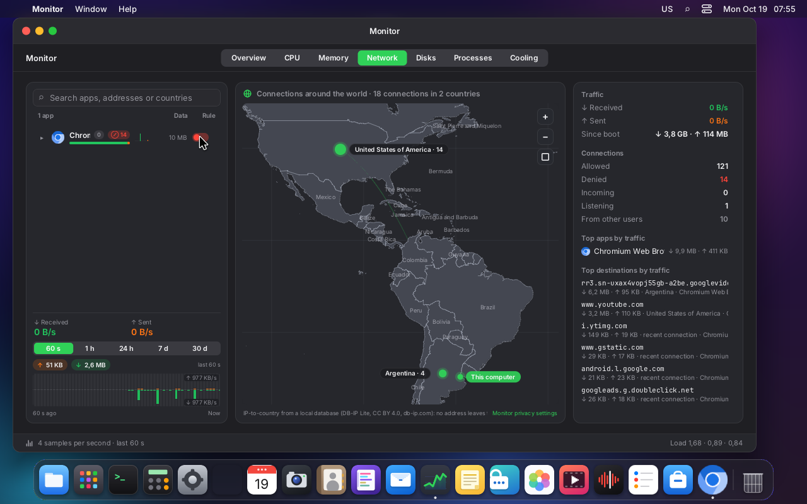
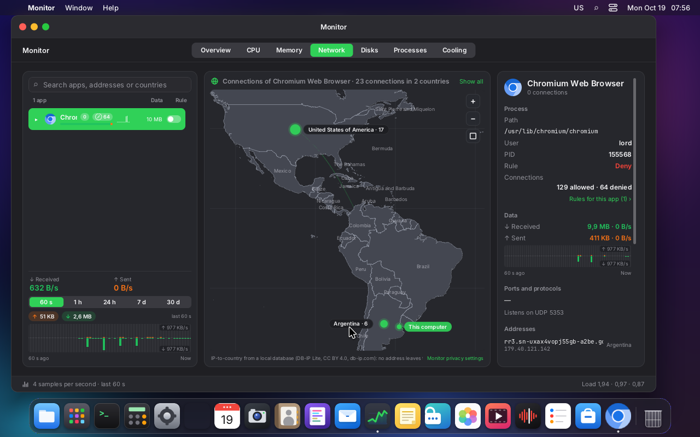

On a kernel with `SOCK_DESTROY` the sockets usually go before more packets arrive, so "Blocked
traffic" stays small (often 0); it grows on a kernel without it, or for a socket the sweep
couldn't see.

**Cost** (`iperf3` through a veth pair into a private network namespace, the client in an app
scope, as in 0.8.1; per-packet time of the program from `kernel.bpf_stats_enabled`, turned off
again afterwards):

| | TCP, ~24 Gbit/s | UDP 1 Gbit/s, 1200 B, sending | UDP 1 Gbit/s, receiving | per packet (UDP send) |
|---|---|---|---|---|
| 0.8.2 (accounting only), a deny rule for another network | 24.2 Gbit/s, 98.5 % sys | 54.2 / 54.7 % | 25.9 / 26.2 % | 200–206 ns |
| 0.8.3, no rules for the app | 24.4 / 24.2 Gbit/s, 98.6 / 98.4 % | 55.5 / 52.8 % | 26.1 / 26.0 % | 231–233 ns |
| 0.8.3, a deny rule for another network (the full decision per packet: trie, bound port, `np_decide`) | 23.9 / 24.2 Gbit/s, 99.5 / 98.7 % | 56.9 / 55.1 % | 26.2 / 26.1 % | 346–369 ns |

- An app without a deny rule pays about **30 ns more per packet** (the `np_apps` lookup); one with a
  deny rule about **150 ns**. At 104,000 packets per second that is 0.3 % and 1.6 % of one core;
  a video over QUIC is a few thousand packets per second. TCP throughput is unchanged within
  run-to-run noise.
- The CPU columns are the client's system CPU (% of one core over 15 s, `iperf3 -J`), two runs each.
- `lord-netperm` itself only works on a reload (one sock_diag dump) and on a cut socket.

### From rules to maps (`npcompile.c`)

There's no time in the kernel for the full precedence of `fw_decide`, so it is precomputed:

1. **Restrictions, trusted and mode** go in `np_apps`. "Ask" is compiled as silent (see "The ask
   mode"). "Just once" rules are not compiled.
2. **`lan`, `internet` and `any`** go in the app's generic list, in precedence order.
   - Up to 16 rules: `NP_GEN_MAX`.
   - They are the least specific, so they go last.
3. **One network per rule.** Each distinct network is a trie node. Its list carries its own rules
   and those of every network that contains it, sorted as in `fw_decide`:
   1. most specific destination;
   2. smallest port range;
   3. concrete protocol;
   4. deny;
   5. the newest.

   The trie's longest match is enough: the first entry that matches in direction, protocol and
   port wins. Up to 16 entries per node (`NP_LIST_MAX`). Any extra ones are reported in the log.
4. **Domains.** For each address the resolver associated with a name that matches one of the
   app's domain rules, there is a /32 or /128 node.
   - Its list starts with those domain rules, which are the most specific.
   - The networks that contain it follow.
   - With several names for one IP, the most specific wins and, on a tie, deny, just like in
     `fw_decide`.

With each new DNS response, only the nodes for those addresses are built, for the apps that have
domain rules. Every 30 s, and with every rule change, the whole app is recompiled and whatever
expired or is left over is removed (the installed map is compared with the new one).

**The test** (`build/npcompile-test`) runs the kernel's same `np_decide` with a simulated trie and
compares it against `fw_decide`:

- 3000 random stores, with domains, wildcards, nested v4/v6 networks, lan/internet/any, ports,
  protocols, incoming, trusted, restricted and the three modes;
- 480,000 connections, with learned names, binds and mapped IPv4: **0 differences** in verdict,
  reason and rule;
- two deliberate mutations of the compiler: inverting "deny wins" and dropping prefix length from
  the ordering. Both produce differences, so the test catches them;
- also, readable cases, the trie keys, the list cap and the two DNS sources (below);
- 401 rules with 4000 learned addresses compile into 2200 nodes in 21 ms on the VM.

### Where the names come from

Only from responses the system resolver gave (`npdns.c`):

1. **With systemd-resolved** (Debian 13 and the ISO): the monitoring interface over varlink,
   `/run/systemd/resolve/io.systemd.Resolve.Monitor`, with `SubscribeQueryResults`. Only root can
   subscribe.
   - Every response resolved gave to any program arrives: via NSS (`nss-resolve`), via the
     127.0.0.53 stub and via D-Bus.
   - It carries the records in wire format (`raw`). From them a DNS message is built that goes
     through `dnsmap`'s strict reader (`dns_parse_response`).
   - **Why it's enough:** an app can't write into resolved's cache. If it uses its own DNS server or
     DNS over HTTPS, those responses don't arrive here. With an "only permitido.com" rule, an IP the
     app got from elsewhere isn't in the trie and is denied.
   - If a lying server slips in a record that doesn't follow from the question (`evil.example` → an
     A of another name), `dnsmap` ignores it. There is a test.
2. **Without resolved:** `NETWORK.md` says LordOS writes `/etc/resolv.conf` (as root). The UDP
   responses that arrive **from port 53 of those servers** are taken.
   - They are read by an AF_PACKET socket that only receives. A classic BPF filter lets through
     only unfragmented UDP with source port 53.
   - The servers come from `resolv.conf`, which is reread every 30 s.
   - It's the simplest thing that is still trustworthy: what an app asks another server isn't
     learned, and an app without root can't send a packet "from port 53" of the server.
   - There is a test of the reader: another server, another port, fragments, lying lengths and
     truncation.

The names belong to the system, not to each app: `dnsmap` stores them under a single key. resolved
doesn't say which program asked. It isn't a hole, because they are real responses: an app can
connect to the IPs of `permitido.com` even if another one requested them.

**The race.** The trie node has to be in place before the app connects.

- On the VM, resolved notifies the monitor between 150 and 300 µs **before** getaddrinfo returns
  in the app.
- A freshly launched `curl -4 https://example.com`, with "deny everything except example.com",
  worked **20 out of 20 times with resolved's cache empty** and 20 out of 20 with a warm cache.
- If it ever arrived late, that first connection is denied with EPERM and the next one works.

### The socket

`/run/lordos/netperm.sock` is 0666: anyone can connect.

- `lord-netperm` knows who each client is through `SO_PEERCRED`. There are up to 4 connections
  per user and each one sees only its user's apps.
- The protocol is in `npproto.h`: `u32` length, `u8` type and the data.
- **From lord-server to lord-netperm** there is a single message, with no data: `RELOAD`. Anything
  else drops the connection.
- **The rules don't travel over the socket.** `lord-netperm` reads the user's
  `~/.config/lordos/firewall.json` itself, with `CAP_DAC_READ_SEARCH`:
  - folder by folder with `openat`, `O_NOFOLLOW` and `O_NONBLOCK`;
  - each folder and the file must belong to the user;
  - the file must be a regular file of up to 4 MB;
  - it is validated by `fw_from_json`'s strict reader. If it doesn't validate, the previous rules
    stay.

  It reads it when the session appears and on every `RELOAD`.
- **From lord-netperm to lord-server:**
  - `STATUS`: `{bpf, devices, bluetooth, bytes, dns, error}` (`bytes`: the accounting programs are loaded);
  - `EVENT`: `{app, v, dir, proto, addr, port, by, rule, flag, record}`, a new connection;
  - `COUNTS`: `{app: [allowed, denied, rx, tx, rxRate, txRate, [[addr, rx, tx, rxRate, txRate], ...]]}`,
    every second, only if something changed. `rx`/`tx` are the app's bytes since its scope
    appeared, the rates are bytes per second over the last second, and the list holds the app's
    64 busiest addresses (those active in the last 2 minutes). Readers that only know
    `[allowed, denied]` keep working.

  If nobody reads, notices are dropped. Counters are sent again when they change.

### `lord.fw` (lord-server, `js_fw.c`)

lord-server owns the user's rules: it loads them at startup, changes them and saves them with
`fw_save`. Then it sends `RELOAD`. The socket never blocks. It is read in `lord.fw.poll()`, which
the SDK calls once per second while the Monitor's Network tab is open.

| Call | What it does |
|---|---|
| `status()` | `{ daemon, bpf, dns, error }` |
| `state()` | `{ mode, trusted, restricted: { app: [restriction] } }` |
| `appRule(app)` / `setAppRule(app, 'allow'\|'deny'\|null)` | the switch's `{app, out, any}` rule |
| `setTrusted(app, on)`, `setRestricted(app, [restriction])`, `setMode('silent'\|'ask'\|'off')` | lists and mode |
| `rules(app)`, `addRule({ app, dir, dst, port, proto, action })`, `removeRule(id)` | rules (domains, networks, ports); each rule from `rules()` also has `when` and `lastMatch` (Unix seconds, 0 = not seen) |
| `updateRule(id, { dir, dst, port, proto, action })` | replaces a rule of the same app; if the new one can't be added, the old one is put back |
| `ruleApps()` | the apps that have at least one rule |
| `poll()` | `{ counts, events }` |
| `blocks(app, restriction)` | `true` if the app is restricted in it (`sdk/notify.js`) |

Everything is validated in C:

- ids with `fw_app_canon`;
- destinations with `fw_parse_dest`;
- ports from 1 to 65535 (`lo ≤ hi`);
- protocols, actions and restriction names against their closed lists.

No call takes paths. Isolated `.lpk` apps don't have `lord.fw`.

In the SDK, `firewall` and `firewallState` from `sdk/monitor.js`, exported in `@lordos/sdk`.

**The Monitor** also attributes each process to the scope it runs in (`js_monitor.c`, `scope_of`,
which reads `/proc/<pid>/cgroup` with a cache). This way a `curl` inside `foot` is `foot`, just as
in the kernel. Before, it was the standalone `curl`, which can't be filtered.

### The modes

| Mode | In the kernel |
|---|---|
| silent (default) | whatever has no rule is allowed, and each new connection is counted and reported to the Monitor (`record`) |
| off | only explicit denials and restrictions apply; the rest is allowed without recording |
| deny (0.8.5, "Deny silently") | whatever no rule allows is denied and recorded; loopback (127/8, `::1`) stays allowed, so the resolver's stub and local services keep working; trusted apps keep the network; the essential system services are not apps and are never affected |
| ask | for now, the same as silent |

The deny mode is `FW_MODE_DENY` in `fw/rules.c` and `NP_M_DENY` in `np_decide` (the last step: a
rule, a restriction or a list decides first); with it every app's packet filter decides, so a
connection that was open when the mode changed is cut ("Existing connections are cut"). It is offered
in Settings → Privacy → App network and in the menu bar item. Tested: `fw-rules-test` (loopback,
`::1`, a mapped `127.0.0.1`, a rule that allows, a trusted app, the file round trip) and the random
comparison of `npcompile-test`, which now draws the deny mode too.

### The ask mode (next step)

A `connect` hook can't wait for the owner, and holding the connection in user space (like
NFQUEUE) is per-connection work outside the kernel. It will work as a "retry" prompt:

1. An app's first connection to a destination with no rule is **denied right away** (EPERM). The
   `ask` verdict goes in `np_apps`, and the notice goes out through the ring with `record`.
2. lord-netperm passes it to lord-server, and the SDK shows a system prompt (`PermissionPrompt`):
   ""App" wants to connect to ejemplo.com:443 — Allow once / Always / Deny".
3. The answer becomes a rule (once, until quit, or forever) and lord-netperm compiles it at once.
4. The app retries: browsers and most clients do it on their own, and the prompt offers "Retry"
   for the rest. The second connection gets through.

While the prompt is open, connections to that destination keep being denied without repeating
the prompt: `np_seen` already groups them for 5 s.

### Tested on VM 122

`tests/netperm_integration.sh` sets up an app scope like the launcher does and writes rules:
**18 out of 18**, with `lord-netperm` as a hardened systemd service.

| Case | Result |
|---|---|
| no rules | TCP to the gateway: works |
| deny the app | TCP `EPERM`, UDP `sendto` `EPERM`, TCP over IPv6 `EPERM` |
| allow it again | works |
| "deny everything except example.com" | `https://example.com` 200; `https://www.debian.org` `EPERM`; the IP the resolver gave works; an IP it didn't give, `EPERM` |
| "LAN only" (`no-internet`) | the gateway works; internet `EPERM` |
| `no-incoming` | `bind`+`listen` on 18080 `EPERM`; ephemeral bind and outgoing work |
| `no-network` | `socket()` `EPERM` |
| off | the explicit denial applies; the rest works |
| another process outside the scope | works |

**With the UI**, the "Network test" app is a `.desktop` that opens `foot` with a loop of `curl`
and `/dev/tcp`:

- **Monitor → Network:** the switch in the Rule column denies the app. `curl` and bash get
  "Operation not permitted", and the denied counter and the row's counter appear. Turning it back
  on, it works.
- **Settings → Privacy → App network:** with "no internet" checked in Restricted apps, the gateway
  works and the internet doesn't.

**`systemd-run --user` escape (the `user@` union).** With a restricted app running
(`desktop:aisla`, "no internet"), from a `foot` terminal placed in `app-lordos-aisla.scope`:

| Escape attempt | Result |
|---|---|
| `curl https://example.com` (direct, in the app scope) | blocked — "Could not connect" (existing scope rule) |
| `systemd-run --user --scope curl https://example.com` | blocked — the scope lands in `user@1000`, `np_union` denies the connect |
| `systemd-run --user curl https://example.com` (transient service) | blocked — same, even though the user manager forks it |
| `setsid curl https://example.com` | blocked — `setsid` does not change the cgroup, stays in the app scope |

`lord-netperm` logs each `user@` denial as `uid 1000 user@: denied … (union of
restricted apps no-internet)`. A normal process outside `user@`/`lordos.service` app scopes (e.g. an
SSH session scope) still reaches the internet while the restricted app runs, so normal apps are
unaffected. Cross-user: a restricted app for `bob` (uid 1001) blocks `bob`'s `systemd-run --user`
escape while `lord` (uid 1000, no restricted app) keeps full access — the union is per
`user@<uid>`, never leaking between users. The screenshot shows the four attempts blocked:

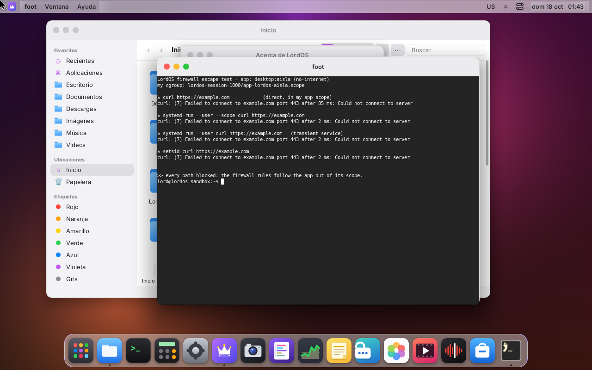

### Measurements (VM 122, 4 vCPU Xeon Silver 4108, kernel 6.12)

`tests/netperm_measure.sh`: 3 runs of 20,000 `connect()` to 127.0.0.1 inside a scope, and 3 GB
over TCP on 127.0.0.1.

| | TCP connect (median) | UDP connect (median) | throughput |
|---|---|---|---|
| lord-netperm off | 13.9 / 13.7 / 16.7 µs | 2.1 / 2.0 / 2.5 µs | 842 MB/s |
| on, no rules (silent) | 13.7 / 17.4 / 17.4 µs | 2.4 / 2.5 / 3.0 µs | 818 MB/s |
| on, 402 rules for the app | 13.7 / 13.8 / 17.7 µs | 3.1 / 2.6 / 2.5 µs | 829 MB/s |

- **The per-connection cost** shows in UDP, because its connect does no handshake: about
  **0.5 µs**. In TCP it stays within loopback noise.
- **Throughput doesn't change:** the differences are within run-to-run noise. (These loopback
  numbers predate the accounting programs of 0.8.1, which return at once on loopback.)
- **The compositor:** lord-server's main thread, with the Monitor open on Network (which calls
  `lord.fw.poll` once per second), used 3.20 % of a core with lord-netperm on, 3.20 % off and
  3.13 % on again. 30 s each. Nothing of the firewall runs in the frame: `poll` reads a socket that
  doesn't block. Per-frame times weren't measured separately.

### Measurements of the traffic accounting (0.8.1, VM 118, same CPU, kernel 6.12)

**Accuracy**, against `/proc/net/dev` (eth0, which also counts the 14-byte Ethernet header and
any other traffic of the machine) while only the app moved data:

| App (its own scope) | Counted by the app | eth0 | Ratio |
|---|---|---|---|
| `curl --http3-only`, a 20 MB file over QUIC | 20.31 MB received | 20.55 MB | 98.8 % |
| Chromium playing a video on a video site (QUIC, 60 s) | 4.54 MB received | 4.60 MB | 98.7 % |
| `iperf3 -u -b 400M -l 1200`, 8 s, to a veth peer | 409,385,865 B sent | — | exact: 400,050,000 B payload + 333,375 × 28 B of IP/UDP headers |

Before, the same QUIC download showed "—" (0 B): UDP had no `tcp_info`.

**Cost**, `iperf3` through a veth pair into a private network namespace (eth0 untouched), the
client inside an app scope; system CPU as % of one core over 15 s, two runs with the accounting
programs:

| | 0.8.0 `lord-netperm` | 0.8.1 (accounting) |
|---|---|---|
| TCP, ~24 Gbit/s (GSO/GRO: few, large skbs) | 162.0 / 161.6 % | 164.5 / 163.1 %, 162.4 / 162.3 % |
| UDP 1 Gbit/s, 1200 B datagrams (104,000 packets/s), sending | 91.5 % | 94.7 %, 100.2 % |
| UDP 1 Gbit/s, 1200 B datagrams, receiving | 100.2 % | 108.7 %, 106.9 % |

- TCP: no measurable difference (throughput 22–25 Gbit/s run to run, either way).
- UDP at 104,000 packets per second: about 5 % of one core more, roughly 0.5 µs per packet (two
  map lookups, two atomic adds, one header read). A QUIC video at a few MB/s is a few thousand
  packets per second: well under 0.1 %.
- `lord-netperm` itself: 0.00–0.01 s of CPU per 15 s run (one counter read per app per second,
  plus one batch read of `np_flows` only while bytes move).
- Script: `bench-monred-118.sh` in the scratchpad (veth `npb0`/`npb1`, namespace `npb`, both
  removed afterwards); `iperf3` was installed on VM 118 for this (`VM-SETUP.md`).

### LordOS components in their own scopes (0.8.5)

Built-in parts that use the network used to run inside lord-server, so their traffic was
"LordOS" and a rule could only take all of them at once. Since 0.8.5 each one has its own process in
its own scope, `lordos-net-<name>.scope`, which lord-netperm reads as the firewall app
`lordos:<name>` (`fw_component_scope`, a fixed list: `mail`, `store`, `print`, `terminal`,
`lists`). The kernel attributes a socket to the cgroup of the process that *created* it, so:

- **Connectors** (`server/src/sec/netconn.c`): for Mail (lord-maild's servers: Mail, Calendar,
  Contacts, Reminders), printers and scanners (IPP and eSCL over TCP, the mDNS socket) and the
  blocklist downloads, lord-server starts `lord-server --net-connector <name>`: the **same binary**
  re-executed (like the terminal holders), fixed argv, `LANG` and `LORDOS_SESSIOND` only, the channel
  on fd 3 and every other descriptor closed. It asks lord-sessiond to place it in its scope, waits a
  quarter of a second so lord-netperm sees the new scope, and then only answers fixed-size requests:
  family (IPv4/IPv6), type (stream/datagram), and an address and port to `connect()` to
  (non-blocking; lord-server waits for the result). It returns the socket over SCM_RIGHTS and
  lord-server checks it is the kind it asked for. It takes no names or paths, runs nothing, has
  `no_new_privs`, is not dumpable and has 64 file descriptors; it only does what lord-server could
  do itself, as the same user. **Fail closed:** in a LordOS session a connector that can't enter its
  scope exits and the request fails (the traffic would otherwise be lord-server's and decided by
  its rules). Outside a session (development, the tests) the socket is made in place, as before.
- **Store and updates:** the package engine's download child (the root admin helper's fork that
  drops to `nobody`) moves itself into `lordos-net-store.scope` before dropping root
  (`cgroup_enter_root`: only from its session's `server` leaf, only itself, a root-owned scope;
  lord-sessiond's placement service only places session users).
- **Terminal:** the shell of each terminal (`term/pty.c`) enters `lordos-net-terminal.scope` before
  exec, so every program started there is "Terminal" (the Monitor lists them by name). Best effort:
  a terminal that can't be placed still opens.
- **The network service:** lord-sessiond starts lord-netd in `lordos.service/netd`, its own leaf
  (`cgroup_service_leaf`), so its traffic (DHCP, the VPN daemons) can be counted apart from
  lord-sessiond's.

Because these are ordinary firewall apps, every rule, restriction and switch works on them (Settings
→ Privacy lists them, restrictions are the network ones). The Monitor shows the VPN tunnels from
their interfaces' counters and never offers a switch for them.

**What was tested on VM 118:** a program in the Terminal and the Store's download each had their own
row with their own bytes; blocking the Store (after its warning) made a download in its scope fail
with `denied out tcp 151.101.66.132:80 (rule)`; `netconn-test` checks the requests on both sides,
the sockets, the real connector process (the test binary re-executed) and that a connector that
can't enter its scope refuses. Mail and the printers use the same connector as the blocklists,
which were tested live; Mail against a real server and a network printer were not (VM 118 has
neither).

### The essential system services (0.8.5)

Name resolution, time and the network service are shown but can never be blocked: they are not in
any app's scope, so no rule reaches them. The accounting programs alone (`cgroup/skb_ingress`,
`skb_egress`) are also attached to `system.slice/systemd-resolved.service` and
`systemd-timesyncd.service` (lord-netd's leaf is already under `lordos.service`), and `np_sysc`
gets an entry for each, keyed by its cgroup id; a packet that isn't an app's is looked up there by
its socket's cgroup (`bpf_skb_cgroup_id`) and only counted, never filtered. COUNTS carries them as
`system:dns`, `system:time` and `system:network` for every user. lord-netd's DHCP client uses a
raw socket for discovery, which the cgroup programs don't see: only its unicast renewals count.

### Measurements, 0.8.5 (VM 118)

`iperf3` through a veth pair into a private namespace (eth0 untouched), the client in an app scope,
system CPU in % of one core over 15 s, 0.8.3's lord-netperm and this one interleaved twice:

| | 0.8.3 | 0.8.5 |
|---|---|---|
| UDP 1 Gbit/s, 1200 B datagrams (104,000 packets/s), sending | 104, 109, 107, 102 % | 112, 117, 112, 110 % |
| the same, receiving | 105, 101, 104, 98 % | 116, 116, 110, 114 % |
| TCP (~22 Gbit/s) | 166, 163 % | 172, 168 % |

About 0.6 µs more per packet at this extreme rate (the per-port flow key and the bound-port lookup
on every packet): a video over QUIC at a few thousand packets per second costs well under 0.5 % of a
core. Blocklists add nothing per packet: with four lists (399,396 entries) on and off, the same
bench gave 105–115 % and 109–111 %, within run-to-run noise. A build without the per-port parsing
gave the same numbers as this one, so the difference is not the port parsing itself.

### Known limits

- **App scopes are root's now** (was: "Scopes belong to the user"). `lord-sessiond` creates the
  scopes and places each process; every `cgroup.procs` of the session subtree is root-owned, so a
  Linux app can no longer move itself to another scope, to `server` or to a new cgroup (tested on
  VM 122, see `PRIVACY.md`, «Root-owned app scopes»).
- **`systemd-run --user` escape: closed** (was the remaining hole). The programs are now attached to
  each user's `user@<uid>.service` too, and a process that escapes there is held to the per-user
  restriction union (see [Escape via `systemd-run --user`](#escape-via-systemd-run---user-the-user-union)).
  Tested on VM 122 (see below). What stays coarse: the union restricts the whole `user@` subtree
  while a restricted app runs, not just the escaped process. `firewall.json` and `permisos.json` are
  still writable by an unsandboxed app running as the user (a filesystem matter, not the firewall);
  an app restricted with `no-files` can't see them.
- **A freshly created scope** is registered via inotify within microseconds, before the program
  finishes starting (exec + libraries). If a connection arrived earlier, it would pass under the
  default rules.
- **What isn't checked:**
  - ICMP: denied only with "no network", through `sock_create`;
  - TCP `listen` without `bind` (ephemeral port): its connections are decided as outgoing ones.

  Incoming connections that arrive at an already open port are now decided per packet by the
  filter (0.8.3, [Existing connections are cut](#existing-connections-are-cut)).
- **Cutting under `user@`:** the packet filter is attached only to `lordos.service`, so a process
  that escaped to `user@<uid>.service` keeps the connections it already had when a restriction is
  added; its new ones are refused by the union as before.
- **Cuts after a restart of `lord-netperm`:** the ports an app bound before the restart come back
  from the listening TCP sockets only; a UDP server bound before it is decided as outgoing until it
  binds again.
- **Per-port rules with direction `in`** are applied at `bind`, with an unknown address.
- **The "ask" mode** is applied as silent.
- **Per-destination rules** in the Monitor: done ("Allow / Block this domain", see
  [Rules by app](#rules-by-app-settings-and-monitor)).
- **Host names** are passed to the session: each `EVENT` notice carries `"hosts"`, up to 4 names
  the system resolver gave for that address, and the Monitor prefills "Block this domain" with
  the first one (tested by `netperm_integration.sh`, step 9).
- **Domain rules and encrypted DNS:** see [What domain rules can't see](#what-domain-rules-cant-see).

### Screenshots (VM 122)

- The denied app: `curl` and bash get "Operation not permitted".
  
- Monitor → Network, with the app's switch on deny and the counters:
  
- Monitor → Network with the app selected (rule and allowed and denied connections):
  
- Settings → Privacy → App network: mode, Trusted apps and Restricted apps:
  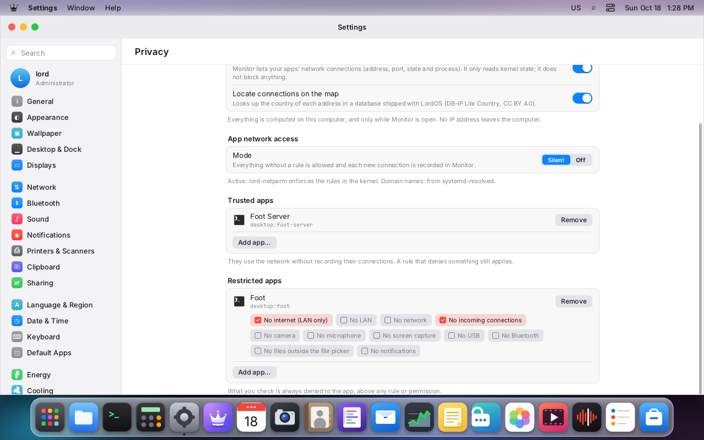
- "LAN only" from Settings: no internet, the gateway yes. 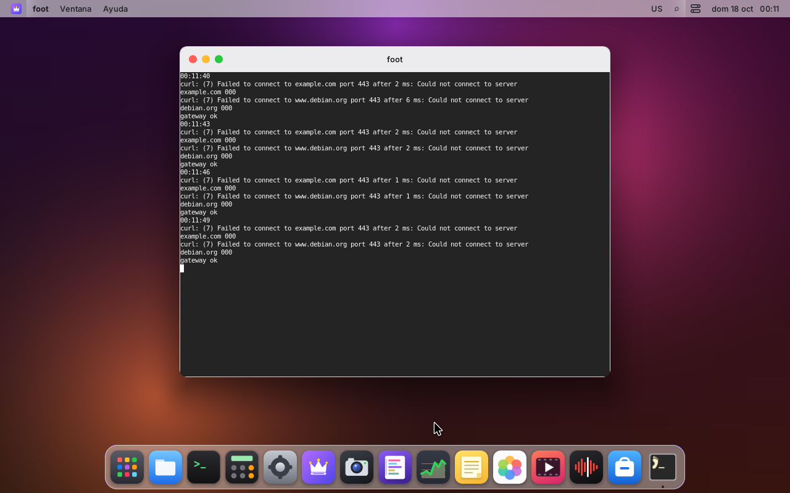


## Blocklists (0.8.5)

A curated catalog of public lists by topic (advertising, trackers, malware and attacks), domain-
and address-based, that the owner turns on in Settings → Privacy → Blocklists, plus custom lists by
https address. Lists are downloaded daily over HTTPS by an unprivileged, sandboxed helper, parsed
strictly, checked again by lord-server, compiled into one file and enforced by lord-netperm in the
existing per-app maps. They never override a rule the owner wrote for a destination.

```
assets/fw/blocklists.json        the catalog: id, topic, url, format, licence, source, date checked
server/src/fw/fwlists.{c,h}      raw parsers, the set (hashes), the compiled file's reader
server/src/fw/fwsub.{c,h}        lord-server: subscriptions, the download job, compiling
server/src/fetch/fetch.c         lord-fetch, the downloader (OpenSSL), fetchproto.h its protocol
server/src/ui/js_fw.c            lord.fw.lists / setList / addList / removeList / updateLists / listMatch
apps/monitor/Blocklists.jsx      Settings → Privacy → Blocklists
tests/fwlists_test.c, fwsub_test.c
```

### The catalog and its licences

Each list was added only after its licence was checked (the list file's own header and its
project's licence file, 2026-10-19), and the catalog records what was found; LordOS ships no list
data, each machine downloads what its owner turns on.

| List | Topic | Format | Source | Licence |
|---|---|---|---|---|
| Advertising (domains) | ads | domains | The Block List Project | MIT (list file), Unlicense (repository) |
| Advertising and malware (unified hosts) | ads | hosts | Unified hosts (Steven Black) | MIT |
| Trackers and analytics | trackers | domains | The Block List Project | MIT, Unlicense |
| Phishing sites, Scam sites, Ransomware, Hidden crypto mining | malware | domains | The Block List Project | MIT, Unlicense |
| Attacking addresses | malware | addresses | IPsum, level 3 | Unlicense |

Left out: a malware URL feed whose terms are fair use without a stated licence; a botnet controller
address list (CC0) that was empty when checked; The Block List Project's malware list (2.6 million
entries, over the size limit); lists under non-commercial licences.

### Downloading: lord-fetch

- **Who connects:** lord-server resolves the list's host and connects through the blocklists'
  connector, so the socket is `lordos:lists`'s (its own row and rules). Only `https://` addresses
  (`fws_split_url`: a host name with a dot, an optional port, a printable path; no user info, no
  addresses in brackets).
- **lord-fetch** (`server/src/fetch/fetch.c`): posix_spawned by the job thread from lord-server's
  folder (root's or the user's, not writable by others), no arguments, `LANG` only, the channel
  (lord-doc's framing) on fd 3. It loads the CA bundle and then calls `sandbox_apply_helper` (scope
  `lordos-fetch.scope`, 256 MB; no socket, connect, bind or exec; no files). For each list it gets the
  connected socket and `{host, path, format, sub}`; it speaks TLS 1.2 or later with the certificate
  checked against the system CA store and the host name (mail/net.c, never relaxed), sends one
  HTTP/1.1 GET with `Accept-Encoding: identity`, and reads at most 16 MB with deadlines
  (mail/http.c). A redirect comes back to lord-server, which follows at most three, https only.
- **Strict parsing, in the helper** (`fwl_parse_raw`): a NUL byte, a line over 1024 bytes or a body
  over 16 MB reject the list; comments (`#`, `!`, `;`, `//`, inline ` #`) are dropped; a hosts file
  only maps names to `0.0.0.0`, `127.0.0.1`, `::` or `::1`; a domain list has one name per line
  (`*.name` and `||name^` mean the name and its subdomains); an address list has an address or a
  CIDR network first on the line (other columns ignored; host bits must be 0). Skipped and counted:
  localhost names, names without a dot, LAN networks (it would cut the machine off its own network)
  and networks broader than /8 or /16. More than 10 % unparsable lines (over 20) reject the list as
  the wrong format. At most 300,000 names or 100,000 networks per list (the rest is cut and said).
  What comes back is normalized lines (`d name`, `s name`, `n cidr`), each once, in a sealed memfd.
- **lord-server checks it again** (every line with the same validator) before keeping a copy in
  `~/.cache/lordos/fwlists/<id>.txt` with its state (`<id>.json`: when, how many, the last error).
- **Daily:** `sdk/netstatus.jsx` asks once an hour (`lord.fw.updateLists`); lord-server downloads
  only the enabled lists whose copy is more than 20 hours old, and a list that failed is tried again
  after an hour. Turning a list on downloads it at once if there's no copy.

### Compiling and enforcing

- **One file:** the job thread writes every enabled list's lines into `~/.config/lordos/fwlists.txt`
  (header `lordos-fwlists 1`, at most 32 MB) and keeps a set of hashes for the Monitor's "on the list
  …" (`lord.fw.listMatch`); when the job ends lord-server sends the usual RELOAD. The three files
  are on `lord.fs`'s deny list.
- **lord-netperm** reads `fwlists.txt` with the same fixed-path, no-links, user-owned, size-limited
  reader as `firewall.json`, and any invalid line keeps the previous set. Names are kept as 64-bit
  hashes (keyed per process) in sorted arrays, about 10 bytes a name: 380,000 names and 19,000
  networks take 13.8 MB of lord-netperm's memory.
- **In the kernel:** each user with lists gets a set in `np_blk4`/`np_blk6` (LPM tries keyed by
  set and address), and each of their apps carries it (`NpApp.blk`). The set holds the lists'
  networks and, from the system resolver's answers, the addresses of listed names; an address is
  only added when **every** name the resolver gave for it is listed, so an address a tracker shares
  with a site that isn't listed (a shared CDN) stays allowed. A DNS answer updates its addresses at
  once, before the app connects; every 30 s the whole set is recomputed (what the resolver forgot
  goes); learned addresses are capped at 16,384 per user. `np_decide` checks the set after the
  rules naming the destination and before `lan`/`internet`/`any`.
- **No per-packet cost:** lists don't make the packet filter decide for every app: `connect()` and
  `sendmsg()` deny, and after each change that adds entries a sweep cuts the sockets already open
  to them (as for rules).

**What lists can't see:** the same as domain rules ("What domain rules can't see"): an app with its
own encrypted DNS is only checked by address.

**Tested:** `fwlists-test` (hosts, domains and address formats, every rejection rule, the set and its
lookups, CNAME-style shared addresses, the file reader, 20,000 mutated lists; also under ASan and
UBSan) and `fwsub-test` (URL parsing, the catalog and config, compiling seeded copies, custom lists,
and lord-fetch refusing bad requests and a peer without TLS, without network). On VM 118: two lists
downloaded over HTTPS (8,527 names and 19,405 networks), then all four; `curl` from the Terminal to
a listed domain and to a listed address failed with `denied out tcp … (list)`; switching that
domain's row on in the Monitor wrote `{"app":"lordos:terminal","dst":"nationalityship.com","action":"allow"}`
and the next connection went through; switching it off removed the rule.

## Rules by app (Settings and Monitor)

The rules the store always supported (`lord.fw.addRule`: domains, wildcards, addresses, networks,
ports, protocols) now have screens:

```
apps/monitor/FwRules.jsx     Settings → Privacy → "Network rules by app" (registerPrivacySection)
apps/monitor/RuleSheet.jsx   the add / edit sheet, shared with the Monitor
apps/monitor/Network.jsx     Monitor → Network: "Allow / Block this domain" on an app's destinations
sdk/fwrule.js                checks what is typed, orders rules by precedence (fwRule in @lordos/sdk)
server/tests/fw_dest_cases.txt, fwdest_test.c, fwrule_input_test.mjs   the parser tests
```

**Settings → Privacy → Network rules by app.** One row per app that has rules (plus any app added
with "Add app…" or opened from the Monitor). Open, an app shows:

- **Default for this app:** "Allow all" (no `{out, any}` rule: what no rule covers follows the mode)
  or "Block all except rules" (the `{out, any, deny}` rule, the same one the Monitor's switch writes).
- **Its rules**, each with Allow / Block, the destination, its kind (exact domain, domain and
  subdomains, address, network…), port, protocol and **when it last matched**, with Edit and Delete
  (Delete asks once more in the row).
- **Add rule…** opens the sheet: action, destination, optional port (`443` or `8000-8080`) and
  protocol (any, TCP, UDP). What is typed is checked as it is typed and the sheet says what the
  destination covers ("example.com and every name under it", "a network of 256 addresses") or what
  is wrong (a host bit outside the prefix in `10.0.0.1/8`, a bad label, a port out of range). A bare
  "any" is refused there: that is the app's default, set above.

**There is no priority to reorder.** `fw_decide` has no rule order: of the rules that match a
connection, the most specific destination wins (exact domain > longer wildcard > shorter wildcard
> longer prefix > shorter prefix > lan/internet > any), then the smaller port range, a concrete
protocol, deny over allow, and the newest (see [Precedence](#precedence)). The list shows each app's
rules in exactly that order (`sortByPrecedence` in `sdk/fwrule.js`, a copy of `consider` in
`rules.c`) and the footer explains it, so the top rule is the one that would win.

**Monitor → Network.** Selecting an app's destination (in the list or in the detail pane) offers
"Allow this domain" / "Block this domain" for that app. The sheet opens over the window:

- prefilled with the name the system resolver gave for that address when the firewall notice
  carries one, with the exact name and `*.parent` as one-click choices;
- without a name (today, see Known limits) it says so and is prefilled with the address, which the
  user can replace with a domain.

Short connections (a `curl`) close before the next sample, so besides the open sockets each app
lists the destinations `lord-netperm` reported recently ("recent connection" / "recently denied").
Since 0.8.2 each destination in an app's open row also has its own allow/block switch: it shows what
the app's rules decide for that name or address (the same order as `fw_decide`, mirrored in
`sdk/fwrule.js` `decide()` and checked against it with `server/tests/fw_domain_cases.txt`) and a
click writes, flips or removes the exact-name rule (`MONITOR.md`, "Per-destination switches").
The detail pane also links to "Rules for this app" (Settings → Privacy, with that app open).

**Last match.** `lord-netperm`'s `EVENT` notices carry the rule that decided (`"by":"rule"`,
`"rule": N`). lord-server keeps, per rule, the time it last saw one (memory only, like the counters;
`lastMatch` in `rules()`), and Settings reads it every 5 s while shown. Two details:

- `lord-netperm` numbers rules on its own: on every reload it reads `firewall.json` into a new
  store, so its ids are 1, 2, 3… in file order. After every save `js_fw.c` reads the saved text the
  same way and maps those ids to its own rules by app, direction, destination, ports and protocol.
- Notices are deduplicated per destination for 5 s, and only those this session received count:
  "matched just now" means within the last minute, not per packet.

### What domain rules can't see

A connection only carries an address. Domains are matched with the names the **system resolver**
returned for that address ([Where the names come from](#where-the-names-come-from)), never with
what the app says. So:

- An app that resolves names **by itself** with encrypted DNS (DNS over HTTPS or over TLS inside a
  browser, for example) never goes through the system resolver: its names aren't learned, and a
  domain rule doesn't see its connections. An "allow only example.com" app is still safe (an
  address the resolver never gave isn't in the trie, so it falls to the default and is blocked),
  but a "block example.com" rule doesn't stop it.
- **Address and network rules, the app's default and its restrictions still apply** to those
  connections: they don't depend on names.
- Names belong to the system, not to one app: if another program resolved `example.com`, its
  addresses count as `example.com` for every app (they are real answers).

Settings says this in a footer under the rules, in the user's language.

### Tests

- `build/fwdest-test` (in `make -C server test`) runs every destination in
  `server/tests/fw_dest_cases.txt` (exact and wildcard domains, upper case and trailing dots,
  punycode, bad labels, IPv4 and IPv6 addresses and networks, host bits outside the prefix, bad
  prefixes, `::ffff:` mapped addresses, leading zeros) through `fw_parse_dest` + `fw_format_dest`:
  62 cases, 0 failures on VM 122.
- `server/tests/fwrule_input_test.mjs` (run by `run_suites.sh` when `node` is installed, otherwise
  "skipped: needs node") runs the same file through the sheet's parser, plus ports, protocols, the
  default rule and the precedence order: 99 checks. Both parsers read one file, so they can't drift.
- End to end on VM 122 (`lord-netperm` from the package, the new `lord-server` and bundle): a
  `.desktop` "Curl test" (`foot -e` a loop of `curl https://example.com` and
  `https://www.debian.org`, every 4 s) started from the launcher runs in
  `app-lordos-curltest.scope`. From the Monitor, "Block this address" → typed `*.example.com` →
  Add rule:

  | Time | `example.com` | `www.debian.org` |
  |---|---|---|
  | before the rule | 200 | 200 |
  | rule added (14:55:02) | `curl: (7) Failed to connect … Could not connect to server` from 14:55:07 | 200 |
  | rule deleted in Settings (14:58:18) | 200 at 14:58:18 | 200 |

  `lord-netperm` logged each denial for `desktop:curltest` (`tcp 172.66.147.243:443 (rule)`, the
  other address, and UDP 443 for HTTP/3). Edit (`10.0.0.0/8` → `10.1.0.0/16`) replaced the rule in
  `firewall.json` in place.

### Screenshots (VM 122)

- Settings → Privacy → Network rules by app, rules in precedence order with their last match:
  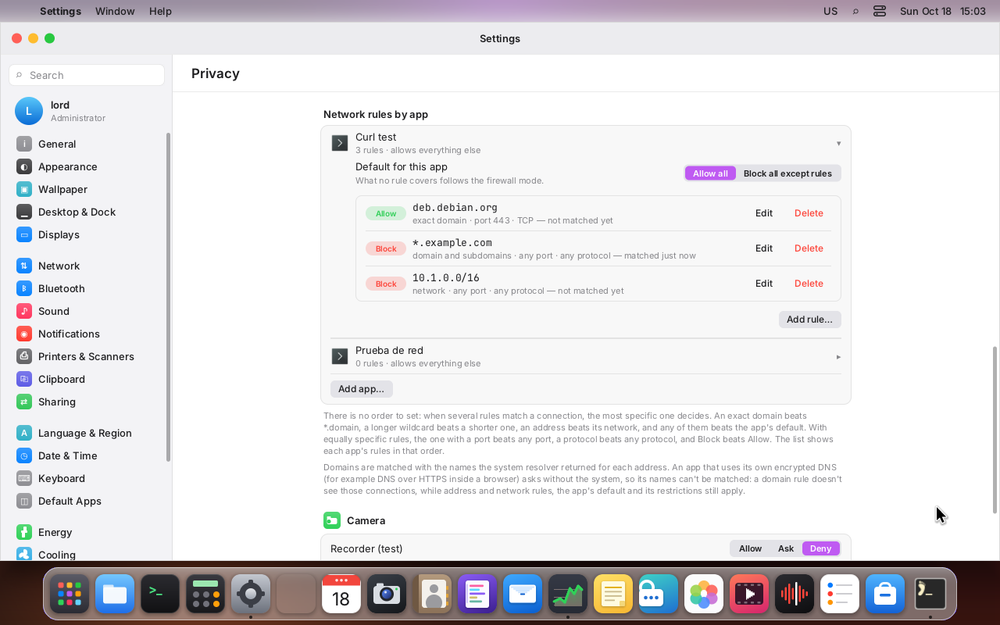
  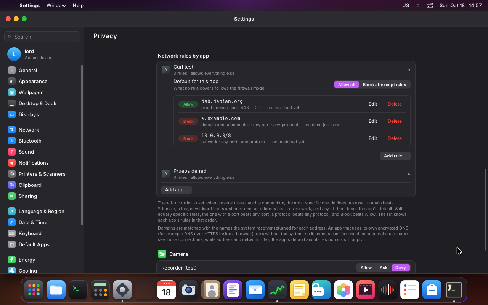
- The sheet: in the Monitor, "Block this address" changed to `*.example.com` (light); in Settings,
  a network with a host bit outside the prefix (dark):
  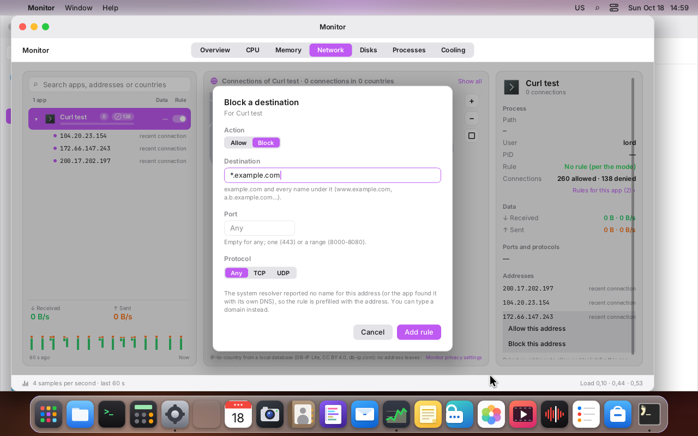
  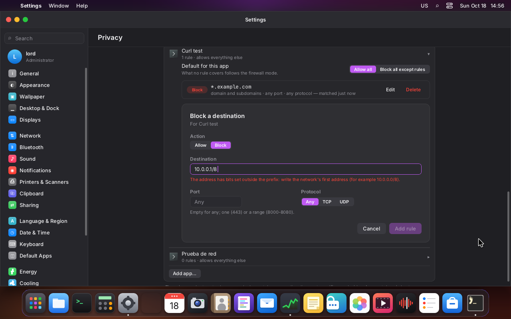
- Monitor → Network with the rule on: the app's recent destinations, "recently denied", and the
  actions on the selected one:
  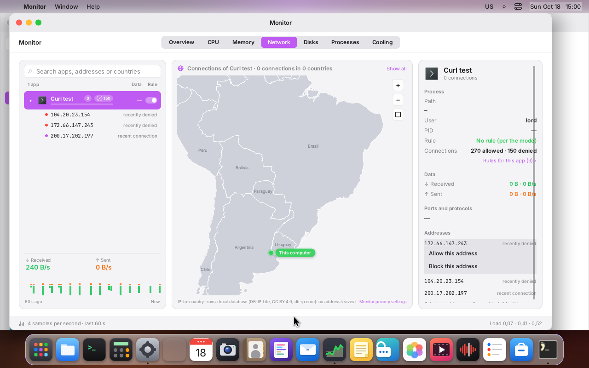
  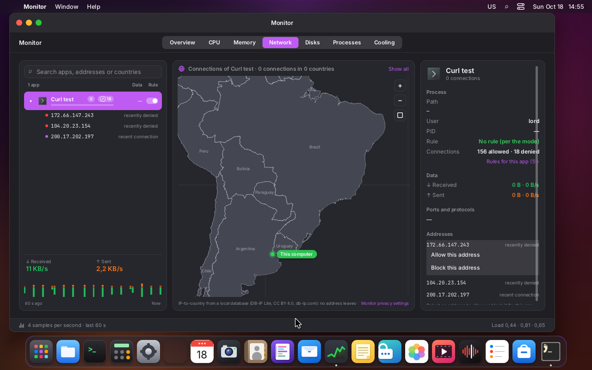

## How the next steps plug in

What remains of steps 3 and 4 (the original design; what's done is above, in "`lord.fw`").

### Step 3: Monitor, the "Rule" column

- **The column:** `apps/monitor` already groups by `appKey` (`lordos`, `desktop:<id>` or the
  path), which is the same canonical id as here. Each app's switch writes the rule
  `{app, out, any, allow|deny, forever}`. Since adding the same destination replaces, going back
  and forth doesn't pile up rules.
- **Each expanded destination** can have its own switch: a rule with that domain (if `dnsmap`
  knows the name) or with that IP.
- **The counters:**
  - "allowed" and "denied" come from `FwDecision.verdict`;
  - those with `record = 1` are the ones silent mode leaves for review;
  - each connection carries the `verdict` (today fixed at `'allow'`, see `docs/MONITOR.md`,
    "Phase 2").

### Step 4: Settings

- **Where:** in Privacy (or in Network, with M7's grouping), two lists:
  - **Trusted apps:** `fw_set_trusted`;
  - **Restricted apps:** `fw_set_restricted`, with a checkbox per restriction from the table
    above.
- **The mode selector:** silent / ask / off.
- **Outside the network:** the non-network restrictions are queried with `fw_blocks` (through
  `sec/restrict.h`) before `perms.c`, by the broker for isolated apps and by `js_media.c` and
  `sdk/notify.js` for the built-in apps. Exactly what is enforced where is in
  [Non-network restrictions](#non-network-restrictions).
- **The JS API:** goes in its own `js_fw.c`, with input validation like the rest of `lord.*`. It
  never takes paths: the file's path is fixed by the server.
