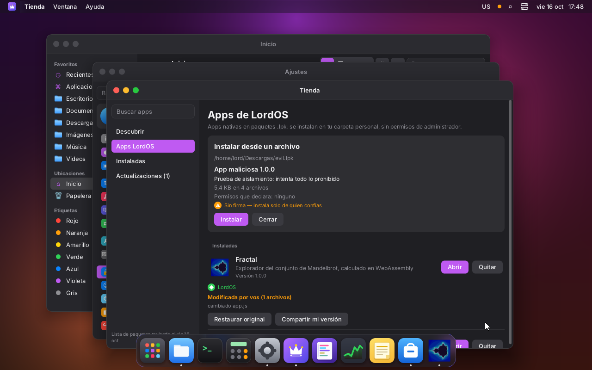
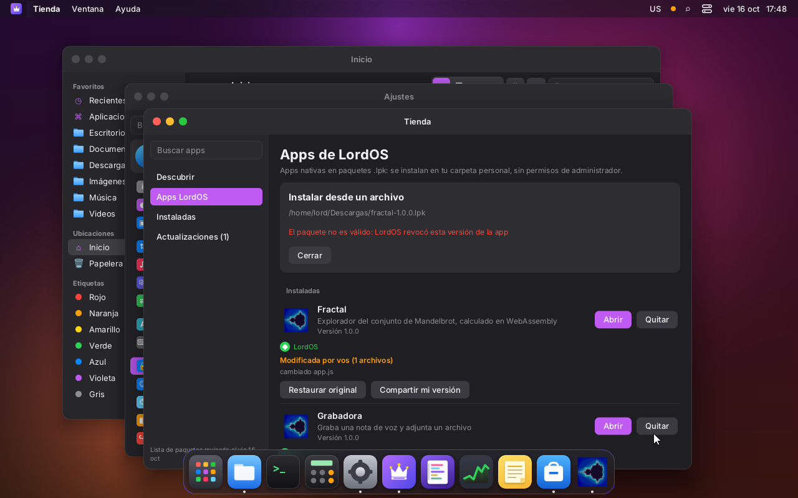
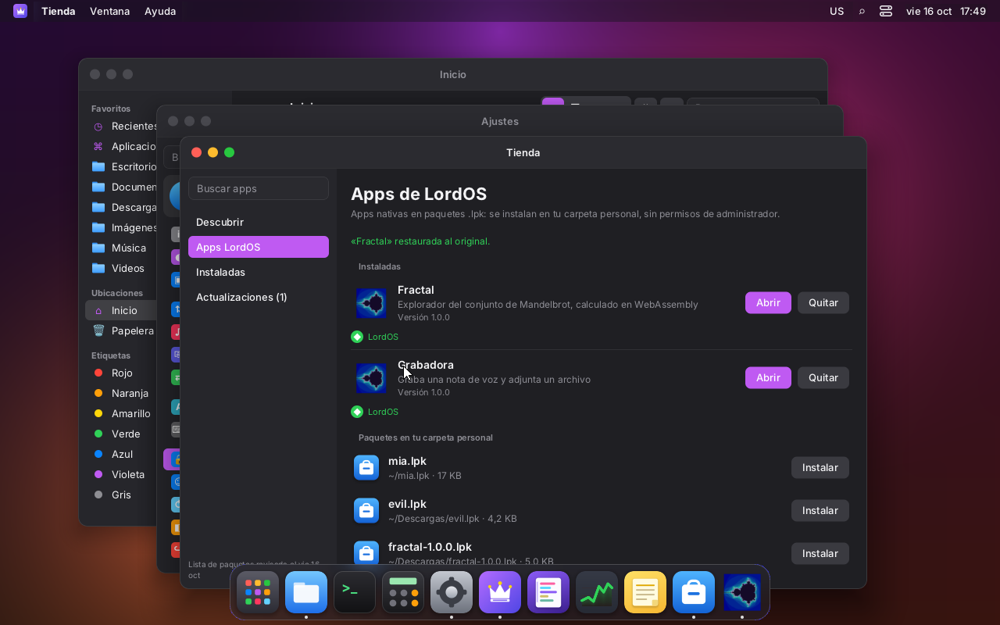

# Firma de paquetes `.lpk` (M8)

Cada paquete de app LordOS (`.lpk`) puede ir **firmado**. LordOS verifica la firma en C, al
instalar y al cargar, para detectar modificaciones y mostrar de quién viene la app. Ver también
[APPS-NATIVAS.md](APPS-NATIVAS.md) y [PRIVACIDAD.md](PRIVACIDAD.md).

## Qué hay adentro

Un `.lpk` firmado trae, además de sus archivos (`manifest.json`, `app.js`, `icon.png`…):

- **`contenido.json`** — la lista de todos los archivos con su ruta, tamaño y **SHA-256**:

  ```json
  {
    "format": 1,
    "id": "fractal",
    "version": "1.0.0",
    "signer": { "name": "LordOS (desarrollo)", "key": "3deb6836…" },
    "files": [
      { "path": "manifest.json", "size": 321, "sha256": "…" },
      { "path": "app.js",        "size": 2411, "sha256": "…" }
    ]
  }
  ```

- **`firma.json`** — ese manifiesto firmado con **Ed25519**:

  ```json
  { "format": 1, "alg": "ed25519", "key": "3deb6836…", "sig": "…" }
  ```

Un `.lpk` **sin firma** puede traer igual `contenido.json` (solo hashes) para detectar daños;
sin él, es «Sin firma» y sin hashes.

## Criptografía propia (`server/src/sec` + `server/src/pkg/crypto.c`)

SHA-256 y Ed25519 son **código propio**, chico y legible. Ed25519 sigue la aritmética de
**TweetNaCl** (dominio público; campo 2^255-19 en 16 palabras de 16 bits); se agregó el **firmar**
(`ed25519_sign`/`ed25519_public`) además del verificar que ya tenía el motor de paquetes. El
lector de JSON es propio y estricto (`server/src/sec/json.c`).

**No OpenSSL:** por política solo lo enlaza `lord-sessiond`. La verificación de los `.lpk` ocurre
en C, al instalar (`lpk_check` en `js_sys.c`) y al cargar (detección de modificación por
`pkg_status`).

### Pruebas (`make -C server test`)

- `build/sign-test` (**55/55**): SHA-256 contra los vectores de **NIST** (incluido el millón de
  `a`), Ed25519 contra las pruebas 1–3 de **RFC 8032** (clave pública, firma byte a byte,
  verificación, rechazo de firma/mensaje alterados), el lector de JSON (válidos e inválidos), y la
  verificación de paquetes: firma válida, archivo alterado, archivo de más, id/versión que no
  coinciden, firma de otra clave y firma rota; más el catálogo firmado y la revocación.
- `build/pkgstate-test` (**11/11**, VM): el flujo completo instalar → «Modificada por vos» →
  restaurar → compartir (derivado firmado) → regla de actualización por clave.

## Niveles de confianza

Se muestran en la Tienda y en el diálogo de instalación:

| Nivel | Cuándo | Texto |
|---|---|---|
| **LordOS** | firmada con la clave oficial (`server/src/sec/keys.h`) | «LordOS» (verde) |
| **Autor verificado** | clave listada en el catálogo firmado | «Autor verificado: <nombre>» (azul) |
| **Firmada por <nombre>** | firmada con una clave desconocida | «Firmada por <nombre>» (gris) |
| **Sin firma** | no trae `firma.json` | «Sin firma — instalá solo de quien confías» (naranja, aviso) |

| | |
|---|---|
|  |  |
| Un paquete sin firma avisa antes de instalar | Un paquete revocado no se instala, con un mensaje claro |

## Reglas

- **Actualizaciones**: una versión nueva tiene que estar firmada con la **misma clave** que la
  instalada (como Android). Una actualización con otra clave se rechaza (`pkg_check_update`).
- **Catálogo firmado** (`catalog.json` + `catalog.sig`): lo firma la clave de LordOS y trae las
  versiones, tamaños, hashes, las claves de autores verificados y una **lista de revocación** de
  claves y paquetes. Un paquete revocado queda deshabilitado con un mensaje claro
  (`catalog_revoked`). El catálogo vigente es el válido de `serial` más alto entre
  `/usr/share/lordos/catalog.json` y `~/.local/share/lordos/catalog/catalog.json`.

## Modificar, restaurar y compartir (la idea «de negocio»)

- Al instalar, se **guarda el `.lpk` original** en `~/.local/share/lordos/apps/.orig/<id>.lpk`.
- Si el usuario **edita** la app instalada, LordOS lo detecta por los hashes y la marca
  «**Modificada por vos**», mostrando qué archivos cambiaron (`pkg_status`).
- «**Restaurar original**» la vuelve a dejar exacta (`pkg_restore`).
- «**Compartir mi versión**» arma un `.lpk` nuevo firmado con la **clave propia del usuario**
  (se genera la primera vez en `~/.local/share/lordos/keys/user.json`, permisos 600), con
  `basedOn: <id>@<versión> by <autor>` en el manifest, así se conserva el crédito (`pkg_share`).

| | |
|---|---|
|  |  |
| «Modificada por vos»: qué cambió, Restaurar y Compartir | «Fractal restaurada al original» |

## Herramientas (`tools/lpk.mjs`)

```sh
node tools/lpk.mjs keygen [--name "Nombre"] [--out archivo]   # par de claves Ed25519
node tools/lpk.mjs <carpeta> [salida.lpk] [--key clave.json | --unsigned]   # empaquetar y firmar
node tools/lpk.mjs sign <paquete.lpk> --key clave.json        # (re)firmar
node tools/lpk.mjs verify <paquete.lpk>                       # ver firma y hashes
node tools/lpk.mjs catalog <fuente.json> --key oficial.json [carpeta]   # catálogo firmado
```

`lpk.mjs` firma al empaquetar si se le da `--key`, `$LPK_KEY` o si existe
`~/.config/lordos/lpk-key.json`. Con `--unsigned` sale «Sin firma» (con hashes igual).

### La clave de LordOS

Los paquetes oficiales (apps incluidas, catálogo) los firma la **clave de LordOS**. Hoy hay una
sola, la clave de **desarrollo**:

- su **clave pública** está en el repositorio: `packaging/keys/lordos-dev.pub`, y compilada en el
  binario en `server/src/sec/keys.h` (a propósito: ningún archivo de la carpeta personal puede
  sumar una clave oficial);
- su **clave privada NO está en el repositorio**: vive en la máquina de desarrollo, en
  `~/.config/lordos-dev/lordos-dev.key` (permisos 600). **No commitear claves privadas.**

Para una versión pública se agrega la clave definitiva a `keys.h` y se quita la de desarrollo.

## Archivos

| Ruta | Qué es |
|---|---|
| `server/src/pkg/crypto.c` | SHA-256/512 y Ed25519 (verificar y firmar), propios |
| `server/src/sec/sign.c` | verificación de paquetes y catálogo, niveles de confianza, revocación |
| `server/src/sec/pkgstate.c` | original guardado, «Modificada por vos», restaurar, compartir, regla de actualización |
| `server/src/sec/json.c` | lector de JSON estricto |
| `server/src/sec/keys.h` | claves públicas oficiales |
| `server/src/ui/js_sec.c` | `lord.sign` para el SDK (status, restore, share, userKey) |
| `tools/lpk.mjs` | empaquetar, firmar, verificar, keygen y catálogo |
| `packaging/keys/lordos-dev.pub` | clave pública de desarrollo |
