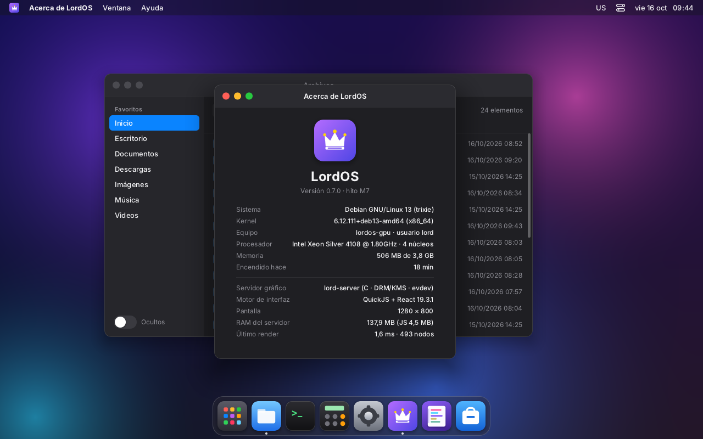
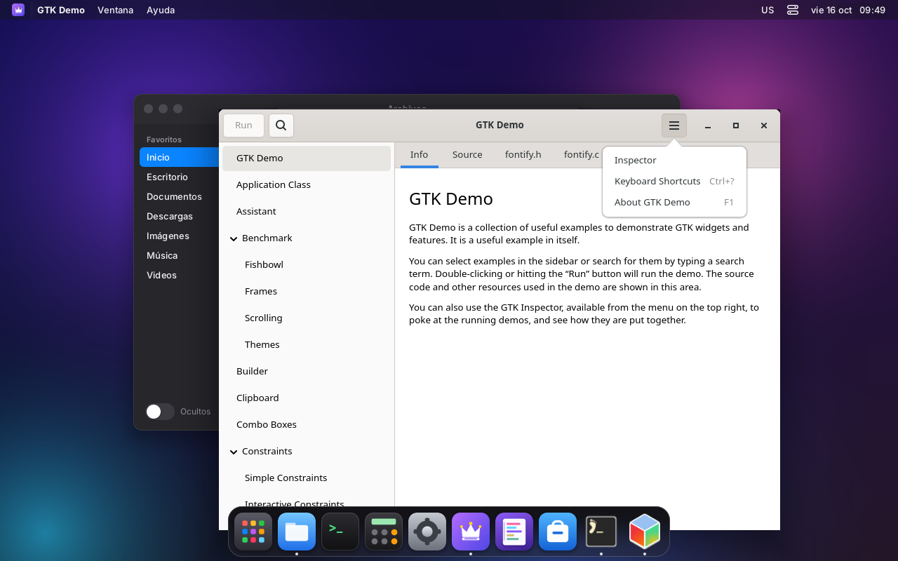
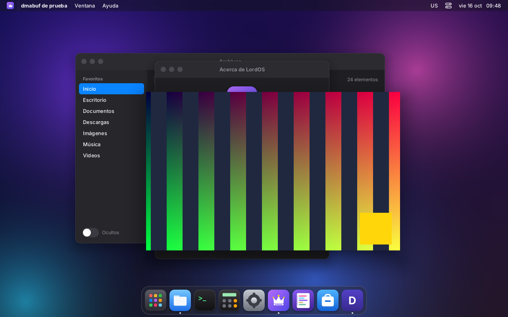
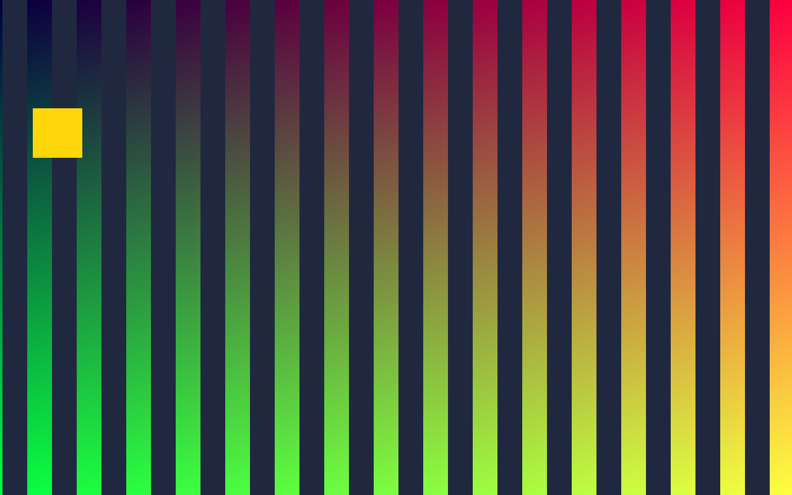

# GPU en LordOS: composición, dmabuf y juegos

lord-server tiene dos caminos para armar la pantalla:

- **CPU** (el de siempre): la UI y las ventanas de las apps se copian en el canvas y se manda
  un dumb buffer con page flip. No necesita nada aparte del kernel.
- **GPU** (nuevo, `server/src/gpu/gpu.c`): GBM + EGL + GLES2 de Mesa. Lo aprobó el usuario el
  2026-10-16 para juegos y apps con GPU en AMD y Nvidia. Ver "Política de dependencias" en
  `ARCHITECTURE.md`.

El modesetting sigue siendo propio (`kms.c`, ioctls sin libdrm). GBM se crea sobre el mismo fd
de la tarjeta, y sus búferes y los dmabuf de las apps pasan a framebuffers con
`DRM_IOCTL_MODE_ADDFB2`.

## Capturas (VM 116, Mesa llvmpipe forzado con `LORD_GPU=1`)

| | |
|---|---|
|  |  |
| La UI de LordOS compuesta por EGL/GLES2 | GTK Demo (shm) debajo del Dock: el orden entre ventanas de apps y de LordOS se respeta |
|  |  |
| Menú de GTK (xdg_popup) en la capa de arriba | `dmabuf-client`: búferes dmabuf de una app (udmabuf, lineal) a 72 FPS, 400/400 presentados |
|  | |
| Pantalla completa: la presenta el compositor encima de todo | |

## Cómo se elige el camino

1. `LORD_GPU=0`: siempre CPU.
2. Se le pregunta al kernel qué driver tiene la placa (`DRM_IOCTL_VERSION`). Si es uno sin 3D
   (simpledrm, bochs, cirrus, qxl, ast, mgag200, vkms, udl, virtio-gpu sin virgl…), se usa la
   CPU **sin cargar Mesa**: lord-server sigue en ~32 MB.
3. Si no, se arma GBM + EGL. Si `GL_RENDERER` es por software (llvmpipe, softpipe), se vuelve a
   la CPU, porque componer con llvmpipe es más caro que el camino propio (ver mediciones).
   `LORD_GPU=1` fuerza la GPU igual, para probar.
4. Si un cuadro falla (eglSwapBuffers, ADDFB2, page flip), se apaga la GPU y se sigue por CPU.

Diagnóstico: `LORD_GPU_DEBUG=1` muestra los formatos dmabuf, los imports que fallan y los
cuadros por scanout directo. El log dice `gpu: composición por GPU (renderer…)` o por qué no.

## Cómo compone

- **La UI** (React → canvas por CPU) es una textura de pantalla completa. Por cuadro solo se sube
  lo que cambió (el damage), con `GL_EXT_unpack_subimage`.
- **Las ventanas de las apps** no pasan por el canvas. Donde va cada ventana, la UI deja un
  **hueco transparente** (alfa 0) y se anota la superficie. Al presentar:
  1. las texturas de las ventanas (capa 0);
  2. encima, la UI con su alfa premultiplicado;
  3. arriba de todo, los menús de las apps, la pantalla completa y el cursor (capa 1).

  Si una ventana de LordOS (o el Dock) tapa una de una app, la tapa de verdad. Si una app tapa a
  otra, también: el hueco se abrió después.
- **El canvas guarda alfa.** Las mezclas propias (`canvas.c`, `term_paint.c`) ahora calculan el
  alfa de salida. En el camino por CPU no cambia nada (KMS es XRGB).
- **El desenfoque de fondo** (Dock, Centro de control) también lleva alfa. Sobre una ventana de
  app la tiñe pero no la desenfoca, porque la ventana no está en el canvas. Desenfocar el
  contenido de las apps queda pendiente; necesita un pase de blur por GPU.
- **Contenido:**
  - shm: la copia de siempre, que se sube a la textura de la superficie cuando cambia;
  - dmabuf: `EGL_EXT_image_dma_buf_import(_modifiers)` y `GL_OES_EGL_image_external`, sin
    copias. Una EGLImage por búfer, que se reutiliza.
- **Repintado:** cuando una app solo cambia su contenido, la UI no se repinta (no hay CPU por
  cuadro de la app); solo se vuelve a presentar. Si cambia el tamaño o la geometría (la forma
  del hueco), sí.
- **Scanout directo:** si la ventana a pantalla completa tiene un dmabuf del tamaño de la salida
  (XRGB/ARGB8888, un plano), no hay menús encima y el cursor va por el plano de cursor, su búfer
  va directo al plano primario (`PRIME_FD_TO_HANDLE` + `ADDFB2` + page flip): cero copias. El
  búfer se le devuelve a la app cuando deja de estar en pantalla.
- **Cursor:** en el camino GPU va por el plano de cursor de KMS (`DRM_IOCTL_MODE_CURSOR2`), así
  mover el mouse no compone nada. Si el driver no tiene plano de cursor, se dibuja como un quad
  (`LORD_SW_CURSOR=1` lo fuerza).

## Protocolos nuevos

| Protocolo | Versión | Qué hace |
|---|---|---|
| `zwp_linux_dmabuf_v1` | 4 | Búferes de GPU de las apps, con feedback: tabla de formatos y modificadores, render node principal. Con GPU, lo que importa EGL; en el camino por CPU, solo ARGB/XRGB8888 lineal, que se mapea (`DMA_BUF_IOCTL_SYNC`) y se copia. Si EGL no puede importar un dmabuf lineal, se lo mapea igual |
| `wp_presentation` | 1 | Hora y número de vblank del flip que mostró cada cuadro (`flip_ns`/`flip_seq` de KMS) |
| `wp_viewporter` | 1 | Recorte y escala de una superficie (en el camino GPU; en el de CPU se dibuja sin escalar) |
| `zwp_relative_pointer_manager_v1` | 1 | Movimiento crudo del mouse, sin bordes (juegos en primera persona) |
| `zwp_pointer_constraints_v1` | 1 | Bloquear o confinar el puntero en la ventana; bloqueado: sin `motion`, cursor fijo |
| `xdg_toplevel.set_fullscreen` | — | Ahora es pantalla completa de verdad: ocupa la salida, encima de todo, con el teclado; **❖Esc** sale |
| `wl_pointer.set_cursor` | — | El cursor de la app (imagen o **oculto**, como hacen los juegos) mientras el puntero está sobre ella |

No están: `xdg_activation`, escala fraccional y sincronización explícita
(`linux-drm-syncobj`). Se usa la sincronización implícita de dma-resv.

## Probado (VM 116 `lordos-gpu`)

En la VM no hay GPU real: el host Proxmox solo tiene la placa ASPEED, sin render node, así que
virgl no arranca. Se usó virtio-gpu 2D con Mesa por software adentro (llvmpipe sobre
kms_swrast). Con eso se prueba de verdad el código de GBM/EGL/GLES/KMS, pero **no** los drivers
de AMD ni de Nvidia.

| Prueba | Resultado |
|---|---|
| UI por EGL/GLES2 (llvmpipe, `LORD_GPU=1`) | se ve igual que por CPU (captura) |
| GTK Demo (shm), menús, Dock encima | orden de capas bien; clics y menús funcionan |
| `glmark2-es2-wayland` 640×400 | 75 FPS en GPU (sincronizado al vblank de 75 Hz); usa shm, porque llvmpipe en la app no usa dmabuf |
| `vkcube` (lavapipe) | anda (300 cuadros), por shm |
| `dmabuf-client` (udmabuf lineal) en ventana | GPU: 72 FPS, 400/400 presentados (wp_presentation); CPU: 131 FPS |
| `dmabuf-client --fullscreen` 1280×800 | GPU: 42,9 FPS; CPU: 42,5 FPS; encima de todo y con teclado |
| `dmabuf-client --lock` (bloqueo + relativo + cursor oculto) | bloqueado; relativos llegan; 0 absolutos mientras está bloqueado; cursor oculto; en GPU y en CPU |
| neverball (SDL2 + OpenGL por Wayland) | GPU forzada: ~20 cuadros/s; CPU: ~24 cuadros/s (llvmpipe: el juego y la composición compiten por la misma CPU) |
| Selección automática en la VM | "virtio_gpu sin 3D" → CPU sin cargar Mesa: 32 MB de RSS |
| `LORD_GPU=0` | todo como antes |

CPU de lord-server con `glmark2-es2-wayland` en ventana durante 10 s:

| Camino | CPU | RSS |
|---|---|---|
| GPU con llvmpipe (`LORD_GPU=1`) | ~300 % (llvmpipe compone 1280×800 por cuadro con varios hilos) | 158 MB |
| CPU | ~100 % | 36 MB |

Con llvmpipe la GPU no conviene; por eso es CPU por defecto. Con una placa real, componer es
trabajo de la GPU, y la CPU solo sube lo que cambió de la UI.

**Sin probar:**
- **AMD y Nvidia reales:** pendiente del ISO live en la PC del usuario (AMD).
- **Importar un dmabuf de GPU por EGL:** virtio-gpu no acepta dmabuf de otro origen, así que en
  la VM ese import falla (`EGL_BAD_ALLOC`) y los udmabuf se mapean.
- **Scanout directo:** en la VM falla por lo mismo. El código está y vuelve a componer si falla.

Para probarlo en la PC con AMD (ISO live):
1. Arrancar.
2. En la Terminal de LordOS, `grep gpu /tmp/lord.log` (o el log que use el ISO): tiene que
   decir `composición por GPU (AMD Radeon …)` y `cursor por hardware`.
3. `vkcube`, `glmark2-es2-wayland`, un juego (SuperTuxKart, 0 A.D.).
4. Con `LORD_GPU_DEBUG=1`, a pantalla completa tiene que aparecer `scanout directo: N cuadros`.

## Cliente de prueba

`server/tests/dmabuf_client.c` (`make -C server build/dmabuf-client`, necesita
`libwayland-client` y `/dev/udmabuf`, que en Debian es del grupo `kvm`):

```sh
build/dmabuf-client [--fullscreen] [--lock] [--frames N] [--size 800x600]
```

Imprime cuadros, FPS, presentados/descartados y, con `--lock`, los eventos de puntero.

## Paquetes

Para compilar con GPU (si faltan, `make` compila sin GPU, `GPU=0`):

```sh
sudo apt-get install -y --no-install-recommends libgbm-dev libegl-dev libgles-dev
```

En tiempo de ejecución: `libgbm1`, `libegl1`, `libgles2`, `libegl-mesa0` y el driver
(`libgl1-mesa-dri`: radeonsi/AMD, iris/Intel, nouveau; Nvidia: su driver con GBM, o NVK).

Solo para probar en la VM 116: `mesa-utils`, `mesa-utils-bin`, `mesa-vulkan-drivers`,
`vulkan-tools`, `glmark2-es2-wayland` y `neverball`. El usuario `lord` se agregó al grupo `kvm`
para `/dev/udmabuf`.

En el host Proxmox se instalaron `libgl1` y `libegl1` (los pide `vga: virtio-gl`). Igual virgl
no anda sin un render node en el host, y la 116 quedó con `vga: virtio`.

## La VM 116 (`lordos-gpu`)

- Clon completo de la 115 (`qm clone 115 116 --name lordos-gpu --full`), con `vga: virtio`
  (2D).
- IP 172.17.0.52 por cloud-init (`ipconfig0`), snippet `local:snippets/lordos-gpu.yaml` (igual
  al de la 115 con otro hostname), MAC nueva.
- Es para el camino GPU. La 115 sigue siendo la de desarrollo y no se tocó.

## Pendiente

- Probar en AMD real (ISO live) y en Nvidia.
- Blur de la UI que incluya el contenido de las apps (pase por GPU).
- `wp_viewporter` con escala en el camino por CPU.
- Scanout directo de ventanas que no son de pantalla completa (planos overlay).
- `linux-drm-syncobj` (sincronización explícita, la que prefiere Nvidia), `xdg_activation`,
  escala fraccional, tearing control (`wp_tearing_control`) y VRR.
- Que JS sepa que una ventana está en pantalla completa (hoy recibe el evento `fullscreen`, pero
  los temas lo ignoran).
