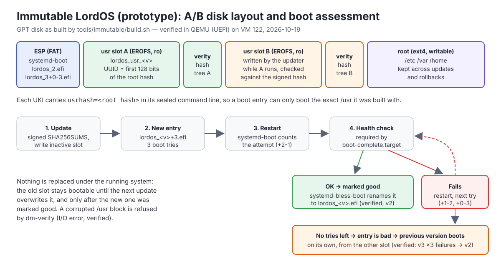

# An immutable LordOS (A/B system images): design study

**Status (0.8.2; unchanged through 0.8.5-beta): design study plus an experimental prototype.** Nothing here changes the regular
ISO, the Raspberry Pi image, `install.sh` or the in-place APT updates of [UPDATES.md](UPDATES.md).
The prototype (`tools/immutable/`) builds a separate disk image that boots in a virtual machine; it
is a minimal Debian 13, not the LordOS desktop yet. Every statement below is marked as one of:

- **Verified** — run on VM 122 (Proxmox, Debian 13, QEMU/KVM with UEFI inside it) on 2026-10-19;
- **Checked** — read from Debian 13's packages, kernel configuration or upstream documentation, not run;
- **Design** — a proposal, not built.

This is phase 3 of 3 of "System apps immutable". Phase 1 (0.8.2, [SIGNING.md](SIGNING.md),
"Verified system code") checks LordOS's own JavaScript bundles against a signed manifest; phase 2 marks
system apps as not removable. This study is about the whole system.

## Summary

**Recommendation:** an *image-based* edition built on the systemd model, which Debian 13 already
ships almost completely:

- `/usr` is a **read-only EROFS image on its own partition, verified by dm-verity**, in two slots
  (A and B). The root hash of the running `/usr` is sealed into the kernel command line of a
  **Unified Kernel Image** (UKI), so the boot entry and the system it boots are one signed object.
- **systemd-boot** boots one UKI per installed version and counts boot attempts; a version that
  doesn't reach a healthy desktop three times is abandoned and the previous one boots on its own.
- One **writable root partition** keeps `/etc`, `/var` and `/home`: user data, accounts and
  settings survive every update and every rollback.
- The images are still **built from Debian packages** (the same `.deb`s and package list as the ISO),
  so Debian security updates reach users as new images. Users keep installing apps: `.lpk` apps in
  the home folder as today, and Debian packages as **system extension images** layered over `/usr`
  (later phase).
- The updater is **LordOS's own code** in the package engine (it already has HTTP, OpenPGP
  signatures and SHA-256), following systemd-sysupdate's on-disk conventions, because
  **Debian 13 does not ship systemd-sysupdate** (checked).
- It is a **separate edition**: "LordOS" (classic, apt-managed) stays as it is and stays supported;
  the immutable edition is for new installs from the ISO and a Raspberry Pi image variant. There is
  no in-place migration of existing systems.

**The prototype verified the core of it on a VM** (see "The prototype"): a GPT image with ESP,
two `/usr` slots with dm-verity and a root partition; a signed update written into the inactive slot
and checked against its root hash; the new version booting with boot counting and being marked good;
`/etc` and `/home` kept; a deliberately broken version failing its health check three times and the
machine falling back to the previous version **without anyone touching it**; and a corrupted block of
the running `/usr` being refused by dm-verity. Secure Boot, the TPM, the LordOS desktop on top, the
Raspberry Pi and app layering are **design only**.

**Effort:** about 300–430 hours in five phases after this one (see "Phased plan"); the first usable
experimental edition (PC, UEFI, full desktop, updates from the Store) is phase 1, about 70–100 hours.

## Goals

1. **A read-only, verified `/usr`.** Nothing at run time — not an app, not the user, not root — can
   change a file of the system in a way that survives a reboot or goes unnoticed: every
   block is checked against a hash that the boot chain vouches for.
2. **Atomic updates with automatic rollback.** An update is written next to the running system and
   becomes active only by booting it. A power cut in the middle leaves the old system untouched. A
   version that fails to come up is abandoned automatically, and the user can always choose the
   previous version.
3. **User data and configuration preserved.** `/home`, accounts, passwords, network and Wi-Fi
   settings, `/etc` changes and installed apps survive updates and rollbacks.
4. **No regression for the classic edition.** `install.sh` on Debian, apt, the Store's Debian
   packages and the 0.8.1 update path keep working exactly as today.
5. **Low-end hardware first** (a LordOS principle): no extra daemons at run time, reads cost a
   hash per 4 KiB block once, updates don't need twice the RAM, SD cards aren't worn by the scheme.

Not goals: making root powerless at run time (see the threat model), a container-only "everything is
a Flatpak" system, or converting existing installations in place.

## Where LordOS stands today

- `/usr` is an ordinary ext4 directory tree owned by dpkg. Root (or `sudo`) can change any file.
- 0.8.2 phase 1 (`server/src/sec/codesig.c`) checks only LordOS's JavaScript bundles, from inside
  `lord-server`; its threat model says plainly that it does not protect against root, who can
  replace `lord-server` itself (and its compiled-in key).
- Updates are in-place `dpkg` upgrades from the signed APT repository (0.8.1). A broken update is
  fixed by another update; there is no "previous version". A power cut during `dpkg` can leave a
  half-configured system (dpkg recovers most of it, not all).
- On the Raspberry Pi 5 the kernel is not in the repository yet, precisely because a bad kernel
  would leave the board unbootable with no way back ([UPDATES.md](UPDATES.md), "The Raspberry Pi
  kernel"). An A/B scheme with `tryboot` is the missing piece there.

## Threat model

Attackers and failures considered:

| # | Who / what | Example |
|---|---|---|
| T1 | A malicious or compromised app running as the user | a Linux app escaping its restrictions, a hostile `.lpk` |
| T2 | Root at run time | malware that got `sudo`, a compromised root service, a hostile postinst |
| T3 | Offline modification | the disk or SD card edited from another computer; a tampered image; "evil maid" |
| T4 | A broken update | a release that doesn't boot, a kernel that doesn't find the disk, a power cut while updating |
| T5 | Corruption | bit rot, a failing SD card, a bad sector under `/usr` |
| T6 | A hostile mirror or network | a modified image on the download path, a replayed old image |

What each layer stops (✓ stops, ~ partly, ✗ no). "Classic" is today's LordOS with 0.8.2 phase 1.

| | Classic 0.8.2 | Immutable, no Secure Boot (Pi 5 today, PCs with SB off) | Immutable + Secure Boot + measured boot (PC) |
|---|---|---|---|
| T1 app changes system files | ✓ (permissions) | ✓ | ✓ |
| T2 root changes `/usr` at run time | ✗ | ~ (writes to the mounted `/usr` fail; writing the raw partition is caught at read time as I/O errors) | ~ (same) |
| T2 root **persists** a change to `/usr` across reboot | ✗ | ✗ (root rewrites the ESP: a new UKI with a new hash) | ✓ (a UKI not signed with the LordOS key does not boot) |
| T2 root persists through `/etc` or `/var` (a unit in `/etc/systemd`, a cron job, a `.bashrc`) | ✗ | ✗ | ✗ (see below) |
| T3 offline change of `/usr` | ✗ | ✓ detected (dm-verity fails reads) — but the boot partition itself is unsigned, so an offline attacker can replace the kernel and hash | ✓ |
| T3 offline change of `/etc`, `/home` | ✗ | ✗ | ~ (only with the root partition encrypted and sealed to the TPM's measurements) |
| T4 broken update | ~ (fix forward) | ✓ automatic rollback | ✓ |
| T5 corruption of `/usr` | ✗ silent | ✓ detected (verified); with `restart-on-corruption` the other slot boots (design) | ✓ (same) |
| T6 hostile mirror | ✓ (APT signatures) | ✓ (signed SHA256SUMS + root hash) | ✓ |
| T6 rollback to an old, vulnerable image | ~ (APT `Valid-Until` not used yet) | ~ (the updater refuses older versions; the boot menu still offers the previous one by design) | ~ (same; a signed minimum version could be added) |

**What root can still do after this work, honestly:**

- Root can change `/etc`, `/var` and the home folders, and that is where most persistence lives
  (systemd units in `/etc/systemd/system`, timers, `ld.so.preload`, PAM configuration). dm-verity on
  `/usr` does **not** stop a root attacker from coming back after a reboot through `/etc`. The real
  answers are later and harder: signed configuration extensions (`confext`), an `/etc` that the
  system rebuilds from the image plus a small allow-list of user changes, and IPE (the kernel's
  Integrity Policy Enforcement, enabled in Debian 13's kernel: `CONFIG_IPE_PROP_DM_VERITY=y`,
  checked) to allow execution only from verified images. They are listed in phase 5; none is cheap.
- Root can load kernel modules and use `kexec` unless the kernel is in lockdown mode, which Debian
  enables automatically only under Secure Boot.
- Root can write the raw `/usr` partition. dm-verity notices at read time (verified in the
  prototype: I/O errors and a kernel message), and the production option `restart-on-corruption`
  would turn that into a reboot into the other slot. Root can also write a new UKI to the ESP; only
  Secure Boot stops that from booting.

**How it composes with phase 1 (signed code).** With a verified `/usr`, `lord-server`, its
compiled-in release key, the bundles and `code-manifest.json` are all inside the verified image, so
phase 1's stated gap ("root can replace lord-server") closes for anything that must survive a
reboot, as long as the UKI is trusted (Secure Boot on PCs). Phase 1 stays: it costs ~7–34 ms, it
protects the classic edition and development trees, and it gives the clear "this component was
modified" screen instead of an I/O error.

**Secure Boot and measured boot on PCs (design).** The chain would be: firmware (Secure Boot, the
usual third-party CA) → **shim** (signed by that CA; Debian's) → **systemd-boot** (Debian 13 ships a
signed one: `systemd-boot-efi-amd64-signed`, checked) → the **LordOS UKI**, signed with a LordOS
Secure Boot key that the user enrolls once as a Machine Owner Key (shim's MokManager screen on the
first boot after install) → kernel command line with `usrhash=` inside the signed UKI → initrd inside
the signed UKI → dm-verity `/usr`. Because the command line is part of the signed UKI, nobody can
point a signed kernel at a different `/usr`. With a TPM, systemd-stub measures the UKI's sections into
PCR 11; an optionally encrypted root partition can be sealed to a **signed PCR policy**
(`systemd-cryptenroll --tpm2-public-key`), so it unlocks for every LordOS-signed version, including
updates, but not for a foreign kernel. Shipping our own signed shim would need the third-party CA's
review program; enrolling a MOK avoids that and is what users already do for out-of-tree drivers.

**The Raspberry Pi 5.** It has no UEFI Secure Boot. Its firmware has its own signed-boot mode
(a customer key fused into one-time-programmable memory, per board, irreversible), which LordOS
cannot turn on for users. So on the Pi the immutable edition gives integrity at run time,
corruption detection and A/B rollback, **not** protection against an offline attacker who rewrites
the boot partition. That is still a large improvement for the Pi's main failure modes (SD card
corruption, bad kernel updates).

## Options compared

Six ways to make the system immutable. "Fits Debian" means: can we keep building from Debian's
`.deb` packages and keep Debian's security updates flowing.

### A. dm-verity `/usr` partitions, A/B, UKIs (the systemd "image-based OS" model)

The OS is a set of partitions: an ESP with one UKI per version, `/usr` slots each with a verity hash
partition (and optionally a signature partition), and a root partition. Built with `systemd-repart`
(or `mkosi` on top of it), updated with `systemd-sysupdate`, rollback with systemd-boot's boot
assessment. Variants of this design are what Flatcar Container Linux (A/B `/usr` partitions with
dm-verity), GNOME OS (systemd-sysupdate, dm-verity) and KDE Linux (mkosi-built EROFS images updated
by systemd-sysupdate) document publicly; the A/B-partition-plus-verity idea is older still in
embedded systems.

- **Integrity:** strongest of the options: every block, checked by the kernel, root hash in a
  signed UKI. Unchanged blocks cost nothing to verify after the first read.
- **Atomicity / rollback:** the whole `/usr` and kernel switch together on reboot; rollback is
  booting the other entry. Verified in the prototype.
- **Debian fit:** Debian 13 ships `systemd-repart`, `ukify`, `systemd-boot` (with `systemd-bless-boot`
  and `systemd-boot-check-no-failures`), the signed systemd-boot, `systemd-veritysetup`,
  `systemd-sysext`, dracut with `systemd-veritysetup`/`systemd-sysext`/`systemd-repart` modules, EROFS
  and dm-verity in the kernel (`CONFIG_DM_VERITY=m`, `CONFIG_EROFS_FS=m`, root-hash signatures via the
  secondary and platform keyrings), `mkosi` 25 — all checked on VM 122. **It does not ship
  `systemd-sysupdate`** (no package contains it; checked with `apt-cache` and `dpkg -c systemd`), and
  Debian's default `initramfs-tools` cannot set up a verity `/usr` from `usrhash=`; dracut can
  (verified). Debian 13 is merged-`/usr` only, which this model needs (checked: `/bin`, `/lib` are
  symlinks into `/usr`).
- **Cost:** `/usr` must be "hermetic": everything that changes per machine lives in `/etc` or `/var`.
  Debian mostly is, with known exceptions (below). Updates are whole images (deltas later).
- **Pi fit:** dm-verity and EROFS are plain kernel features (the LordOS Pi kernel needs
  `CONFIG_DM_VERITY` and `CONFIG_EROFS_FS` checked/enabled); no systemd-boot, so A/B is done with
  the firmware's `tryboot` instead (below).

### B. fs-verity per file

The kernel seals individual files (ext4, f2fs, btrfs): a sealed file can't change, and its digest
can be signed. Tools are in Debian 13 (`fsverity` 1.6, checked).

- It protects **only files that were sealed**, and nothing in dpkg seals them; root can delete a
  sealed file and put an unsealed one in its place, unless a policy (IPE or IMA appraisal) requires
  a valid digest for everything executed. That policy work is the hard part and is not there.
- No atomicity, no rollback: it is an integrity tool, not an update scheme.
- **Useful as a building block:** for `.lpk` files in the home folder, or with composefs (C). Not
  a whole-system answer by itself. (The first notes for this item named fs-verity; this study
  recommends dm-verity for the system and keeps fs-verity for later, per-file uses.)

### C. composefs (EROFS metadata + overlayfs + fs-verity objects)

A content-addressed object store on a normal writable filesystem, with fs-verity on every object
and a small EROFS image holding the directory tree and the expected digests; overlayfs joins them.
The EROFS image's own fs-verity digest goes on the kernel command line. It is how OSTree's composefs
mode and bootc-based systems verify their trees.

- Integrity close to A (per file instead of per block), with **file-level deduplication**: many
  versions cost only their changed files on disk, and deltas are natural.
- More moving parts: overlayfs semantics, fs-verity on the backing filesystem, the composefs tools.
  **Debian 13 has no composefs package** (checked: no candidate for `composefs`/`libcomposefs1`).
- Worth revisiting once it is packaged in Debian and if A's full-image slots prove too large.

### D. OSTree

A git-like store of system trees, hard-linked into "deployments"; the bootloader picks a deployment;
updates download only changed objects (or static deltas). It has a built-in three-way `/etc` merge,
which solves a problem A has to solve by hand. Debian 13 ships `ostree` 2025.2 (checked). Endless OS
is a Debian-based desktop that has used OSTree for years, which shows that trees built from
Debian packages work with it.

- **Integrity:** without composefs, the deployed files are only protected by a read-only bind
  mount: root can remount and change them. Weaker than A unless combined with C.
- **Rollback:** previous deployments stay bootable; automatic boot assessment needs an extra piece
  (greenboot-style), not in Debian.
- **Debian fit:** building trees is fine; installing extra Debian packages on the client ("package
  layering", as rpm-ostree does for RPM) has no maintained apt equivalent.
- Bigger dependency (libostree, GLib, curl) on every client; LordOS prefers small, own code.

### E. Two full root partitions (A/B root, no verity)

Two copies of the whole root filesystem; the updater writes the inactive one and flips the
bootloader. Vanilla OS's ABRoot (Debian-based) and the embedded updaters RAUC (in Debian 13, checked),
SWUpdate and Mender work like this.

- Simple and robust for **atomicity and rollback**, but without verity it gives **no integrity**:
  root can mount the inactive or active root read-write. With verity it becomes option A with
  `/etc` inside the image, which makes user configuration harder to keep across updates.

### F. Btrfs snapshots ("transactional apt")

The system is a read-only btrfs subvolume; an update is `apt` running inside a new snapshot, which
becomes the default on the next boot (openSUSE MicroOS/Aeon's transactional-update model).

- **Best fit for apt:** users keep installing Debian packages, into a new snapshot.
- **No integrity:** root can flip the subvolume's read-only property. Rollback is good. Btrfs copy-on-
  write on SD cards and very small disks is a cost for the Pi. Every client still runs dpkg
  maintainer scripts, so a broken postinst still breaks the new snapshot (but not the old one).

### Comparison

| | A dm-verity A/B | B fs-verity | C composefs | D OSTree | E A/B root | F btrfs snapshots |
|---|---|---|---|---|---|---|
| Integrity of system files | **strong** (block, kernel, signed UKI) | partial (sealed files only) | strong (per file) | weak (ro bind) | none | none |
| Atomic update | **yes** | no | yes | yes | yes | yes |
| Automatic rollback | **yes** (sd-boot counting, verified) | no | with extra pieces | with extra pieces | yes | with extra pieces |
| In Debian 13 | almost (no sysupdate) | tools only | **no** | yes | partly (RAUC) | yes |
| Keep apt on the client | no (sysext layers) | yes | no | no | no | **yes** |
| Update size | full image (deltas: later) | — | changed files | changed files | full image | changed packages |
| Disk cost | 2 × slot | none | ~1 × + changes | ~1 × + changes | 2 × root | snapshots |
| Raspberry Pi 5 | yes, with `tryboot` | yes | not packaged | possible | yes, with `tryboot` | possible, SD wear |
| Moving parts on the client | kernel + small updater | kernel | kernel + overlayfs + tools | libostree | small updater | btrfs + apt |
| Fits "own small code" | **yes** | yes | partly | no | yes | partly |

Option A is the only one that delivers all three goals with what Debian 13 ships plus a small
updater of our own, and its integrity is the strongest. Its cost — no apt on the client and
full-image downloads — is addressed below (system extensions; chunked deltas).

## Recommended design

### Building images from Debian packages

The image is built on the build machine exactly like the ISO's chroot today (`debootstrap` + the
same package list + `lordos_<version>.deb`), then split:

- `/usr` → **EROFS**, compressed with **lz4hc** (decompression is cheap on low-end CPUs; zstd is an
  option for smaller downloads), built reproducibly (`mkfs.erofs -T0 -U <fixed>`; the prototype gives
  byte-identical blocks for unchanged files, see "Update size") → `veritysetup format` → root hash.
- the kernel, a **dracut** initrd (systemd, dm-verity, EROFS) and the command line with `usrhash=`
  → **UKI** (`ukify`), signed for Secure Boot (phase 2).
- `/etc` and `/var` → the root partition of a fresh install, and a **factory copy** in
  `/usr/share/factory/etc` for updates (below).

So dpkg stays the source of truth for what is in the system, and every Debian security update
becomes a LordOS image release (a weekly security image plus LordOS releases; see "Update size").

### Making Debian's `/usr` hermetic: `/etc`, users, caches

This is where Debian and immutable images rub. Known issues and the planned answer:

| Issue | Answer |
|---|---|
| Packages ship defaults in `/etc` (conffiles), and an update may change them | Each image carries `/usr/share/factory/etc`. On the first boot of a new version, the migration runner (`/usr/lib/lordos/migrate`, already in 0.8.1) does a **three-way merge**: a file the admin never changed (same as the old factory copy) is replaced with the new factory copy; a changed one is kept and the new default goes next to it as `<file>.lordos-new`, reported in the Store; new files are copied. This is how OSTree handles `/etc`. |
| System users and groups made by `adduser` in postinst (`lordos-greeter`, `systemd-*`, `messagebus`…) live in `/etc/passwd` | Ship `sysusers.d` entries for every system user of the image (generated at build time from the chroot's `/etc/passwd`); `systemd-sysusers` creates missing ones on boot. |
| Caches that dpkg triggers rebuild: `ld.so.cache` (in `/etc`!), icon and MIME caches, `gdk-pixbuf` loaders, fontconfig, GSettings schemas | Built at image build time into `/usr`; `ldconfig` at boot only when `/etc/ld.so.conf.d` changed (Debian's `ldconfig.service` already does this with `ConditionNeedsUpdate=/etc`). System extensions trigger a rebuild into `/var/cache` (phase 4). |
| Units enabled with `systemctl enable` create links in `/etc` | Enable LordOS's units from `/usr` (vendor `.wants`/`.requires` links, as the prototype does) or presets applied by the merge; keep the admin's own `systemctl` choices in `/etc`. |
| `/var/lib/dpkg` describes the image, not the machine | Ship it read-only inside `/usr` (`/usr/lib/lordos/dpkg-status`) for the Store's "installed" view and for SBOM-style queries; there is no dpkg database on the client to corrupt. |
| Kernel modules built on the machine (DKMS: some Wi-Fi, out-of-tree GPU drivers) | Not possible on a verified `/usr`. Ship the common ones prebuilt in the image; others need the classic edition. Said clearly in the installer. |
| `install.sh` and Debian derivatives | Classic only: they are someone else's Debian installation. |

### Disk layout: PC (UEFI)

| # | Partition | Type (Discoverable Partitions) | Size | Contents |
|---|---|---|---|---|
| 1 | `lordos-esp` | ESP | 1 GiB | systemd-boot, one UKI per version (`EFI/Linux/lordos_<v>[+tries].efi`), `loader.conf` |
| 2 | `lordos_usr_<v>` | `usr` (x86-64) | 5 GiB | EROFS `/usr`, slot A |
| 3 | `lordos_usr_v_<v>` | `usr-verity` | 64 MiB | dm-verity hash tree of slot A |
| 4 | `lordos_usr_<v>` / `_empty` | `usr` | 5 GiB | slot B |
| 5 | `lordos_usr_v_<v>` / `_empty` | `usr-verity` | 64 MiB | slot B hashes |
| 6 | `lordos-root` | `root` (x86-64) | the rest (min. 8 GiB) | ext4 (or optionally encrypted): `/etc`, `/var`, `/home`, `/swapfile`, `/opt` |

Sizes: the ISO's live system is 1.5 GB uncompressed in 0.7.0 ([ISO.md](ISO.md)); with browsers,
Mesa, firmware and CJK fonts in 0.8.x the `/usr` tree is about 2.5–3 GB, ~1.2–1.6 GB as EROFS/lz4hc
(estimate from the prototype's ratio, 319 MB → 202 MB; **not measured on the full desktop**). A 5 GiB
slot leaves room for years of growth; slot sizes can never change after install, so they are
generous. The hash tree is ~0.8 % of the data (prototype: 1.7 MB for 202 MB). UKIs are ~50 MB with
the prototype's generic initrd (40 MB, every driver); a trimmed initrd brings that to ~25 MB, so
1 GiB of ESP holds plenty. Minimum disk for the immutable edition: 24 GB (classic: 8 GB). The
**installer** (`apps/installer`, `server/src/install/install.c`) gets an "Immutable (experimental)"
choice that writes this layout with `systemd-repart` definitions shipped in the image, and copies
the running slot instead of unsquashing the live system. **BIOS-only PCs:** systemd-boot is UEFI-only,
so they get the classic edition.

### Disk layout: Raspberry Pi 5 (design)

The Pi's firmware reads `autoboot.txt` from the first FAT partition, which can name the boot
partition (`boot_partition=N`) and a different one under `[tryboot]`; `reboot "0 tryboot"` boots the
`[tryboot]` choice **once**, and any later reset returns to the committed one. That is A/B with a
one-shot trial, done by the firmware itself.

| # | Partition | Size | Contents |
|---|---|---|---|
| 1 | `autoboot` (FAT) | 64 MiB | `autoboot.txt` only (`[all] boot_partition=2` / `[tryboot] boot_partition=3`), plus the `ssh`, `remote-desktop`, `lordos-user.txt` switch files |
| 2 | `bootfs-A` (FAT) | 256 MiB | firmware, `kernel_2712.img`, initramfs, DTBs, `config.txt`, `cmdline.txt` with `usrhash=` of slot A |
| 3 | `bootfs-B` (FAT) | 256 MiB | the same for slot B |
| 4–7 | `usr` A, `usr-verity` A, `usr` B, `usr-verity` B | 5 GiB / 64 MiB each | as on the PC (arm64 partition types) |
| 8 | `root` (ext4) | the rest | `/etc`, `/var`, `/home` |

GPT is needed (eight partitions); the Pi 5's bootloader supports GPT and `autoboot.txt`. **Update:**
write the inactive `usr` and `bootfs`, then `reboot "0 tryboot"`. **Commit:** after the health check
passes, rewrite `autoboot.txt` so the new partition is the default (one small write; FAT has no
atomic rename, so what the firmware does with a torn `autoboot.txt` must be tested on the board, and
the write may need to go through two alternating files). **Rollback:** if the trial boot hangs, the hardware **watchdog**
(`dtparam=watchdog=on`, `RuntimeWatchdogSec=` in systemd) resets the board and the firmware boots
the committed partition; if the health check fails, the system simply reboots without `tryboot`.
This also solves the kernel problem of [UPDATES.md](UPDATES.md): the kernel travels inside the
image, with the previous one as the fallback, so Pi kernels can finally be updated from the Store.
Not built or tested; the firmware behaviour is from Raspberry Pi's documentation of `tryboot` and
`autoboot.txt`.

**SD card wear.** `/usr` is never written except by an update (one sequential write of the slot,
~1.5 GB, versus apt's scattered writes of a similar volume for a large upgrade). The root partition
gets the same treatment as today plus `noatime` and a larger ext4 commit interval. Read-only `/usr`
removes the most dangerous failure (a half-written system file after a power cut). The net effect on
wear is neutral-to-better for the system and unchanged for user data.

### Updates

- **Format.** Each version publishes `lordos_usr_<v>.erofs`, `lordos_usr_<v>.verity`,
  `lordos_usr_<v>.roothash` and the signed UKI `lordos_<v>.efi` (Pi: a `bootfs` image), listed in a
  `SHA256SUMS` signed with the LordOS **APT archive key** (OpenPGP Ed25519, which the package engine
  already verifies) — next to the APT repository, e.g. `https://lordos.org/images/stable/<arch>/`.
  The root hash binds the data; the UKI's signature binds the root hash; the `SHA256SUMS` signature
  binds the download.
- **The updater** (design: C, in `server/src/pkg`, a new closed admin action `image-update`; the
  prototype is a shell script with the same steps): check the signature; pick the newest version
  (never older than the running one); invalidate the inactive slot (label `_empty`) *before* writing,
  so a crash never leaves a half slot that looks bootable; write data and hash partitions; **verify
  the written blocks against the root hash** (`veritysetup verify`); set the partition UUIDs derived
  from the root hash and the labels; install the UKI last, as `lordos_<v>+3.efi`. These are
  systemd-sysupdate's conventions (labels `@v`, `+tries` names, `_empty`), so LordOS can switch to
  `systemd-sysupdate` if Debian ships it later, with the same disk.
- **Store → Updates** shows "LordOS 0.9.1 is available" as today; Update downloads and writes the
  inactive slot while the user keeps working; then "Restart required". Nothing is replaced under the
  running session (an improvement over 0.8.1, where files change under it).
- **Update size and bandwidth.** A full image is ~1.2–1.6 GB to download (zstd-19 transfer: the
  prototype's 202 MB EROFS compresses to 167 MB; xz −6 165 MB) against ~6 MB for a `lordos` `.deb`
  today, so full images alone are not acceptable for LordOS users on slow links. Measured on the
  prototype between versions 1 and 2 (a small change in `/usr/lib`): the deterministic EROFS images
  differ in **3 of 51,678 4-KiB blocks**, and `zstd --patch-from` (v1 as dictionary) makes a
  **156 KB** delta instead of 167 MB. Real releases change many packages, and inserting a file
  shifts later data, so fixed offsets won't stay that good; the plan is **content-defined chunking**
  (as casync/desync do): a signed chunk index per version, chunks addressed by SHA-256 and seeded
  from the running slot, so only new chunks are downloaded. Own code in the package engine (phase 4);
  full images remain the fallback. Debian security updates become a weekly image; with chunking the
  download is close to the size of the changed packages.

### Boot assessment and rollback UX

- **Automatic.** A new version boots with 3 tries (`lordos_<v>+3.efi`); systemd-boot renames it on
  every attempt (`+2-1`, `+1-2`, …). When `boot-complete.target` is reached,
  `systemd-bless-boot` renames it to `lordos_<v>.efi` (good). `boot-complete.target` requires the
  **LordOS health check**: in the product, "`lord-sessiond` showed the login screen and the GPU or
  CPU path composited a frame" plus `systemd-boot-check-no-failures`. On failure the health check
  restarts the machine; after the last try systemd-boot treats the entry as bad and boots the
  previous version. In the initrd, `panic=10 rd.emergency=reboot` turns an early failure (no `/usr`,
  a kernel that doesn't find the disk) into a counted attempt too. **Verified in the prototype**
  except the product health check.
- **Telling the user.** After a fallback, the session sees that the booted version is older than the
  newest entry, which is marked bad, and shows: "LordOS 0.9.2 could not start on this computer, so it
  went back to 0.9.1. Your files and settings are unchanged. The update will be offered again when a
  newer version is available." The bad version is remembered and not reinstalled.
- **Choosing the previous version.** The boot menu (shown with a key held, or after a failed boot)
  lists "LordOS 0.9.2" and "LordOS 0.9.1 (previous)". Settings → General → "Restart into the previous
  version" sets a one-shot entry (`LoaderEntryOneShot`, a new closed admin action), and "Keep this
  version" makes it the default.

### Recovery

- **Factory reset:** wipe and recreate the root partition (`systemd-repart` with `FactoryReset=yes`
  definitions, or a boot menu entry with `systemd.factory_reset=1`); `/usr` is untouched, so it takes
  seconds. Offered in Settings for administrators and in the boot menu.
- **Both slots broken** (should not happen: a slot is only replaced when the other one is known
  good): boot the live ISO and reinstall, or repair from it.
- **Corruption:** with `systemd.verity_usr_options=restart-on-corruption` (or `panic-on-corruption`)
  a bad block reboots, the counter drops, and the other slot boots. The prototype uses the default
  (I/O error) to show the error.
- **Forgotten password, broken `/etc`:** as today (live ISO), plus factory reset.

### How users still install Linux apps

The Store keeps working for every kind of app, but where things land changes:

| Kind | Classic | Immutable |
|---|---|---|
| `.lpk` apps | home folder | **the same**, unchanged |
| WebAssembly apps | home folder | the same |
| Debian packages from the Store (Linux apps, codecs, fonts) | `dpkg` into `/usr` | **system extension images** (phase 4): the package engine resolves the packages against the image's own package list, unpacks them (`dpkg-deb -x`, no maintainer scripts), and builds an EROFS `sysext` under `/var/lib/extensions` with an `extension-release` pinned to the image version; `systemd-sysext` overlays it on `/usr`. On every image update the engine rebuilds the extension for the new version before the reboot. Packages whose maintainer scripts do real work (system users, DKMS, services that need enabling) are refused with a clear message, or handled by known rules (sysusers, presets) |
| Large popular apps (browsers, office) | Debian packages | prebuilt, signed **LordOS sysexts** with dm-verity, offered by the Store, or simply included in the image |
| Developer tools (`gcc`, language toolchains, `apt` itself) | apt | a **Debian box**: a `systemd-nspawn` container with full apt, its home shared, apps shown in the launcher (phase 4) |
| Portable per-user apps (single-file app images, user-local installs) | home folder | the same (`~/.local`) |
| `/usr/local` and `/opt` | writable | `/opt` on the root partition (bind or symlink); `/usr/local` as a writable directory from the root partition mounted over the image's empty one |
| Flatpak | not offered | a possible later app source; it is not used for LordOS's own isolation (the policy in [ARCHITECTURE.md](ARCHITECTURE.md) stands). A decision for the project, not part of this design |

Locally built system extensions cannot be signed with a LordOS key, so `systemd-sysext`'s image
policy would accept unsigned extensions only from `/var/lib/extensions`, created by the root-side
package engine, and the Store marks them as "added on this computer". That is the same trust as a
Debian package installed by an administrator today, and less than the verified base.

### Editions and `install.sh`

- **LordOS (classic):** the ISO's default install, the current Pi image and `install.sh` on Debian.
  apt and in-place updates (0.8.1). Supported indefinitely.
- **LordOS Immutable (experimental at first):** an option in the ISO installer (UEFI PCs) and a second
  Raspberry Pi image. Images and updates from the image channel.
- **Migration:** **none in place.** Converting needs repartitioning a disk in use and turning a
  dpkg-managed system into an image, which can't be made safe. Moving is "back up with Backup,
  install the immutable edition, restore the home folder". The live ISO can do it on another disk.

## The prototype

`tools/immutable/build.sh` (POSIX sh, root, Debian 13 amd64) and `tools/immutable/demo.py`. It does
not touch `tools/iso` or `tools/rpi`.

```sh
# on a Debian 13 build host (VM 122), from the repository root
sudo apt-get install --no-install-recommends debootstrap systemd-repart systemd-ukify \
  systemd-boot-efi systemd-boot-tools cryptsetup-bin erofs-utils mtools dosfstools \
  gpg gpg-agent gpgv qemu-system-x86 ovmf zstd
sudo tools/immutable/build.sh all            # ~3.5 min: base, releases 1, 2, 3 (bad), disk, publish 1 2
sudo tools/immutable/demo.py                 # ~8 min: the A/B demonstration in QEMU (KVM, UEFI)
```

What it builds:

- **base:** `debootstrap` trixie (minbase) + systemd, systemd-boot (for `systemd-bless-boot`),
  systemd-cryptsetup, dracut, `linux-image-amd64`, curl, gpgv; a dracut initrd with
  `systemd-veritysetup`; root autologin on the serial console (**prototype only**); a throwaway
  OpenPGP test key whose public half goes into `/usr/share/lordos/immutable/update-keyring.gpg`.
- **release `<v>`:** copies `/usr`, sets `IMAGE_ID=lordos-immutable` / `IMAGE_VERSION=<v>` in
  `os-release`, builds the EROFS image (lz4hc, fixed timestamps and UUID), the dm-verity hash tree,
  and the UKI with `usrhash=`, the verity partition UUIDs derived from the hash and
  `root=PARTLABEL=lordos-root`. Release 3 is built **broken on purpose** (its health check fails).
- **disk:** `systemd-repart` writes the GPT image: ESP 512 MiB (systemd-boot + `lordos_1.efi`),
  slot A (1 GiB) + hashes (64 MiB) with release 1, slot B empty, root ext4 (1 GiB) with `/etc` and
  `/var`. (Slots are small here; see "Disk layouts" for real sizes.)
- **publish:** `SHA256SUMS` over the chosen releases, signed with the test key, served by the demo
  over HTTP.
- **in the image:** `/usr/lib/lordos/immutable/update` (the updater, see "Updates"),
  `/usr/lib/lordos/immutable/health-check` with `lordos-health.service` (required by
  `boot-complete.target`, restarts the machine on failure through `lordos-health-failed.service`),
  both enabled from `/usr` (vendor `.requires` links), not from `/etc`.

### Results (VM 122, 2026-10-19)



Build: `build.sh all` in **221 s** on VM 122 (4 vCPU Xeon Silver 4108, 4 GB), most of it
`debootstrap` and apt. Sizes: `/usr` tree 319 MB (minimal Debian + kernel modules) → EROFS/lz4hc
**202 MB**, hash tree **1.7 MB**, UKI **50 MB** (40 MB of it the generic dracut initrd). Disk image
3.7 GB apparent, 390 MB actually written (sparse).

The scripted demonstration (`demo.py`, QEMU 10.0 with KVM inside the VM, OVMF, 2 vCPU, 1 GB) ran
end to end with six boots in **175 s** (a run on the previous build) and **281 s** (the final run,
whose first restart spent ~90 s in a shutdown stop job). Excerpts of the final run's serial transcript
(commands as `$`, the console messages of the failed boots as `[console]`; the whole cleaned transcript
is [immutable-demo-transcript.txt](immutable-demo-transcript.txt)):

```text
##### 1. first boot of the factory image
$ /usr/lib/lordos/immutable/update --status
  running: image version 1, /usr = /dev/mapper/usr erofs ro
  slot A: /dev/vda2  label=lordos_usr_1  <- running
  slot B: /dev/vda4  label=_empty
  boot entries (ESP /efi/EFI/Linux):
    lordos_1.efi
$ veritysetup status usr
  /dev/mapper/usr is active and is in use.
    type:        VERITY
    status:      verified
$ touch /usr/bin/evil
  touch: cannot touch '/usr/bin/evil': Read-only file system
$ echo 'kept across updates' > /etc/lordos-demo.conf; echo 'my file' > /home/demo/notes.txt

##### 2. signed update to version 2 (into slot B)
$ /usr/lib/lordos/immutable/update http://10.0.2.2:8642
  signature: good (update key)
  installing version 2 (running 1)
  writing slot B (/dev/vda4, was _empty)
  slot verified against usrhash 5305fd2b…
  version 2 installed; it boots next (3 tries), version 1 stays as the fallback.
  boot entries: lordos_1.efi  lordos_2+3.efi
$ systemctl reboot
##### booted after the update
$ cat /usr/lib/lordos/immutable/VERSION
  LordOS immutable prototype, image version 2
$ cat /etc/lordos-demo.conf /home/demo/notes.txt
  kept across updates
  my file
$ journalctl -b -u systemd-bless-boot -o cat
  Marked boot as 'good'. (Boot attempt counter is at 1.)
  boot entries: lordos_1.efi  lordos_2.efi

##### 3. a broken release: version 3 (fails its health check) into slot A
$ /usr/lib/lordos/immutable/update http://10.0.2.2:8642
  installing version 3 (running 2)
  writing slot A (/dev/vda2, was lordos_usr_1)
  boot entries: lordos_2.efi  lordos_3+3.efi
$ systemctl reboot
  [console] lordos: this version failed its health check; restarting in 5 s   (attempt 1)
  [console] lordos: this version failed its health check; restarting in 5 s   (attempt 2)
  [console] lordos: this version failed its health check; restarting in 5 s   (attempt 3)
##### booted on its own after the failed attempts
$ cat /usr/lib/lordos/immutable/VERSION
  LordOS immutable prototype, image version 2
$ /usr/lib/lordos/immutable/update --status
  slot A: /dev/vda2  label=lordos_usr_3
  slot B: /dev/vda4  label=lordos_usr_2  <- running
  boot entries: lordos_2.efi  lordos_3+0-3.efi
$ cat /etc/lordos-demo.conf /home/demo/notes.txt
  kept across updates
  my file
$ /usr/lib/lordos/immutable/update http://10.0.2.2:8642
  version 3 could not start on this computer (all tries failed); staying on 2 until a newer version is published

##### 3b. a hostile mirror: SHA256SUMS changed on the server (a version 9 added) without the key
$ /usr/lib/lordos/immutable/update http://10.0.2.2:8642
  update: SHA256SUMS: BAD or missing signature, nothing installed

##### 4. tampering: corrupt 8 MiB of the running /usr slot underneath dm-verity
$ dd if=/dev/urandom of=/dev/vda4 bs=1M count=8 seek=40 conv=fsync; echo 3 > /proc/sys/vm/drop_caches
$ find /usr -type f -exec cat {} + > /dev/null 2> /tmp/err; grep -c 'Input/output error' /tmp/err
  228
  [kernel] device-mapper: verity: 253:4: data block 10241 is corrupted
```

What this verifies:

| Claim | Result |
|---|---|
| `/usr` comes from the dm-verity device, mounted read-only, root hash = the UKI's `usrhash=` | ✓ (`veritysetup status`, `findmnt`) |
| Root cannot write `/usr` at run time | ✓ (`Read-only file system`) |
| The updater accepts only a validly signed `SHA256SUMS` and checks every file's SHA-256 | ✓ (a `SHA256SUMS` changed on the server is refused, slots and boot entries unchanged) |
| The written slot is checked block by block against the signed root hash before it can boot | ✓ (`veritysetup verify`, "slot verified") |
| A UKI picks its own slot through the root-hash-derived partition UUIDs | ✓ (versions 1, 2 and 3 booted from the right slot) |
| systemd-boot boots the newest entry, counts tries, and `systemd-bless-boot` marks a healthy boot good | ✓ (`lordos_2+3.efi` → `lordos_2.efi`, "Marked boot as 'good'") |
| A version that fails its health check is retried, then abandoned, and the previous version boots **with no user action** | ✓ (three boots of version 3, `lordos_3+0-3.efi`, version 2 back) |
| `/etc` and `/home` survive an update and a rollback | ✓ |
| A version that used up its tries is not reinstalled | ✓ |
| The factory entry (no counter) needs no assessment | ✓ (`lordos-health` and `systemd-bless-boot` stay inactive on it, as systemd intends for entries without `+tries`) |
| A modified block of the running `/usr` is refused | ✓ (228 files unreadable, `data block … is corrupted`); with `restart-on-corruption` this would reboot into the other slot (not tested) |
| Update delta between two releases (`zstd --patch-from`) | 156 KB instead of 167 MB for a small change; 3 of 51,678 blocks differed (see "Update size and bandwidth") |

### What the prototype does not do (yet)

- The payload is a minimal Debian, not LordOS: no desktop, no `lord-sessiond` health check.
- No Secure Boot (unsigned UKI, OVMF without enrolled keys), no TPM, no verity signature partition.
- The updater is a shell script with `curl` and `gpgv`; the product one is C in the package engine.
- No three-way `/etc` merge (the factory copy is recorded but not used), no sysusers generation,
  no system extensions, no deltas, no Raspberry Pi.
- Root autologin on the serial console: for the scripted demo only.

## Phased plan and effort

Estimates are for one experienced developer working with agents, including VM tests and docs.

| Phase | Version | What | Effort |
|---|---|---|---|
| 0 | 0.8.2 (this item) | Study, prototype (VM-verified A/B with dm-verity, boot counting, automatic rollback) | done |
| 1 | 0.9.x | **Experimental PC edition with the full desktop:** image build from the ISO's chroot (`tools/immutable` grows into it), hermetic `/usr` fixes (factory `/etc` + three-way merge in `migrate`, sysusers for every system user, vendor-enabled units), dracut initrd trimmed, installer option "Immutable (experimental)" with repart definitions, the updater in C (`image-update` admin action, APT-key-signed `SHA256SUMS`), Store → Updates for images, the health check in `lord-sessiond`, fallback notice, "previous version" in Settings, factory reset. VM tests (UEFI), real-PC test | 70–100 h |
| 2 | 0.9.x | **Secure Boot and measured boot:** LordOS Secure Boot key (on the maintainer's Mac, like the other keys), signed UKIs, shim + MOK enrollment step in the installer and its help, verity signature partition, `restart-on-corruption`, optional encrypted root with a signed TPM PCR policy | 40–60 h |
| 3 | 0.9.x–1.0 | **Raspberry Pi 5 immutable image:** GPT + `autoboot.txt`/`tryboot` A/B, watchdog, kernel in the image (closes the Pi kernel gap), LordOS Pi kernel with dm-verity/EROFS checked, board tests (SD and NVMe) | 40–60 h |
| 4 | 1.x | **Apps and bandwidth:** Debian packages as system extensions from the Store, prebuilt signed sysexts, the Debian box container, chunked delta updates (signed chunk index, seeding from the running slot), weekly security images in the release pipeline | 100–140 h |
| 5 | later | **Hardening `/etc` and execution:** signed confexts for LordOS's own configuration, `/etc` reduced to an allow-list of user changes, IPE policy (execute only from verified images), signed minimum version against rollback attacks; decide whether the immutable edition becomes the default | 50–70 h |

Total after this study: **about 300–430 hours**. Each phase is useful on its own and none of them
changes the classic edition.

**What moves to a later version:** everything from phase 1 on. 0.8.2 ships this study and the
experimental build scripts.

## References

- The Discoverable Partitions Specification, the Boot Loader Specification, "Automatic Boot
  Assessment" and the `systemd-repart`, `systemd-sysupdate`, `systemd-sysext`, `systemd-veritysetup`,
  `ukify` and `systemd-bless-boot` manuals (systemd project, version 257 as in Debian 13).
- The kernel's dm-verity, fs-verity, EROFS and IPE documentation.
- Raspberry Pi's documentation of `autoboot.txt`, `tryboot` and the bootloader configuration.
- The public design documentation of Flatcar Container Linux, GNOME OS, KDE Linux, Endless OS,
  OSTree/composefs, Vanilla OS ABRoot, RAUC and openSUSE's transactional-update.
