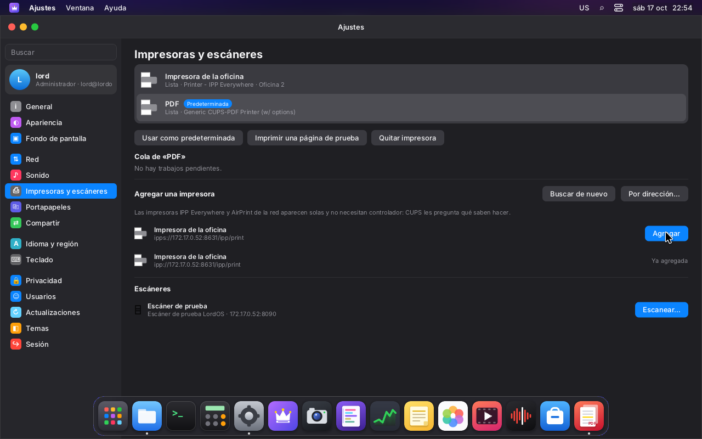
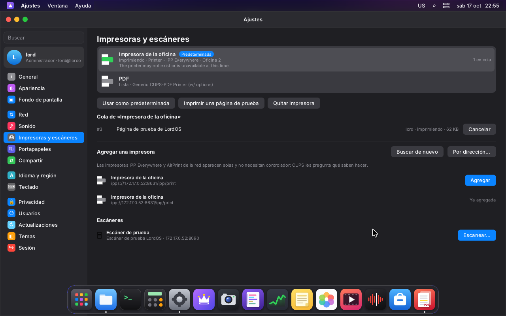
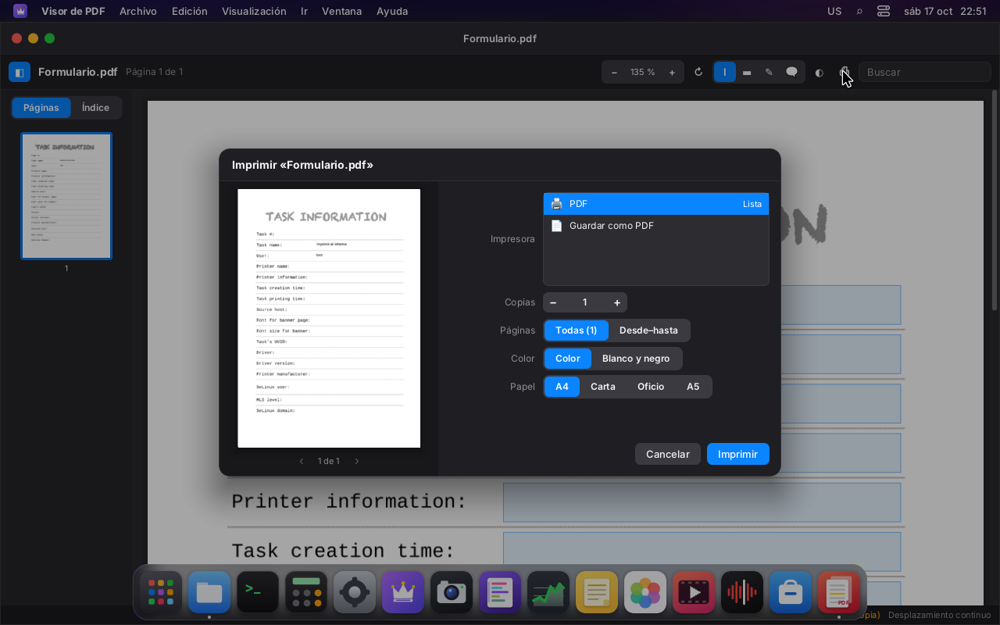
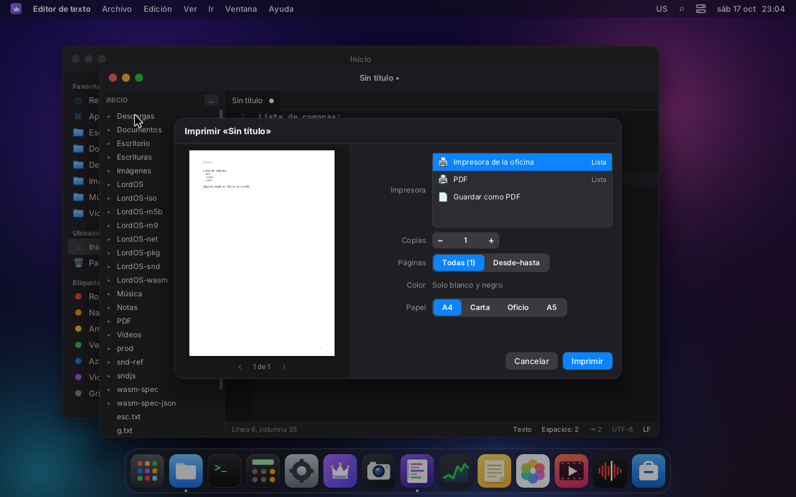
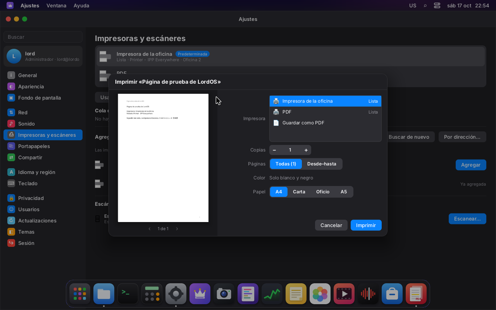
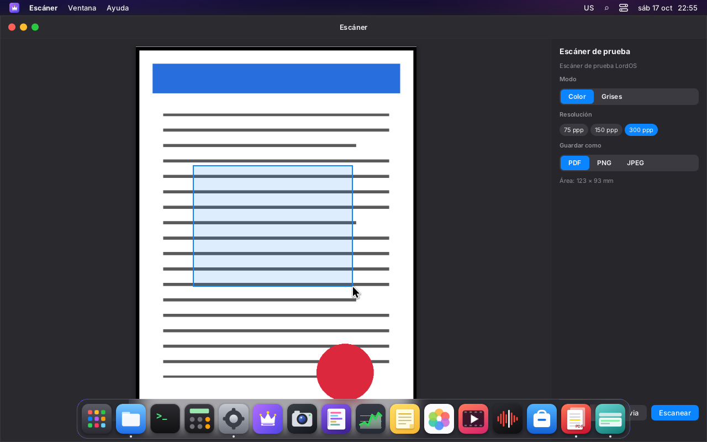

# Impresión y escáner (M9)

**CUPS administra la cola y los controladores. LordOS no usa libcups**: le habla IPP por su
socket local con un cliente propio en C. Las impresoras y los escáneres de la red se encuentran
por mDNS con código propio, y los escáneres se usan por eSCL, sin SANE. La interfaz es nativa:
Ajustes → Impresoras y escáneres, el diálogo de impresión del sistema y la app Escáner.

## Capturas (VM 116)

| | |
|---|---|
|  |  |
| Ajustes → Impresoras y escáneres: la cola de CUPS, una impresora IPP Everywhere encontrada por mDNS y agregada, y el escáner de prueba | La cola de la impresora con un trabajo y «Cancelar» |
|  |  |
| El diálogo del sistema desde el Visor de PDF: vista previa con el formulario completado, impresora, copias, páginas, color y papel | El mismo diálogo desde el Editor: el texto armado como PDF |
|  |  |
| Página de prueba hacia una impresora sin color (solo blanco y negro) | Escáner: vista previa, área elegida arrastrando, resolución, color y formato |

## Cómo está armado

```
apps (Visor de PDF, Editor, Notas, Fotos…)
  └── print.open(...)        sdk/print.js + sdk/printdialog.jsx  (diálogo del sistema)
        ├── vista previa     lord-doc (PDF armado o el PDF de la app), ver DOCUMENTOS.md
        └── lord.print.submit(impresora, blob | ruta, opciones)
              └── server/src/print  (hilos de lord-server, nunca el compositor)
                    ├── ipp.c     codificador/decodificador IPP/1.1 propio
                    ├── phttp.c   HTTP/1.1 mínimo (socket unix de CUPS, TCP a la LAN)
                    ├── cups.c    operaciones: impresoras, cola, imprimir, cancelar, agregar…
                    ├── mdns.c    DNS-SD por mDNS (legacy unicast)
                    └── escl.c    escáneres eSCL
CUPS (/run/cups/cups.sock) → filtros y controladores de Debian → la impresora
```

- **Asincrónico:** cada pedido corre en un hilo propio (hasta 8 a la vez) y el resultado llega a
  JS con `lord.print.poll()`. El compositor no espera nunca, ni siquiera mientras CUPS arma la
  PPD de una impresora nueva, que tarda unos segundos.
- **Imprimir:** siempre se manda **PDF** (`document-format application/pdf`), con los atributos
  de trabajo de IPP:
  - `copies`, `page-ranges` (rangos como «1-3, 5»), `print-color-mode`, `sides` y `media`
    (A4, carta, oficio, A5);
  - el nombre del trabajo.

  CUPS convierte y aplica el resto con sus filtros. Lo que imprimen las apps:
  - **el PDF de una app:** la ruta (se verifica que sea `%PDF-` y de la carpeta personal);
  - **un PDF armado o anotado:** un «blob» de lord-doc (memfd sellado).

### Por qué sin libcups

- **IPP alcanza:** es un formato binario simple, y lo que LordOS necesita son siete operaciones
  (CUPS-Get-Printers, CUPS-Get-Default, Get-Jobs, Print-Job, Cancel-Job,
  CUPS-Add-Modify-Printer, CUPS-Delete-Printer y CUPS-Set-Default). Con libcups vendrían también
  su DNS-SD (avahi-client), GnuTLS y la gestión de PPD, que no se usan.
- **Lo que lee está probado:** el decodificador valida todos los largos, anida colecciones hasta
  8 niveles y tiene topes de atributos y valores. `build/ipp-test` lo prueba con mensajes
  cortados en cada byte y 20.000 mutaciones al azar.
- **El costo es chico:** ~920 líneas propias (`ipp.c`, `phttp.c` y `cups.c`).

### Administrar impresoras: la política de CUPS, sin admin.c

**Decisión:** agregar, quitar y elegir la predeterminada no pasan por el ayudante de root. Usan
la **política del propio CUPS**:

- en Debian, esas operaciones piden un usuario de `@SYSTEM`, o sea **root o el grupo
  `lpadmin`**;
- el cliente se identifica con **PeerCred**: ante un 401, repite el pedido con
  `Authorization: PeerCred <usuario>`, y CUPS lo verifica mirando las credenciales del socket
  unix (SO_PEERCRED);
- no viaja ninguna contraseña y no hay código nuevo corriendo como root.

**Quiénes tienen `lpadmin`:** los **administradores** de LordOS, como en Ubuntu.
- El instalador (`server/src/install/install.c`) se lo da al primer usuario.
- Ajustes → Usuarios lo agrega y lo quita junto con `sudo` al marcar o desmarcar
  «Administrador» (`users_admin.c`). Si CUPS no está instalado, el grupo no existe y se saltea.

**Un usuario común:**
- ve las impresoras y su cola, imprime y cancela **sus** trabajos (la política de CUPS);
- al intentar agregar o quitar una impresora, Ajustes le explica que hace falta ser
  administrador.

**Agregar una impresora:**
- CUPS-Add-Modify-Printer con `ppd-name=everywhere`: CUPS le pregunta a la impresora sus
  capacidades y arma la PPD, sin controlador (IPP Everywhere, AirPrint);
- en el mismo pedido se la deja aceptando trabajos (`printer-is-accepting-jobs`,
  `printer-state=idle`);
- el nombre de la cola se arma con el nombre del anuncio (`queueName`: letras, dígitos, `_` y `-`).

### Encontrar impresoras y escáneres (mDNS)

`server/src/print/mdns.c`, propio:

- **Pregunta** por `_ipp._tcp`, `_ipps._tcp`, `_uscan._tcp` y `_uscans._tcp` a 224.0.0.251:5353
  **desde un puerto cualquiera** («legacy unicast», RFC 6762 §6.7): no hace falta tener el 5353
  ni avahi, y no se toca la configuración de la red.
- **Arma la respuesta** con los registros PTR, SRV, TXT y A. A los que llegan incompletos les
  vuelve a preguntar el SRV, el TXT o la dirección. En total escucha 1,8 s.
- **Para agregar** usa `ipp://<IPv4>:<puerto>/<rp>`. Si la misma impresora se anuncia por ipp e
  ipps, se muestra una vez.
- **Lo que llega** se lee como dato no confiable: punteros de compresión con tope de saltos,
  largos verificados y sin caracteres de control. Hay pruebas en `ipp-test`: un paquete armado a
  mano, cortado en cada byte y con un bucle de punteros.

### Escáner (eSCL, `apps/scanner`)

`server/src/print/escl.c` + la app **Escáner** (se abre desde Ajustes o desde el Launchpad):

- **Capacidades** (`GET /eSCL/ScannerCapabilities`): modelo, vidrio o alimentador, tamaño
  máximo, resoluciones, modos de color y formatos. El XML se lee con un buscador de etiquetas
  propio y acotado, sin libxml2.
- **Escanear:**
  - `POST /eSCL/ScanJobs` con ScanSettings: área en 1/300", resolución, ColorMode y formato;
  - `201 Location`, y después `GET …/NextDocument`, reintentando mientras conteste 503;
  - lo que llega se guarda en `~/.cache/lordos/scan/`.
- **Vista previa** a la resolución más baja. **El área** se elige arrastrando sobre la vista
  previa.
- **Guardar como PDF, PNG o JPEG** en Documentos o Imágenes, con «Escaneo <fecha> <hora>»:
  - si el escáner da ese formato, se copia tal cual;
  - si no, lo convierte lord-doc (stb_image y cairo), a la medida real según la resolución;
  - la imagen que manda el escáner **se decodifica en lord-doc**, encerrado, nunca en lord-server.
- **Seguridad:**
  - solo direcciones IPv4 de la red local (10/8, 172.16/12, 192.168/16, 169.254/16, 127/8), así
    que la app no sirve para pedir cosas a internet;
  - el camino del Location se usa siempre contra la misma dirección;
  - topes de tamaño (256 MB).

### El diálogo de impresión del sistema

`print.open(fuente)` (de `@lordos/sdk`) lo abre encima de todo. Lo monta `startShell`, así que
cualquier app lo tiene sin dibujar nada propio:

| Fuente | Qué imprime | Quién la usa |
|---|---|---|
| `{ title, path }` | un PDF tal cual | — |
| `{ title, doc }` | un PDF abierto con `pdf.open`, con sus formularios y anotaciones (`doc.blob()`) | Visor de PDF |
| `{ title, text, mono }` | texto armado como PDF en lord-doc: cairo y FreeType, fuente con respaldo por carácter, encabezado con el título y número de página | Editor (❖P, Archivo → Imprimir), Notas (Archivo → Imprimir) |
| `{ title, image }` | una imagen centrada en la página (apaisada si es ancha) | Escáner; Fotos, del agente de medios |

**Qué tiene el diálogo:**
- impresora (con su estado) o «Guardar como PDF»;
- copias y páginas (todas o un rango);
- color o blanco y negro, solo si la impresora tiene color;
- doble faz (borde largo o corto), solo si la impresora la ofrece;
- papel A4, carta, oficio o A5: carta por defecto en las regiones que la usan (EE. UU., Canadá,
  México…).

**La vista previa** es el mismo PDF que se manda, dibujado por lord-doc, y con un rango muestra
solo esas páginas. Si cambia el papel, el texto o la imagen se vuelven a armar. Esc o Cancelar
cierran.

### API (`sdk/print.js`, `lord.print` en `js_print.c`)

| | |
|---|---|
| `print.open(fuente)` | diálogo; → `{ job, printer }`, `{ saved }` o `null` |
| `print.printers()` | `{ printers: [{ name, info, location, model, state, message, accepting, color, media, sides, colorModes, queued }], default }` |
| `print.jobs()`, `print.cancel(id)` | cola sin terminar (todas las impresoras); cancelar |
| `print.add(nombre, uri, info, lugar)`, `remove(nombre)`, `setDefault(nombre)` | administración (lpadmin) |
| `print.discover()` | `{ printers: [{ name, uri, addr, port, model, uuid, color, duplex }], scanners: [{ name, addr, port, rs, model, tls, lan }] }` |
| `print.scanCaps(escáner)`, `print.scan(escáner, ajustes)` | eSCL; → `{ file, format, bytes }` |
| `print.submit(impresora, blob \| rutaPdf, opciones)` | sin diálogo |

Las entradas se validan del lado de C:
- nombres de cola: `[A-Za-z0-9_-]{1,127}`;
- URIs: `ipp`, `ipps`, `http`, `https` o `dnssd`, sin espacios ni comillas;
- textos sin caracteres de control;
- rangos de páginas: «1-3, 5»;
- `media`, `sides` y `print-color-mode`: palabras de una lista cerrada.

## Cómo se probó (VM 116)

**Paquetes:** `cups`, `printer-driver-cups-pdf`, `cups-ipp-utils` y `avahi-daemon` (ver
`VM-SETUP.md`). El usuario `lord` está en el grupo `lpadmin`.

**Impresora virtual (cups-pdf, la cola «PDF»):**
- se imprimió el formulario completado desde el Visor de PDF;
- el PDF que dejó cups-pdf en `~/PDF/` tiene los valores escritos («Imprimir el informe», «lord»).

**Impresora «de la red», IPP Everywhere:**

```sh
ippeveprinter -p 8631 -M LordOS -m "Impresora IPP de prueba" -l "Oficina 2" \
  -f application/pdf,image/pwg-raster,image/jpeg -d /tmp/ippeve "Impresora de la oficina"
```

Se anuncia por avahi. En Ajustes:
- apareció sola (mDNS) y se agregó con «Agregar», como usuario con `lpadmin` y autorizado por
  PeerCred: `lpstat -v` → `ipp://172.17.0.52:8631/ipp/print`, modelo «IPP Everywhere»;
- se eligió como predeterminada;
- se imprimió una página de prueba: el trabajo terminó (`job-completed-successfully`) y el PDF
  llegó a `/tmp/ippeve`;
- con la impresora apagada se encoló un trabajo, la cola lo mostró y «Cancelar» lo canceló
  (`job-canceled-by-user`).

**Editor:** se imprimió y se guardó como PDF (`pdftotext` devuelve el texto; las fuentes son
Noto Sans y DejaVu Sans Mono, incrustadas).

**Escáner:** no hay uno real. `server/tests/escl_server.py` es un **escáner eSCL de prueba**, con
la biblioteca estándar de Python:
- devuelve capacidades y entrega una hoja dibujada (PNG) del área y la resolución pedidas;
- se anuncia con
  `avahi-publish -s "Escáner de prueba" _uscan._tcp 8090 "rs=eSCL" "ty=Escáner de prueba LordOS"`.

Resultados:
- vista previa a 75 ppp (637×877);
- área de 123×93 mm guardada como **PDF** de 349×265 pt, el tamaño real;
- la misma área a 150 ppp como **JPEG** de 728×551 (convertido en lord-doc).

**Pruebas sin pantalla:** `build/ipp-test`, 40/40:
- el codificador y el decodificador IPP, ida y vuelta;
- una respuesta con dos impresoras, varios valores, una colección y `textWithLanguage`;
- mensajes cortados y mutados, largos imposibles y colecciones anidadas de más;
- mDNS con compresión y bucles;
- rangos de páginas, nombres y URIs.

## Pendiente

- Los escáneres por `_uscans` (TLS) y las impresoras `ipps` directas a la impresora: lord-server
  no enlaza TLS. CUPS sí habla ipps con las impresoras que agrega.
- mDNS por IPv6 y la búsqueda continua (hoy se busca al abrir Ajustes y con «Buscar de nuevo»).
- El alimentador con varias hojas (hoy se toma la primera) y el escaneo dúplex.
- Pausar o reanudar una impresora, y opciones avanzadas (bandejas, calidad).
- Impresoras USB sin IPP-USB: necesitan un controlador de CUPS y no se probaron.
- Impresoras y escáneres físicos: todo se probó con emuladores.
