# LordOS live ISO

An image to boot LordOS from a USB stick or a CD on any 64-bit PC, without installing anything. It
is the LordOS distribution itself (a minimal Debian 13 with the LordOS desktop environment) and
it boots straight into the desktop. It's for testing real hardware: the GPU (AMD or Nvidia),
sound, Wi-Fi and displays. It is the first step of M8 (the
installable image).

| | |
|---|---|
| 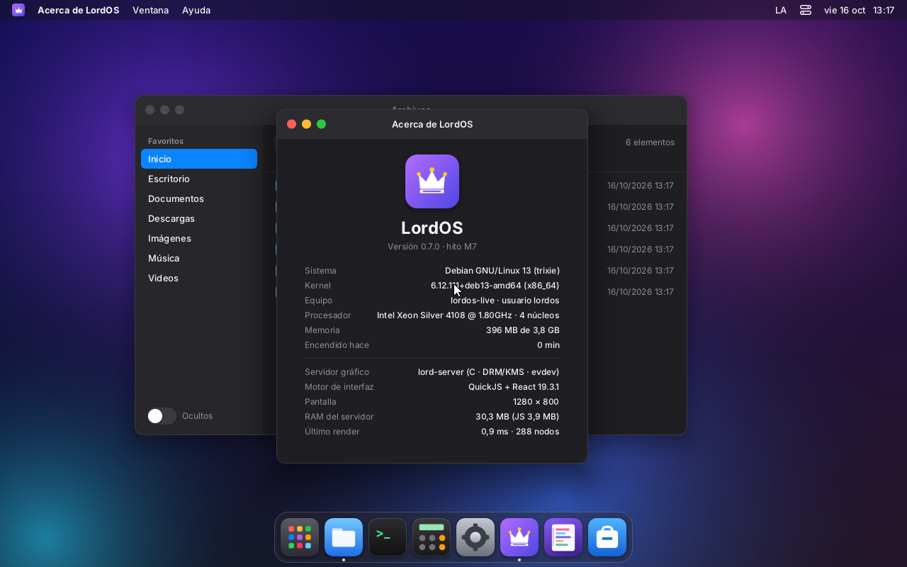 | 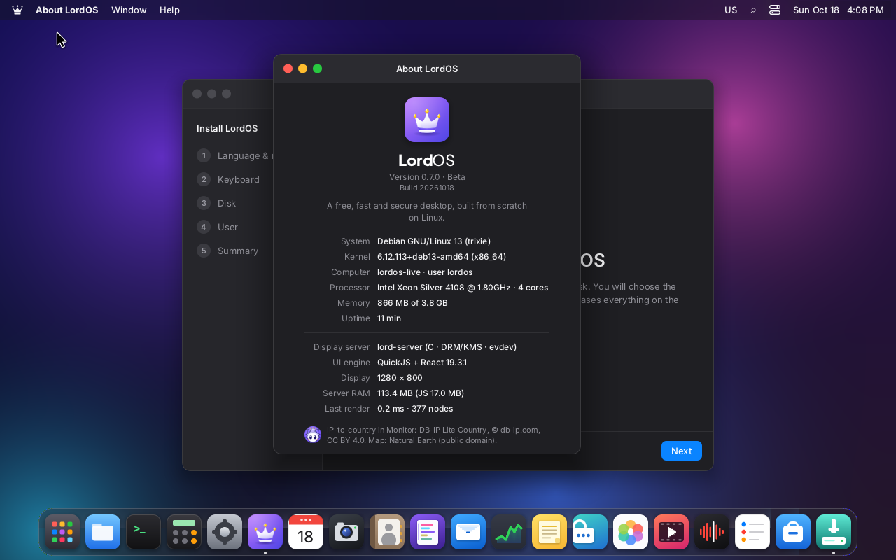 |
| VM with SeaBIOS: boots on its own into LordOS | VM with OVMF (UEFI); screenshot from the final 0.7.0 ISO test |
|  | 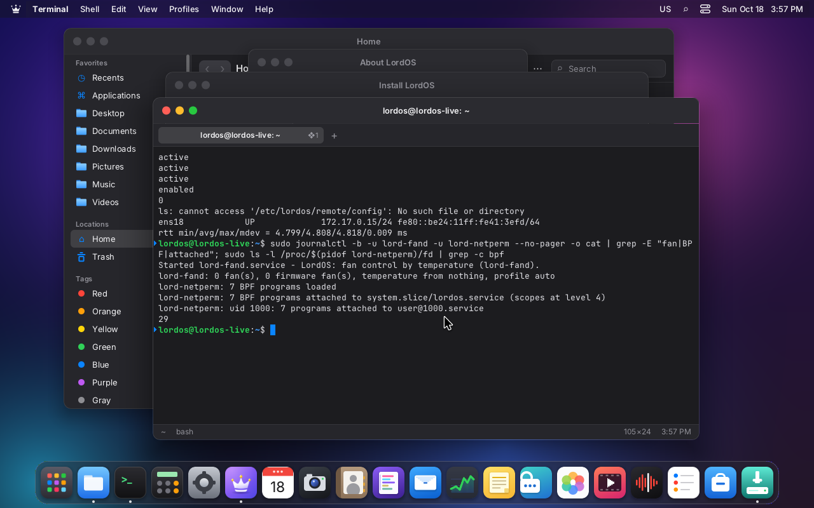 |
| Boot menu (screenshot from before the grub font fix: the borders showed up as "?") | Network via LordOS's own DHCP, DNS, `ping` without root, sound (PipeWire) and boot in 11.8 s (screenshot: services and network in the final 0.7.0 ISO test) |

## Writing it to a USB stick

The ISO is **hybrid**: it is written as is, without special tools. Careful: the whole USB stick is
erased.

- **Linux and other Unix-like systems:**
  ```sh
  sha256sum -c lordos-live-0.7.0-amd64.iso.sha256      # or: shasum -a 256 -c …
  sudo dd if=lordos-live-0.7.0-amd64.iso of=/dev/sdX bs=4M status=progress conv=fsync
  ```
  `/dev/sdX` is the whole USB stick (not a partition). On BSD-derived systems it is usually `/dev/rdiskN`: find
  it with the system disk tool and unmount it first.
- **Other systems:** Rufus in **DD** mode (when it asks "ISO or DD", choose DD) or balenaEtcher.
- **Ventoy** also works: copy the `.iso` onto the stick.

Then boot the PC from the USB stick: usually F12, F11, F8 or Esc at power-on, depending on the
motherboard. It works with **UEFI** and with **BIOS/Legacy**. **Secure Boot** has to be off (see
"Pending").

## Boot menu

| Entry | What for |
|---|---|
| LordOS (live) | normal, in English (the default language) |
| LordOS (safe mode: no GPU) | passes `lordos.gpu=0` → `LORD_GPU=0`: lord-server doesn't use the GPU path and composites on the CPU |
| LordOS (Español) / LordOS (Português) | `lordos.lang=es` / `lordos.lang=pt`: the interface in Spanish or Portuguese the first time |
| LordOS (copy to RAM) | `toram`: copies the system to memory (~1 GB free is needed) and the USB stick can be removed |

The GRUB menu itself is in English (GRUB's default). Every entry except safe mode boots with the
boot splash (`splash`); safe mode boots in text (`nosplash`).

## Boot splash and boot menu

From power-on to the login screen LordOS shows its own look: the boot menu, then the crown with a
progress bar, then the login screen (or the desktop, with autologin) without a black frame or console
text in between.

| Boot menu (GRUB theme) | Boot splash (Plymouth) |
|---|---|
| 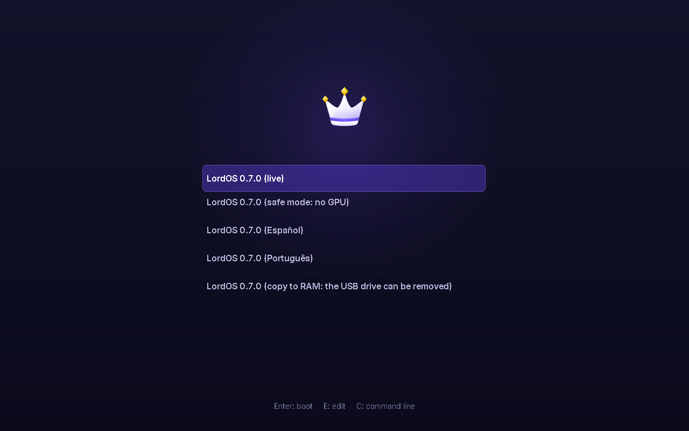 |  |

- **Boot menu:** the GRUB theme `tools/iso/grub/lordos/` (`theme.txt`, images and Inter as GRUB
  fonts): the navy background, a small crown, the entries in the brand colours with the selected one
  on a rounded violet band, and the countdown as the splash's bar. The ISO copies it to
  `/boot/grub/themes/lordos/`; the package installs it in `/usr/share/grub/themes/lordos/` (amd64
  only) and the disk installer sets `GRUB_THEME` to it. The entries (English, Español, Português,
  safe mode, copy to RAM) are the same as before.
- **Boot splash:** the Plymouth theme `lordos` (`tools/boot/plymouth/lordos/`, the `script`
  module), installed by the package in `/usr/share/plymouth/themes/lordos/`. The ISO installs
  `plymouth` and `plymouth-label` and selects it (`plymouth-set-default-theme lordos`) before building
  the initramfs, so it shows from the initramfs on. The bar follows Plymouth's boot progress, eased so
  it never jumps or goes back; there are no text messages, and **Esc** shows the text console as
  usual. If a disk is encrypted (LUKS), a styled password field with a lock replaces the bar.
- **Installed system:** the installer writes `GRUB_CMDLINE_LINUX_DEFAULT="quiet splash
  vt.global_cursor_default=0 loglevel=3"`, `GRUB_GFXPAYLOAD_LINUX=keep`, `GRUB_TERMINAL_OUTPUT=gfxterm`
  and `GRUB_THEME` (each only when Plymouth and the themes are in the copied system), then rebuilds
  the initramfs and the GRUB menu. `nosplash` on the kernel command line (`e` in the menu) boots in
  text for one boot.
- **Hand-off:** see `SESSIONS.md`, "Boot splash": Plymouth gives up the card just before
  lord-sessiond takes it, its last frame stays until LordOS's first frame replaces it, and only then
  is Plymouth ended with `--retain-splash`.
- **On Debian (install.sh):** optional and asked for; see `INSTALL-DEBIAN.md`.

The images come from `python3 tools/boot/gen-boot-assets.py` (rsvg-convert; `--preview` also
writes the static previews in `docs/boot/`). The GRUB fonts are made on a Debian with `grub-common`:

```sh
R=0x20-0x7E,0xA0-0x17F,0x2010-0x2027
grub-mkfont -s 16 -r $R -o tools/iso/grub/lordos/inter-regular-16.pf2  assets/fonts/Inter-Regular.ttf
grub-mkfont -s 14 -r $R -o tools/iso/grub/lordos/inter-regular-14.pf2  assets/fonts/Inter-Regular.ttf
grub-mkfont -s 16 -r $R -o tools/iso/grub/lordos/inter-semibold-16.pf2 assets/fonts/Inter-SemiBold.ttf
```

Inter is under the SIL Open Font License 1.1 (`assets/fonts/Inter-LICENSE.txt`).

In the live session:
- **User:** `lordos`, no password, with passwordless `sudo`.
- **root:** password `lordos`, only for the emergency console.
- **Changes:** everything you change stays in RAM and is lost on power-off. The Store and package
  installation work the same, but in memory.

## Installing to disk

On the live ISO the **Install LordOS** assistant (`apps/installer`) opens on its own. It only exists
on the live system: the manifest has `"live": true` and the SDK hides it if
`/run/live/medium/live/filesystem.squashfs` is not there.

| | |
|---|---|
|  |  |
| Welcome | Disk: model, size, contents and a strong confirmation |
|  | 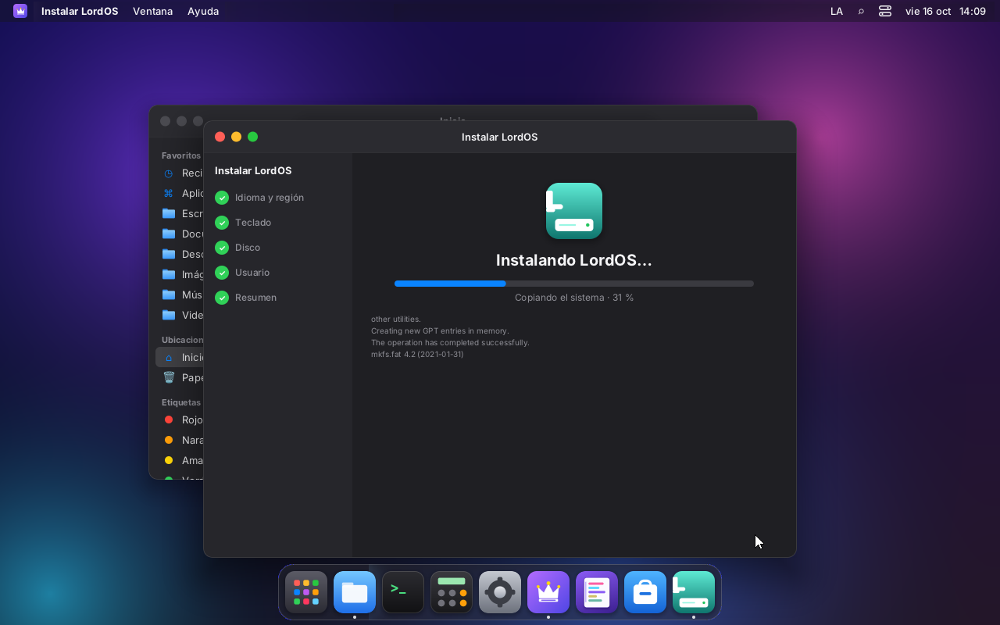 |
| User, password and computer name, with validation | Installing: progress bar by phase |
| 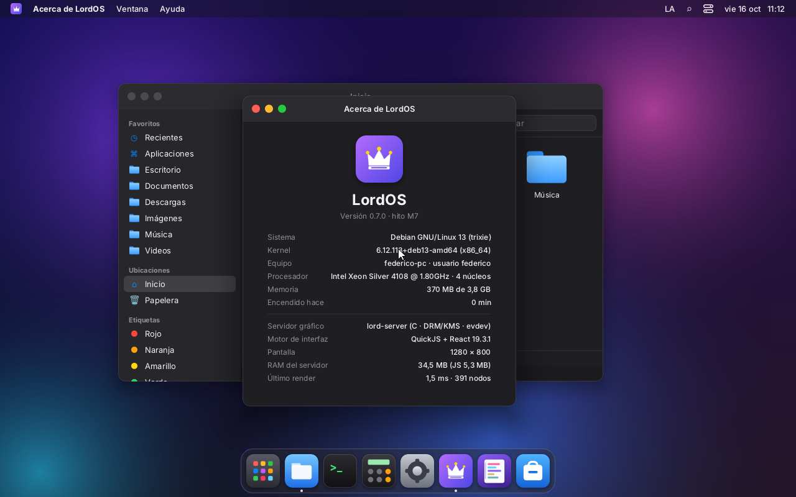 |  |
| Booted from the disk (UEFI), with the created user | Groups, fstab with UUIDs, es_AR, time zone, no live-boot, network; sudo asks for a password |
|  | 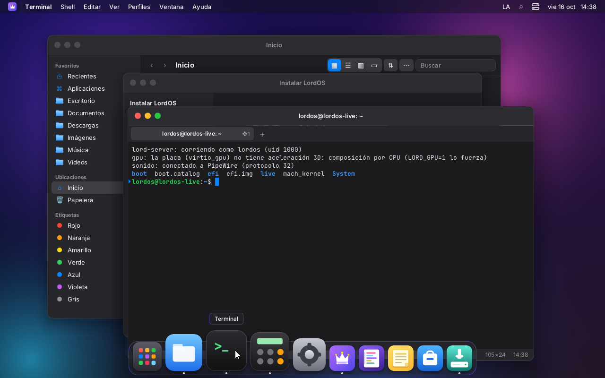 |
| The same disk booting through SeaBIOS (BIOS + GPT) | The ISO ships the GPU path (`GPU=1`); in the VM (virtio without 3D) it falls back to the CPU on its own |

Assistant steps:

1. **Welcome.**
2. **Language, region and time zone.** The language changes the interface live.
3. **Keyboard.** The layout is applied live and there's a field to try it.
4. **Disk.** Lists the disks (model, size, connection and what's on them), excluding the disk the
   live system booted from. To continue you have to tick "I understand the whole disk will be
   erased" and type the disk's name (`sda`). Optional: swap as a file, of 2, 4 or 8 GB.
5. **User.**
   - The user name is suggested from the full name.
   - The password is typed twice.
   - The computer name is suggested as `<user>-pc`.
   - The same rules are validated again later, on the root side.
6. **Summary** and "Install".
7. **Progress**, in four phases:
   - partitioning;
   - copying the system, with the percentage reported by `unsquashfs`;
   - configuring;
   - installing the bootloader.

   At the end "Restart" appears.

How the disk ends up:

| Partition | Size | What for |
|---|---|---|
| 1 `biosboot` (EF02) | 1 MiB | grub for BIOS on a GPT disk |
| 2 `EFI` (EF00) | 512 MiB, FAT32 | grub for UEFI, at the removable path (`EFI/BOOT/BOOTX64.EFI`: boots on any firmware without an NVRAM entry) |
| 3 `LordOS` (8304) | the rest, ext4 | the system; swap is `/swapfile` |

The installed system is a copy of the live system with these changes:

- **Live-only things removed:**
  - `live-boot` and the `lordos` user are removed, along with its passwordless sudo;
  - root is locked (`*`).
- **The new user** is in the `sudo`, `audio`, `video`, `input` and `render` groups, and has
  linger, so their PipeWire starts with the system.
- **Configuration** that gets written:
  - `fstab` with UUIDs;
  - hostname and `/etc/hosts`;
  - `/etc/default/locale`, `/etc/localtime` and `/etc/default/keyboard`;
  - the user's LordOS settings (language and keyboard);
  - a new `machine-id`;
  - the regenerated initramfs and `grub.cfg`.
- **Login:**
  - `lordos.service` starts `lord-sessiond`, which shows LordOS's own login screen
    (`SESSIONS.md`): the installer writes an empty `AUTOLOGIN=` to `/etc/lordos/session.conf`;
  - automatic login is turned on in Settings → Users;
  - the password is used for `sudo` and for administration actions.

### Installer security

It adds three actions to the privileged helper (`server/src/install/install.c`, macro
`INSTALL_ADMIN_ACTIONS` in `admin.c`):

| Action | Who | What it does |
|---|---|---|
| `install-disks` | administrator | lists the installable disks (JSON via `LOG`) |
| `install-run <json>` | administrator, in a separate process | installs |
| `install-reboot` | administrator | `systemctl reboot` |

All three answer **ERR outside live mode**: `/run/live/medium/live/filesystem.squashfs` has to
exist. On an installed system that file doesn't exist.

What `install-run` validates on the root side, without trusting the interface:

- **The disk:**
  - it has to be in the same list as `install-disks` (from `/sys/block`, without loop, ram, zram,
    sr, dm, md or nbd, without read-only ones and without the disk that contains
    `/run/live/medium`);
  - it has to be at least 8 GB;
  - it can't have anything mounted or active swap.
- **User:**
  - `^[a-z_][a-z0-9_-]{0,31}$`;
  - it can't be a reserved name or a user that already exists on the system.
- **Full name:** UTF-8, without `:`, `,` or control characters.
- **Computer name:** `^[a-z0-9]([a-z0-9-]{0,61}[a-z0-9])?$`.
- **Region:** it has to appear in `/usr/share/i18n/SUPPORTED` with UTF-8.
- **Time zone:** a regular file in `/usr/share/zoneinfo`, without `..`.
- **Keyboard:** the layout has to exist in `/usr/share/X11/xkb/symbols`; the variant,
  `[A-Za-z0-9_-]`.
- **Swap:** from 0 to 16384 MiB.
- **The password:**
  - never goes into an argv: it arrives through the helper's socketpair;
  - it is hashed with `crypt(3)` yescrypt (`$y$`, like Debian, with `crypt_gensalt_ra`);
  - the hash is written directly to the new system's `/etc/shadow`;
  - afterwards it is wiped from memory (`explicit_bzero`), and the interface also forgets it when
    starting.
- **Fixed-path programs:** `wipefs`, `sgdisk`, `udevadm`, `mkfs.vfat`, `mkfs.ext4`, `unsquashfs`,
  `blkid`, `fallocate`, `mkswap`, `chroot` (with `dpkg`, `userdel`, `useradd`, `locale-gen`,
  `systemd-machine-id-setup`, `update-initramfs`, `grub-install` and `grub-mkconfig` inside) and
  `systemctl`. `install.c` builds the arguments from the already validated values.

## What it ships

- **LordOS** as its own package, `lordos_<version>_amd64.deb`, built by `tools/iso/mkdeb.sh`. The
  version and the release channel come from `package.json` (`"version"` and `"lordos": {"channel": "beta"}`;
  an empty channel is a stable release). `make -C server` bakes both, plus the build date and git
  commit, into `lord-server`, and About and Settings → General show them. The package contains:
  - `/usr/lib/lordos/bin/lord-sessiond` (root: sessions, login screen, remote desktop off, port
    5673) and `/usr/lib/lordos/bin/lord-server` (each session);
  - the prebuilt themes, in `/usr/lib/lordos/themes`;
  - `assets/`: fonts, texts, icons and the shell integration;
  - `lordos.service`.
- **Boot:** `lordos.service` starts `lord-sessiond` on tty1 as root.
  - `/etc/lordos/session.conf` says `AUTOLOGIN=lordos`: it logs in on its own, as before. The user
    has no password; after locking the screen you get back in with the field empty (only on the
    physical display).
  - Before that, `lordos-live-prep` (`ExecStartPre`, only if `/run/live` exists) applies
    `lordos.lang` (to `/etc/default/locale` and the user's settings), creates their folders and
    leaves `/etc/network/interfaces` with only `lo`.
  - `lordos.gpu=0` (safe mode) still works: lord-sessiond reads it from `/proc/cmdline` and passes
    `LORD_GPU=0` to every session. Without that option, the session on the display composites on
    the GPU as before (Mesa: EGL, GBM, GLES2, linux-dmabuf and direct scanout).
  - The user has linger, so their PipeWire starts with the system.
  - The system user `lordos-greeter`, the login screen's user, is created when building the ISO
    (lord-sessiond also creates it if it's missing).
- **Network:** LordOS's own DHCP, in `lord-netd` from boot (`NETWORK.md`). No ifupdown,
  systemd-networkd or NetworkManager.
- **Sound:** PipeWire, pipewire-pulse, WirePlumber, alsa-ucm-conf and the SOF firmware (audio on
  Intel laptops).
- **GPU:** Mesa (radeonsi, iris, nouveau, llvmpipe and RADV/ANV/NVK for Vulkan), `libgbm1`,
  `libegl1`, `libgles2`, `firmware-amd-graphics` and `firmware-misc-nonfree`. To test it:
  `glmark2-es2-wayland`, `eglinfo`/`glxinfo` (mesa-utils) and `vulkaninfo`.
- **Wi-Fi:** wpa_supplicant and Intel (iwlwifi), Realtek and Atheros firmware.
- **Fonts:** Noto (core, CJK, emoji) and DejaVu; the rest of what M5b needs: libthai-data, skkdic
  and rime-data-pinyin-simp.
- **Sample Linux apps:** foot and FeatherPad.

## Building it

On a Debian 13, from the root of an already compiled repository. Since M8 it is built on **VM 116**
(`lordos-gpu`, 172.17.0.52, a clone of 115), in `~/LordOS-iso`: 115 is the user's development VM and
is not used for this.

```sh
# on the development machine: the themes (also the login screen, themes/greeter)
npm run build
COPYFILE_DISABLE=1 tar czf - --no-xattrs --exclude build --exclude node_modules \
  package.json README.md server third_party assets themes tools | \
  ssh lord@172.17.0.52 'rm -rf ~/LordOS-iso && mkdir ~/LordOS-iso && cd ~/LordOS-iso && tar xzf -'
# on VM 116
make -C server -j4                            # lord-server (GPU=1) and lord-sessiond (needs libssl-dev)
sudo tools/iso/build.sh /var/tmp/lordos-iso   # → /var/tmp/lordos-iso/out/
```

The ISO is copied to Proxmox (`local:iso/lordos-live-<version>-amd64.iso`). Before overwriting it, the
previous one is kept with its date: `lordos-live-0.7.0-amd64-20261016-1529.iso` is the last one with
`lordos-session` (sha256 `d4a8b25f…4b4dc5`).

`build.sh` steps:
1. `mkdeb.sh`: the LordOS package.
2. `debootstrap --variant=minbase` of trixie, with main, contrib, non-free and non-free-firmware.
3. `apt-get install --no-install-recommends` of the list above and the LordOS package.
4. Configuration:
   - locales `es_ES`, `es_AR`, `es_MX`, `en_US` and `pt_BR`;
   - the `lordos` user, with linger;
   - `lordos.service` enabled and `getty@tty1` masked;
   - `/etc/resolv.conf` as a regular file, for LordOS's DHCP;
   - `/etc/network/interfaces` with only `lo`;
   - `net.ipv4.ping_group_range`, so `ping` works without root.
5. Cleanup: apt lists, caches and `machine-id`.
6. `mksquashfs` (xz, BCJ x86).
7. `grub-mkrescue`: a single ISO with El Torito for BIOS and an EFI image (`efi.img`) for UEFI, with
   the hybrid MBR for USB.

lord-server is compiled with `make -C server GPU=1` (it needs `libgbm-dev libegl-dev libgles-dev`) so
the ISO ships GPU compositing (Mesa; see `GPU.md`).

Measured on VM 116 (4 Xeon Silver 4108 cores, 4 GB): **~8 minutes**, almost all of it downloading and
installing packages and compressing.

| | |
|---|---|
| ISO | 651 MB (650 809 344 bytes; with lord-sessiond, the login screen, the installer and the GPU path) |
| squashfs | 545 MB |
| uncompressed system | 1.5 GB |
| `lordos_0.7.0_amd64.deb` | 2.9 MB |

### Build packages

```sh
sudo apt-get install -y --no-install-recommends debootstrap squashfs-tools xorriso grub-pc-bin \
  grub-efi-amd64-bin grub-common mtools dosfstools lintian libgbm-dev libegl-dev libgles-dev libssl-dev \
  libpoppler-glib-dev libarchive-dev libavcodec-dev libavformat-dev libavutil-dev libswscale-dev \
  libswresample-dev libva-dev clang
```

| Package | What for |
|---|---|
| `libssl-dev` | compiling `lord-sessiond` (remote desktop TLS); without it, `make` builds only lord-server and `mkdeb.sh` refuses |
| `libpoppler-glib-dev`, `libarchive-dev` | compiling `lord-doc` (PDF and archives); without them `make` skips it and the package ships without a PDF viewer |
| `libavcodec-dev`, `libavformat-dev`, `libavutil-dev`, `libswscale-dev`, `libswresample-dev` | compiling `lord-media` (video, photos, camera, recorder); without them `make` skips it |
| `libva-dev` | optional: GPU decoding (VA-API) in `lord-media` |
| `clang` | compiling `lord-netperm`'s BPF programs (per-app network permissions); without it the build still works, but no rules are applied |
| `debootstrap` | the Debian base system |
| `squashfs-tools` | `mksquashfs` |
| `xorriso`, `grub-pc-bin`, `grub-efi-amd64-bin`, `grub-common`, `mtools`, `dosfstools` | `grub-mkrescue`: the hybrid BIOS + UEFI ISO |
| `lintian` | checking the `.deb` |

### lintian

`lintian lordos_0.7.0_amd64.deb` reports no errors. Two warnings remain, on purpose:

- **`duplicate-font-file`:** JetBrains Mono ships in `assets/fonts` because the Terminal needs it even
  when `fonts-jetbrains-mono` isn't installed.
- **`uses-dpkg-database-directly`:** our own package engine reads `/var/lib/dpkg/status` (see
  `PACKAGES.md`); it doesn't write the dpkg database.

## Test with lord-sessiond (M8, October 16)

The ISO starts `lord-sessiond` instead of `lordos-session`. ISO tested:
`lordos-live-0.7.0-amd64.iso`, 650 817 536 bytes, sha256
`7cf1c1b1d97ee040e74dcf8d93a6996f1ae369b457f51aba23cdd2bdd64e898c`.

| | |
|---|---|
|  |  |
| UEFI (OVMF): grub menu | Logs straight into the desktop, without going through the login screen |
| 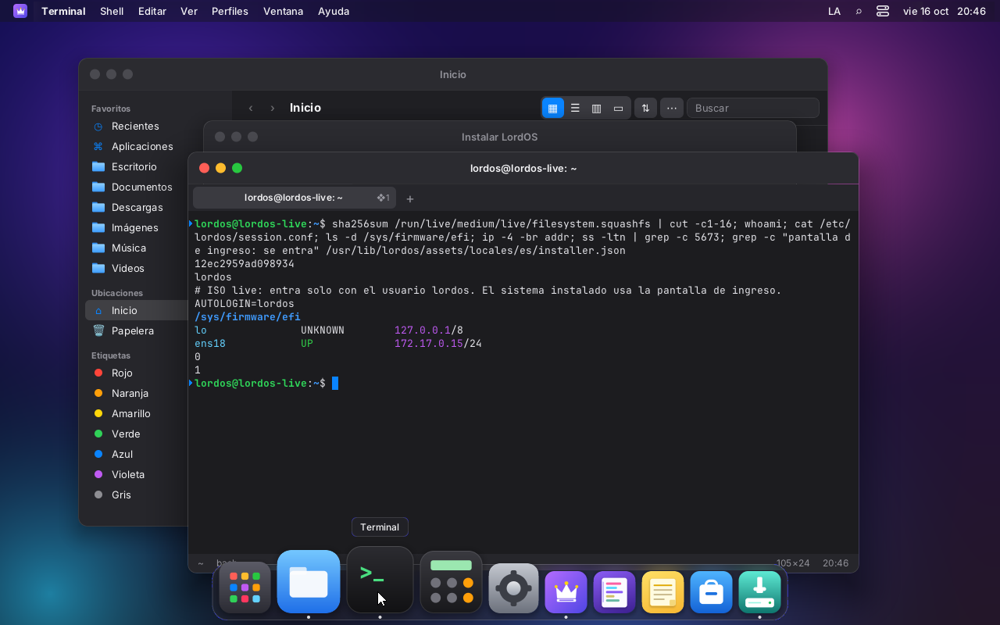 | 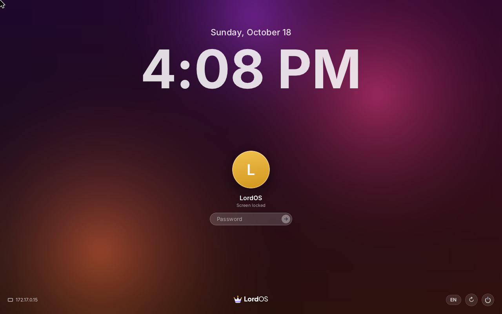 |
| `lordos`, `AUTOLOGIN=lordos`, `/sys/firmware/efi`, network via DHCP, port 5673 closed | ❖L: locked screen, with the IP at the bottom |
|  | 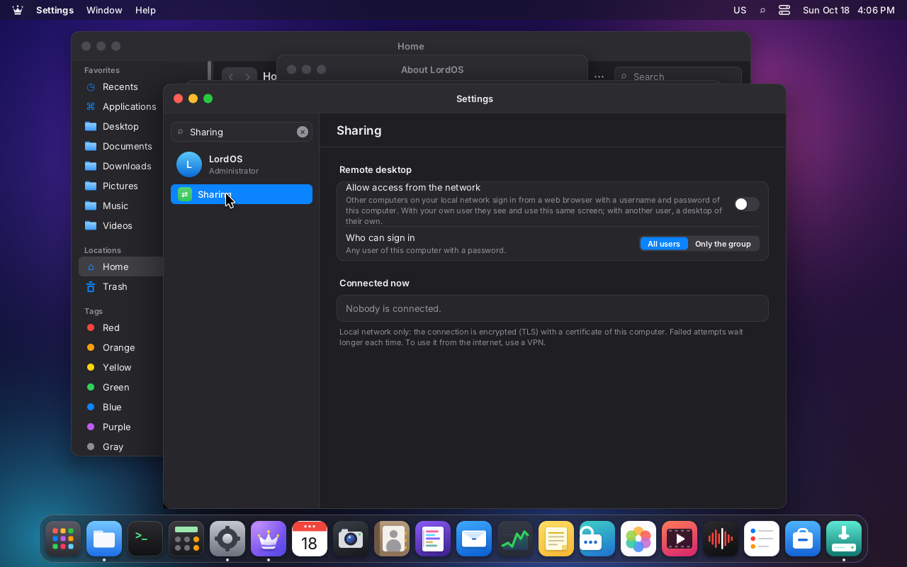 |
| Enter with the field empty: back to the same session | Settings → Sharing: remote desktop off (there's no `/etc/lordos/remote/config`) |
| 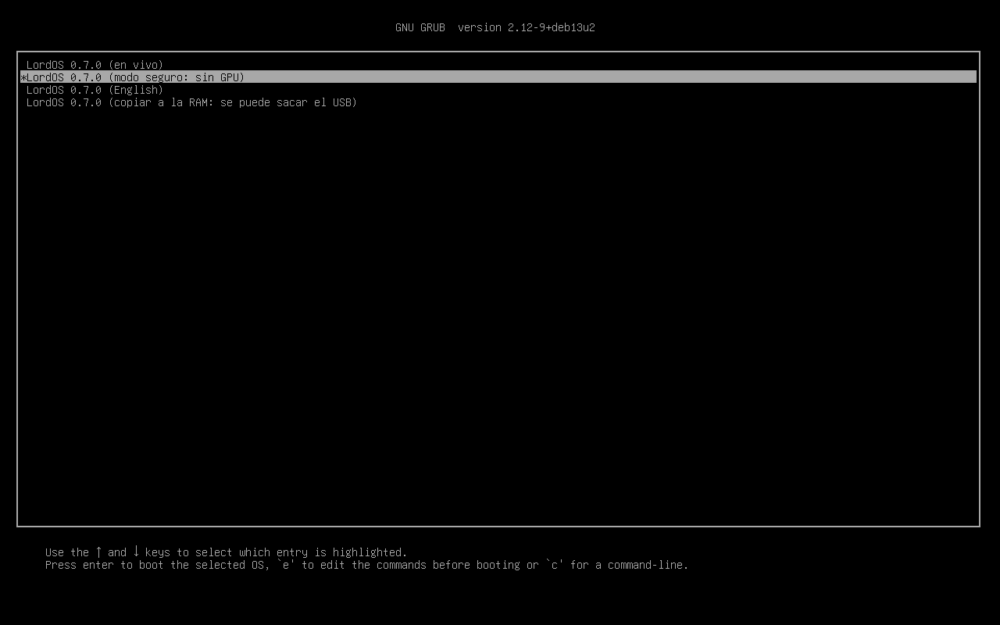 |  |
| "Safe mode" entry | `lordos.gpu=0` → the session receives `LORD_GPU=0` and composites on the CPU |
| 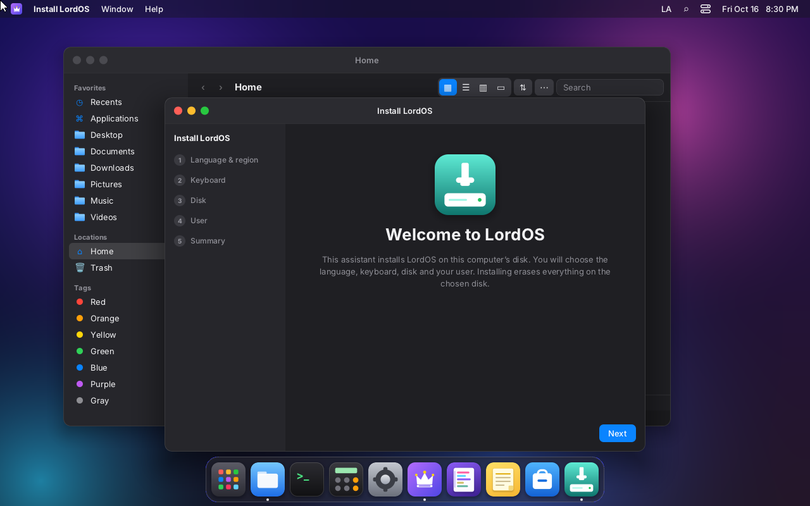 | 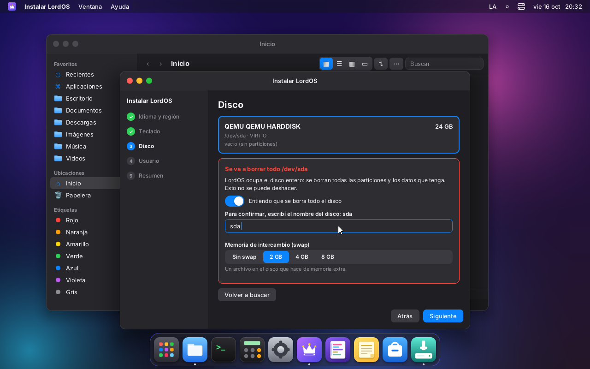 |
| `lordos.lang=en`: the interface in English | Installer, in a temporary VM with an empty 24 GB disk (OVMF) |
| 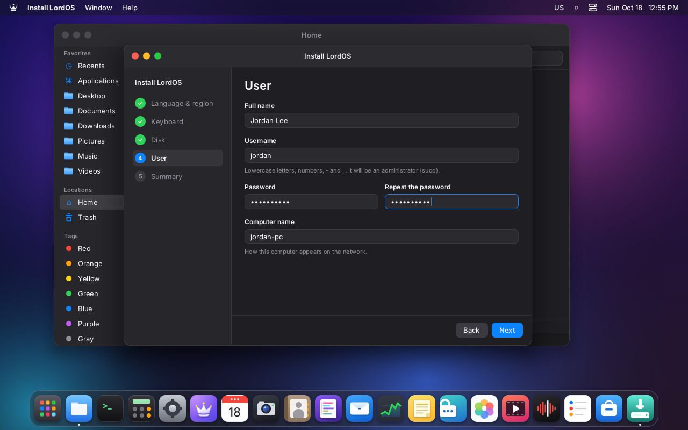 | 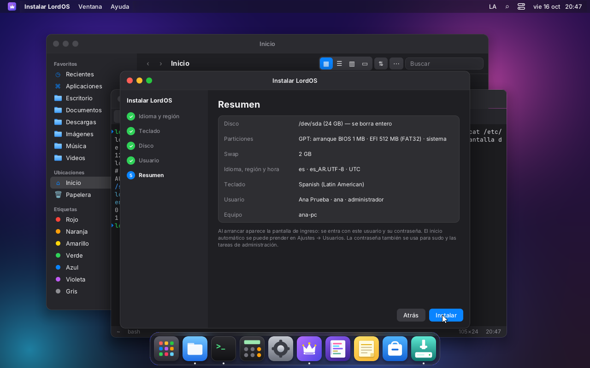 |
| User `jordan` / «Jordan Lee», computer `jordan-pc` | Summary, with the new login text |
| 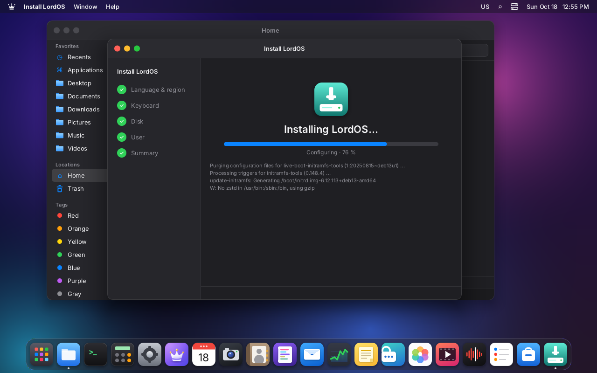 | 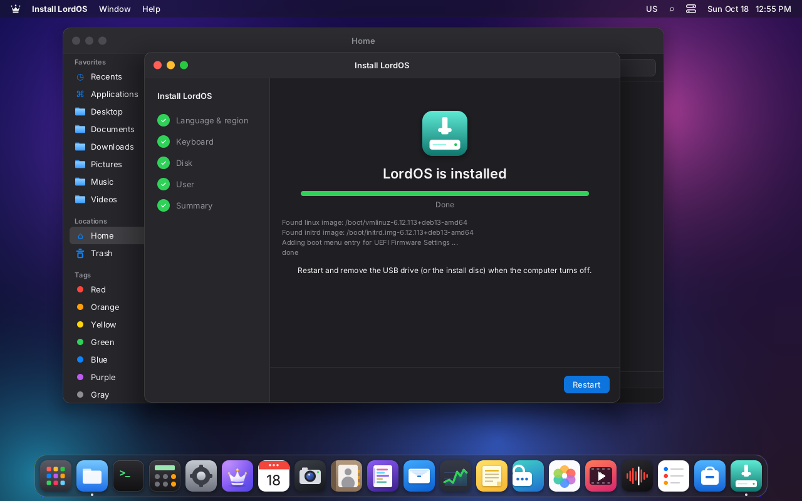 |
| Installing (~1 minute) | Done; "Restart" with one click |
| 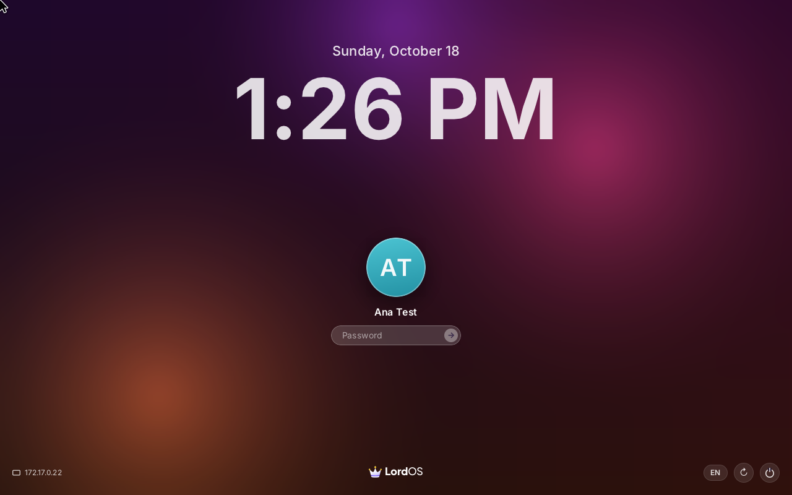 | 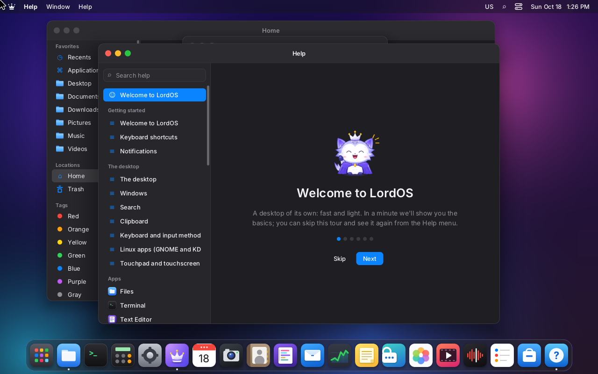 |
| The installed system boots to the login screen | Logging in with the new user's password (final 0.7.0 ISO test) |
| 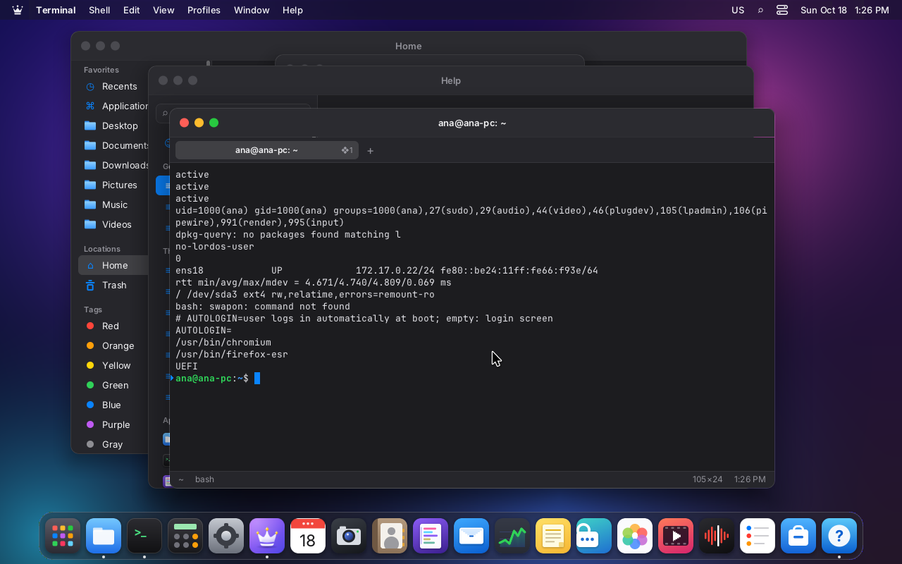 | |
| Empty `AUTOLOGIN=`; no `live-boot` or `lordos` user; groups sudo, audio, video, render and input; network; UEFI | |

**Fixes found in this test:**

- **The network didn't come up.** With lord-sessiond, every session is `--headless`, including the
  one on the display. `main.c` only sent `net-restore` without `--headless`, so `ens18` stayed DOWN.
  - Now every user session sends `net-restore`.
  - `net_act_restore` (`server/src/net/actions.c`) records in `/run/lordos/net-owner` the pid of the
    helper that brought the network up. While that helper is alive, the other sessions don't start
    another DHCP on the same interface.
- **The installer summary said** the system logged in on its own and that the login screen would
  come "in an upcoming version". `installer.summary.login` was changed in es, en and pt.

The installer screenshots up to "Done" and those of the installed system are from the ISO before that
text was fixed (sha256 `daba6313…c8ec65`). That ISO has the same binaries; only those texts change.
With the final ISO, UEFI boot, the network, ❖L/Enter and the installer summary were repeated. Nothing
was installed in that repeat.

## Final ISO test (0.7.0 Beta, October 18)

`lordos-live-0.7.0-amd64.iso`, 963 794 944 bytes, sha256
`999afa4009de0a67ba980e982cdeac42c2c9121f4d1fcf945346a6852919474a`, built on VM 116 from `main`
8941033 (new brand and Lumo) with `GPU=1`; `make -C server test`: 23 passed, 0 failed, 1 skipped
(bidi data not installed). `lordos_0.7.0_amd64.deb` (6.0 MB): lintian 0 errors. squashfs 843 MB,
uncompressed system 2.5 GB, build 14.5 minutes. Screenshots in `docs/iso-final/`.

The live checks were made on VM 117 (OVMF) with the build just before this one (sha256
`881c24c3…88dd9cfd`), which only lacks `gsettings-desktop-schemas`; the GTK app, both browsers and
the whole installation were repeated with the final ISO.

| Check | Result |
|---|---|
| Boot menu: English default, safe mode, Español, Português, copy to RAM | pass ([grub](iso-final/grub.png), [es](iso-final/live-es-desktop.png)) |
| Live user → desktop (autologin), keyboard follows the entry's language (US / LA) | pass (after fix 1) |
| `lordos`, `lord-netperm`, `lord-fand` active; `lord-fand` enabled | pass ([terminal](iso-final/live-services.png)) |
| `lord-fand` on a VM: "0 fan(s) … profile auto", Cooling says "No controllable fans" calmly | pass |
| Firewall step 2: 7 BPF programs loaded and attached to `lordos.service` and `user@1000.service` | pass |
| Remote desktop off: no `/etc/lordos/remote/config`, port 5673 closed, toggle off in Sharing | pass |
| Chromium 155 and Firefox ESR 153 preinstalled, open pages, LordOS frame | pass |
| GTK 3 app (Mousepad, installed with apt in the live session) with the LordOS titlebar and dark theme | pass (after fix 2) |
| Passwords: separate `lord-server --app passwords` in its own scope, seccomp, NoNewPrivs; create, lock | pass |
| Mail, Monitor (Cooling and Network tabs), Settings (General, Cooling, Sharing), Files, Store (73 097 packages), Terminal, About "0.7.0 · Beta" | pass |
| Audio: 30 s tone through PipeWire (HDA), 0 errors in `pw-top`, data loop real time (FIFO 88) | pass |
| Network: DHCP from `lord-netd`, ping to the internet | pass |
| ❖L lock and unlock with an empty password | pass |
| Install on VM 120 (24 GB, OVMF): en / en_US / Buenos Aires / US / 2 GB swap, ~2 minutes | pass |
| Installed: login screen, sign in, services active, no `live-boot` or `lordos` user, `AUTOLOGIN=` empty, groups, UEFI, network, Chromium, Firefox, audio | pass |

Idle (after a minute without input):

| | Used RAM (`free`) | CPU idle (`vmstat`) | Boot |
|---|---|---|---|
| Live, VM 117 (4 GB, 4 cores) | 465 MB | 99 % | 16.3 s (4.9 kernel + 11.4 userspace) |
| Installed, VM 120 (4 GB, 4 cores) | 487 MB | 99 % | — |

**Fixes made in this test:**

1. **English live session with the Latin American keyboard.** The SDK's default layout is `latam`,
   and `lordos-live-prep` only wrote the language. It now also writes `keyboards` for the live user
   from the boot entry: English → `us`, Español → `latam`, Português → `br`.
2. **GTK 3 apps drew light Adwaita.** lord-server writes `gtk-theme` to the GSettings keyfile, but
   without `gsettings-desktop-schemas` GTK 3 can't read it. The ISO installs it and the package
   recommends it.
3. **Package copyright** said the license was undefined; it now carries the MIT text and lists
   Plus Jakarta Sans with the other OFL fonts.

Noted then, fixed for 0.7.0-beta: Notes stored its notes in `~/Notas`, a Spanish folder name that
also appeared in English sessions. It now uses `~/Notes` and moves `~/Notas` there on first run
(`docs/NOTES.md`).

## Tests (VM 117 `lordos-live`, Proxmox)

VM 117 has 4 GB of RAM, 4 cores, q35, `vga: virtio`, an HDA sound card and the ISO as a CD. It also
has a 24 GB `scsi0` disk, left over from an earlier installer test, with an old installation on it.
It boots from the CD first.

- **SeaBIOS:** boots on its own into LordOS; `systemd-analyze` gives 11.8 s (4.3 s kernel and 7.5 s
  userspace). Working:
  - the Terminal;
  - PipeWire, which sees the HDA card: `wpctl status` lists the output and the input, and LordOS as
    a client;
  - Settings, Files and the Store;
  - the network, with LordOS's own DHCP: IP, route, DNS and internet access.
- **OVMF (UEFI)**, with the efidisk without preloaded keys (Secure Boot off): boots on its own into
  LordOS (`/sys/firmware/efi` present) in 12.5 s, with the network and the rest the same as with BIOS.
- **Installation to disk** (24 GB, OVMF): the full assistant in ~3 minutes; afterwards it boots from the disk via **UEFI and SeaBIOS**, logs in on its own with the created user, with network (DHCP), sound (HDA), 2 GB swap, es_AR, America/Argentina/Buenos_Aires and the Latin American keyboard; `sudo` asks for the chosen password; `live-boot` and the `lordos` user are gone.
- **"Restart" when finished** (bug found on VM 120): after installing, the first click did nothing and the second left a black screen without restarting. The cause was the recursive `bind` of `/dev`, `/proc`, `/sys` and `/run` for the chroot: with systemd those mounts are *shared*, so unmounting the target also unmounted the live system's `/run/live/medium`. From then on the live system lost files and the action answered "only from the live system". Now the `bind`s are slaves (`MS_SLAVE`). Also:
  - `install-reboot` launches `systemctl --no-block reboot` from a separate process and doesn't wait. If nothing has ended it after 20 s, it does `sync` + `reboot(2)`;
  - `lordos.service` has `TimeoutStopSec=5`;
  - the button shows "Restarting…".
  Measured on VM 117 after the fix: a single click, shutdown completes and after ~5 s the firmware is already up.
- **Bugs found and fixed along the way:**
  - **Network down:** `live-boot` writes `/etc/network/interfaces` with the interface on DHCP. LordOS
    reads that as "managed by ifupdown" (even though ifupdown isn't there) and didn't touch it, so
    the network stayed down. Now `lordos-live-prep` leaves that file with only `lo` when there's no
    ifupdown. I tried `ip=frommedia`, but Debian's initramfs takes it as an interface name and wastes
    a few seconds looking for it.
  - **No `ping` for the user:** the executable's `cap_net_raw` capability doesn't survive on the live
    system. `ping_group_range` was added.
  - **Menu borders as "?":** `loadfont unicode` was missing from `grub.cfg`.
  - **PipeWire without real time:** `rtkit` was missing.
  - **The service didn't restart:** `systemctl restart lordos` waited for the terminals, which are
    designed to outlive the server. Now it uses `KillMode=process`.
  - **Missing symbols:** some Settings icons (◐ ▣ ◧) came out blank. Now the ISO ships
    `fonts-dejavu-core`.

## Pending

- **Secure Boot:** sign with shim and our own MOK, or with Debian's shim plus a signed grub. Today
  Secure Boot has to be turned off.
- **Switching consoles** (Ctrl+Alt+F2) while lord-server runs: part of M8's own session work.
- **Installer to disk** (M8) and optional persistence on the USB stick (live-boot's `persistence`).
- **Keyboard:** `lordos-live-prep` sets the live user's layout from the boot entry's language
  (English: US, Español: Latin American, Português: Brazilian) and it's changed in Settings →
  Keyboard. A selector on first boot is missing.
- **Real GPU (AMD/Nvidia):** tested with this ISO on real hardware. The GPU path is done by another
  fork; the ISO already ships Mesa and the firmware, and the "safe mode" entry passes `LORD_GPU=0`.
- **Network robustness:** `net/state.c` takes `/etc/network/interfaces` as a sign of ifupdown even
  when ifupdown isn't installed. It should also check that `/sbin/ifup` exists. Today the ISO works
  around it in `lordos-live-prep`.
- Audio diagnostic tools (`pactl`) aren't included; `wpctl status` is.
- ~~**Network before the first login**~~ and ~~**folders of the installed user**~~: fixed in M9.
  The network belongs to the system (`lord-netd`, started by `lord-sessiond` at boot; see `NETWORK.md`)
  and the installer creates Desktop, Documents, Downloads, Music, Pictures and Videos in the chosen
  language (in Spanish: Escritorio, Documentos, Descargas, Música, Imágenes, Videos), with
  `~/.config/user-dirs.dirs` (`server/src/users/homedirs.c`, the same list as Settings → Users and
  `lordos-live-prep`). Still to be repeated with a new ISO installed to disk.
- **First mouse movement after unlocking:** on VM 117, the first absolute QMP event after ❖L/Enter
  left the cursor at the top (y≈8). The following ones worked fine. Not investigated.

## For VM-SETUP.md

M8 step (live ISO), on the development VM:

```sh
sudo apt-get install -y --no-install-recommends debootstrap squashfs-tools xorriso grub-pc-bin \
  grub-efi-amd64-bin grub-common mtools dosfstools lintian libssl-dev
```

In Proxmox, VM 117 `lordos-live` is used to test the ISO. It has 4 GB, 4 cores, q35, `vga: virtio`,
`audio0: ich9-intel-hda`, OVMF with an efidisk and the ISO at
`local:iso/lordos-live-<version>-amd64.iso`. For BIOS: `qm set 117 --bios seabios`.
