# Language and region in LordOS

LordOS handles language across the whole system, not just in the interface. It ships with
**Spanish, English and Portuguese**, and more languages are added with packs, without touching code.

| Layer | What it does | Where |
|---|---|---|
| LordOS interface | Theme, app and SDK text with `t('key')`; plurals; dates and numbers | `sdk/i18n.js`, `assets/locales/` |
| User region | `LANG`/`LC_*` in `~/.config/locale.conf`; inherited by shells (and by Linux apps in M6) | `server/src/ui/js_sys.c` |
| glibc regions | generates `es_AR.UTF-8`, `pt_BR.UTF-8`… (`locale-gen`), system default region | helper `server/src/admin.c` |
| Program messages | Debian's translations (gettext): `ls`, `date`, `man`… come out in the chosen language | Debian |
| Keyboard | every XKB layout via libxkbcommon: variants, AltGr, dead keys, compose | `server/src/keyboard.c`, `sdk/keyboard.js` |
| Time zone | `timedatectl set-timezone` (or `/etc/localtime`) | helper `server/src/admin.c` |
| Debian language packages | manpages, hunspell, aspell, hyphen, mythes, fonts for the script and the input method dictionary | helper `server/src/admin.c` |
| Complex scripts | right to left (bidi), Arabic forms, marks, CJK, per-script font fallback | `server/src/ui/bidi.c`, `shape.c`, `otf.c`, `textlayout.c` |
| Mirrored interface | with Arabic, Hebrew, Persian… the whole interface runs right to left | `direction` in `layout.c`, `sdk/i18n.js` |
| Input methods | Korean (hangul), Japanese (kana + SKK), Chinese (pinyin) | `server/src/ime.c`, `sdk/ime.js` |

Everything is managed from **Settings → Language & Region** and **Settings → Keyboard**.

## Screenshots (VM, real lord-server)

| | |
|---|---|
| 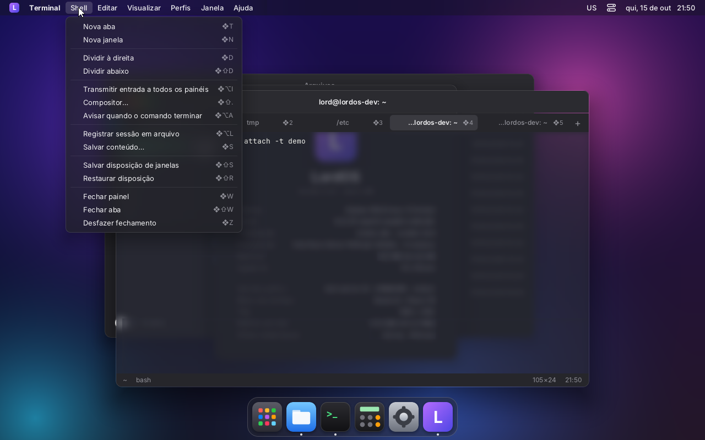 | 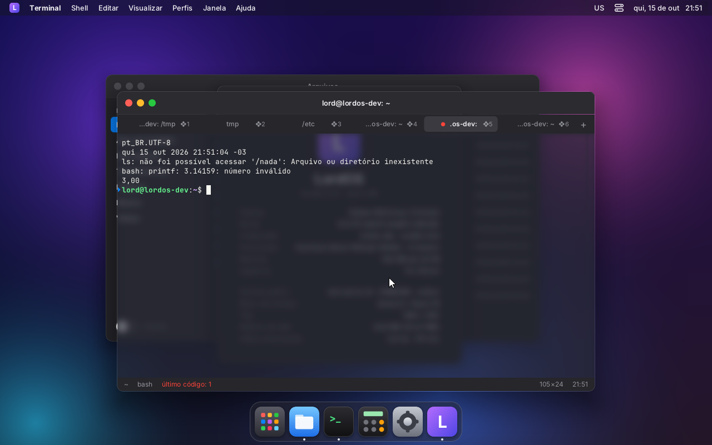 |
| Terminal in Portuguese (menus adjust to the text length) | With `pt_BR.UTF-8`: `date`, `ls` and `printf` respond as in Brazil |
| 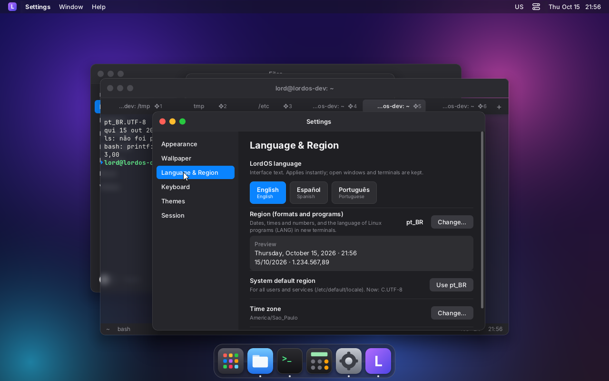 | 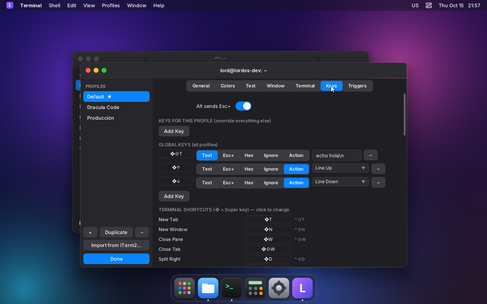 |
| English interface with pt_BR region: English names, Brazilian numbers and date | Terminal preferences in English |
| 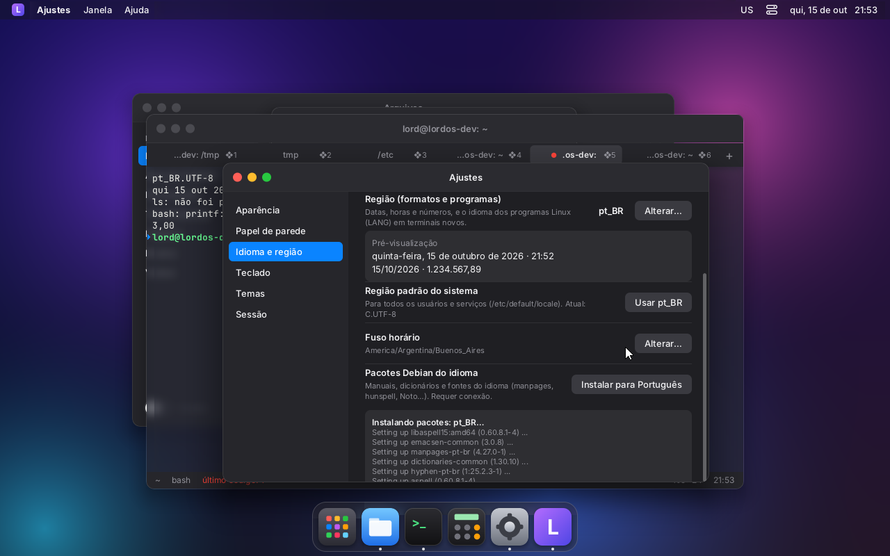 | 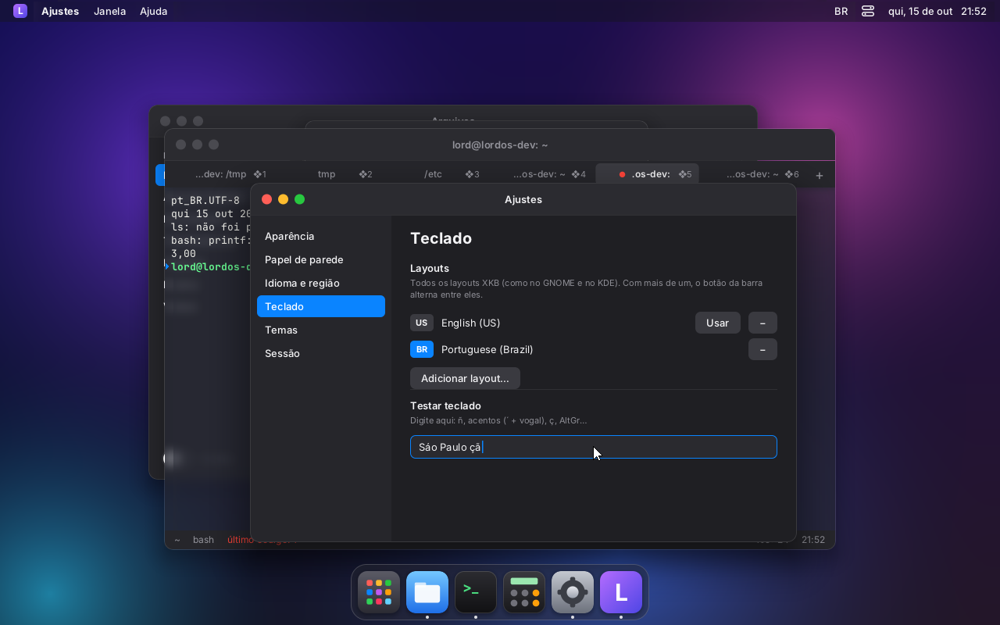 |
| Installing the Debian packages for pt_BR (live apt output) | Brazilian layout (XKB): ´+a = á, ç, ~+a = ã |
| 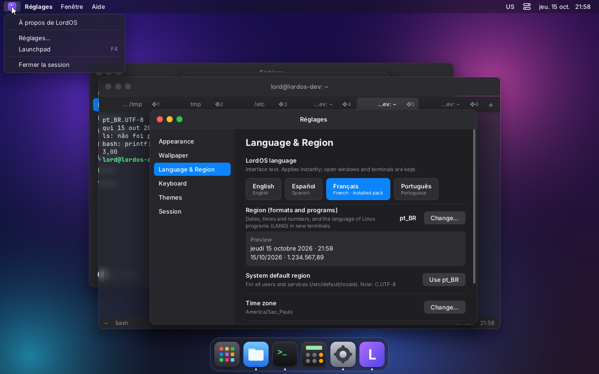 | |
| A new language pack (French) built with `i18n-pack` and added from Settings | |

## Interface text

```js
import { t, useLocale, formatDate, formatTime, formatNumber } from '@lordos/sdk';

t('files.items', { count: 3 })     // "3 elementos" / "3 items" / "3 itens"
t('about.version', { v: '0.5.0', m: 'M5' })
formatDate(new Date(), 'long')     // "jueves, 15 de octubre de 2026"
formatNumber(1234.5, 2)            // "1.234,50" (es_AR) / "1,234.50" (en_US)
```

- The key is `namespace.rest`; the namespace is the file: `t('terminal.action.newTab')` lives in
  `assets/locales/<language>/terminal.json` under `"action.newTab"`.
- A value can be text or a plurals object (`{ "one": "…", "other": "…" }`, plus
  `few`/`many`/`two`/`zero` depending on the language). Variables: `{name}`.
- If a key is missing in the chosen language, English is used; if it's missing there too, the key itself.
- App names come from `apps.json` (`appName(app)`); if there is no translation, from
  `manifest.json` (whose `name` and `description` are English).
- **English is the default language** and the fallback: a new user, the greeter, the live system
  (unless GRUB's Español/Português entry passes `lordos.lang`) and the installer start in English.
  A language saved in `settings.json` is always kept.
- Changing the language remounts the whole interface. Windows, tabs and sessions live in stores
  and are kept. That's why lists containing text can't be module-level constants: they are built
  in a function or at render time.
- QuickJS has no `Intl`: the plural rules (`sdk/i18n.js`) and the formats (`format.json`) are our
  own.

### Error and status messages

The server never sends prose to the interface. Every error that can reach the UI (an `ERR` line of
the privileged helper, a `lord.*` exception, an error field of an event) is a **code line**
(`server/src/errcode.h`):

```
pkg.removeEssential name=dpkg
sys.writeFailed path=/etc/locale.gen
fs.readFailed path=/home/ana/a%20b.txt errno=ENOENT
```

`code` is `module.camelCase`; parameter values are percent-encoded (space, `%`, `=`, `"`, control
characters). The UI shows `t('errors.<code>', params)` (`assets/locales/<lang>/errors.json`);
statuses (`OK`/`LOG` lines) use `status.json`. Two parameters are special: `errno=ENOENT` becomes
the translated description (`errors.errno.ENOENT`) and `reason=<code line>` is a nested code.

- C: `admin_err("pkg.x", "name", n, NULL)` / `admin_ok(…)` / `admin_log(…)` in the helper,
  `lerr_set(err, sizeof err, "pkg.x", "name", n, NULL)` for error buffers, and
  `js_throw_code(c, "fs.x", "path", p, NULL)` / `js_throw_line(c, err)` (`server/src/ui/js_err.h`)
  for exceptions. Numbers with `lerr_int(n)`, errno with `lerr_errno(errno)`.
- JS (`sdk/errors.js`): `admin.run()` rejects with an `Error` whose message is already translated
  and that has `.code` and `.params`; `lord.*` exceptions too (the SDK registers
  `globalThis.__lordErrorText`). For other channels, `errorText(lineOrError)` and
  `statusText(line)`. Code that needs to react to an error compares `e.code`, never the text.
- Logs and the journal stay English prose, for developers.
- Tests match codes (`lerr_has(err, "pkg.removeAlso")`), not text.
- `node tools/i18n-check.mjs` fails if a code used in C has no English string, or if an `ERR`
  line or a JS exception is written as prose.

### Formats

Each language's `format.json` has month and day names, date patterns (`short`, `long`,
`numeric`), decimal and thousands separators, and 12- or 24-hour clock, with per-region variants
(`regions.en_GB`, `regions.pt_PT`…). As in macOS, the **names** come from the interface language
and the **order, separators and clock** from the region: English with region pt_BR gives
«Thursday, October 15, 2026 · 21:56» and «15/10/2026 · 1.234.567,89».

## Language packs

A language is a `<id>/` folder with `meta.json`, `format.json` and one JSON per namespace:

```
assets/locales/pt/meta.json   { "id": "pt", "name": "Português", "english": "Portuguese",
                                "plural": "zero-one-other", "region": "pt_BR", "direction": "ltr" }
```

The ones shipped with LordOS are in `assets/locales/`; the user's in
`~/.local/share/lordos/locales/` (they don't need root and win if both exist).

To create one:

```sh
node tools/i18n-pack.mjs new fr "Français" French zero-one-other fr_FR   # lordos-lang-fr.json, in English
# translate the file's strings…
node tools/i18n-check.mjs lordos-lang-fr.json                           # missing keys and variables
```

Then copy `lordos-lang-fr.json` to `~/Descargas` and use **Settings → Language & Region →
Add**. Available plural rules: `one-other`, `zero-one-other`, `none`, `east-slavic`, `polish`,
`czech-slovak`, `arabic`. `node tools/i18n-pack.mjs export pt` exports an existing language in
the same format.

`node tools/i18n-check.mjs` with no arguments checks every bundled language and also the keys the
code uses (`t('…')` in apps, themes and SDK) that don't exist in English. Today: 391 keys,
complete in es, en and pt.

## Privileged helper (`lord-admin`)

Whatever needs root is done by a small process that `lord-server` creates before dropping
privileges (`server/src/admin.c`). It has no screen, input or other descriptors. It only
understands a closed list of actions, each validated on its own side:

| Action | Validation | Does |
|---|---|---|
| `locale-gen es_AR.UTF-8` | the region is listed in `/usr/share/i18n/SUPPORTED` as UTF-8 | enables the line in `/etc/locale.gen` and runs `locale-gen` |
| `system-locale es_AR.UTF-8` | supported and already generated (`locale -a`) | writes `/etc/default/locale` |
| `timezone America/Sao_Paulo` | safe name and an existing file in `/usr/share/zoneinfo` | `timedatectl set-timezone` |
| `langpack pt_BR` | `ll` or `ll_CC` | `apt-get install` of the `manpages/hunspell/aspell/hyphen/mythes-<ll[-cc]>` that exist + fonts for the script (compiled-in list) |

- It only serves the request if the session user is in the `sudo`, `admin` or `wheel` group.
- Programs run with a fixed absolute path and a clean environment; a command is never built from user text.
- The package list is compiled into the binary, not kept in an editable file.
- It dies with `lord-server` (`PR_SET_PDEATHSIG`).
- From JS: `admin.run('locale-gen', 'pt_BR.UTF-8', onLog)` returns a promise. Progress
  (apt's lines, for example) arrives via `onLog` and via the `admin.busy` store.

Difference from polkit: it doesn't ask for a password. Being an administrator is enough, and the
actions are few and narrow.

## Keyboard

`server/src/keyboard.c` uses **libxkbcommon** with the **xkb-data** data, like GNOME and KDE.
Any layout and variant is available (`latam`, `br`, `pt`, `us(intl)`, `fr(oss)`…), up to 4 at a
time; the menu bar button switches to the next. Dead keys and compose sequences use the region's
compose table (package `libx11-data`, which is data only). If XKB can't be loaded, the UI falls
back to its own tables (latam and us).

## Complex scripts (M5b)

No HarfBuzz, fribidi, ICU, ibus or fcitx: everything is our own C, verified against the
references (see "How it was verified").

### Right to left (bidi)

`server/src/ui/bidi.c` implements the **complete Unicode Bidirectional Algorithm** (UAX #9,
Unicode 15.1): explicit embeddings and overrides, isolates (LRI/RLI/FSI/PDI), isolating run
sequences, W rules, bracket pairs (N0), N1–N2, I1–I2 and, per line, L1–L2. It passes **all 91,707
cases of Unicode's `BidiCharacterTest.txt`** with no failures.

Each paragraph's direction is that of its first strong character (like "natural" in macOS): a file
name in Arabic looks right even when the interface is in Spanish, and "Informe (versión 2)
تقرير.pdf" mixes both directions correctly. Brackets are mirrored in RTL runs. In Arabic context,
"4.5%" is shown as "%4.5": that's what the algorithm says (digits following an Arabic letter are
Arabic numbers) and it's what Chrome does too.

### Arabic forms, marks and ligatures

`server/src/ui/shape.c` + `otf.c` shape each run like HarfBuzz: Arabic contextual forms (isol/init/medi/fina according to each
letter's joining type, with HarfBuzz's stages), required ligatures (لا), `ccmp`, `calt`, `liga`,
lookup flags with GDEF (ignore marks), reverse chaining substitution, GPOS kerning, cursive
(Urdu nastaliq) and marks anchored to the base, to ligatures and to other marks (harakat, niqqud,
combining accents).

### Indic scripts and Thai

`server/src/ui/shape_indic.c` reimplements HarfBuzz's Indic shaper for Devanagari (Hindi,
Marathi, Nepali), Bengali, Gurmukhi, Gujarati, Oriya, Tamil, Telugu, Kannada and Malayalam:
normalization (split matras, nukta), Unicode categories, each consonant's position according to
the font, syllables (with ◌ if the syllable is broken), initial reordering (base, reph, matras
that go before the consonant), each stage's features (nukt, akhn, rphf, rkrf, pref, blwf, abvf,
half, pstf, vatu, cjct) without crossing syllables, final reordering (matra after the half forms,
reph according to the script, pref, init) and the rest (pres, abvs, blws, psts, haln).
In Thai and Lao, SARA AM (ำ) is decomposed and NIKHAHIT moves before the tone marks, like HarfBuzz.
Syllables are kept whole when breaking lines.
Before shaping, marks are sorted by combining class (with HarfBuzz's adjustments for Hebrew and
Arabic) and invisibles (ZWJ, direction marks) are hidden.

### Khmer, Myanmar and the Universal Shaping Engine

| | |
|---|---|
| 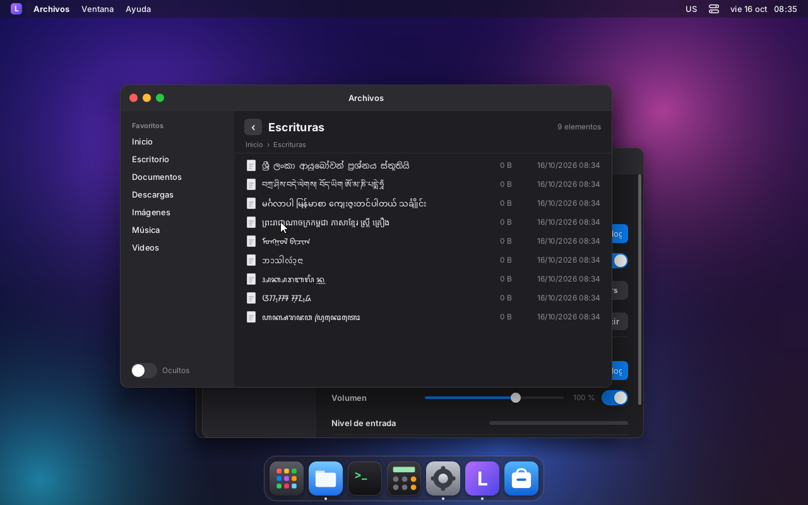 | 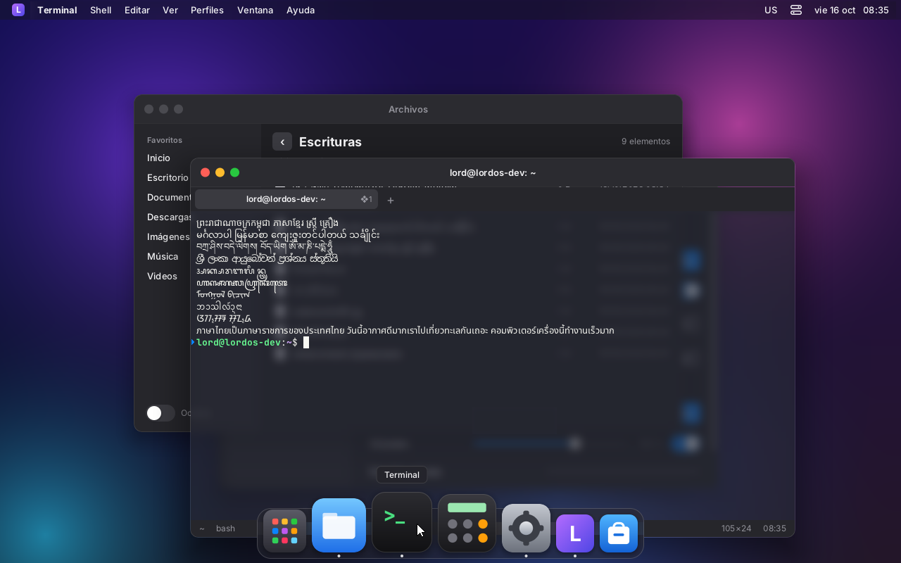 |
| In the interface (file names in Files): Sinhala, Tibetan, Myanmar, Khmer, Mongolian, Tai Tham, Sundanese, Balinese and Javanese | In the Terminal, with Thai at the end (`docs/packs/escrituras-m5b.txt`) |

For the remaining scripts of South and Southeast Asia, LordOS follows HarfBuzz's other three
shapers:

| Shaper | Scripts | What it does |
|---|---|---|
| Khmer (`shape_khmer.c`) | Khmer | split vowels (ើ = េ + ើ), coeng + ro before the base (pref, and cfar for what follows), the left vowel at the start, ◌ in broken syllables; locl…cfar together per syllable and clig instead of liga |
| Myanmar (`shape_myanmar.c`) | Burmese, Mon, Shan, Karen… (fonts with the `mym2` tag; old `mymr` ones go through the default shaper, as in HarfBuzz) | kinzi (င်္) after the base, medial ra (ြ) and ေ before, the order of the below marks; rphf, pref, blwf and pstf one at a time; zero-width marks before GPOS |
| Universal Shaping Engine (`shape_use.c`) | Tibetan, Sinhala, Balinese, Javanese, Sundanese, Buginese, Batak, Cham, Lepcha, Limbu, Tai Tham, Tai Le, Chakma, Brahmi and the ~80 scripts HarfBuzz sends to the USE, among them Mongolian, N'Ko and Adlam (with Arabic joining forms) | Microsoft's USE categories, syllables with their grammar (ignoring CGJ and the ZWNJ before a mark), rphf (a substituted reph becomes R), pref, the basic features per syllable, ◌ in broken syllables, the reph before the first post-base glyph and pre-base vowels at the start, isol/init/medi/fina per syllable |

The syllable grammars are HarfBuzz's Ragel ones, written as text in each shaper and compiled on
first use by `shape_syl.c` (a Thompson automaton walked with state sets; the longest alternative
wins and, at equal length, the first, like Ragel's scanner). Normalization is also HarfBuzz's: it
decomposes only what the font can show separately, sorts marks by combining class (with
HarfBuzz's adjustments for Telugu, Thai and Tibetan) and recomposes a mark with its base if the
font has the composite. GPOS skips invisibles (ZWJ, ZWNJ) when looking for kerning pairs, like
HarfBuzz.

The Unicode tables (bidi class, mirrors, brackets, joining type, script, combining class,
invisibles, line break, marks, Indic, Khmer, Myanmar and USE categories) are generated with
`node tools/gen-unicode.mjs <UCD>` into `server/src/ui/unidata.h` and compiled only in
`unicode.c`. The USE categories follow HarfBuzz's `gen-use-table.py`: besides the UCD they need
`ArabicShaping.txt` and the two Microsoft files shipped with HarfBuzz
(`src/ms-use/IndicSyllabicCategory-Additional.txt` and
`IndicPositionalCategory-Additional.txt`).

### Fallback fonts and line breaking

Latin, Greek and Cyrillic text that Inter covers keeps going through the usual fast path
(`text.c`). Everything else goes through `textlayout.c`, which picks a font per character: Inter,
the Noto for its script (`Noto Sans Arabic`, `Noto Sans Hebrew`, `Noto Sans <script>` for any
other installed), `Noto Sans`/`DejaVu Sans`, symbols and the color emoji font. The same ideograph
is drawn differently in Chinese, Japanese and Korean: the CJK font (`Noto Sans CJK
JP/KR/SC/TC`) comes from the interface language. The terminal uses the same chain, with the
monospaced variant (`Noto Sans Mono CJK`).

For Chinese and Japanese, which don't separate words, lines can break between characters while
honoring the UAX #14 rules that matter (no break before 、。」！ or after 「). Marks, joiners and
variation selectors are never left alone at the start of a line.

**Thai is broken by words**, like in GNOME: `server/src/ui/thbrk.c` reads libthai's dictionary
(`/usr/share/libthai/thbrk.tri`, package `libthai-data`, a libdatrie double-array trie) with its
own reader and finds the segmentation with libthai's same "maximal matching" (the word path that
reaches furthest with the fewest characters outside the dictionary and the fewest breaks, and the
recovery after an unknown word), with its syllable-start hints, dotted abbreviations (พ.ศ.,
กอ.รมน.) and the rules for ๆ, digits and ฿. It doesn't link libthai or libdatrie. Without the
dictionary, it breaks wherever a syllable can start. Khmer and Myanmar (no dictionary in Debian)
break between syllables, without separating the final consonant (င် with asat, ញ់ with bantoc)
from the syllable it closes; Lao, only at spaces. To test breaks without a screen:
`LORD_WRAP=230 build/text-test salida.ppm "texto"…` (`tests/text_test.c`). If a word doesn't fit
on the line, it's broken anyway, but never inside a glyph cluster (a shaped syllable, a letter
with its marks).

Each text is shaped once and stored in a small cache (128 entries): layout measures it and every
repaint draws it without shaping it again.

### Truncation with an ellipsis

`textOverflow: 'ellipsis'` and `numberOfLines` (`themes/README.md`) cut a line with "…"
(`text_ellipsize` in `text.c`, `text_layout_ellipsize` in `textlayout.c`):

- **Where it may cut:** only between grapheme clusters, using the shaped line: never inside a glyph
  that covers several characters (lam-alef, an Indic syllable, an emoji ZWJ family), before a mark
  or a spacing mark (Thai and Lao SARA AM), after a ZWJ or a virama, inside a skin-tone sequence or
  between the two regional indicators of a flag. Trailing spaces before the "…" are dropped.
- **Shaping again:** the cut prefix plus "…" is shaped as a new text, so the last Arabic letter takes
  its final form; if that made it wider than the box, one more cluster goes.
- **Which side:** the "…" is the end of the paragraph for bidi, so it lands at the visual end: on the
  left of Arabic and Hebrew text, on the right of Latin text, whatever the interface direction (the
  text's own direction, like its alignment).
- **Cost:** the widths come from the cached shaping (a prefix sum), and each cut is remembered like a
  measurement, so a list repaints its labels without searching again.

`server/tests/engine_test.c` checks it for Latin, Arabic, Hebrew, Thai, combining accents and emoji
ZWJ sequences and flags at every box width from 8 to 400 px (`make -C server test`).

### Mirrored interface

If the language is right to left (`meta.json` → `"direction": "rtl"`; `i18n-pack` sets it
automatically for ar, he, fa, ur…), **the whole interface flips** like in macOS: menu bar, menus
(they open to the left), windows (buttons on the right), Dock, tabs, Settings, Files and the
Classic theme (start and taskbar on the right). The terminal's content stays left to right (see
"In the terminal" below).

The engine follows CSS: `direction: 'rtl' | 'ltr'` is inherited, flips the row axis and the
column start, and `textAlign` has `'start'`/`'end'` (default `'start'`). `left`, `right`, margins
and paddings remain physical, so absolute positions (windows, context menus) don't change.
Anything that computes positions from the mouse x (the Dock magnifier, the Terminal's pane
divider, the Slider) is laid out with `direction: 'ltr'`.

APIs: `direction()` (the interface direction), `textDirection(text)` (that of a standalone text;
`TextInput` uses it to put the cursor on the correct side), `useLocale().dir`.

### Input methods

`server/src/ime.c` has three methods on top of the Latin (us) keyboard. They are added as input
sources in **Settings → Keyboard → Input Methods**; the bar button (한, あ, 拼) and
**❖⌥Space** (or Ctrl+⌥Space) switch from one source to the next, like ⌃⌥Space in macOS. ❖Space and Ctrl+Space open Spotlight (`SPOTLIGHT.md`).

| Method | How you type | Dictionary (Debian) |
|---|---|---|
| Korean (hangul) | 2-set keyboard (dubeolsik): `gksrmf` → 한글, compound vowels and finals, the final moves to the next syllable; Backspace undoes one jamo at a time | none |
| Japanese (kana) | romaji → hiragana (Hepburn and kunrei, っ for a double consonant, nn/n' → ん, ー 、。「」); Space converts **the phrase**: it's split into words (dictionary, okurigana like 書く/行きます, particles and endings like です/ています that stay in hiragana) and the focused segment is highlighted; ←/→ change segment, Shift+←/→ shrink or grow it, Space/↓ cycle through its candidates (always with hiragana and katakana), 1–9 pick, Enter commits everything, Esc goes back to kana | `skkdic` (SKK-JISYO.L, EUC-JP, binary search over the mapped file, entries with and without okurigana) |
| Simplified Chinese (pinyin) | letters → candidates by frequency: the whole phrase, **initial-letter abbreviations** (`zg` → 这个/中国, `bjdx` → 北京大学, also `zhg`), phrases that start with what was typed (`zhongg` → 中国, 中国人) and those covering the beginning (the rest stays in composition); 1–9 or Space pick; − = turn the page; Enter leaves the letters | `rime-data-pinyin-simp` (65,000 characters and phrases) |

The Debian language pack for Japanese or Chinese also installs its dictionary (and the CJK
fonts). A custom dictionary can be put in `~/.local/share/lordos/ime/`.

Composition only happens when a text field or a terminal has focus: otherwise keys pass through
as-is and app shortcuts keep working. With Ctrl/Alt/❖ whatever is pending is committed and the
key passes through. Committed text arrives as a key that types that text, so any app receives it
unchanged. `TextInput` shows the composition underlined in place; the terminal, over the cursor.
The candidate window (`<ImeOverlay />`) is mounted by `startShell`: every theme has it.

For a custom text field: `ime.attach(token, () => ({ x, y, h }), { inline })` when taking focus
and `ime.detach(token)` when losing it; `useIme()` gives `{ preedit, candidates, selected }`.

Japanese segmentation uses the dictionary and rules, not a statistical model like Mozc: on the
phrase bank in `server/tests/ime-ja.txt` it gets 16 of 18 right (the two errors need to know
which word is more frequent, 昨日 versus 機能, and SKK has no frequencies); it's corrected with
Space or Shift+arrows. Pinyin doesn't convert punctuation to full width and there's no temporary
Latin mode with Shift (switch source with ❖⌥Space).

### In the terminal

A row with Arabic or Hebrew is shown in **visual order** (the same bidi, with a left-to-right
paragraph, like Konsole and mlterm) and Arabic, Hebrew, Indic, Thai, Tibetan, Myanmar, Khmer,
Sinhala and other USE-script words are shaped together (joined letters, لا, niqqud, conjuncts, matras) and drawn at their natural width
within the cells they occupy. The content doesn't change: copy, search and the program see the
logical order; the cursor, the selection and the mouse follow the visual order. It's not applied
on the alternate screen (vim, less, mc), because those programs lay out their own screen. It can
be turned off per profile in Preferences → Text → "Arabic and Hebrew". For these scripts the
terminal uses the script's Noto font first, so a word doesn't mix fonts.

### How it was verified

| Test | Result |
|---|---|
| `build/bidi-test BidiCharacterTest.txt` (Unicode 15.1) | 91,707 / 91,707 |
| `tests/hb_compare.py` against HarfBuzz (uharfbuzz 0.56, HarfBuzz 14.6): Arabic Sans, Naskh and Nastaliq with harakat, Hebrew with niqqud, Latin, Cyrillic, Greek, CJK, Inter, the 9 Indic scripts (words and phrases with conjuncts, reph, pref, chillus, ZWJ/ZWNJ), Thai and Lao; Khmer (Sans and Serif), Myanmar (Sans and Serif), Tibetan, Sinhala (with ZWJ), Balinese, Javanese, Mongolian (with variation selectors), Buginese, Tai Tham, Chakma, Brahmi, Sundanese, Cham, Batak, Lepcha, Limbu, N'Ko, Adlam, Tai Viet, Tai Lue and Tai Le, with broken syllables, CGJ and ZWJ/ZWNJ | 409 / 409 identical phrases (glyphs and positions) |
| `tests/thbrk_compare.sh` against libthai 0.1.29: breaks between Thai characters in `tests/th-break.txt` and in 705 paragraphs from Thai Wikipedia (191,000 characters) | 30 / 30 and 705 / 705 |
| Terminal ligatures (JetBrains Mono, Fira Code) against HarfBuzz | no differences (same as in M4) |
| `build/ime-test` (hangul, kana, pinyin) | 한글 안녕하세요, 日本/漢字/東京/新聞/きって/こんにちは, 你好/中国/我爱, zg/bjdx/zhongg |
| Japanese phrases (`tests/ime-ja.txt`) | 16 / 18 (私は日本語を勉強しています, 東京に行きます, 学校へ行きました…) |
| VM: Arabic interface with both themes, file names in 7 scripts, the three methods in the Terminal and in a text field | see screenshots |

Memory: with the CJK fonts and both dictionaries loaded, lord-server goes from ~43 to 55 MB of
RSS (36 MB anonymous; 19 MB are the mapped fonts and dictionaries, which the kernel shares and
can drop).

### M5b screenshots

| | |
|---|---|
| 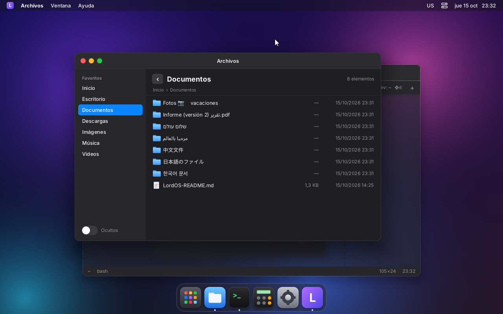 | 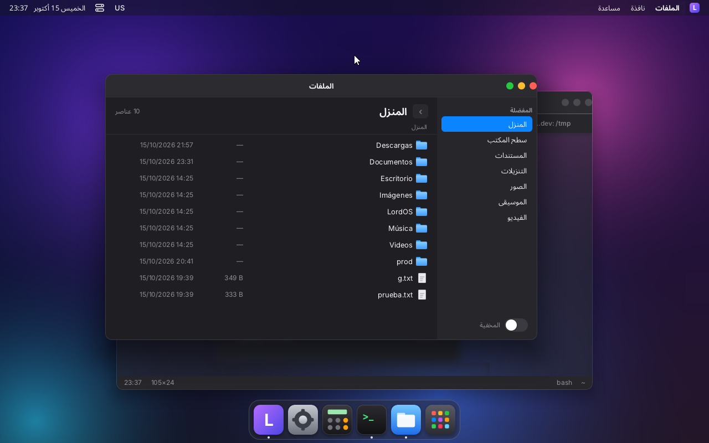 |
| Names in Arabic, Hebrew, Chinese, Japanese, Korean and mixed (bidi), with emoji | Arabic interface: bar, window, sidebar, columns and Dock mirrored |
| 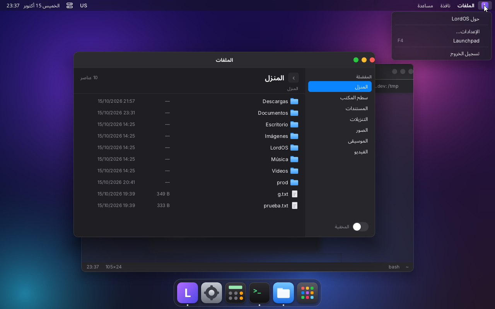 | 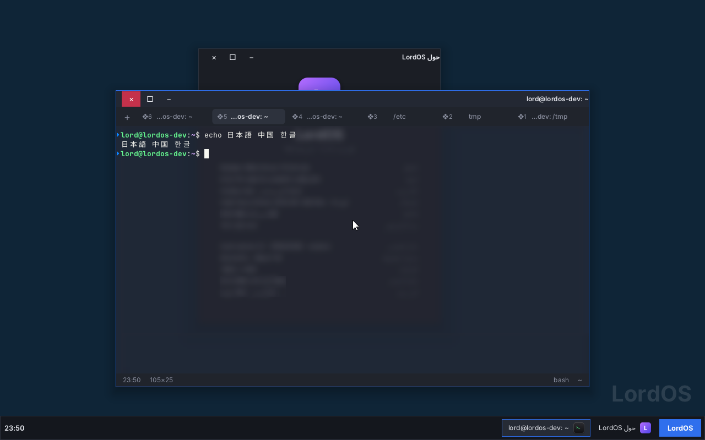 |
| Menu in Arabic: opens to the left, shortcut on the other side | Classic theme in Arabic; the terminal stays left to right |
| 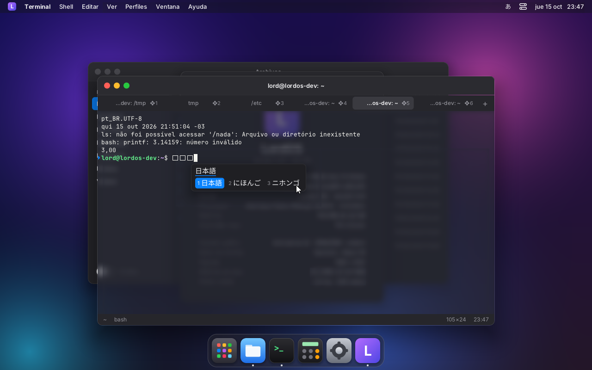 | 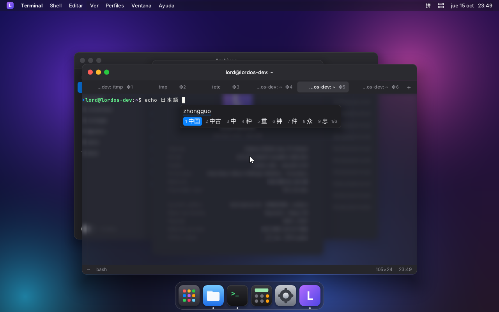 |
| Japanese in the Terminal: にほんご → 日本語 / にほんご / ニホンゴ | Pinyin: zhongguo → 中国, 中古, 中… (page 1 of 6) |
| 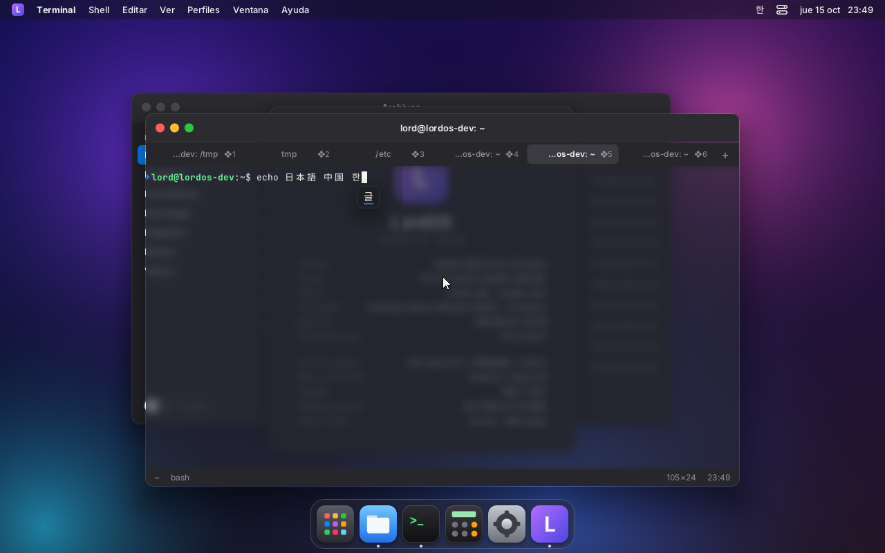 | 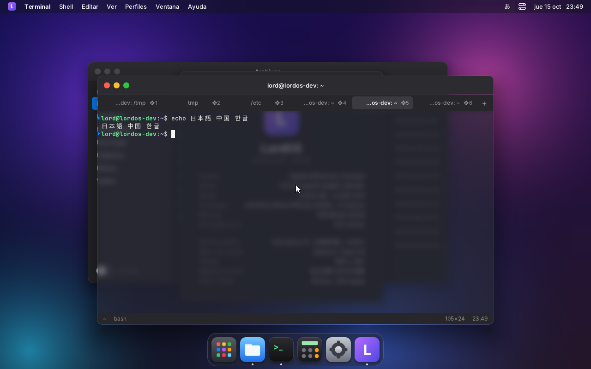 |
| Korean: 한 committed, 글 in composition | `echo 日本語 中国 한글` with the three methods |
| 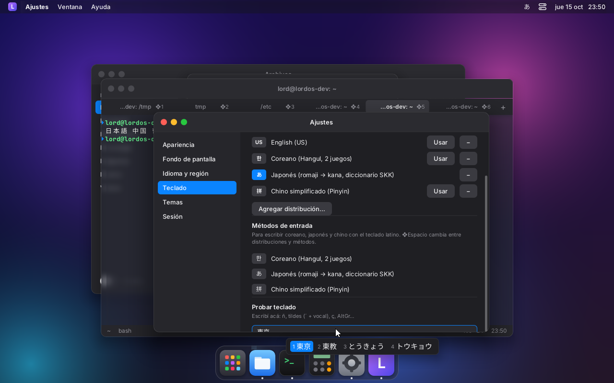 | 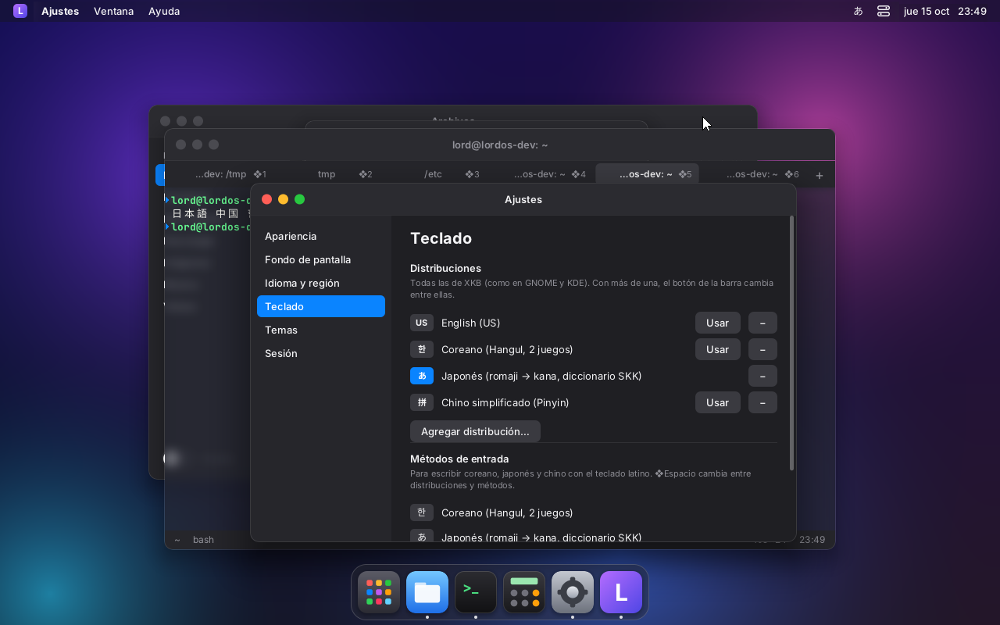 |
| In a text field: 東京 in composition, candidates over the cursor | Settings → Keyboard with the input sources |
| 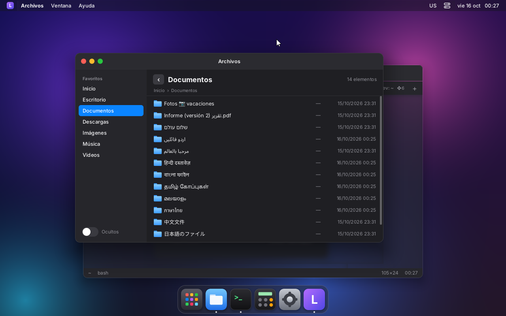 | 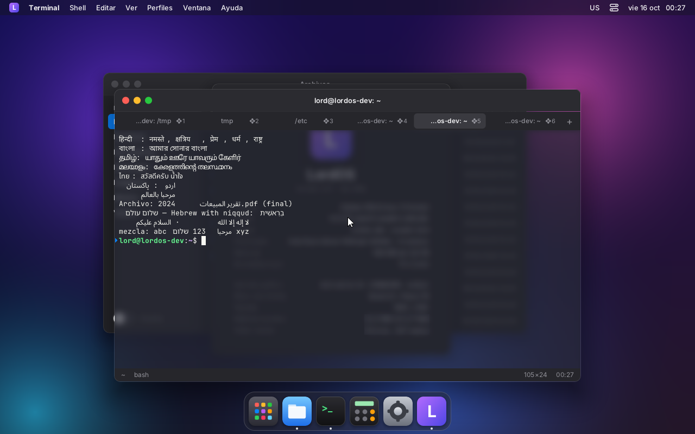 |
| Hindi, Bengali, Tamil, Malayalam, Thai and Urdu in Files | The terminal with Indic, Thai, Urdu, Arabic and Hebrew shaped and in visual order |
|  | |
| Phrase conversion: 私は日本語を勉強しています, with the 私は segment focused | |

The Arabic pack in the screenshots is a test pack (`docs/packs/lordos-lang-ar.json`): it
translates the desktop, Settings, Files, About and the Calculator; the Terminal stays in English.

## Pending

- HarfBuzz's vowel constraints (◌ before invalid vowel sequences in Devanagari, Sinhala and
  others): a misspelled sequence is shaped without the dotted circle.
- Word-based line breaking for Lao (there's no packaged dictionary in Debian; ICU ships one):
  today only at spaces. Khmer and Myanmar break by syllable, not by word.
- Japanese with frequencies: Debian has no lightweight dictionary with frequencies (Mozc's data,
  `mozc-data`, comes in its own binary format); zhuyin, cangjie and hanja.
- Translate the server's log messages (the ones that go to stderr, for developers).
- `lord.locale.available()` marks as "generated" only what the server process already saw at
  startup; Settings corrects it on screen after generating.

## Packages in the VM (M5b)

| Package | What for |
|---|---|
| `libthai-data` | dictionary for Thai word breaking (it was already installed as a dependency; the `th` language pack installs it too) |
| `libthai-dev` | only for the `tests/thbrk_compare.sh` test (compares with libthai); LordOS doesn't use it |
| `fonts-noto-core` | already installed: provides Noto Sans Khmer, Myanmar, Sinhala, Balinese, Javanese, Mongolian…, Noto Serif Tibetan (the km, my, bo, si, mn, jv… language packs require it) |
