

  <picture>
    <source media="(prefers-color-scheme: dark)" srcset="brand/svg/logo-horizontal-dark.svg">
    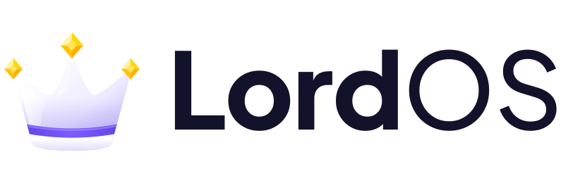
  </picture>

# LordOS brand identity

This document describes the LordOS identity: the logo, its colours, its typefaces and how to use
them. The file index (every SVG, PNG and favicon, and how they are generated) is in
[`brand/README.md`](brand/README.md). All the files come from `tools/gen-brand.py`. Don't edit
the renders by hand.

## 1. What LordOS is

LordOS is a free, fast and secure GNU/Linux distribution based on Debian, with a desktop environment of
its own, built from its fundamental components on top of Debian and Wayland. It has its own display server and Wayland compositor written in C and
its own React-based interface engine, the whole system idles at 465–487 MB of RAM (measured once,
live ISO and installed, in a VM; `lord-server` 32–36 MB RSS at idle; the paper's §7.1), and it brings a Dock, an app launcher, a menu bar, instant search and polished
native apps to PCs and to the Raspberry Pi 5, while still running regular Linux applications. The
crown stands for a desktop where the user rules: fast, private and fully under their control.

## 2. The logo

The logo is a soft white crown with three peaks (the middle one taller). It has a violet band near
the base, a rounded rim and a faceted yellow gem on each tip. Next to it is the wordmark **Lord**OS.

### App icon

   

The crown on a rounded square (22 % corner radius) with a diagonal violet gradient. It is the
system's own icon (About, Settings → General, the Dock, Monitor, Help). Outside LordOS, use it for
store listings, avatars and anywhere a square mark is needed. File: `brand/svg/app-icon.svg`, PNGs
from 16 to 1024 px in `brand/png/`.

### Crown symbol

The crown alone on a transparent background. Use it when the name is already nearby: splash
screens, section headers, stickers. File: `brand/svg/crown.svg`, `brand/png/crown-{256,512}.png`.

### Horizontal logo

| On light | On dark |
|---|---|
|  |  |

The crown with the wordmark, on a transparent background. It's the main logo for websites, documents,
the README and presentations. Use the light version (navy text) on light backgrounds and the dark
version (white text) on dark ones. On the web, switch between them with `<picture>` and
`prefers-color-scheme`. Files: `brand/svg/logo-horizontal-{light,dark}.svg`,
`brand/png/logo-horizontal-{light,dark}-{400,800}.png` (1x and 2x).

### Monochrome

| Black | White |
|---|---|
|  |  |

A flat, single-colour version: the band and the gem outlines are cut out. Use it for print, engraving,
embroidery, small sizes and on photos or busy backgrounds where the full-colour crown would get
lost. Files: `brand/svg/logo-mono-{black,white}.svg`, `brand/svg/crown-mono.svg`.

### Small variants

  &nbsp;  

The icon and the one-colour crown are redrawn on a pixel grid (32 px and 16 px), with fewer details,
so they stay sharp where the detailed versions would blur. Use `app-icon-small.svg` from 16 to 32 px
and `crown-mono-small.svg` for 12–20 px glyphs. In the OS, the menu bar logo is the small crown in
the menu text colour:

### Favicon

 

`brand/favicon/favicon.svg` (the pixel-grid icon) for browser tabs, with `favicon-32.png` as a
fallback, `apple-touch-icon-180.png` for phone home screens and `favicon-512.png` for a web app
manifest. The HTML is in [`brand/README.md`](brand/README.md).

### Social card

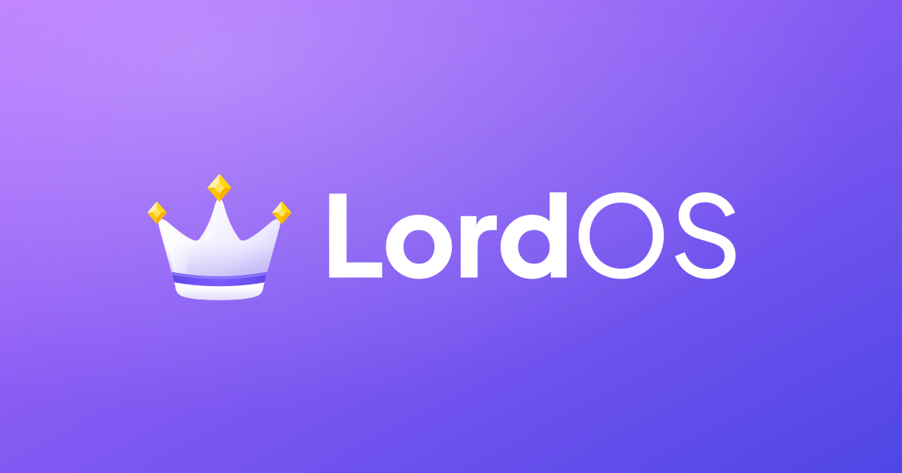

1200 × 630: the dark logo on the icon's violet gradient. Use it for link previews (`og:image`) and
social posts. Files: `brand/svg/social-card.svg`, `brand/png/social-card-1200x630.png`.

### In the system

| About (light) | Login screen |
|---|---|
|  |  |

## 3. Colours

| | Hex | Role |
|---|---|---|
|  | `#B46CFF` | Violet gradient start (icon, social card: top left) |
|  | `#4F46E5` | Violet gradient end (bottom right) |
|  | `#B46CFF → #4F46E5` | The brand gradient, at 135° |
|  | `#5B3FE0` | Crown band, edges |
|  | `#7C5CFF` | Crown band, centre |
|  | `#FFD60A` | Gem yellow (main facet) |
| 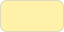 | `#FFF1A8` | Gem highlight (lit facet) |
|  | `#FFC300` | Gem shade facet |
|  | `#FFB000` | Gem deep facet |
|  | `#BDB1F5` | Crown shading (lavender) |
|  | `#12122A` | Navy: the wordmark and text on light backgrounds |
|  | `#FFFFFF` | White: the crown body, the wordmark on dark backgrounds |

- **On light backgrounds:** the full-colour crown with the navy wordmark (`logo-horizontal-light`),
  or the black one-colour logo.
- **On dark backgrounds:** the full-colour crown with the white wordmark (`logo-horizontal-dark`),
  or the white one-colour logo.
- **On the brand gradient:** the dark logo (white text), as in the social card.
- In the OS the wordmark follows the theme: navy in light mode, white in dark mode.

## 4. Typography

- **Wordmark: Plus Jakarta Sans.** "Lord" in ExtraBold (800) and "OS" in Medium (500), letter
  spacing −0.01 em, no space in between. SIL Open Font License 1.1 (release 2.7.1,
  github.com/tokotype/PlusJakartaSans). The two weights ship in `assets/fonts/` with their license.
  In the OS the wordmark is live text in this face (`fontFamily: 'brand'`, the `LordOSWordmark`
  component). In the SVGs it is outlined from the same files, so they don't need the font
  installed.
- **Interface: Inter.** All UI text (Regular 400, Medium 500, SemiBold 600, Bold 700). SIL Open Font
  License 1.1. Code and the terminal use JetBrains Mono.

Plus Jakarta Sans is only for the name "LordOS" (and, if needed, short headlines next to it), never
for body text.

## 5. Usage

### Clear space

Keep free space around the logo at least as large as **half the wordmark's cap height**. Around the
app icon, keep 10 % of its size. No text, edges or other marks go inside it. In the lockup the crown is
1.6 times the cap height, centred on the capitals, 0.27 em from the text. Use the files as they are.

### Minimum sizes

| Version | Minimum |
|---|---|
| Horizontal logo | 96 px wide (24 mm in print); below 120 px prefer the one-colour version |
| App icon | 16 px (`app-icon-small.svg` up to 32 px) |
| Crown, full colour | 24 px |
| Crown, one colour | 12 px (`crown-mono-small.svg`) |
| Live wordmark in the UI | 13 px font size |

### Do

- Use the provided files and the generator. Pick light or dark by the background.
- Give the logo its clear space and keep the crown on the left of the name, also in right-to-left
  languages.
- Use the one-colour versions on photos, in print and at small sizes.
- Use the small variants at 32 px and below.

### Don't

- Don't stretch, skew, rotate or re-proportion the logo, or move the crown to another side.
- Don't recolour the crown, the band or the gems, or put the logo on clashing colours.
- Don't set "LordOS" in another font or weight, add a space ("Lord OS") or change the case
  ("LORDOS", "Lordos").
- Don't add outlines, drop shadows, glows, bevels or textures (the app icon's soft shadow is part
  of it).
- Don't use the light logo on dark backgrounds or the dark logo on light ones.
- Don't trace or rebuild the logo from screenshots or raster images. Change `tools/gen-brand.py`
  and regenerate.

## 6. Lumo, the guardian of LordOS

Lumo, the guardian of LordOS: a small celestial fox with white fur and violet highlights, who wears
a crown and a cape as symbols of protection, freedom and control.

**Anatomy:**

- big, pointed fox ears;
- abundant, fluffy white fur, like an arctic fox;
- a short, fluffy, slightly curved tail;
- a round, kitten-like face with big, expressive eyes;
- a small, compact fantasy-creature body.

Lumo is curious by nature and loyal by design: a small guardian for a greater tomorrow. It
watches over the system quietly and shows up only when there is something worth a little warmth:
a welcome, a job well done, a moment of calm, or a gentle hand when something goes wrong.

| Front | Three-quarter | Back | Avatar |
|:-:|:-:|:-:|:-:|
| 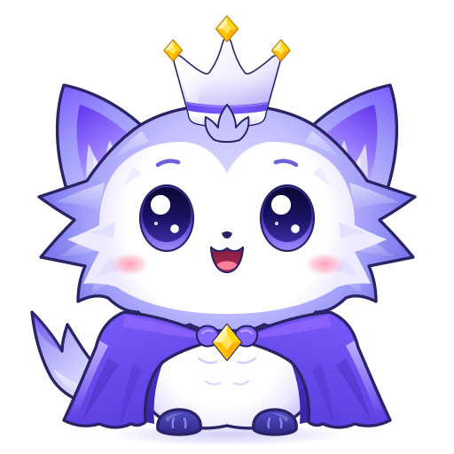 | 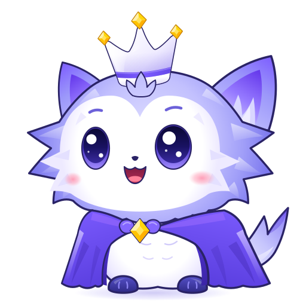 | 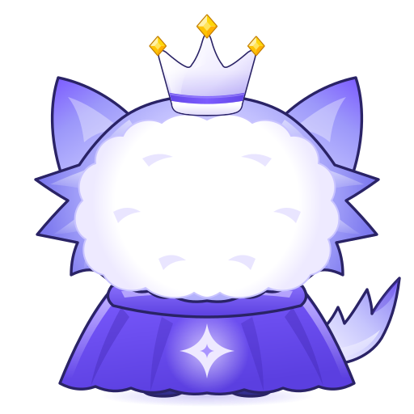 | 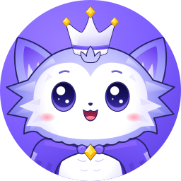 |

The head is big and the body small. The LordOS crown sits on top of the head, with a small
three-lobed tuft of fur in front of its band. The violet capelet is fastened at the neck with a
yellow gem and leaves the round white belly in view; from the back it shows a four-point star.

### Poses

| Pose | Name | Meaning | Where LordOS uses it |
|:-:|---|---|---|
| 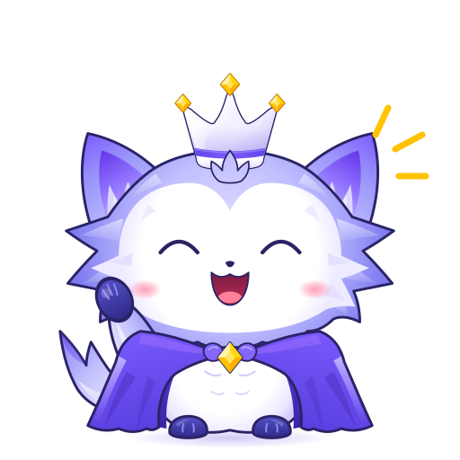 | `lumo-wave` | Hello, welcome | The installer's welcome step and the first page of the first-login tour (Help) |
| 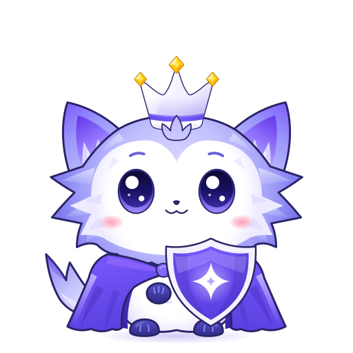 | `lumo-shield` | Protected, all good | Monitor → Network when the firewall is on and nothing was blocked |
| 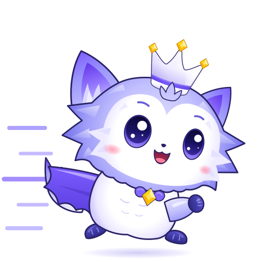 | `lumo-run` | Speed, work in progress | Brand material for speed and downloads |
|  | `lumo-sleep` | Rest, energy saving, idle | Brand material for energy saving and idle |
|  | `lumo-celebrate` | Done, success | Store → Updates when everything is up to date |
| 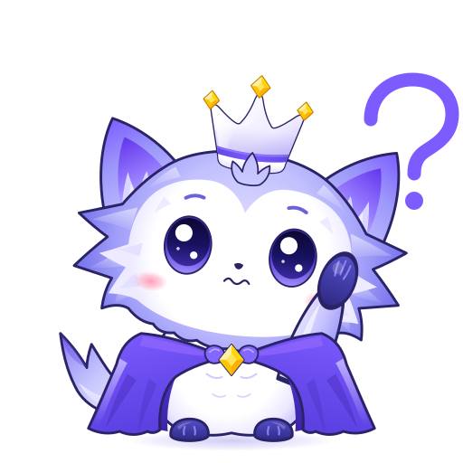 | `lumo-confused` | Something went wrong, nothing here | Error and "not available" states (Calendar, Contacts, Reminders, Logs, Disks, Help, the Store's package engine) |

In LordOS (real sessions on the test VM, light and dark):

| First-login tour (Help) | Installer | Service not available | About |
|:-:|:-:|:-:|:-:|
| 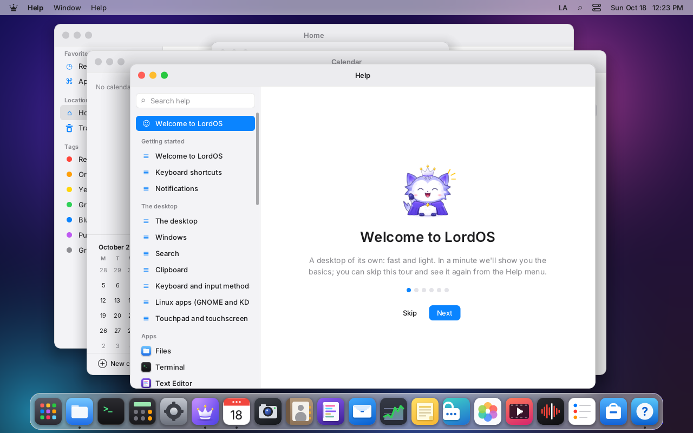 | 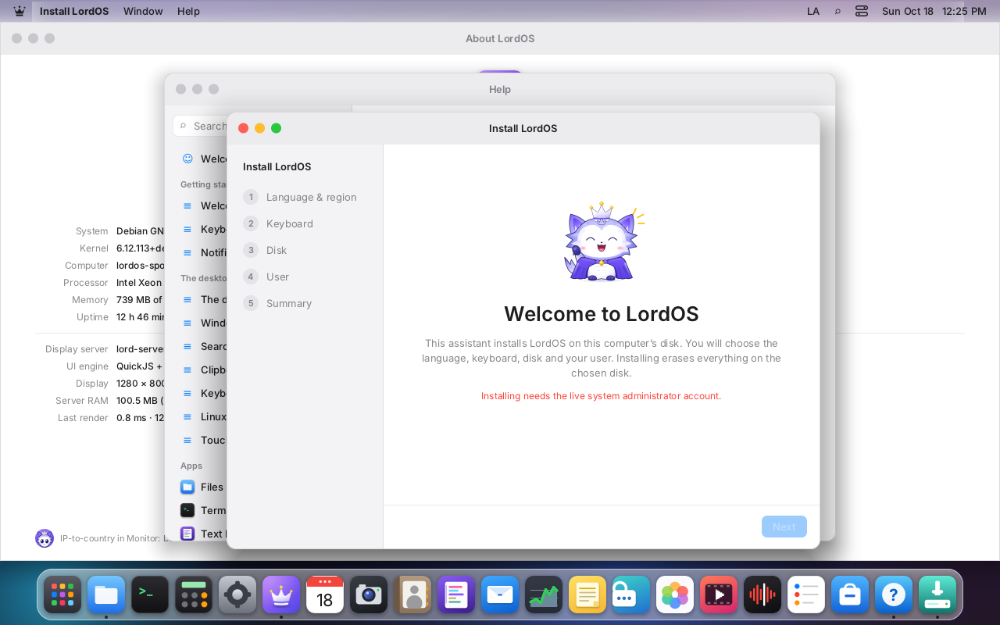 | 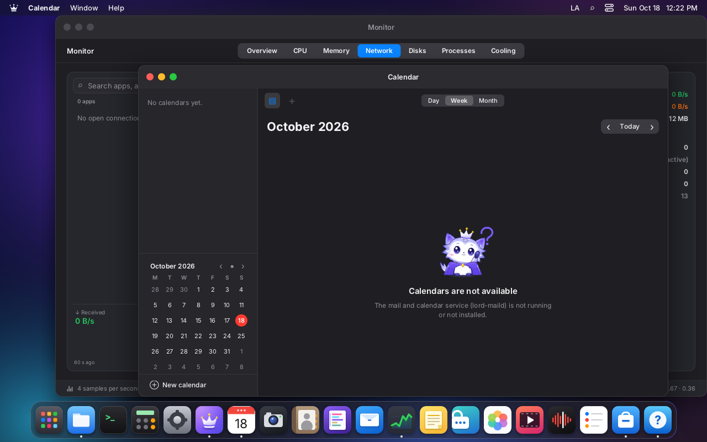 | 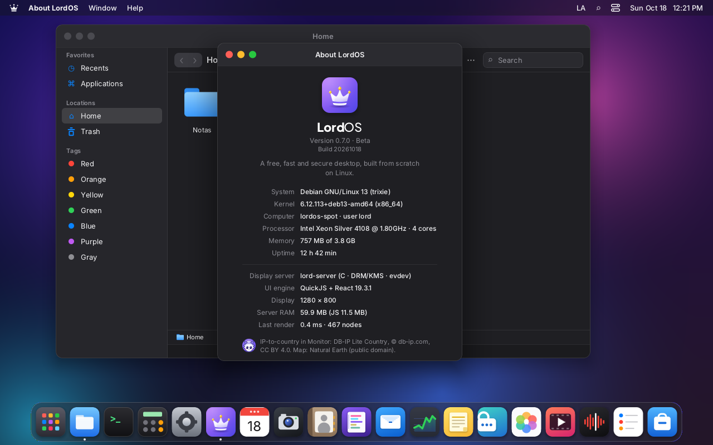 |

In the UI, `<Lumo pose="..." size={...} />` (sdk/mascot.js) or `<EmptyState mascot="confused" />`
draws a pose; `<Lumo pose="avatar" size={20} />` draws the avatar (About). One Lumo per view at most,
in outcome states, never in "nothing selected" panes.

### Palette

| Colour | Hex | Use |
|---|---|---|
| Outline | `#2A2366` | thin dark-indigo outline (3.4 px on silhouettes, 2.2 px inside, on a 512 canvas) |
| Fur | `#FFFFFF` → `#E9E4FF` → `#7C78EE` | white face and belly, lavender shading, periwinkle tufts |
| Violet highlights | `#7C5CFF` | ear tips, tail tip, cape |
| Cape | `#7C5CFF` → `#5B3FE0` | capelet gradient; lining `#4C31C9` → `#3B24A6`; sheen `#9B6BFF` |
| Eyes | `#0B0833` → `#3A2BA0` | irises, violet rim light below, white highlights |
| Paws | `#5550C8` → `#2E2984` | dark-indigo paws with toe lines |
| Blush and mouth | `#FF8FAB`, `#B42E55`, `#FF8098` | cheeks, mouth, tongue |
| Gems | `#FFF1A8`, `#FFD60A`, `#FFC300`, `#FFB000`, `#FFE45C` | the crown's and the clasp's facets |

### Do's and don'ts

- Do use the files in `assets/brand/mascot/` or their renders; change `tools/gen-mascot.py` or
  `assets/brand/mascot/src/lumo-parts.svg` and regenerate, so every pose stays the same character.
- Do keep Lumo small and occasional: one per view, in welcome, success, security and error states.
- Do keep the outline: it is what makes Lumo read on dark backgrounds.
- Don't distort, stretch, rotate or crop Lumo (the avatar is the only crop).
- Don't recolour the crown or its gems; it is the LordOS crown.
- Don't change the cape's colour: it stays violet.
- Don't give Lumo a long snout, a long tail or a big body; don't make it look like another
  project's mascot.
- Don't trace or rebuild Lumo from raster images or screenshots.

## 7. Wallpapers

Created by iPERFEX with an AI image generator; part of the LordOS brand assets.
© iPERFEX, part of the LordOS brand.

Eleven original wallpapers in three categories, shipped in `/usr/share/backgrounds/lordos/` and
listed by category in **Settings → Wallpaper** (with the default theme's four gradients as a fourth
category, "Gradients"). The files, sizes and how to regenerate them are in
[`assets/wallpapers/README.md`](../assets/wallpapers/README.md).

| | Signature | |
|:-:|:-:|:-:|
|  **Crystal Crown** (login screen) |  **Eternal Dawn** |  **Royal Flow** |
|  **Royal Waves** |  **Violet Horizon** | |

| Lumo | |
|:-:|:-:|
|  **Celestial** (default desktop) |  **Aurora** |

| | Cosmos | | |
|:-:|:-:|:-:|:-:|
|  **Event Horizon** |  **Infinite Galaxy** |  **Solar Odyssey** |  **Stellar Voyage** |

- **Defaults:** new users start on **Celestial** (Lumo); the login screen and the remote login page
  use **Crystal Crown**. Users who already chose a wallpaper keep it.
- **Size:** the originals are 1672×941. They ship as high-quality JPEG (about 4 MB for all eleven
  instead of 23 MB of PNG) with 320×180 thumbnails for the pickers. On 4K screens they look soft;
  a `lordos-<name>@3840x2160` version added to the collection is picked automatically on screens
  that need it.
- **License and provenance:** iPERFEX created the images with an AI image generator; they are
  not hand-drawn. They ship under the repository's terms (MIT) like
  the rest of the brand kit, and the name, crown and Lumo in them fall under the trademark and brand
  policy. AI-generated images may get limited copyright protection in some countries; the
  trademark policy still applies.
- **Lumo pieces:** Celestial and Aurora are an artistic interpretation of the celestial fox, with a
  long flowing tail. They don't replace the mascot drawings in section 6; for Lumo in the interface,
  use the brand kit.
- **Do** use them as desktop, login and promotional backgrounds for LordOS, with the logo on top
  following section 5.
- **Don't** crop the crown out of Crystal Crown for use as a logo, or present them as another
  project's artwork.
