# Medios: Fotos, Reproductor, Capturas, Cámara y Grabadora (M9)

Cinco apps nativas de LordOS, preinstaladas, más un ayudante aislado, `lord-media`. Es el único
programa de LordOS que enlaza FFmpeg, y solo para decodificar y codificar. El reproductor, la
sincronización de audio y video, la interfaz y la composición son propios.

| App | id | Qué hace |
|---|---|---|
| **Fotos** | `photos` | Fototeca de `~/Imágenes` con miniaturas y visor: zoom, desplazamiento, giro, pantalla completa, presentación, GIF animado y edición básica (recorte, giro, brillo y contraste) guardada como copia |
| **Reproductor** | `player` | Video con audio sincronizado, barra de tiempo, volumen, subtítulos `.srt` y de la pista, pantalla completa, imagen en imagen; biblioteca de música por artista y álbum con carátulas, cola, aleatorio y repetir; teclas multimedia y el Centro de control |
| **Capturas** | `screenshots` | Pantalla, ventana o área, temporizador, al portapapeles o a `~/Imágenes/Capturas`, miniatura flotante y editor de anotaciones (flecha, recuadro, texto, desenfoque); grabar la pantalla a MP4 con micrófono opcional |
| **Cámara** | `camera` | Vista previa V4L2, foto JPEG, video H.264 + AAC, espejo, elegir cámara |
| **Grabadora** | `recorder` | Grabar el micrófono, forma de onda, lista, renombrar, recortar y exportar a Opus, MP3 o WAV |

Los nombres son genéricos y los íconos son propios, dibujados con nodos como los de las demás
apps. Se tomó la forma de trabajo de las apps de macOS, nunca sus logos ni su diseño.

## Capturas (VM 119, lord-server real, `screendump` de Proxmox)

| | |
|---|---|
|  |  |
| Fototeca: miniaturas hechas por lord-media (PNG, JPEG, WebP, BMP, HEIC, AVIF y GIF) | Visor con una AVIF |
| 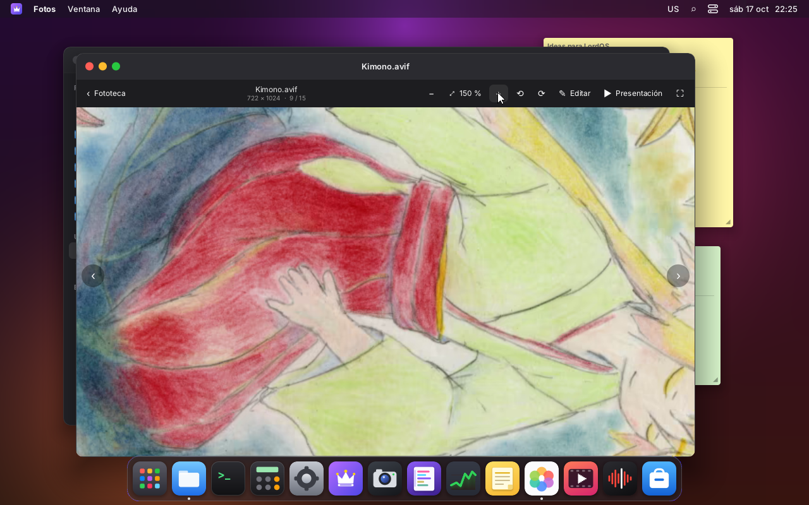 |  |
| Girada 90° y al 150 % | Edición: recorte, brillo y contraste en vivo; «Guardar como copia» |
| 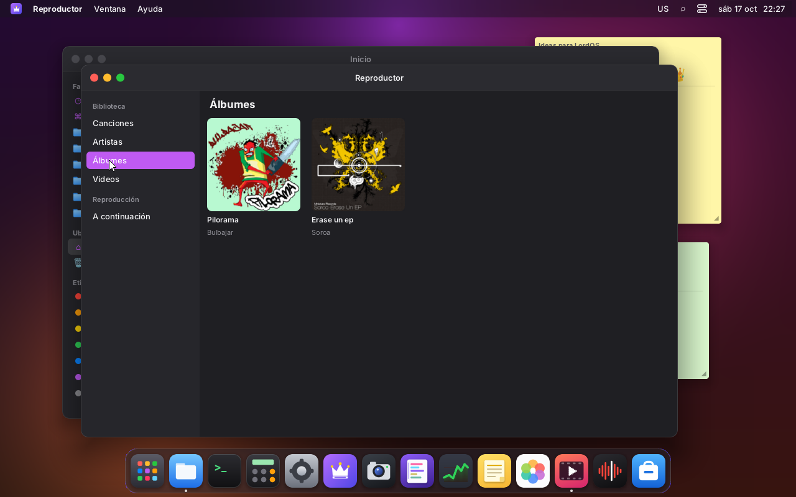 | 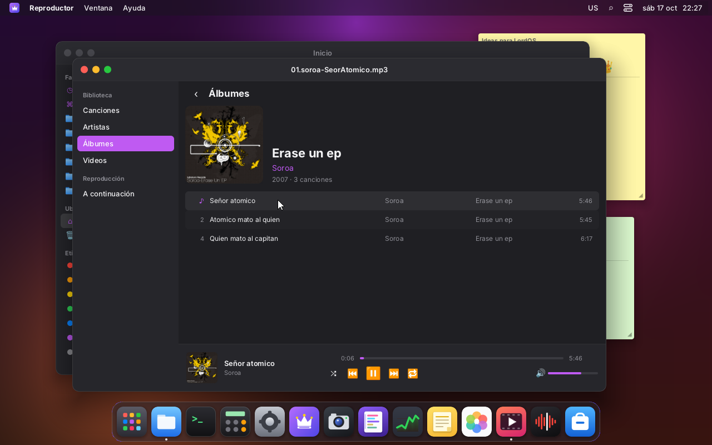 |
| Biblioteca de música por álbum, con carátulas de las etiquetas | Reproduciendo: cola, aleatorio y repetir |
| 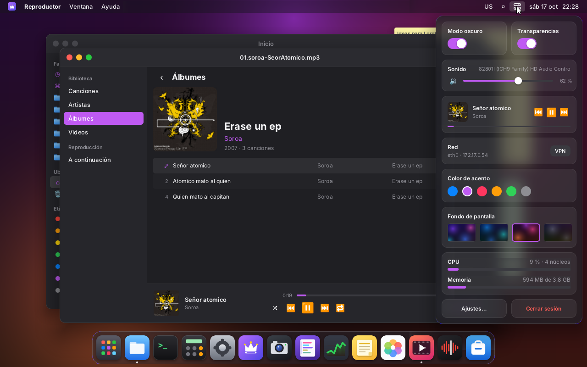 | 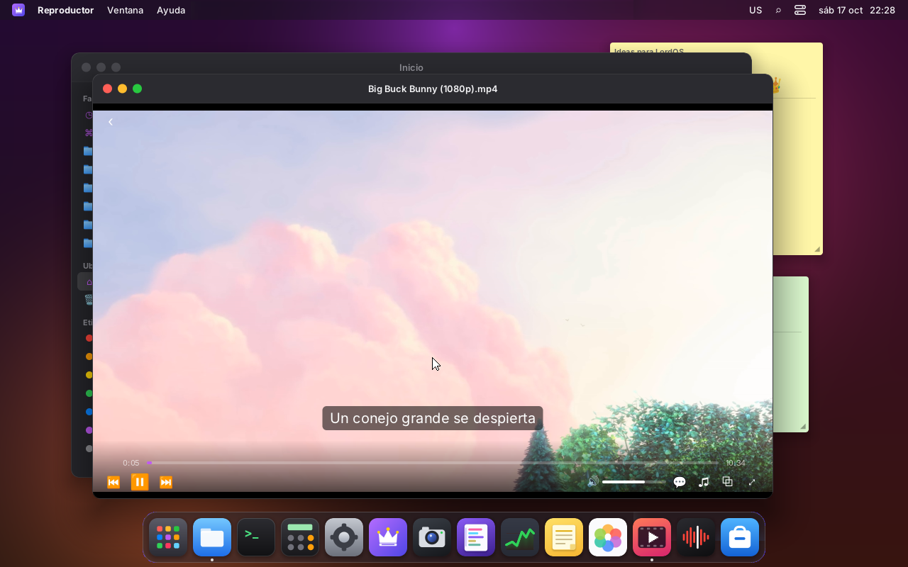 |
| El Centro de control con lo que suena | Big Buck Bunny 1080p con subtítulos `.srt` |
|  |  |
| Subtítulos de la pista de un MKV | Pantalla completa |
|  | 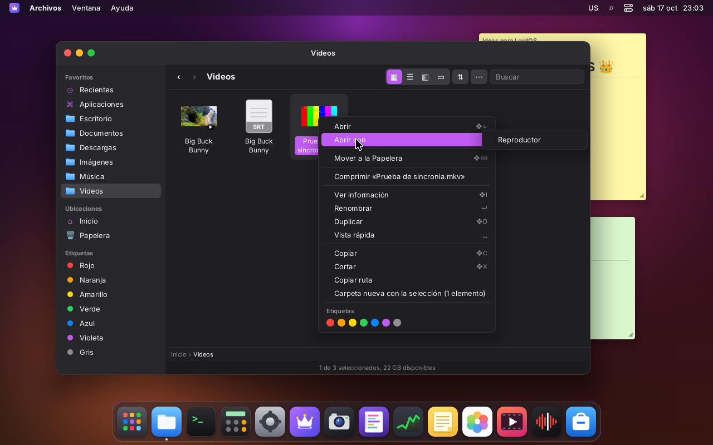 |
| Imagen en imagen sobre Archivos | Archivos: miniaturas de video y «Abrir con → Reproductor» |
|  |  |
| El panel de Capturas (❖⇧5) | El sistema pide el permiso de pantalla la primera vez |
|  | 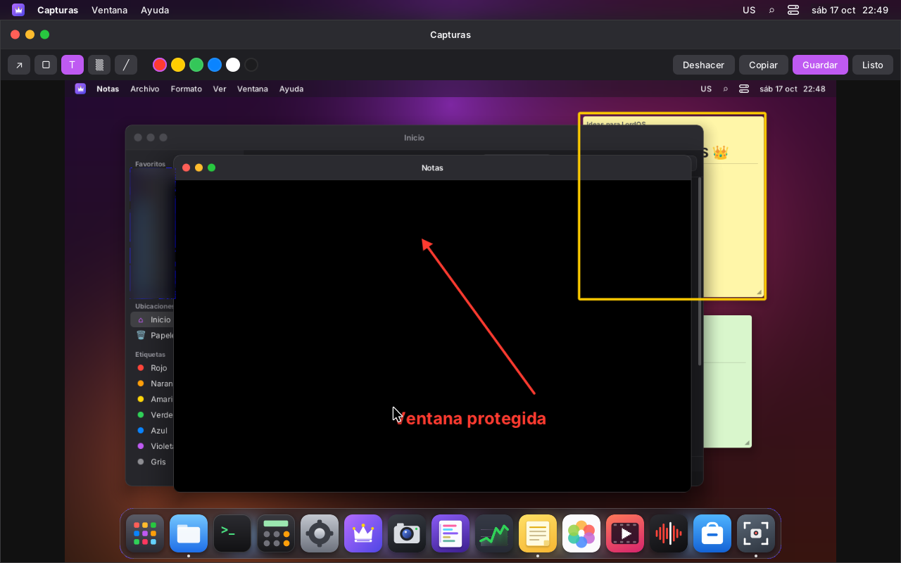 |
| Captura de un área sobre la pantalla congelada | Editor: flecha, recuadro, desenfoque y texto, a resolución completa |
| 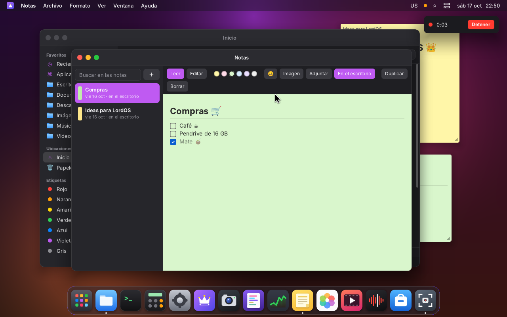 | 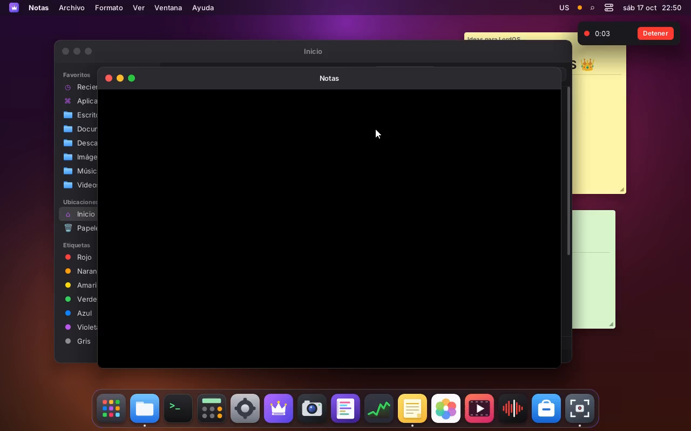 |
| Grabando la pantalla (indicador de micrófono naranja) | Un cuadro del MP4 grabado: Notas protegida sale negra |
| 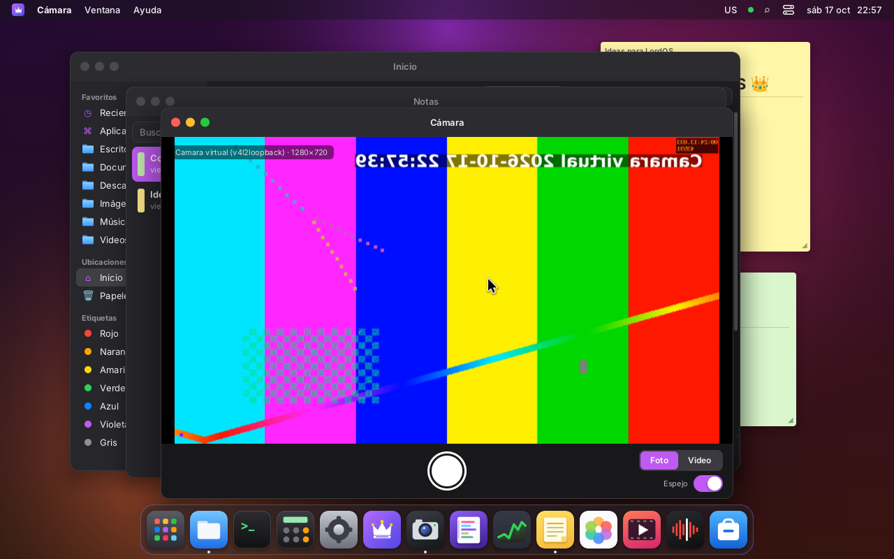 | 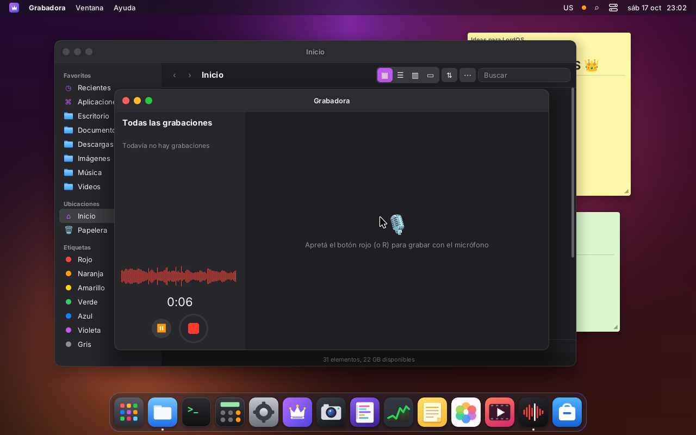 |
| Cámara (v4l2loopback; ver «Pruebas»), con espejo y el punto verde | Grabadora: nivel en vivo |
| 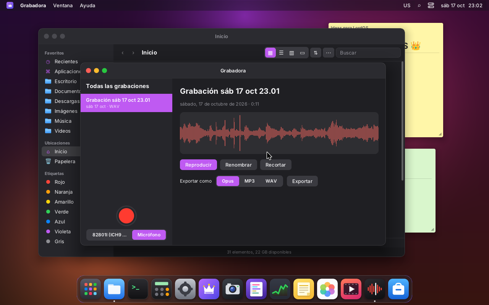 |  |
| La grabación con su forma de onda | Recortar y exportar |
| 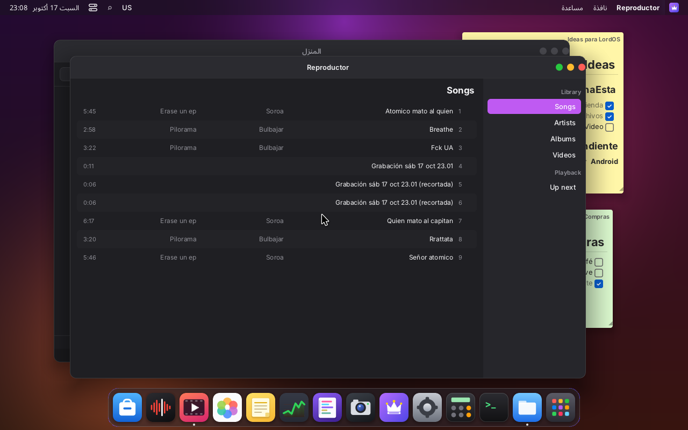 | |
| El Reproductor en árabe (de derecha a izquierda) | |

### Ventanas protegidas

| En la pantalla | En la captura | En el escritorio remoto |
|---|---|---|
| 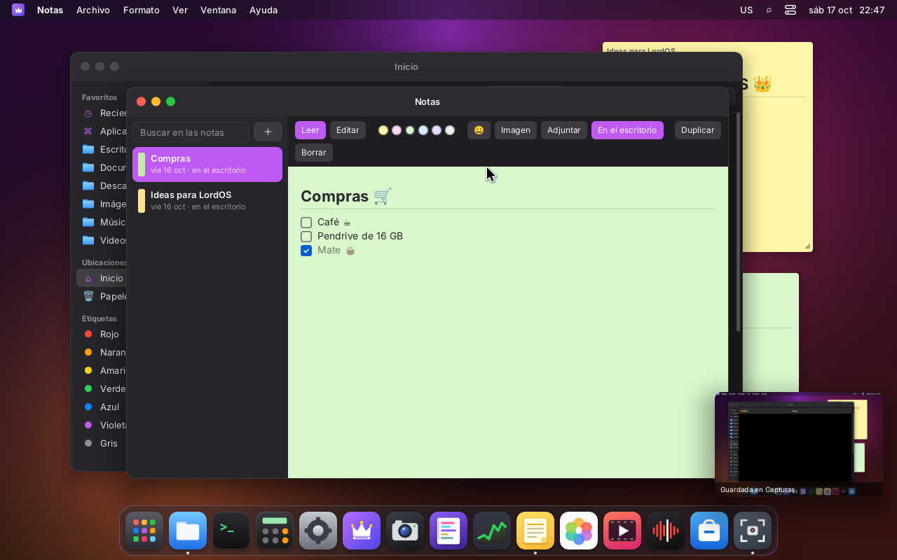 |  | 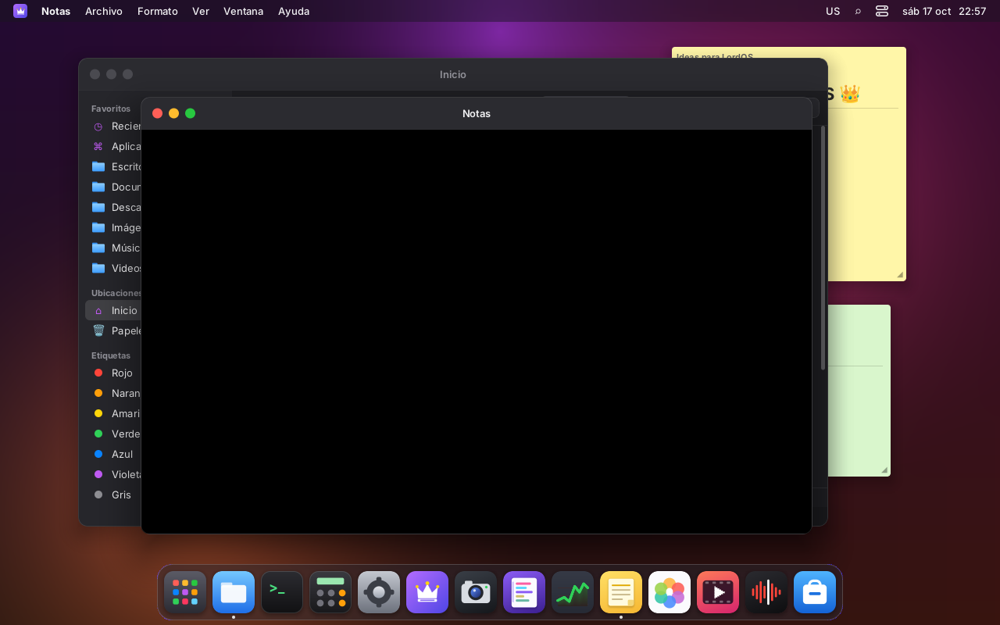 |
| Notas protegida, se ve normal (abajo, la miniatura de la captura) | El PNG guardado: el contenido de Notas es negro | Lo que recibe el navegador por el WebSocket del remoto |

## Arquitectura

```
 apps (React)  Fotos · Reproductor · Capturas · Cámara · Grabadora
      │         <MediaView media={id}/> · sdk/media.js (media, usePlayer, nowPlaying)
      ▼
 lord-server   ui/js_media.c (lord.media, validación y permisos)
      │        media/media.c   ayudantes, trabajos, miniaturas, rutas
      │        media/mview.c   dibuja el nodo media (copia directa, zoom, giro, mipmaps)
      │        media/capture.c capturas, grabación, escritorio remoto, ventanas protegidas
      │        media/maudio.c  streams de PipeWire de los medios (reproducir y grabar)
      │        media/annot.c   anotaciones
      │   socket SEQPACKET + fds (media/proto.h)   memoria compartida (cuadros, audio)
      ▼
 lord-media    media/helper/*  (FFmpeg + libva; caja de arena; sin red ni archivos)
```

### El ayudante `lord-media`

- **Cómo se lanza:** lord-server lo lanza a pedido (`media_spawn`), con ruta fija:
  `<carpeta de lord-server>/lord-media`, que tiene que ser de root o del usuario y no escribible
  por otros. No lleva argumentos, el entorno es mínimo y el socket va en el fd 3. Hay uno por
  reproductor, cámara o grabación, y dos *workers* para los trabajos cortos (miniaturas y probes
  en segundo plano; imágenes, ediciones y exportaciones adelante). Los workers terminan solos a
  los 20 s sin trabajo.
- **Nunca recibe una ruta.** lord-server valida cada ruta con las mismas reglas que `lord.fs`
  (carpeta personal y montajes del usuario), abre el archivo y le pasa el fd.
  - Las salidas se crean como temporales al lado del destino. Al terminar bien se renombran con
    `RENAME_NOREPLACE`, así que nunca se pisa un archivo.
  - La cámara (`/dev/videoN`) y el render node (`/dev/dri/renderD*`, para VA-API) también los abre
    lord-server.
  - El audio no llega como socket (ver «Audio»).
- **Caja de arena:** la compartida de los ayudantes, `sandbox_apply_helper` de `sec/sandbox.c` (la
  misma de lord-doc). Se aplica antes de leer un byte del archivo y antes de iniciar VA-API:
  - Landlock: solo lectura de `/usr/lib`, `/usr/share`, `/etc/ld.so.cache` y `/sys/devices`; nada de
    la carpeta personal, `/tmp`, `/dev` ni `/run`;
  - seccomp con TSYNC: sin `socket`/`connect`/`bind`, sin `exec`, `clone` solo para hilos, y los
    `ioctl` solo de las clases DRM/dma-buf (VA-API) o V4L2 (cámara) cuando hacen falta;
  - `no_new_privs`, sin capacidades, `PR_SET_DUMPABLE=0`, sin core dumps y cgroup
    `app-lordos-media.scope` con tope de memoria.

  `build/media-test sandbox` lo prueba de afuera: abrir `/etc/passwd` o `/home`, crear en `/tmp`,
  `socket` AF_INET o AF_UNIX, `fork` y `exec`: todo falla.
- **Si se cae, el escritorio sigue.**
  - lord-server nunca espera al ayudante: socket no bloqueante, mensajes chicos.
  - La memoria compartida que manda el ayudante tiene que venir sellada contra achicarse
    (`F_SEAL_SHRINK`, se verifica): un ayudante comprometido no puede hacer caer a lord-server con
    `SIGBUS`.
  - Al cerrarse el socket, la ventana recibe `closed` (`crashed: true`) y muestra un aviso. El
    proceso se espera o se mata.
  - Probado con un error real (desborde de cola al final del archivo, ya corregido): el segfault
    quedó en el kernel log, el Reproductor mostró el aviso y el resto del escritorio siguió.
- **Aceleración por hardware:** `hwaccel=vaapi|v4l2request|none`, elegible con
  `LORD_MEDIA_HWACCEL`; `LORD_MEDIA_HW=0` la apaga.
  - Con VA-API, el driver (radeonsi o iHD) decodifica y el cuadro NV12 se baja para escalarlo.
  - `v4l2request` (HEVC de la Raspberry Pi 5) queda preparado: hace falta el FFmpeg de Raspberry
    Pi y crear el dispositivo sobre fds (TODO en `lm_io.c`).
  - Si no hay driver, el decodificador sigue por software sin cortar.

### Cuadros de video: una sola copia

1. lord-media decodifica y escala cada cuadro (swscale, con la matriz de color BT.709/601 del
   video) **al tamaño exacto en que se ve**. lord-server le avisa la caja del nodo con `MM_SIZE`.
2. Lo escribe en una de tres ranuras de un memfd sellado y avisa `MM_FRAME`. lord-server contesta
   `MM_ACK` cuando pasa a mostrarla, y desde ahí las anteriores quedan libres. Si no hay ranura
   libre, el cuadro se descarta en vez de esperar.
3. El nodo `media` copia la ranura directo al lienzo (`canvas_blit`): es la copia de componer, no
   hay otra. Con zoom, giro o espejo (Fotos, Cámara) se arma una imagen intermedia del tamaño
   visible, bilineal y con mipmaps para fotos grandes, que se reutiliza mientras no cambie nada.
4. **Pintar desde el video:** si todo lo que cambió en el cuadro está adentro de un video opaco
   (`media_cover_node`), `paint.c` no pinta lo que queda debajo en el orden de pintado (fondo,
   ventanas de atrás, el desenfoque del Dock); recorre esos nodos solo por sus recortes. Las
   capas de encima (controles, subtítulos) se pintan igual. Bajó el costo de lord-server con un
   video de 1080p de 42 % a 11–13 % de un núcleo en ventana, y de 92 % a 14 % en pantalla
   completa (ver «Mediciones»). No se usa en el camino GPU, que arma ahí su lista de ventanas.

En el camino GPU (`GPU.md`) el nodo se pinta en la textura de la UI, y solo se sube la región que
cambió. **Pendiente:** el cero-copia de verdad, que exporta la superficie VA-API como dmabuf
(NV12) y la importa por EGL como textura externa. No se escribió porque no hay dónde probarlo:
ni la VM ni el host tienen una GPU con VA-API.

### Audio: PipeWire es de lord-server, no del ayudante

El socket de PipeWire (protocolo de PulseAudio) permite cargar módulos, grabar otros streams y
cambiar la salida, así que un decodificador comprometido no debe tenerlo. El audio va por
memoria compartida (`media/aring.h`):

- **Reproducir:**
  - lord-media escribe PCM (s16, 48 kHz, estéreo) en un anillo de 1,4 s que crea lord-server
    (memfd sellado).
  - lord-server tiene el stream de PipeWire (`maudio.c`, con el cliente asíncrono `mpulse.c`) y
    copia del anillo cuando PipeWire pide (`REQUEST`).
  - El stream aparece como «Reproductor» en Ajustes → Sonido, y el volumen se pone ahí.
- **El reloj:**
  - Después de cada `GET_PLAYBACK_LATENCY`, cada 40 ms mientras suena, lord-server escribe en la
    página del anillo qué byte se oye (`read_index − latencia de la salida`) y en qué instante
    `CLOCK_MONOTONIC`, con un seqlock.
  - lord-media lo lee sin bloqueos ni idas y vueltas y presenta cada cuadro cuando
    `pts ≤ reloj + 4 ms`; si llega tarde, lo descarta.
  - Sin audio, el reloj es el del sistema. Si lord-server deja de leer el anillo por más de 2 s
    (PipeWire se cayó), el video sigue con el reloj del sistema.
- **Grabar** (micrófono, después del permiso): al revés. lord-server tiene el stream de grabación
  y escribe en el anillo; lord-media lo lee para el WAV de la Grabadora o el AAC de las
  grabaciones de pantalla y de cámara.
- **Seek:** lord-media sube `serial` y `discard_to`; lord-server descarta lo anterior y hace
  `FLUSH` del stream.
- **Desconfianza:** lord-server nunca confía en la cabecera compartida (el otro lado la puede
  escribir). Usa su propio tamaño y su propio cursor y acota todo (`ar_write_t`, `ar_read_t`,
  `ar_avail_t`): lo peor que puede pasar es audio perdido o repetido.

### Ventanas protegidas

`wm.setProtected(id, true)` (SDK) marca una ventana como protegida, como la protección de captura
de macOS (la usa KeePassXC). La futura app Contraseñas la va a usar. Se ve normal en la pantalla
y sale **negra** en:

- **Capturas de pantalla** (`lord.media.screenshot`): se vuelve a pintar el árbol en un lienzo
  aparte en «modo captura» (`paint_capture`). Un nodo con `protected` es un rectángulo negro, y lo
  que está encima de la ventana protegida se ve igual.
- **Grabación de pantalla y escritorio remoto** (`server/src/remote`): si hay alguna ventana
  protegida, se mantiene un segundo lienzo en modo captura, repintado solo en la región que
  cambió. Si no hay ninguna, se usa el cuadro tal cual, sin costo. `media_composed` en `main.c`
  le da ese lienzo al remoto (`mirror_frame`) y a la grabación.
- **Miniaturas:** la miniatura flotante y el editor de Capturas salen de la misma captura.
- **Apps Linux (Wayland):** el contenido, sus menús emergentes y la pantalla completa de una
  ventana protegida también salen negros (`wl.c`, `node_protected`).

Cómo funciona:

- El SDK pone la prop `protected` en el nodo del contenido de la ventana (`AppHost`).
- El motor la guarda en `Node.protect` (`lord.setProp(id, 'protected', bool)`).
- El marco del tema (título incluido) sigue visible, así que una app que lo necesite pone un
  título genérico.
- El servidor no deja capturar en el camino GPU: grabar la pantalla compone por CPU, igual que
  cuando alguien mira por el escritorio remoto.
- Capturas tiene un ítem de menú «Privacidad → Proteger la ventana del frente de las capturas»
  para usarlo con cualquier ventana.

### Permisos

Pantalla, micrófono y cámara pasan por los permisos del sistema (`sec/perms.c`, `PRIVACIDAD.md`):

- el SDK pide el permiso con `requestPermission` (el aviso lo dibuja el sistema);
- `js_media.c` vuelve a verificar en C que la decisión guardada sea «permitir»: `permitted()`, el
  punto donde el broker va a enganchar;
- mientras se usan, se prenden los puntos verde y naranja de la barra de menú (`markDeviceUse`).

### Atajos (globales, también con una app Linux al frente)

| Atajo | Qué hace |
|---|---|
| ❖⇧3 o Impr Pant | Captura de la pantalla completa |
| ❖⇧4 | Captura de un área (Espacio: de una ventana; Esc cancela) |
| ❖⇧5 | Panel de Capturas; si se está grabando, detiene la grabación |
| Teclas multimedia (play/pausa, siguiente, anterior, stop) | Lo que suena ahora (`nowPlaying`) |
| Reproductor: Espacio, ← →, ⇧← ⇧→, ↑ ↓, F | Pausa, ±5 s, ±30 s, volumen, pantalla completa |
| Fotos: ← →, + −, 0, 1, R, F, Espacio, ❖P | Anterior/siguiente, zoom, encajar, 100 %, girar, pantalla completa, presentación, imprimir |
| Grabadora: R, Espacio | Grabar o detener, reproducir |

❖⇧3/4/5 no estaban usados por nadie (ver `ARCHIVOS.md`, `NOTAS.md`, `TERMINAL.md`). El
compositor deja pasar a LordOS las teclas multimedia e Impr Pant aunque una app Wayland tenga
el foco (`wl_key`).

## API

### `lord.media` (`server/src/ui/js_media.c`)

| Función | Qué hace |
|---|---|
| `play(app, ruta, { loop, native, autoplay, audio, hw, volume, music, appName })` | Reproductor → id. `native`: tamaño original (GIF en Fotos) |
| `control(id, 'play'\|'pause'\|'seek'\|'volume'\|'audioTrack'\|'subTrack'\|'loop', valor)` | |
| `view(id, { fit, zoom, cx, cy, rotate, mirror, background, brightness, contrast })` | Cómo se dibuja en `<MediaView>` |
| `image(app, ruta)` → id | Foto decodificada (evento `ready`) |
| `thumb(ruta, lado)` | Ruta en `~/.cache/lordos/thumbs` o `null` mientras se hace (evento `thumb`) |
| `probe(ruta)`, `waveform(ruta, barras)`, `poster(ruta, lado)` + `take(id)` | Trabajos (evento `job`); `poster` deja píxeles RGBA |
| `edit(app, ruta, salida, { rotate, brightness, contrast, cx, cy, cw, ch, refw, format, quality })` | Copia editada |
| `transcode(app, ruta, salida, { format: 'opus'\|'mp3'\|'wav', from, to })` | Exportar audio con recorte |
| `screenshot(app, { x, y, width, height })` → id, `crop`, `annotate(base, ops, destino)` | Capturas (permiso `screen`) |
| `saveImage(id, salida, { format })`, `copyImage(id)` | PNG/JPEG a un archivo o al portapapeles |
| `screenRecord(app, salida.mp4, { mic, fps })`, `audioRecord(app, salida.wav)`, `stop(id)` | Grabaciones (permisos `screen`, `microphone`) |
| `cameras()`, `camera(app, dispositivo, { width, height })`, `photo(id, salida, espejo)`, `cameraRecord(id, salida \| null, { mic, mirror })` | Cámara (permiso `camera`) |
| `info(id)`, `close(id)`, `protectedCount()`, `hwaccel()` | |

Eventos: `__lordMedia(id, tipo, datos)`. Tipos: `info`, `pos`, `state`, `sub`, `stats`, `level`,
`ready`, `error`, `closed`, `done`, `photo`, `video`, `job` y `thumb`.

### `@lordos/sdk`

- `media` (lo de arriba con promesas y permisos), `usePlayer(id)` (el estado sobrevive a que la
  app se vuelva a montar), `nowPlaying`/`useNowPlaying`, `NowPlayingTile` (para el Centro de
  control de un tema), `useThumb(ruta)`, `mediaFormatTime` y `userDirs()`.
- `<MediaView media={id} />` (runtime) y la prop `protected`.
- Ventanas:
  - `wm.setProtected(id, on)`;
  - `wm.setFullscreen(id, on)`: la dibuja el SDK encima de todo, y Esc sale;
  - `wm.setPip(id, frame | null)`: una ventanita sin marco, siempre encima y arrastrable.

  Las pinta `FloatingWindows`, que pone `startShell`, así que los temas no tienen que hacer nada.
- `useWindowState(clave, inicial)`: estado de una ventana que sobrevive al cambio de lugar (pantalla
  completa o imagen en imagen).

## Archivos y Archivos (la app)

- **Miniaturas:**
  - van en `~/.cache/lordos/thumbs/<sha256 de ruta, fecha, tamaño y lado>.png`;
  - las hace el worker de segundo plano;
  - las que fallan no se vuelven a pedir en la sesión;
  - Archivos las usa para videos, carátulas de audio y las imágenes que stb no lee (WebP, HEIC,
    AVIF).
- **«Abrir con»:** Fotos para las imágenes y Reproductor para audio y video, los dos como
  opción predeterminada.
- **Vista rápida:** la de Archivos (del agente de documentos) usa `media.poster`.
- **Dónde se guarda:**
  - capturas en `~/Imágenes/Capturas`;
  - cámara en `~/Imágenes/Cámara`;
  - grabaciones en `~/Música/Grabaciones`;
  - con xdg-user-dirs se respetan las carpetas del usuario.
- **Biblioteca de música:** se guarda en `~/.cache/lordos/music.json`, por ruta, tamaño y fecha.
  Solo se vuelven a leer las etiquetas de lo que cambió.

## Mediciones (VM 119)

Big Buck Bunny 1080p H.264 a 30 cuadros/s con audio MP3. VM con 4 vCPU (Xeon Silver 4108 a
1,8 GHz) y virtio-gpu sin 3D, así que se compone por CPU y **no hay VA-API**.

| Prueba | lord-server | lord-media | Cuadros |
|---|---|---|---|
| `media-test` (sin compositor, 960×540) | — | 37–43 % | 30,0/s, 0 descartados en 60 s |
| En la sesión, en ventana (~958×539), antes de pintar desde el video | 41,5 % | 38–42 % | |
| En la sesión, en ventana, después | 10,9–13,0 % | 38–49 % | 1962 de 1968 mostrados, **0 descartados** (60 s) |
| Pantalla completa (1280×720), antes | 92,1 % | 50 % | |
| Pantalla completa, después | 14,1–14,7 % | 52–54 % | 14 descartados de 1971 (0,7 %), al cambiar a pantalla completa |
| Con VA-API | **no medido** | **no medido** | La VM no tiene driver (`vainfo` falla); el código cae a software. Hay que medirlo en la PC con AMD (ver abajo) |

CPU como % de un núcleo, de `/proc/<pid>/stat` durante 20–60 s; con el video, la CPU total de la
VM queda en ~20 %. Sincronización A/V medida adentro del reproductor (`|pts del cuadro − reloj
del audio|` al presentarlo, sin contar el vblank):

| | Media | Máximo |
|---|---|---|
| Antes (lord-media con el socket de PipeWire, latencia en el mismo stream) | 0,97–1,01 ms | 25–28 ms |
| Ahora (anillo de lord-server + reloj por seqlock), `media-test` | 1,7–1,9 ms | 4–10 ms |
| Ahora, en la sesión (60 s) | 0,55 ms | 31 ms (al arrancar) |

El clip de prueba es un `testsrc2` con un pitido de 100 ms cada segundo (`sync.mp4`). En las dos
versiones se arranca con un poco de silencio mientras PipeWire llena el búfer (~0,3 s).

Otras: miniatura de 256 px de un video de 1080p, 150 ms; decodificar fotos de 0,5 a 1,4 MP, 50–120
ms (HEIC 118 ms); grabación de pantalla con libx264 `veryfast`, de ritmo variable (solo codifica
cuando cambia algo), 0 cuadros descartados.

**Para medir VA-API en la PC con AMD** (ISO live):
1. `vainfo`: tiene que decir radeonsi y listar `H264`.
2. Reproducir un 1080p y ver en `~/.cache/lordos/session.log` la línea
   `medios: reproducción …: …, VA-API, …`.
3. Con `python3 server/tests/media_cpu.py 30` (o `top`), comparar con `LORD_MEDIA_HWACCEL=none`.

## Pruebas

- `make -C server build/lord-media build/media-test` (necesita los `-dev` de FFmpeg; si faltan,
  `make` compila todo lo demás sin `lord-media`).
- `build/media-test probe|thumb|image|wave|export|edit|play|sandbox` lanza `lord-media` igual que
  lord-server, sin argumentos y con fds:
  - `play` mide cuadros, descartes, desfase A/V y CPU, con el audio por `maudio.c` como en la
    sesión;
  - `sandbox` verifica la caja de arena.
- **En la VM 119**, con el lord-server instalado como en el `.deb` (`/usr/lib/lordos`,
  `lordos.service`), están las capturas de arriba:
  - todas las apps;
  - permisos;
  - teclas multimedia (`sendkey audioplay`);
  - Centro de control;
  - pantalla completa e imagen en imagen;
  - capturas con ventana protegida en la captura, la grabación y el escritorio remoto;
  - portapapeles (`wl-paste -t image/png` recibe el PNG);
  - cámara y grabadora;
  - RTL (árabe).
- **Muestras** (licencias libres):
  - Big Buck Bunny (Blender Foundation, CC BY 3.0);
  - los EP «Erase un EP» de Soroa y «Pilorama» de Bulbajar (archive.org, CC BY 3.0), con las
    carátulas incrustadas para la prueba;
  - imágenes de la galería WebP de Google, Wikimedia Commons (tierra girando, dominio público),
    Nokia HEIF y link-u (AVIF).
- **Cámara:** la VM no tiene webcam. Se emuló con `v4l2loopback` (`/dev/video10`, «Camara virtual
  (v4l2loopback)») alimentado por `ffmpeg` (`testsrc2` 1280×720 YUYV), como un servicio
  `lordos-test-camfeed`.
- **Micrófono:** un `module-null-sink` + `module-remap-source` («Micrófono virtual») con un clip en
  bucle (`lordos-test-micfeed`).

## Pendiente

- **VA-API medido en hardware real**, y el **cero-copia** dmabuf → EGL en el camino GPU. Probarlos
  en la PC con AMD.
- **Raspberry Pi 5:** HEVC por `v4l2request` sobre fds (el FFmpeg de Debian no lo trae).
- **Subtítulos de imagen** (PGS, DVD): hoy solo los de texto.
- **Velocidad de reproducción** y **listas de reproducción** guardadas.
- **Capturas:** grabar solo un área (hoy, la pantalla completa) y grabar el audio del sistema (hoy,
  el micrófono).
- **Ventanas protegidas:** el marco del tema y el título siguen visibles en las capturas (solo el
  contenido es negro).
- **Fotos:** guardar como WebP (no hay codificador sin libwebp), metadatos (EXIF) en la copia y
  álbumes propios.
- **Pantalla completa:** una vez (en dos intentos más no pasó) la reproducción se detuvo al
  entrar; falta encontrar el motivo.
