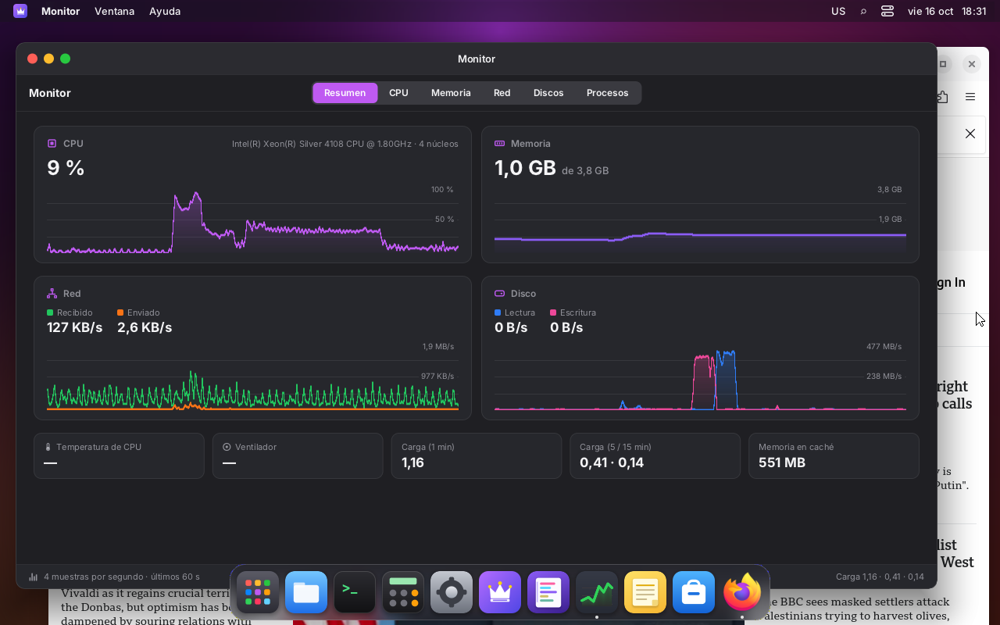
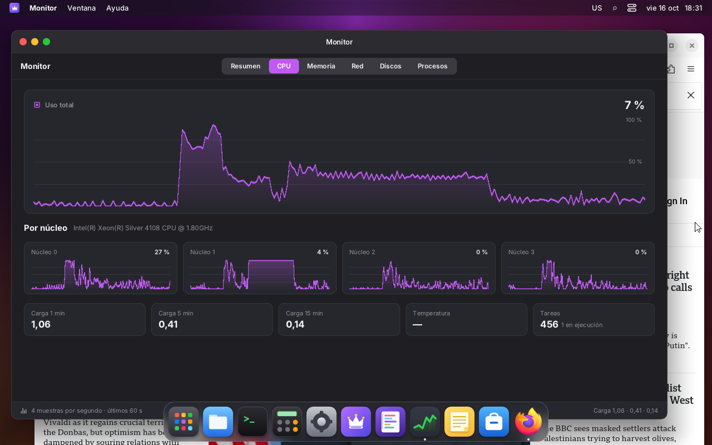
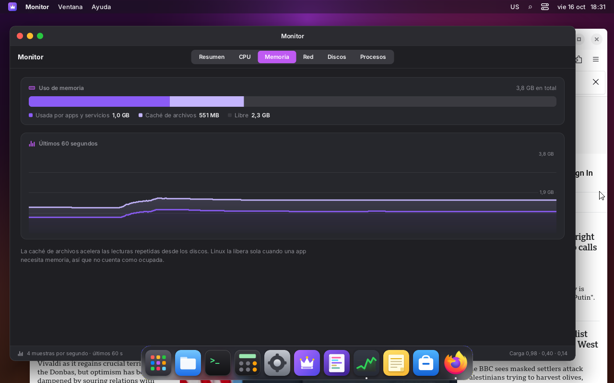
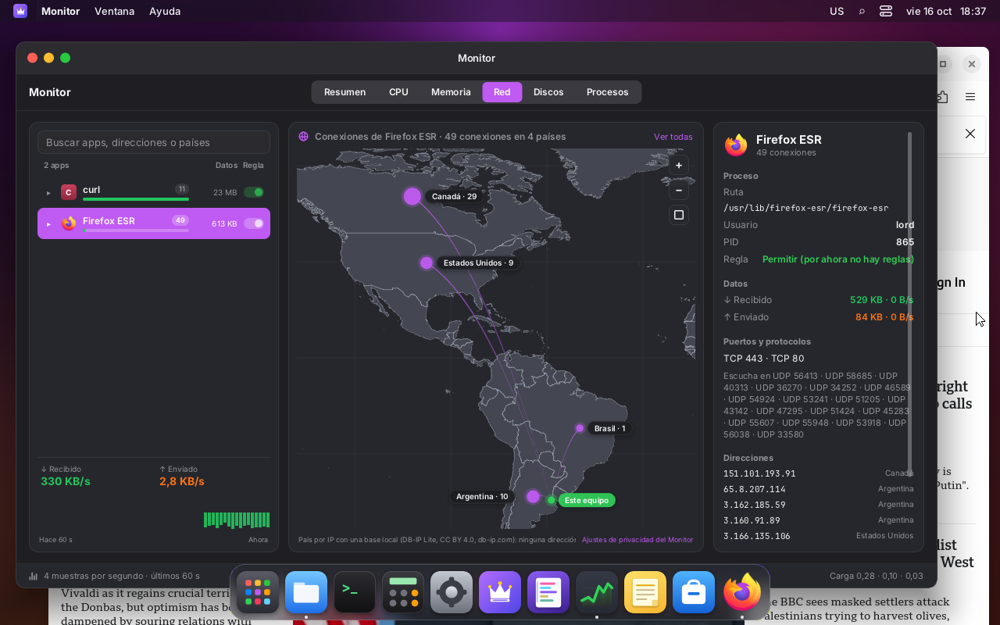
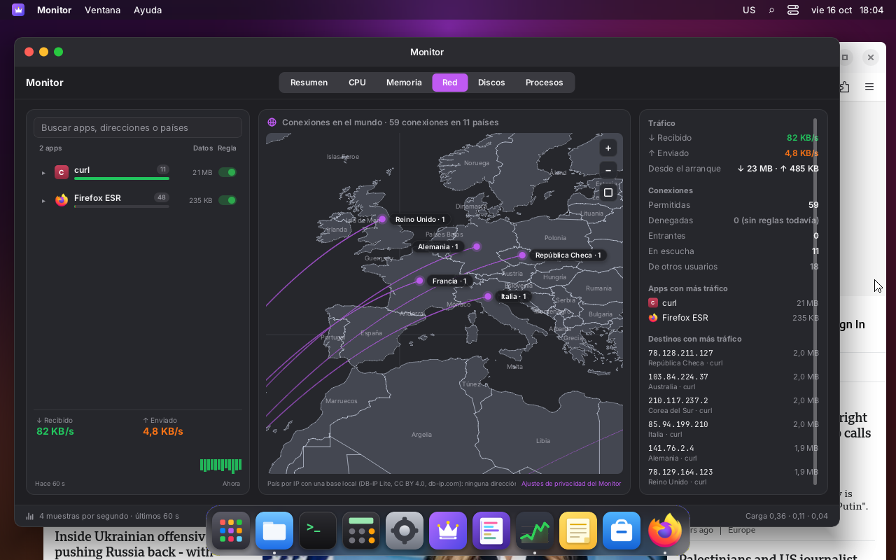
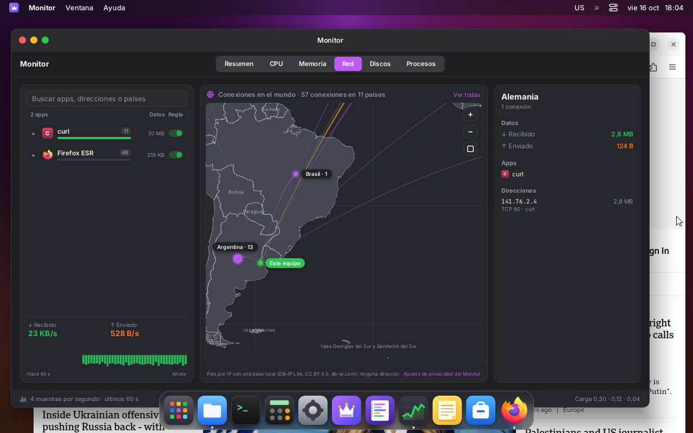
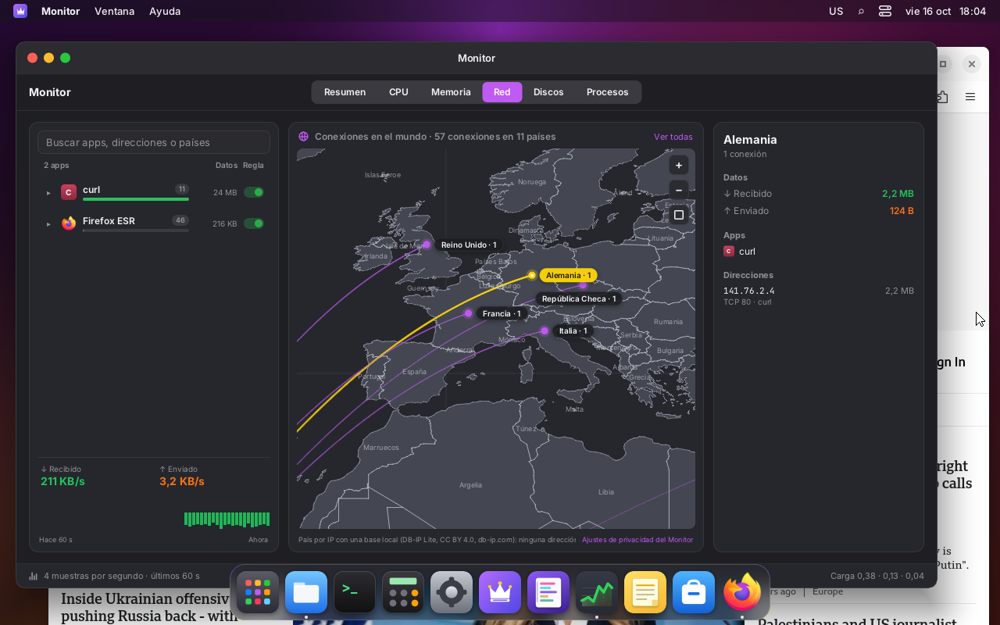
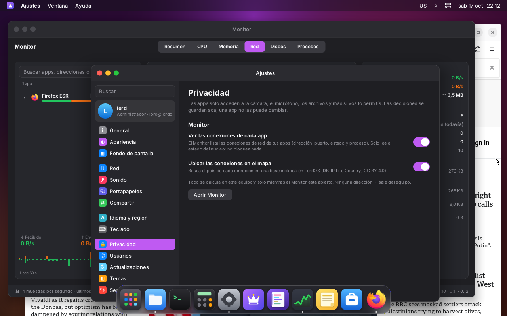

# Monitor

Preinstalled native app (`apps/monitor`) to see how this machine is being used: CPU, memory,
network, disks, processes and each app's network connections on a world map. It copies the look
of TangoOS's Monitor (`tangoos/web/packages/app-monitor`): segmented tabs, dark cards with an icon,
a big number and a live area chart, a row of small figures and a footer with the sampling rate.
The Network tab takes the shape of a per-app network monitor (apps on the left, map in the middle, summary on
the right).

Phase 1 (this one): read-only. No root daemon, no firewall, no saved history and no alerts.

## Tabs

| Tab | What it shows |
|---|---|
| Overview | CPU, Memory, Network and Disk with a 60 s chart; below, CPU temperature, fan, 1 min load, 5/15 min load and cached memory |
| CPU | total usage (big chart), one chart per core, 1/5/15 load, temperature and tasks |
| Memory | stacked bar (used, file cache, free), swap and a 60 s chart |
| Network | apps with connections, map, summary or detail of the chosen app (see below) |
| Disks | total read and write and one row per disk (model, `/dev`, size, rates) |
| Processes | sortable table (CPU, memory, threads, PID, user), search, "Mine" / "All" |

Charts pause with the mouse over them and show a crosshair with the values at that instant, as in
TangoOS. Time always runs left to right, also in Arabic and Hebrew; the rest of the window mirrors
itself.

### Network

- **Left:** search (by app, address or country) and one row per app with its icon, number of
  connections, a traffic bar (received in green, sent in orange, relative to the app that moved
  the most), the bytes and the **Rule** column, reserved for the firewall: today it is a read-only
  switch set to "allow". Each app expands to show its destinations (IP and country). At the bottom,
  the current download and upload speed and per-second bars for the last 60 s.
- **Center:** the map fills the whole height of the column. It has an arc from "This computer" to
  each country, one dot per country (bigger the more connections) and pill labels with the name
  and the count. It's controlled like this:
  - wheel: zoom toward the cursor;
  - touchpad: pinching zooms toward the center of the gesture and two fingers move the map (see
    `TRACKPAD.md`; with remote desktop, the browser's trackpad pinch works too).
    Screenshots: [before](trackpad-mapa-antes.png) and [after pinching](trackpad-mapa-despues.png);
  - drag: move;
  - double click: zoom in;
  - `+`, `−` and "show all" buttons in the corner.

  When zoomed in, the borders and names of the other countries show. The Lite base has no cities,
  so labels are always countries.

  When an app is chosen, the map shows only its places and frames them. A click on a dot or an arc
  chooses that country: the right panel shows its apps, addresses, ports and bytes. At the bottom,
  a line with the DB-IP attribution and the link to the privacy settings.
- **Right:**
  - no selection: traffic (current and since boot), allowed and denied connections (0: there are
    no rules yet), incoming, listening and from other users, and the apps and destinations with the
    most traffic;
  - with an app chosen: executable path, user, PIDs, rule, bytes and speed, ports and protocols,
    listening ports and addresses;
  - with a country chosen: bytes, apps and addresses (with ports and app).

Hosts are shown as IPs. There is no reverse DNS: asking for an IP's name sends it to the DNS
server, and this app's rule is that no address leaves the machine.

**"This computer"** is placed by the time zone (`/etc/localtime` → coordinates from
`/usr/share/zoneinfo/zone1970.tab`), without the network.

## Architecture

```
apps/monitor/            index.jsx (tabs), Network.jsx (Network), MapView.jsx (map), Chart.jsx,
                         draw.js (pixels), icons.jsx, Privacy.jsx, countries.js (generated)
sdk/monitor.js           useMonitor(), stores monitorSamples / monitorProcesses / monitorConnections
server/src/ui/js_monitor.c   lord.monitor (read-only, validated API)
server/src/monitor/mon.c     sampling thread: /proc, /sys, processes
server/src/monitor/conn.c    connections via sock_diag + inode → process
server/src/monitor/mmdb.c    our own MaxMind DB reader (IP → country)
server/src/monitor/map.c     vector map, on its own thread
assets/monitor/          land.bin (Natural Earth 1:50m), geoip-country.mmdb.xz (DB-IP Lite)
tools/gen-monitor-data.py    generates that data, countries.js and the country names
tests/mmdb_test.c, tests/map_bench.c   reader test and map benchmark
```

### lord.monitor

| Function | What it does |
|---|---|
| `start()` / `stop()` | adds or removes an interested party; at 0, or with no queries for 3 s, the thread goes to sleep |
| `want(processes, connections, countries)` | which lists the thread builds besides the sample |
| `sample()` | the latest sample, or `null` if there is no new one |
| `processes(lang)` | `{ t, total, hz, list: [{ pid, ppid, uid, user, name, cmd, exe, state, threads, cpu, rss, start, self, app, appName, appIcon }] }` |
| `connections(lang)` | `{ t, ok, others, list: [{ id, proto, fam, state, dir, local, lport, remote, rport, scope, cc, pid, self, name, exe, sent, recv, app, appName, appIcon }] }` |
| `info()` | `{ cpuModel, cores, geo, tick, home: { zone, cc, lat, lon } }`; `cpuModel` comes from `js_sys_cpu_name()`, the same one About uses (on ARM, the core from "CPU part" and the board) |
| `map(view)` | requests a map frame: `{ width, height, lon, lat, ppd, land, border, accent, homeColor, selColor, home, dots: [{ lon, lat, r, sel }] }` (validated numbers, up to 2048×2048 and 256 dots) |
| `mapFrame()` | the latest ready frame `{ seq, width, height, lon, lat, ppd, ms, data }`, or `null` |

No function takes paths or commands: the only arguments are booleans and a language code
(letters, digits, `-` and `_`, up to 15). `lord-server` runs nothing for the Monitor.

### Sampling without slowing the screen

- A dedicated thread (`mon.c`) builds the sample every **250 ms** (4 Hz, as TangoOS): `/proc/stat`
  (total and per-core CPU), `/proc/meminfo`, `/proc/loadavg`, `/proc/uptime`, `/proc/net/dev`,
  `/proc/diskstats` (only whole disks from `/sys/block` with `device/`), and the temperature and
  fans from `/sys/class/hwmon` (chip `coretemp`, `k10temp`, `zenpower`, `cpu_thermal`…; if there
  is none, `/sys/class/thermal`).
- Processes (`/proc/<pid>/stat`, `cmdline`, and `exe` for the user's own) and connections: **once
  per second**, and only if the tab that shows them is open.
- The thread leaves the JSON ready; the screen thread only copies and converts it
  (`JS_ParseJSON`). It never reads files during a frame.
- **Zero cost when closed:** without `start()` the thread doesn't even exist; after `stop()` (or if
  nobody asks for a sample for 3 s, for example when switching themes) it sleeps on a condition
  variable, and releases the country database.

### Connections

`conn.c` does the same as `ss`: a `NETLINK_SOCK_DIAG` dump for TCP and UDP, IPv4 and IPv6, with
`INET_DIAG_INFO` (`tcpi_bytes_acked` and `tcpi_bytes_received` come from `tcp_info`). No root
needed. For other users' sockets, only how many there are is counted.

The owning process of each of the user's sockets comes from `/proc/<pid>/fd` (`socket:[inode]`) of
the user's own processes. That walk is the most expensive part, so there is an inode → pid cache
that is only rebuilt when an unknown socket appears, and at most once per second.

Direction: `listen` (TCP listening or UDP without a destination), `in` (the local port is a
listening one) or `out`. Scope: `internet`, `lan` (private, CGNAT, link-local, ULA, multicast) or
`local`.

**From process to app** (`js_monitor.c`, on the screen thread with the list from `apps.c`):

1. `lord-server` itself is **LordOS** (native apps and the Store run inside it);
2. otherwise, the `.desktop` whose `Exec` program (`DesktopApp.bin`) matches the executable,
   `argv[0]` or the process name;
3. otherwise, `StartupWMClass` equal to the process name;
4. otherwise, the process name.

### Country of an IP

- **Database:** DB-IP Lite Country (CC BY 4.0, <https://db-ip.com>), converted to the MaxMind DB
  format by `tools/gen-monitor-data.py`. To keep it small:
  - it only stores `country.iso_code`;
  - IPv4 blocks smaller than /24 and IPv6 blocks smaller than /32 go to the country with the most
    addresses inside;
  - it's compressed with xz.
- **Size:** 854 KB in the package (4.2 MB in memory). The DB-IP original is 8.3 MB.
- **Accuracy:** against the full DB-IP file, over 200,000 random addresses, it matches
  **99.96 %** for IPv4 and **99.78 %** for IPv6 (`build/mmdb-test <ours> <dbip.mmdb>`).
- **The reader** (`mmdb.c`) is our own:
  - every access goes through a bounds check;
  - a decoder pointer is followed only once;
  - depth is bounded;
  - a broken file gives "no data".
- **Test:** `build/mmdb-test` (in `make -C server test`) looks up known addresses and opens 400
  broken copies (truncated, with random bytes, fake metadata); during development it is also run
  with `-fsanitize=address,undefined`.
- **Loading:** the database is decompressed on the Monitor thread the first time connections with
  countries are requested. It is released when the app closes or when location is turned off.

No address is sent to any service: neither online geolocation nor reverse DNS.

### Map

The map is drawn as vectors, sharp at any zoom (no scaled PNG).

- **Data:** `assets/monitor/land.bin` (200 KB), from Natural Earth 1:50m, public domain.
  - The outlines are simplified (Douglas-Peucker, 0.02°) and in hundredths of a degree.
  - No Antarctica: the map goes from 84° N to 56° S.
  - `countries.js` has each country's label point (`LABEL_X`/`LABEL_Y`).
  - The country names in `assets/locales/{es,en,pt}/countries.json` come from
    `NAME_ES`/`NAME_EN`/`NAME_PT`.
- **Drawing** (`map.c`, on its own thread, equirectangular projection):
  - fill with an active edge table, 4 sub-scanlines per row and exact horizontal coverage
    (antialiasing), even-odd over all countries;
  - borders and a 30° grid (10° when zoomed) with Wu lines;
  - arcs and dots on top.

  Segments shorter than one pixel are skipped, and edges are sorted by sub-scanline with a
  counting sort, in O(n).
- **Without stalling:**
  - the screen thread requests a frame (`map`) and picks it up when it's ready (`mapFrame`),
    without waiting; if several requests arrive, only the last one is drawn;
  - meanwhile, the app shows the previous frame shifted, and scaled if the zoom changed, so
    dragging and zooming respond immediately;
  - labels are engine text, always sharp, and are placed without overlapping.
- **Memory:** after 20 s without requests, the thread releases the outlines and the buffers.

### Charts

`Chart.jsx` draws in pixels at the box's real width (`lord.getLayout`):

- gradient fill from 0.32 to 0.02 opacity and a 1.6 px line, as in TangoOS;
- guides at 25/50/75 %;
- axis with a "nice" scale (1, 2, 2.5 or 5 × 10ⁿ).

With `Uint32Array` it costs one pixel per write.

## Privacy

Settings → Privacy → **Monitor** (registered with `registerPrivacySection` if the page exists) has
two switches, saved in `settings.monitor`:

- `connections`: see each app's connections. When off, the thread doesn't query sock_diag.
- `geo`: place them on the map. When off, the country database isn't loaded.

## Phase 2

**Done (firewall, see `FIREWALL.md`):**

- The **Rule** column is a per-app switch (`lord.fw.setAppRule`). `lord-netperm` applies it in the
  kernel and a denied app gets EPERM.
- The **allowed** and **denied** counters in the summary and for each app come from the kernel.
- An app with no open connections but with denied attempts still shows up in the list.
- Each process is attributed to the scope of the app it runs in (`/proc/<pid>/cgroup`).

**Planned:**


- **Firewall** per app and per domain, connection alerts and silent mode, on the same screen:
  - each connection already carries `verdict` (always `'allow'` today) and is grouped by a stable
    key (`appKey`: `lordos`, `desktop:<id>` or the executable path);
  - rules would be `{ appKey, host | country, port, protocol, direction, verdict }`;
  - the Rule column and the allowed/denied counters are already in the interface.
- **Devices:** `monitor.deviceUsers()` → `[{ kind: 'camera' | 'microphone', app, name, pid }]` and
  the `monitorDevices` store (already exported, empty).
- **Host names** without asking anyone: for example, the names the apps themselves resolved
  (requires a local resolver).
- Saved history and usage alerts.

## Measurements

VM 123 (4 vCPU Xeon Silver 4108 at 1.8 GHz, `virtio_gpu` without 3D, CPU compositing, 1280×800).

### lord-server CPU

Percentage of one core, 30 s average (`~/thr.sh`, per thread, from `/proc/<pid>/task`). During the
measurement there were 13 downloads in progress and Firefox open on the Network tab.

| Situation | Main thread | Sampling thread | Map thread |
|---|---|---|---|
| Monitor closed | 0.4–0.5 % | (doesn't exist / asleep) | (doesn't exist / asleep) |
| Overview, in front (4 charts at 4 Hz) | 10.4 % | 0.1–0.2 % | — |
| Overview, in the background (drawn at 1 Hz) | 4.7 % | 0.2 % | — |
| Processes, in front | 5.6 % | 0.7 % | — |
| Network, map still | 5.1 % | 0.5 % | 0 % |
| Network, dragging the map nonstop | 20.6 % | 0.6 % | 4.0 % |
| Monitor closed again | 0.4 % | 0 % | 0 % |

- **Closed costs nothing:**
  - without `start()` the sampling thread doesn't exist;
  - afterwards, it sleeps on a condition variable;
  - the map thread releases everything after 20 s.
- **Sampling:** reading `/proc` and `/sys` four times per second costs less than 1 %.
- **Drawing the interface:** this is what costs.
  - Each tab subscribes only to what it shows and at its own rate: charts at 4 Hz with the window
    in front and 1 Hz behind; Processes and Network at 1 Hz.
  - Before splitting it this way, Processes cost 17 % and Network 14 %.
  - In Overview, most of it is repainting the box that holds the four charts (the engine uses a
    single damaged region per frame, about 12 ms) and drawing the charts in JS (around 1.5 %).

### Map

Time for an 800×560 frame on the map thread (`build/map-bench`):

| View | Average | Worst case |
|---|---|---|
| Whole world | 13.0 ms | 16.0 ms |
| Europe zoomed in | 6.7 ms | 8.1 ms |
| South America zoomed in | 4.4 ms | 5.2 ms |

It runs outside the frame. While it draws, the screen shows the previous frame shifted.

### Country by IP

- **First load:** the database (854 KB → 4.2 MB) is decompressed only once, on the sampling
  thread, outside the frame.
  - The whole `build/mmdb-test`, which includes that load and 400 broken files, takes 0.5 s in the
    VM.
- **Lookup:** each one walks at most 128 nodes.

## Screenshots (VM 123)

- Overview: 
- CPU: 
- Memory: 
- Disks: 
- Network, with curl expanded: 
- Firefox chosen: 
- Map:
  - the world: 
  - zoomed in on Europe: 
  - zoomed in on South America: 
  - Germany chosen: 
- Settings → Privacy → Monitor: 
- In Arabic (RTL): 

## Pending

- **Privacy link:** with the window's default size (1180×700 on 1280×800), the "Monitor privacy
  settings" link in the map footer falls in the Dock area, which takes the click. It can still be
  reached through Settings → Privacy.
- **Arabic and other languages:** the Monitor's texts exist in es/en/pt. In Arabic the window
  mirrors correctly, but the texts show in English until the language pack translates them.
- **Sensors:** the VM has no CPU `hwmon` or fans, so temperature and fan show "—". Still needs
  testing on real hardware (the code looks for `coretemp`, `k10temp`, `zenpower`, `cpu_thermal`
  and `pwmfan`).
- **Phase 2:** what's in the "Phase 2" section.

## Attributions

- **Countries by IP:** DB-IP Lite Country © db-ip.com, CC BY 4.0 license
  (<https://creativecommons.org/licenses/by/4.0/>).
  - The attribution is shown in About LordOS, at the foot of the map and in
    `/usr/share/doc/lordos/copyright`.
  - Source used: `dbip-country-lite-2026-10`.
- **Country outlines and names:** Natural Earth (<https://www.naturalearthdata.com>), public
  domain.
