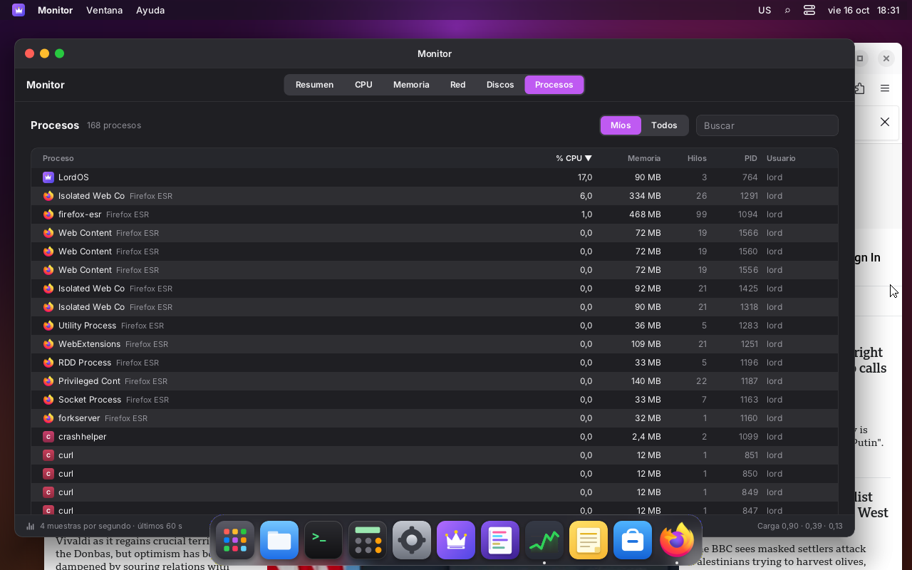

# Monitor

App nativa preinstalada (`apps/monitor`) para ver el uso de este equipo: CPU, memoria, red,
discos, procesos y las conexiones de red de cada app sobre un mapa del mundo. Copia el aspecto
del Monitor de TangoOS (`tangoos/web/packages/app-monitor`): pestañas segmentadas, tarjetas
oscuras con ícono, número grande y gráfico de área en vivo, fila de datos chicos y un pie con la
frecuencia de muestreo. La pestaña Red toma la forma de Little Snitch (apps a la izquierda, mapa
al centro, resumen a la derecha).

Fase 1 (esta): solo lectura. Sin daemon root, sin firewall, sin historial guardado y sin alertas.

## Pestañas

| Pestaña | Qué muestra |
|---|---|
| Resumen | CPU, Memoria, Red y Disco con gráfico de 60 s; abajo temperatura de CPU, ventilador, carga 1 min, carga 5/15 min y memoria en caché |
| CPU | uso total (gráfico grande), un gráfico por núcleo, carga 1/5/15, temperatura y tareas |
| Memoria | barra apilada (usada, caché de archivos, libre), intercambio y gráfico de 60 s |
| Red | apps con conexiones, mapa, resumen o detalle de la app elegida (ver abajo) |
| Discos | lectura y escritura totales y una fila por disco (modelo, `/dev`, tamaño, tasas) |
| Procesos | tabla ordenable (CPU, memoria, hilos, PID, usuario), búsqueda, "Míos" / "Todos" |

Los gráficos se pausan con el mouse encima y muestran una cruz con los valores del instante,
como en TangoOS. El tiempo siempre corre de izquierda a derecha, también en árabe y hebreo; el
resto de la ventana se espeja sola.

### Red

- **Izquierda:** búsqueda (por app, dirección o país) y una fila por app con su ícono, cantidad de
  conexiones, una barra de tráfico (recibido en verde, enviado en naranja, relativa a la app que
  más movió), los bytes y la columna **Regla**, reservada para el firewall: hoy es un interruptor
  de solo lectura en "permitir". Cada app se despliega con sus destinos (IP y país). Abajo, la
  velocidad actual de bajada y subida y barras por segundo de los últimos 60 s.
- **Centro:** el mapa ocupa toda la altura de la columna. Tiene un arco desde "Este equipo" hasta
  cada país, un punto por país (más grande cuantas más conexiones) y etiquetas en píldora con el
  nombre y la cantidad. Se maneja así:
  - rueda: zoom hacia el cursor;
  - touchpad: pellizcar hace zoom hacia el centro del gesto y dos dedos mueven el mapa (ver
    `TRACKPAD.md`; con el escritorio remoto, el pellizco del trackpad del navegador también).
    Capturas: [antes](trackpad-mapa-antes.png) y [después de pellizcar](trackpad-mapa-despues.png);
  - arrastrar: mover;
  - doble clic: acercar;
  - botones `+`, `−` y "ver todo" en la esquina.

  Con zoom se ven los bordes y los nombres de los demás países. La base Lite no trae ciudades,
  así que las etiquetas son siempre de países.

  Al elegir una app, el mapa muestra solo sus lugares y los encuadra. Un clic en un punto o en
  un arco elige ese país: el panel derecho muestra sus apps, direcciones, puertos y bytes. Abajo,
  una línea con la atribución de DB-IP y el enlace a los ajustes de privacidad.
- **Derecha:**
  - sin selección: tráfico (actual y desde el arranque), conexiones permitidas, denegadas (0:
    todavía no hay reglas), entrantes, en escucha y de otros usuarios, y las apps y destinos con
    más tráfico;
  - con una app elegida: ruta del ejecutable, usuario, PIDs, regla, bytes y velocidad, puertos y
    protocolos, puertos en escucha y direcciones;
  - con un país elegido: bytes, apps y direcciones (con puertos y app).

Los hosts se muestran como IP. No se hace DNS inverso: preguntar el nombre de una IP se la manda
al servidor DNS, y la regla de esta app es que ninguna dirección salga del equipo.

**"Este equipo"** se ubica por la zona horaria (`/etc/localtime` → coordenadas de
`/usr/share/zoneinfo/zone1970.tab`), sin red.

## Arquitectura

```
apps/monitor/            index.jsx (pestañas), Network.jsx (Red), MapView.jsx (mapa), Chart.jsx,
                         draw.js (píxeles), icons.jsx, Privacy.jsx, countries.js (generado)
sdk/monitor.js           useMonitor(), stores monitorSamples / monitorProcesses / monitorConnections
server/src/ui/js_monitor.c   lord.monitor (API de solo lectura, validada)
server/src/monitor/mon.c     hilo de muestreo: /proc, /sys, procesos
server/src/monitor/conn.c    conexiones por sock_diag + inodo → proceso
server/src/monitor/mmdb.c    lector propio de MaxMind DB (IP → país)
server/src/monitor/map.c     mapa vectorial, en su propio hilo
assets/monitor/          land.bin (Natural Earth 1:50m), geoip-country.mmdb.xz (DB-IP Lite)
tools/gen-monitor-data.py    genera esos datos, countries.js y los nombres de países
tests/mmdb_test.c, tests/map_bench.c   prueba del lector y medición del mapa
```

### lord.monitor

| Función | Qué hace |
|---|---|
| `start()` / `stop()` | suma o resta un interesado; con 0 o sin consultas por 3 s, el hilo se duerme |
| `want(procesos, conexiones, países)` | qué listas arma el hilo además de la muestra |
| `sample()` | la última muestra, o `null` si no hay una nueva |
| `processes(idioma)` | `{ t, total, hz, list: [{ pid, ppid, uid, user, name, cmd, exe, state, threads, cpu, rss, start, self, app, appName, appIcon }] }` |
| `connections(idioma)` | `{ t, ok, others, list: [{ id, proto, fam, state, dir, local, lport, remote, rport, scope, cc, pid, self, name, exe, sent, recv, app, appName, appIcon }] }` |
| `info()` | `{ cpuModel, cores, geo, tick, home: { zone, cc, lat, lon } }`; `cpuModel` sale de `js_sys_cpu_name()`, el mismo de Acerca de (en ARM, el núcleo por "CPU part" y la placa) |
| `map(vista)` | pide un cuadro del mapa: `{ width, height, lon, lat, ppd, land, border, accent, homeColor, selColor, home, dots: [{ lon, lat, r, sel }] }` (números validados, hasta 2048×2048 y 256 puntos) |
| `mapFrame()` | el último cuadro listo `{ seq, width, height, lon, lat, ppd, ms, data }`, o `null` |

Ninguna función recibe rutas ni comandos: los únicos argumentos son booleanos y un código de
idioma (letras, dígitos, `-` y `_`, hasta 15). `lord-server` no ejecuta nada para el Monitor.

### Muestreo sin frenar la pantalla

- Un hilo propio (`mon.c`) arma la muestra cada **250 ms** (4 Hz, como TangoOS): `/proc/stat`
  (CPU total y por núcleo), `/proc/meminfo`, `/proc/loadavg`, `/proc/uptime`, `/proc/net/dev`,
  `/proc/diskstats` (solo discos enteros de `/sys/block` con `device/`), y la temperatura y los
  ventiladores de `/sys/class/hwmon` (chip `coretemp`, `k10temp`, `zenpower`, `cpu_thermal`…;
  si no hay, `/sys/class/thermal`).
- Procesos (`/proc/<pid>/stat`, `cmdline`, y `exe` de los propios) y conexiones: **una vez por
  segundo**, y solo si la pestaña que las muestra está abierta.
- El hilo deja el JSON listo; el hilo de la pantalla solo lo copia y lo convierte
  (`JS_ParseJSON`). Nunca lee archivos durante un frame.
- **Cero costo cerrado:** sin `start()` el hilo ni existe; después de `stop()` (o si nadie pide una
  muestra por 3 s, por ejemplo al cambiar de tema) queda dormido en una variable de condición, y
  suelta la base de países.

### Conexiones

`conn.c` hace lo mismo que `ss`: un volcado de `NETLINK_SOCK_DIAG` para TCP y UDP, IPv4 e IPv6,
con `INET_DIAG_INFO` (de `tcp_info` salen `tcpi_bytes_acked` y `tcpi_bytes_received`). No hace
falta root. De los sockets de otros usuarios solo se cuenta cuántos hay.

El proceso dueño de cada socket del usuario sale de `/proc/<pid>/fd` (`socket:[inodo]`) de sus
propios procesos. Ese recorrido es lo más caro, así que hay una caché inodo → pid que solo se
rehace cuando aparece un socket desconocido, y como mucho una vez por segundo.

Dirección: `listen` (TCP en escucha o UDP sin destino), `in` (el puerto local es uno en escucha)
u `out`. Alcance: `internet`, `lan` (privadas, CGNAT, link-local, ULA, multicast) o `local`.

**De proceso a app** (`js_monitor.c`, en el hilo de la pantalla con la lista de `apps.c`):

1. el propio `lord-server` es **LordOS** (las apps nativas y la Tienda corren adentro);
2. si no, el `.desktop` cuyo programa de `Exec` (`DesktopApp.bin`) coincide con el ejecutable, el
   `argv[0]` o el nombre del proceso;
3. si no, `StartupWMClass` igual al nombre del proceso;
4. si no, el nombre del proceso.

### País de una IP

- **Base:** DB-IP Lite Country (CC BY 4.0, <https://db-ip.com>), convertida al formato MaxMind DB
  por `tools/gen-monitor-data.py`. Para que quede chica:
  - solo guarda `country.iso_code`;
  - los bloques de IPv4 más chicos que /24 y los de IPv6 más chicos que /32 van al país con más
    direcciones adentro;
  - va comprimida con xz.
- **Tamaño:** 854 KB en el paquete (4,2 MB en memoria). El original de DB-IP pesa 8,3 MB.
- **Precisión:** contra el archivo completo de DB-IP, en 200 000 direcciones al azar, coincide el
  **99,96 %** en IPv4 y el **99,78 %** en IPv6 (`build/mmdb-test <ours> <dbip.mmdb>`).
- **El lector** (`mmdb.c`) es propio:
  - todo acceso pasa por un control de límites;
  - un puntero del decodificador se sigue una sola vez;
  - la profundidad está acotada;
  - un archivo roto da "sin datos".
- **Prueba:** `build/mmdb-test` (en `make -C server test`) busca direcciones conocidas y abre 400
  copias rotas (cortadas, con bytes al azar, metadatos falsos); en el desarrollo se corre también
  con `-fsanitize=address,undefined`.
- **Carga:** la base se descomprime en el hilo del Monitor la primera vez que se piden conexiones
  con países. Se suelta al cerrar la app o al apagar la ubicación.

Ninguna dirección se envía a ningún servicio: ni geolocalización en línea ni DNS inverso.

### Mapa

El mapa se dibuja en vectores, nítido a cualquier zoom (sin escalar un PNG).

- **Datos:** `assets/monitor/land.bin` (200 KB), de Natural Earth 1:50m, dominio público.
  - Los contornos van simplificados (Douglas-Peucker, 0,02°) y en centésimos de grado.
  - Sin la Antártida: el mapa va de 84° N a 56° S.
  - `countries.js` tiene el punto de la etiqueta de cada país (`LABEL_X`/`LABEL_Y`).
  - Los nombres de los países en `assets/locales/{es,en,pt}/countries.json` salen de
    `NAME_ES`/`NAME_EN`/`NAME_PT`.
- **Dibujo** (`map.c`, en un hilo propio, proyección equirectangular):
  - relleno con tabla de aristas activas, 4 sub-líneas por fila y cobertura horizontal exacta
    (antialias), par-impar sobre todos los países;
  - bordes y grilla de 30° (10° con zoom) con líneas de Wu;
  - arcos y puntos encima.

  Los tramos de menos de un píxel se saltan, y las aristas se ordenan por sub-línea con un
  conteo, en O(n).
- **Sin trabarse:**
  - el hilo de la pantalla pide un cuadro (`map`) y lo retira cuando está listo (`mapFrame`),
    sin esperar; si llegan varios pedidos, se dibuja solo el último;
  - mientras tanto, la app muestra el cuadro anterior corrido, y escalado si cambió el zoom, así
    que arrastrar y acercar responden enseguida;
  - las etiquetas son texto del motor, nítidas siempre, y se ubican sin pisarse.
- **Memoria:** a los 20 s sin pedidos, el hilo suelta los contornos y los búferes.

### Gráficos

`Chart.jsx` dibuja en píxeles al ancho real de la caja (`lord.getLayout`):

- relleno degradado de 0,32 a 0,02 de opacidad y línea de 1,6 px, como TangoOS;
- guías al 25/50/75 %;
- eje con escala "linda" (1, 2, 2,5 o 5 × 10ⁿ).

Con `Uint32Array` cuesta un píxel por escritura.

## Privacidad

Ajustes → Privacidad → **Monitor** (registrado con `registerPrivacySection` si la página existe)
tiene dos interruptores, guardados en `settings.monitor`:

- `connections`: ver las conexiones de cada app. Apagado, el hilo no consulta sock_diag.
- `geo`: ubicarlas en el mapa. Apagado, no se carga la base de países.

## Fase 2

**Hecho (firewall, ver `FIREWALL.md`):**

- La columna **Regla** es un interruptor por app (`lord.fw.setAppRule`). `lord-netperm` lo aplica
  en el kernel y una app denegada recibe EPERM.
- Los contadores **permitidas** y **denegadas** del resumen y de cada app salen del kernel.
- Una app sin conexiones abiertas pero con intentos denegados aparece igual en la lista.
- Cada proceso se atribuye a la scope de la app en la que corre (`/proc/<pid>/cgroup`).

**Planeado:**


- **Firewall** por app y por dominio, alertas de conexión y modo silencioso, en la misma
  pantalla:
  - cada conexión ya trae `verdict` (hoy siempre `'allow'`) y se agrupa por una clave estable
    (`appKey`: `lordos`, `desktop:<id>` o la ruta del ejecutable);
  - las reglas serían `{ appKey, host | país, puerto, protocolo, dirección, verdict }`;
  - la columna Regla y los contadores de permitidas/denegadas ya están en la interfaz.
- **Dispositivos:** `monitor.deviceUsers()` → `[{ kind: 'camera' | 'microphone', app, name, pid }]`
  y el store `monitorDevices` (ya exportados, vacíos).
- **Nombres de host** sin consultar a nadie: por ejemplo, los nombres que las propias apps
  resolvieron (requiere un resolvedor local).
- Historial guardado y alertas de uso.

## Mediciones

VM 123 (4 vCPU Xeon Silver 4108 a 1,8 GHz, `virtio_gpu` sin 3D, composición por CPU, 1280×800).

### CPU de lord-server

Porcentaje de un núcleo, promedio de 30 s (`~/thr.sh`, por hilo, desde `/proc/<pid>/task`).
Durante la medición había 13 descargas en curso y Firefox abierto en la pestaña Red.

| Situación | Hilo principal | Hilo de muestreo | Hilo del mapa |
|---|---|---|---|
| Monitor cerrado | 0,4–0,5 % | (no existe / dormido) | (no existe / dormido) |
| Resumen, al frente (4 gráficos a 4 Hz) | 10,4 % | 0,1–0,2 % | — |
| Resumen, en segundo plano (se dibuja a 1 Hz) | 4,7 % | 0,2 % | — |
| Procesos, al frente | 5,6 % | 0,7 % | — |
| Red, mapa quieto | 5,1 % | 0,5 % | 0 % |
| Red, arrastrando el mapa sin parar | 20,6 % | 0,6 % | 4,0 % |
| Monitor cerrado otra vez | 0,4 % | 0 % | 0 % |

- **Cerrado no cuesta nada:**
  - sin `start()` el hilo de muestreo no existe;
  - después, duerme en una variable de condición;
  - el del mapa suelta todo a los 20 s.
- **Muestreo:** leer `/proc` y `/sys` cuatro veces por segundo cuesta menos del 1 %.
- **Dibujo de la interfaz:** es lo que cuesta.
  - Cada pestaña se suscribe solo a lo que muestra y a su ritmo: gráficos a 4 Hz con la ventana
    al frente y a 1 Hz detrás; Procesos y Red a 1 Hz.
  - Antes de separarlo así, Procesos costaba 17 % y Red 14 %.
  - En Resumen, la mayor parte es repintar la caja que une los cuatro gráficos (el motor usa una
    sola región dañada por frame, unos 12 ms) y dibujar los gráficos en JS (alrededor de 1,5 %).

### Mapa

Tiempo de un cuadro de 800×560 en el hilo del mapa (`build/map-bench`):

| Vista | Promedio | Peor caso |
|---|---|---|
| Mundo entero | 13,0 ms | 16,0 ms |
| Europa con zoom | 6,7 ms | 8,1 ms |
| Sudamérica con zoom | 4,4 ms | 5,2 ms |

Corre fuera del frame. Mientras dibuja, la pantalla muestra el cuadro anterior corrido.

### País por IP

- **Primera carga:** la base (854 KB → 4,2 MB) se descomprime una sola vez, en el hilo de
  muestreo, fuera del frame.
  - `build/mmdb-test` entero, que incluye esa carga y 400 archivos rotos, tarda 0,5 s en la VM.
- **Búsqueda:** cada una recorre como mucho 128 nodos.

## Capturas (VM 123)

- Resumen: 
- CPU: 
- Memoria: 
- Discos: 
- Procesos: 
- Red, con curl desplegado: 
- Firefox elegido: 
- Mapa:
  - el mundo: 
  - zoom en Europa: 
  - zoom en Sudamérica: 
  - Alemania elegida: 
- Ajustes → Privacidad → Monitor: 
- En árabe (RTL): 

## Pendiente

- **Enlace a la privacidad:** con el tamaño por omisión de la ventana (1180×700 en 1280×800), el
  enlace "Ajustes de privacidad del Monitor" del pie del mapa cae en la zona del Dock, que se
  queda con el clic. Se llega igual por Ajustes → Privacidad.
- **Árabe y otros idiomas:** los textos del Monitor existen en es/en/pt. En árabe la ventana se
  espeja bien, pero los textos salen en inglés hasta que el paquete de idioma los traduzca.
- **Sensores:** en la VM no hay `hwmon` de CPU ni ventiladores, así que temperatura y ventilador
  muestran "—". Falta probar en hardware real (el código busca `coretemp`, `k10temp`,
  `zenpower`, `cpu_thermal` y `pwmfan`).
- **Fase 2:** lo de la sección "Fase 2".

## Atribuciones

- **Países por IP:** DB-IP Lite Country © db-ip.com, licencia CC BY 4.0
  (<https://creativecommons.org/licenses/by/4.0/>).
  - La atribución se muestra en Acerca de LordOS, al pie del mapa y en
    `/usr/share/doc/lordos/copyright`.
  - Fuente usada: `dbip-country-lite-2026-10`.
- **Contornos y nombres de países:** Natural Earth (<https://www.naturalearthdata.com>), dominio
  público.
