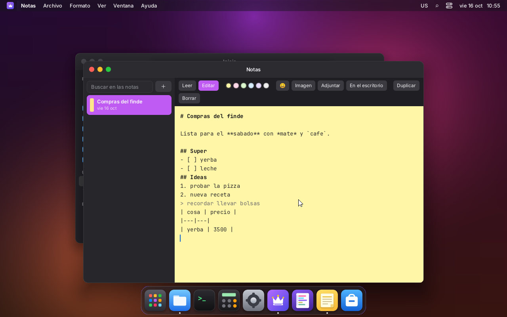
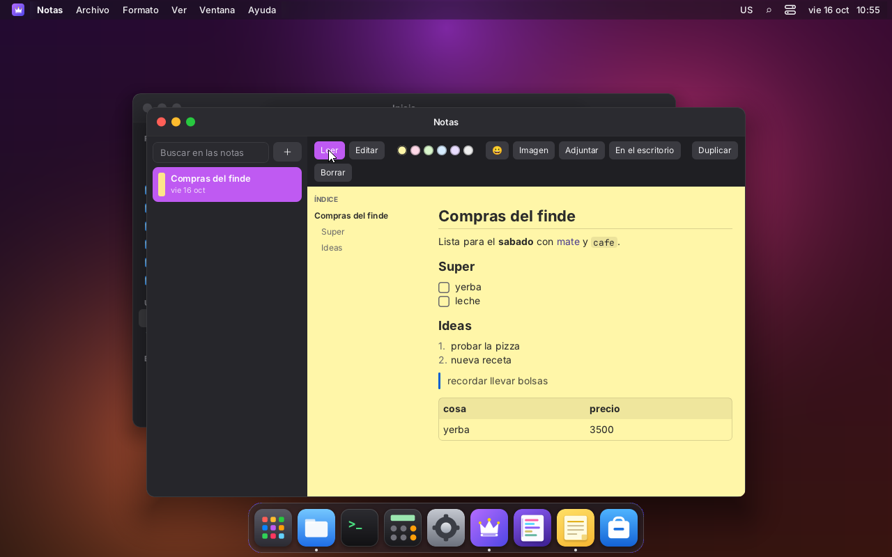
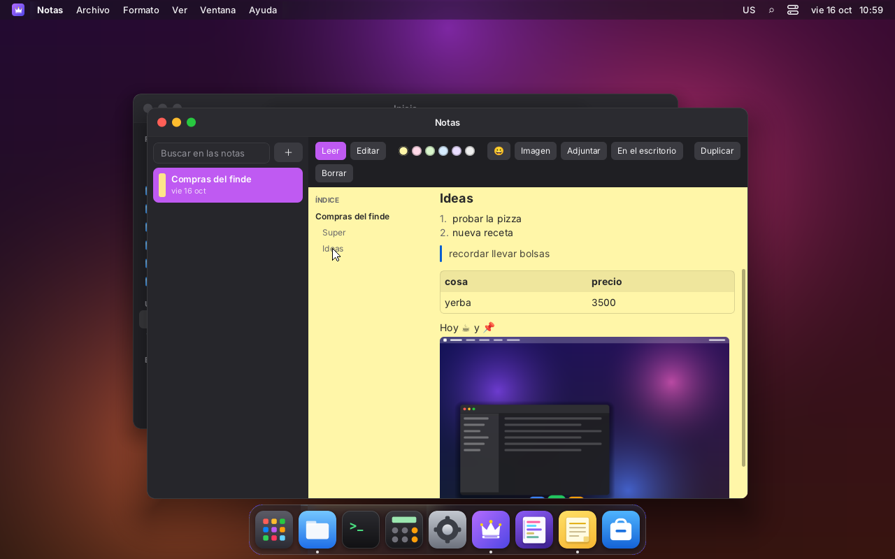
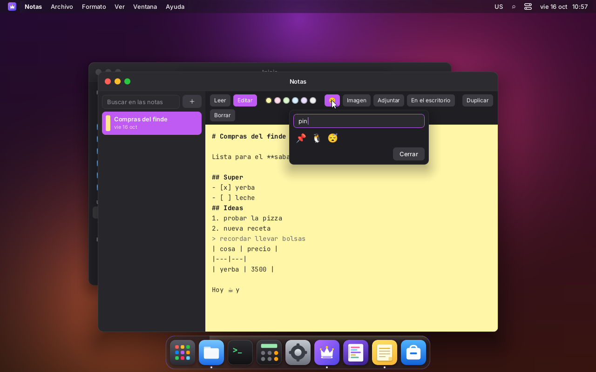
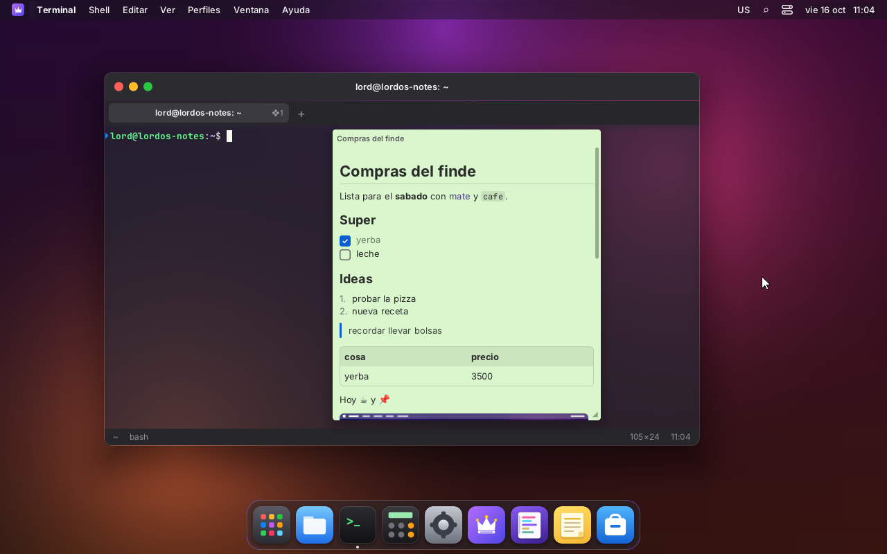
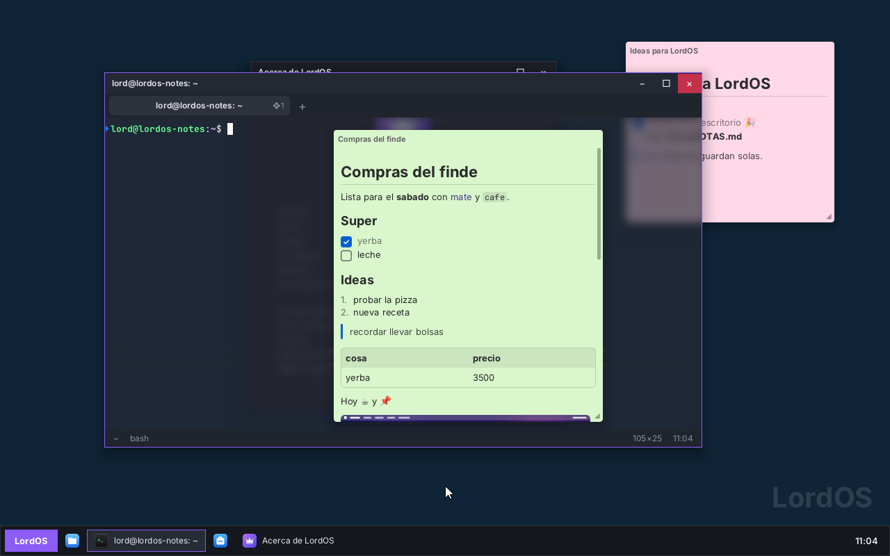

# Notas (post-its)

App nativa de LordOS que viene instalada: `apps/notes`, en el Dock por defecto. Son notas
en markdown que se leen con formato y índice, admiten imágenes, archivos adjuntos y emojis, y se
pueden poner en el escritorio como post-its (widgets) que se mueven y cambian de tamaño. Se
guardan solas en la carpeta personal.

## Capturas (VM 118, lord-server real)

| | |
|---|---|
|  |  |
| Edición: markdown con los títulos resaltados; las listas y casillas siguen solas con Enter | Lectura: títulos, negrita, cursiva, código, casillas que se tildan con clic, lista numerada, cita, tabla e índice |
|  |  |
| El índice salta al título; la imagen es parte de la nota | Selector de emojis con búsqueda en español o inglés (también `:nombre` mientras se escribe) |
|  |  |
| Nota en el escritorio, con una imagen pegada del portapapeles | Fijada al frente: queda encima de las ventanas |
|  | |
| Tema Clásico: una fijada (verde) y otra en el escritorio detrás de la ventana (rosa) | |

## Dónde se guardan

Cada nota es una carpeta en `~/Notas/<nota>/`:

```
~/Notas/nota-20261016-135509/
├── nota.md          la nota
├── imagen-1.png     pegada del portapapeles
├── m1-screenshot.png   insertada con «Imagen»
└── informe.txt      adjunta con «Adjuntar»
```

`nota.md` es markdown común con un encabezado YAML chico: se abre con cualquier editor. Si se
edita a mano mientras LordOS corre, el cambio se ve la próxima vez que se abre la sesión.

```markdown
---
title: Compras del finde
color: green            # yellow | pink | green | blue | purple | gray
x: 480                  # posición y tamaño en el escritorio
y: 187
w: 387
h: 420
desktop: true           # se muestra en el escritorio
pinned: false           # fijada encima de las ventanas
created: "2026-10-16T13:55:09.073Z"
updated: "2026-10-16T13:56:30.386Z"
---
# Compras del finde
- [x] yerba
```

- **Guardado.** Es automático, unos 600 ms después del último cambio, con `fs.write` (atómico).
  Los cambios pendientes se escriben también al cerrar la ventana.
- **Título.** Es la primera línea con texto, sin las marcas de markdown.
- **Borrar.** La carpeta de la nota va a la Papelera (`fs.trash`) y se puede restaurar desde
  Archivos.

## Ventana

A la izquierda está la lista de notas, con búsqueda en el título y el texto, el color y la fecha.
A la derecha va la nota abierta, con estos botones:

- **Leer / Editar:** con ❖E se pasa de uno a otro; un doble clic en la lectura edita.
- **Colores.**
- **😀:** el selector de emojis.
- **Imagen / Adjuntar:** eligen un archivo de la carpeta personal, que se copia dentro de la nota.
- **En el escritorio.**
- **Duplicar:** copia también los adjuntos.
- **Borrar.**

En el menú Archivo están, además, «Nueva nota» (❖N) y «Mostrar en Archivos».

## En el escritorio

Cada nota marcada «En el escritorio» es un post-it entre el fondo y las ventanas.

- Al pasar el mouse aparece la barra con los colores, ✎/👁 (editar o leer), 😀, 📌 (fijar al frente),
  ⤢ (abrirla en la ventana) y ✕ (sacarla del escritorio: la nota no se borra).
- Se arrastra por la barra y se le cambia el tamaño desde la esquina de abajo a la derecha.
- La posición, el tamaño y el color quedan en la nota, así que después de reiniciar vuelve en
  su lugar (probado).
- Se edita ahí mismo: toma el foco de texto (`takeTextFocus` del SDK), así las teclas no van
  a la ventana del frente. Con Esc vuelve a la lectura.

## Edición

| Atajo | Qué hace |
|---|---|
| ❖B / ❖I | **negrita** / *cursiva* (sobre la selección, o deja las marcas listas) |
| ❖K | enlace `[texto](url)` |
| ❖1 / ❖2 / ❖3 | título de nivel 1, 2 o 3 (otra vez lo saca) |
| ❖⇧7 / ❖⇧8 / ❖⇧9 | lista numerada / viñetas / casillas `- [ ]` |
| ❖⇧C | bloque de código |
| Enter en una lista | sigue la lista (número siguiente, casilla vacía); en un ítem vacío la termina |
| Tab / ⇧Tab en una lista | sangra / desangra |
| ❖Z / ❖⇧Z | deshacer / rehacer |
| ❖C / ❖X / ❖V | copiar / cortar / pegar. Si lo copiado es una imagen (de cualquier app, también Linux), se guarda como `imagen-N.png` en la nota y se inserta |
| `:` + nombre | sugerencias de emoji (`:cafe` → ☕); Enter o Tab elige |

El editor es propio (`apps/notes/NoteEditor.jsx`): texto en fuente monoespaciada con corte por
palabras, selección con el mouse (doble clic: palabra; triple clic: renglón), métodos de entrada
(japonés, chino, coreano) y los títulos resaltados.

## Markdown (`<Markdown>` del SDK)

`sdk/markdown.jsx` es reutilizable por cualquier app: `<Markdown source base width onLink
onToggleTask onHeadingRef emoji />`, más `markdownHeadings(texto)` para armar un índice y
`toggleTask(texto, renglón)`.

- **Bloques:** títulos, párrafos, citas (anidadas), listas con niveles, listas numeradas, casillas
  (`- [ ]` / `- [x]`, se tildan con un clic y eso cambia el `.md`), bloques de código, tablas
  con alineación y separadores.
- **En línea:** negrita, cursiva, tachado, `código`, enlaces, URLs sueltas, imágenes locales
  `` (relativas a la carpeta de la nota, con su tamaño real hasta el ancho
  disponible) y `:emoji:`.
- **Cómo se arma el texto con estilos mezclados.** El motor de LordOS no tiene tramos con
  estilos distintos dentro de un mismo `<Text>`. Por eso un párrafo es una fila con
  `flexWrap: 'wrap'` y un `<Text>` por palabra (el espacio va pegado a la palabra): corta líneas
  entre palabras y cada palabra lleva su estilo.
- **Tachado.** Va con el carácter combinante U+0336.

## Widgets del escritorio (`sdk/widgets.js`)

Es una capa genérica, no solo para las notas:

- Una app registra un tipo con `registerWidgetType('note', Componente)` y publica sus widgets
  con `setWidgets('note', [{ id, x, y, w, h, pinned }])`.
- Los dos temas dibujan `<DesktopWidgets layer="below" />` entre el fondo y las ventanas, y
  `<DesktopWidgets layer="above" />` encima, para los fijados.
- Las notas se cargan al arrancar la sesión (el módulo de la app se evalúa con el tema), así las
  del escritorio aparecen sin abrir la app.

## APIs nuevas en el servidor

- `lord.clipboard.imageData()` (`js_term.c`): el PNG copiado como `ArrayBuffer`, o `null`. La
  app lo guarda con `lord.fs.write`, con sus reglas de siempre.
- `lord.image.size(ruta)` (`js_sys.c`): el ancho y alto de una imagen de la carpeta personal,
  para mostrarla en su tamaño.

## Pendiente

- Arrastrar un archivo desde Archivos hasta una nota (hoy se usa «Imagen» o «Adjuntar»).
- Ajustar la interfaz para derecha a izquierda: el área de texto va siempre en `ltr`, como en el
  editor. Falta probar las notas en árabe.
- Ver los cambios hechos a mano en `nota.md` sin volver a abrir la sesión.
- Recordatorios con hora (⏰), notas compartidas, sincronizar.
- En el editor los emojis se ven en blanco y negro (fuente mono); en la lectura, a color.
