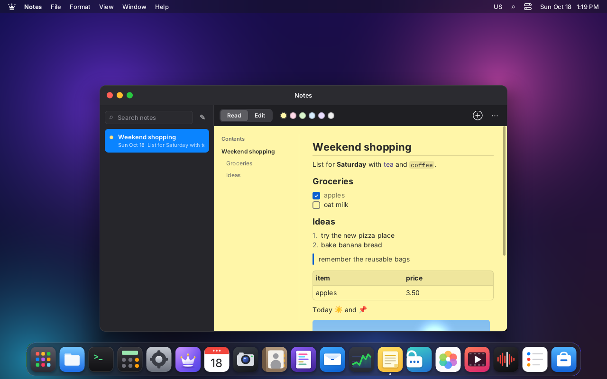
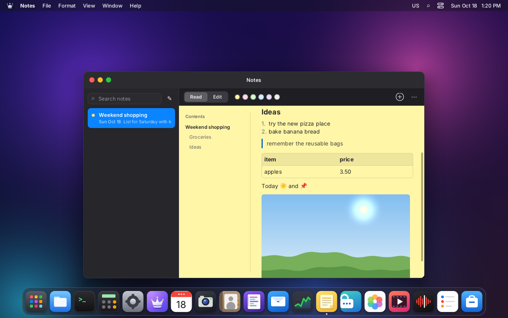
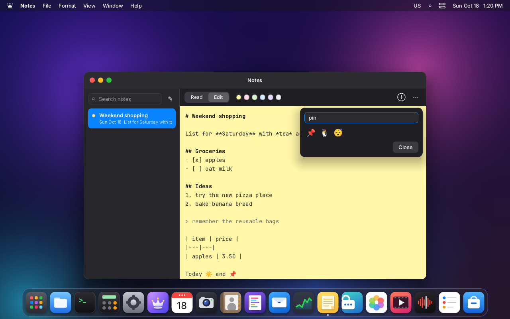
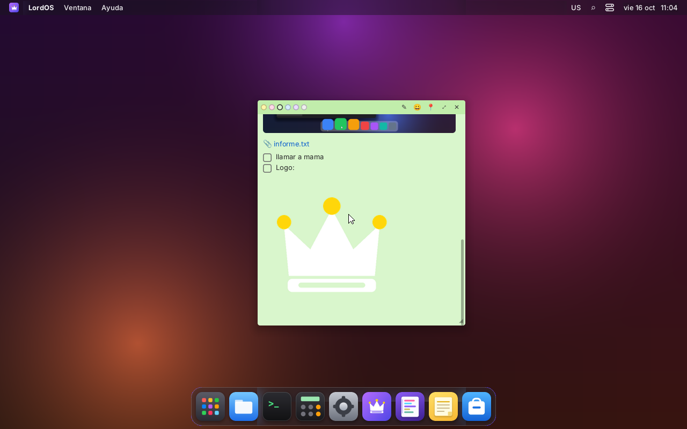
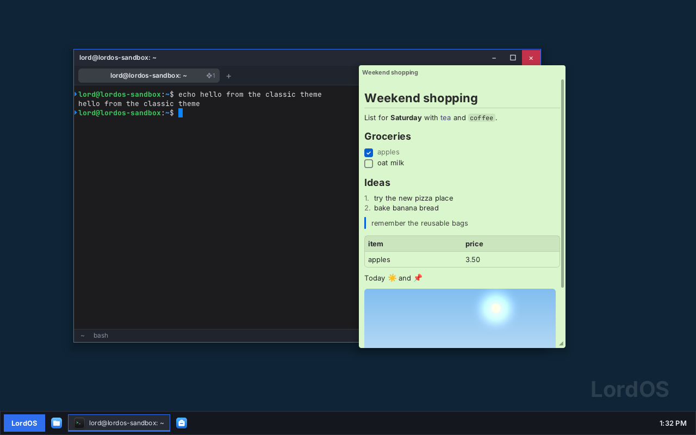

# Notes (sticky notes)

A native LordOS app that comes preinstalled: `apps/notes`, in the Dock by default. They are
markdown notes that are read with formatting and a table of contents, accept images, attachments
and emoji, and can be placed on the desktop as sticky notes (widgets) that move and resize. They
save themselves in the home folder.

## Screenshots (VM 118, real lord-server)

| | |
|---|---|
|  |  |
| Editing: markdown with the headings highlighted; lists and checkboxes continue on their own with Enter | Reading: headings, bold, italic, code, checkboxes ticked with a click, numbered list, quote, table and table of contents |
|  |  |
| The table of contents jumps to the heading; the image is part of the note | Emoji picker with search in Spanish or English (also `:name` while typing) |
|  |  |
| A note on the desktop, with an attachment, checkboxes and an image | Pinned to the front: it stays above the windows |
|  | |
| Lord Classic theme: a note pinned in front of the Terminal | |

## Where they are stored

Each note is a folder in `~/Notes/<note>/`:

```
~/Notes/note-20261016-135509/
├── nota.md          the note
├── image-1.png      pasted from the clipboard
├── m1-first-frame.png   inserted with «Image»
└── informe.txt      attached with «Attach»
```

Before 0.7.0 the folder was `~/Notas`. On the first run Notes moves it to `~/Notes` (a rename
in the home folder through `lord.fs`). If both folders exist, Notes uses `~/Notes` and leaves
`~/Notas` untouched; Search also falls back to `~/Notas` while `~/Notes` doesn't exist yet. If
there is no Trash, a deleted note goes to `~/Notes/.trash`.

`nota.md` is plain markdown with a small YAML header: it opens with any editor. If it is edited
by hand while LordOS is running, the change shows up the next time the session is opened.

```markdown
---
title: Compras del finde
color: green            # yellow | pink | green | blue | purple | gray
x: 480                  # position and size on the desktop
y: 187
w: 387
h: 420
desktop: true           # shown on the desktop
pinned: false           # pinned above the windows
created: "2026-10-16T13:55:09.073Z"
updated: "2026-10-16T13:56:30.386Z"
---
# Compras del finde
- [x] yerba
```

- **Saving.** It is automatic, about 600 ms after the last change, with `fs.write` (atomic).
  Pending changes are also written when the window closes.
- **Title.** It is the first line with text, without the markdown marks.
- **Deleting.** The note's folder goes to the Trash (`fs.trash`) and can be restored from Files.

## Window

On the left is the list of notes, with search in the title and the text, the color and the date.
On the right is the open note, with these buttons:

- **Read / Edit:** ❖E switches between them; a double click while reading starts editing.
- **Colors.**
- **😀:** the emoji picker.
- **Image / Attach:** pick a file from the home folder, which is copied into the note.
- **On the desktop.**
- **Duplicate:** also copies the attachments.
- **Delete.**

The File menu also has «New note» (❖N) and «Show in Files».

## On the desktop

Each note marked «On the desktop» is a sticky note between the wallpaper and the windows.

- Hovering shows the bar with the colors, ✎/👁 (edit or read), 😀, 📌 (pin to the front),
  ⤢ (open it in the window) and ✕ (remove it from the desktop: the note isn't deleted).
- It is dragged by the bar and resized from the bottom-right corner.
- The position, size and color are stored in the note, so after a reboot it comes back in its
  place (tested).
- It is edited right there: it takes the text focus (the SDK's `takeTextFocus`), so keys don't
  go to the frontmost window. Esc goes back to reading.

## Editing

| Shortcut | What it does |
|---|---|
| ❖B / ❖I | **bold** / *italic* (on the selection, or leaves the marks ready) |
| ❖K | link `[text](url)` |
| ❖1 / ❖2 / ❖3 | heading level 1, 2 or 3 (again removes it) |
| ❖⇧7 / ❖⇧8 / ❖⇧9 | numbered list / bullets / checkboxes `- [ ]` |
| ❖⇧C | code block |
| Enter in a list | continues the list (next number, empty checkbox); on an empty item it ends it |
| Tab / ⇧Tab in a list | indent / outdent |
| ❖Z / ❖⇧Z | undo / redo |
| ❖C / ❖X / ❖V | copy / cut / paste. If what was copied is an image (from any app, Linux ones too), it is saved as `image-N.png` in the note and inserted |
| `:` + name | emoji suggestions (`:cafe` → ☕); Enter or Tab picks |

The editor is our own (`apps/notes/NoteEditor.jsx`): text in a monospace font with word wrap,
mouse selection (double click: word; triple click: line), input methods (Japanese, Chinese,
Korean) and highlighted headings.

## Markdown (the SDK's `<Markdown>`)

`sdk/markdown.jsx` is reusable by any app: `<Markdown source base width onLink
onToggleTask onHeadingRef emoji />`, plus `markdownHeadings(text)` to build a table of contents
and `toggleTask(text, line)`.

- **Blocks:** headings, paragraphs, quotes (nested), lists with levels, numbered lists,
  checkboxes (`- [ ]` / `- [x]`, ticked with a click, which changes the `.md`), code blocks,
  tables with alignment, and separators.
- **Inline:** bold, italic, strikethrough, `code`, links, bare URLs, local images
  `` (relative to the note's folder, at their real size up to the available
  width) and `:emoji:`.
- **How mixed-style text is built.** The LordOS engine has no runs with different styles inside
  a single `<Text>`. So a paragraph is a row with `flexWrap: 'wrap'` and one `<Text>` per word
  (the space is attached to the word): it breaks lines between words and each word carries its
  style.
- **Strikethrough.** A 1 px line drawn across each word (the combining character U+0336 used before
  is missing from most fonts and drew boxes).

## Desktop widgets (`sdk/widgets.js`)

It is a generic layer, not just for notes:

- An app registers a type with `registerWidgetType('note', Component)` and publishes its widgets
  with `setWidgets('note', [{ id, x, y, w, h, pinned }])`.
- Both themes draw `<DesktopWidgets layer="below" />` between the wallpaper and the windows, and
  `<DesktopWidgets layer="above" />` on top, for the pinned ones.
- Notes are loaded when the session starts (the app's module is evaluated with the theme), so
  the desktop ones appear without opening the app.

## New server APIs

- `lord.clipboard.imageData()` (`js_term.c`): the copied PNG as an `ArrayBuffer`, or `null`. The
  app saves it with `lord.fs.write`, under its usual rules.
- `lord.image.size(path)` (`js_sys.c`): the width and height of an image in the home folder, to
  show it at its size.

## Pending

- Dragging a file from Files onto a note (today «Image» or «Attach» is used).
- Adjusting the UI for right-to-left: the text area is always `ltr`, as in the editor. Notes
  still need testing in Arabic.
- Seeing hand-made changes to `nota.md` without reopening the session.
- Timed reminders (⏰), shared notes, sync.
- In the editor emoji show in black and white (mono font); while reading, in color.
