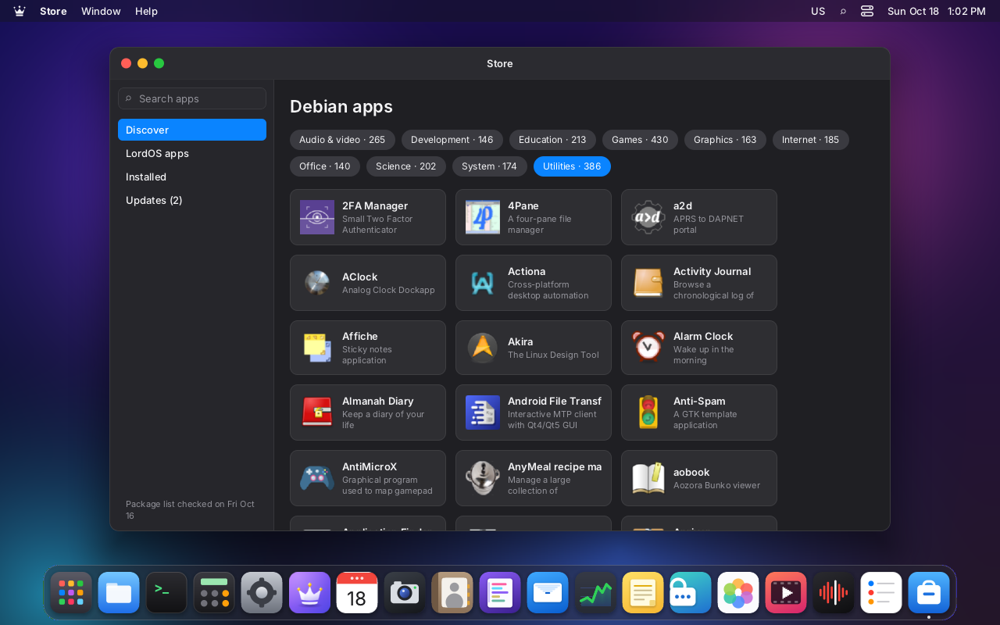
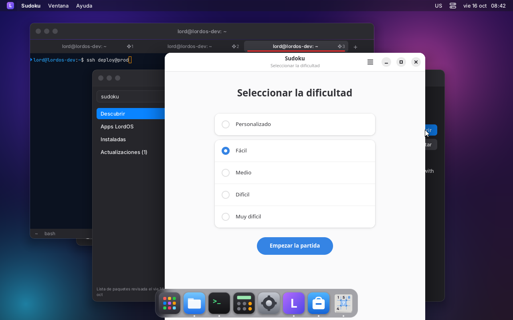

# Debian packages in LordOS

LordOS installs and removes Debian packages with its own code: it reads the apt sources,
downloads and verifies the signed indexes, resolves dependencies and downloads the `.deb` files.
**dpkg** does only the last step: unpacking and configuring. It doesn't use apt or libapt,
gpgv/sqv, curl, zlib or liblzma. The dpkg database (`/var/lib/dpkg`) is still written only by
dpkg, so `apt` and `dpkg` keep working the same on the same system.

The code is in `server/src/pkg/`:

| File | What it does |
|---|---|
| `crypto.c` | SHA-256, SHA-512, RSA PKCS#1 v1.5 verification (Montgomery) and Ed25519 (TweetNaCl arithmetic) |
| `pgp.c` | Binary or armored OpenPGP keyrings, subkeys, expirations and revocations; v4 signatures of clear-signed messages (`InRelease`) |
| `xz.c` | Our own xz/LZMA2 decompressor; gzip with `stb_image`'s inflate (already there for PNGs) |
| `deb.c` | dpkg version comparison, deb822 fields, relations (`a (>= 1) \| b`) |
| `idx.c` | The compact index that `pkg-update` builds and that is read with mmap |
| `status.c` | Reading `/var/lib/dpkg/status` (what is installed) |
| `resolve.c` | Dependency resolver and installation order |
| `http.c` | HTTP/1.1 client, with a child process that runs as `nobody` |
| `pkg.c` | Privileged helper actions (update, install, remove, local `.deb`) |
| `../ui/js_pkg.c` | `lord.pkg`, the queries for the UI (without root) |

## Security

- **Signatures.** An `InRelease` is only valid if it has at least one valid signature from a key
  in the source's keyring (`Signed-By`; if missing, those in `/etc/apt/trusted.gpg.d`). The key
  must be able to sign, and can't be expired or revoked. The signature can't be expired or come
  from the future. If a known key has an invalid signature, the whole file is rejected.
- **Rejections.** An `InRelease` is also rejected in these cases:
  - it expired (`Valid-Until`);
  - it is from another suite;
  - it is older than the one already stored (replay attack);
  - it carries data after the signature.
- **Hashes.** Every `Packages`, `Translation`, DEP-11 and `.deb` is verified against the SHA-256
  given in the signed index. Only then is it stored, read or passed to dpkg.
- **Keyring.** It is taken as trusted, as gpgv does: it is a root-owned file installed by
  `debian-archive-keyring`.
- **HTTP instead of HTTPS.** LordOS has no TLS of its own, so `https://` sources are downloaded
  over `http://`, with the same path. Security comes from the signatures and the SHA-256 hashes,
  as with apt and `http://deb.debian.org`. Someone watching the network can see which packages
  are downloaded, but can't change them.
- **Downloads without root.** The process that talks to the network drops privileges before
  connecting: it becomes `nobody`, with no groups, with `no_new_privs` and no way back to root.
  It passes the bytes to the root process through a pipe. The root process only writes them into
  its folder, counts the size and computes the SHA-256: it doesn't interpret anything it
  receives.
- **Locks.** While dpkg works, LordOS takes dpkg's frontend lock
  (`/var/lib/dpkg/lock-frontend`, same as apt) and passes it `DPKG_FRONTEND_LOCKED=1`. If apt is
  running, LordOS waits its turn: they don't step on each other. LordOS operations among
  themselves are queued (`/var/lib/lordos/pkg/lock`).
- **Local `.deb`** (`pkg-install-file`):
  - the file must be in the user's folder;
  - it is opened with that user's permissions (`setfsuid`), walking the path component by
    component without following links (`O_NOFOLLOW`);
  - it is copied to a new root-owned file, and everything else (reading the control file,
    installing) is done on that copy, so the user can't change it midway.
- **Essential packages.** Packages with `Essential: yes` or `Protected: yes` are never removed.
- **Names.** They follow Debian's syntax (`[a-z0-9][a-z0-9+.-]+`). Arguments are validated in the
  helper, even though lord-server has already validated them.

## Files

| Path | Contents |
|---|---|
| `/var/lib/lordos/pkg/index.bin` | Index (packages, "provides", AppStream apps, sources, texts and long descriptions); world-readable |
| `/var/lib/lordos/pkg/lists/` | Verified `InRelease` files and the compressed indexes, named by their SHA-256 (what didn't change isn't downloaded again) |
| `/var/lib/lordos/pkg/icons/64/` | 64×64 icons of the desktop apps (DEP-11) |
| `/var/lib/lordos/pkg/auto` | Packages LordOS installed as dependencies |
| `/var/cache/lordos/pkg/` | `.deb` files while they're being installed (deleted when done) |

## Helper actions (`admin.run`)

| Action | Argument |
|---|---|
| `pkg-update` | (none) |
| `pkg-install` | `name name… [--recommends] [--allow-remove]` |
| `pkg-remove` | `name name… [--cascade] [--purge] [--keep-orphans]` |
| `pkg-autoremove` | (none): removes dependencies that are no longer used |
| `pkg-upgrade` | `[--allow-remove]` |
| `pkg-install-file` | `/home/user/…/file.deb [--allow-remove]` |

All of them run in a separate process (`A_FORK`) and require an administrator user.

### Confirmations

- Recommended packages are not installed by default. `--recommends` adds them, and if one of them
  can't be installed it doesn't stop the rest.
- If a request forces removing something that wasn't asked for, the action fails with
  `ERR también hay que quitar: a, b` ("these must also be removed"). For example:
  - installing `postfix` removes `exim4`, because they are two mail programs and can't coexist;
  - removing a library removes what depends on it.

  The UI shows the plan (`lord.pkg.plan`) and, if the user accepts, repeats the request with
  `--allow-remove` (when installing) or `--cascade` (when removing).
- **Orphans.** When removing, the dependencies LordOS installed (recorded in
  `/var/lib/lordos/pkg/auto`) that nobody uses anymore after that change are removed too, as
  `apt autoremove` would do afterwards. They appear in the plan with `reason: 'auto'` and do
  **not** need `--cascade`. `--keep-orphans` keeps them. `pkg-autoremove` cleans up the ones that
  were already left over.

### Progress

While running, the action sends `LOG` lines:

```
LOG plan install featherpad 1.6.1-1 603084        (one per package: install|upgrade|remove, version, bytes)
LOG plan held libfoo                               (upgrades that can't be done now)
LOG plan total 4034148 24981                       (bytes to download, KB the installed size changes by)
LOG progress download 1048576 4034148              (phases: lists, index, download, unpack, configure, remove)
LOG Unpacking featherpad (1.6.1-1) ...             (everything else: text for the log)
OK 3 instalado(s), 0 actualizado(s), 0 quitado(s)
```

(The final `OK` line is the helper's literal output: 3 installed, 0 upgraded, 0 removed.)

The `progress <phase> <done> <total>` lines are for a progress bar.

### Notifications

When finished, the helper sends an unrequested notification:
- `EVENT pkg index`, after updating the list;
- `EVENT pkg changed`, after installing or removing.

The UI receives them with `admin.onEvent()`.

## The Store

`apps/store`. In "Discover" it shows the AppStream desktop apps by category, with their translated
names and descriptions and their icon. Search returns apps first and then the other packages. A
package's page, before installing or removing, shows the plan: what gets installed, upgraded or
removed, how much is downloaded and how much disk space it takes. It also shows the task's
progress. "Updates" lists what can be upgraded and upgrades everything together. From Files, a
`.deb` opens in the Store (`pkg-install-file`).

| | |
|---|---|
|  |  |
| Debian apps by category | The GNOME Sudoku plan: the same 9 packages as `apt-get -s install` |
|  | |
| Installed and opened from the Store (GTK 4 + libadwaita, in Spanish, with its AppStream icon in the Dock) | |

## `lord.pkg` (lord-server, without root)

The queries read the index with mmap and `/var/lib/dpkg/status`, and reload by themselves when
these change. `lang` (`'es'`, `'pt'` or omitted) picks the AppStream name and description.

```js
lord.pkg.available()            // true if there is already an index
lord.pkg.lastUpdate()           // seconds since 1970 (0: never)
lord.pkg.sources()              // [{ uri, suite, component, codename, label, date, validUntil, priority, packages }]
lord.pkg.search(q, { limit = 50, apps = false, section, lang })   // [Summary], sorted by relevance
lord.pkg.info(name, { lang })   // Summary + { description, homepage, arch, source, depends, preDepends,
                                //   recommends, suggests, provides, conflicts, breaks, priority, suite,
                                //   origin, appDescription, versions: [{ version, suite, size }] } | null
lord.pkg.installed({ lang })    // [Summary] of everything installed
lord.pkg.upgrades()             // [{ name, from, to, summary, suite, size }]
lord.pkg.plan({ install: [], remove: [], recommends, allowRemove, cascade, upgrade, keepOrphans })
    // { ok, error, items: [{ action: 'install'|'upgrade'|'remove', name, version, oldVersion, size,
    //   requested, reason }], held: [], download, installedDelta }   (bytes)
    // with remove, it includes the orphans: { action: 'remove', reason: 'auto', requested: false }
lord.pkg.orphans()              // [{ name, version, summary, installedSize }]: what pkg-autoremove would remove
lord.pkg.apps({ category, type = 'desktop-application', limit = 100, offset = 0, lang })
    // [App + { package, installed, version, size }], sorted by name
lord.pkg.categories()           // { AudioVideo: 210, Development: 180, … } (desktop apps)
lord.pkg.icon(name)             // path of the 64×64 PNG or null

// Summary = { name, version (candidate), summary, section, size, installedSize (bytes),
//             installed (version or null), upgradable, essential, auto, app: App | null }
// App     = { id, type, name, summary, icon (path or null), categories: [] }
```

To make changes:

```js
await admin.run('pkg-update')
const plan = lord.pkg.plan({ install: ['featherpad'] })      // show it and ask for confirmation
await admin.run('pkg-install', 'featherpad', (line) => …)    // line: "progress download 123 456"…
```

## How it resolves

- **Candidate.** It is the newest version from the highest-priority source:
  - priority 500 for normal ones;
  - 100 for `NotAutomatic` + `ButAutomaticUpgrades`, like backports;
  - 1 for `NotAutomatic` only, like experimental.

  What was installed from backports keeps being upgraded from there. It never downgrades.
- **Dependencies.** It walks those of what changes: `Pre-Depends` and `Depends`, and `Recommends`
  with `--recommends`.
- **Choices.** Alternatives (`a | b`) and virtual packages are tried in order. Among providers of
  a virtual package, the highest `Priority` is preferred, then the name. If a path fails, it
  backtracks, with a maximum of 4000 attempts.
- **Conflicts.** It checks `Conflicts` and `Breaks` in both directions. If it clashes with
  something installed:
  1. it upgrades that package, if its new version no longer clashes;
  2. otherwise it removes it, with confirmation.
- **Orphans.** Marking starts from the roots: what was installed manually, what is essential and
  what is being installed now. `Pre-Depends`, `Depends` and `Recommends` are followed, because apt
  also counts recommended packages, and so are all present alternatives or providers. Whatever in
  `auto` is left unmarked is removed. Only dependencies LordOS installed are touched: what apt
  installed as automatic is not included.
- **Neighbors.** When something is upgraded or removed, it rechecks what depended on it.
  Installed packages left without what they need are first upgraded, and if that isn't possible
  they are removed (with confirmation). It repeats until nothing else changes.
- **Order for dpkg.** It sorts topologically by dependencies and uses one `dpkg --install` per
  batch. A `Pre-Depends` on something in the same batch splits it, because that has to be
  configured first.

## Tests

```sh
make -C server build/pkg-test
build/pkg-test                         # unit tests: versions, deb822, SHA, RSA, Ed25519, xz/gz,
                                       # index and resolver over a toy repository
build/pkg-test pgp /usr/share/keyrings/debian-archive-keyring.gpg InRelease
build/pkg-test plan /var/lib/lordos/pkg /var/lib/dpkg/status gimp     # the plan, without installing
sudo build/pkg-test run pkg-update     # the real actions, without lord-server
sudo build/pkg-test run pkg-install "cowsay sl"
```

## Real tests (VM, Debian 13.7, 2026-10-16)

- **Unit tests:** `pkg-test` passes 78/78, including the orphan tests.
- **Real signature:** the real trixie `InRelease` was verified with `debian-archive-keyring.gpg`.
  It has three signatures: two RSA-4096 and one Ed25519, the Stable Release Key 13, and all three
  are valid. With one byte changed it is rejected.
- **`pkg-update` against deb.debian.org**, with 4 sources: trixie, trixie-updates,
  trixie-backports and trixie-security.

  | Situation | Downloaded | Time | Peak memory |
  |---|---|---|---|
  | First time | 11 indexes, 29 MB | 4.9 s | 122 MB, in the child process that lives as long as the action |
  | No changes in the lists (304 responses) | nothing | 0.12 s | 3 MB |

  Result: 74,362 packages and 2,100 icons. On disk, `/var/lib/lordos/pkg` takes 98 MB:
  60 MB of index and 29 MB of compressed lists.
- **Plans against `apt-get -s install --no-install-recommends`:**

  | Package | Packages in the plan |
  |---|---|
  | cowsay | 1 |
  | sl | 2 |
  | postfix | 3 |
  | gnome-calculator | 13 |
  | thunderbird | 30 |
  | inkscape | 48 |
  | libreoffice-writer | 79 |
  | vlc | 110 |
  | gimp | 121 |
  | blender | 197 |
  | krita | 237 |
  | kdenlive | 437 |

  In all 12 cases the names and versions match apt's.
  - With recommended packages, gimp gives 188 packages, same as apt.
  - `pkg-upgrade` gives 1 upgrade (libexpat1, from trixie-security), same as
    `apt-get -s upgrade`.
  - Removing `libqt6core6t64` gives the same 18 removals as `apt-get -s remove`.
- **Real installations:**
  - `cowsay sl`: 3 packages in 1.7 s; `cowsay` works.
  - `gnome-calculator`: 13 packages, 3.9 MB, in 4.9 s.
  - `hello` from a `.deb` downloaded to the user's folder: works.
  - Removals: `sl cowsay`, `gnome-calculator` and the 13 dependencies recorded in `auto`.
  - Rejections:
    - removing `dpkg`, because it is essential;
    - removing `libgtk-4-1` without `--cascade`, which lists what would have to be removed;
    - a name `../etc`;
    - a `.deb` that is a link to `/etc/shadow`;
    - a path through a link to `/root`;
    - a file outside the home folder.

  - Orphans: `pkg-autoremove` removed the 8 left over from a Store test
    (libadwaita-1-0, libqqwing2v5…).
  - Installing `gnome-sudoku` (9 packages) and then `pkg-remove gnome-sudoku`, without
    `--cascade`, removes all 9. With `keepOrphans` the plan has 1.

  After each test, `apt-get check` and `dpkg --audit` came back clean. The VM was left as it was.
- **`lord.pkg`**, with `build/pkg-js-test`:

  | Query | Time |
  |---|---|
  | `search` over 74 thousand packages | 27–42 ms |
  | `info` | 0.1 ms |
  | `apps` by category | 0.6 ms |
  | `plan` for gimp | 7 ms |
  | `installed` (648 packages) | 3 ms |

  The process's peak memory is 37 MB, including the pages of the mapped index touched while
  searching; the kernel can reclaim them.

## Pending

- `Suggests` don't count for orphans (apt does by default); apt's `extended_states` is not
  touched.
- **Packages from other architectures.** Today only the native one and `all` are used. What is
  installed from another architecture (i386) is ignored when resolving.
- **Versions or suites on request.** `package=version` or `package/backports` can't be requested
  yet.
- **Flat repositories.** Those whose suite ends in `/` are not accepted.
- **`control.tar.zst`** in local `.deb` files (Ubuntu); Debian's use xz.
- **Incremental index diffs** (`Packages.diff`). Today the whole index is downloaded when it
  changes.
