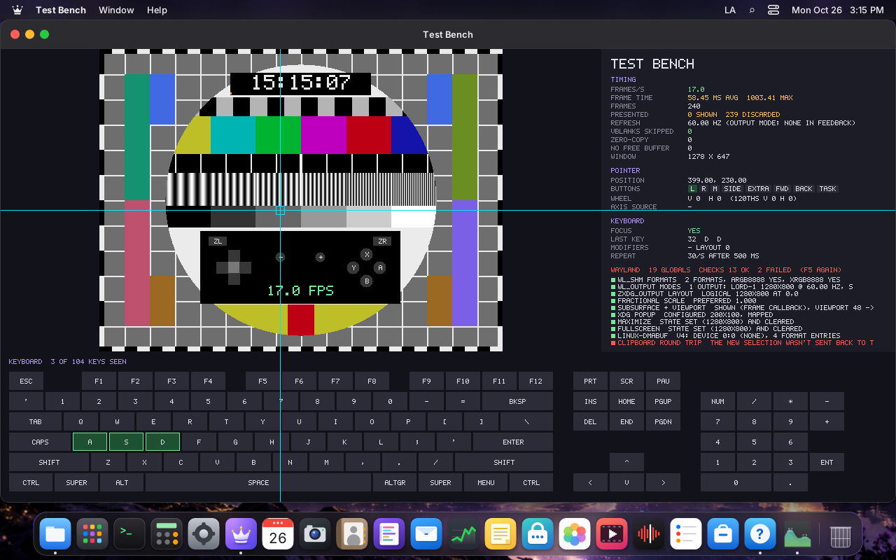
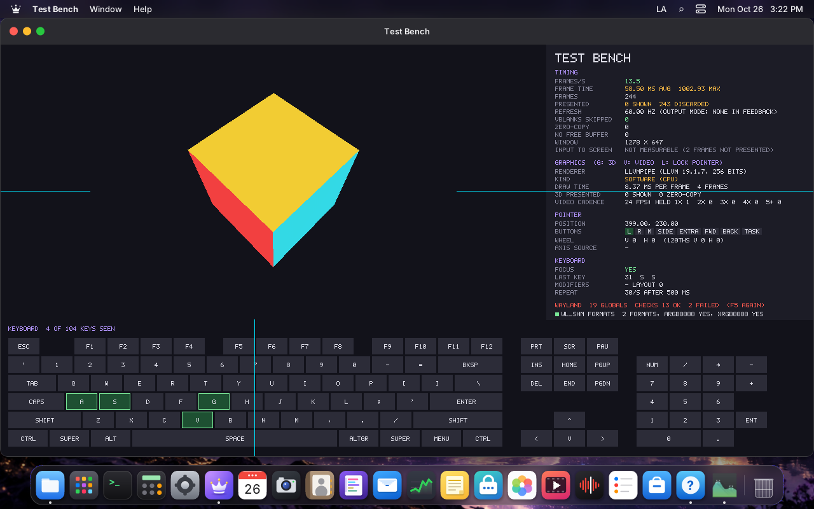

# Validating the paper

The technical paper (https://lordos.org/paper/, LordOS 0.8.0 Beta) makes claims about LordOS. This page
lists each one with how it is checked today and its state in 0.8.5, so anyone can see what is proven,
what was measured once, what is not tested, and what the paper must correct. Updated 2026-10-26.

**How a claim is checked**

| Mark | Meaning |
|---|---|
| **Test** | An automated test in the repository (`make -C server test`, `test-full` or `node` suites) fails if the claim stops being true. |
| **Check** | System Information → Checks verifies it on the user's own computer: *configured* (the mechanism is there) or *effective* (it was tried and gave the right answer). |
| **Measured** | A number measured by hand on a named machine; nothing repeats it yet. LordBench (0.8.6) is meant to. |
| **Untested** | The paper itself says it wasn't tested (real hardware). |
| **Outdated** | No longer true in 0.8.5: the paper must change. |
| **Design** | A design rule, checked by review and `AGENTS.md`, not by a program. |

## §1–§2 Vision and architecture

| § | Claim | How | State |
|---|---|---|---|
| 1.2 | JavaScript has no API to run programs, with three narrow exceptions | Design (`AGENTS.md`); the exceptions grew since: Xwayland (0.8.3), the network connectors and the blocklist downloader (0.8.5) | **Outdated**: list the approved exceptions |
| 1.2 | GPU composition optional, the CPU path always works | Test (`canvas-test`, CPU path in every test); Check `gpu` says which path and why | Holds |
| 1.2 | The compositor never waits on helpers or apps | Design (non-blocking sockets) | Design |
| 2.2 | `lord-server` runs as the user | Check `serverUser` (configured) | Holds |
| 2.4 | `lord-netd` only takes `net-*` actions from uid 0 peers | Design; `net-test` covers the actions | Partly tested |
| 2.4 | `lord-fand` writes only fans its scan found and restores them on stop or crash | Test (`fan-test`, fake sysfs); Measured on the Pi 5 (§7.4) | Holds |
| 2.4 | Display changes revert after 15 s without confirmation | Manual | Not automated |
| 3.6 | Passwords are checked by the root process, not the login screen | Design; `remote-sec-test` covers the parsers | Design |

## §3 Compositor and remote desktop

| § | Claim | How | State |
|---|---|---|---|
| 3.1 | Modesetting with our own DRM ioctls, the card with connectors | Design (`kms.c`, no libdrm) | Design |
| 3.2 | CPU path without a 3D card; software OpenGL falls back to it | Check `gpu` names the reason (`no-3d`, `software`…) | Holds (VM 116 shows it) |
| 3.2 | GPU path tested only with Mesa's software renderer | Untested on AMD/Nvidia/Intel | **Untested** |
| 3.3 | Touchpad gestures replayed in tests | Test (`tp-test`, `tests/touchpad-sim`) | Holds |
| 3.4 | Only `libwayland-server` plus generated protocol code | Design | Design |
| 3.4 | **Xwayland not supported** | Xwayland launches on demand since 0.8.3 | **Outdated** |
| 3.4 | No screen-capture protocol offered to apps | Design | Design |
| 3.5 | Scale 100–200 % per display; two virtual heads tested, real monitors not | Manual (VM 116) | Untested on real monitors |
| 3.6 | Remote desktop off by default, port 5673 | Check `remoteClosed` (effective: `/proc/net`) | Holds |
| 3.6 | TLS 1.2+, self-signed P-256; cookie Secure, HttpOnly, SameSite=Strict | Test (`remote-sec-test`, `remote-fuzz`) | Holds |
| 3.6 | **Failed logins wait 1, 2, 4… s up to 5 min** | Since 0.8.3: 3 failures block the source 15 min → 1 h → 24 h, answers at a fixed 1.25 s | **Outdated** |
| 3.6 | **Screen updates are PNG still and JPEG moving** | WebRTC video (H.264, VP8) since 0.8.4 | **Outdated** |
| 3.6 | **No audio** | Sound since 0.8.4 (Opus) | **Outdated** |

## §4–§5 UI engine and apps

| § | Claim | How | State |
|---|---|---|---|
| 4.2 | React 19.3.1, QuickJS 2025-04-26; default theme 367 KB | Build output | Size changed: re-measure |
| 4.2 | Shaping identical to HarfBuzz on 409 of 409 sentences | Test (`shape-test`, `hb_compare.py` in `test-full`) | Holds |
| 4.2, 7.4 | NEON loops bit-identical to C | Test (`canvas-test` on the Pi) | Holds |
| 4.4 | English, Spanish, Portuguese; keys and brand names checked | Test (`tools/i18n-check.mjs`) | Holds |
| 5.1 | About thirty native apps | Count | 33 in `apps/`, System Information and its hidden probe included |
| 5.2 | `.lpk` limits: 2,000 files, 64 MB | Test (`pkg-test`, `sign-test`) | Holds |
| 5.3 | InRelease signatures, plans equal to apt's in 12 cases | Test (`pkg-test`, `engine-test`) | Holds |
| 5.3 | Downloads over HTTP even for HTTPS sources | Still true (signatures carry integrity) | Holds |
| 5.4 | Linux apps not sandboxed by default | Still true; restrictions per app since 0.8.3 | Holds, needs a note |
| 5.5 | WebAssembly 2.0 without SIMD, 26,290 of 26,290 assertions | Test (`wasm-test`) | Holds |
| 5.5 | WebAssembly 3–5× faster than JS on the example | Measured once | Measured |
| 5.6 | Install script checks the Ed25519 signature and SHA-256 | Manual | Not automated |

## §6 Security

| § | Claim | How | State |
|---|---|---|---|
| 6.4 | Landlock ABI up to 6 for `.lpk` apps | Check `landlock` (configured) + Sandbox Probe `appSandbox` (effective) | Holds |
| 6.4 | Seccomp denies ptrace, mount, exec…; no new privileges; no capabilities | Sandbox Probe (effective: each tried; NoNewPrivs, Seccomp 2, CapEff 0 read by lord-server); Test (`sandbox-test`) | Holds |
| 6.4 | Per-app cgroup: memory.high 192 MB, memory.max 512 MB, one core | Sandbox Probe `appScope` (memory.max) | Holds in a session; memory.high and CPU not shown yet |
| 6.4 | No network permission: no internet sockets, no TCP | Sandbox Probe (`netInet` refused) | Holds |
| 6.4 | `sandbox-test` 14/14 and 14/14 with network | Test (`test-full`) | Holds |
| 6.4 | Malicious test app fails at everything | Test (`tests/lpk-evil`) | Holds |
| 6.4, 7.1 | Isolated app ~13.7 MB RSS, starts in 106 ms, sandbox in 0.89 ms (VM 122) | Measured once | Measured |
| 6.5 | The broker checks every request in C | Sandbox Probe `broker` (effective: four requests refused); Test (`broker-restrict-test`, `brokermail-test`) | Holds |
| 6.6 | Seven network eBPF programs plus device and LSM programs | Check `netperm` (configured); Test (`npverify-test`, kernel, VM) | Holds where installed (VM 116 lacks it) |
| 6.6 | 480,000 random connections, 0 differences | Test (`npcompile-test`) | Holds |
| 6.6 | ~0.5 µs per UDP connect, no per-packet cost | Measured once | Measured |
| 6.6 | A denied app can't connect | Not yet effective on the user's machine | **Pending** (Checks) |
| 6.7 | Helpers: no sockets, no exec, seccomp on every thread, exit if it fails | Sandbox Probe `helperSandbox` (effective); Test (`sandbox-test helper`, 17/17) | Holds |
| 6.8 | Ed25519 and SHA-256 against NIST and RFC 8032: 55 of 55 | Test (`sign-test`) | Holds |
| 6.8 | Official `.lpk` packages signed with a development key | Changed? Re-check before publishing | Re-check |
| 6.9 | Release key fingerprint, SBOM in SPDX 2.3 | Release scripts | Manual |
| 6.9 | Every bundle verified against the signed manifest | Check `code` (effective: this session's bundles) | Holds |
| 6.10 | Vault: Argon2id, XChaCha20-Poly1305, 1,165 of 1,165 tamper tests | Test (`vault.mk` suites) | Holds |
| 6.10 | FIDO2 keys untested on real hardware | — | **Untested** |
| 6.11 | Protected windows black in screenshots, recordings, remote desktop | Test (`media-test` covers capture paths) | Partly tested |
| 6.12 | Aligned with ISO/IEC 29147, 30111, 5230, 18974; no audit | Documents | Design |

## §7 Performance

| § | Claim | How | State |
|---|---|---|---|
| 7.1 | Live ISO idle 465 MB, installed idle 487 MB, CPU 99 % idle | Measured once (VM 117, 120) | Measured → LordBench |
| 7.1 | Boot 16.3 s with UEFI | Measured once | Measured → LordBench |
| 7.1 | `lord-server` without 3D ~32 MB RSS; session ~50 MB, login 41 MB | Measured once; Check `memory` shows the current number (VM 116 today: ~100 MB in a headless session with apps open) | **Re-measure** at idle |
| 7.2 | Window drag 1280×800 CPU path 6.7–6.9 ms, ~120 fps | Measured once (VM 118) | Measured → LordBench |
| 7.2 | Video: lord-server 42 % → 13 %, fullscreen 92 % → 15 % of a core | Measured once | Measured |
| 7.2 | — | New in 0.8.5: remote desktop CPU reference (`REMOTE.md`, "Measurements (0.8.5, CPU reference)") | Add to the paper |
| 7.3 | GPU benefits on real cards not measured | — | **Untested** |
| 7.4 | Pi 5: build 1 min 02 s, tests 23/0/0, NEON 2.0–2.3×, idle 36 MB, fan behaviour | Measured once on the Pi | Measured |
| 7.5 | No measurements on real PCs | — | **Untested** |

## §10–§11 Limits and verification

| § | Claim | How | State |
|---|---|---|---|
| 10.2 | Untested on real hardware: AMD/Nvidia GPUs, monitors, laptops, Bluetooth, printers, scanners, FIDO2, mail providers | System Information reports (0.8.7: community reports) | **Untested** |
| 10.2 | Secure Boot must be off | System Information shows Secure Boot | Holds |
| 11.2 | `make test` 23 passed, 1 skipped | Today 23 passed, 0 failed, 9–10 skipped (node or data missing on the VM) | Holds |
| 11.2 | 30,953 parser checks with mutation fuzzing | Tests (`remote-fuzz`, mail, doc, imager fuzzers) | Holds; count to refresh |
| 11.4 | Port 5673 closed until enabled | Check `remoteClosed` (effective) | Holds |

## What the paper must change for 0.8.5

1. §1.2: the approved exceptions are more than three (Xwayland, the network connectors, the blocklist
   downloader, the Store's download child, the Sandbox Probe's system package).
2. §3.4: Xwayland is supported on demand (0.8.3).
3. §3.6: remote login lockout (3 failures; 15 min → 1 h → 24 h; fixed 1.25 s answers); WebRTC video with
   H.264/VP8 and Opus sound instead of PNG/JPEG and no audio.
4. §7: re-measure `lord-server`'s memory at idle and the theme's size; add the 0.8.5 remote desktop and CPU
   path measurements (`REMOTE.md`, `GPU.md`).
5. §6: mention that anyone can now check the sandbox on their own computer (System Information → Checks).

## What is still missing to validate everything

| Gap | Covers | Plan |
|---|---|---|
| A denied connection, tried on the user's machine | §6.6 effective | An app with network access and a temporary rule (Checks) |
| Repeatable performance numbers | §7 | LordBench (0.8.6): idle memory and CPU, boot, frame times, video, app start |
| Rendering, 3D and video on every GPU | §3.2, §7.2–7.3 | The visual test bench below |
| Every key, the mouse, touchpads, gamepads, and the Wayland protocols | §3.3–§3.4 | The visual test bench below |
| Real hardware | §10.2 | Reports from System Information (0.8.7) |

## The visual test bench (`lordos-testbench`)

**Phase 1 built (2026-10-26):** `server/src/testbench/` (`make -C server build/lordos-testbench`), packaged as
`/usr/bin/lordos-testbench` with `packaging/desktop/lordos-testbench.desktop` (Test Bench in the launcher).
The test card is ported from go-link-console's `pkg/testpattern` (same author). It shows the card with a
live clock and a marker that moves one step per frame, frames a second and frame times, `wp_presentation`
feedback (shown, discarded, refresh, skipped vblanks, zero-copy), the pointer (exact crosshair, eight
buttons, wheel in steps and 120ths, axis source), the keyboard (a full ISO/ANSI layout with keypad and
navigation keys lit while down and marked once seen, codes of keys not drawn, keysym and text from the
compositor's keymap, modifiers and layout, repeat rate and delay) and every global with its version.
`--auto [seconds]` prints the same as JSON. On VM 116 (headless session, CPU path) it found that
`wp_presentation` reports every frame as discarded and no refresh rate when the session has no monitor.

**Phase 2, the protocol checklist (2026-10-26, `checks.c`):** runs at start (F5 runs it again; Pause freezes
the picture for a still capture) and in `--auto`'s JSON. Each protocol is bound at the advertised version
and exercised, and a protocol error ends the connection with the failing check named (its first run caught
the bench's own mistake, `wl_shm.release` on version 1, which LordOS's compositor rightly refused). First
run on VM 116 (headless session); after the two compositor fixes below: 16 passed, 0 failed:

| Check | Result |
|---|---|
| `wl_shm` formats | pass: ARGB8888 and XRGB8888 |
| `wl_output` modes, `zxdg_output` layout | pass: LORD-1 1280×800 at 60.00 Hz, scale 1, logical 1280×800 at 0,0 |
| fractional scale | pass: preferred 1.000 |
| subsurface + viewport | pass: shown (its frame callback came back), viewport 48 → 96 |
| xdg popup | pass: configured 200×100 and mapped |
| maximize, fullscreen | pass: the configure carries the state, and loses it after unset |
| `linux-dmabuf` v4 feedback | pass, with a finding: a headless session sends main device 0:0 (none) and 4 formats |
| clipboard, primary selection round trip | **failed, then fixed (same day)**: the compositor didn't send a new selection back to the focused client that set it (`wl.c`, `offer_selection` and `prim_offer_to` returned early for "its own"), which the protocol requires. Now the focused client gets every new selection and `dev_set_selection` offers it at once; both round trips come back intact |
| `wp_presentation` | offered, but a headless session discards every frame and gives no refresh (the output's mode says 60 Hz) |
| cursor shape, relative pointer, gestures | bound; they need the real pointer or a touchpad to go green |
| idle inhibit | **added (same day)**: `zwp_idle_inhibit_manager_v1`; while a shown surface holds an inhibitor, `main.c` keeps the idle timers (screen off, lock, sleep) from running. The bench creates and releases one |
| not offered | text-input v3 (input methods for Linux apps), xdg-activation, single-pixel buffers, tearing control, content type, tablets, idle notify, drm-lease |

Also seen: system shortcuts (F1 opens Help, F4 the launcher, ❖ combinations) never reach the app, so the
keyboard test can't light them; the bench should list them as taken by the system.

**Phase 3 (2026-10-26, `gl3d.c` and `testbench.c`):**

- **3D (G, or `--gl`):** a rotating cube with EGL and OpenGL ES 2 on a subsurface through Mesa's Wayland
  platform, as a game draws: the renderer, vendor and version, whether it is a hardware GPU, a virtual
  GPU or software (llvmpipe and the like, i.e. the CPU), the time to draw a frame (`glFinish`), and its
  frames' presentation with the zero-copy flag (direct scanout). On VM 116: `llvmpipe (LLVM 19.1.7)`,
  software, 0.5–8 ms a frame.
- **Input to screen:** the time of each key or click (the event's timestamp) to the presentation time of
  the frame that shows it (`wp_presentation`, CLOCK_MONOTONIC). In the headless session it says "not
  measurable": no frame is presented there.
- **Generated video (V):** content at 24, 30 or 60 fps with a square that steps once per content frame,
  and how many refreshes each content frame stayed (24 on 60 Hz should be 2 and 3 alternating).
- **Pointer lock (L):** `zwp_pointer_constraints_v1.lock_pointer`, shown as locked or not.
- Built without EGL the bench still runs and the 3D row says so.

**Still to build:** pointer confine, keys taken by system shortcuts, gamepads, a run with the real monitor and
GPU (presentation, latency, zero-copy), and attaching the report to System Information.

### The plan

LordOS writes its own compositor, so it needs its own tool to show, on any computer, that what it draws
and what it receives are right. The idea is a test-pattern window like a TV test card (and like the test
pattern of go-link-console), with live measurements around it:

- **What it is:** a native Wayland client in C (`tools/testbench/`, installed as `/usr/bin/lordos-testbench`
  with a `.desktop` file). It speaks the protocol directly with `libwayland-client`, the way any app does,
  so it tests the compositor from the outside. It is launched like any Linux app (`lord.apps.launch`), so
  no new exception in `lord-server`, and it also runs on other compositors for comparison.
- **The pattern (rendering):** colour bars, grey steps, a resolution grating (1-pixel lines that show
  scaling or blurring), a geometry grid and circle (wrong aspect or scaling shows at once), a live clock
  and a frame counter that changes every frame (a dropped or repeated frame is visible), scale and
  fractional-scale readout, colour format.
- **Timing:** frames per second against the display's refresh, frame-time histogram, missed frames, using
  `wl_surface.frame` and `wp_presentation` feedback (when the frame really reached the screen).
- **3D:** a rotating textured scene with EGL/GLES2 on the GPU (`linux-dmabuf`), showing the renderer and
  whether the buffer was scanned out directly or composed; a CPU-only shm mode to compare.
- **Video:** a generated moving pattern at 24/30/60 fps (no files, no decoders), to see judder and dropped
  frames; later the same through `lord-media`'s hardware decoder.
- **Keyboard:** a full keyboard drawn on screen; each key lights when its key event arrives, with the
  keycode, the keysym from the keymap the compositor sent, modifiers, repeat rate and delay; a list of
  keys never seen, to go through every key of a real keyboard.
- **Mouse and touchpad:** pointer position and the hotspot, buttons, scroll (discrete and smooth), relative
  motion, pointer constraints and locking, gestures (swipe, pinch), the cursor shapes it asks for.
- **Gamepad:** shown if the device is readable by the user (evdev); otherwise said so.
- **Protocol checklist (low level):** every global the compositor advertises, its version, and a scripted
  run of each one (create, use, destroy) with pass or fail: `wl_shm` formats, `xdg_wm_base` (configure,
  resize, maximize, fullscreen, popups), `xdg-decoration`, `linux-dmabuf` formats and feedback,
  `wp_viewporter`, `fractional-scale`, `presentation-time`, `pointer-constraints`, `relative-pointer`,
  `pointer-gestures`, `text-input`, `primary-selection`, data device (copy and paste of text and images),
  `idle-inhibit`, `xdg-activation`, cursor-shape. Its output is a report (JSON and Markdown) that System
  Information can attach, with the GPU and the monitor, so the same run on many computers shows where
  LordOS's Wayland works and where it doesn't.
- **Automation:** `lordos-testbench --auto` runs the protocol checklist and a timed render without a person,
  for CI and for the VMs (the input tests then use the remote desktop's injected keys and pointer, as the
  tests in this repository already do).
