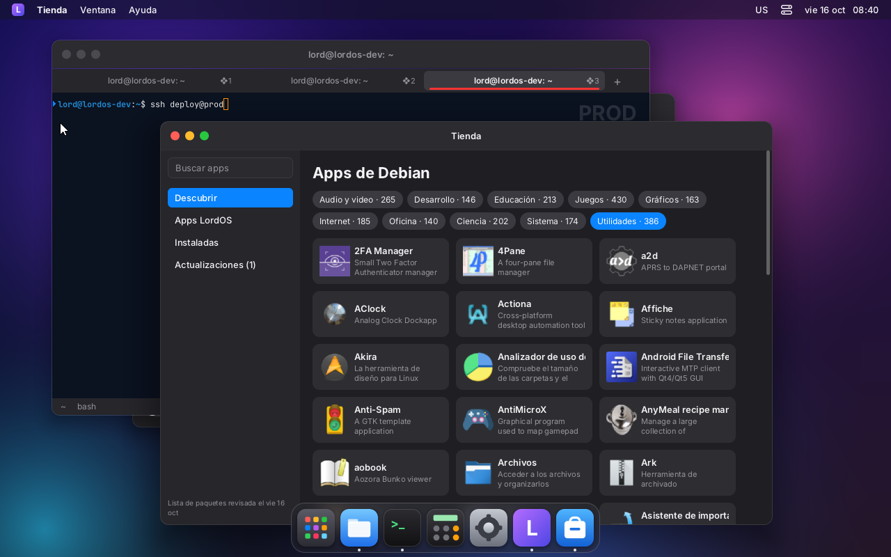
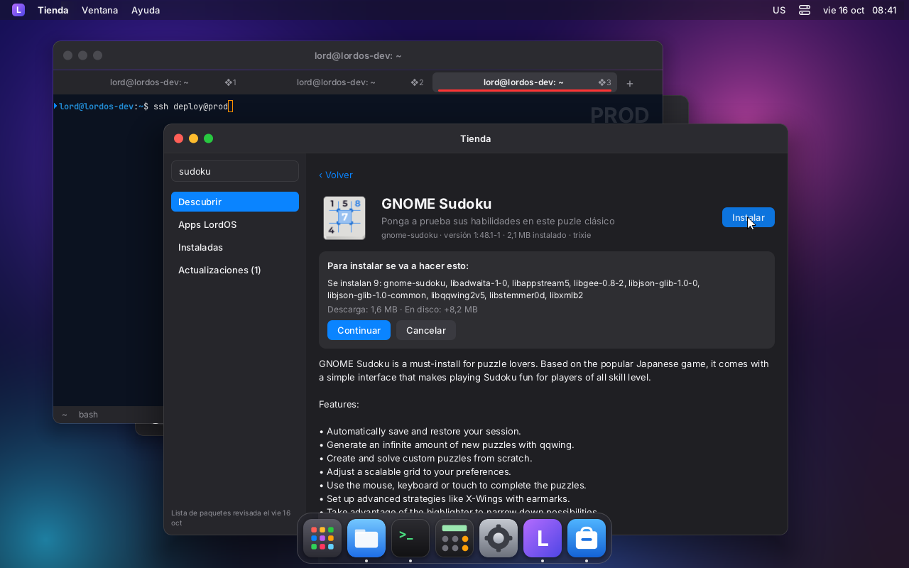

# Paquetes de Debian en LordOS

LordOS instala y quita paquetes de Debian con código propio: lee las fuentes de apt, baja y
verifica los índices firmados, resuelve las dependencias y baja los `.deb`. **dpkg** hace solo
el último paso: desempaquetar y configurar. No usa apt ni libapt, gpgv/sqv, curl, zlib ni
liblzma. La base de dpkg (`/var/lib/dpkg`) la sigue escribiendo solo dpkg, así que `apt` y
`dpkg` siguen funcionando igual en el mismo sistema.

El código está en `server/src/pkg/`:

| Archivo | Qué hace |
|---|---|
| `crypto.c` | SHA-256, SHA-512, verificación RSA PKCS#1 v1.5 (Montgomery) y Ed25519 (aritmética de TweetNaCl) |
| `pgp.c` | Llaveros OpenPGP binarios o armados, subclaves, vencimientos y revocaciones; firmas v4 de mensajes firmados en claro (`InRelease`) |
| `xz.c` | Descompresor xz/LZMA2 propio; gzip con el inflate de `stb_image` (ya estaba para los PNG) |
| `deb.c` | Comparación de versiones de dpkg, campos deb822, relaciones (`a (>= 1) \| b`) |
| `idx.c` | El índice compacto que se arma con `pkg-update` y se lee con mmap |
| `status.c` | Lectura de `/var/lib/dpkg/status` (lo instalado) |
| `resolve.c` | Resolvedor de dependencias y orden de instalación |
| `http.c` | Cliente HTTP/1.1, con un proceso hijo que corre como `nobody` |
| `pkg.c` | Acciones del ayudante privilegiado (actualizar, instalar, quitar, `.deb` local) |
| `../ui/js_pkg.c` | `lord.pkg`, las consultas para la interfaz (sin root) |

## Seguridad

- **Firmas.** Un `InRelease` solo vale si tiene al menos una firma válida de una clave del
  llavero de la fuente (`Signed-By`; si falta, las de `/etc/apt/trusted.gpg.d`). La clave
  tiene que poder firmar, y no puede estar vencida ni revocada. La firma no puede estar vencida
  ni venir del futuro. Si una clave conocida tiene una firma inválida, se rechaza todo el
  archivo.
- **Rechazos.** También se rechaza un `InRelease` en estos casos:
  - venció (`Valid-Until`);
  - es de otra suite;
  - es más viejo que el que ya estaba guardado (ataque de repetición);
  - trae datos después de la firma.
- **Hashes.** Cada `Packages`, `Translation`, DEP-11 y `.deb` se verifica con el SHA-256 que
  dice el índice firmado. Solo así se guarda, se lee o se le pasa a dpkg.
- **Llavero.** Se toma como confiable, como hace gpgv: es un archivo de root que instaló
  `debian-archive-keyring`.
- **HTTP en vez de HTTPS.** LordOS no tiene TLS propio, así que las fuentes `https://` se bajan
  por `http://`, con el mismo camino. La seguridad la dan las firmas y los SHA-256, como en apt
  con `http://deb.debian.org`. Quien mire la red puede ver qué paquetes se bajan, pero no puede
  cambiarlos.
- **Descargas sin root.** El proceso que habla con la red suelta los privilegios antes de
  conectarse: pasa a `nobody`, sin grupos, con `no_new_privs` y sin poder volver a root. Le
  pasa los bytes al proceso root por un pipe. El proceso root solo los escribe en su carpeta,
  cuenta el tamaño y calcula el SHA-256: no interpreta nada de lo que llega.
- **Locks.** Mientras dpkg trabaja, LordOS toma el lock de frontend de dpkg
  (`/var/lib/dpkg/lock-frontend`, igual que apt) y le pasa `DPKG_FRONTEND_LOCKED=1`. Si apt
  está corriendo, LordOS espera su turno: no se pisan. Las operaciones de LordOS entre sí van
  en fila (`/var/lib/lordos/pkg/lock`).
- **`.deb` local** (`pkg-install-file`):
  - el archivo tiene que estar en la carpeta del usuario;
  - se abre con los permisos de ese usuario (`setfsuid`), recorriendo la ruta componente por
    componente sin seguir enlaces (`O_NOFOLLOW`);
  - se copia a un archivo nuevo de root, y todo lo demás (leer el control, instalar) se hace
    sobre esa copia, así que el usuario no puede cambiarlo en el medio.
- **Esenciales.** Los paquetes `Essential: yes` o `Protected: yes` nunca se quitan.
- **Nombres.** Siguen la sintaxis de Debian (`[a-z0-9][a-z0-9+.-]+`). Los argumentos se
  validan en el ayudante, aunque lord-server ya los haya validado.

## Archivos

| Ruta | Contenido |
|---|---|
| `/var/lib/lordos/pkg/index.bin` | Índice (paquetes, «provee», apps de AppStream, fuentes, textos y descripciones largas); legible por todos |
| `/var/lib/lordos/pkg/lists/` | `InRelease` verificados y los índices comprimidos, con su SHA-256 como nombre (lo que no cambió no se vuelve a bajar) |
| `/var/lib/lordos/pkg/icons/64/` | Íconos de 64×64 de las apps de escritorio (DEP-11) |
| `/var/lib/lordos/pkg/auto` | Paquetes que LordOS instaló como dependencia |
| `/var/cache/lordos/pkg/` | `.deb` mientras se instalan (se borran al terminar) |

## Acciones del ayudante (`admin.run`)

| Acción | Argumento |
|---|---|
| `pkg-update` | (nada) |
| `pkg-install` | `nombre nombre… [--recommends] [--allow-remove]` |
| `pkg-remove` | `nombre nombre… [--cascade] [--purge] [--keep-orphans]` |
| `pkg-autoremove` | (nada): quita las dependencias que quedaron sin uso |
| `pkg-upgrade` | `[--allow-remove]` |
| `pkg-install-file` | `/home/usuario/…/archivo.deb [--allow-remove]` |

Todas corren en un proceso aparte (`A_FORK`) y requieren un usuario administrador.

### Confirmaciones

- Por defecto no se instalan los recomendados. `--recommends` los agrega, y si alguno no se
  puede instalar no frena el resto.
- Si un pedido obliga a quitar algo que no se pidió, la acción falla con
  `ERR también hay que quitar: a, b`. Por ejemplo:
  - instalar `postfix` quita `exim4`, porque son dos programas de correo y no conviven;
  - quitar una biblioteca quita lo que depende de ella.

  La interfaz muestra el plan (`lord.pkg.plan`) y, si el usuario acepta, repite el pedido con
  `--allow-remove` (al instalar) o `--cascade` (al quitar).
- **Huérfanos.** Al quitar, también se quitan las dependencias que LordOS instaló (anotadas en
  `/var/lib/lordos/pkg/auto`) y que con ese cambio ya no usa nadie, como haría después
  `apt autoremove`. Van en el plan con `reason: 'auto'` y **no** necesitan `--cascade`.
  `--keep-orphans` las deja. `pkg-autoremove` limpia las que ya habían quedado.

### Progreso

Mientras corre, la acción manda líneas `LOG`:

```
LOG plan install featherpad 1.6.1-1 603084        (una por paquete: install|upgrade|remove, versión, bytes)
LOG plan held libfoo                               (actualizaciones que no se pueden hacer ahora)
LOG plan total 4034148 24981                       (bytes a bajar, KB que cambia lo instalado)
LOG progress download 1048576 4034148              (fases: lists, index, download, unpack, configure, remove)
LOG Unpacking featherpad (1.6.1-1) ...             (el resto: texto para el registro)
OK 3 instalado(s), 0 actualizado(s), 0 quitado(s)
```

Las líneas `progress <fase> <hecho> <total>` son para una barra de progreso.

### Avisos

Al terminar, el ayudante manda un aviso sin pedido:
- `EVENT pkg index`, después de actualizar la lista;
- `EVENT pkg changed`, después de instalar o quitar.

La interfaz los recibe con `admin.onEvent()`.

## La Tienda

`apps/store`. En «Descubrir» muestra las apps de escritorio de AppStream por categoría, con sus
nombres y descripciones traducidos y su ícono. La búsqueda trae primero las apps y después los
demás paquetes. La ficha de un paquete, antes de instalar o quitar, muestra el plan: qué se
instala, actualiza o quita, cuánto se baja y cuánto ocupa en disco. Además muestra el progreso de
la tarea. «Actualizaciones» lista lo que se puede actualizar y lo actualiza todo junto. Desde
Archivos, un `.deb` se abre en la Tienda (`pkg-install-file`).

| | |
|---|---|
|  |  |
| Apps de Debian por categoría | El plan de GNOME Sudoku: los mismos 9 paquetes que `apt-get -s install` |
|  | |
| Instalado y abierto desde la Tienda (GTK 4 + libadwaita, en español, con su ícono de AppStream en el Dock) | |

## `lord.pkg` (lord-server, sin root)

Las consultas leen el índice con mmap y `/var/lib/dpkg/status`, y se recargan solas cuando
cambian. `lang` (`'es'`, `'pt'` u omitido) elige el nombre y la descripción de AppStream.

```js
lord.pkg.available()            // true si ya hay índice
lord.pkg.lastUpdate()           // segundos desde 1970 (0: nunca)
lord.pkg.sources()              // [{ uri, suite, component, codename, label, date, validUntil, priority, packages }]
lord.pkg.search(q, { limit = 50, apps = false, section, lang })   // [Resumen], ordenado por relevancia
lord.pkg.info(nombre, { lang }) // Resumen + { description, homepage, arch, source, depends, preDepends,
                                //   recommends, suggests, provides, conflicts, breaks, priority, suite,
                                //   origin, appDescription, versions: [{ version, suite, size }] } | null
lord.pkg.installed({ lang })    // [Resumen] de todo lo instalado
lord.pkg.upgrades()             // [{ name, from, to, summary, suite, size }]
lord.pkg.plan({ install: [], remove: [], recommends, allowRemove, cascade, upgrade, keepOrphans })
    // { ok, error, items: [{ action: 'install'|'upgrade'|'remove', name, version, oldVersion, size,
    //   requested, reason }], held: [], download, installedDelta }   (bytes)
    // con remove, incluye los huérfanos: { action: 'remove', reason: 'auto', requested: false }
lord.pkg.orphans()              // [{ name, version, summary, installedSize }]: lo que quitaría pkg-autoremove
lord.pkg.apps({ category, type = 'desktop-application', limit = 100, offset = 0, lang })
    // [App + { package, installed, version, size }], ordenadas por nombre
lord.pkg.categories()           // { AudioVideo: 210, Development: 180, … } (apps de escritorio)
lord.pkg.icon(nombre)           // ruta del PNG de 64×64 o null

// Resumen = { name, version (candidata), summary, section, size, installedSize (bytes),
//             installed (versión o null), upgradable, essential, auto, app: App | null }
// App     = { id, type, name, summary, icon (ruta o null), categories: [] }
```

Para modificar:

```js
await admin.run('pkg-update')
const plan = lord.pkg.plan({ install: ['featherpad'] })      // mostrarlo y pedir confirmación
await admin.run('pkg-install', 'featherpad', (linea) => …)   // linea: "progress download 123 456"…
```

## Cómo resuelve

- **Candidata.** Es la versión más nueva de la fuente de mayor prioridad:
  - prioridad 500 para las normales;
  - 100 para `NotAutomatic` + `ButAutomaticUpgrades`, como backports;
  - 1 para solo `NotAutomatic`, como experimental.

  Lo que se instaló desde backports sigue actualizándose desde ahí. Nunca baja de versión.
- **Dependencias.** Recorre las de lo que cambia: `Pre-Depends` y `Depends`, y `Recommends`
  con `--recommends`.
- **Elecciones.** Las alternativas (`a | b`) y los paquetes virtuales se prueban en orden. Entre
  proveedores de un virtual se prefiere la mayor `Priority` y después el nombre. Si un camino
  falla, vuelve atrás, con un máximo de 4000 intentos.
- **Conflictos.** Revisa `Conflicts` y `Breaks` en los dos sentidos. Si choca con algo
  instalado:
  1. actualiza ese paquete, si su versión nueva ya no choca;
  2. si no, lo quita, con confirmación.
- **Huérfanos.** Se marca desde las raíces: lo instalado a mano, lo esencial y lo que se
  instala ahora. Se siguen `Pre-Depends`, `Depends` y `Recommends`, porque apt también cuenta
  los recomendados, y todas las alternativas o proveedores presentes. Lo de `auto` que queda sin
  marcar se quita. Solo se tocan las dependencias que instaló LordOS: lo que instaló apt como
  automático no entra.
- **Vecinos.** Cuando algo se actualiza o se quita, vuelve a revisar lo que dependía de él. Lo
  instalado que queda sin lo que necesita primero se actualiza, y si no se puede se quita (con
  confirmación). Repite hasta que nada más cambia.
- **Orden para dpkg.** Ordena topológicamente por dependencias y usa un `dpkg --install` por
  tanda. Un `Pre-Depends` sobre algo de la misma tanda la corta, porque eso tiene que quedar
  configurado antes.

## Pruebas

```sh
make -C server build/pkg-test
build/pkg-test                         # unitarias: versiones, deb822, SHA, RSA, Ed25519, xz/gz,
                                       # índice y resolvedor sobre un repositorio de juguete
build/pkg-test pgp /usr/share/keyrings/debian-archive-keyring.gpg InRelease
build/pkg-test plan /var/lib/lordos/pkg /var/lib/dpkg/status gimp     # el plan, sin instalar
sudo build/pkg-test run pkg-update     # las acciones reales, sin lord-server
sudo build/pkg-test run pkg-install "cowsay sl"
```

## Pruebas reales (VM, Debian 13.7, 2026-10-16)

- **Unitarias:** `pkg-test` da 78/78, con las pruebas de huérfanos.
- **Firma real:** se verificó el `InRelease` real de trixie con `debian-archive-keyring.gpg`.
  Tiene tres firmas: dos RSA-4096 y una Ed25519, la del Stable Release Key 13, y las tres son
  válidas. Con un byte cambiado se rechaza.
- **`pkg-update` contra deb.debian.org**, con 4 fuentes: trixie, trixie-updates,
  trixie-backports y trixie-security.

  | Situación | Bajó | Tiempo | Memoria máxima |
  |---|---|---|---|
  | Primera vez | 11 índices, 29 MB | 4,9 s | 122 MB, en el proceso hijo que dura lo que la acción |
  | Sin cambios en las listas (respuestas 304) | nada | 0,12 s | 3 MB |

  Resultado: 74.362 paquetes y 2.100 íconos. En disco, `/var/lib/lordos/pkg` ocupa 98 MB:
  60 MB de índice y 29 MB de listas comprimidas.
- **Planes contra `apt-get -s install --no-install-recommends`:**

  | Paquete | Paquetes del plan |
  |---|---|
  | cowsay | 1 |
  | sl | 2 |
  | postfix | 3 |
  | gnome-calculator | 13 |
  | thunderbird | 30 |
  | inkscape | 48 |
  | libreoffice-writer | 79 |
  | vlc | 110 |
  | gimp | 121 |
  | blender | 197 |
  | krita | 237 |
  | kdenlive | 437 |

  En los 12 casos coinciden los mismos nombres y las mismas versiones que apt.
  - Con recomendados, gimp da 188 paquetes, igual que apt.
  - `pkg-upgrade` da 1 actualización (libexpat1, de trixie-security), igual que
    `apt-get -s upgrade`.
  - Quitar `libqt6core6t64` da las mismas 18 quitas que `apt-get -s remove`.
- **Instalaciones reales:**
  - `cowsay sl`: 3 paquetes en 1,7 s; `cowsay` funciona.
  - `gnome-calculator`: 13 paquetes, 3,9 MB, en 4,9 s.
  - `hello` desde un `.deb` bajado a la carpeta del usuario: anda.
  - Quitas: `sl cowsay`, `gnome-calculator` y las 13 dependencias anotadas en `auto`.
  - Rechazos:
    - quitar `dpkg`, por esencial;
    - quitar `libgtk-4-1` sin `--cascade`, que lista lo que habría que quitar;
    - un nombre `../etc`;
    - un `.deb` que es un enlace a `/etc/shadow`;
    - una ruta por un enlace a `/root`;
    - un archivo fuera de la carpeta personal.

  - Huérfanos: `pkg-autoremove` quitó los 8 que habían quedado de una prueba de la Tienda
    (libadwaita-1-0, libqqwing2v5…).
  - Instalar `gnome-sudoku` (9 paquetes) y después `pkg-remove gnome-sudoku`, sin `--cascade`,
    quita los 9. Con `keepOrphans` el plan es de 1.

  Después de cada prueba, `apt-get check` y `dpkg --audit` dieron limpio. La VM quedó como
  estaba.
- **`lord.pkg`**, con `build/pkg-js-test`:

  | Consulta | Tiempo |
  |---|---|
  | `search` sobre 74 mil paquetes | 27–42 ms |
  | `info` | 0,1 ms |
  | `apps` por categoría | 0,6 ms |
  | `plan` de gimp | 7 ms |
  | `installed` (648 paquetes) | 3 ms |

  La memoria máxima del proceso es de 37 MB, con las páginas del índice mapeado que se tocaron
  al buscar; el kernel las puede liberar.

## Pendiente

- Los `Suggests` no cuentan para los huérfanos (apt, por defecto, sí); no se toca
  `extended_states` de apt.
- **Paquetes de otras arquitecturas.** Hoy solo se usan la nativa y `all`. Lo instalado de otra
  arquitectura (i386) se ignora al resolver.
- **Versiones o suites a pedido.** Todavía no se puede pedir `paquete=versión` ni
  `paquete/backports`.
- **Repositorios planos.** No se aceptan los que tienen la suite terminada en `/`.
- **`control.tar.zst`** en `.deb` locales (Ubuntu); los de Debian usan xz.
- **Diffs incrementales de los índices** (`Packages.diff`). Hoy se baja el índice entero cuando
  cambia.
