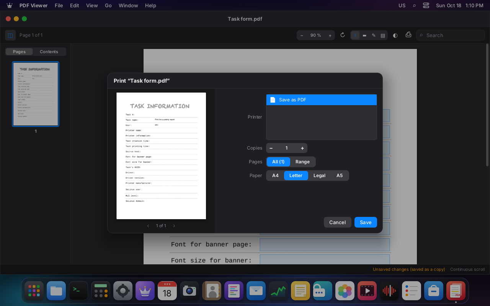

# Printing and scanning (M9)

**CUPS manages the queue and the drivers. LordOS doesn't use libcups**: it speaks IPP to it over
its local socket with our own C client. Network printers and scanners are found over mDNS with our
own code, and scanners are used over eSCL, without SANE. The interface is native: Settings →
Printers & Scanners, the system print dialog and the Scanner app.

## Screenshots (VM 116)

| | |
|---|---|
|  |  |
| Settings → Printers & Scanners: the CUPS queue, an IPP Everywhere printer found over mDNS and added, and the test scanner | The printer's queue with one job and "Cancel" |
|  |  |
| The system dialog from the PDF Viewer: preview with the filled-in form, printer, copies, pages, color and paper | The same dialog from the Editor: the text built as a PDF |
|  |  |
| Test page to a printer without color (black and white only) | Scanner: preview, area chosen by dragging, resolution, color and format |

## How it's built

```
apps (PDF Viewer, Editor, Notes, Photos…)
  └── print.open(...)        sdk/print.js + sdk/printdialog.jsx  (system dialog)
        ├── preview          lord-doc (built PDF or the app's PDF), see DOCUMENTS.md
        └── lord.print.submit(printer, blob | path, options)
              └── server/src/print  (lord-server threads, never the compositor)
                    ├── ipp.c     our own IPP/1.1 encoder/decoder
                    ├── phttp.c   minimal HTTP/1.1 (CUPS unix socket, TCP to the LAN)
                    ├── cups.c    operations: printers, queue, print, cancel, add…
                    ├── mdns.c    DNS-SD over mDNS (legacy unicast)
                    └── escl.c    eSCL scanners
CUPS (/run/cups/cups.sock) → Debian filters and drivers → the printer
```

- **Asynchronous:** each request runs on its own thread (up to 8 at a time) and the result reaches
  JS with `lord.print.poll()`. The compositor never waits, not even while CUPS builds the PPD for a
  new printer, which takes a few seconds.
- **Printing:** **PDF** is always sent (`document-format application/pdf`), with the IPP job
  attributes:
  - `copies`, `page-ranges` (ranges like "1-3, 5"), `print-color-mode`, `sides` and `media` (A4,
    letter, legal, A5);
  - the job name.

  CUPS converts and applies the rest with its filters. What the apps print:
  - **an app's PDF:** the path (it's checked to be `%PDF-` and from the home folder);
  - **a built or annotated PDF:** a "blob" from lord-doc (sealed memfd).

### Why without libcups

- **IPP is enough:** it's a simple binary format, and what LordOS needs is seven operations
  (CUPS-Get-Printers, CUPS-Get-Default, Get-Jobs, Print-Job, Cancel-Job, CUPS-Add-Modify-Printer,
  CUPS-Delete-Printer and CUPS-Set-Default). libcups would also bring its DNS-SD (avahi-client),
  GnuTLS and PPD management, which aren't used.
- **What it reads is tested:** the decoder validates every length, nests collections up to 8
  levels and has caps on attributes and values. `build/ipp-test` tests it with messages truncated
  at every byte and 20,000 random mutations.
- **The cost is small:** ~920 lines of our own (`ipp.c`, `phttp.c` and `cups.c`).

### Managing printers: CUPS policy, without admin.c

**Decision:** adding, removing and choosing the default don't go through the root helper. They use
**CUPS's own policy**:

- on Debian, those operations require a user from `@SYSTEM`, that is **root or the `lpadmin`
  group**;
- the client identifies itself with **PeerCred**: on a 401, it repeats the request with
  `Authorization: PeerCred <user>`, and CUPS verifies it by looking at the unix socket's
  credentials (SO_PEERCRED);
- no password travels and no new code runs as root.

**Who has `lpadmin`:** LordOS **administrators**, as in Ubuntu.
- The installer (`server/src/install/install.c`) gives it to the first user.
- Settings → Users adds and removes it together with `sudo` when checking or unchecking
  "Administrator" (`users_admin.c`). If CUPS isn't installed, the group doesn't exist and it's
  skipped.

**A regular user:**
- sees the printers and their queue, prints and cancels **their own** jobs (CUPS policy);
- when trying to add or remove a printer, Settings explains that you need to be an administrator.

**Adding a printer:**
- CUPS-Add-Modify-Printer with `ppd-name=everywhere`: CUPS asks the printer for its capabilities
  and builds the PPD, without a driver (driverless printing, IPP Everywhere);
- in the same request it's left accepting jobs (`printer-is-accepting-jobs`,
  `printer-state=idle`);
- the queue name is built from the announcement's name (`queueName`: letters, digits, `_` and `-`).

### Finding printers and scanners (mDNS)

`server/src/print/mdns.c`, our own:

- **It asks** for `_ipp._tcp`, `_ipps._tcp`, `_uscan._tcp` and `_uscans._tcp` at 224.0.0.251:5353
  **from any port** ("legacy unicast", RFC 6762 §6.7): no need to own 5353 or have avahi, and the
  network configuration isn't touched.
- **It assembles the answer** from the PTR, SRV, TXT and A records. For those that arrive
  incomplete it asks again for the SRV, the TXT or the address. In total it listens for 1.8 s.
- **To add** it uses `ipp://<IPv4>:<port>/<rp>`. If the same printer is announced over ipp and
  ipps, it's shown once.
- **What arrives** is read as untrusted data: compression pointers with a jump cap, verified
  lengths and no control characters. There are tests in `ipp-test`: a hand-built packet, truncated
  at every byte and with a pointer loop.

**Their own firewall app** (0.8.5): the IPP and eSCL connections to network printers and scanners,
and the mDNS discovery socket, are made by the printers' connector (`lord-server --net-connector
print`, `lordos-net-print.scope`), so they are "Printers and scanners" (`lordos:print`) in Monitor →
Network, with their own rules (`FIREWALL.md`, "LordOS components in their own scopes"). The local
CUPS socket is a Unix socket and isn't affected.

### Scanner (eSCL, `apps/scanner`)

`server/src/print/escl.c` + the **Scanner** app (opened from Settings or from the app launcher):

- **Capabilities** (`GET /eSCL/ScannerCapabilities`): model, flatbed or feeder, maximum size,
  resolutions, color modes and formats. The XML is read with our own bounded tag finder, without
  libxml2.
- **Scanning:**
  - `POST /eSCL/ScanJobs` with ScanSettings: area in 1/300", resolution, ColorMode and format;
  - `201 Location`, then `GET …/NextDocument`, retrying while it answers 503;
  - what arrives is saved in `~/.cache/lordos/scan/`.
- **Preview** at the lowest resolution. **The area** is chosen by dragging over the preview.
- **Save as PDF, PNG or JPEG** in Documents or Pictures, as "Escaneo <date> <time>":
  - if the scanner provides that format, it's copied as is;
  - otherwise lord-doc converts it (stb_image and cairo), at the real size according to the
    resolution;
  - the image the scanner sends **is decoded in lord-doc**, confined, never in lord-server.
- **Security:**
  - only IPv4 addresses on the local network (10/8, 172.16/12, 192.168/16, 169.254/16, 127/8), so
    the app can't be used to request things from the internet;
  - the Location path is always used against the same address;
  - size caps (256 MB).

### The system print dialog

`print.open(source)` (from `@lordos/sdk`) opens it on top of everything. `startShell` mounts it, so
any app has it without drawing anything of its own:

| Source | What it prints | Who uses it |
|---|---|---|
| `{ title, path }` | a PDF as is | — |
| `{ title, doc }` | a PDF opened with `pdf.open`, with its forms and annotations (`doc.blob()`) | PDF Viewer |
| `{ title, text, mono }` | text built as a PDF in lord-doc: cairo and FreeType, a font with per-character fallback, a header with the title and page number | Editor (❖P, File → Print), Notes (File → Print) |
| `{ title, image }` | an image centered on the page (landscape if it's wide) | Scanner; Photos, from the media agent |

**What the dialog has:**
- printer (with its state) or "Save as PDF";
- copies and pages (all or a range);
- color or black and white, only if the printer has color;
- two-sided (long or short edge), only if the printer offers it;
- A4, letter, legal or A5 paper: letter by default in the regions that use it (US, Canada,
  Mexico…).

**The preview** is the same PDF that gets sent, drawn by lord-doc, and with a range it shows only
those pages. If the paper changes, the text or the image is rebuilt. Esc or Cancel close it.

### API (`sdk/print.js`, `lord.print` in `js_print.c`)

| | |
|---|---|
| `print.open(source)` | dialog; → `{ job, printer }`, `{ saved }` or `null` |
| `print.printers()` | `{ printers: [{ name, info, location, model, state, message, accepting, color, media, sides, colorModes, queued }], default }` |
| `print.jobs()`, `print.cancel(id)` | unfinished queue (all printers); cancel |
| `print.add(name, uri, info, location)`, `remove(name)`, `setDefault(name)` | administration (lpadmin) |
| `print.discover()` | `{ printers: [{ name, uri, addr, port, model, uuid, color, duplex }], scanners: [{ name, addr, port, rs, model, tls, lan }] }` |
| `print.scanCaps(scanner)`, `print.scan(scanner, settings)` | eSCL; → `{ file, format, bytes }` |
| `print.submit(printer, blob \| pdfPath, options)` | without a dialog |

Inputs are validated on the C side:
- queue names: `[A-Za-z0-9_-]{1,127}`;
- URIs: `ipp`, `ipps`, `http`, `https` or `dnssd`, without spaces or quotes;
- texts without control characters;
- page ranges: "1-3, 5";
- `media`, `sides` and `print-color-mode`: words from a closed list.

## How it was tested (VM 116)

**Packages:** `cups`, `printer-driver-cups-pdf`, `cups-ipp-utils` and `avahi-daemon` (see
`VM-SETUP.md`). The user `lord` is in the `lpadmin` group.

**Virtual printer (cups-pdf, the "PDF" queue):**
- the filled-in form was printed from the PDF Viewer;
- the PDF cups-pdf left in `~/PDF/` has the values typed in ("Imprimir el informe", "lord").

**"Network" printer, IPP Everywhere:**

```sh
ippeveprinter -p 8631 -M LordOS -m "Impresora IPP de prueba" -l "Oficina 2" \
  -f application/pdf,image/pwg-raster,image/jpeg -d /tmp/ippeve "Impresora de la oficina"
```

It's announced over avahi. In Settings:
- it showed up by itself (mDNS) and was added with "Add", as a user with `lpadmin` and authorized
  by PeerCred: `lpstat -v` → `ipp://172.17.0.52:8631/ipp/print`, model "IPP Everywhere";
- it was chosen as the default;
- a test page was printed: the job finished (`job-completed-successfully`) and the PDF reached
  `/tmp/ippeve`;
- with the printer off a job was queued, the queue showed it and "Cancel" canceled it
  (`job-canceled-by-user`).

**Editor:** printed and saved as PDF (`pdftotext` returns the text; the fonts are Noto Sans and
DejaVu Sans Mono, embedded).

**Scanner:** there's no real one. `server/tests/escl_server.py` is a **test eSCL scanner**, using
Python's standard library:
- it returns capabilities and delivers a drawn sheet (PNG) of the requested area and resolution;
- it's announced with
  `avahi-publish -s "Escáner de prueba" _uscan._tcp 8090 "rs=eSCL" "ty=Escáner de prueba LordOS"`.

Results:
- preview at 75 dpi (637×877);
- a 123×93 mm area saved as a 349×265 pt **PDF**, the real size;
- the same area at 150 dpi as a 728×551 **JPEG** (converted in lord-doc).

**Headless tests:** `build/ipp-test`, 40/40:
- the IPP encoder and decoder, round trip;
- a response with two printers, multiple values, a collection and `textWithLanguage`;
- truncated and mutated messages, impossible lengths and over-nested collections;
- mDNS with compression and loops;
- page ranges, names and URIs.

## Pending

- Scanners over `_uscans` (TLS) and direct `ipps` printers: lord-server doesn't link TLS. CUPS does
  speak ipps with the printers it adds.
- mDNS over IPv6 and continuous discovery (today it searches when Settings opens and with "Search
  again").
- A feeder with several sheets (today the first one is taken) and duplex scanning.
- Pausing or resuming a printer, and advanced options (trays, quality).
- USB printers without IPP-USB: they need a CUPS driver and weren't tested.
- Physical printers and scanners: everything was tested with emulators.
