# Privacy: app isolation and permissions (M8)

LordOS isolates third-party apps (`.lpk`) and controls what each one can use (camera,
microphone, files, network…) with permissions in the style of **macOS TCC**: the system asks the
first time and the user decides. See also [SIGNING.md](SIGNING.md) (signed packages) and
[NATIVE-APPS.md](NATIVE-APPS.md).

## Status

| Piece | Status |
|---|---|
| Every `.lpk` app runs as **its own process** (`lord-server --app <id>`), a Wayland client of the compositor | **done**, tested on VM 122 |
| **Broker**: a single socket between the app and `lord-server`, which checks the permission of every call | **done** (fs, clipboard, permissions, indicators) |
| Our own sandbox (`server/src/sec/sandbox.c`): Landlock + seccomp (TSYNC) + cgroup + no capabilities | **done** (`build/sandbox-test`: 13/13 app, 13/13 with network) |
| Hardened variant for decoding helpers (`sandbox_apply_helper`, lord-media and lord-doc) | **done** (`build/sandbox-test helper`: 17/17) |
| Sandbox (`build/sandbox-test`) | **13/13→14/14 app**, 14/14 with network, 17/17 helper |
| Per-app permissions, TCC style, stored where the app can't write (`server/src/sec/perms.c`) | **done** |
| Prompts drawn by the system (including those an isolated app requests through the broker), Settings → Privacy, green/orange dots | **done** |
| Per-app cgroup (`app-lordos-lpk-<id>.scope`, `app-lordos-<id>.scope`) with limits, in the session's delegated subtree | **done**, tested with `lord-sessiond` and `Delegate=yes` |
| **Root-owned app scopes**: an app can't move itself to another cgroup (`lord-sessiond` places each process, see [Root-owned app scopes](#root-owned-app-scopes)) | **done**, tested on VM 122 (the `systemd-run --user` escape is now closed by the `user@` union, see there and `docs/FIREWALL.md`) |
| Package signing and trust levels | **done**, see [SIGNING.md](SIGNING.md) |
| Theme tokens, language and direction (RTL) **live** inside the app process | **done** (light/dark, accent, language; tested with Arabic) |
| Live revocation: when a permission is denied, the app releases the camera/microphone at once | **done** |
| Powerbox: open/save dialog **drawn by lord-server** that hands over only the fd of the chosen file | **done** (`fs.openFile`/`fs.saveFile`) |
| App menus in the system menu bar | **done** (through the broker) |
| **Microphone** as data (audio) through a read-only ring, after consent | **done** (lord-server opens the PipeWire stream; the app reads the level with its own cursor; revoking closes it) |
| Camera as decoded frames through a ring (via lord-media), after consent | **done**, tested on VM 122 with v4l2loopback (see [Camera for isolated apps](#camera-for-isolated-apps)) |
| Several windows per isolated app | **done**, tested on VM 122 (see [Several windows per isolated app](#several-windows-per-isolated-app)) |

## The per-app process

When a `.lpk` app is opened (Launchpad, Dock, Store), `lord-server` launches it as its own
process: **the same binary in "app mode"**, `lord-server --app <id>` (`server/src/app/`).

```
lord-server (session, compositor)                    lord-server --app evil (isolated)
├── Wayland compositor (wl.c)   ◀── Wayland client ── window (wl_shm, xdg_toplevel)
├── broker (sec/brokersrv.c)    ◀── socket (SEQPACKET) ── lord.fs / clipboard / permissions…
└── system prompts (sdk/privacy.js)                     QuickJS + React + SDK + app.js
```

- **Launch** (`app/appspawn.c`): only with a **validated** id of an installed package
  (`lpk_valid_id` and the folder exists); never caller arguments. It is the third narrow
  exception to "the server doesn't run commands" (see `AGENTS.md`). A `socketpair` is created for
  the broker and passed to the child (`LORD_BROKER_FD`). From JS: `lord.apps.launchPackage(id)`;
  the SDK uses it in `launchApp()` and, if something opens an in-process window for a package
  (`wm.open`, the Dock's "New window"), that window launches the process and closes without
  evaluating `app.js` (`sdk/packages.js`).
- **The app process** (`app/appclient.c`):
  1. connects to the compositor as a Wayland client (`libwayland-client`), asks for **server-side
     decoration** (like Qt apps), so the theme draws **the same frame** for it as for native apps,
     and sets its `app_id` = the package id;
  2. applies the sandbox (below) **before** loading any app code;
  3. runs its own QuickJS, React and engine (`ui/`), and draws into a `wl_shm` buffer that it
     hands to the compositor.
- **On the desktop** it arrives like any Wayland window: the SDK shows it with the theme's frame,
  the **package's name** and **icon** (`sdk/wayland.js`, `windowIcon`), in the Dock, Mission
  Control and the remote desktop.
- **The app's SDK doesn't change** for whoever writes it: the "app host" (`runtime/app-host.js`,
  `assets/app-host.bundle.js`) brings React, the runtime and `@lordos/sdk`; drawing `lord.*` is
  local and the rest goes through the broker (`ui/js_broker.c`).

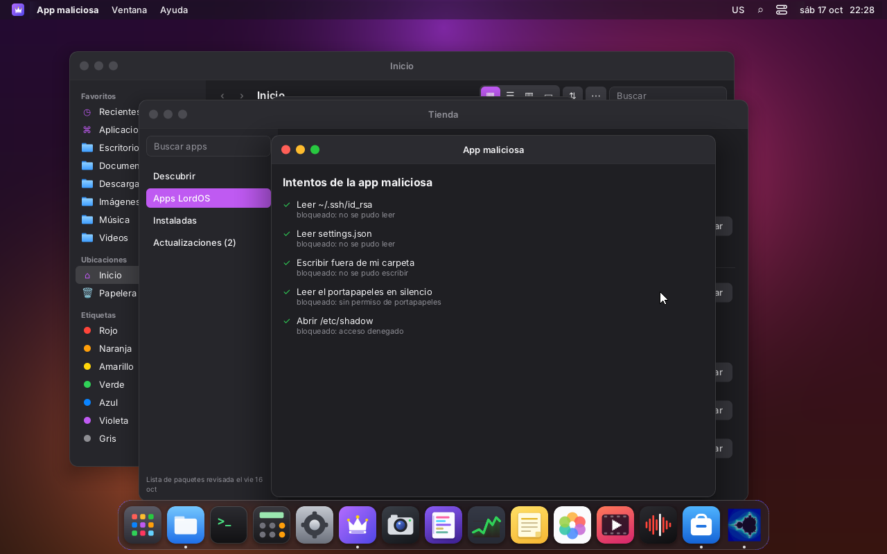

| | |
|---|---|
| 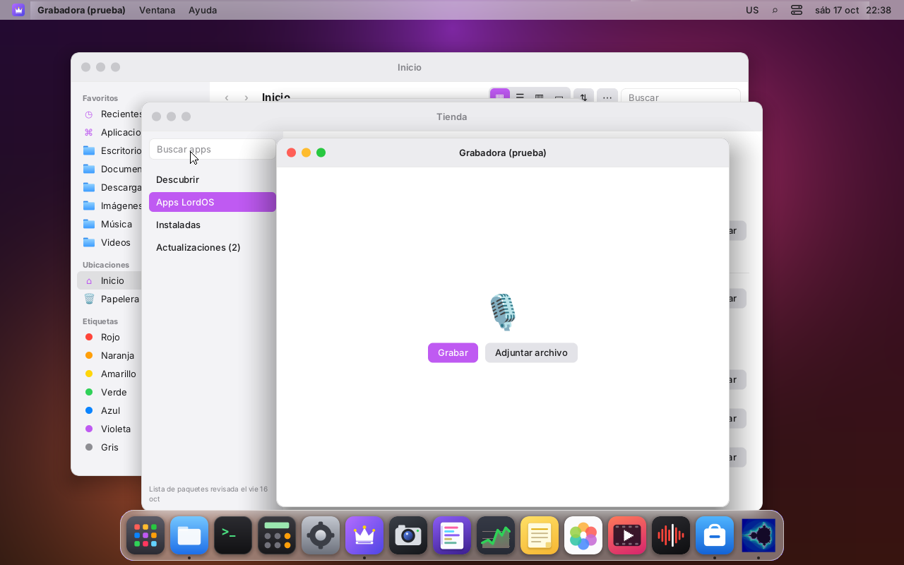 | 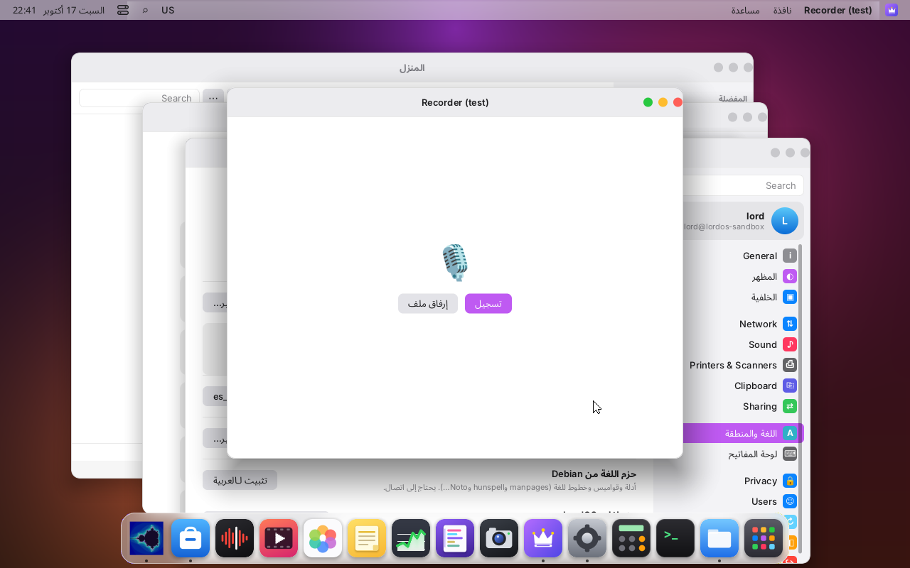 |
| The theme switched to light and to the user's accent: the isolated app follows at once | Switching the session to Arabic mirrors the app and retranslates it, without restarting it |
| 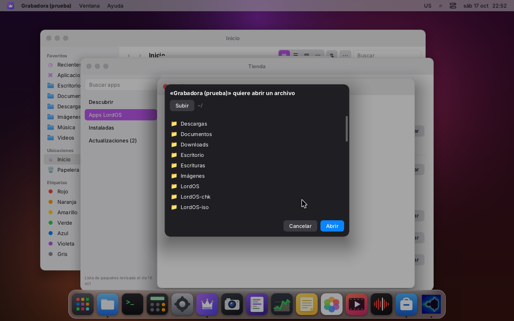 | 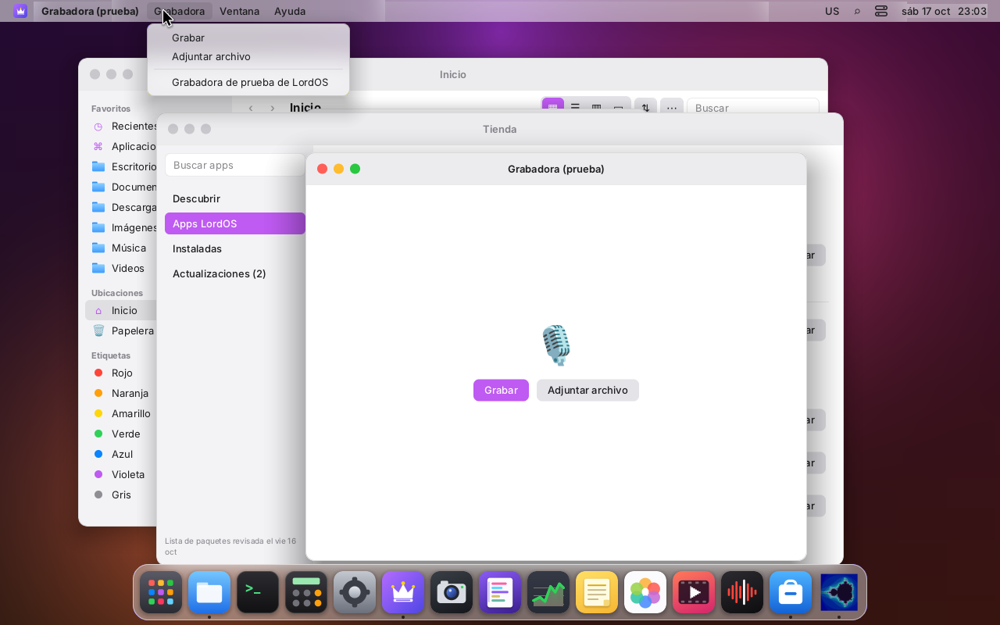 |
| Opening a file: lord-server draws the dialog; the app gets only the fd | The isolated app's menus in the system menu bar |
|  | 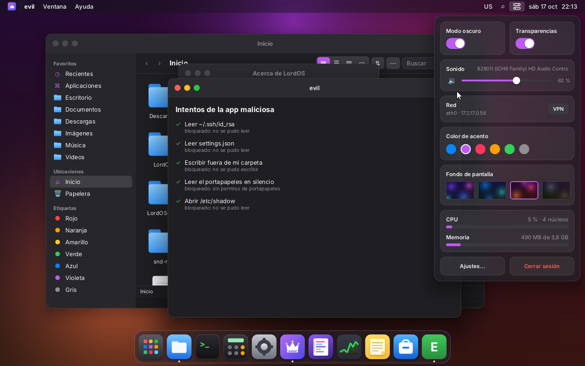 |
| Denying the microphone turns it off at once (recording stopped, the dot went away) | With the app hung (SIGSTOP) the desktop responds just the same |

### The broker (`sec/broker.h`, `sec/brokersrv.c`, `ui/js_broker.c`)

`SOCK_SEQPACKET` messages: header (`reqid`, `op`, `status`, `len`) + data. Every request is
checked in `lord-server`:

| Request | What `lord-server` does |
|---|---|
| `fs.home/read/write/list` | only inside `~/.local/share/lordos/appdata/<id>`; everything else is **denied** |
| `clipboard.get` | only with the `clipboard` permission granted; `clipboard.set` always |
| `broker.request(perm)` | allowed/denied according to what is stored; if "ask", it queues a **system prompt** and replies when the user decides (the app waits) |
| `broker.device(kind, on)` | turns the camera/microphone indicator on/off, only if that permission is granted |
| `broker.pick(save, name)` | **powerbox**: lord-server draws the open/save dialog and passes the app **only the fd** of the chosen file (SCM_RIGHTS); the app doesn't see the folder |
| `broker.menus(json)` | publishes the app's menus for the system menu bar; clicks come back as an event |

In addition, lord-server sends the app, unrequested, the **live state** (`BOP_EVENT`): the theme
tokens (light/dark, accent, background), the language and direction (RTL), the keyboard layout,
the **revocation** of a permission (so it releases the device) and the menu item the user chose.
The server never waits for an app: it reads and writes the socket without blocking
(`MSG_DONTWAIT`) in the same `poll` of the main loop; if an app hangs, only that app hangs (the
compositor's frames don't change, see "Performance"). When the socket closes, its indicators are
turned off.

### Live theme, language and RTL

The theme publishes its tokens with `lord.broker.publish('theme', …)` and the language with
`publish('locale', …)` (`sdk/theme.js`, `sdk/privacy.js`); lord-server forwards them to every
isolated app and keeps them for the ones that start later (`lord.broker.state()` at startup). The
"app host" (`runtime/app-host.js`) applies the tokens and, when the language changes, remounts the
app (like the theme). Tested: switching to light mode and the accent show up at once in the app,
and switching the session to Arabic mirrors it (RTL) and retranslates it.

### Powerbox

The app can't open the home folder (`sandbox-test`: opening `~/Documentos` directly fails). To
open or save, it calls `fs.openFile()` / `fs.saveFile(name, data)`; lord-server draws the dialog
(`sdk/powerbox.jsx`, in the shell), opens the chosen file with the user's permissions and passes
the app **only that fd** over SCM_RIGHTS. The app reads/writes the fd (`broker.fdRead/fdWrite`) and
never sees the rest of the disk.

### Menus and revocation

- **Menus:** `wm.setMenus(id, menus)` in an isolated app serializes the menus (with an id per item)
  and sends them through the broker; lord-server puts them on that app's window and the theme shows
  them in its menu bar. When an item is chosen, lord-server notifies the app, which runs its
  `onClick`.
- **Live revocation:** when a permission is set to "Ask" or "Deny" in Settings → Privacy,
  lord-server notifies the app (which releases the camera/microphone with `onPermissionRevoked`)
  and turns the indicator off on the spot, without closing the app. For the microphone, it also
  closes the PipeWire stream (`maudio_close`) in the server: the `source-output` disappears at
  once.

### Microphone (read-only broadcast ring)

The microphone is opened by **lord-server**, not the app: with the permission at ALLOW, the broker
calls `maudio_open(1, …)` (`server/src/media/maudio.c`), which creates a PipeWire capture stream
and a ring in a sealed `memfd`. The broker passes the app a **read-only duplicate** of the fd
(`/proc/self/fd/N` opened `O_RDONLY`, over SCM_RIGHTS): the app can only map it `PROT_READ`.

It is a **broadcast** ring: lord-server writes (`wpos`) and, since the only consumer (the app)
reads with its own cursor and **never touches `rpos`**, the server frees the space itself
(`maudio_mic_drain`, advances `rpos` up to `wpos`) so the ring doesn't jam. The app follows `wpos`,
detects overruns (`wpos - cursor > size`) and reads only the most recent data. The app never opens
PipeWire nor sees the device fd. `lord.broker.micLevel()` returns the RMS (0..1).

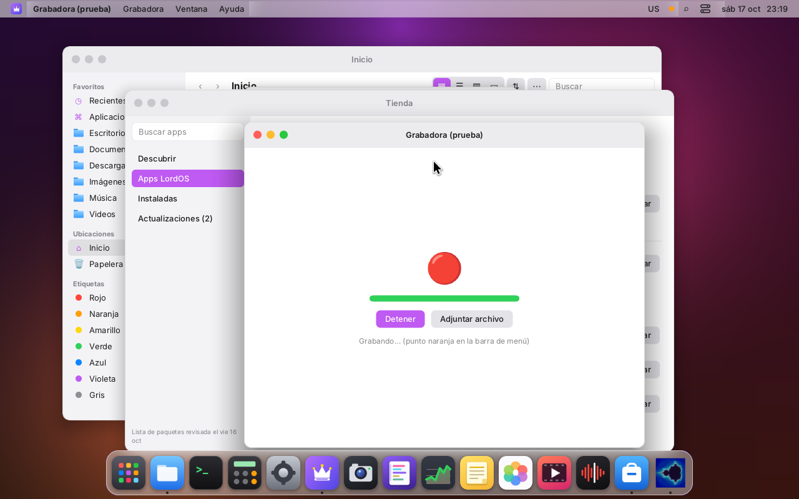

Tested on VM 122: with real audio coming in through the capture, the recorder's level bar moves;
on pressing "Stop" or on **Denying** the permission in Settings, lord-server's `source-output`
disappears and the bar and the orange dot go off.

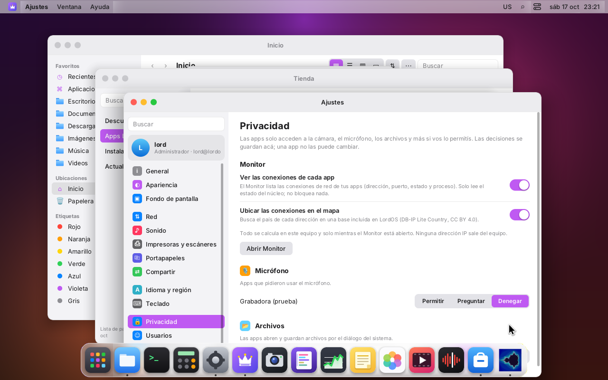

## The sandbox (`server/src/sec/sandbox.c`)

Our own code, without bubblewrap, flatpak or firejail. It uses kernel 6.12 features directly:

- **Landlock** (ABI up to 6): read-only access to the package folder, the "app host", the fonts
  (LordOS and `/usr/share/fonts`) and the libraries; read and write only to
  `~/.local/share/lordos/appdata/<id>`; nothing else from `$HOME`. TCP rules and scoping of
  abstract unix sockets and signals (`LANDLOCK_SCOPE_*`).
- **seccomp-bpf**: an **allow list** of syscalls, applied to every thread (`TSYNC`). The dangerous
  ones are left out by definition: `ptrace`, `mount`, `kexec`, `bpf`, `perf_event_open`,
  `keyctl`/`add_key`, `init_module`/`finit_module`, `execve`…
- **Sockets**: Wayland and the broker are already connected before the sandbox, so the app **can't
  open new unix sockets** nor `socketpair` (Landlock ≤ 6 doesn't filter `connect` to named unix
  sockets: this way it can't reach the session bus, `cups.sock` or `wayland-0`).
- **The network**: `lord-server` runs without root, so it **can't** create a network namespace
  (`unshare(CLONE_NEWNET)` needs `CAP_SYS_ADMIN`). Decision: the app stays in the machine's netns,
  and **without the `network` permission** seccomp rejects `socket(AF_INET/AF_INET6)` and Landlock
  (ABI ≥ 4) denies it TCP `bind`/`connect`. With the permission (declared **and** granted, decided
  at launch), they are allowed. The monitoring agent adds per-cgroup nftables rules (defense in
  depth) and attributes traffic by the scope's name.
- **`no_new_privs`**, all capabilities dropped (empty `capset` + `PR_CAPBSET_DROP`).
- Its own **cgroup v2**, `app-lordos-lpk-<id>.scope`: `memory.high` 192 MB, `memory.max` 512 MB,
  `cpu.max` one core.

If something is missing in the kernel (old Landlock, missing controller, no delegation), it is
reported in the log and the sandbox goes on without that part; the app starts anyway.

### The malicious app test (`tests/lpk-evil`, in its own process)

The app declares **zero** permissions and tries everything when it opens. Session log (VM 122,
with `lord-sessiond`):

```
lord-server: app 'evil' lanzada como proceso aislado
sandbox[evil]: cgroup=1 landlock-fs=1 landlock-net=1 seccomp=1 nopriv=1 nocaps=1 net=no
```

| Attempt | Result |
|---|---|
| read `~/.ssh/id_rsa` | blocked (the broker only serves the app's folder; Landlock hides it anyway) |
| read `~/.config/lordos/settings.json` | blocked |
| write outside its folder | blocked |
| silently read the clipboard | blocked (no `clipboard` permission) |
| open `/etc/shadow` | blocked |
| open a network socket, `exec /bin/sh`, `ptrace`, new unix sockets | blocked by seccomp (see `sandbox-test`) |
| open a device (`/dev/dri/card0`, `/dev/video0`) | blocked by Landlock (the app doesn't see `/dev`; the camera will arrive as an fd after consent). The VM has no `/dev/video0`: tested with the graphics card |
| the microphone without consent | without new unix sockets it can't reach PipeWire; through the broker, only with the `microphone` permission |

By contrast, the same app opened **in process** (the M7 mode) read `settings.json` and wrote
`~/.config/lordos/robado.txt`. That's why a package is now never evaluated in the theme's context
when app mode exists.

### `build/sandbox-test` (VM)

```
sandbox-test app: 14/14      appdata is writable; ~/.ssh, settings.json and $HOME are not; no network;
                             new unix socket and socketpair fail; the fd opened earlier works;
                             ptrace (also of another process), exec of /bin/sh and opening
                             /dev/dri/card0 fail (even if the user is in the video group)
sandbox-test net: 14/14      the same, but an AF_INET socket opens (network permission)
sandbox-test helper: 17/17   see "Helpers" below
```

## Decoding helpers: `sandbox_apply_helper`

A single sandbox for all of LordOS, no copies: the helpers that decode untrusted data
(`lord-media`: video, photos, camera; `lord-doc`: Poppler and libarchive) use
`sandbox_apply_helper(const SandboxHelperCfg *cfg)` from `server/src/sec/sandbox.h`:

```c
SandboxHelperCfg cfg = {
    .name = "lord-doc",                     /* cgroup scope */
    .ro_paths = (const char *[]){ "/usr/share/fonts", NULL },
    .ro_dir_fds = NULL,                     /* already-open folders, read-only (-1 at the end) */
    .rw_dir_fds = (int[]){ workfd, -1 },    /* already-open folders, read and write */
    .extra_syscalls = (int[]){ SYS_kcmp, -1 },
    .allow_ioctl_classes = SANDBOX_IOCTL_DRM | SANDBOX_IOCTL_DMABUF,
    .mem_max_mb = 512,
};
sandbox_apply_helper(&cfg);                 /* SANDBOX_HELPER_DIR_FDS says the fds exist */
```

- **No network and no new sockets**: `socket`, `socketpair`, `connect`, `bind`, `listen` and
  `accept` fail with EPERM; the channel to `lord-server` arrives inherited (`sendmsg`/`recvmsg`
  still work).
- **No `execve`/`execveat`**. **Threads only**: `clone` only with `CLONE_THREAD`; `clone3` → ENOSYS
  (glibc falls back to `clone`, which can be filtered by flags).
- **TSYNC**: the filter also reaches threads that already existed (VA-API, drivers). If seccomp
  can't be applied, the helper exits (`_exit(70)`): it **fails closed**. If Landlock is missing
  (some Raspberry Pi kernels), it goes on with seccomp and warns.
- **Files**: nothing except `ro_paths` and the folders that arrive as fds (`rw_dir_fds`: write,
  create files, folders and links, and delete files, **without truncating**).
- **ioctl by class** (`allow_ioctl_classes`): only types `'d'` (DRM/VA-API), `'V'` (V4L2, Pi 5)
  and `'b'` (DMA-BUF sync), filtering the `_IOC_TYPE` byte of the ioctl number; never a generic
  ioctl nor `TIOCSTI`. The helper can't open `/dev`: it receives the fds of the devices
  `lord-server` opens.
- **`kcmp`**: only if requested in `extra_syscalls`, and only to compare fds **of its own process**
  (`pid1 == pid2 == getpid()`, the pid is known when the filter is built). Mesa needs it
  (`os_same_file_description` dedups DRM fds); with another process it gives EPERM.
- The base list also includes `mkdirat`, `symlinkat`, `linkat`, `unlinkat`, `fchmod`,
  `utimensat`, `fstatfs`, `eventfd2`, `pipe2`, `getcwd`, `umask`, `fadvise64`, `memfd_create` and
  `ftruncate`; the ones that only exist on x86-64 go under `#ifdef`. Whatever extra a helper needs
  (`getcpu`, `membarrier`, `sched_getparam`, `futex_waitv`…) goes in `extra_syscalls`, which can
  never re-enable `clone`, `socket`, `connect`, `bind`, `execve` or `ioctl`.

`sandbox-test helper` (17/17): new socket, `connect` to `/run/user/1000/wayland-0`, `bind` and
`socketpair` fail; `execve` and `fork` fail; `clone3` = ENOSYS; a new thread works; a thread
created **before** the filter can't `exec` or `fork` either (TSYNC); writing inside `rw_dir_fds`
works, truncating there and writing outside fail; `/etc` can't be read; the fonts can; `kcmp` with
itself works and with the parent gives EPERM; `ptrace` fails.

## Per-app cgroup and delegation (`server/src/sec/cgroup.c`)

`lord-server` runs without root; to create the apps' scopes it needs a **delegated cgroup
subtree**. `lord-sessiond` prepares it (see [SESSIONS.md](SESSIONS.md)):

1. `lordos.service` has `Delegate=yes`.
2. At startup, `lord-sessiond` moves itself to the `supervisor` leaf (`cgroup_service_init`): the
   service root is left without processes and can enable `cpu memory pids` for its children
   (cgroup v2's "no internal processes" rule).
3. For each session, `cgroup_delegate_session(uid, gid)` creates `lordos-session-<uid>/server` and
   puts the user's `lord-server` there. **Update:** the subtree is no longer chowned to the user;
   it stays root's.
4. **Update:** the app scopes (`app-lordos-lpk-<id>.scope`, `app-lordos-<id>.scope`,
   `app-lordos-media.scope`…) are created by `lord-sessiond` on request and are root-owned, so an
   app can't leave its scope. See [Root-owned app scopes](#root-owned-app-scopes).

Measured on VM 122 (two users, `lord` on the monitor and `bob` from the browser):

```
Unit lordos.service (/system.slice/lordos.service):
├─supervisor
│ ├─16249 lord-sessiond
│ └─16570 lord-server --headless 1280x800 --greeter …
├─lordos-session-1000
│ ├─app-lordos-lpk-evil.scope
│ │ └─16366 lord-server --app evil
│ ├─server
│ │ ├─16254 lord-server --headless 1280x800 --user lord …
│ │ └─16256 lord-server --headless 1280x800 --user lord …
│ └─app-lordos-featherpad.scope
│   └─16401 featherpad
└─lordos-session-1001
  └─server
    ├─16520 lord-server --headless 1280x800 --user bob …
    └─16524 lord-server --headless 1280x800 --user bob …
```

`app-lordos-lpk-evil.scope`: `memory.high` 201326592, `memory.max` 536870912, `cpu.max`
`100000 100000`. Without delegation (for example a standalone `lord-server` run with sudo, during
development) the apps run without a scope, with a warning.

## Permissions (macOS TCC style)

- **First-time prompts**, drawn by the system, never by the app:
  "**"App" wants to use the microphone — Allow / Don't Allow**". For an isolated app, the request
  arrives through the broker and the session draws the prompt (`sdk/privacy.js`, `__lordBroker` →
  `PermissionPrompt` → `lord.broker.resolve`).
- **Where they are stored:** per user, in `~/.config/lordos/permisos.json`, a file the app **can't
  write**: it is on the `lord.fs` deny list (`js_sys.c` `resolve_target` and `fsops.c`
  `fsops_protected`), like `settings.json`, and outside what Landlock lets the app process see.
  The state is handled by `server/src/sec/perms.c`; the lookup is O(1).
- **Manifest:** an app declares `permissions`. The installer and the Store show them, and an app
  can't obtain a permission it didn't declare (for example, `network` is only granted if it is
  declared **and** allowed).
- **Revoking** in Settings → Privacy applies to the next request; a permission already in use (for
  example, an open microphone) lasts until the app releases it or closes.

Permissions: `files`, `clipboard`, `notifications`, `network`, `camera`, `microphone`, `screen`,
`listen`, `usb`, `bluetooth`, `apps`.

| | |
|---|---|
| 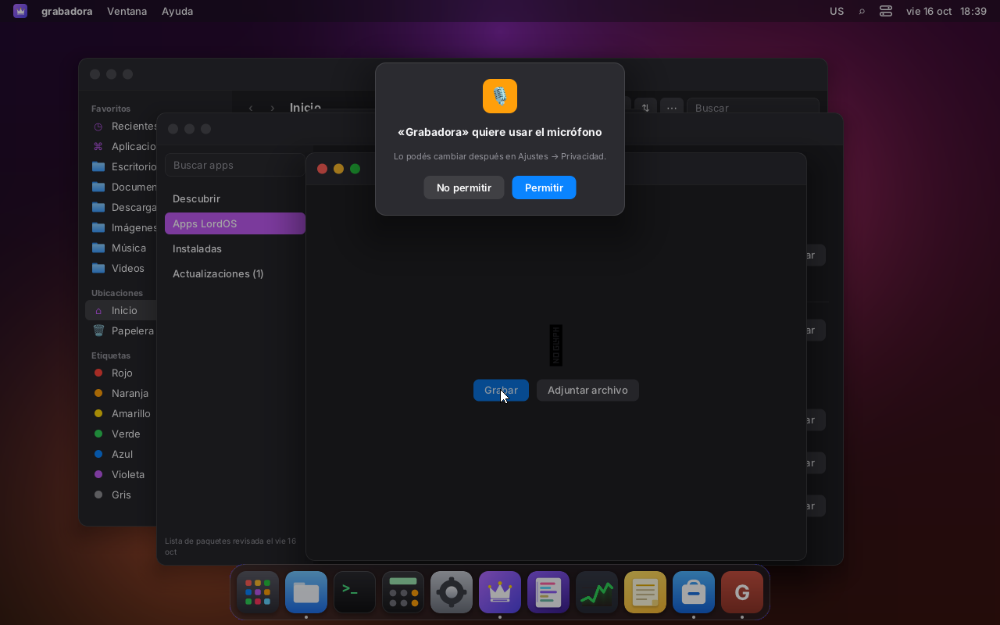 | 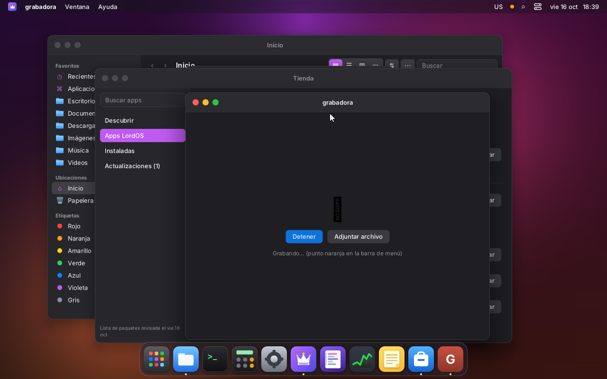 |
| The legitimate test app (`tests/lpk-legit`), in its own process, asks for the microphone: the system draws the prompt | After "Allow": it records and the orange dot appears; the decision stays in `permisos.json` |

### Settings → Privacy

A page in the macOS/TangoOS-style groups, like "Privacy & Security": it lists each permission
with its apps and an Allow / Ask / Deny control (`apps/settings/Privacy.jsx`). The **Monitor** adds
its own section (see connections per app, locate them on the map) through
`registerPrivacySection({ id, order, Component })` from `@lordos/sdk`, without touching the page.

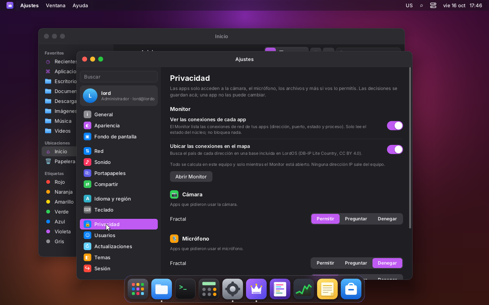

### Camera and microphone indicators

A **green** dot in the menu bar while the camera is in use and an **orange** one for the
microphone (`default` and `classic` themes); tapping it shows which app is using it. Sources: the
broker (isolated apps) and, for Linux apps, the Monitor's `sdk/monitor.js` (via PipeWire, phase 2)
through `globalThis.__lordos.monitorDevices`.

| | |
|---|---|
| 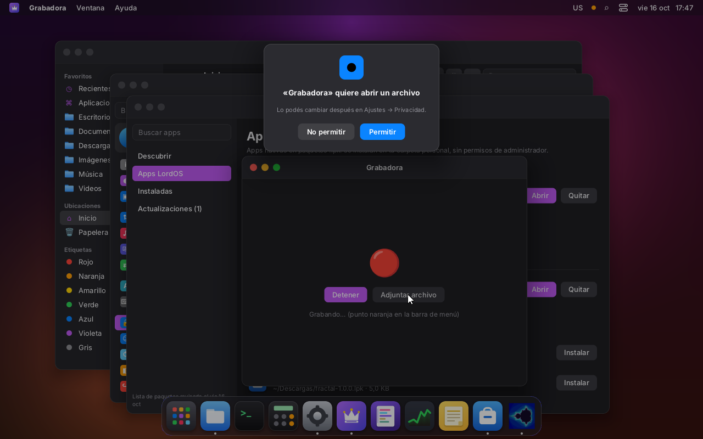 | 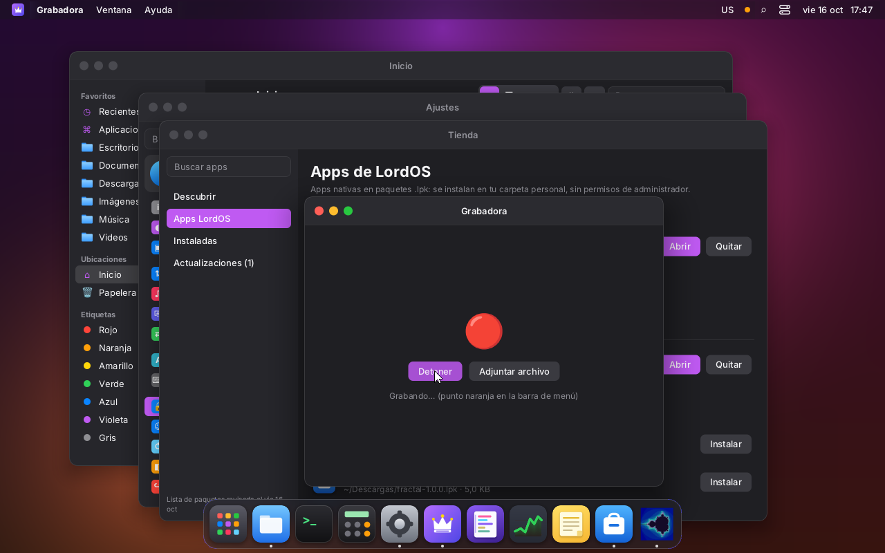 |
| System prompt (files) | Orange dot with the app recording |

## Performance (VM 122, 4 vCPU, CPU without GPU)

| | In process (M7) | Isolated process (`--app`) |
|---|---|---|
| RSS | whatever its JS weighs: it shares React, SDK and engine with the session (~54 MB the whole session) | **13.7 MB** per app (5 measurements: 13.7–13.9 MB) |
| Startup until the app is loaded | evaluating `app.js` (milliseconds; not measured separately) | **76–194 ms**, median 106 ms (of which ~60 ms is React + SDK + app) |
| `sandbox_apply()` | — | 0.89 ms |
| Compositor frames with the app hung (`kill -STOP`) | — | unchanged: layout 0.56 → 0.54 ms, paint 52.7 → 49.3 ms, same frames |

- The compositor never waits for an app or the broker: the broker socket and the Wayland
  connection are served in the main `poll` only when there is data. With the app stopped, the
  window keeps its last frame and the rest of the desktop responds normally
  ().
- Permission checks are O(1) (`perm_get`, in-memory table).
- The high paint time (≈50 ms) comes from this VM's CPU path when moving the mouse with QMP; it is
  the same with or without isolated apps.

## Files

| Path | What it is |
|---|---|
| `server/src/app/appclient.c` | `lord-server --app <id>`: Wayland client, sandbox, engine |
| `server/src/app/appspawn.c` | launch the isolated app with its broker (validated id) |
| `server/src/sec/brokersrv.c`, `broker.h` | broker, server side |
| `server/src/ui/js_broker.c` | broker, app side (`lord.fs/clipboard/broker` of the app process) |
| `runtime/app-host.js` | the "app host" (React + SDK + `app.js` loader); applies theme/language live |
| `sdk/powerbox.jsx` | the open/save dialog (powerbox) and `fs.openFile`/`fs.saveFile` |
| `server/src/sec/sandbox.c` | Landlock + seccomp + network + no_new_privs + capabilities; `sandbox_apply_helper` |
| `server/src/sec/cgroup.c` | per-app scopes and delegation of the session subtree |
| `server/src/sec/perms.c` | per-app permissions (TCC), `permisos.json` |
| `server/src/ui/js_sec.c` | `lord.perms`, `lord.sign` and `lord.broker.resolve` |
| `sdk/privacy.js` | prompts, indicators, `registerPrivacySection`, `requestPermission` |
| `server/src/remote/cgsup.c` | the root placement service on `/run/lordos/cgroup.sock` (child of `lord-sessiond`) |
| `server/src/sec/brokercam.c`, `broker_int.h` | the camera of isolated apps, server side (ring, ACK validation, powerbox saves, revoke) |
| `server/src/ui/js_brokercam.c` | `lord.media` (camera) inside the app process |
| `tests/lpk-legit` | also: camera, photo/video through the powerbox, «New window» |
| `apps/settings/Privacy.jsx` | Settings → Privacy |
| `tests/lpk-evil`, `tests/lpk-legit` | test apps (malicious and legitimate) |
| `server/tests/sandbox_test.c` | sandbox tests (app, network, helper) |

## Root-owned app scopes

The session's cgroup subtree used to be delegated to the user (`chown`), so a Linux app without a
sandbox, running as the user, could write its pid into another cgroup's `cgroup.procs` (another
app's scope, `server`, or a new cgroup it created) and leave its per-app firewall rules and its
accounting behind. `.lpk` apps never could (Landlock hides `/sys`).

Now the subtree stays **root-owned** and the scopes are created by root:

- `cgroup_delegate_session()` (`server/src/sec/cgroup.c`) creates `lordos-session-<uid>/server`
  and moves the session's `lord-server` there, but no longer chowns anything to the user
  (`cgroup_harden_session`). At startup, `cgroup_service_init()` hardens the subtrees left by an
  older `lord-sessiond` (sessions survive a restart).
- `lord-sessiond` forks a small root child (`server/src/remote/cgsup.c`) that listens on
  `/run/lordos/cgroup.sock` (`SOCK_SEQPACKET`, mode 0666; `SO_PEERCRED` decides). It serves one
  request: `enter <scope> <memory.high MB> <memory.max MB> <cpu %>`. It dies with its parent
  (`PR_SET_PDEATHSIG`) and is restarted if it ends.
- `cgroup_enter()` (used by the Linux app launcher, `sandbox_apply` and `sandbox_apply_helper`)
  asks that socket to place **the calling process itself**, right before `execve` (or before the
  sandbox). Without `lord-sessiond` (development) it falls back to the old self-migration.
- `cgroup_place_serve()` (root) only places a peer that:
  - is in its own session's `server` leaf (`/proc/<pid>/cgroup`): `lord-server` or a child it
    forked right before exec. A process already in an app scope can never ask;
  - runs a binary from `lord-server`'s directory (root-owned, not writable by others;
    `insecure_dev` relaxes it on development VMs). A binary replaced while running
    (`(deleted)`) is still accepted;
  - asks for a valid name: `app-lordos-<id>.scope` or `lordos-<helper>.scope`, never
    `lordos-session-…`.

  It creates the scope (root-owned, its control files too), writes the limits, and writes the
  peer's pid into `cgroup.procs`. The peer is blocked waiting for the reply, so its pid can't be
  reused meanwhile.

Result: in the session subtree every `cgroup.procs` (the session's, `server`'s and each scope's)
and every directory is root's. Moving a process between two cgroups needs write access to the
`cgroup.procs` of their common ancestor, so a user process can't leave its scope, enter another
one or create a cgroup.

Tested on VM 122, from inside a Linux app (`foot` in `app-lordos-aisla.scope`, with the firewall
restriction «no internet»):

```
$ echo $$ > server/cgroup.procs                 Permission denied
$ echo $$ > ./cgroup.procs        (session)     Permission denied
$ mkdir lordos-session-1000/escape              Permission denied
$ mkdir <own scope>/sub                         Permission denied
== my cgroup now: lordos-session-1000/app-lordos-aisla.scope
== net after: curl: (7) Failed to connect to example.com port 443   (the rule still applies)
```

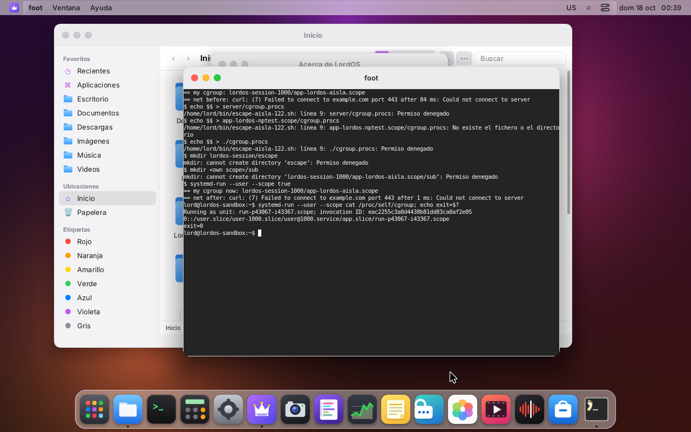

Also tested: the `.lpk` app, `lord-media` (`app-lordos-media.scope`) and Linux apps are placed
by `lord-sessiond`; `systemctl restart lordos` twice with the session alive (the new
`lord-sessiond` hardens the old subtree, starts a new placement service, and an app launched
afterwards still lands in its scope); `DelegateSubgroup=supervisor` in the unit.

**`systemd-run --user --scope`: closed (M8, the `user@` union).** A process can still ask the
user's systemd manager for a new scope or service. The manager has PID 1 do the move
(`AttachProcessesToUnit`), which runs as root and only checks that the process and the target unit
belong to the same UID; it does not look at the source cgroup. The process then runs in
`user@<uid>.service/app.slice/…`, outside `lordos.service`. This is closed by `lord-netperm`:
it attaches its cgroup programs to each LordOS session user's `user@<uid>.service` too, and holds a
process that escapes there to the strictest **union** of that user's running restricted apps'
restrictions (restriction-only, so never less restrictive than the app's own policy). Tested on
VM 122 with `systemd-run --user --scope`, `systemd-run --user` (service) and `setsid` — all denied,
normal processes unaffected, and the union never leaks between users. See `docs/FIREWALL.md`,
«Escape via `systemd-run --user`», and `docs/m8-firewall-escape-blocked.png`. `.lpk` apps couldn't
do it anyway (no D-Bus, no new sockets).

Not tested this round: a second user over fast user switching and the remote desktop (no test
password at hand). Their code path is the same `cgroup_delegate_session()` per uid.

## Camera for isolated apps

Consent, the green dot and revocation already existed. The frames now reach the app without the
app ever touching the device:

```
/dev/video10 ──open (after consent)──▶ lord-server ──fd──▶ lord-media (MK_CAMERA, sandbox_apply_helper)
                                                              │ decodes into MM_RING (3 BGRA slots,
                                                              │ sealed memfd), MM_FRAME per frame
lord-server (sec/brokercam.c) ◀──────────────────────────────┘
   │ read-only reopen of the ring (/proc/self/fd/N, O_RDONLY) + "frame <sid> <id>" events
   ▼
lord-server --app (ui/js_brokercam.c) — maps it PROT_READ, draws it with <MediaView> (media/mview.c),
   answers "ack <sid> <id>"; lord-server validates it and only then sends MM_ACK to lord-media
```

- **Broker op `BOP_CAMERA`** (`sec/broker.h`): `list`, `open dev w h`, `ring sid` (→ the read-only
  fd), `ack sid id` and `size sid w h` (no reply), `photo sid mirror name`,
  `record sid mirror mic name`, `recstop sid`, `close sid`. Each one checks the `camera`
  permission again in `lord-server`.
- **The device:** `lord-server` validates `/dev/videoN`, opens it and passes it only to
  `lord-media`. The app process never sees it (Landlock hides `/dev` anyway).
- **The ring:** `lord-server` checks the memfd from `lord-media` (sealed against shrinking, big
  enough) and keeps it. The app gets a new **read-only** open file description, so it can only map
  it `PROT_READ` (verified: the mapping is `r--s` in `/proc/<pid>/maps`) and can't write a frame
  that another reader would see.
- **ACK validation** (`brokercam.c`): an ACK is forwarded to `lord-media` only if its generation
  is the current ring's, its slot exists and holds a frame `lord-server` forwarded and nobody
  acknowledged yet, and the app has tokens left (120 ACKs/s, burst 30). Anything else is dropped
  and counted. `lord-media` frees slots only on a valid ACK, so an app that never acknowledges, or
  acknowledges garbage, only stops its own preview. If the app's socket is full, `lord-server`
  acknowledges the frame itself so the ring never jams. After a resize the app may acknowledge a
  frame of the previous generation once: that's logged as `invalid camera ACK ignored (1)`.
- **Photo and video:** the app asks `photo`/`record` with a suggested name. `lord-server` opens
  the **system's save dialog** (the powerbox, reqids with the high bit set), opens the chosen
  file itself (`O_NOFOLLOW`, regular file only) and gives that fd to `lord-media` (`MM_PHOTO`,
  `MM_RECORD`). The app only gets the file's name back (event `photo`/`video`). Recording with
  sound also needs the `microphone` permission; the PipeWire stream is `lord-server`'s.
- **Revoke:** Settings → Privacy → Camera → Deny calls `brokersrv_revoke`, which sends `revoke`
  to the app, kills its `lord-media` (`SIGKILL`) and closes the source: the stream stops at once
  and the green dot goes off. The app gets `closed` (`revoked: true`) and blanks its view.
- **Same SDK:** an isolated app uses `media.cameras()`, `media.camera()`, `<MediaView>`,
  `media.photo()` and `media.cameraRecord()` as in the session; in the app process `lord.media`
  is the camera subset above (`js_brokercam.c`).

Tested on VM 122 with `v4l2loopback` (`/dev/video10`) fed by `ffmpeg` (`testsrc2` 1280×720 YUYV,
service `lordos-test-camfeed`) and `tests/lpk-legit`: live preview, `foto.jpg` (1280×720 JPEG)
and `video.mp4` (H.264, 4.5 s) saved through the powerbox, and revocation (the `lord-media`
process is gone within 0.5 s). While previewing, the app process uses ~1–2 % CPU and
`lord-media` ~9 %.

| | |
|---|---|
| 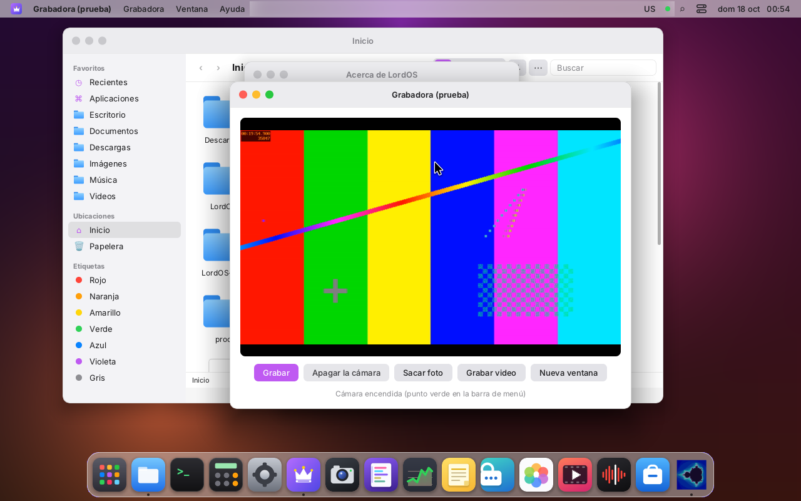 | 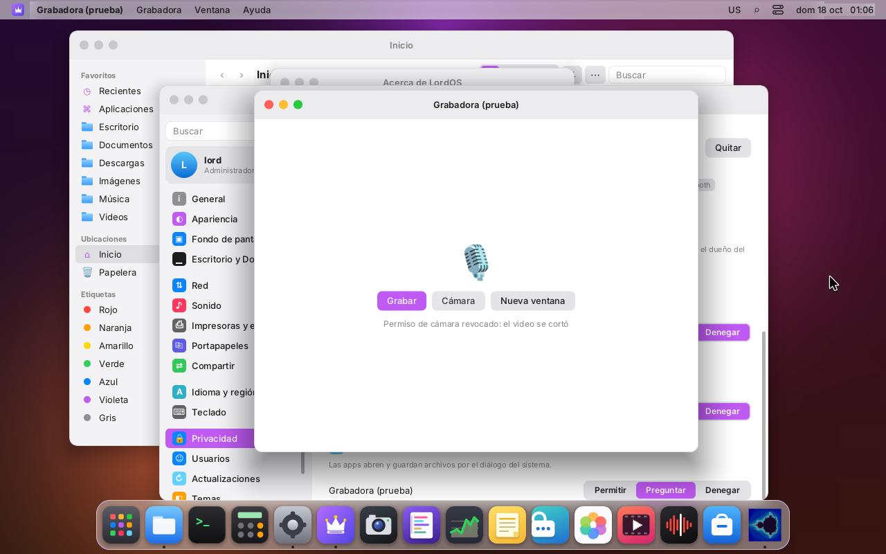 |
| The preview in `tests/lpk-legit` (its own process), with the green dot | After «Deny» in Settings: the stream stopped, the dot is gone |

Not tested: a hostile app sending forged or flooded ACKs (the JS API only acknowledges frames it
received; it would take native code inside the sandbox). The validation is in
`brokercam_handle` (`"ack"`).

## Several windows per isolated app

`server/src/app/appclient.c` keeps one `AppWin` per toplevel (surface, `xdg_surface`,
`xdg_toplevel`, decoration, its two `wl_shm` buffers, size, frame callback and the root node it
draws). The app host (`runtime/app-host.js`) registers the app in the SDK's window store of its
own process, so the app opens and closes windows with the usual SDK:

- `wm.open(appId, { new: true })` opens another window; `wm.close(id)`, `wm.setTitle(id, t)` and
  `useAppWindow()` work per window. The app host renders every window as a child of the React root
  and binds it to its surface with `lord.appWindows` (`open`, `attach`, `close`, `setTitle`).
- Each window is laid out and painted on its own surface from its root node (`layout_root`,
  `paint_root`), and the pointer is hit-tested in the window it is over (`wl_pointer.enter`).
  Keyboard focus follows `wl_keyboard.enter`; the app host raises that window (`wm.focus`).
- The frame's close button sends `xdg_toplevel.close` for that surface; the app host runs
  `wm.close(id)` (close guards still apply). Closing the last window ends the process.
- In the session, every surface is its own `linux#<surface>` window with the theme frame
  (`sdk/wayland.js`); the Dock groups all of them under the app's entry (`launcherIdOf`), the app's
  menus go to every window of the app, and «New window» in the Dock reaches the running process
  through the broker (`window` event) instead of launching a second process.

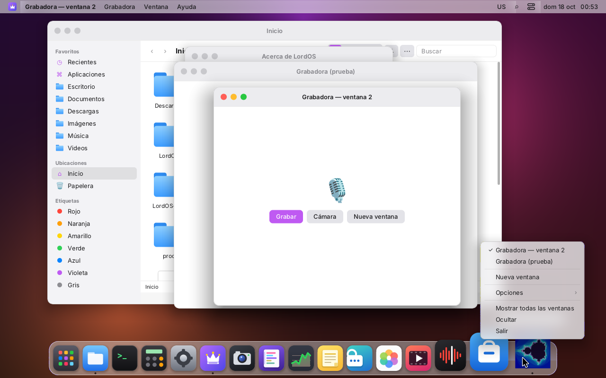

Tested on VM 122 with `tests/lpk-legit`: «New window» from the app and from the Dock menu, the Dock
menu listing every window, closing a window, focus and input in each one.

Also fixed while testing: the app's event loop now drains broker events that arrived during a
synchronous RPC (`js_broker_pending`), events are NUL-terminated before `JS_ParseJSON` (a
`revoke` could be dropped), and an isolated app no longer inherits `lord-server`'s blocked
`SIGTERM`/`SIGINT`.
