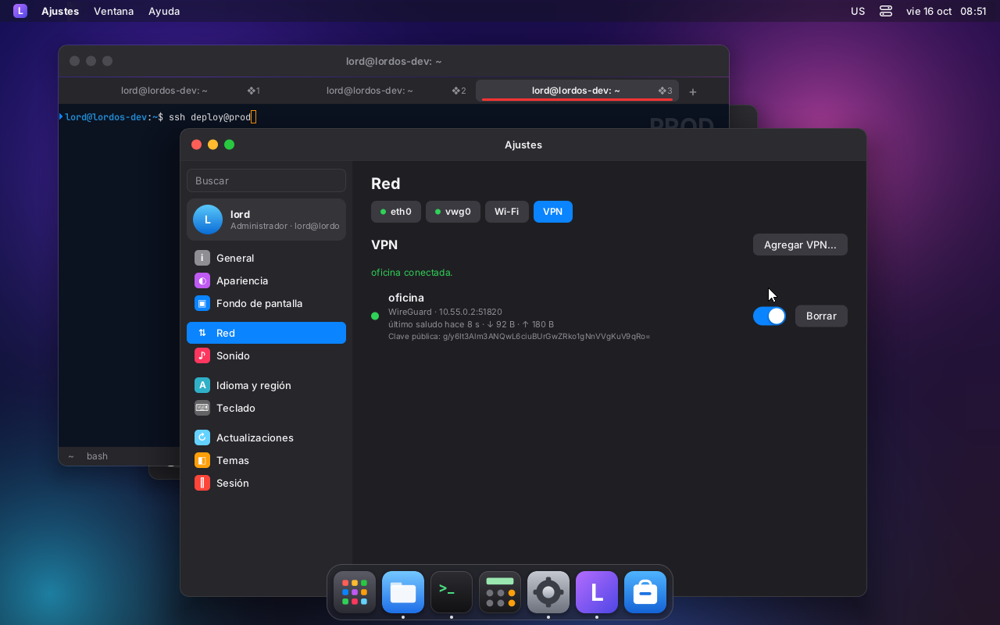

# Red y VPN en LordOS

La red de LordOS es propia y corre directo sobre el kernel. No usa NetworkManager, D-Bus, libnl, wg-quick ni wireguard-tools. El código está en `server/src/net/` y tiene dos lados:

| Lado | Qué hace | Archivos |
|---|---|---|
| lord-server (sin root) | Lee el estado con rtnetlink (interfaces, direcciones, rutas, contadores) y escucha los cambios. El DNS sale de `/run/systemd/resolve/resolv.conf` o de `/etc/resolv.conf`. Lo expone a JS como `lord.net`. | `state.c`, `ui/js_net.c` |
| `lord-netd` (root, the system network) | Serves the `net-*` actions of `admin.c`'s closed list and owns the resident processes (DHCP, wpa_supplicant, VPN). `lord-sessiond` starts and supervises it at boot (see "The network belongs to the system"). Without `lord-sessiond`, the session's helper serves them, as before. | `actions.c`, `dhcp.c`, `wifi.c`, `wg.c`, `ovpn.c`, `ipsec.c` + `vici.c`, `vpnproc.c` (PPTP, OpenConnect, Fortinet), `vpn.c` (lo común), `sys.c` |
| compartido | netlink propio, criptografía mínima (X25519, SHA-1/PBKDF2, base64), utilidades | `nl.c`, `crypto.c`, `netpriv.h` |

## The network belongs to the system: `lord-netd` (M9)

Up to M8 the network was brought up by the root helper of the **first session** that logged in
(`/run/lordos/net-owner`). On an installed system that had three problems:

- there was no network before the first login, so the greeter showed the hostname instead of the
  IP and the remote desktop was unreachable;
- if that session logged out, its DHCP client and wpa_supplicant exited with it, and the other
  sessions didn't bring the network back;
- the network depended on who logged in first.

Now the network belongs to the system, like NetworkManager or systemd-networkd:

```
lordos.service
└── lord-sessiond
    └── lord-netd                       the network: DHCP, saved Wi-Fi, configs, DNS, VPN
        ├── if:<if>                     DHCP client (our own code)
        ├── wpa:<if>                    wpa_supplicant
        └── vpn:<name>                  openvpn, charon, pppd…
lord-server --user lord ── lord-admin ──┐  /run/lordos/netd.sock (0600, root only)
lord-server --user ana  ── lord-admin ──┘  net-* actions are forwarded as they are
```

- **What it is.** `lord-netd` is `admin.c` built with `LORD_NETD` (`server/src/net/netd.c` only has
  `main`). Its table has **only** the `net-*` actions, with the same validation, and it runs
  nothing those actions didn't already run. libc only.
- **When it starts.** `lord-sessiond` starts it at boot, before the greeter
  (`server/src/remote/netsup.c`):
  - fixed path `<lord-sessiond's directory>/lord-netd`, root-owned and not writable by others
    (unless `insecure_dev`);
  - no arguments and a minimal environment;
  - in its own session (`setsid`).

  `lord-netd` runs `net-restore` by itself: the configs in `/etc/lordos/net/if`, DHCP on free
  physical NICs, Wi-Fi with the saved networks, and DNS. That is why there is an IP before anyone
  logs in.
- **Sessions** bring nothing up. Each session's helper connects to `/run/lordos/netd.sock`
  (`SO_PEERCRED`: uid 0 only), introduces itself with `HELLO <user>` and forwards every `net-*`
  action as it is. `lord-netd` works out again whether that user is an administrator (group sudo)
  and applies `A_ANYONE` as before. Replies go back to the helper that asked; events
  (`net dhcp…`, `net wifi…`, `net vpn…`) go to every session. Settings → Network didn't change.
- **A session's `net-restore`** answers `OK 0 interfaz(es): la red es del sistema (lord-netd)`.
- **Wi-Fi and VPN passwords** stay in `/etc/lordos/net/wifi` and `/etc/lordos/net/vpn` (root, 0600).
  They travel over the socket between two root processes and never go back to a session.
- **If `lord-netd` exits,** `lord-sessiond` starts it again: it waits 1, 2, 4… up to 30 s, and goes
  back to 1 s if it had run for more than a minute.
  - Its DHCP client gets `SIGUSR1` (`PR_SET_PDEATHSIG`): it exits **without releasing the address**
    and leaves the lease in `/run/lordos/dhcp/<if>.lease` (0600). The new client confirms it
    (INIT-REBOOT) and connections are not dropped.
  - VPNs that were up are reconnected (`/run/lordos/netd-vpns`).
  - wpa_supplicant does restart: Wi-Fi reassociates within a few seconds.
- **If `lord-sessiond` restarts** (`KillMode=process`), `lord-netd` keeps running and the new
  `lord-sessiond` **adopts** it: it reads `/run/lordos/netd.pid`, checks that it is a root process
  named `lord-netd` and watches it with a `pidfd` in its `poll`, without polling. The lock
  `/run/lordos/netd.lock` (`flock`) prevents two from running.
- **Sessions reconnect:** when `lord-netd` restarts, each session's helper sees it come back with
  inotify on `/run/lordos` (the socket is created under another name and renamed once it listens)
  and reconnects. An action in progress answers "la red del sistema se reinició: probá de nuevo".
- **Without `lord-sessiond`** (a standalone `lord-server`, in development) there is no
  `/run/lordos/netd.enabled`, and the session's helper runs the network itself, as before (with
  `net-owner`). With that mark, a session never brings the network up on its own.
- **Resident processes no longer inherit the helper's descriptors** (`admin_daemon_fork` and
  `A_FORK` actions keep only their pipe): a DHCP client that outlives `lord-netd` doesn't hold its
  lock or socket.

### Test (VM 119, October 17)

VM 119 runs `lord-sessiond` installed like the `.deb`; it was not installed from the ISO (see
`VM-SETUP.md`, step 20). `eth0` is managed by systemd-networkd (netplan) and LordOS leaves it
alone, so the test uses a LordOS-managed NIC: the veth `lnt0`, whose peer is in the netns `lnt`
with a `dnsmasq` there (`lordos-test-netns.service`, which starts before `lordos.service`), and
`/etc/lordos/net/if/lnt0.conf` with `method=dhcp`.

| Test | Result |
|---|---|
| Boot, nobody logged in | `lord-netd` started together with the greeter; `lnt0` had `10.77.0.96/24` after **3 s** |
| Remote desktop before login | `curl https://10.77.0.96:5673/` from the netns: **200** |
| `lord` logs in on the monitor, `ana` (created in Settings → Users) over the network | two helpers connected to `netd.sock`; Settings → Network shows `lnt0` "por DHCP" |
| `lord` logs out (it was the "first" session) | `lnt0` keeps its IP |
| `ana` logs out too: no session left | `lnt0` keeps its IP and the remote desktop answers 200 |
| `kill -9` on `lord-netd` | restarted in 1 s, lease `resume`: the address **never dropped** (sampled every 0.5 s) |
| `systemctl restart lordos` | `lord-netd still running (pid …): the network was not interrupted`; killing it afterwards: restarted and resumed the same way |

| | |
|---|---|
|  |  |
| Greeter right after boot, nobody logged in: the IP at the bottom. On this VM it is `eth0`'s (netplan); `lnt0`'s (lord-netd) was already up, as the log shows | Logged in: `lnt0` "por DHCP", brought up by `lord-netd` |

A fix that came out of the test: `systemctl restart lordos` failed with "Failed to spawn executor:
Device or resource busy" while processes were still alive (greeter, sessions and now `lord-netd`):
systemd tries to put the new main process in the service cgroup's root, which has controllers
enabled. `lordos.service` now has `DelegateSubgroup=supervisor`.

## Qué hay (probado en la VM)

| Función | Cómo | Estado |
|---|---|---|
| Interfaces, direcciones, rutas, contadores, DNS | rtnetlink sin root | ✅ |
| Avisos de cambios | grupos de rtnetlink en el `poll` de lord-server → `__lordNet` | ✅ |
| DHCPv4 | Cliente propio (RFC 2131). Usa AF_PACKET, renueva en T1 por unicast y vuelve a pedir en T2. DHCPRELEASE al parar. | ✅ contra dnsmasq: concesión, renovación y liberación |
| IP estática | dirección/prefijo, puerta de enlace y DNS | ✅ |
| DNS | Con systemd-resolved: `resolvectl` por interfaz. Sin resolved: `/etc/resolv.conf`. | ✅ resolved |
| Convivencia con systemd-networkd | Las interfaces del sistema se ven pero no se tocan. `net-manage` las pasa a LordOS y `net-unmanage` las devuelve. | ✅ con una interfaz de prueba |
| Wi-Fi WPA2-Personal y redes abiertas | wpa_supplicant (Debian) por su socket de control. La PSK se calcula con PBKDF2. | ✅ escaneo, clave incorrecta, conexión y DHCP, reconexión al reiniciar, olvidar (con mac80211_hwsim + hostapd) |
| Wi-Fi WPA3 (SAE) | `sae_password` y `key_mgmt WPA-PSK SAE` | ⚠️ sin probar: el hostapd de prueba es WPA2 |
| WireGuard | netlink genérico propio (`WG_CMD_SET_DEVICE`/`GET_DEVICE`) y claves X25519 propias | ✅ contra el `wg` oficial: túnel parcial y completo (0.0.0.0/0 con fwmark y reglas como wg-quick), DNS, estado |
| OpenVPN | El programa de Debian, con la config filtrada por una lista de opciones permitidas y la management interface | ✅ contra un servidor openvpn 2.6: certificados incrustados, usuario y contraseña (incluida la clave incorrecta), rutas y DNS empujados |
| IPsec/IKEv2 (incluido) | strongSwan: su `charon` de Debian, uno propio por VPN, manejado por VICI con un cliente propio (`vici.c`, sin swanctl). Interfaz XFRM `ips-<n>` con `if_id`. | ✅ contra un charon 6.0.1 en un netns: EAP-MSCHAPv2 (bien y con la clave incorrecta), PSK, IP virtual, DNS empujado, túnel parcial (host) y completo (netns) |
| IPsec con certificado de cliente (`auth=cert`) | igual, con `load-key` | ⚠️ implementado, sin probar |
| PPTP (incluido, **inseguro**) | `pppd` + `pptp` de Debian con la config de pppd que escribe LordOS | ✅ contra `pptpd` en un netns: MS-CHAPv2, MPPE 128 obligatorio negociado, rutas, DNS, clave incorrecta |
| OpenConnect (opcional: `net-vpn-enable openconnect`) | `openconnect` de Debian con un script propio de contenido fijo | ✅ AnyConnect contra `ocserv` 1.3 en un netns: pin del certificado, rutas partidas y DNS/dominio que manda el servidor, clave incorrecta, certificado desconocido sin pin (falla bien). La instalación con el motor de paquetes de LordOS también se probó. GlobalProtect y Pulse: ⚠️ sin servidor de prueba |
| Fortinet (opcional: `net-vpn-enable fortinet`) | `openfortivpn` de Debian | ⚠️ **no probado contra un FortiGate** (no hay servidor libre). Probado: instalación, config generada, arranque, error "Connection refused" contra un puerto cerrado, nombre que no resuelve |
| DHCPv6, 802.1X/WPA-Enterprise | — | pendiente |

## La interfaz: Ajustes → Red

No es una app aparte: está en Ajustes, igual que en macOS. Arriba tiene una fila con cada
conexión, Wi-Fi y VPN (`apps/settings/Network.jsx`). El Centro de control muestra la conexión
principal y si hay VPN activas, y abre esa sección.

| | |
|---|---|
|  |  |
| eth0, manejada por systemd-networkd: LordOS la muestra y no la toca, salvo que se pase a LordOS a propósito | WireGuard importada desde `~/Descargas/oficina.conf` y conectada: último handshake y tráfico. El peer estaba en un netns de prueba; el ping por el túnel respondió y el DNS de eth0 no cambió |
|  | |
| Centro de control: red y VPN activas | |

## API para JS: `lord.net` (solo lectura, sin root)

| Llamada | Devuelve |
|---|---|
| `lord.net.interfaces()` | `[{ name, index, type, kind, up, carrier, operstate, mac, mtu, master, managed, rxBytes, txBytes, rxPackets, txPackets, rxErrors, txErrors, addresses: [{ family: 4\|6, address, prefix, scope: 'global'\|'link'\|'host', dynamic, validLifetime }], config }]` |
| `lord.net.routes()` | `[{ family, dst: 'default'\|'a.b.c.d/n', gateway, dev, metric, table, protocol: 'kernel'\|'boot'\|'static'\|'dhcp'\|'ra'\|n }]` (sin la tabla local ni las fe80::/64) |
| `lord.net.dns()` | `{ source: 'systemd-resolved'\|'resolv.conf', servers: [...], search: [...] }` |
| `lord.net.config(if)` | `{ method, addresses: [], gateway, dns: [] }` o `null` (lo que guardó LordOS) |
| `lord.net.vpnList()` | Sin secretos. `[{ name, type: 'wireguard', ifname, server, address, fullTunnel, publicKey, peers }` \| `{ name, type: 'openvpn', ifname, server, needsAuth, hasCredentials }` \| `{ name, type: 'ipsec', ifname, server, auth: 'eap'\|'psk'\|'cert', user, fullTunnel, insecure: false }` \| `{ name, type: 'pptp'\|'openconnect'\|'fortinet', ifname, server, user, fullTunnel, insecure }]` (`insecure: true` solo en PPTP) |
| `lord.net.vpnTypes()` | `[{ type, available, optional, package, insecure }]` para los seis tipos: `wireguard`, `openvpn`, `ipsec`, `pptp` (incluidos) y `openconnect`, `fortinet` (`optional: true`: si `available` es `false`, la UI muestra «Activar» → `net-vpn-enable`). `package`: los paquetes de Debian que hacen falta. |
| `lord.net.wifiKnown()` | `[{ ssid, security: 'psk'\|'open' }]` |
| `lord.net.prepareOvpn(ruta)` | Texto del `.ovpn` con `ca`/`cert`/`key`/`tls-auth`/`tls-crypt`/`extra-certs` incrustados desde la misma carpeta. Solo acepta archivos dentro de `$HOME`; si falta un archivo, tira un error. |
| `globalThis.__lordNet(qué)` | Avisa que cambió `'link'`, `'addr'` o `'route'`. La app vuelve a pedir los datos. |

Valores de los campos:
- `type`: `ethernet`, `wifi`, `wireguard`, `tun`, `bridge`, `loopback`, `other` o el `kind` del kernel (`veth`, `vlan`, `bond`, `dummy`…).
- `managed`:
  - `system`: la maneja systemd-networkd o ifupdown. LordOS no la toca.
  - `lordos`: tiene configuración de LordOS, o es una VPN de LordOS.
  - `none`: libre.
- Contadores: `interfaces()` hace un volcado nuevo en cada llamada, así que para el tráfico en vivo alcanza con llamarla cada uno o dos segundos.

## Acciones (`admin.run('net-…', arg)`)

El argumento puede tener varias líneas (`\n`). "Cualquiera" quiere decir que no hace falta ser administrador, igual que en NetworkManager.

| Acción | Argumento | Quién | Respuesta |
|---|---|---|---|
| `net-restore` | — | cualquiera | With `lord-netd`, it runs it by itself at boot; the one each session sends answers `OK 0 … la red es del sistema`. Without `lord-netd` (development) the first session applies it, noted in `/run/lordos/net-owner` while alive. Aplica las configs de `/etc/lordos/net/if`, y las interfaces físicas libres sin config van por DHCP (con Wi-Fi: wpa_supplicant más las redes guardadas). `OK <n>` |
| `net-up` / `net-down` | `if` | admin | `net-down` además para su DHCP/wpa |
| `net-config` | `if\nmethod=dhcp\|static\|off\naddress=ip/n\n…gateway=ip\ndns=ip…` | admin | Guarda y aplica. Rechaza las interfaces del sistema. |
| `net-manage` / `net-unmanage` | `if` | admin | Escribe y borra `/etc/systemd/network/00-lordos-<if>.network` (`Unmanaged=yes`) y hace `networkctl reload`. |
| `net-wifi-scan` | `if` | cualquiera | Un `LOG` por red con `{ ssid, bssid, freq, signal, security: open\|wep\|wpa\|wpa2\|wpa2/wpa3\|wpa3\|enterprise, known }`, después `OK <n>` (≈3–10 s) |
| `net-wifi-connect` | `if\nssid\ncontraseña` (vacía si es abierta) | cualquiera | `OK conectando…`. El resultado llega por EVENT. |
| `net-wifi-disconnect` | `if` | cualquiera | |
| `net-wifi-forget` | `ssid` | admin | |
| `net-vpn-import` | `tipo\nnombre\nconfig`, tipo `wireguard\|openvpn\|ipsec\|pptp\|openconnect\|fortinet` | admin | WireGuard: `OK <clave pública>`; con `PrivateKey = generate` la crea. Los demás: `OK importada`. Para OpenVPN, primero `lord.net.prepareOvpn`. Los formatos están más abajo. Si falta el programa: `ERR falta el programa de <tipo>…` |
| `net-vpn-enable` | `openconnect\|fortinet` | admin | Instala `openconnect` u `openfortivpn` con el motor de paquetes de LordOS (lo mismo que `pkg-install`): `LOG progress …` y `OK n instalado(s)…`. Si ya estaba: `OK ya estaba instalado`. |
| `net-vpn-credentials` | `nombre\nusuario\ncontraseña` | admin | Solo OpenVPN. Se guardan con modo 0600. |
| `net-vpn-up` / `net-vpn-down` | `nombre` | cualquiera | WireGuard: `OK conectada`. OpenVPN: `OK conectando` y después EVENT. |
| `net-vpn-delete` | `nombre` | admin | |
| `net-vpn-status` | `nombre` o vacío | cualquiera | Un `LOG` por VPN y después `OK <n>`:<br>`{ name, type:'wireguard', ifname, active, peers: [{ publicKey, endpoint, lastHandshake (unix), rxBytes, txBytes }] }`<br>`{ name, type:'openvpn', ifname, running, active }`<br>`{ name, type:'ipsec'\|'pptp'\|'openconnect'\|'fortinet', ifname, running, active, address }` |

Los nombres de VPN aceptan `[A-Za-z0-9_-]`, hasta 24 caracteres. La interfaz, en minúsculas y recortada a 15 caracteres, es `wg-`, `ovpn-`, `ips-`, `ppp-`, `oc-` o `fvpn-` + el nombre.

Para todos los tipos que no son WireGuard, `net-vpn-up` responde `OK conectando` y el resultado llega por EVENT. Solo puede haber un IPsec conectado a la vez, porque charon usa `/run/charon.pid`; el segundo responde `ERR ya hay otra VPN IPsec conectada`.

### Formatos de importación (IPsec, PPTP, OpenConnect, Fortinet)

Van en el tercer campo de `net-vpn-import`, con una línea `clave=valor` por renglón.
- Las líneas vacías y las que empiezan con `#` se ignoran.
- Una clave desconocida rechaza el archivo.
- Ningún valor puede tener caracteres de control y el máximo es 255.
- Un valor PEM (`-----BEGIN …`) sigue en las líneas de abajo hasta su `-----END …-----`.

**`ipsec`** (IKEv2):

| Clave | |
|---|---|
| `server` | obligatoria: nombre o IP |
| `remote_id` | identidad del servidor. Si falta, se usa `server`. |
| `auth` | `eap` (usuario y contraseña con EAP-MSCHAPv2, el caso típico de los proveedores), `psk` o `cert` |
| `user`, `password` | para `eap` |
| `psk`, `local_id` | para `psk`: la clave tiene al menos 8 caracteres; `local_id` es opcional |
| `cert`, `key` | PEM, para `cert`. `local_id` es opcional. |
| `ca` | PEM, opcional. Si falta, valen las autoridades de `/etc/ssl/certs`. |
| `ike`, `esp` | propuestas, opcionales (ej. `aes256-sha256-modp2048`) |
| `routes` | `10.0.0.0/8,192.168.1.0/24`: túnel parcial. Si falta, va todo el tráfico. |

Siempre pide IP virtual (`vips`).

**`pptp`**: `server` (nombre o IPv4), `user`, `password`, `mppe` (`required`, que es el valor por defecto, `optional` u `off`) y `routes` (opcional; si falta, va todo el tráfico).

**`openconnect`**:

| Clave | |
|---|---|
| `server` | `host[:puerto][/ruta]` |
| `protocol` | `anyconnect` (por defecto), `gp`, `pulse` o `fortinet` |
| `user`, `password` | |
| `usergroup` | opcional (`--authgroup`) |
| `servercert` | opcional: `pin-sha256:…` o la huella en hex |

Las rutas y el DNS los manda el servidor. Si no manda rutas, va todo el tráfico.

**`fortinet`**: `host`, `port` (443 por defecto), `user`, `password`, `trusted-cert` (huella sha256 en hex de 64 caracteres; puede haber varias separadas por comas) y `routes` (opcional; si falta, va todo el tráfico).

**Túnel completo.** Nunca se toca la ruta por defecto del sistema. Se hace como `redirect-gateway def1` de OpenVPN:
- `0.0.0.0/1` y `128.0.0.0/1` por el túnel;
- una ruta `/32` al servidor por donde iba antes.

Las tres van con el protocolo 76 (`RTPROT_LORDOS`): se borran al desconectar, y `net-restore` borra las que hayan quedado de un corte.

### Avisos (`admin.onEvent`, texto)

```
net dhcp <if> started | stopped | bound <ip>/<n> <gw|-> <segundos> | no-carrier | nak | expired | reboot-timeout | error <motivo>
net wifi <if> connected <ssid> | disconnected | wrong-key | no-sae | scan-results
net vpn <nombre> connecting | connected [ip] | reconnecting | disconnected | need-auth | auth-failed | state <estado> | error [motivo] | log <línea de error de openvpn>
daemon <proceso> <línea>       (salida de wpa_supplicant: "wpa:<if>")
daemon <proceso> exit <código> (fin de "if:<if>", "wpa:<if>", "vpn:<nombre>")
```

## Seguridad

- **Nada del usuario va a un shell ni como argumento libre.**
  - Las IPs, prefijos, nombres de interfaz, SSID y claves se validan en `actions.c`.
  - Los programas tienen ruta fija: `/usr/sbin/wpa_supplicant`, `/usr/sbin/openvpn`, `/usr/lib/ipsec/charon`, `/usr/sbin/pppd`, `/usr/sbin/pptp`, `/usr/sbin/openconnect`, `/usr/bin/openfortivpn`, `/usr/bin/resolvectl` y `/usr/bin/networkctl`.
  - Ninguna contraseña va en la línea de comandos. Van por VICI (IPsec), en archivos 0600 (pppd, openfortivpn) o por stdin (openconnect).
- **wpa_supplicant.**
  - Su config la escribimos nosotros y solo tiene el socket de control.
  - Las redes se cargan por ese socket: el SSID va en hex y la clave WPA2 como PSK ya calculada.
  - La contraseña de WPA3 viaja entre comillas y se rechaza si tiene caracteres de control.
- **WireGuard.**
  - `PostUp`/`PreUp`/`PostDown`/`PreDown`/`SaveConfig`/`Table`/`FwMark` se ignoran con un aviso: LordOS no ejecuta comandos.
  - Una clave desconocida rechaza el archivo.
- **OpenVPN.**
  - Pasan solo las opciones de cliente de la lista `allowed` de `ovpn.c`.
  - `up`, `down`, `script-security`, `plugin`, `route-up`, `config`, `cd`, `setenv`, `management`, `log`, `<connection>`, `auth-user-pass archivo`, certificados como archivo, etc. rechazan el archivo (probado).
  - LordOS agrega `script-security 1` (solo los programas propios de openvpn, como `ip`), su propia interfaz de administración y `verb 3`.
  - Los DNS que empuja el servidor se leen del `PUSH_REPLY` y los aplica LordOS, porque OpenVPN no los aplica sin scripts.
- **IPsec.**
  - Cada VPN tiene su propio `charon` con un `strongswan.conf` generado. El archivo va en `/etc/strongswan.d/lordos/<n>.conf` (0600) y el socket VICI en `/run/charon.lordos-<n>.vici`.
  - Esas rutas son las que permite el perfil de AppArmor de Debian para charon: con otras, charon no arranca ("invalid configuration"). El `strongswan.conf` del sistema no incluye esa carpeta.
  - charon carga solo los plugins que LordOS nombra: sin `updown` (scripts) ni `stroke`.
  - Claves, contraseñas y certificados viajan por VICI con un cliente propio. No se usa swanctl porque su perfil de AppArmor solo lo deja hablar con `/run/charon.vici`.
  - El DNS que empuja el servidor se toma del registro de charon. El plugin `resolve` apunta a `resolvconf` en `/nonexistent`, así no toca nada.
  - Usa puertos al azar (`port = 0`), así que no choca con un strongSwan del sistema.
- **PPTP** es inseguro: MS-CHAPv2 se rompe y MPPE es RC4. Está porque lo piden redes viejas, y `vpnList`/`vpnTypes` lo marcan con `insecure: true`.
  - La config de pppd la escribe LordOS. El `pty` es el único comando: `/usr/sbin/pptp <IP ya resuelta> --nolaunchpppd`.
  - `ip-up`/`ip-down` apuntan a un archivo que no existe, y no hay forma de agregar `plugin`, `connect` ni ninguna otra opción.
  - Se acepta solo MS-CHAPv2: PAP, CHAP, MS-CHAP y EAP están rechazados.
- **OpenConnect.**
  - Su `--script` es `/etc/lordos/net/oc-script`, de contenido fijo. Solo anota en `/run/lordos/oc/<if>.connect` las variables que manda el servidor (dirección, rutas, DNS) y LordOS las valida y aplica. No se usa vpnc-script.
  - El certificado del servidor se valida contra las CA del sistema o el `servercert` (pin) de la importación.
- **Fortinet.** openfortivpn corre con `set-routes = 0`, `set-dns = 0` y `pppd-use-peerdns = 0`: las rutas y el DNS los pone LordOS. Con `set-routes` cambiaría la ruta por defecto del sistema. El pppd que lanza openfortivpn sí corre los scripts `/etc/ppp/ip-up.d` del sistema; no son del usuario.
- **Secretos.**
  - Van en `/etc/lordos/net/vpn/<n>.conf|.ovpn|.auth|.ipsec|.pptp|.openconnect|.fortinet|.<ca|cert|key>.pem` y `/etc/lordos/net/wifi/<ssid-hex>.key`, root 0600.
  - También en las configs generadas: `/etc/lordos/net/ppp/<n>.options` y `/etc/lordos/net/fortinet/<n>.conf`, 0600.
  - La UI ve solo los `.json` públicos (0644). Ninguna acción devuelve una clave privada; la pública sí.
- **DNS.** Solo se cambia en interfaces de LordOS (nunca en las de `managed: system`) y solo desde el network namespace del sistema (`sys.c`).
  - Por qué lo del namespace: `resolvectl` le habla al systemd-resolved del sistema con el número de interfaz del namespace propio. Lanzado desde otro netns, ese número puede ser el de eth0.
  - Esto pasó en una prueba: el DNS del túnel quedó en eth0 y la VM se quedó sin resolución de nombres hasta hacer `resolvectl revert eth0`.
  - Al bajar una VPN su DNS se revierte con `resolvectl revert`, mientras la interfaz todavía existe.

## Procesos residentes

They are children of `lord-netd` (or, without it, of the session's helper), which starts them with `admin_daemon_*`:

| Proceso | Qué es |
|---|---|
| `if:<if>` | Cliente DHCP. En Wi-Fi además traduce los avisos de wpa_supplicant. |
| `wpa:<if>` | wpa_supplicant. Deja un pidfile en `/run/lordos/wpa/<if>.pid` para matar uno que haya quedado de una sesión anterior. |
| `vpn:<nombre>` | Maneja openvpn, charon, pppd, openconnect u openfortivpn. El programa muere con él (`PDEATHSIG`). |

If `lord-netd` restarts, it brings everything back up and resumes the DHCP leases and the VPNs that were up. After a shutdown, VPNs don't reconnect by themselves.

## Cómo se reproduce la prueba

Nada toca eth0, por donde entra SSH. Todo va sobre veth, network namespaces y radios virtuales.

```sh
make -C server build/net-test
./build/net-test crypto     # X25519 (RFC 7748), PBKDF2 de WPA (IEEE 802.11i), base64
./build/net-test state      # lo que ve lord.net
```

`sudo net-test act <acción> '<arg con \n>'` corre una acción como el ayudante. `@archivo` agrega un archivo. Los procesos residentes dejan su log en `/run/lordos/test/<proceso>.log`.

**DHCP**

```sh
sudo ip netns add lnt
sudo ip link add lnt0 type veth peer name lnt1
sudo ip link set lnt1 netns lnt
sudo ip -n lnt addr add 10.77.0.1/24 dev lnt1
sudo ip -n lnt link set lnt1 up
sudo ip netns exec lnt dnsmasq --no-daemon --conf-file=/dev/null --interface=lnt1 --bind-interfaces \
    --dhcp-range=10.77.0.50,10.77.0.99,2m --dhcp-option=6,10.77.0.1 &
sudo ./build/net-test act net-config 'lnt0\nmethod=dhcp'
```

Resultado: `bound 10.77.0.96/24 10.77.0.1 120`. A los 60 s renueva (T1); `method=off` manda DHCPRELEASE.

**WireGuard parcial**

```sh
# netns lnw con wg0 (wg oficial) en 10.88.0.2:51820
sudo ./build/net-test act net-vpn-import 'wireguard\nprueba\n@/tmp/wg.conf'    # PrivateKey = generate
sudo ./build/net-test act net-vpn-up prueba
ping 10.99.0.1
```

`net-vpn-status` muestra el handshake.

**WireGuard completo (`AllowedIPs = 0.0.0.0/0`)** se prueba dentro de otro netns, `lnc`, porque en el namespace del sistema cortaría el SSH:

```sh
sudo ip netns exec lnc ./build/net-test act net-vpn-up full
```

Ahí quedan las reglas 32764 (`main suppress_prefixlength 0`) y 32765 (`not fwmark 0xca6c lookup 51820`). Dentro de un netns el DNS no se toca, a propósito.

**OpenVPN**

1. Una PKI con `openssl` y un servidor openvpn 2.6 en `lnw` (UDP 1194, `tls-crypt`, `auth-user-pass-verify`, push de DNS y rutas).
2. El `.ovpn` del cliente lleva los archivos al lado (`ca ca.crt`…).
3. `net-test ovpn-inline` (lo mismo que `lord.net.prepareOvpn`), después `net-vpn-import`, `net-vpn-credentials` y `net-vpn-up`.

**Wi-Fi**

```sh
sudo modprobe mac80211_hwsim radios=2
sudo iw phy phy1 set netns name lnw
# en lnw: hostapd con WPA2 "LordTest" y dnsmasq en wlan1
sudo ./build/net-test act net-restore ''           # wpa_supplicant en wlan0
sudo ./build/net-test act net-wifi-scan wlan0
sudo ./build/net-test act net-wifi-connect 'wlan0\nLordTest\nclave-segura-1'
```

**IPsec**

1. Un `charon` servidor en `lnw`, con `/run` privado (`unshare -m` + tmpfs) y su config en `/etc/strongswan.d/lordtest/` y `/etc/swanctl/lordtest/`, por AppArmor.
2. Las conexiones `eap` (EAP-MSCHAPv2, certificado del servidor de una CA de prueba) y `psk`, con el pool `10.20.0.0/24`, DNS `10.21.0.1` y `local_ts 10.21.0.0/24`.
3. En el cliente:

```
server=10.88.0.2
auth=eap
user=lord
password=s3creta
routes=10.21.0.0/24
ca=-----BEGIN CERTIFICATE-----
…
```

Después `net-vpn-import` y `net-vpn-up`. Resultado: `connected 10.20.0.1`, ping a 10.21.0.1 por `ips-<n>` y DNS 10.21.0.1 solo en esa interfaz. Con la clave incorrecta: `auth-failed`. El túnel completo se prueba dentro del netns `lnc`.

**PPTP**

1. `pptpd -c … -f` en `lnw`, con `require-mschap-v2` y `require-mppe-128`.
2. El usuario de prueba va en `/etc/ppp/chap-secrets` (se restaura al terminar).
3. Resultado: `connected 10.30.0.10`, y en el registro de pppd `MPPE 128-bit stateless compression enabled`.

**OpenConnect**

1. `net-vpn-enable openconnect`.
2. `ocserv -f -c …` en `lnw`, con `auth = plain`, el certificado de la CA de prueba, `route = 10.21.0.0/24`, `dns` y `default-domain`.
3. Importación con `servercert=pin-sha256:…`.
4. Resultado: `connected 10.40.0.11`, ruta partida, DNS y dominio en `oc-<n>`.

**Fortinet**

1. `net-vpn-enable fortinet`.
2. `net-vpn-up` contra `10.88.0.2:10443`, un puerto cerrado. Resultado: `error ERROR:  connect: Connection refused` y después `disconnected`.

**Para limpiar:** `ip netns del …`, `rmmod mac80211_hwsim` y borrar `/etc/lordos/net/if`.

## Paquetes en la VM

| Paquete | Para qué |
|---|---|
| `wpasupplicant` | Wi-Fi (lo lanza LordOS). Trae `wpa_supplicant.service`, que en modo D-Bus no toca interfaces; en una imagen de LordOS conviene deshabilitarlo. |
| `openvpn` | VPN OpenVPN (lo lanza LordOS). `openvpn.service` es un servicio vacío. |
| `strongswan-charon`, `libcharon-extauth-plugins` | IPsec/IKEv2: el daemon `charon` y el plugin EAP-MSCHAPv2. Es lo mínimo: `charon-systemd` y `strongswan-swanctl` no hacen falta. `strongswan-charon` trae `strongswan-starter`, que se habilita solo y se deshabilitó (`systemctl disable --now strongswan-starter`); en una imagen de LordOS va deshabilitado. |
| `pptp-linux`, `ppp` | PPTP |
| `openconnect`, `openfortivpn` | **Opcionales.** No van en la imagen: los instala `net-vpn-enable`. En la VM se instalaron así y se volvieron a quitar para que la UI pruebe «Activar». |
| `hostapd`, `dnsmasq-base`, `iw`, `wireguard-tools` | Solo para las pruebas: punto de acceso, servidor DHCP, mover radios entre namespaces y el peer WireGuard "oficial" para comparar. |
| `pptpd`, `ocserv` | Solo para las pruebas: servidores PPTP y AnyConnect. Sus servicios quedaron deshabilitados (`systemctl disable --now`). |
| `strongswan-swanctl` | Solo para las pruebas: carga la config del charon servidor. |

Ya estaban: `openssl` (PKI de prueba), systemd-networkd, systemd-resolved y los módulos `wireguard` y `mac80211_hwsim` del kernel 6.12.

## Pendiente

- **VPN sin probar:**
  - Fortinet contra un FortiGate real.
  - GlobalProtect y Pulse/Ivanti con OpenConnect.
  - IPsec con certificado de cliente.
  - L2TP/IPsec, que no está.
- **VPN, más:** varias IPsec a la vez, que hoy no se puede por el pidfile único de charon. IPv6 por dentro de los túneles de PPTP, OpenConnect y Fortinet (hoy solo IPv4).
- **Wi-Fi:** probar WPA3/SAE con un hostapd SAE; WPA-Enterprise (802.1X); redes ocultas desde la UI; elegir entre varios BSSID.
- **IPv6:** DHCPv6 (hoy el kernel hace SLAAC solo) y DNS por RA (RDNSS).
- **VPN at boot:** a per-VPN "connect automatically" option. Today interfaces, Wi-Fi and the VPNs that were up before a `lord-netd` restart are restored, but not those from before a shutdown.
- **Test `lord-netd` with a real physical NIC and Wi-Fi** on a system installed from the ISO (on VM 119 it was tested with a veth and `lord-sessiond` installed like the `.deb`).
- **ifupdown:** las interfaces de `/etc/network/interfaces` se ven como del sistema, pero `net-manage` todavía no sabe sacarlas de ahí.
