# Remote desktop on the LAN

Another computer on the local network opens `https://<machine IP>:5673` in a browser and logs in
with a user and password of the machine. Nothing needs to be installed: no extra programs, no
plugins, no third-party remote desktop protocol. It's part of `lord-sessiond`
([SESSIONS.md](SESSIONS.md)), the same process that handles the monitor's login screen.

The port is **5673**, which spells "LORD" on a phone keypad.

- **With the same user that's on the monitor:** you see and drive **the same session**. Both
  sides move the mouse and type at the same time. The monitor shows the notice
  «Remote desktop: lord · 192.168.x.x».
- **With another user:** they get **their own desktop**, running at the same time in the
  background.
- **If the session was already open:** it's resumed (including one somebody left on the monitor
  before switching users).
- **It's off by default.** It's turned on and off in Settings → Sharing → «Remote Desktop», as on
  popular desktop systems.
- **Video:** in a browser with WebRTC the screen arrives as video with sound, and still areas are
  then made sharp with lossless tiles; otherwise as images. See [Video (WebRTC)](#video-webrtc).
- **Terminal access** (SSH) is a separate switch on the same page: see
  [Remote login (SSH)](#remote-login-ssh).

## Settings → Sharing

- The switch («Allow access from the network»), with the `remote-enable` and `remote-disable`
  actions.
- The URL built from the LAN IPv4 addresses and the certificate's SHA-256 fingerprint, to compare
  with the one the browser shows.
- **Who can connect:** all users, or only the `lordos-remote` group (`remote-config`;
  `remote-member` adds users to or removes them from the group).
- **Who can connect** and **Blocked addresses**: see [Blocked and allowed
  addresses](#blocked-and-allowed-addresses).
- **Connected now:** user, IP, whether they're watching this screen or their own desktop, and for
  how long, with a «Disconnect» button (`remote-kick`, only pids from lord-sessiond's list).
- **Video:** the WebRTC switch (on by default), STUN servers and a TURN relay (`remote-ice`); see
  [Video (WebRTC)](#video-webrtc).

The actions change `/etc/lordos/remote/config` (`enabled=`, `port=`, `allow=`) and send SIGHUP to
lord-sessiond. Turning remote off cuts the connections, but the sessions stay open, as with RDP.

Without a screen, the same file is written by the Raspberry Pi image's `remote-desktop` switch file
(`RASPBERRY.md`) and by the Debian installer's `--remote-desktop` option for servers and VPS
(`INSTALL-DEBIAN.md`, "Servers and VPS").

## Login

The page has the same look as the monitor's login screen: background, date, large clock, avatar
and rounded fields. It has a language selector (es, en, pt) and an error shakes the field.

**It doesn't show the user list**: who has an account isn't revealed to the network. The avatar
takes the initials of the name being typed.

- `POST /login` (only from the page itself: `Origin` must be `https://` + `Host`):
  - the server checks every field again, strictly: the user name `^[a-z_][a-z0-9_-]{0,31}$`, the
    password 1–1024 bytes without NUL, exactly the fields `user` and `pass`, once each
    (`server/src/remote/rsec.c`); the page checks the same before sending;
  - it's verified against `/etc/shadow` (`getspnam` + `crypt_r`, constant-time comparison);
  - only people's accounts: uid 1000–59999, a shell listed in `/etc/shells`, not locked, not
    expired, password not expired or due for a forced change, no `/etc/nologin`; **never root**
    (nor an account whose group is root's);
  - never an account without a password, not even the live ISO's;
  - a wrong user name, a refused account and a wrong password are answered exactly 1.25 s after
    the check began (unknown accounts spend the same `crypt` work on a dummy hash).
- **Lockout:** 3 failed sign-ins block the address (see [Blocked and allowed
  addresses](#blocked-and-allowed-addresses)). The old growing per-address waits stay as well.
- **Cookie** `__Host-lordos_remote`: 32 random bytes, `Secure; HttpOnly; SameSite=Strict; Path=/`,
  12 hours. Only its SHA-256 is kept, with a digest of the account's shadow hash: changing or
  locking the password ends it. Locking the screen ends every cookie of that user. Signing out is a
  `POST /logout` from the page.
- **Headers:** `Content-Security-Policy` with the SHA-256 of the page's own script and style (no
  `unsafe-inline`), `frame-ancestors 'none'`, `form-action 'self'`; `X-Frame-Options: DENY`,
  `X-Content-Type-Options: nosniff`, `Referrer-Policy: same-origin`, `Cache-Control: no-store`,
  `Permissions-Policy` (no camera, microphone, location, USB…), `Cross-Origin-Opener-Policy` and
  `-Resource-Policy: same-origin`. No HSTS: with a self-signed certificate it would make the
  browser's warning impossible to get past.

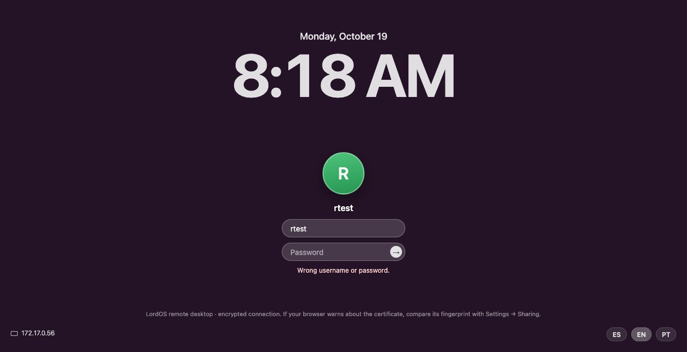

## Blocked and allowed addresses

**Lockout** (`server/src/remote/lockout.c`):

- 3 failed sign-ins from one address, without a successful one in between (within 24 hours),
  block it for **15 minutes**; blocked again within 24 hours, **1 hour**; then **24 hours**.
- IPv6 addresses count per **/64** (a host has a whole /64 to hop through).
- The answer to the third failure is the sign-in page with the "blocked" message; after that the
  address is closed right after `accept()`, before any TLS work.
- Blocks are kept in `/var/lib/lordos/remote/blocklist` (root, 0600, folder 0700) and survive a
  restart of `lord-sessiond` or of the computer.
- A successful sign-in clears that address's count. **Accounts are never locked** (anybody could
  lock you out); repeated failures for one user name, from any address, only slow it down: none for
  the first 4, then 1, 2, 4 and at most 8 s before checking.
- Each failure and each block is logged to the journal with the address and the attempted user
  name, cleaned to printable ASCII. Never the password.
- The user on the monitor gets a notification ("Remote desktop: address blocked") with a button
  that opens Settings → Sharing.

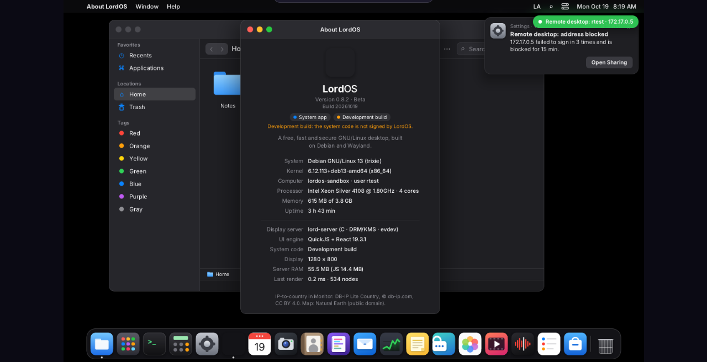

**Who can connect** (Settings → Sharing, `net=` in `/etc/lordos/remote/config`):

- **Local network** (the default): private ranges (10/8, 172.16/12, 192.168/16, 100.64/10),
  loopback, link-local and IPv6 unique-local, plus connections over a VPN of this computer: only
  on an interface LordOS's VPN manager created (`wg-`, `ovpn-`, `ips-`, `ppp-`, `oc-`, `fvpn-` +
  the VPN's name, `vpn_ifname` in `server/src/net/wg.c`), to that interface's own address, and
  from inside its subnet or its point-to-point peer (`rs_vpn_accepts`). A bare `ppp0` (often a
  PPPoE internet uplink), `tun0` or `wg0` never counts. Public addresses are closed.
- **Only these addresses**: only the networks in the list.
- **Any address**: everyone who can reach the port (still with the lockout).

**Two lists and the temporary blocks**, each its own section in Settings → Sharing:

- **Allowlist:** the addresses and networks that may connect with "Only these addresses". Being on
  it doesn't exempt an address from the lockout (an allowed machine can be compromised too), but an
  administrator can unblock it at once.
- **Blocklist:** always refused, checked before anything else, until removed.
- **Temporarily blocked:** the lockout's blocks with the time left, **Unblock** and **Block
  permanently** (moves it to the blocklist).

The lists live in `/etc/lordos/remote/access` (root, 0600): `allow <cidr>` and `block <cidr>`, at
most 64 of each. Networks are IPv4 /8–/32 or IPv6 /16–/128; host bits are cleared. The same lists,
the clients and the failed sign-ins are also in Monitor → Network ([MONITOR.md](MONITOR.md),
"Remote desktop").

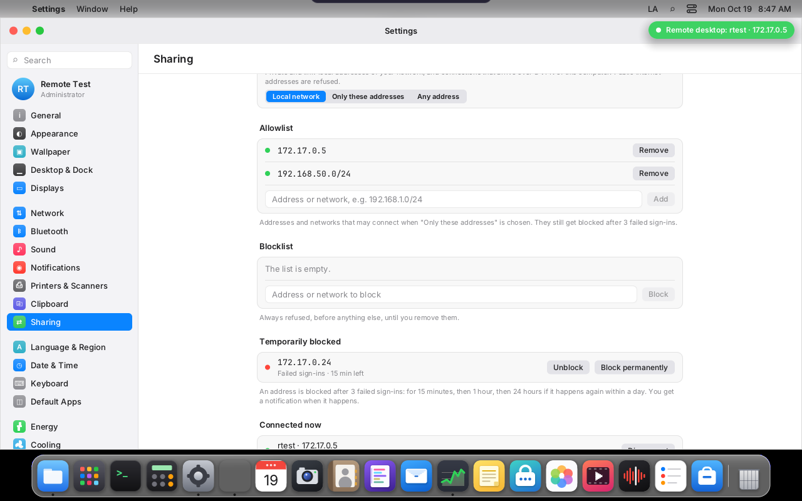

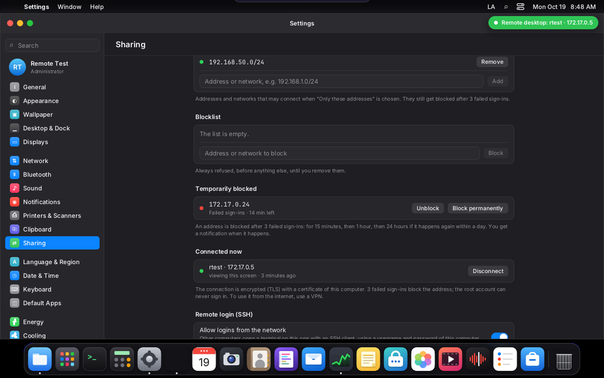

**Admin actions** (`remote_admin.c`, administrators only, validated on the root side by
`rs_cidr_parse`):

| Action                 | Argument            | What it does                                                    |
|------------------------|---------------------|-----------------------------------------------------------------|
| `remote-config`        | `net=lan\|list\|any` | the mode (with the existing `allow=`, `port=` lines)            |
| `remote-block`         | `<cidr>`            | adds a manual block to `access`                                 |
| `remote-unblock`       | `<cidr>`            | removes manual blocks inside it and appends `unblock <cidr>` to `/var/lib/lordos/remote/requests` (root 0600, `flock`); `lord-sessiond` lifts the lockout blocks inside it on SIGHUP |
| `remote-allow`         | `add\|del <cidr>`    | the allowlist                                                   |
| `remote-failures`      | none                | read-only: the recent failed sign-ins as code lines (`remote.failure key= count= first= last= user=`), from `/run/lordos/remote-failures` (root 0600); for Monitor |

Unblocking from Settings forgets that address's history (its next block is 15 minutes again).

## Browser protocol (WebSocket `/ws`)

**Server → browser.** Binary:

- `[1][x,y,w,h u16 BE][0 png│1 jpeg][data]`: a rectangle;
- `[2][w,h,hx,hy u16 BE][png]`: cursor image;
- `[3]`: end of frame;
- `[4]`: PNG refresh.

Text (JSON): `hello` (with `rtc:1` and `ice:["stun:…"]` when video is on), `size`, `cur{x,y,m}`,
`clip{text}`, `pong`, `bye` (with `lock:1` if the session was locked), `rtc{sdp,codec}` (our WebRTC
answer) or `rtc{fail:1}` (back to tiles).

**Browser → server.** Text (JSON):

- `m{x,y}`, `b{b,d}`, `w{d}` (wheel steps);
- the browser's trackpad (see `TRACKPAD.md`):
  - `s{p,x,y}`: fine scrolling in 1/256 of a pixel, with phase `p` (1 begins, 2 continues, 3 ends
    after 150 ms without events). It's told apart from a wheel because it carries `deltaX`,
    fractions or small steps;
  - `pz{p,s,r}`: pinch, with the scale ×65536 relative to the start and the rotation in degrees
    ×256. It comes from the wheel with `ctrlKey`, which is how Chrome and Firefox deliver the
    trackpad pinch (and also a mouse's Ctrl+wheel), or from `gesturechange` in WebKit browsers;
  - the bridge passes them to the session as `RP_SCROLL` and `RP_PINCH`, with clamped values;
- `k{c,d}`, with evdev codes derived from `KeyboardEvent.code`, so the session applies the
  layout;
- `clip{text}`;
- `resize{w,h}`: on connecting and when the window is resized; if the session is on the monitor,
  the monitor wins;
- `ack`, `ping{ts}`;
- the video's signaling: `rtc{sdp}` (the browser's offer, at most 32 KB), `ice{c}` (a trickled
  candidate, at most 512 bytes) and `vmode{on}` (1: the video is playing; 0: back to tiles).

**Validation** (`rs_ws_consume`, `rs_json_parse`, `rs_browser_input` in `rsec.c`): frames must be
masked, without RSV bits, with a known opcode and the shortest length encoding; control frames at
most 125 bytes and never fragmented; a message at most 2 MB (fragments are joined up to that);
text must be valid UTF-8; a binary message closes the connection (the page never sends one). Each
text message is one flat JSON object (known keys, integers or strings, no duplicates); positions
are clamped to the screen, key codes are keyboard keys only (1–248), the clipboard is at most 1 MB.
Anything else is ignored or closes with 1002/1007/1009.

**Compression:**

- **Still screen:** PNG (lossless).
- **Moving screen** (consecutive frames) and large areas: straight JPEG.
- **When it becomes still:** whatever was JPEG is refreshed as PNG.

**Flow control:** the browser acknowledges each frame (`ack`) only once it has drawn it, and the
session accumulates changes until then. A slow network gets fewer frames, but always the current
state.

## Video (WebRTC)

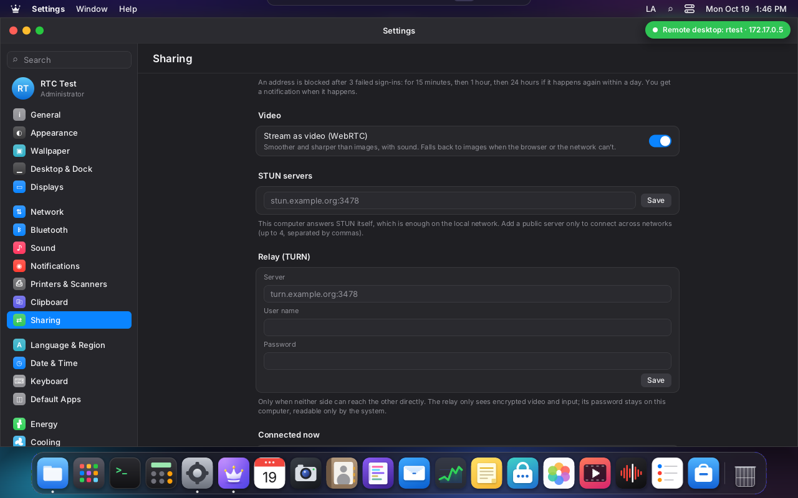

When the page finds `RTCPeerConnection` and Settings allows video (`video=1`, the default), the
remote desktop becomes a WebRTC connection between the browser and the bridge:

1. The page connects to `/ws?…&v=1` as always and starts with the tiles.
2. The bridge creates its WebRTC peer and says so in `hello` (`rtc:1`, `ice:["stun:<address>:<port>"]`:
   a STUN server of its own, see below).
3. The page makes an offer (video and audio to receive, data channels `input` and `tiles`), waits
   for its candidates (at most 1.5 s) and sends it over the WebSocket: `{"t":"rtc","sdp":…}`.
4. The bridge parses it strictly (`rtcwire.c`) and answers `{"t":"rtc","sdp":…,"codec":"h264"}`.
5. ICE, DTLS and SCTP come up; the bridge tells the session `RP_VIDEO` and the session's encoder
   starts (or a keyframe goes to the new viewer of an encoder already running).
6. As soon as the first frame plays, the page sends `{"t":"vmode","on":1}`: the canvas becomes a
   transparent layer over the `<video>`, input goes over the `input` data channel, and the session
   sends tiles only when the screen is still.
7. If no frame plays within 12 s, the connection fails, or the offer is refused, the page closes it
   (`{"t":"vmode","on":0}`) and stays on the tiles.

**What travels where:**

| Channel | Content |
|---|---|
| video track | H.264 constrained baseline (packetization mode 1) or VP8, RTP over SRTP, 90 kHz clock; frames only when the screen changed, at most 30 per second, one more tiny frame 70 ms after the last change (browsers paint a lone frame late) |
| audio track | Opus, 20 ms frames, mono 48 kHz, 64 kbit/s |
| `input` data channel | the same JSON input messages as the WebSocket (`m`, `b`, `w`, `s`, `pz`, `k`, `clip`, `resize`), parsed by the same `rs_browser_input`; at most 256 KB per message |
| `tiles` data channel | `[1][x,y,w,h u16][png]` a lossless tile; `[2][x,y,w,h…]` these areas changed (show the video there); `[3]` done |
| WebSocket | everything else, as before: signaling, cursor, clipboard from the session, ping |

**Sharp text.** Video blurs fine text a little, so once the screen has been still for 250 ms the
session sends the tiles that changed since the last time, as PNG, over the `tiles` channel; the page
draws them on the layer over the video. Any change clears that layer where it happens (`RP_DAMAGE`,
sent at once) and the video shows there again. The video is tagged sRGB (BT.709 matrix and
primaries, sRGB transfer) so the browser shows the same colors as the tiles: the measured
difference between both over the whole screen is 0.1 levels.

**One encoder per session.** The session's `lord-server` renders as always; the frame the remote
desktop sees (protected windows in black, from `media_composed`, or the GPU's read-back) goes to a
live encoder: `lord-media` in `MK_STREAM` mode, through a sealed memfd of 3 slots, like the screen
recording. It uses H.264 with VA-API when the card encodes it, else libx264 (`ultrafast`,
`zerolatency`, CRF 22 with a bit-rate cap), or VP8 with libvpx (`realtime`) for browsers without
H.264. Every viewer of the session gets the same encoded frames over the session socket
(`RP_VFRAME`, `RP_AFRAME`); the bridge only packetizes and encrypts. The bit rate is the slowest
viewer's: each bridge lowers its target on loss reported by the browser (receiver reports, REMB)
and raises it slowly when there is none (300 kbit/s to 12 Mbit/s). A viewer that falls more than
3 MB behind skips frames until the next keyframe; a lost frame (PLI, FIR) asks for one, and the
current screen is encoded again for it. Two users means two sessions, two `lord-server`s and two
encoders, each as its own user.

**The GPU keeps composing.** Until 0.8.3 a remote viewer switched the session to CPU composition.
Now `gpu_frame` reads the composed frame back (`gpu_read_next`) once, for the encoder and the tiles,
and the screen keeps its GPU composition. Only two cases still use the CPU path: protected windows on
screen (they are painted black in a CPU copy of the scene) and screen recording. `LORD_REMOTE_GPU=0`
forces the CPU path. While the remote desktop reads frames back, a fullscreen app is composed rather
than scanned out directly.

**ICE, STUN and TURN.**

- The bridge is an ICE-lite agent: it never sends checks; it answers checks signed with its ICE
  password (from the answer that went over the authenticated WebSocket), from addresses that pass
  the same rules as the WebSocket (`rs_access_decide`: the signed-in browser's own address, the local
  network or the allowlist by Settings, and never a blocked one).
- **Built-in STUN server:** a second UDP socket per connection answers plain binding requests (at
  most 20 a second, only from allowed addresses), and the page uses it as its STUN server: on a LAN
  that's all it needs, with no outside server. It must be a different port from the media: browsers
  hand every STUN packet from their STUN server's address to that server's request handler,
  including the ICE answers.
- **External STUN** (Settings → Sharing → STUN servers, up to 4): the bridge learns its public
  address from them and offers it as a candidate; the page uses them too.
- **TURN** (Settings → Sharing → Relay): the bridge allocates a relayed address with the long-term
  credentials, permits only the browser's candidate addresses, and offers the relay as a candidate.
  The relay only sees DTLS and SRTP. The password is kept in `/etc/lordos/remote/turn.key` (root
  0600), read by the connection's root process right before the bridge drops root and handed over
  in memory; after the first answer from the relay only its MD5 key remains, and it is never logged,
  written to the config or sent to the browser (the browser is not given the relay).

**DTLS bound to the sign-in.** The bridge is the DTLS server, with a new P-256 certificate per
connection; its fingerprint goes in the answer, over the authenticated TLS WebSocket. The browser's
certificate must hash to the `a=fingerprint` of the offer that came over that same WebSocket, or the
connection ends ("does not match the fingerprint of the signed-in offer") and the page stays on the
tiles. DTLS 1.2 with ECDHE-ECDSA AES-GCM / ChaCha20-Poly1305 only; SRTP with AES-GCM (or
AES-CM-HMAC-SHA1-80) keys exported from it. After DTLS is up, the media moves to another network
path only after an authenticated packet (a DTLS record or SRTCP that decrypts) came from it:
leaked ICE credentials alone can't redirect the stream.

**Process.** The WebRTC peer lives in the bridge, which already dropped root (see Process and
privileges): its UDP sockets are created after the drop, as the user. `lord-sessiond` now links
libsrtp2 and usrsctp (Debian packages); `lord-server` links neither; FFmpeg stays only in
`lord-media`.

**Admin action:**

| Action | Argument | What it does |
|---|---|---|
| `remote-ice` | lines: `video=on\|off`, `stun=<host:port>[,…]` (up to 4), `turn=<host:port>` (empty: no relay), `turn_user=<name>`, `turn_pass=<password>` | validates every line (`rw_ice_server_valid`, `rw_turn_user_valid`, `rw_turn_pass_valid`) before writing; the password only into `turn.key` (0600); the rest into `config` (`video=`, `stun=`, `turn=`, `turn_user=`, `turn_key=1`) and SIGHUP |

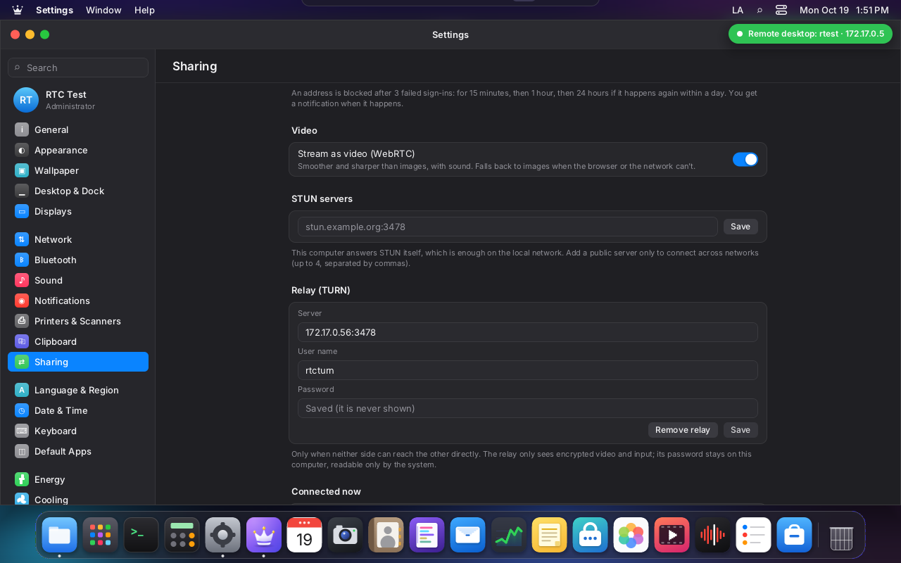

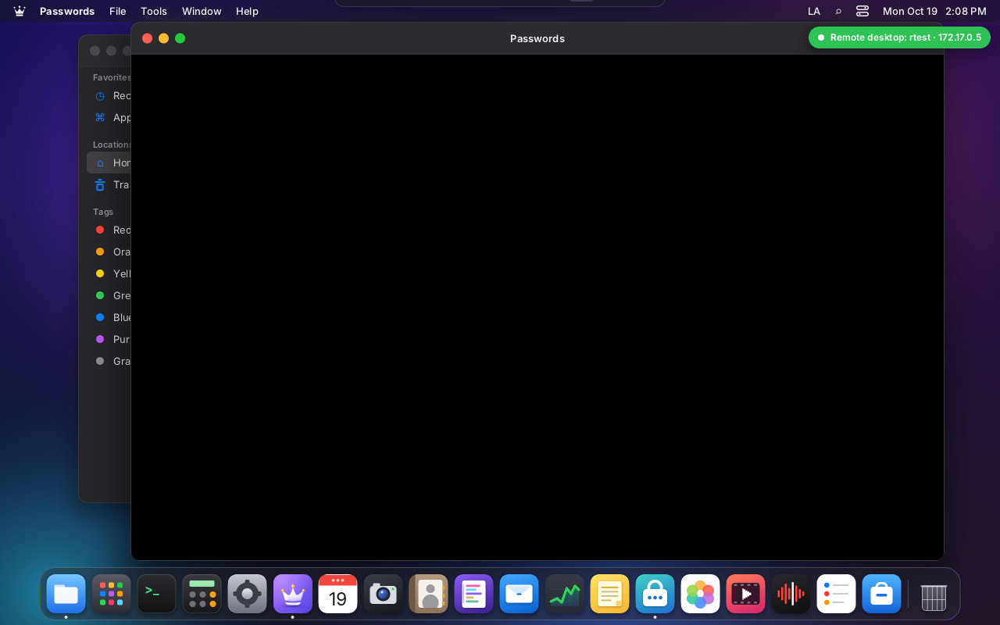

### Security analysis (0.8.4, video)

The new network surface: the signaling messages on the WebSocket, the SDP offer and candidates, the
UDP socket (STUN, DTLS, SRTP/SRTCP, SCTP), the data channel messages, the TURN client and the
password storage. Unit tests in `server/tests/remote_sec_test.c` (now 352 checks, with a real
Chrome offer), the same ASan+UBSan fuzz run on every `make -C server test` now also feeds the SDP,
candidate, STUN/TURN, RTCP, data channel open and RTP payload code (2,000,000 inputs clean in a
longer run), and these attacks on VM 122:

| # | What was tried | Result |
|---|---|---|
| 1 | WebSocket (the only signaling path) without a cookie, with a forged one, from a foreign `Origin` | 403, as before |
| 2 | An offer whose fingerprint doesn't match the browser's real certificate (fingerprint swap) | DTLS refused ("does not match the fingerprint of the signed-in offer"); the page went on with tiles at 28 frames per second |
| 3 | An offer over 32 KB | ignored; the page gave up after 12 s and stayed on tiles |
| 4 | Data channel: 262,000 bytes of junk, a binary message on `input`, 300 keys with invalid codes; a message over 256 KB | ignored (the browser itself refuses over 256 KB; the bridge would end the connection) |
| 5 | From another address, against a live connection: plain STUN, ICE checks with a wrong password or user fragment, a DTLS ClientHello, RTCP, random 1400 bytes, an oversized user name | only the plain STUN and a check with the right credentials were answered; nothing else |
| 6 | The same with "Only these addresses" not listing that address | nothing answered, not even STUN; "refused ICE check" in the journal |
| 7 | (Found here, fixed.) With stolen ICE credentials, a check with USE-CANDIDATE moved the media to the attacker's address | the media now moves only to a path that sent an authenticated DTLS or SRTCP packet: 0 packets redirected |
| 8 | TURN password: journal, session logs, `status.json`, the config, the bridge's environment, every WebSocket message and the answer | not found anywhere; `turn.key` is root 0600 and unreadable by the user |
| 9 | The bridge while video runs | uid/gid of the user (real, effective, saved), no capabilities, `NoNewPrivs 1`, no shared mapping; its UDP sockets created after the drop |
| 10 | A protected window (Passwords) opened while the GPU composes and a browser watches | the session switches to the CPU path while it's on screen: black in the video, normal on the monitor |

What stays as it is: ICE-lite answers checks from any allowed address that knows the credentials
(they only travel inside the authenticated TLS WebSocket); a relay sees the traffic's size and
timing; the encoder, `lord-media`, parses only our own frames (in its sandbox, as for recording).

### Measurements (0.8.4, video)

VM 122 (Xeon Silver 4108 at 1.8 GHz, 4 vCPUs, no 3D, 1280×800), headless Chrome 155 on a Mac on the
same LAN; dragging a window for 16 s; CPU per process from `/proc`, traffic on `eth0`.

| Situation | Path | Frames/s | Network | lord-server | encoder | bridge(s) |
|---|---|---|---|---|---|---|
| idle | tiles | 0 | < 1 kbit/s | 1 % | — | 0 % |
| idle | video | 0.5 | < 80 kbit/s | 3 % | 2 % | 1 % |
| dragging, 1 viewer | tiles | 23 | 12.5 Mbit/s | 53 % | — | 57 % |
| dragging, 1 viewer | H.264 (veryfast) | 28 | 0.3–0.9 Mbit/s | 60 % | 42 % | 2 % |
| dragging, 1 viewer | H.264 (ultrafast, the default) | 28.5 | 0.4–0.5 Mbit/s | 64 % | 31 % | 2 % |
| dragging, 1 viewer | VP8 | 28.8 | 2.0 Mbit/s | 58 % | 46 % | 2 % |
| dragging, 2 viewers of one session | tiles | 24 and 21 | 24 Mbit/s | 58 % | — | 58 % + 59 % |
| dragging, 2 viewers of one session | H.264 | 28.8 and 25.2 | 2.1 Mbit/s | 61 % | 33 % (one) | 2 % + 2 % |
| dragging, 2 users (2 sessions) | H.264 | 27.5 and 27.2 | 3.5 Mbit/s | 62 % + 65 % | 31 % + 32 % | 2 % + 2 % |
| dragging, monitor session composed on the GPU (llvmpipe) | H.264 | 26 | 0.46 Mbit/s | 167 % (software GL) | 25 % | 2 % |

- **Latency** (a click on the page until the pixel changes on it, 12 clicks each): tiles 63–96 ms
  (median 66 ms); video 72–130 ms (median about 90 ms; before the flush frame, a third of the clicks
  took 320–360 ms). Network round trip 1 ms, browser jitter buffer 15–80 ms while dragging, decode
  2.6 ms.
- **Quality:** still areas are pixel-identical to the tiles path (they are the same PNG tiles); in
  motion, H.264 at 1280×800 instead of JPEG quality 70 per tile. The page's latency is shown in its
  top bar with the mode ("Video · H264" or "Images").
- On real graphics hardware the GPU row would not cost CPU: llvmpipe is the CPU emulating a GPU.
  VA-API encoding was not measured (the VM has no video encoder).

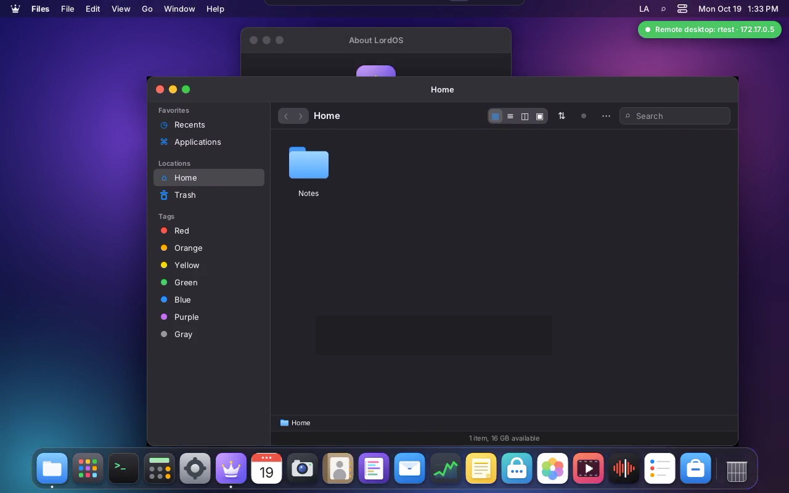

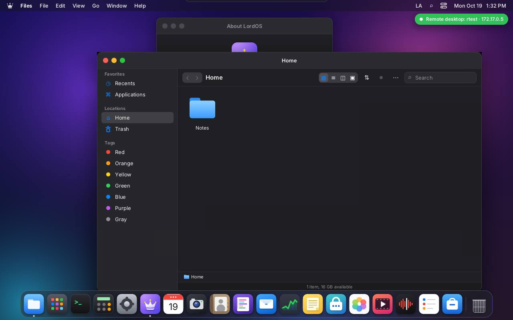

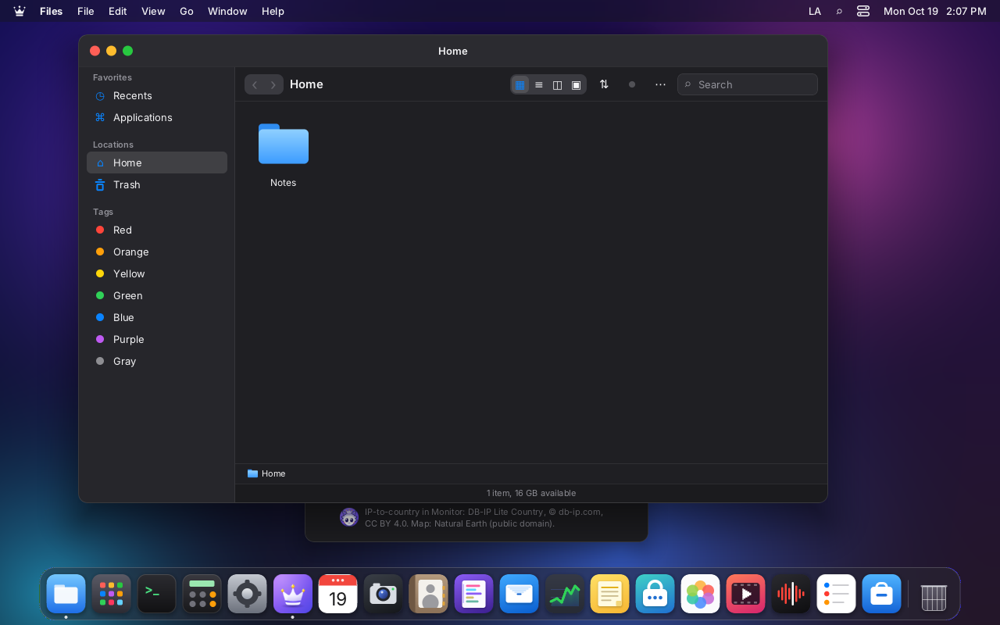

## Process and privileges

1. `lord-sessiond` (root) accepts the connection. Refused addresses (blocked, not allowed, too many
   connections) are closed there, before TLS. Otherwise a child handles it (48 at most, 8 per
   address; 32 signed-in browsers).
2. That child does TLS and reads one request under a 15 s deadline (a 90 s alarm backs it up). With
   a valid cookie, `/ws` finds the user's session or creates it (`sess.c`, with the same lock as
   the monitor).
3. **It forks the bridge, which drops root for good:** it unmaps `lord-sessiond`'s shared memory,
   closes every descriptor but the TLS socket, the session socket and a pipe to its parent, clears
   the environment, then `initgroups`, `setresgid`, `setresuid`, checks that the real, effective
   and saved ids are the user's and that it can't get root back, sets `no_new_privs`, not dumpable,
   and dies with its parent. TLS, compression and the bridge run as the user. The root parent keeps
   nothing of the connection: it only waits, and when the bridge reports that the session was
   locked, it ends every cookie of that user.

OpenSSL (TLS) is only in `lord-sessiond`; `lord-server` doesn't link it. The certificate is
self-signed P-256, with CN equal to the machine name and ten years of validity. It's in
`/etc/lordos/remote/cert.pem` (`key.pem` 0600) and is created the first time remote is turned on.

## Threats

| Threat                                 | What's there                                                                             |
|----------------------------------------|------------------------------------------------------------------------------------------|
| someone listens on the network         | TLS 1.2+ with AEAD ciphers only; the certificate fingerprint is shown in Settings          |
| password guessing                      | 3 failures block the address (15 min, 1 h, 24 h), per-account slowdown, journal            |
| guessing from many addresses           | each address gets 2 tries before its block; the per-account slowdown caps the rate per user |
| user enumeration                       | no user list; same message and the same 1.25 s for unknown users and wrong passwords      |
| cookie theft or fixation               | `__Host-`, `HttpOnly`, `Secure`, `SameSite=Strict`, 12 h, stored hashed, new at each sign-in, ended by lock, logout and password change |
| another page uses the session (CSRF)   | `Origin` = `https://` + `Host` required on `/login`, `/logout` and `/ws`; `frame-ancestors 'none'` |
| floods and slow clients                | 20 new connections per address then 2/s, 8 open per address, 48 in all, 15 s to send the request |
| bug in the bridge                      | it runs as the user who owns the session, without root's shared state or descriptors      |
| access from the internet               | refused by default (local network only); use a VPN (Settings → Network → VPN)             |
| someone on the LAN sends UDP to the video port | only allowed addresses get answers; ICE needs the password from the TLS WebSocket; DTLS needs the browser's certificate; media only moves to proven paths |
| a TURN relay reads the traffic         | it only sees DTLS and SRTP; its password stays root-only on this computer                |

## Security analysis (0.8.3)

A review of everything the network can reach, done for 0.8.3: the HTTP parser, the login, the
cookie, CSRF, the WebSocket and the input messages, the privilege drop, resource limits, TLS,
headers, logging and the lock screen. Every finding below was fixed in the same release; the tests
are in `server/tests/remote_sec_test.c` (218 checks), `server/tests/remote_fuzz.c` (ASan+UBSan,
100,000 random and mutated inputs on every `make -C server test`), and the attack run on VM 122
listed after the table.

| # | Severity | What | Fix | Test |
|---|----------|------|-----|------|
| 1 | High | The 32-connection cap only counted signed-in browsers: any host could open unlimited connections, each a root child that waited up to 15 s per read (forever if bytes trickled in). | A child per connection only if the address is allowed, not blocked, within 20 new connections then 2/s, under 8 open from it and 48 in all; 15 s for handshake + request, 90 s alarm. | 14 parallel connections: 8 served; 60 quick requests: 8 served, 52 refused; one header byte per second: cut at 16.1 s; TCP without a TLS handshake: cut at 15.0 s. |
| 2 | High | After dropping root the bridge still had `lord-sessiond`'s shared memory mapped read-write: it could forge a cookie for any other user, erase blocks, hold the lock (freezing the root process) or plant a pid that root later signalled when remote was turned off (`kill(-1)` = every process). | The bridge is forked after the handshake and unmaps it; root only signals pids from its own private list. | `/proc` of a live bridge: uid 1003 (real, effective, saved), no shared mapping, fds 0–2 + socket + session + pipe, `NoNewPrivs 1`. |
| 3 | Medium | User enumeration by timing: an unknown or refused account returned before `crypt`, a wrong password after it. | Dummy hash with the same algorithm and cost; every failure answered 1.25 s after the check began. | 8–24 tries each: unknown 1254.2 ms, existing user with a wrong password 1254.1 ms, `root` 1254.6 ms, a system account 1254.8 ms (medians). |
| 4 | Medium | No lockout (only growing waits, in a 64-entry table an attacker could cycle); no restriction on where connections came from. | Lockout per address (/64 for IPv6), 15 min → 1 h → 24 h, persistent; local network only by default; manual lists. | 3 wrong → blocked page, 4th refused before TLS; still blocked after restarting `lord-sessiond`; unblocked from Settings; "only these addresses" refused the Pi and served the listed Mac. |
| 5 | Medium | A request without `Origin` passed the same-origin check; logout was a `GET` (any site could sign you out). | `Origin` required and equal to `https://` + `Host` on `/login`, `/logout`, `/ws`; `Sec-Fetch-Site` must agree; logout is a `POST`. | foreign `Origin`, `http://` origin, none, `cross-site`: 403; `GET /logout`: 405. |
| 6 | Medium | Cookie: matched by substring (`xlordos_remote=` counted), no `__Host-` prefix (another service on the same host could plant one), kept in clear in shared memory, unaffected by a password change. | `__Host-lordos_remote`, exact parse, two of them refused, only SHA-256 stored, bound to the shadow hash, the old cookie dropped at sign-in. | forged, old name, duplicated: 403; after `chpasswd` and after logout: 303 to the sign-in page / 403 on `/ws`. |
| 7 | Medium | Locking the screen ended only the cookie of the browsers connected at that moment; a browser signed in earlier could come back to the session. | Lock ends every cookie of that user (the root process for a lock on the monitor, the bridge's root parent otherwise). | a second, unconnected cookie: 200 before the lock, refused after. |
| 8 | Low | HTTP parser: last duplicate header won, `Content-Length` read with `atol`, `Transfer-Encoding` ignored, bare LF, folding, any method served pages, bytes after the body accepted. | `rs_parse_head`: strict request line, 40 headers, 8 KB head, duplicates refused, `Transfer-Encoding` → 501, 4 KB body, one request per connection, method per path. | 22 malformed requests answered 400/405/413/414/415/431/501 as expected. |
| 9 | Low | Form parser: first duplicate won, `%00` cut the value, long values truncated silently, unknown fields ignored, no `Content-Type` check, 256-byte password limit. | `rs_parse_login`: exactly `user` and `pass`, strict `%XX`, user name rules, password 1–1024 bytes, no NUL; form type required; no query on `/login`. | 33-character name, 1025-byte password, `%00`: refused (and counted); duplicate/unknown field, `%zz`: 400; `text/plain`: 415. |
| 10 | Low | WebSocket: no RSV/opcode/length checks, pings up to 2 MB echoed back, fragments silently dropped, no UTF-8 check. | `rs_ws_consume` (see Browser protocol). | unmasked frame → close 1002; fuzzed. |
| 11 | Low | Input messages were read with `strstr` (a string could smuggle `"x":` into a number); `BTN_*` codes up to 0x2ff accepted as keys. | Strict flat JSON; keys 1–248; all values clamped. | unit tests. |
| 12 | Low | TLS used OpenSSL's default list (CBC suites in TLS 1.2), compression and renegotiation defaults; key permissions not checked. | ECDHE-ECDSA AES-GCM / ChaCha20-Poly1305 only, TLS 1.3 AEAD suites, X25519/P-256/P-384, no compression or renegotiation, server order; `key.pem` forced to root 0600. | TLS 1.0/1.1: protocol alert; TLS 1.2 accepts exactly the 3 AEAD suites; TLS 1.3 the 3 standard ones (CCM refused); compression none. |
| 13 | Low | CSP allowed inline scripts; no `Permissions-Policy`, COOP or CORP. | Hash-based CSP, `form-action`, `base-uri`, the rest of the headers. `Referrer-Policy` stays `same-origin`: with `no-referrer` browsers send `Origin: null` on the page's own form. | header dump; Chrome sign-in works under the CSP. |
| 14 | Low | Accounts: shells matched by substring only, root-group accounts allowed, `/etc/nologin`, forced password change and expired passwords ignored. | Shell from `/etc/shells`, no gid 0, never `root`, the shadow aging rules. | `root` refused like a wrong password. |
| 15 | Low | Log injection: `Origin`/`Host` logged raw (a bare LF forged a journal line); attempted names logged only when valid. | Everything logged is cleaned to printable ASCII; attempted names logged sanitized. | journal check. |
| 16 | Info | The privilege drop didn't check saved ids or groups, kept the environment and every inherited descriptor, and the bridge outlived `lord-sessiond` (the parent-death signal is cleared by `setuid`). | See "Process and privileges". | `/proc` check above. |
| 17 | Info | After a failure the user name went into the URL (`/?e=1&u=…`): a password typed into the user field ended up in the history. | The page keeps the name in `sessionStorage` and clears the address bar. | browser check. |
| 18 | High | (Found in review of this branch.) "Local network" counted any interface named `ppp*`, `tun*` or `wg*` as a VPN, so a public address arriving over a PPPoE uplink (`ppp0`) or any tunnel passed the default. | Only LordOS's own VPN interface names (with the dash), only to that interface's address, and only from inside its subnet or its point-to-point peer. | unit tests: `ppp0` with a public peer refused; `wg-home` with an in-subnet peer accepted and a public one refused; `/0` subnets refused. |

**Greeter and lock.** A remote browser can't unlock the monitor: the monitor shows the login
screen (a separate `lord-server` as `lordos-greeter`), and the session only reaches `lord-sessiond`
through the seat connection, whose requests are lock, switch user and power. Signing in from the
browser resumes the user's session in the background, never on the monitor. Locking the monitor
ends the remote viewers and every remote cookie of that user; a browser must sign in again with the
password. Locking from the browser does the same.

**What stays as it is.** `lord-sessiond` reads `/etc/shadow` itself instead of PAM (no PAM stack
to configure; the account rules PAM would apply are listed under Login). The certificate is
self-signed: compare the fingerprint the first time. An attacker on the LAN with many addresses
gets 2 tries per address; the per-account slowdown limits that. Two-step sign-in is a proposal in
`ROADMAP.md`.

**Attack run (VM 122, Debian 13, October 19)** from the development Mac (172.17.0.5) and the
Raspberry Pi (172.17.0.24) with a stdlib Python client, OpenSSL's `s_client` on the VM, and a
headless browser for the pages: normal sign-in, desktop over WebSocket and sign-out; brute force
and persistence; timing; 22 malformed requests; CSRF; WebSocket without, with forged, logged-out,
duplicated or out-of-date cookies, wrong key, version or origin; slowloris; connection flood; TLS
scan; headers; lock. All results are in the table.

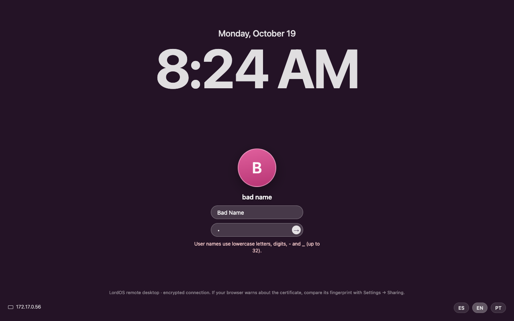

## Measurements (VM 118: Xeon Silver 4108 at 1.8 GHz, 4 cores, no GPU, 1280×800)

| Situation                                         | lord-server (session) | bridge (lord-sessiond) | monitor | network      |
|---------------------------------------------------|----------------------|------------------------|---------|--------------|
| idle desktop, watched from the web                | 1–2 %                | 0 %                    | —       | < 1 KB/s     |
| just moving the mouse (web)                       | 2–3 %                | 0–1 %                  | —       | 25–40 KB/s   |
| dragging a large window (web)                     | 95 %                 | 13 %                   | —       | 380 KB/s, 4–5 frames/s |
| dragging a large window on the monitor (CPU)      | 80 %                 | —                      | —       | —            |
| session nobody is watching                        | ~1 %                 | —                      | —       | —            |

- **Memory per session:** about 50 MB. The login screen uses 41 MB. With software GPU
  (llvmpipe), the monitor session uses about 145 MB.
- **With JPEG while moving:** the bridge went from 53 % to 13 % CPU while dragging.
- **Frames per second:** in this VM the limit is the desktop's CPU composition (blur and
  transparency), not the network or the compression.

## Sound

The session's sound reaches the browser with the video (see [Video (WebRTC)](#video-webrtc)): the
session's `lord-server` records the monitor of the default output from PipeWire itself (the same
`maudio.c` stream as the screen recorder's microphone, `@DEFAULT_MONITOR@`, mono 48 kHz) into a
shared-memory ring, and the live encoder makes Opus of it (20 ms frames, 64 kbit/s, low delay). The
page starts muted (browsers only play sound after a click) and has a sound button in its top bar.
Still to do: stereo, and the microphone the other way (by permission).

## Remote login (SSH)

Settings → Sharing also has **«Remote login (SSH)»**: other computers open a terminal on this one
with any SSH client (`ssh <user>@<address>`), with a user and password of the machine. It's the
standard OpenSSH server (`openssh-server`), not something of our own.

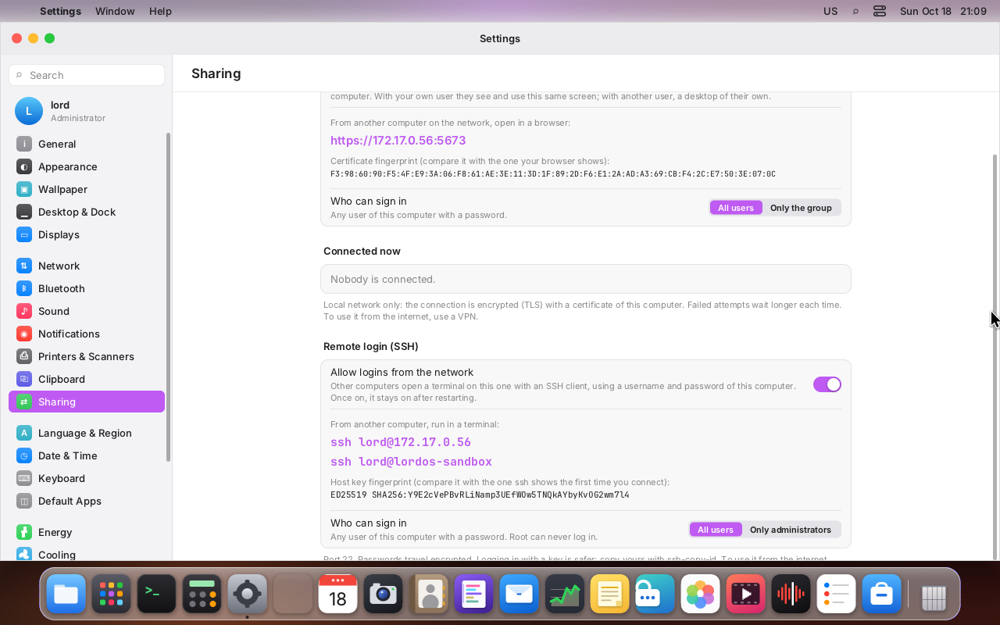

- **It's off by default on every install:** the live ISO, a disk installed from it, the Raspberry
  Pi image and the Debian installer. The ISO and the installed system don't even ship
  `openssh-server`; the Pi image ships it disabled. The switch shows the real state: whether
  `ssh.service` (or `ssh.socket`) is enabled to start at boot, and whether `sshd` is running.
- **Turning it on:**
  1. If `openssh-server` isn't installed, Settings installs it with the package engine's own
     action, `pkg-install openssh-server openssh-sftp-server` (the Store's path, `server/src/pkg`
     and `dpkg`; `openssh-sftp-server` is a Recommends the engine skips, and `scp`/`sftp` need
     it). With no package lists yet (a fresh install) it runs `pkg-update` once first. It needs
     the internet.
  2. Then `ssh-set on`: it creates the host keys if missing (`ssh-keygen -A`), checks the
     configuration (`sshd -t`) and runs `systemctl enable --now ssh.service`. It stays on across
     reboots.
- **Turning it off:** `ssh-set off` runs `systemctl disable --now ssh.service ssh.socket`. The
  package stays installed. Sessions already open aren't cut (Debian's unit uses
  `KillMode=process`); new ones are refused and port 22 closes, also after a reboot.
- **How to connect:** when it's on, the page shows `ssh <your user>@<address>` for each LAN IPv4
  address and for the machine name, and the **ED25519 host key fingerprint** (`SHA256:…`, computed
  by `lord-server` from `/etc/ssh/ssh_host_ed25519_key.pub`, the same as
  `ssh-keygen -lf /etc/ssh/ssh_host_ed25519_key.pub`). Compare it with the one `ssh` shows the
  first time it connects.
- **Who can log in:** all users with a password (the default), or **only administrators**
  (`ssh-allow admins` writes `/etc/ssh/sshd_config.d/11-lordos-allow.conf` with
  `AllowGroups sudo admin wheel`, checks it with `sshd -t` and reloads the server; `ssh-allow all`
  removes it). **Root never logs in.**
- **Raspberry Pi:** the image's `ssh` switch file on the boot partition keeps working
  ([RASPBERRY.md](RASPBERRY.md)): it enables `ssh.service`, and the Settings switch shows it on.
- **Debian installer** (`install.sh`): it never touches an existing SSH server (on a server or VPS
  it may be how you are connected); it only reports its state at the end.

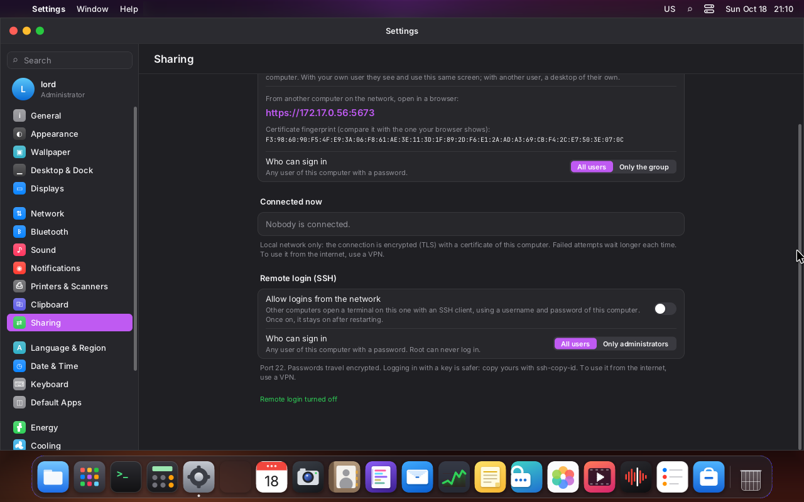

### Safe defaults

The `lordos` package ships `/etc/ssh/sshd_config.d/10-lordos.conf`, read only once
`openssh-server` is installed. Debian's `sshd_config` includes that folder at the top and `sshd`
keeps the first value it reads, so it wins over the rest:

- `PermitRootLogin no`.
- Password logins stay on, because people expect them. **Key logins are safer**: copy your key
  with `ssh-copy-id <user>@<address>` and, once it works, you may add a file in that folder with
  `PasswordAuthentication no`.
- Nothing else is changed: Debian's defaults (key types, ciphers, `MaxAuthTries`) stay.

### Privileges

The privileged part is two closed actions of the admin helper (`server/src/remote/ssh_admin.c`,
`SSH_ADMIN_ACTIONS` in `admin.c`), only for administrators (sudo, admin or wheel), like the
`remote-*` actions:

| Action                  | Argument          | What it runs (fixed paths)                                              |
|-------------------------|-------------------|--------------------------------------------------------------------------|
| `ssh-set`               | `on` or `off`     | `ssh-keygen -A` if there's no host key, `sshd -t`, `systemctl enable --now` / `disable --now` |
| `ssh-allow`             | `all` or `admins` | writes or removes the fixed `AllowGroups` drop-in, `sshd -t`, `systemctl try-reload-or-restart` |

Nothing the user types reaches a command line or sshd's configuration, and no package is installed
by these actions: that stays in the package engine. `lord-server` only reads the state
(`lord.ssh.status()` in `server/src/ui/js_sys.c`: the unit files, `/proc/*/comm` for a root
`sshd`, the drop-in and the public host key), and doesn't run anything.

### Firewall

Nothing to open. `lord-netperm`'s per-app rules apply to programs started from a LordOS session
(they live in its cgroup tree); `sshd` is a system service in `system.slice/ssh.service`, so the
rules never block it, and LordOS adds no system-wide packet filter. If you run your own (nftables,
a router), allow TCP port 22 from the local network only. As with remote desktop, to use it from
the internet, use a VPN instead of opening the port.

### Tested (VM 122, Debian 13, 0.8.1 development build)

- With `openssh-server` purged, the switch was off and port 22 closed. Turning it on installed
  `openssh-server` and `openssh-sftp-server` through `pkg-install` (about 20 s), created new host
  keys and started the server; the fingerprint on the page matched
  `ssh-keygen -lf /etc/ssh/ssh_host_ed25519_key.pub`.
- From another machine: key login, password login and `scp` worked; `root` was refused
  (`sshd -T`: `permitrootlogin no`, `passwordauthentication yes`).
- «Only administrators»: `bob` (not in sudo) was refused («none of user's groups are listed in
  AllowGroups»), `lord` logged in. Back to «All users» removed the drop-in.
- Reboot with it on: still enabled and listening. Turned off: `ssh.service` disabled and
  inactive, port 22 closed, and still closed after another reboot.
- A standard user (lord taken out of `sudo` for the test): the page shows the administrator note
  and the switch does nothing; the server stayed off.

## Files

| Path                                  | What it is                                                 |
|---------------------------------------|------------------------------------------------------------|
| `server/src/remote/conn.c`            | one connection: HTTP, login, WebSocket, bridge             |
| `server/src/remote/rsec.c`            | strict parsers: request head, form, cookie, WebSocket, JSON |
| `server/src/remote/ipnet.c`, `lockout.c` | addresses and networks, lockout and connection rate     |
| `server/src/remote/enc.c`             | PNG/JPEG (stb_image_write, vendored in third_party/stb)    |
| `server/src/remote/rtc.c`             | the WebRTC peer in the bridge: ICE-lite, STUN server, DTLS-SRTP, SCTP data channels, RTP, TURN client |
| `server/src/remote/rtcwire.c`         | strict SDP, candidate, STUN/TURN, RTCP and data channel parsers; RTP payloaders (tested and fuzzed) |
| `server/src/media/mstream.c`          | the session's shared live encoder (lord-server side)        |
| `server/src/media/helper/lm_stream.c` | the live encoder in `lord-media` (H.264/VP8, Opus)          |
| `server/src/remote/login.html`, `client.html` | pages (embedded in the binary)                      |
| `server/src/remote/remote_admin.c`    | `remote-*` actions                                         |
| `server/src/remote/ssh_admin.c`       | `ssh-*` actions (remote login)                             |
| `tools/iso/rootfs/etc/ssh/sshd_config.d/10-lordos.conf` | sshd defaults shipped by the `lordos` package |
| `apps/settings/Sharing.jsx`, `sdk/remote.js` | Settings → Sharing and the notice on the monitor    |
| `/etc/lordos/remote/`                 | `config`, `access`, `cert.pem`, `key.pem`, `fingerprint`, `turn.key` (root 0600) |
| `/var/lib/lordos/remote/`             | `blocklist`, `requests` (root only)                        |

## Screenshots

- 
- 
- 
- 
- 
- 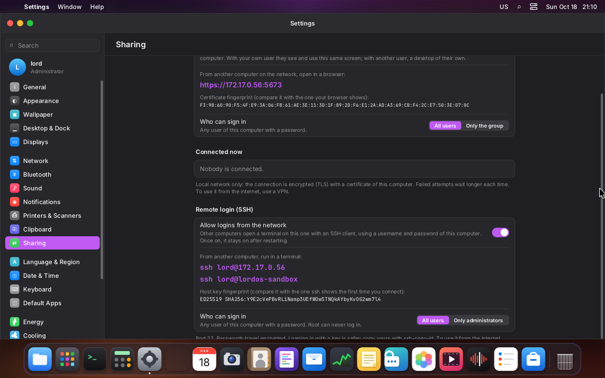
- 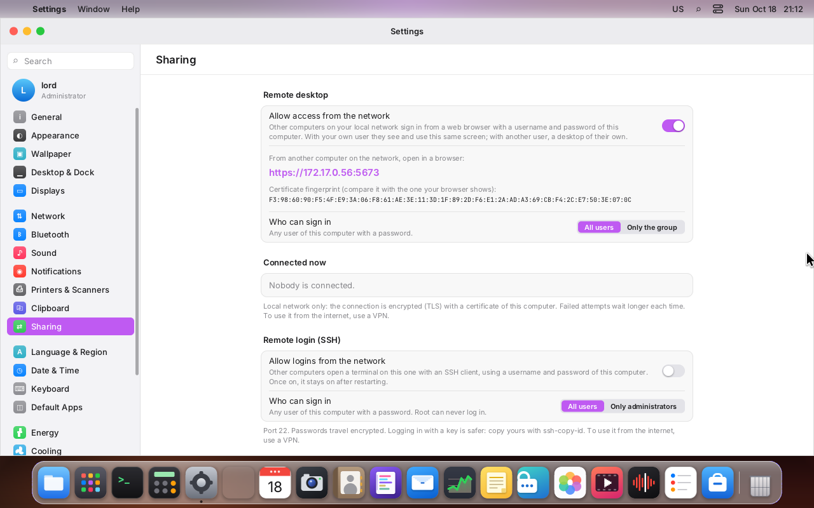
