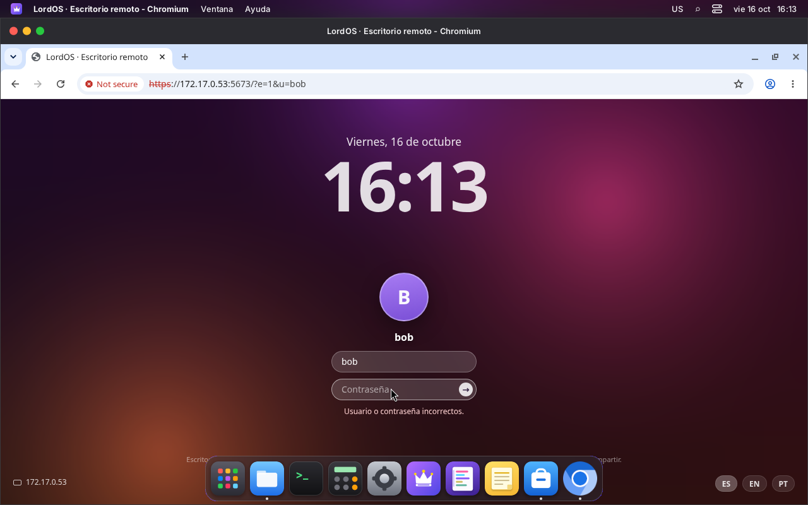
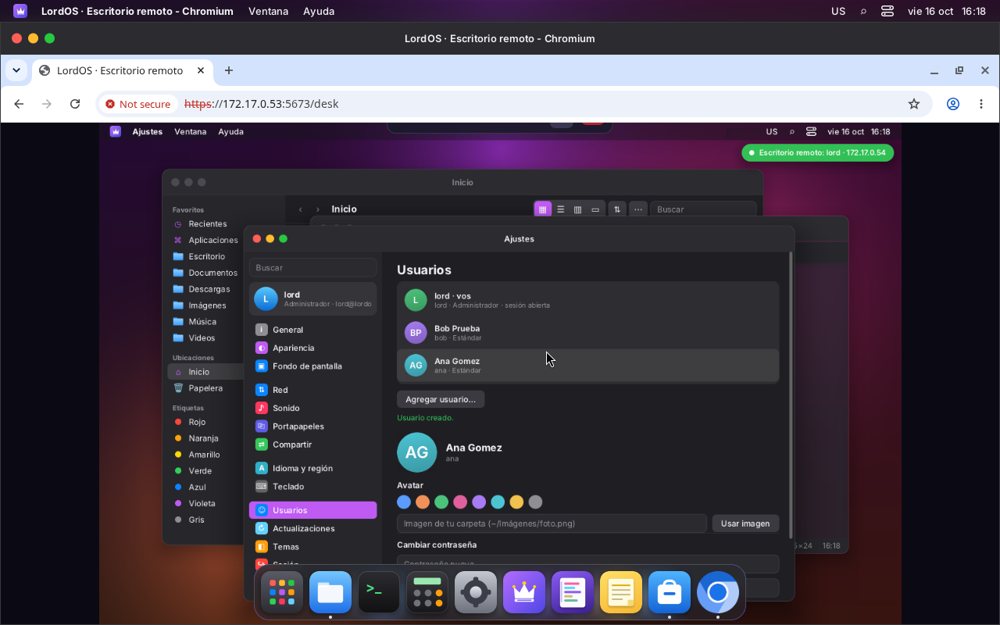
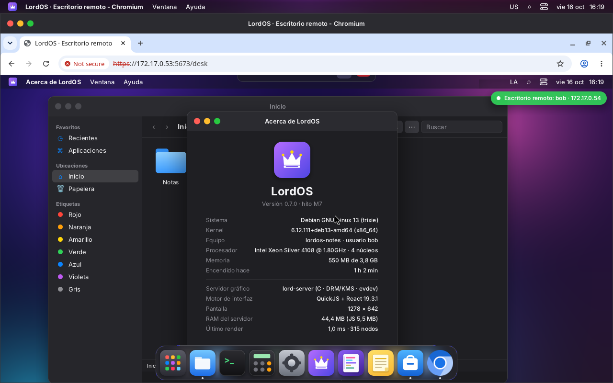
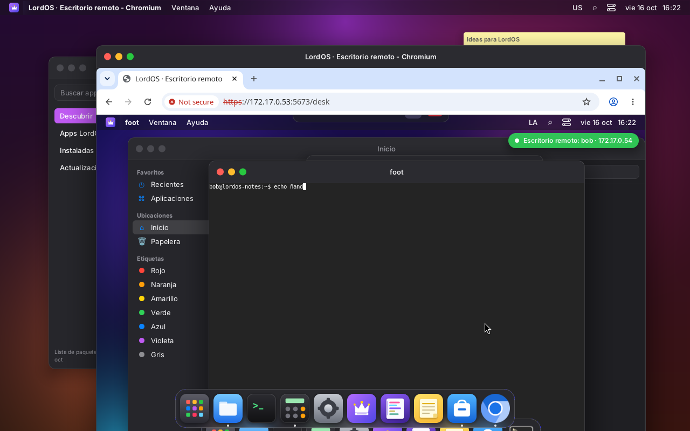
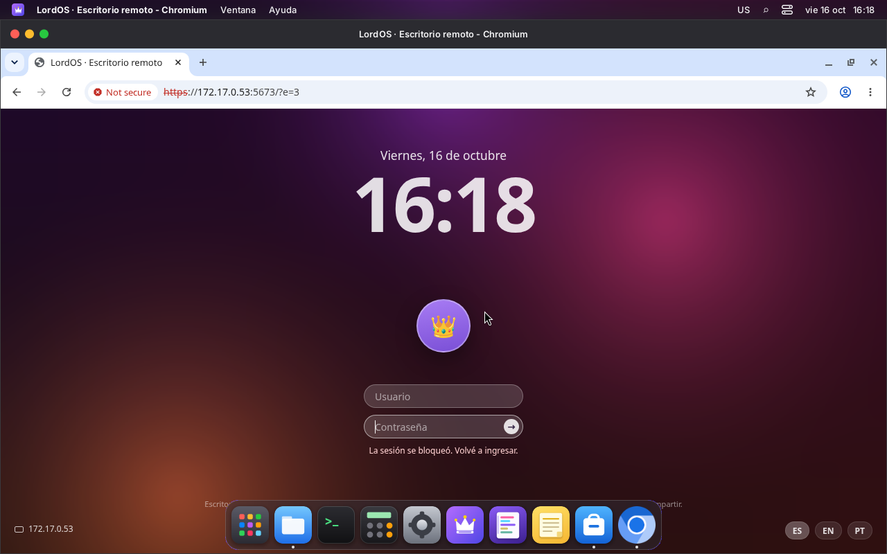

# Remote desktop on the LAN

Another computer on the local network opens `https://<machine IP>:5673` in a browser and logs in
with a user and password of the machine. Nothing needs to be installed: no extra programs, no
plugins, no third-party remote desktop protocol. It's part of `lord-sessiond`
([SESSIONS.md](SESSIONS.md)), the same process that handles the monitor's login screen.

The port is **5673**, which spells "LORD" on a phone keypad.

- **With the same user that's on the monitor:** you see and drive **the same session**. Both
  sides move the mouse and type at the same time. The monitor shows the notice
  «Remote desktop: lord · 192.168.x.x».
- **With another user:** they get **their own desktop**, running at the same time in the
  background.
- **If the session was already open:** it's resumed (including one somebody left on the monitor
  before switching users).
- **It's off by default.** It's turned on and off in Settings → Sharing → «Remote Desktop», as on
  popular desktop systems.

## Settings → Sharing

- The switch («Allow access from the network»), with the `remote-enable` and `remote-disable`
  actions.
- The URL built from the LAN IPv4 addresses and the certificate's SHA-256 fingerprint, to compare
  with the one the browser shows.
- **Who can connect:** all users, or only the `lordos-remote` group (`remote-config`;
  `remote-member` adds users to or removes them from the group).
- **Connected now:** user, IP, whether they're watching this screen or their own desktop, and for
  how long, with a «Disconnect» button (`remote-kick`, only pids from lord-sessiond's list).

The actions change `/etc/lordos/remote/config` (`enabled=`, `port=`, `allow=`) and send SIGHUP to
lord-sessiond. Turning remote off cuts the connections, but the sessions stay open, as with RDP.

## Login

The page has the same look as the monitor's login screen: background, date, large clock, avatar
and rounded fields. It has a language selector (es, en, pt) and an error shakes the field.

**It doesn't show the user list**: who has an account isn't revealed to the network. The avatar
takes the initials of the name being typed.

- `POST /login`:
  - it's verified against `/etc/shadow` (`getspnam` + `crypt_r`, constant-time comparison);
  - only people's accounts: uid 1000–59999, with a shell, not locked or expired;
  - never an account without a password, not even the live ISO's.
- **Per-IP waits:** the first two failures don't wait. After that, 1, 2, 4… seconds up to 5
  minutes, plus a fixed 1 s on each failure. Measured: the 5th attempt reaches `?e=2` without
  being verified.
- **Cookie** `lordos_remote`: 32 random bytes, `Secure; HttpOnly; SameSite=Strict`, 12 hours.
- **Headers:** strict `Content-Security-Policy`, `X-Frame-Options: DENY`,
  `Referrer-Policy: same-origin`, `Cache-Control: no-store`.
- **Same origin:** the form and the WebSocket check `Origin` against `Host`.

## Browser protocol (WebSocket `/ws`)

**Server → browser.** Binary:

- `[1][x,y,w,h u16 BE][0 png│1 jpeg][data]`: a rectangle;
- `[2][w,h,hx,hy u16 BE][png]`: cursor image;
- `[3]`: end of frame;
- `[4]`: PNG refresh.

Text (JSON): `hello`, `size`, `cur{x,y,m}`, `clip{text}`, `pong`, `bye` (with `lock:1` if the
session was locked).

**Browser → server.** Text (JSON):

- `m{x,y}`, `b{b,d}`, `w{d}` (wheel steps);
- the browser's trackpad (see `TRACKPAD.md`):
  - `s{p,x,y}`: fine scrolling in 1/256 of a pixel, with phase `p` (1 begins, 2 continues, 3 ends
    after 150 ms without events). It's told apart from a wheel because it carries `deltaX`,
    fractions or small steps;
  - `pz{p,s,r}`: pinch, with the scale ×65536 relative to the start and the rotation in degrees
    ×256. It comes from the wheel with `ctrlKey`, which is how Chrome and Firefox deliver the
    trackpad pinch (and also a mouse's Ctrl+wheel), or from `gesturechange` in WebKit browsers;
  - the bridge passes them to the session as `RP_SCROLL` and `RP_PINCH`, with clamped values;
- `k{c,d}`, with evdev codes derived from `KeyboardEvent.code`, so the session applies the
  layout;
- `clip{text}`;
- `resize{w,h}`: on connecting and when the window is resized; if the session is on the monitor,
  the monitor wins;
- `ack`, `ping{ts}`.

**Compression:**

- **Still screen:** PNG (lossless).
- **Moving screen** (consecutive frames) and large areas: straight JPEG.
- **When it becomes still:** whatever was JPEG is refreshed as PNG.

**Flow control:** the browser acknowledges each frame (`ack`) only once it has drawn it, and the
session accumulates changes until then. A slow network gets fewer frames, but always the current
state.

## Process and privileges

1. `lord-sessiond` (root) accepts the connection and handles it in a child (up to 32 at a time).
2. That child does TLS and the login. With a valid cookie, it finds the user's session or creates
   it (`sess.c`, with the same lock as the monitor).
3. **It drops root:** `initgroups`, `setgid`, `setuid`, and it's verified that it can't get it
   back. TLS, compression and the bridge run as the user.

OpenSSL (TLS) is only in `lord-sessiond`; `lord-server` doesn't link it. The certificate is
self-signed P-256, with CN equal to the machine name and ten years of validity. It's in
`/etc/lordos/remote/cert.pem` (`key.pem` 0600) and is created the first time remote is turned on.

## Threats (LAN)

| Threat                                 | What's there                                                                             |
|----------------------------------------|------------------------------------------------------------------------------------------|
| someone listens on the network         | TLS 1.2+; the certificate fingerprint is shown in Settings for comparison                |
| password guessing                      | growing per-IP waits, 1 s per failure, logged to the journal                             |
| cookie theft                           | `HttpOnly`, `Secure`, `SameSite=Strict`, 12 h; locking the session invalidates it        |
| another page uses the session (CSRF)   | `Origin` = `Host` on `/login` and `/ws`; `frame-ancestors 'none'`                        |
| user enumeration                       | the login page doesn't list them; same message for wrong user and wrong password         |
| bug in the bridge                      | it runs as the user who owns the session, not as root                                    |
| access from the internet               | not intended: use a VPN (Settings → Network → VPN). No port is opened on the router      |

## Measurements (VM 118: Xeon Silver 4108 at 1.8 GHz, 4 cores, no GPU, 1280×800)

| Situation                                         | lord-server (session) | bridge (lord-sessiond) | monitor | network      |
|---------------------------------------------------|----------------------|------------------------|---------|--------------|
| idle desktop, watched from the web                | 1–2 %                | 0 %                    | —       | < 1 KB/s     |
| just moving the mouse (web)                       | 2–3 %                | 0–1 %                  | —       | 25–40 KB/s   |
| dragging a large window (web)                     | 95 %                 | 13 %                   | —       | 380 KB/s, 4–5 frames/s |
| dragging a large window on the monitor (CPU)      | 80 %                 | —                      | —       | —            |
| session nobody is watching                        | ~1 %                 | —                      | —       | —            |

- **Memory per session:** about 50 MB. The login screen uses 41 MB. With software GPU
  (llvmpipe), the monitor session uses about 145 MB.
- **With JPEG while moving:** the bridge went from 53 % to 13 % CPU while dragging.
- **Frames per second:** in this VM the limit is the desktop's CPU composition (blur and
  transparency), not the network or the compression.

## Stage 2: audio (designed, pending)

The idea is for the bridge, which already runs as the user, to be one more client of that
session's PipeWire:

- **From the machine to the browser:**
  - it takes the monitor of the default output;
  - compresses it with Opus (20 ms, 48 kHz stereo, about 64 kbit/s);
  - sends it in a new binary message, `[5][timestamp][opus]`;
  - the browser decodes it with WebCodecs `AudioDecoder` and plays it with an `AudioWorklet`,
    with a buffer of about 60 ms. Without WebCodecs, it falls back to Opus in WASM.
- **Microphone (optional, by permission):** the reverse path, with an `Audio/Source` node in the
  session.
- **Multiple viewers:** if there are several, the audio goes to just one, the last one that asked
  for it.
- **Dependency:** libopus, only in lord-sessiond.

## Files

| Path                                  | What it is                                                 |
|---------------------------------------|------------------------------------------------------------|
| `server/src/remote/conn.c`            | one connection: HTTP, login, WebSocket, bridge             |
| `server/src/remote/enc.c`             | PNG/JPEG (stb_image_write, vendored in third_party/stb)    |
| `server/src/remote/login.html`, `client.html` | pages (embedded in the binary)                      |
| `server/src/remote/remote_admin.c`    | `remote-*` actions                                         |
| `apps/settings/Sharing.jsx`, `sdk/remote.js` | Settings → Sharing and the notice on the monitor    |
| `/etc/lordos/remote/`                 | `config`, `cert.pem`, `key.pem`, `fingerprint`             |

## Screenshots

- 
- 
- 
- 
- 
