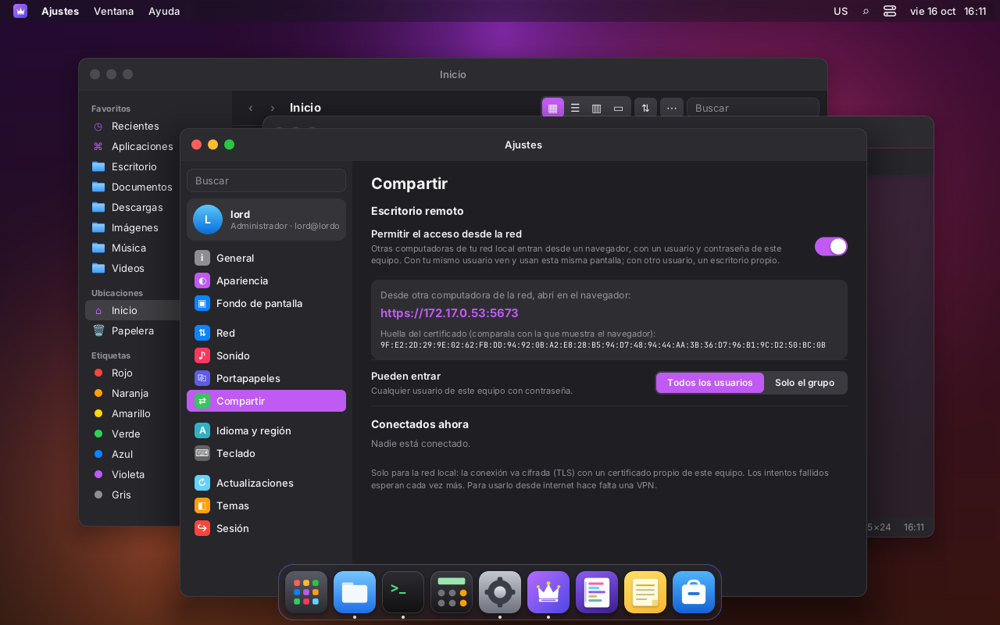
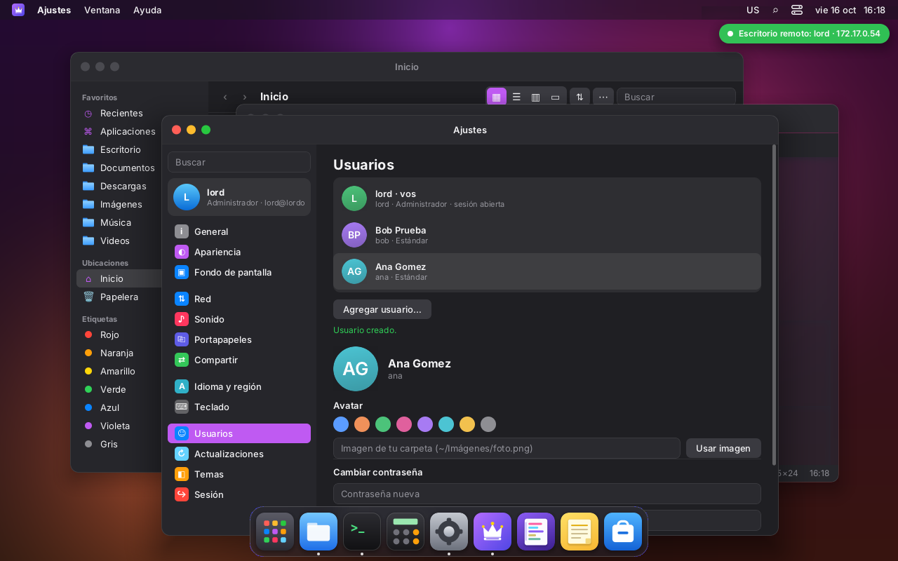

# Escritorio remoto en la LAN

Otra computadora de la red local abre `https://<IP del equipo>:5673` en un navegador e ingresa
con un usuario y contraseña del equipo. No hace falta instalar nada: ni programas extra, ni
plugins, ni un protocolo de escritorio remoto de terceros. Es parte de `lord-sessiond`
([SESIONES.md](SESIONES.md)), el mismo que maneja la pantalla de ingreso del monitor.

El puerto es **5673**, que se escribe "LORD" en el teclado de un teléfono.

- **Con el mismo usuario que está en el monitor:** se ve y se maneja **la misma sesión**. Los dos
  lados mueven el mouse y escriben a la vez. En el monitor aparece el aviso
  «Escritorio remoto: lord · 192.168.x.x».
- **Con otro usuario:** tiene **su propio escritorio**, que corre al mismo tiempo en segundo
  plano.
- **Si la sesión ya estaba abierta:** se retoma (también la de alguien que la dejó en el
  monitor y cambió de usuario).
- **Viene apagado.** Se prende y se apaga en Ajustes → Compartir → «Escritorio remoto», como en
  macOS.

## Ajustes → Compartir

- El interruptor («Permitir el acceso desde la red»), con las acciones `remote-enable` y
  `remote-disable`.
- La URL armada con las IPv4 de la LAN y la huella SHA-256 del certificado, para compararla
  con la que muestra el navegador.
- **Pueden entrar:** todos los usuarios, o solo el grupo `lordos-remote` (`remote-config`;
  `remote-member` suma o saca usuarios del grupo).
- **Conectados ahora:** usuario, IP, si mira esta pantalla o su propio escritorio, y hace cuánto,
  con un botón «Desconectar» (`remote-kick`, solo pids de la lista de lord-sessiond).

Las acciones cambian `/etc/lordos/remote/config` (`enabled=`, `port=`, `allow=`) y le mandan
SIGHUP a lord-sessiond. Al apagar el remoto se cortan las conexiones, pero las sesiones siguen
abiertas, como en un RDP.

## Ingreso

La página tiene la misma estética que la pantalla de ingreso del monitor: fondo, fecha, reloj
grande, avatar y campos redondeados. Tiene selector de idioma (es, en, pt) y el error sacude el
campo.

**No muestra la lista de usuarios**: desde la red no se revela quién tiene cuenta. El avatar
toma las iniciales del nombre que se escribe.

- `POST /login`:
  - se verifica contra `/etc/shadow` (`getspnam` + `crypt_r`, comparación en tiempo constante);
  - solo cuentas de personas: uid 1000–59999, con shell, sin bloquear ni vencidas;
  - nunca una cuenta sin contraseña, ni siquiera la del ISO live.
- **Esperas por IP:** los dos primeros fallos no esperan. Después, 1, 2, 4… segundos hasta 5
  minutos, más 1 s fijo en cada fallo. Medido: el 5.º intento llega a `?e=2` sin verificar.
- **Cookie** `lordos_remote`: 32 bytes aleatorios, `Secure; HttpOnly; SameSite=Strict`, 12 horas.
- **Encabezados:** `Content-Security-Policy` estricta, `X-Frame-Options: DENY`,
  `Referrer-Policy: same-origin`, `Cache-Control: no-store`.
- **Mismo origen:** el formulario y el WebSocket controlan `Origin` contra `Host`.

## Protocolo del navegador (WebSocket `/ws`)

**Servidor → navegador.** Binario:

- `[1][x,y,w,h u16 BE][0 png│1 jpeg][datos]`: un rectángulo;
- `[2][w,h,hx,hy u16 BE][png]`: imagen del cursor;
- `[3]`: fin de cuadro;
- `[4]`: reposición en PNG.

Texto (JSON): `hello`, `size`, `cur{x,y,m}`, `clip{text}`, `pong`, `bye` (con `lock:1` si la sesión
se bloqueó).

**Navegador → servidor.** Texto (JSON):

- `m{x,y}`, `b{b,d}`, `w{d}` (pasos de una rueda);
- trackpad del navegador (ver `TRACKPAD.md`):
  - `s{p,x,y}`: scroll fino en 1/256 de píxel, con fase `p` (1 empieza, 2 sigue, 3 termina a los
    150 ms sin eventos). Se distingue de una rueda porque trae `deltaX`, fracciones o pasos
    chicos;
  - `pz{p,s,r}`: pellizco, con la escala ×65536 relativa al comienzo y el giro en grados ×256.
    Sale de la rueda con `ctrlKey`, que es como Chrome y Firefox entregan el pellizco del
    trackpad (y también Ctrl+rueda de un mouse), o de `gesturechange` en Safari;
  - el puente los pasa a la sesión como `RP_SCROLL` y `RP_PINCH`, con valores acotados;
- `k{c,d}`, con códigos evdev a partir de `KeyboardEvent.code`, así la distribución la aplica la
  sesión;
- `clip{text}`;
- `resize{w,h}`: al conectar y al cambiar el tamaño de la ventana; si la sesión está en el
  monitor, manda el monitor;
- `ack`, `ping{ts}`.

**Compresión:**

- **Pantalla quieta:** PNG (sin pérdida).
- **Pantalla en movimiento** (cuadros seguidos) y zonas grandes: JPEG directo.
- **Al quedar quieta:** lo que fue JPEG se repone en PNG.

**Control de flujo:** el navegador confirma cada cuadro (`ack`) recién cuando lo dibujó, y la
sesión junta los cambios hasta entonces. Una red lenta recibe menos cuadros, pero siempre el
estado actual.

## Proceso y privilegios

1. `lord-sessiond` (root) acepta la conexión y la atiende en un hijo (hasta 32 a la vez).
2. Ese hijo hace TLS y el ingreso. Con la cookie válida, busca la sesión del usuario o la crea
   (`sess.c`, con el mismo lock que el monitor).
3. **Suelta root:** `initgroups`, `setgid`, `setuid` y se verifica que no pueda volver. TLS, la
   compresión y el puente corren como el usuario.

OpenSSL (TLS) está solo en `lord-sessiond`; `lord-server` no lo enlaza. El certificado es
autofirmado P-256, con CN igual al nombre del equipo y diez años de validez. Está en
`/etc/lordos/remote/cert.pem` (`key.pem` 0600) y se crea la primera vez que se prende el remoto.

## Amenazas (LAN)

| Amenaza                                | Qué hay                                                                                  |
|----------------------------------------|------------------------------------------------------------------------------------------|
| alguien escucha la red                 | TLS 1.2+; la huella del certificado se ve en Ajustes para compararla                      |
| prueba contraseñas                     | esperas crecientes por IP, 1 s por fallo, registro en el journal                           |
| roba la cookie                         | `HttpOnly`, `Secure`, `SameSite=Strict`, 12 h; bloquear la sesión la invalida             |
| otra página usa la sesión (CSRF)       | `Origin` = `Host` en `/login` y `/ws`; `frame-ancestors 'none'`                          |
| enumera usuarios                       | la página de ingreso no los lista; mismo mensaje para usuario y contraseña incorrectos      |
| bug en el puente                       | corre como el usuario dueño de la sesión, no como root                                   |
| acceso desde internet                  | no está pensado: usar una VPN (Ajustes → Red → VPN). No se abre ningún puerto en el router |

## Mediciones (VM 118: Xeon Silver 4108 a 1,8 GHz, 4 núcleos, sin GPU, 1280×800)

| Situación                                         | lord-server (sesión) | puente (lord-sessiond) | monitor | red          |
|---------------------------------------------------|----------------------|------------------------|---------|--------------|
| escritorio quieto, mirado desde la web            | 1–2 %                | 0 %                    | —       | < 1 KB/s     |
| solo mover el mouse (web)                         | 2–3 %                | 0–1 %                  | —       | 25–40 KB/s   |
| arrastrar una ventana grande (web)                | 95 %                 | 13 %                   | —       | 380 KB/s, 4–5 cuadros/s |
| arrastrar una ventana grande en el monitor (CPU)  | 80 %                 | —                      | —       | —            |
| sesión que nadie mira                             | ~1 %                 | —                      | —       | —            |

- **Memoria por sesión:** unos 50 MB. La pantalla de ingreso usa 41 MB. Con GPU por software
  (llvmpipe), la sesión del monitor usa unos 145 MB.
- **Con JPEG en movimiento:** el puente bajó de 53 % a 13 % de CPU arrastrando.
- **Cuadros por segundo:** en esta VM el límite es la composición por CPU del escritorio (blur y
  transparencias), no la red ni la compresión.

## Etapa 2: audio (diseñado, pendiente)

La idea es que el puente, que ya corre como el usuario, sea un cliente más del PipeWire de esa
sesión:

- **Del equipo al navegador:**
  - toma el monitor de la salida por defecto;
  - lo comprime en Opus (20 ms, 48 kHz estéreo, unos 64 kbit/s);
  - lo manda en un mensaje binario nuevo, `[5][timestamp][opus]`;
  - el navegador lo decodifica con WebCodecs `AudioDecoder` y lo reproduce con un
    `AudioWorklet`, con un búfer de unos 60 ms. Sin WebCodecs, cae a Opus en WASM.
- **Micrófono (opcional, por permiso):** el camino inverso, con un nodo `Audio/Source` en la
  sesión.
- **Varios visores:** si hay varios, el audio va a uno solo, el último que lo pidió.
- **Dependencia:** libopus, solo en lord-sessiond.

## Archivos

| Ruta                                  | Qué es                                                     |
|---------------------------------------|------------------------------------------------------------|
| `server/src/remote/conn.c`            | una conexión: HTTP, ingreso, WebSocket, puente             |
| `server/src/remote/enc.c`             | PNG/JPEG (stb_image_write, vendorizado en third_party/stb) |
| `server/src/remote/login.html`, `client.html` | páginas (embebidas en el binario)                   |
| `server/src/remote/remote_admin.c`    | acciones `remote-*`                                        |
| `apps/settings/Sharing.jsx`, `sdk/remote.js` | Ajustes → Compartir y el aviso en el monitor        |
| `/etc/lordos/remote/`                 | `config`, `cert.pem`, `key.pem`, `fingerprint`             |

## Capturas

- 
- 
- 
- 
- 
