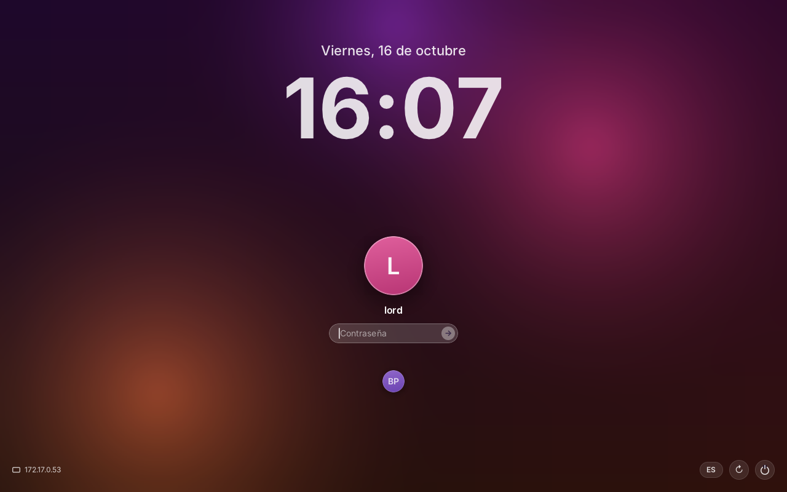
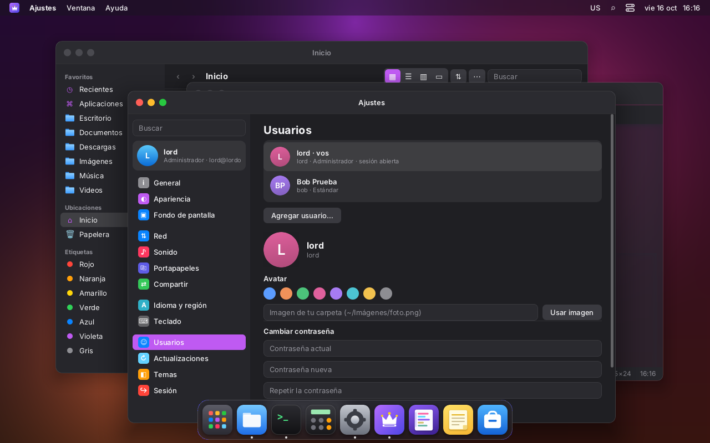
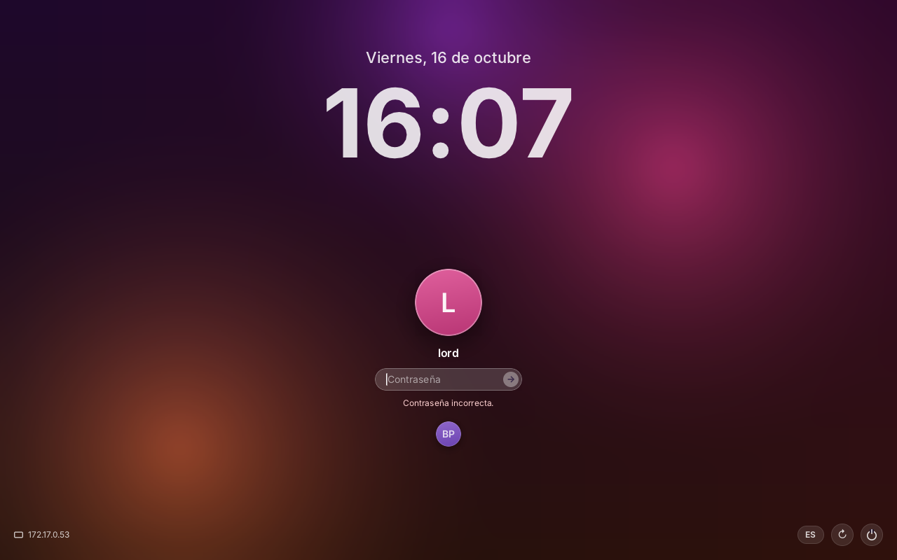
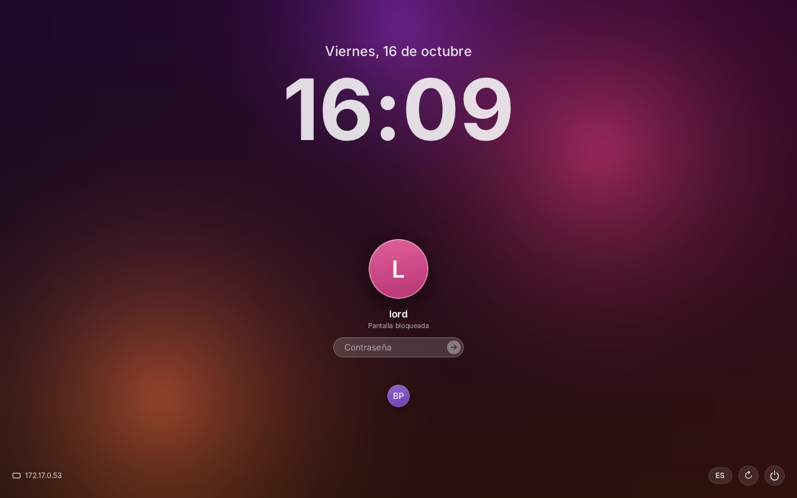
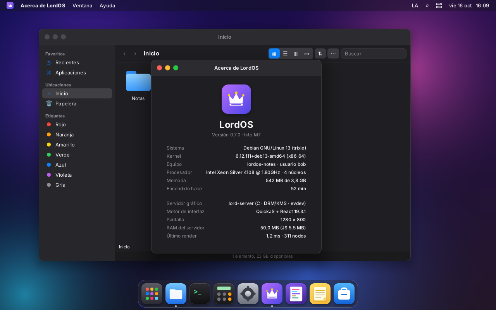
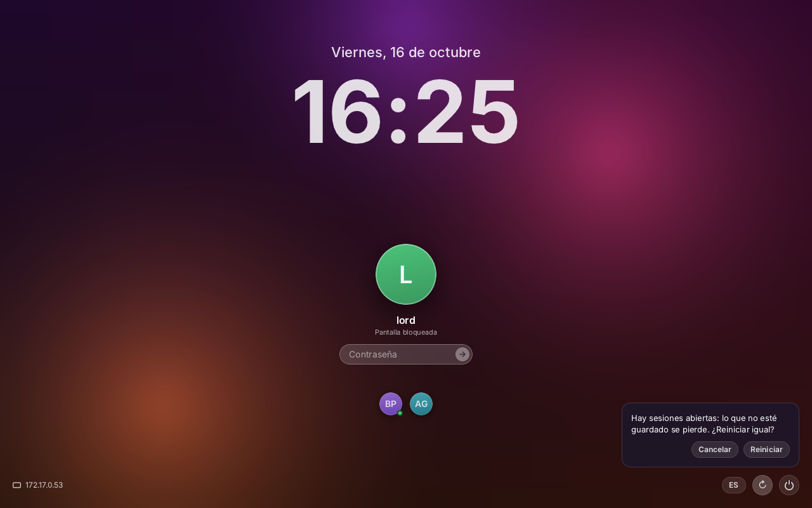
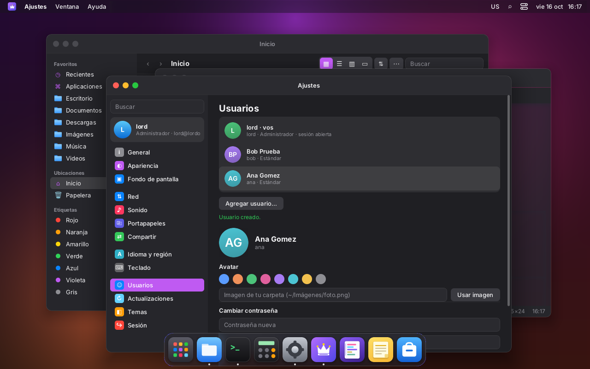
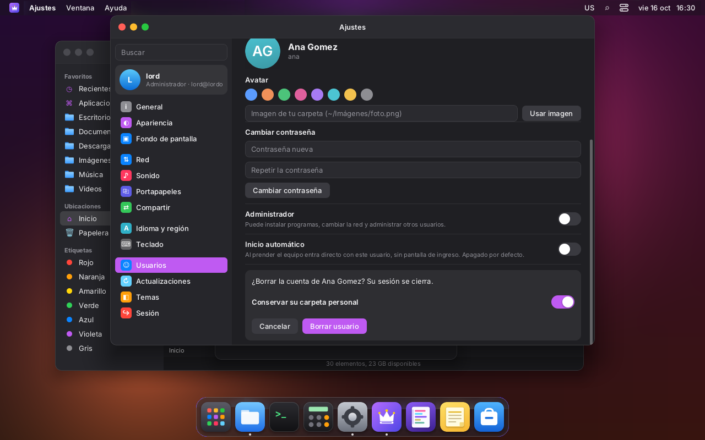

# Sesiones, pantalla de ingreso y cambio rápido de usuario (M8)

LordOS tiene su propio administrador de sesiones, `lord-sessiond`. Hace lo mismo que GDM o el
"display manager" de macOS:

- muestra la pantalla de ingreso en el monitor;
- verifica las contraseñas;
- abre una sesión por usuario;
- deja que varias sesiones vivan a la vez (cambio rápido de usuario);
- también atiende el escritorio remoto en la LAN (ver [REMOTO.md](REMOTO.md)).



## Piezas

```
lordos.service (root)
└── lord-sessiond                     principal: config, lista de sesiones, contraseñas, monitor
    ├── lord-netd (netsup.c)          la red del sistema, desde el arranque (RED.md); lo relanza si termina
    ├── conexiones web (conn.c)       un hijo por navegador; pasa a ser el usuario (REMOTO.md)
    └── trabajadores                  hijos cortos: verificar contraseña, crear la sesión
lord-server --greeter --user lordos-greeter   pantalla de ingreso (tema themes/greeter)
lord-server --user lord               una sesión por usuario, viva en segundo plano
lord-server --user bob
```

### Una sesión por usuario

Cada sesión es un `lord-server --headless WxH --user <u>`. Arranca como root y suelta los
privilegios en seguida, igual que antes. Tiene dos estados:

- **En el monitor.** Dibuja directo en la placa, como un lord-server de siempre:
  - composición por GPU (Mesa: EGL, GBM, GLES2) si hay una placa con 3D;
  - linux-dmabuf para las apps y juegos, y scanout directo de pantalla completa;
  - cursor por el plano de la placa;
  - si no hay GPU, el camino por CPU de siempre.

  La sesión no abre dispositivos ni es root: lord-sessiond le **presta** la placa y la entrada
  (ver abajo).
- **Sin monitor.** Se dibuja en memoria, por CPU, y se ve solo desde el navegador. Si nadie la
  mira, no se dibuja: no gasta CPU, pero sus programas, terminales y apps Linux siguen
  corriendo.

**El mismo usuario es la misma sesión.** Todos se conectan a su socket
`$XDG_RUNTIME_DIR/lordos/remote.sock`: lord-sessiond, que le presta el monitor, y los
navegadores, que la miran (REMOTO.md). Por eso se ve lo mismo en el monitor y en la web, y los
dos manejan el mouse y el teclado. Usuarios distintos tienen sesiones distintas, que trabajan en
paralelo.

Si un navegador mira la sesión que está en el monitor, la sesión compone por CPU mientras dura
esa conexión (la imagen tiene que estar en memoria para mandarla). Cuando no queda nadie
mirando, vuelve sola a la GPU. Así era también en M7.

- **Creación:** al crear una sesión, el monitor y la red toman un lock por usuario
  (`/run/lordos/spawn-<uid>.lock`). Así nunca se crean dos sesiones del mismo usuario.
- **`/run/user/<uid>`:** si no existe, se arranca `user@<uid>.service`, que también arranca su
  PipeWire.
- **GPU:**
  - por defecto, cada sesión la usa cuando está en el monitor;
  - con `lordos.gpu=0` en la línea del kernel (modo seguro de grub) o `LORD_GPU=0` en el
    servicio, lord-sessiond les pasa `LORD_GPU=0` a todas;
  - `LORD_GPU=1` fuerza la GPU, incluso por software (llvmpipe).
- **Idioma:** sale de `/etc/default/locale`. Si el usuario tiene `~/.config/locale.conf`, se usa
  ese, como antes.

### El monitor: la placa se presta (como los "session devices" de logind)

`server/src/remote/monitor.c`, en el proceso principal (root):

1. **Abre los dispositivos:**
   - la placa, `/dev/dri/card0`, de nuevo para cada sesión, y la hace DRM master;
   - los teclados, mouses, tablets, touchpads y pantallas táctiles, `/dev/input/event*` (los
     touchpads los maneja el driver propio de la sesión, `server/src/tp`; ver `TRACKPAD.md`).
2. **Se los pasa a la sesión** con `RP_DISPLAY`, por su socket (`SCM_RIGHTS`). La sesión prepara
   la salida (`kms_attach`), toma la entrada (`input_open_fds` y `EVIOCGRAB`) y cambia de tamaño
   en vivo a la resolución del monitor:
   - el área de trabajo y las ventanas se acomodan;
   - las apps Wayland reciben el modo nuevo.
3. **Para cambiar de sesión:**
   - avisa a la sesión que sale (`RP_UNDISPLAY`), que vuelve a dibujarse en memoria;
   - revoca su entrada con `EVIOCREVOKE`: sus fds dejan de servir aunque no los cierre;
   - le saca el master con `DROP_MASTER` sobre la copia propia del mismo archivo abierto;
   - recién ahí le da una placa y una entrada nuevas a la que entra.

**Enchufar y desenchufar en caliente:**

- **Al enchufar:** `lord-sessiond` mira `/dev/input` con inotify. Un teclado, mouse o touchpad
  nuevo:
  - se abre como root;
  - pasa el mismo filtro que los demás;
  - se le manda **solo a la sesión que está en el monitor** (`RP_INPUT_ADD`, con el fd).

  Las sesiones de segundo plano no reciben nada; lo ven al volver al monitor, porque
  `sd_mon_show` abre todo de nuevo.
- **Al desenchufar:**
  - `lord-sessiond` cierra su copia;
  - la sesión ve `ENODEV` o `POLLHUP` en el suyo y **cierra solo ese dispositivo**.
- **Dejar el monitor:** solo pasa cuando lo pide `lord-sessiond` (`RP_UNDISPLAY`). Nunca se
  deduce de un error de un dispositivo; antes, desenchufar un mouse USB dejaba la pantalla en
  negro.

Probado en la VM 123 con dispositivos simulados por uinput:

- enchufar, mover y desenchufar con la sesión en el monitor;
- volver a enchufar;
- un mouse con rueda de alta resolución;
- un touchpad enchufado con la pantalla bloqueada: le llegó a la pantalla de ingreso y no a la
  sesión de `lord`.

Cambiar de usuario es solo esto: la otra sesión sigue viva en segundo plano. La consola se pone
en modo gráfico una vez (`KD_GRAPHICS`) y vuelve a texto al apagar el servicio.

La placa, la entrada y el socket del monitor nunca quedan abiertos en los hijos (conexiones web,
trabajadores): `sd_mon_child()` los cierra antes de soltar root.

### La pantalla de ingreso (greeter)

Es un `lord-server --headless --greeter` que corre como `lordos-greeter`, sin privilegios y sin
ayudante de administración. Su runtime está en `/run/lordos/greeter` y su casa en
`/var/lib/lordos-greeter`. Carga el tema especial `themes/greeter` (React, el mismo motor):

- la fecha y un reloj grande;
- el avatar del usuario elegido con el campo «Contraseña» (→);
- los demás usuarios abajo; un punto verde marca a los que tienen sesión abierta;
- abajo a la izquierda, la IP del equipo;
- abajo a la derecha:
  - el idioma (es, en, pt);
  - el teclado, si el sistema tiene varios (`/etc/default/keyboard`);
  - Reiniciar y Apagar. Si hay sesiones abiertas, piden confirmación.
- La contraseña incorrecta sacude el campo. Con muchos intentos, pide esperar.

Para pedir cosas, el JS usa `lord.greeter.send(json)`. Esa función existe solo en modo greeter.
El pedido viaja así:

```
greeter (JS) → RP_GREETER → lord-sessiond (root), por el socket de la pantalla de ingreso
```

**La verificación de la contraseña la hace siempre el proceso root**, contra `/etc/shadow` con
`crypt_r`. El JS nunca ve el hash. Pedidos y avisos:

| Pedido (greeter → sessiond)        | Respuesta / aviso (sessiond → greeter)                                    |
|------------------------------------|---------------------------------------------------------------------------|
| `{t:'hello'}`                      | `{t:'hello', mode, user, host, layouts, variants, lang, users:[…]}`        |
| `{t:'login', user, pass}`          | `{t:'ok'}` y el monitor pasa a la sesión · `{t:'fail', wait}` · `{t:'error'}` |
| `{t:'power', a:'reboot'│'poweroff'}` | (`systemctl reboot` / `poweroff`, una lista cerrada)                     |
|                                    | `{t:'mode', mode:'login'│'lock'│'switch', user}` al mostrarse              |

Los intentos fallidos en el monitor se cuentan por usuario (`monitor:<usuario>`). Los dos
primeros no esperan; después la espera es de 1, 2, 4… segundos, hasta 5 minutos.

### Bloquear, cambiar de usuario y cerrar sesión

- **Bloquear pantalla:** ❖L, ❖Ctrl+Q, o el menú del logo → «Bloquear pantalla».
  1. La sesión manda `RP_SESSION {"a":"lock"}` a todos sus visores.
  2. El monitor muestra la pantalla de ingreso con ese usuario.
  3. Los navegadores conectados a esa sesión también se cortan y vuelven al ingreso
     (`/?e=3`).
- **Cambiar de usuario…**: `{"a":"switch"}`. Muestra la pantalla de ingreso con otro usuario
  elegido. La sesión anterior sigue viva en segundo plano y se vuelve a ella ingresando de
  nuevo.

  
- **Cerrar sesión:** termina el `lord-server` de ese usuario y el monitor vuelve a la pantalla de
  ingreso.
- **Reinicio de `lord-sessiond`:**
  - las sesiones siguen vivas (`KillMode=process`), y al volver se entra de nuevo por la
    pantalla de ingreso;
  - `lord-netd` también sigue vivo y el `lord-sessiond` nuevo lo adopta: la red no se corta;
  - `lordos.service` lleva `DelegateSubgroup=supervisor`: sin eso, systemd no podía arrancar el
    principal nuevo mientras quedaban procesos vivos en el árbol delegado («Device or resource
    busy»);
  - el inicio automático se aplica una sola vez por arranque del equipo
    (`/run/lordos/autologin-done`), así que un reinicio del servicio no desbloquea una sesión
    bloqueada.

En el SDK: `session.lock()`, `session.switchUser()` y `session.managed()`. Los temas `default` y
`classic` muestran esos ítems solo si `managed()` es verdadero.

## cgroups: un subárbol por sesión

Cada app de una sesión va a su propio cgroup v2 (una «scope») para que el monitoreo atribuya
tráfico y hardware y para ponerle límites (ver [PRIVACIDAD.md](PRIVACIDAD.md)). `lord-server`
corre sin root, así que `lord-sessiond` le **delega** un subárbol:

- `lordos.service` lleva `Delegate=yes`. Al arrancar, `lord-sessiond` se mueve a la hoja
  `supervisor` (`cgroup_service_init`, `server/src/sec/cgroup.c`), así la raíz del servicio queda
  sin procesos y puede habilitar `cpu memory pids` para sus hijos.
- Al crear la sesión de un usuario (`spawn` en `sess.c`), el hijo —todavía root, antes del
  `execve` de `lord-server`— llama a `cgroup_delegate_session(uid, gid)`: crea
  `lordos-session-<uid>/server`, se mete ahí y le cede el subárbol al usuario (`chown`).
- `lord-server` crea las scopes de sus apps como hermanas de `server`, sin root:
  `app-lordos-lpk-<id>.scope` (apps `.lpk` aisladas) y `app-lordos-<id>.scope` (apps Linux).
- La pantalla de ingreso y las conexiones web quedan en `supervisor`.

```
lordos.service
├─supervisor                 lord-sessiond, pantalla de ingreso, conexiones web
├─lordos-session-1000        (de lord)
│ ├─server                   su lord-server y su ayudante
│ ├─app-lordos-lpk-evil.scope
│ └─app-lordos-featherpad.scope
└─lordos-session-1001        (de bob)
  └─server
```

Probado en la VM 122: `lord` en el monitor, `bob` entrando por el navegador (sesión nueva en
`lordos-session-1001`) y `lord` por el navegador (la misma sesión del monitor); cambio rápido de
usuario de `lord` a `bob` y de vuelta, con las apps de `lord` (FeatherPad y una app aislada)
vivas. Con `KillMode=process`, un reinicio del servicio deja las sesiones en sus subárboles.

Sin `Delegate=yes` (o `lord-server` suelto con sudo, como en el desarrollo) todo sigue como
antes: las apps corren sin scope y se avisa en el registro.

## Inicio automático

Se configura en `/etc/lordos/session.conf`: `AUTOLOGIN=usuario`, o vacío para usar la pantalla de
ingreso.

- **Sistema instalado:** el instalador escribe `AUTOLOGIN=` vacío. Se entra por la pantalla de
  ingreso.
- **Ajustes → Usuarios → «Inicio automático»:** viene apagado y lo cambia la acción
  `user-autologin`.
- **ISO live:** `AUTOLOGIN=lordos`. El usuario `lordos` no tiene contraseña, así que después de
  bloquear se vuelve con el campo vacío. Esto vale solo:
  - en el monitor;
  - para el usuario de inicio automático;
  - nunca desde la red.

## Ajustes → Usuarios



La lista sale de `lord.users.list()`, de solo lectura: las cuentas con uid 1000–59999 y un shell
real. Muestra el avatar, si es administrador y si tiene sesión abierta. Todo lo que cambia algo
pasa por acciones cerradas de `admin.c` (`server/src/users/users_admin.c`), validadas del lado
root:

| Acción            | Argumento (líneas)                         | Quién                                         |
|-------------------|--------------------------------------------|-----------------------------------------------|
| `user-add`        | nombre, nombre completo, contraseña, admin | administrador                                 |
| `user-del`        | nombre, conservar carpeta (0/1)            | administrador; no la propia ni el último admin |
| `user-passwd`     | nombre, nueva, actual                      | la propia, con la actual; la de otro, un administrador |
| `user-admin`      | nombre, 0/1 (grupo `sudo`)                 | administrador; no el último admin              |
| `user-avatar`     | nombre, color `#rrggbb`, imagen            | el propio, o un administrador                  |
| `user-autologin`  | nombre o vacío                             | administrador                                 |

- **Contraseñas:**
  - se escriben con `chpasswd` por la entrada estándar, nunca en argv;
  - el ayudante borra el argumento de la memoria después de usarlo;
  - el SDK no lo guarda en el aviso de "en curso" (`quiet`).
- **Imagen del avatar:**
  - tiene que ser una ruta de la carpeta personal de quien lo pide;
  - se lee con sus permisos (`setfsuid`), así root no lee nada que el usuario no pudiera leer;
  - solo PNG o JPEG, de hasta 4 MB.
- **Avatares:** quedan en `/var/lib/lordos/users/<u>.json` (el color) y `<u>.png` (la imagen).
  La pantalla de ingreso los puede leer; la casa de cada usuario, no.
- **Usuario nuevo:**
  - se crea con las carpetas comunes en el idioma del sistema (Escritorio, Documentos, Descargas,
    Música, Imágenes y Videos; en inglés o portugués si ese es el idioma), su
    `~/.config/user-dirs.dirs` y `user-dirs.locale` (xdg-user-dirs), más `settings.json` y
    `locale.conf`. La lista está en un solo lugar, `server/src/users/homedirs.c`, y la usa también
    el instalador; es la misma de `lordos-live-prep`. Prueba: `build/homedirs-test`;
  - el nombre de usuario se sugiere a partir del nombre completo.

## Seguridad

| Proceso                           | Corre como      | Qué puede                                                        |
|-----------------------------------|-----------------|------------------------------------------------------------------|
| `lord-sessiond` (principal)       | root            | lee shadow, abre y presta la placa y la entrada, crea sesiones, reinicia; no lee píxeles |
| `lord-netd`                       | root            | solo las acciones `net-*` de `admin.c` (RED.md); habla solo con los ayudantes root de las sesiones (`netd.sock` 0600) |
| pantalla de ingreso               | `lordos-greeter` | dibujar y pedir; sin ayudante de administración ni acceso a casas |
| sesión                            | el usuario      | lo de siempre (el ayudante `admin.c` con su lista cerrada); la placa y la entrada solo mientras está en el monitor |
| conexión web                      | root → usuario  | suelta root apenas sabe de quién es la sesión (REMOTO.md)          |

- **Mensajes de las sesiones:** la conexión de lord-sessiond (`RP_SEAT`) no recibe la
  pantalla. Solo lee JSON corto de hasta 4 KB y se salta todo lo demás sin interpretarlo. Los
  rectángulos de pantalla los procesa el puente web, que ya corre como el usuario.
- **Binarios:** las sesiones se crean solo con un `lord-server` que sea de root y que nadie más
  pueda escribir. `insecure_dev=1` en `/etc/lordos/remote/config` lo permite en una VM de
  desarrollo.
- **Bloquear de verdad saca la sesión del monitor:** no es una capa encima del escritorio. Si la
  sesión del usuario se cuelga, la pantalla de ingreso sigue funcionando.

## Archivos

| Ruta                                   | Qué es                                                    |
|----------------------------------------|-----------------------------------------------------------|
| `server/src/remote/sessiond.c`         | el principal                                              |
| `server/src/remote/monitor.c`          | el monitor: prestar y revocar la placa y la entrada       |
| `server/src/remote/sess.c`             | cuentas, contraseñas, esperas, crear y encontrar sesiones |
| `server/src/remote/mirror.c`           | lado de la sesión: visores, monitor prestado, tamaño, pedidos |
| `server/src/remote/proto.h`            | el protocolo local                                        |
| `server/src/users/users_admin.c`       | acciones `user-*`                                         |
| `server/src/users/homedirs.c`          | carpetas comunes y `user-dirs.dirs` (Usuarios y el instalador) |
| `server/src/remote/netsup.c`           | lanza, vigila y adopta a `lord-netd` (RED.md)             |
| `/run/lordos/netd.sock`, `netd.pid`, `netd.enabled` | la red del sistema (RED.md)                  |
| `server/src/sec/cgroup.c`              | subárbol de cgroup por sesión y scopes por app (`Delegate=yes`) |
| `themes/greeter/`                      | la pantalla de ingreso                                    |
| `apps/settings/Users.jsx`              | Ajustes → Usuarios                                        |
| `/run/lordos/status.json`              | sesiones, quién está en el monitor y quién conectado por la red |
| `/etc/lordos/session.conf`             | `AUTOLOGIN=`                                              |

## Capturas

- 
- 
- 
- 
- 
- 
- 
- 

## Pendiente

- **Varios monitores:** se usa un solo conector, igual que antes.
- **Consolas de texto:** Ctrl+Alt+F2 no cambia de consola mientras corre LordOS, igual que antes.
- **Elegir la imagen del avatar:** hoy es una ruta escrita a mano; falta el selector de archivos.
- **Probar con una placa real** (AMD, en el USB live): en las VMs, la GPU solo se pudo probar con
  `LORD_GPU=1` y llvmpipe.
