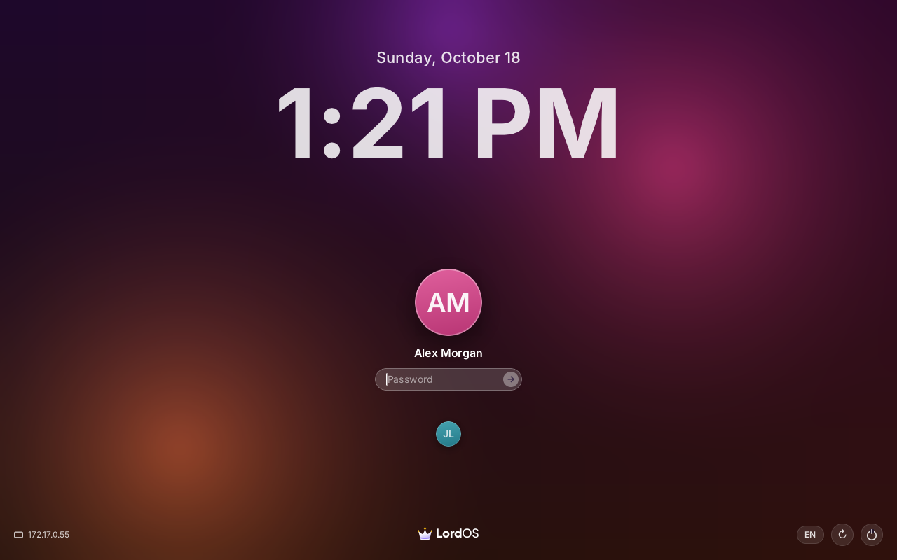
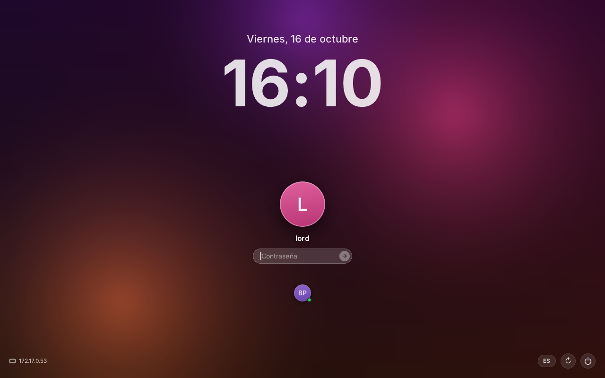
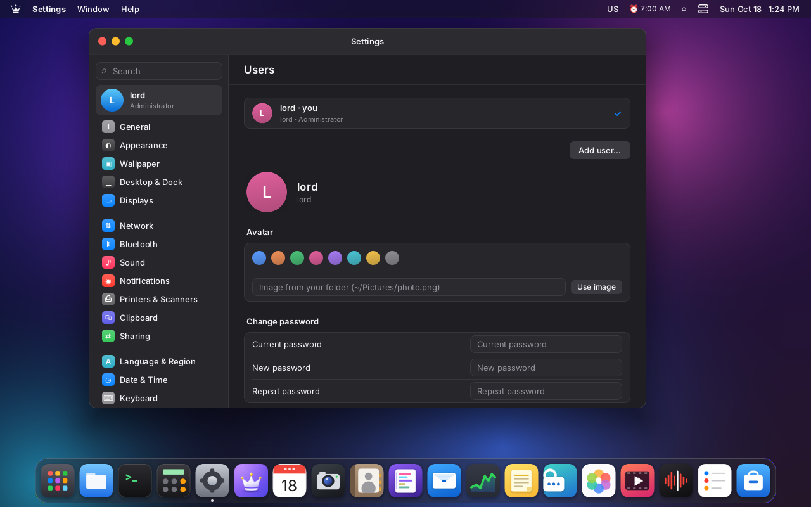
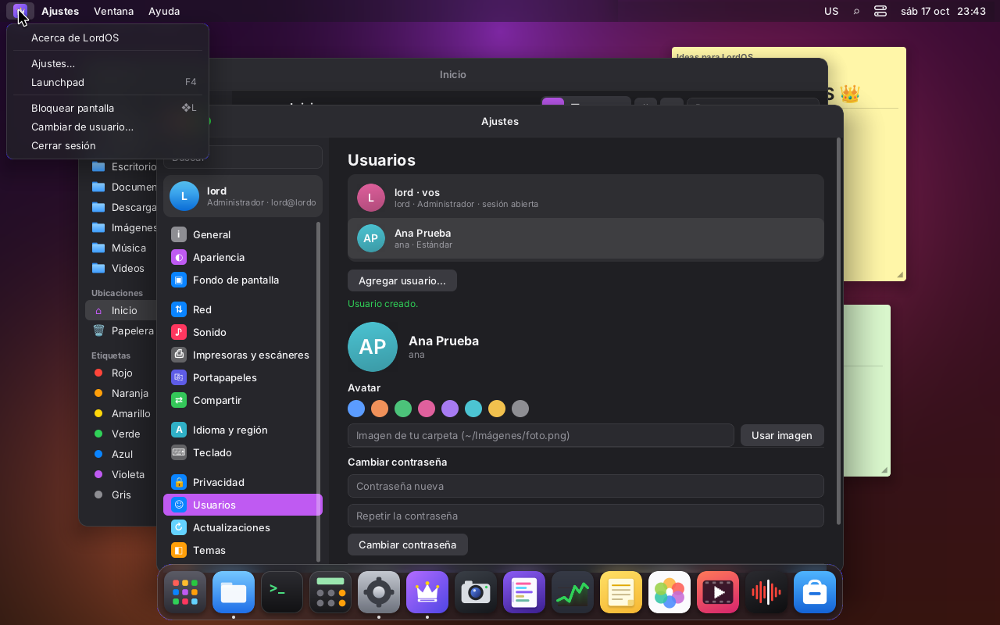
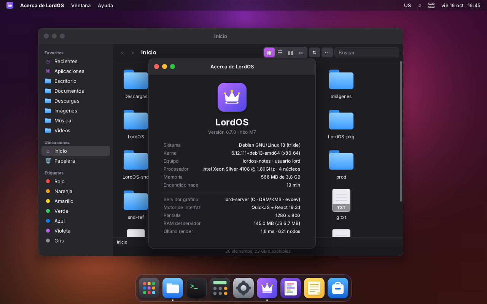
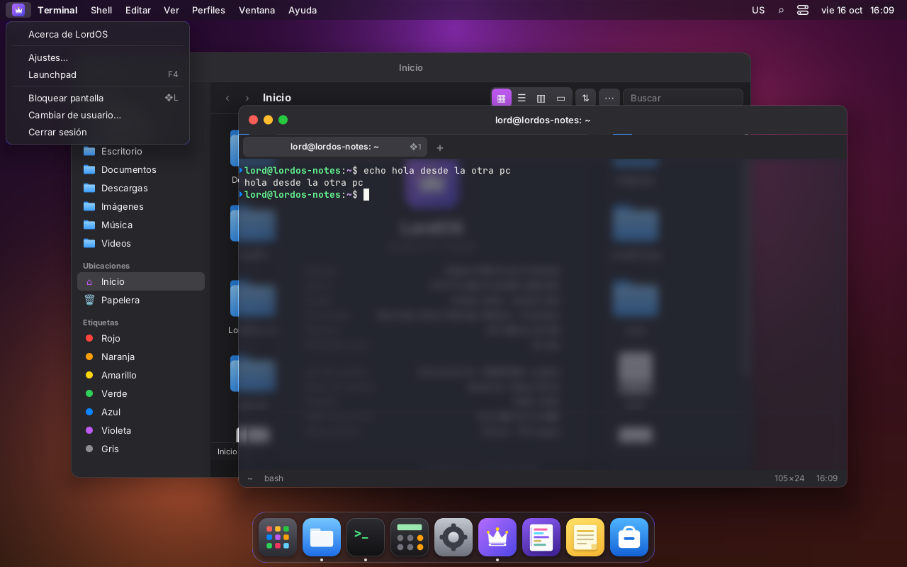
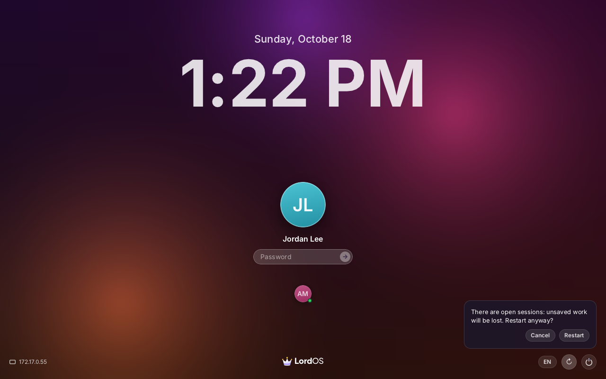
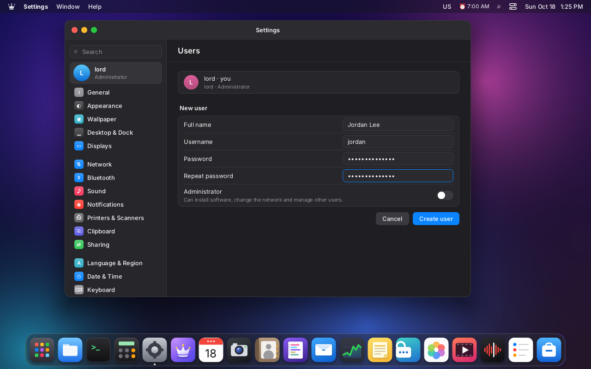

# Sessions, login screen and fast user switching (M8)

LordOS has its own session manager, `lord-sessiond`. It does the same as GDM or any other
"display manager":

- it shows the login screen on the monitor;
- it verifies passwords;
- it opens one session per user;
- it lets several sessions live at the same time (fast user switching);
- it also serves the remote desktop on the LAN (see [REMOTE.md](REMOTE.md)).



## Pieces

```
lordos.service (root)
└── lord-sessiond                     main: config, session list, passwords, monitor
    ├── lord-netd (netsup.c)          the system network, from boot (NETWORK.md); restarted if it exits
    ├── web connections (conn.c)      one child per browser; becomes the user (REMOTE.md)
    └── workers                       short-lived children: verify password, create the session
lord-server --greeter --user lordos-greeter   login screen (theme themes/greeter)
lord-server --user lord               one session per user, alive in the background
lord-server --user bob
```

### One session per user

Each session is a `lord-server --headless WxH --user <u>`. It starts as root and drops privileges
right away, as before. It has two states:

- **On the monitor.** It draws straight to the card, like a regular lord-server:
  - GPU composition (Mesa: EGL, GBM, GLES2) if there's a card with 3D;
  - linux-dmabuf for apps and games, and direct fullscreen scanout;
  - cursor via the card's plane;
  - without a GPU, the usual CPU path.

  The session doesn't open devices and isn't root: lord-sessiond **lends** it the card and the
  input (see below).
- **Off the monitor.** It draws in memory, on the CPU, and is only seen from the browser. If
  nobody is watching, it doesn't draw: it uses no CPU, but its programs, terminals and Linux apps
  keep running.

**The same user is the same session.** Everyone connects to its socket
`$XDG_RUNTIME_DIR/lordos/remote.sock`: lord-sessiond, which lends it the monitor, and the
browsers, which watch it (REMOTE.md). That's why the monitor and the web show the same thing, and
both drive the mouse and keyboard. Different users have different sessions, which work in
parallel.

If a browser watches the session that's on the monitor, the session composites on the CPU for as
long as that connection lasts (the image has to be in memory to send it). When nobody is left
watching, it goes back to the GPU on its own. It was like that in M7 too.

- **Creation:** when creating a session, the monitor and the network take a per-user lock
  (`/run/lordos/spawn-<uid>.lock`). So two sessions of the same user are never created.
- **`/run/user/<uid>`:** if it doesn't exist, `user@<uid>.service` is started, which also starts
  its PipeWire.
- **GPU:**
  - by default, each session uses it while it's on the monitor;
  - with `lordos.gpu=0` on the kernel line (grub's safe mode) or `LORD_GPU=0` in the service,
    lord-sessiond passes `LORD_GPU=0` to all of them;
  - `LORD_GPU=1` forces the GPU, even in software (llvmpipe).
- **Language:** it comes from `/etc/default/locale`. If the user has `~/.config/locale.conf`,
  that one is used, as before.

### The monitor: the card is lent (like logind's "session devices")

`server/src/remote/monitor.c`, in the main process (root):

1. **It opens the devices:**
   - the card, `/dev/dri/card0`, again for each session, and makes it DRM master;
   - keyboards, mice, tablets, touchpads and touchscreens, `/dev/input/event*` (touchpads are
     handled by the session's own driver, `server/src/tp`; see `TRACKPAD.md`).
2. **It passes them to the session** with `RP_DISPLAY`, over its socket (`SCM_RIGHTS`). The
   session prepares the output (`kms_attach`), takes the input (`input_open_fds` and
   `EVIOCGRAB`) and resizes live to the monitor's resolution:
   - the work area and the windows adjust;
   - Wayland apps receive the new mode.
3. **To switch sessions:**
   - it tells the leaving session (`RP_UNDISPLAY`), which goes back to drawing in memory;
   - it revokes its input with `EVIOCREVOKE`: its fds stop working even if it doesn't close them;
   - it takes master away with `DROP_MASTER` on its own copy of the same open file;
   - only then does it give a new card and input to the incoming session.

**Hot plugging and unplugging:**

- **On plug:** `lord-sessiond` watches `/dev/input` with inotify. A new keyboard, mouse or
  touchpad:
  - is opened as root;
  - passes the same filter as the others;
  - is sent **only to the session that's on the monitor** (`RP_INPUT_ADD`, with the fd).

  Background sessions get nothing; they see it when they return to the monitor, because
  `sd_mon_show` opens everything again.
- **On unplug:**
  - `lord-sessiond` closes its copy;
  - the session sees `ENODEV` or `POLLHUP` on its own and **closes only that device**.
- **Leaving the monitor:** only happens when `lord-sessiond` asks (`RP_UNDISPLAY`). It's never
  inferred from a device error; before, unplugging a USB mouse left the screen black.

Tested in VM 123 with devices simulated through uinput:

- plugging, moving and unplugging with the session on the monitor;
- plugging back in;
- a mouse with a high-resolution wheel;
- a touchpad plugged in with the screen locked: it went to the login screen and not to `lord`'s
  session.

Switching users is just this: the other session stays alive in the background. The console is
put in graphics mode once (`KD_GRAPHICS`) and goes back to text when the service stops.

The card, the input and the monitor socket are never left open in the children (web
connections, workers): `sd_mon_child()` closes them before dropping root.

### Boot splash

The boot splash (Plymouth, theme `lordos`; see `ISO.md` and `RASPBERRY.md`, "Boot splash") hands
the screen to LordOS without a black frame or a flash of the text console:

1. **`lordos.service` → `lordos-splash deactivate`**, the last `ExecStartPre` (on the Raspberry Pi
   after `wait-kms`): Plymouth stops drawing and drops DRM master, but its last frame stays on the
   screen. The unit has `TTYReset=no`: systemd's terminal reset switches tty1 back to text mode
   before every `Exec*` line, and with nobody holding DRM master the console would be drawn on top
   of the splash.
2. **lord-sessiond** opens the card, becomes DRM master (`SET_MASTER` works because Plymouth
   dropped it) and lends it to the login screen, or the autologin session, with
   **`RP_DISPLAY_KEEP`** (a flags byte after the fd count in `RP_DISPLAY`). The flag is only sent while
   `/run/lordos/first-frame` doesn't exist, that is, before the first frame of this boot: later the
   screen may hold another user's session, which must never stay visible.
3. **The session** (`kms_attach(..., keep)`) skips the black first modeset: `modeset_pending`
   makes the first `kms_flip` (CPU path) or `kms_set_fb`/`kms_flip_fb` (GPU path, direct scanout)
   do the `SETCRTC` with a real frame. Until then the splash is what the screen shows. Then it sends
   **`RP_SHOWN`** to lord-sessiond.
4. **lord-sessiond** creates `/run/lordos/first-frame` (also at once when there is no monitor).
5. **`lordos-splash-quit.service`** (wanted by `lordos.service`) waits for that file and runs
   `plymouth quit --retain-splash`: Plymouth closes its card without touching the screen, which
   already shows LordOS. Without the file after 30 s it ends Plymouth anyway.
6. Plymouth's own `plymouth-quit.service` (a plain `plymouth quit`) is ordered after it by
   `plymouth-quit.service.d/lordos.conf`, so it can't end the splash early. There is no
   `Conflicts=` with it (the display-manager way): starting `plymouth-quit.service` by hand would
   then stop LordOS.

lord-sessiond runs nothing new for this: Plymouth is only called from the units, with fixed
arguments (`/usr/lib/lordos/lordos-splash`). Without Plymouth installed or running, both steps do
nothing and the boot is the same as before (the first frame is then black, as always).

### The login screen (greeter)

It's a `lord-server --headless --greeter` running as `lordos-greeter`, unprivileged and without
an admin helper. Its runtime is in `/run/lordos/greeter` and its home in
`/var/lib/lordos-greeter`. It loads the special theme `themes/greeter` (React, the same engine):

- the date and a large clock;
- the chosen user's avatar with the «Password» field (→). When the screen is shown it preselects
  the locked user, otherwise the last user whose session was on the monitor (`last` in the `hello`
  reply, kept in `/var/lib/lordos/last-user` across reboots), then a user with an open session, then
  the first one. An avatar the person clicks always wins over a later `hello` reply;
- the other users below; a green dot marks those with an open session;
- bottom left, the machine's IP;
- bottom right:
  - the language (es, en, pt);
  - the keyboard, if the system has several (`/etc/default/keyboard`);
  - Restart and Shut Down. If there are open sessions, they ask for confirmation.
- A wrong password shakes the field. After many attempts, it asks you to wait.

To request things, the JS uses `lord.greeter.send(json)`. That function only exists in greeter
mode. The request travels like this:

```
greeter (JS) → RP_GREETER → lord-sessiond (root), over the login screen's socket
```

**Password verification is always done by the root process**, against `/etc/shadow` with
`crypt_r`. The JS never sees the hash. Requests and notices:

| Request (greeter → sessiond)       | Reply / notice (sessiond → greeter)                                       |
|------------------------------------|---------------------------------------------------------------------------|
| `{t:'hello'}`                      | `{t:'hello', mode, user, last, host, layouts, variants, lang, users:[…]}`  |
| `{t:'login', user, pass}`          | `{t:'ok'}` and the monitor switches to the session · `{t:'fail', wait}` · `{t:'error'}` |
| `{t:'power', a:'reboot'│'poweroff'}` | (`systemctl reboot` / `poweroff`, a closed list)                         |
|                                    | `{t:'mode', mode:'login'│'lock'│'switch', user}` when shown                |

Failed attempts on the monitor are counted per user (`monitor:<user>`). The first two don't wait;
after that the wait is 1, 2, 4… seconds, up to 5 minutes.

### Lock, switch user and log out

- **Lock screen:** ❖L, ❖Ctrl+Q, or the logo menu → «Lock Screen».
  1. The session sends `RP_SESSION {"a":"lock"}` to all its viewers.
  2. The monitor shows the login screen with that user.
  3. Browsers connected to that session are also cut off and go back to the login
     (`/?e=3`).
- **Switch User…**: `{"a":"switch"}`. Shows the login screen with another user selected. The
  previous session stays alive in the background and you return to it by logging in again.

  
- **Log out:** ends that user's `lord-server` and the monitor goes back to the login screen.
- **Restarting `lord-sessiond`:**
  - sessions stay alive (`KillMode=process`), and on return you get back in through the login
    screen;
  - `lord-netd` keeps running too and the new `lord-sessiond` adopts it: the network is not cut;
  - the login screen does **not** survive: it keeps no state, so `lord-sessiond` stops every
    process of `lordos-greeter` when it stops, and any left over (after a crash) when it starts,
    and starts a fresh one on demand. Before 0.8.0-beta the old greeter stayed ("remains running
    after unit stopped") and, after a package upgrade, kept the old binary;
  - `lordos.service` has `DelegateSubgroup=supervisor`: without it, systemd couldn't start the new
    main process while live processes remained in the delegated tree ("Device or resource busy");
  - autologin is applied only once per machine boot (`/run/lordos/autologin-done`), so a service
    restart doesn't unlock a locked session.
- **Linux app windows across a lock or a switch:** leaving the monitor tears the session's GPU
  context down and coming back makes a new one. Every window is imported again in the new context
  and, while the session is off the monitor, a window whose buffer the CPU can't read keeps its
  last frame. Before 0.8.1, Chromium's window came back black (`GPU.md`, "When the GPU context is
  re-created"; `tests/gpu_cycle.sh` repeats the off/on cycle).

In the SDK: `session.lock()`, `session.switchUser()` and `session.managed()`. The `default` and
`classic` themes show those items only if `managed()` is true.

## cgroups: one subtree per session

Each app in a session goes into its own cgroup v2 (a «scope») so monitoring can attribute traffic
and hardware and so limits can be applied (see [PRIVACY.md](PRIVACY.md)). `lord-server` runs
without root, so `lord-sessiond` **delegates** a subtree to it:

- `lordos.service` has `Delegate=yes`. At startup, `lord-sessiond` moves itself to the
  `supervisor` leaf (`cgroup_service_init`, `server/src/sec/cgroup.c`), so the service root has
  no processes and can enable `cpu memory pids` for its children.
- When a user's session is created (`spawn` in `sess.c`), the child —still root, before
  `lord-server`'s `execve`— calls `cgroup_delegate_session(uid, gid)`: it creates
  `lordos-session-<uid>/server`, moves itself there and hands the subtree to the user (`chown`).
- `lord-server` creates its apps' scopes as siblings of `server`, without root:
  `app-lordos-lpk-<id>.scope` (isolated `.lpk` apps) and `app-lordos-<id>.scope` (Linux apps).
- **Update (root-owned scopes):** the subtree is no longer chowned to the user. The scopes are
  created by `lord-sessiond` (a root child on `/run/lordos/cgroup.sock`, `remote/cgsup.c`) when
  `lord-server`, or a child it forked right before exec, asks to be placed; all of them, and
  every `cgroup.procs`, are root's. After a restart the new `lord-sessiond` hardens the subtrees
  of the sessions that survived. See `PRIVACY.md`, «Root-owned app scopes».
- The login screen and the web connections stay in `supervisor`.

```
lordos.service
├─supervisor                 lord-sessiond, login screen, web connections
├─lordos-session-1000        (lord's)
│ ├─server                   its lord-server and its helper
│ ├─app-lordos-lpk-evil.scope
│ └─app-lordos-featherpad.scope
└─lordos-session-1001        (bob's)
  └─server
```

Tested in VM 122: `lord` on the monitor, `bob` logging in through the browser (new session in
`lordos-session-1001`) and `lord` through the browser (the same session as the monitor); fast
user switching from `lord` to `bob` and back, with `lord`'s apps (FeatherPad and an isolated app)
alive. With `KillMode=process`, a service restart leaves the sessions in their subtrees.

Without `Delegate=yes` (or `lord-server` run standalone with sudo, as in development) everything
works as before: apps run without a scope and a warning goes to the log.

## Autologin

It's configured in `/etc/lordos/session.conf`: `AUTOLOGIN=user`, or empty to use the login
screen.

- **Installed system:** the installer writes an empty `AUTOLOGIN=`. You log in through the login
  screen.
- **Settings → Users → «Automatic login»:** off by default; it's changed by the
  `user-autologin` action.
- **Live ISO:** `AUTOLOGIN=lordos`. The `lordos` user has no password, so after locking you get
  back in with the field empty. This only applies:
  - on the monitor;
  - to the autologin user;
  - never from the network.

## Settings → Users



The list comes from `lord.users.list()`, read-only: accounts with uid 1000–59999 and a real
shell. It shows the avatar, whether the user is an administrator and whether they have an open
session. Everything that changes something goes through closed `admin.c` actions
(`server/src/users/users_admin.c`), validated on the root side:

| Action            | Argument (lines)                           | Who                                           |
|-------------------|--------------------------------------------|-----------------------------------------------|
| `user-add`        | name, full name, password, admin           | administrator                                 |
| `user-del`        | name, keep folder (0/1)                    | administrator; not one's own nor the last admin |
| `user-passwd`     | name, new, current                         | one's own, with the current one; someone else's, an administrator |
| `user-admin`      | name, 0/1 (`sudo` group)                   | administrator; not the last admin             |
| `user-avatar`     | name, color `#rrggbb`, image               | one's own, or an administrator                |
| `user-autologin`  | name or empty                              | administrator                                 |

- **Passwords:**
  - they're written with `chpasswd` through standard input, never in argv;
  - the helper wipes the argument from memory after using it;
  - the SDK doesn't keep it in the "in progress" notice (`quiet`).
- **Avatar image:**
  - it must be a path in the requester's home folder;
  - it's read with their permissions (`setfsuid`), so root reads nothing the user couldn't read;
  - PNG or JPEG only, up to 4 MB.
- **Avatars:** they're kept in `/var/lib/lordos/users/<u>.json` (the color) and `<u>.png` (the
  image). The login screen can read them; each user's home, it can't.
- **New user:**
  - it is created with the common folders in the system language (Escritorio, Documentos,
    Descargas, Música, Imágenes and Videos; in English or Portuguese if that is the language), its
    `~/.config/user-dirs.dirs` and `user-dirs.locale` (xdg-user-dirs), plus `settings.json` and
    `locale.conf`. The list lives in one place, `server/src/users/homedirs.c`, which the installer
    uses too; it matches `lordos-live-prep`. Test: `build/homedirs-test`;
    
  - the username is suggested from the full name;
  - it joins `pipewire` and `plugdev`, and `audio`, `video` and `render` when those groups exist:
    `lord-sessiond` sessions have no logind seat, so there are no `uaccess` ACLs, and without
    them a new user only got PipeWire's dummy output (integration QA, VM 122). `input` is not
    added: `lord-sessiond` lends the input devices to the session on the monitor.

## Security

| Process                           | Runs as         | What it can do                                                   |
|-----------------------------------|-----------------|------------------------------------------------------------------|
| `lord-sessiond` (main)            | root            | reads shadow, opens and lends the card and input, creates sessions, reboots; doesn't read pixels |
| `lord-netd`                       | root            | only the `net-*` actions of `admin.c` (NETWORK.md); talks only to the sessions' root helpers (`netd.sock` 0600) |
| login screen                      | `lordos-greeter` | draw and request; no admin helper and no access to homes        |
| session                           | the user        | the usual (the `admin.c` helper with its closed list); the card and input only while it's on the monitor |
| web connection                    | root → user     | drops root as soon as it knows whose session it is (REMOTE.md)   |

- **Messages from the sessions:** lord-sessiond's connection (`RP_SEAT`) doesn't receive the
  screen. It only reads short JSON of up to 4 KB and skips everything else without interpreting
  it. Screen rectangles are processed by the web bridge, which already runs as the user.
- **Binaries:** sessions are only created with a `lord-server` owned by root that nobody else can
  write. `insecure_dev=1` in `/etc/lordos/remote/config` allows it in a development VM.
- **Locking really takes the session off the monitor:** it isn't a layer on top of the desktop.
  If the user's session hangs, the login screen keeps working.

## Files

| Path                                   | What it is                                                |
|----------------------------------------|-----------------------------------------------------------|
| `server/src/remote/sessiond.c`         | the main process                                          |
| `server/src/remote/monitor.c`          | the monitor: lend and revoke the card and input           |
| `server/src/remote/sess.c`             | accounts, passwords, waits, creating and finding sessions |
| `server/src/remote/mirror.c`           | session side: viewers, lent monitor, size, requests       |
| `server/src/remote/proto.h`            | the local protocol                                        |
| `server/src/users/users_admin.c`       | `user-*` actions                                          |
| `server/src/users/homedirs.c`          | common folders and `user-dirs.dirs` (Users and the installer) |
| `server/src/remote/netsup.c`           | starts, supervises and adopts `lord-netd` (NETWORK.md)       |
| `/run/lordos/netd.sock`, `netd.pid`, `netd.enabled` | the system network (NETWORK.md)                 |
| `server/src/sec/cgroup.c`              | per-session cgroup subtree and per-app scopes (`Delegate=yes`) |
| `themes/greeter/`                      | the login screen                                          |
| `apps/settings/Users.jsx`              | Settings → Users                                          |
| `/run/lordos/status.json`              | sessions, who's on the monitor and who's connected over the network |
| `/run/lordos/first-frame`              | the first session frame of this boot is on the monitor (boot splash hand-off) |
| `tools/boot/lordos-splash`, `tools/boot/systemd/` | the boot splash hand-off: `deactivate`, `quit` and the units |
| `/etc/lordos/session.conf`             | `AUTOLOGIN=`                                              |

## Screenshots

- 
- 
- 
- 
- 
- 
- 
- 

## Pending

- **Multiple monitors:** a single connector is used, as before.
- **Text consoles:** Ctrl+Alt+F2 doesn't switch consoles while LordOS is running, as before.
- **Choosing the avatar image:** today it's a hand-typed path; the file picker is missing.
- **Testing with a real card** (AMD, on the live USB): in the VMs, the GPU could only be tested
  with `LORD_GPU=1` and llvmpipe.
