# Settings: Displays, Bluetooth, Energy, Notifications, Date & Time, Default Apps

Six Settings pages modeled on macOS System Settings, with the hardware side in
`server/src/hw/` (C, libc only) and the session side in `sdk/hardware.jsx`, `sdk/defaults.js` and
`sdk/notify.js`. Tested on VM 118 (`lordos-notes`) with `lord-sessiond`, virtio-gpu and a virtual
Bluetooth controller (`btvirt`). Screenshots: `docs/ajustes-*.png`.

Screenshots, dark and light: Displays (`ajustes-pantallas-oscuro.png`, `-claro.png`), Bluetooth
(`ajustes-bluetooth-*`), Energy (`ajustes-energia-*`), Notifications (`ajustes-notificaciones-*`,
plus `ajustes-notificaciones-app-claro.png`), Date & Time (`ajustes-fecha-hora-*`), Default Apps
(`ajustes-apps-por-defecto-*`); the revert countdown in both modes (`ajustes-pantallas-revertir.png`,
`ajustes-pantallas-revertir-claro.png`), 200 % (`ajustes-pantallas-200.png`), rotation, Night Shift,
pairing, Sound with a Bluetooth headset, a Linux app's notification and Files' "Open With".

| Page | Sidebar group | Code |
|---|---|---|
| Displays | with Appearance, Wallpaper, Desktop & Dock | `apps/settings/Displays.jsx`, `hw/display.c`, `hw/edid.c`, `hw/modes.c`, `hw/night.c`, `kms.c` |
| Bluetooth | with Network and Sound | `apps/settings/Bluetooth.jsx`, `hw/bt.c`, `hw/sysbus.c` |
| Notifications | with Sound | `apps/settings/Notifications.jsx`, `sdk/notify.js`, `hw/notifyd.c` |
| Date & Time | with Language & Region | `apps/settings/DateTime.jsx`, `hw/hw.c` (timedated) |
| Default Apps | with Keyboard and Trackpad | `apps/settings/DefaultApps.jsx`, `sdk/defaults.js`, `hw/defaults.c`, `hw/mimeapps.c` |
| Energy (Battery) | with Privacy | `apps/settings/Power.jsx`, `hw/power.c`, `hw/ppd.c` |

Shared pieces: `apps/settings/ui.jsx` (a row with a hint, a pop-up button, the page header) on top of
the SDK's `GroupBox` (`docs/DESIGN.md`). All text goes through `t()` in the `prefs` namespace
(`assets/locales/{en,es,pt}/prefs.json`); `node tools/i18n-check.mjs` passes. Pages use
`textAlign: 'start'` and leading/trailing layout, so they mirror in Arabic and Hebrew; sliders and
the time fields keep `direction: 'ltr'`.

## How it fits together

```
 apps/settings/*.jsx ── sdk/hardware.jsx (stores, Night Shift timer, idle, system dialogs)
        │                    ▲ __lordHw(kind, data): "display" "idle" "power" "bt" "bt-prompt"
        ▼                    │  "bt-result" "ppd" "ppd-result" "timedate" "notify" "notify-close"
 lord.display / power / bt / mime / timedate / notifyd   (server/src/ui/js_hw.c, validated)
        │
        ▼
 server/src/hw/   display.c ─ kms.c (modeset, gamma LUT, DPMS)        uevent.c (netlink: drm,
                  bt.c, ppd.c ─ sysbus.c ─ vault/dbus.c (system bus)     power_supply, backlight)
                  notifyd.c ─ vault/dbus.c (session bus)              power.c (sysfs)
                  defaults.c, mimeapps.c (~/.config/mimeapps.list)
        │
        ▼  root work: closed admin actions (hw/hw_admin.c)
 admin.c ─ display-brightness, power-profile, power-suspend, power-buttons, time-ntp, time-set,
           bt-unblock
```

Nothing polls. Hotplugged displays, batteries and chargers arrive as kernel uevents (one
`NETLINK_KOBJECT_UEVENT` socket in the main loop), Bluetooth and power profiles as D-Bus signals,
idle deadlines go into the main loop's poll timeout, and the Night Shift schedule is a JavaScript
timer that sleeps until the next change (30 s steps only during the 30-minute fade).

## Displays

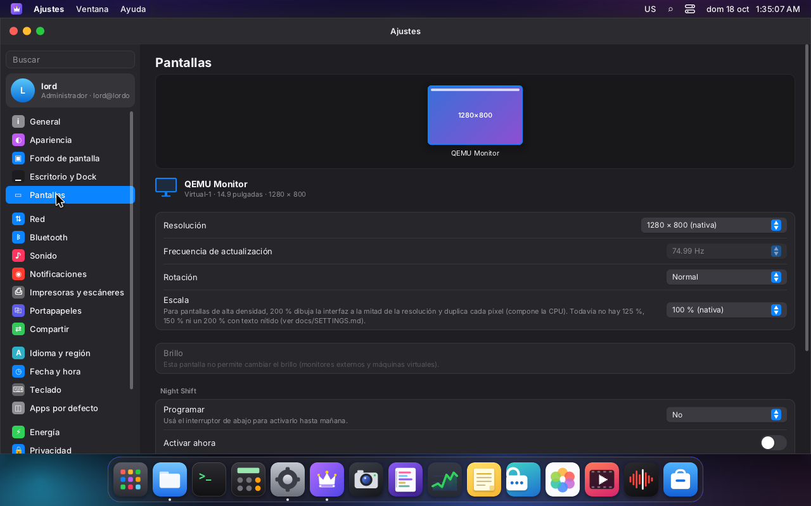

- **Outputs and modes.** `kms_outputs()` reads every connector with its modes and EDID blob.
  `hw/edid.c` parses the base block (vendor, product, serial, name descriptor, size, native
  timing) and `hw/modes.c` computes exact refresh rates (`clock·1000/(htotal·vtotal)`, interlace
  and double-scan aware), the list of resolutions (largest first, highest rate per size) and the
  best mode for a size and rate (progressive before interlaced; ties go to the preferred mode).
- **Applying.** `lord.display.apply(conn, w, h, mHz, rotation, scale)` queues the change and
  `main.c` runs it between frames (never with a page flip pending): the GPU path stops (its GBM
  surfaces have the old size), `kms_modeset()` recreates the dumb buffers and calls `SETCRTC`, the
  session takes the new size (`set_size`: work area, windows and Wayland outputs follow) and the GPU
  starts again. If the driver refuses the mode, the previous one is restored.
- **"Keep these display settings?"** The system draws the dialog (`DisplayConfirm`, mounted by
  `startShell`, so it works even if Settings is closed) and goes back to the previous mode after
  15 seconds without an answer, like macOS.

  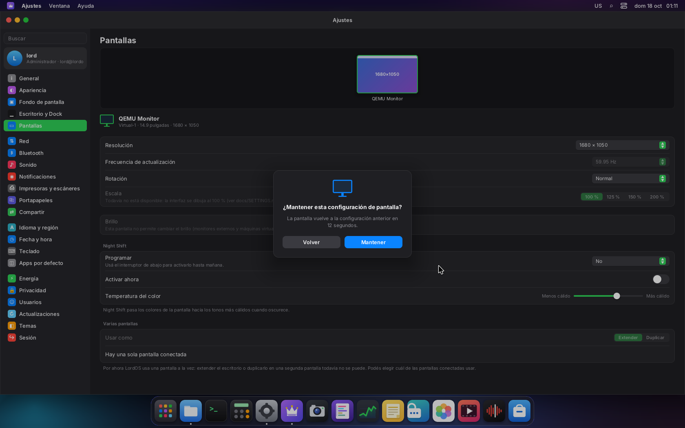
  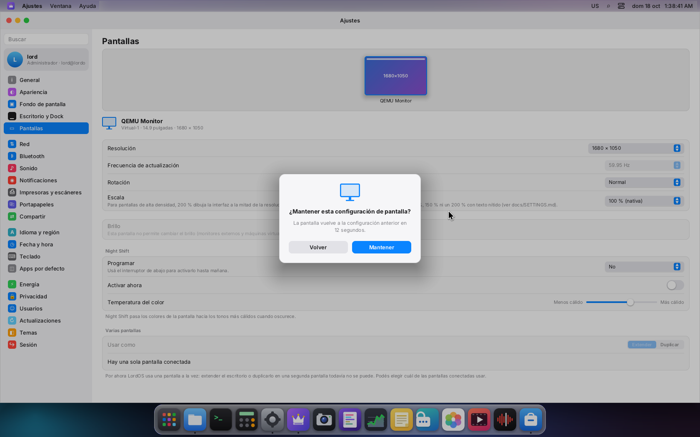
- **Saved per display.** "Keep" writes `~/.config/lordos/displays.json`:

  ```json
  { "main": "RHT-1234-QEMU_Monitor",
    "displays": { "RHT-1234-QEMU_Monitor": { "w": 1920, "h": 1080, "refresh": 60000, "rotation": 0, "scale": 1 } } }
  ```

  The key is the EDID identity (`vendor-product-serial`, or the name when there is no serial).
  `kms.c` asks `display_pick()` (registered with `kms_set_picker`) every time `lord-sessiond` lends
  the monitor to the session, so the saved mode and main display are used from the first frame.
  Two identical monitors without serial numbers share an identity. The greeter always uses the
  preferred mode.
- **Main display.** With several connected outputs, "Use as Main Display" moves the session to
  another connector (and its preferred mode). Unplugging the display in use moves to another one
  automatically (DRM uevent → `display_hotplug()`).
- **Rotation (90°, 180°, 270°).** Done by software: the frame is composed upright at the logical
  size in a staging buffer and copied rotated into the card's buffer, only the damaged rectangles.
  The cursor is composited apart so the staging buffer stays clean. Tablets and touch screens report
  physical positions, which are mapped back (`display_unrotate_point`). A rotated screen is always
  composed by the CPU (the GPU path and direct scanout are off).

  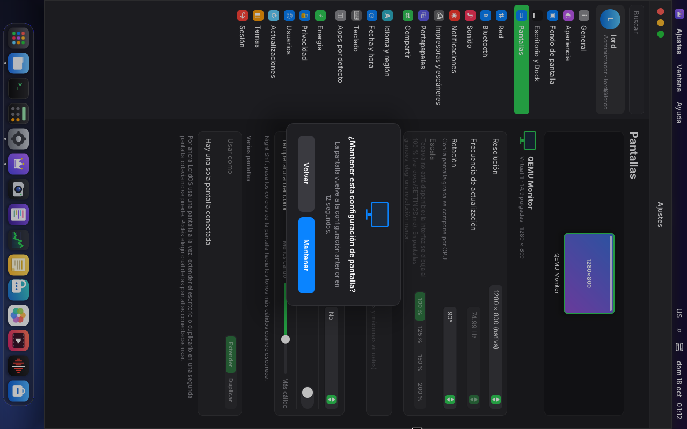
- **Scale.** The engine has no resolution-independent scale: styles, layout boxes, `getLayout`,
  pointer coordinates, window grabs and Wayland surfaces are all in physical pixels. What exists
  now is **200 %**: the session runs at half the size and every pixel is doubled while copying the
  frame (CPU path, like rotation; both combine). Limits, documented in the page:
  - text and icons are as sharp as on a screen of half the resolution (not Retina-sharp);
  - no 125 % or 150 % (a fractional upscale would blur everything);
  - Linux apps are doubled too (they see a 1× output).

  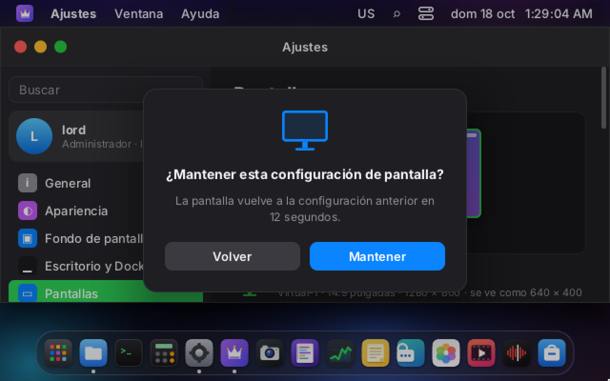

  Sharp HiDPI needs a scale factor applied when styles are parsed (`ui/style.c`: lengths and font
  sizes), with `getLayout`, pointer and gesture coordinates divided by it in `ui/js.c`, window grabs
  (`ui/grab.c`, `js_wm.c`) in logical units, `wl_output.scale` and `wl_surface.set_buffer_scale`
  honored in `wl/wl.c`, and the Terminal's cell size scaled. That is pending.
- **Brightness.** Read from `/sys/class/backlight` (anyone can), written through the closed admin
  action `display-brightness <name> <value>`: the name must be a real backlight under `/sys/devices`
  and the value within `0..max_brightness`. External monitors (DDC/CI) and virtual machines have
  none; the row says so. Untested on hardware (the VM has no backlight).
- **Night Shift.** A color temperature from 6500 K (off) down to 1900 K, from a blackbody fit
  (`night_temp_rgb`) normalized so that 6500 K is neutral. It goes into the CRTC's gamma LUT
  (`DRM_IOCTL_MODE_SETGAMMA`) when the card has one: free, and the cursor and direct scanout are
  tinted too. Without a LUT (virtio-gpu, some ARM boards) a 3×256 table is applied by software to
  each damaged rectangle while copying the frame, and the page says so; the cursor is not tinted
  then, and the GPU path is not tinted (pending: a multiply pass in `gpu.c`).

  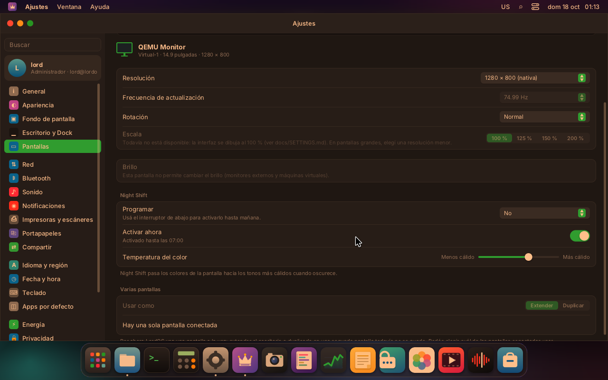

  Schedule: off, **sunset to sunrise** or **custom hours**, with a 30-minute fade, plus "Turn on
  now" (until the end of tonight's schedule, or 07:00). Sunrise and sunset come from the Almanac
  for Computers algorithm (`night_sun_times`, within ±4 min of NOAA in the tests) at the
  coordinates of the **chosen time zone** in `/usr/share/zoneinfo/zone1970.tab`. The location is
  never looked up on the network.
- **Multiple displays.** `kms.c` drives one CRTC: extending the desktop across two displays or
  mirroring them is **not implemented**. The page shows the "Extend / Mirror" control disabled with
  that explanation and lists the other connected displays with "Use as Main Display". Mirroring
  needs a second CRTC flipped with the first one (or one CRTC with two connectors where the
  encoders allow cloning); extending needs per-output scene regions and per-CRTC buffers and flips.

## Bluetooth

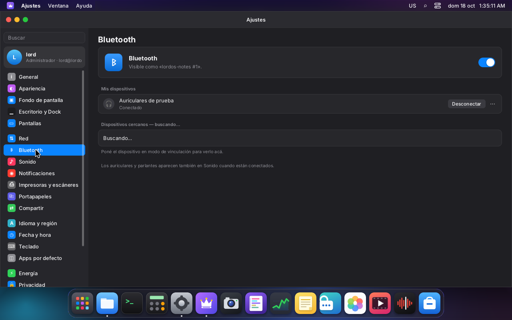

`hw/bt.c` talks to BlueZ (`bluetoothd`, Debian package `bluez`) on the system bus with our own D-Bus
client (`vault/dbus.c`, plus `dbus_connect_system()`). One connection for Settings
(`hw/sysbus.c`) carries Bluetooth, power profiles and timedated, with replies matched by serial
and signals dispatched to handlers.

- **State.** `ObjectManager.GetManagedObjects` once, then `InterfacesAdded`, `InterfacesRemoved`
  and `PropertiesChanged` (matched with `AddMatch`, only from org.bluez's unique name).
  `Adapter1`, `Device1` and `Battery1` properties are parsed into a small model
  (`bt_apply_props`); changes are sent to the theme once per main-loop turn.
- **Actions.** Power (`Properties.Set Powered`), discovery while the page is open
  (`StartDiscovery`/`StopDiscovery`), pair (then `Trusted = true` and `Connect`, like macOS),
  connect, disconnect and forget (`Adapter1.RemoveDevice`). A soft rfkill block is lifted with the
  closed action `bt-unblock`.
- **Pairing agent.** lord-server exports `org.bluez.Agent1` at `/org/lordos/BluetoothAgent` with
  the `KeyboardDisplay` capability and becomes the default agent. PIN, passkey, numeric comparison
  and authorization requests are drawn by the system (`BluetoothPrompt`, outside any app) and
  answered with `lord.bt.answer`; PINs are 1–16 alphanumerics and passkeys 0–999999, validated in C.
  Calls to the agent from anyone but bluetoothd are refused. A device that went through pairing may
  use its services without asking again.

  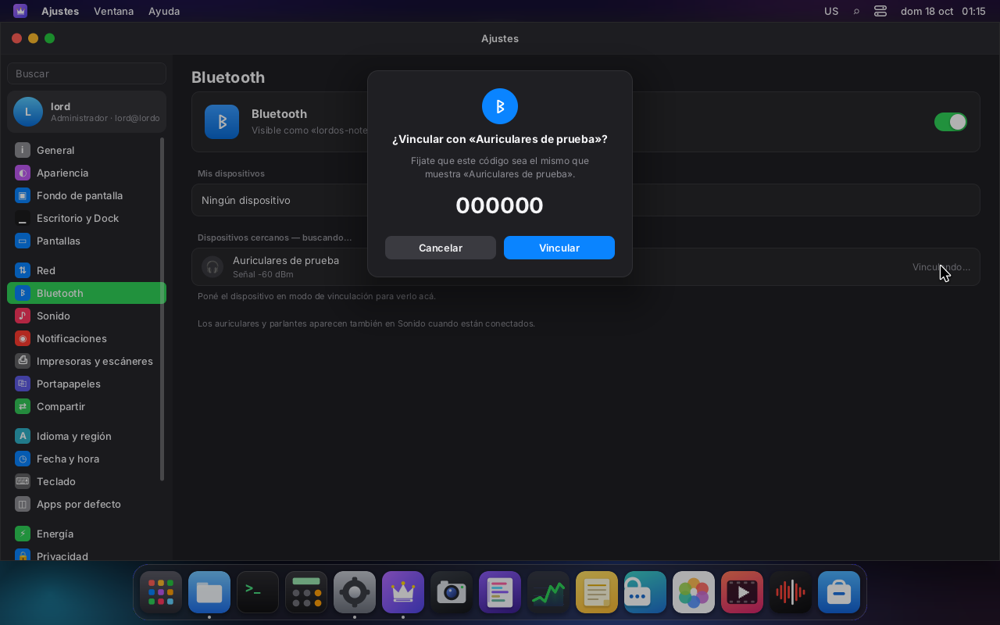
- **Audio.** Headphones and speakers become PipeWire devices through WirePlumber's BlueZ monitor
  (Debian `libspa-0.2-bluetooth`) and appear in Settings → Sound. WirePlumber 0.5 only enables
  Bluetooth for a user whose session is active **on a logind seat**; sessions started by
  `lord-sessiond` are not logind sessions, so LordOS needs this drop-in
  (`/etc/wireplumber/wireplumber.conf.d/lordos-bluez.conf` on the ISO):

  ```
  wireplumber.profiles = {
    main = {
      monitor.bluez.seat-monitoring = disabled
    }
  }
  ```

  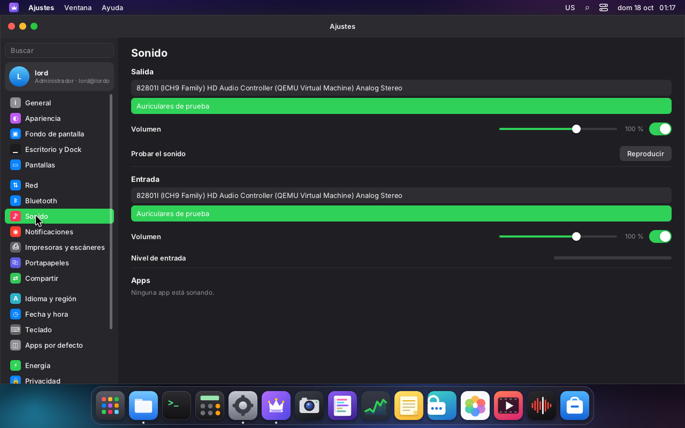

Tested with `btvirt -l2` (bluez-test-tools) on VM 118: two virtual controllers on one virtual
radio. hci1 plays a headset (class 0x240404, discoverable, a `bluetoothctl` agent fed through a
FIFO); from Settings on hci0: discovery, pairing with the numeric-comparison prompt, connection,
the HFP output and input in Sound, disconnect and forget. Unit tests: `build/bt-test` (managed
objects, property dictionaries, battery, truncated input, removal, paths, state JSON). **Not tested
with real hardware** (no controller in the VMs).

## Energy (Battery)

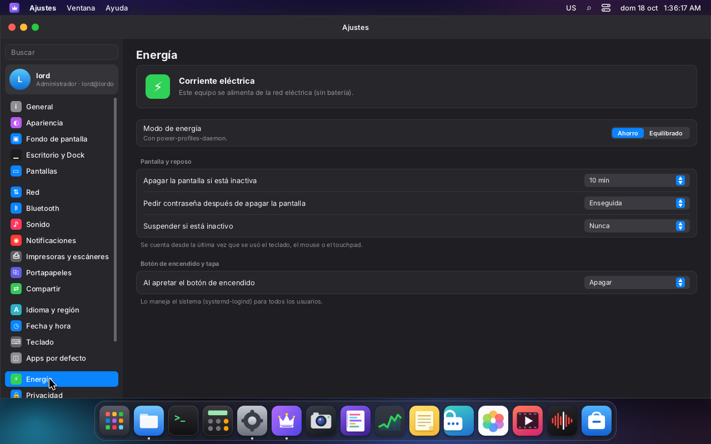

- **Battery.** `hw/power.c` reads `/sys/class/power_supply` (`energy_*`/`power_now` or
  `charge_*`/`current_now`/`voltage_now`): percentage, time to empty or to full (the kernel's
  `time_to_*_now` when present), health (`full / full_design`), cycles, watts, model and
  technology. Device batteries (mice, keyboards: `scope = Device`) are listed but not counted.
  Refreshed on `power_supply` uevents. Unit-tested over a fake sysfs tree; **untested on a real
  laptop** (the VMs have no battery and the Debian kernel has no `test_power` module).
- **Low battery.** A notification at 20 %, 10 % and 5 % (sticky at 5 %) while discharging.
- **Menu bar.** A battery item with the percentage (optional) through `registerStatusItem`, so
  every theme that draws `<StatusItems />` shows it; hidden without a system battery.
- **Energy mode.** power-profiles-daemon over D-Bus (`org.freedesktop.UPower.PowerProfiles`, or the
  older `net.hadess.PowerProfiles`), following its `PropertiesChanged`. Setting it as the user goes
  to the daemon; if polkit refuses (the session is not a logind session) the page falls back to the
  closed action `power-profile`, which runs `/usr/bin/powerprofilesctl set <p>` or, without the
  daemon, writes the cpufreq governor (`performance`, `schedutil`/`ondemand`, `powersave`) and the
  energy/performance preference of every policy.
- **Display off, lock, sleep.** Seconds of inactivity (keyboard, mouse, touchpad, remote input),
  different on battery and on power. lord-server keeps the deadlines (`display_timeout` in the
  poll timeout): screen off is the connector's DPMS (`kms_dpms`; nothing is drawn while it is off),
  "require password" locks the session through `lord-sessiond` N seconds after the screen goes off,
  and sleep runs the closed action `power-suspend` (`systemctl suspend`). The VM is never put to
  sleep in the tests.
- **Power button and lid.** What systemd-logind does (sleep, hibernate, shut down, do nothing). The
  admin action `power-buttons <power> <lid> <lid-on-ac>` writes
  `/etc/systemd/logind.conf.d/lordos.conf` (a short list of values, validated) and runs
  `systemctl reload systemd-logind`. LordOS never grabs the ACPI power button (only keyboards, mice
  and tablets are grabbed), so logind sees it. Lid rows only show with a battery.

## Notifications

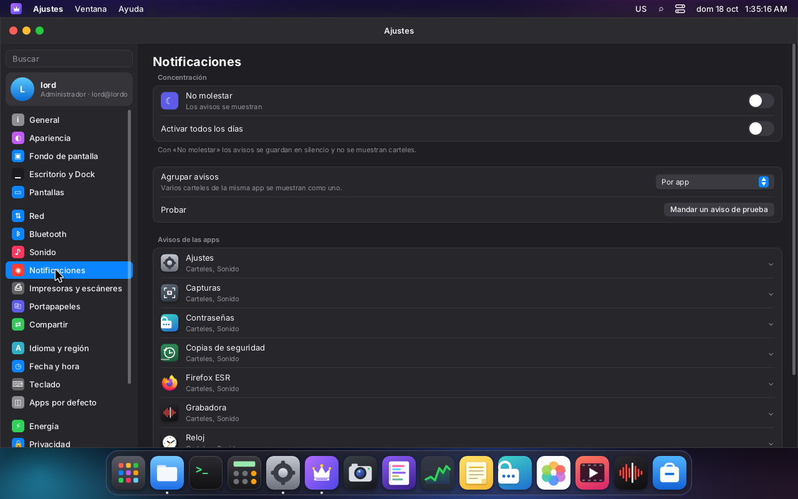

`sdk/notify.js` gained a policy, applied to every `notify()`:

- **Per app:** allow, style (none / banners / alerts: alerts stay until dismissed), sound, and
  "show on lock screen" (stored, shown disabled: the lock screen is the greeter and does not show
  notifications yet). Apps appear after their first notification, plus LordOS apps that notify
  (Backup, Clock, Settings…) and packages that declare the `notifications` permission. For `.lpk`
  packages "allow" **is** the sandbox's `notifications` permission (`perms.set`), the same switch as
  Privacy & Security.
- **Do Not Disturb:** manual, and every day on a schedule. Notifications are kept in the history
  without a banner or sound.
- **Grouping:** several banners from the same app collapse into one with "+N".
- **Linux apps:** `hw/notifyd.c` serves `org.freedesktop.Notifications` on the session bus
  (spec 1.2: `Notify`, `CloseNotification`, `GetCapabilities`, `GetServerInformation`,
  `NotificationClosed`, `ActionInvoked`), so GTK, Qt, Electron and `notify-send` notifications
  become LordOS banners with the app's icon and actions, and follow the same per-app settings (the
  key is `linux:<desktop id>`, from the `desktop-entry` hint). Body markup is reduced to text.

  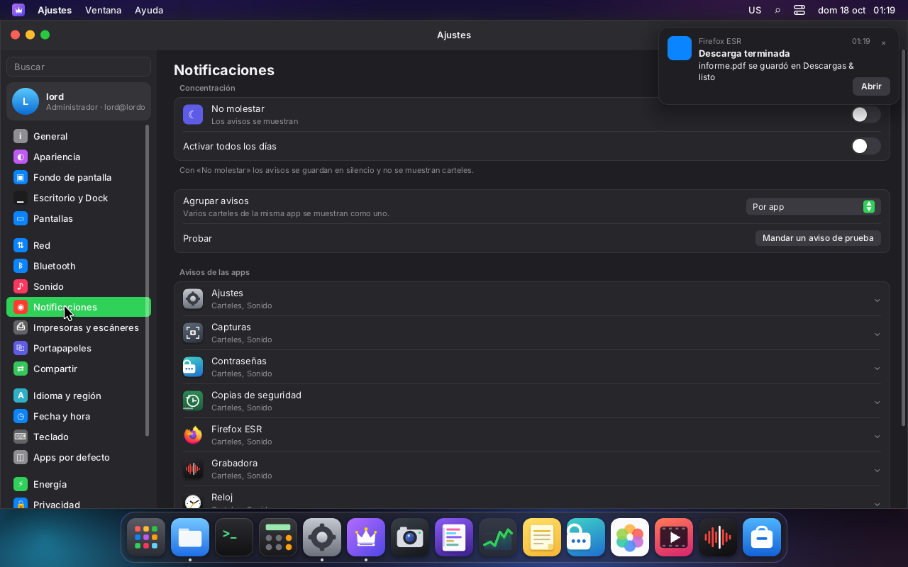

## Date & Time

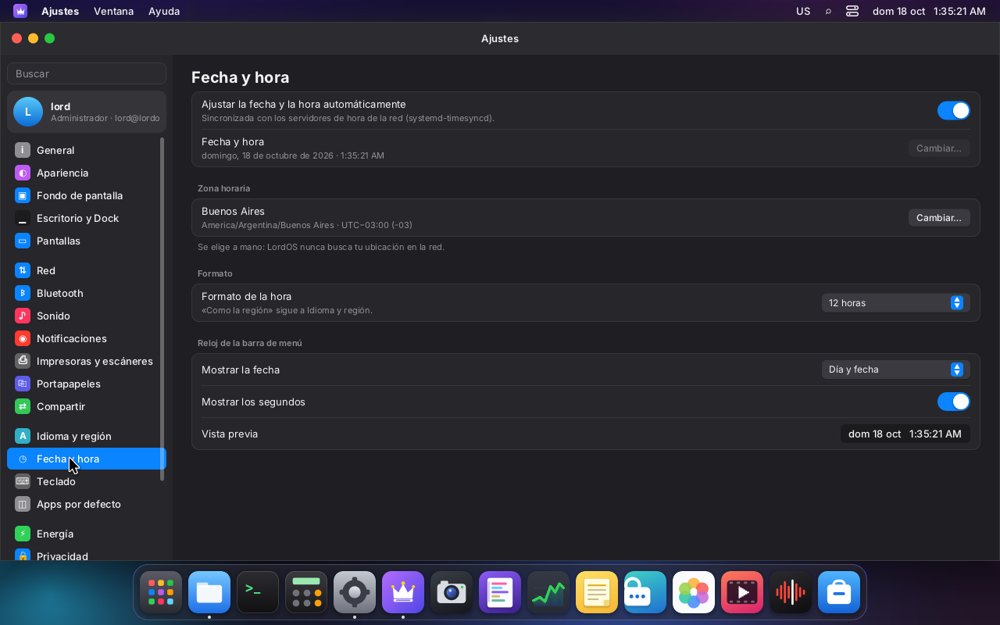

- **Automatic time:** systemd-timesyncd, switched with the closed action `time-ntp on|off`
  (`timedatectl set-ntp`); its state (NTP on, synchronized, available) is read from timedated over
  D-Bus.
- **Manual:** `time-set YYYY-MM-DD HH:MM:SS` (`timedatectl set-time`; a real date from 2000 to 2099,
  only with automatic time off).
- **Time zone:** a searchable list with the UTC offset of each zone (our TZif reader), applied with
  the existing `timezone` action. **Never guessed from the network**: no IP leaves the computer.
- **12/24 hours:** "like the region" (Language & Region), or forced; `formatTime` honors it
  everywhere.
- **Menu bar clock:** weekday and date, weekday only or time only, with or without seconds
  (`menuClock()`; the default theme uses it, the classic one honors the seconds).

## Default Apps

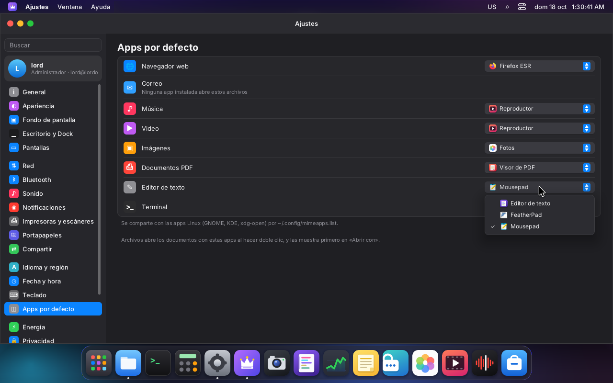

Browser, mail, music, video, images, PDF, text editor and terminal. Candidates are LordOS's own apps
and the Linux apps whose `.desktop` `MimeType` covers the category (terminals: `Categories` with
`TerminalEmulator`).

- Saved in `~/.config/mimeapps.list` (freedesktop spec: the `[Default Applications]` line is
  replaced and the app goes first in `[Added Associations]`, as GLib does; every other line is
  kept), so `xdg-open` and GNOME/KDE apps agree. LordOS apps are written as `lordos-<app>.desktop`.
  The terminal goes in `~/.config/xdg-terminals.list`.
- Lookup follows the spec's order (`$XDG_CONFIG_HOME`, `/etc/xdg`, `~/.local/share/applications`,
  `/usr/local/share/applications`, `/usr/share/applications`, `defaults.list`), with the user's
  `[Removed Associations]` applied. File types come from shared-mime-info's `globs2` (highest
  weight, longest pattern, case-sensitive patterns first).
- **Files** lists the default app first in "Open With", marked "(default)", and double-click opens
  it. **`lord.apps.launchWith('', path)`** opens a file with the default Linux app for its type
  (the same rules as `launchWith`: a real path in the home or `/media/$USER`, one argument, no
  shell); it returns false when the default is a LordOS app, which the theme opens itself.

  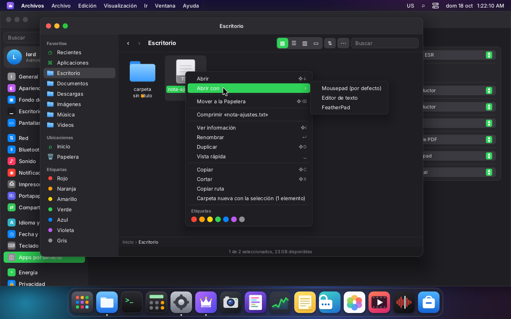

## Admin actions

All in `server/src/hw/hw_admin.c`, in the `actions` table through `HW_ADMIN_ACTIONS`:

| Action | Argument | Who | Does |
|---|---|---|---|
| `display-brightness` | `<backlight> <value>` | anyone | writes `/sys/class/backlight/<name>/brightness` (real device under `/sys/devices`, `0..max`) |
| `power-profile` | `performance` \| `balanced` \| `power-saver` | anyone | `/usr/bin/powerprofilesctl set`, or the cpufreq governor and EPP |
| `power-suspend` | — | anyone | `/usr/bin/systemctl suspend` |
| `power-buttons` | `<power> <lid> <lid-on-ac>` (`suspend`, `hibernate`, `poweroff`, `ignore`) | admin | generates `/etc/systemd/logind.conf.d/lordos.conf`, `systemctl reload systemd-logind` |
| `time-ntp` | `on` \| `off` | admin | `/usr/bin/timedatectl set-ntp` |
| `time-set` | `YYYY-MM-DD HH:MM:SS` | admin | `/usr/bin/timedatectl set-time` |
| `bt-unblock` | — | anyone | rfkill "unblock all Bluetooth" on `/dev/rfkill` |

The validators are unit-tested in `build/settings-hw-test`.

## Tests

- `build/settings-hw-test` (`make test`): EDID (QEMU's real block, serial/name identities, broken
  checksums), mode selection and refresh rates, Night Shift math (temperature, ramp, sunrise and
  sunset in London, Buenos Aires, Tokyo and Svalbard, schedule across midnight, zone1970.tab),
  mimeapps.list editing and globs2, the power_supply reader, the admin validators. 129 checks.
- `build/bt-test` (`make test`): BlueZ parsing. 32 checks.
- On VM 118: live mode changes with revert and keep, persistence across a session restart,
  rotation, software Night Shift, Bluetooth with `btvirt`, power profiles with
  power-profiles-daemon (placeholder driver), the logind drop-in, NTP and manual time, Linux
  notifications with `busctl`, default apps with `xdg-mime` and Files.

## Not done or untested

- Extending or mirroring across several displays (one CRTC).
- Sharp HiDPI and fractional scales (only the doubled 200 %).
- Night Shift on the GPU path when the card has no gamma LUT.
- Brightness, battery, lid and power profiles on real laptops; Bluetooth with real controllers.
- Notifications on the lock screen; a notification center listing the history.
- Wayland idle inhibit (a video player does not keep the screen on yet).

## ISO packages

`bluez`, `libspa-0.2-bluetooth`, `power-profiles-daemon`, `systemd-timesyncd` and
`shared-mime-info`, plus the WirePlumber drop-in above (see the final report for the exact lines).
