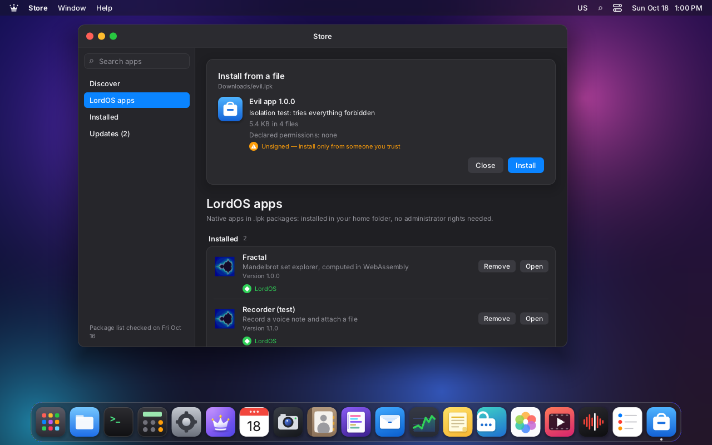
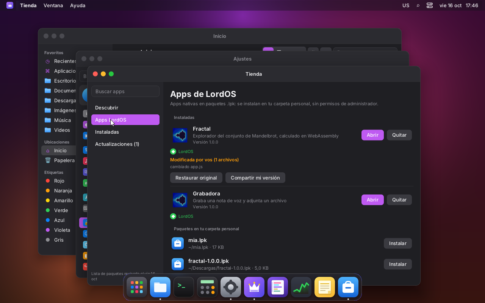
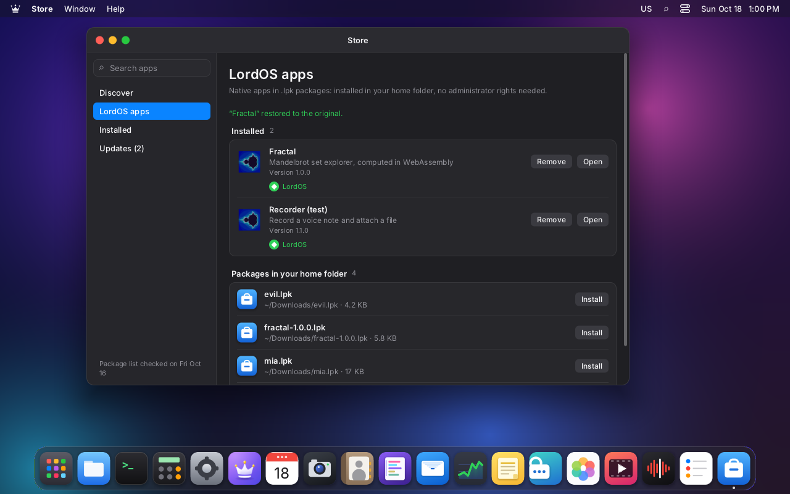
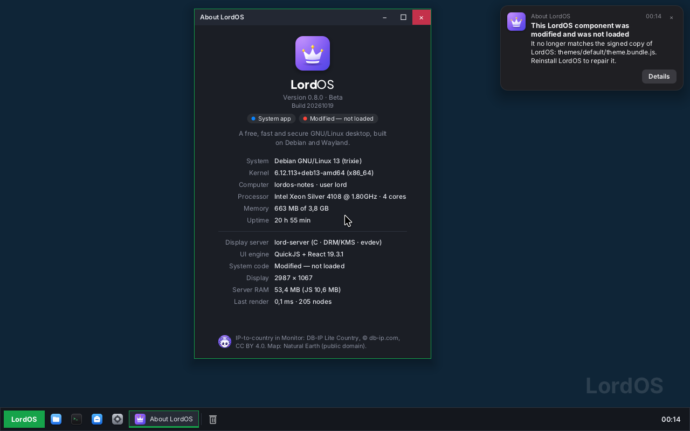
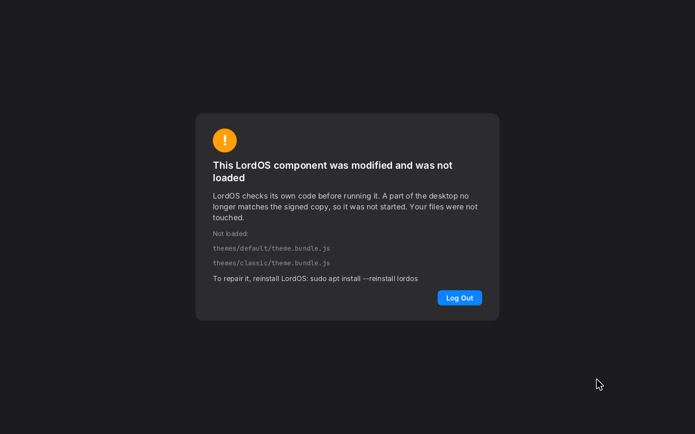
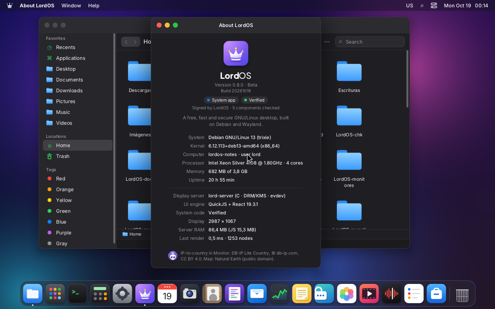
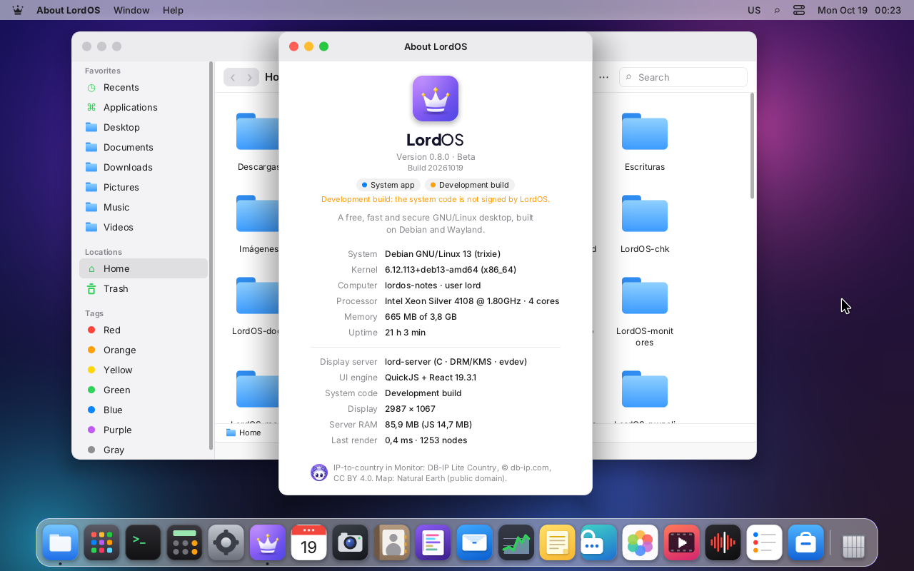
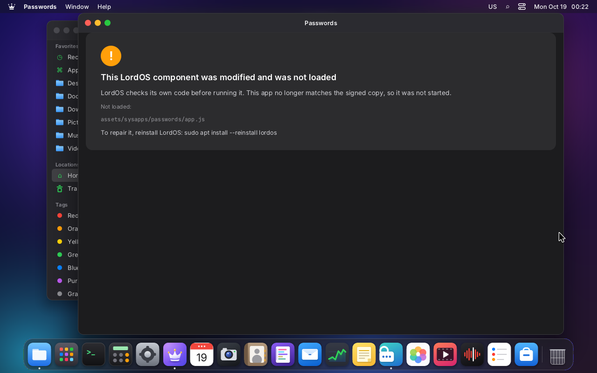
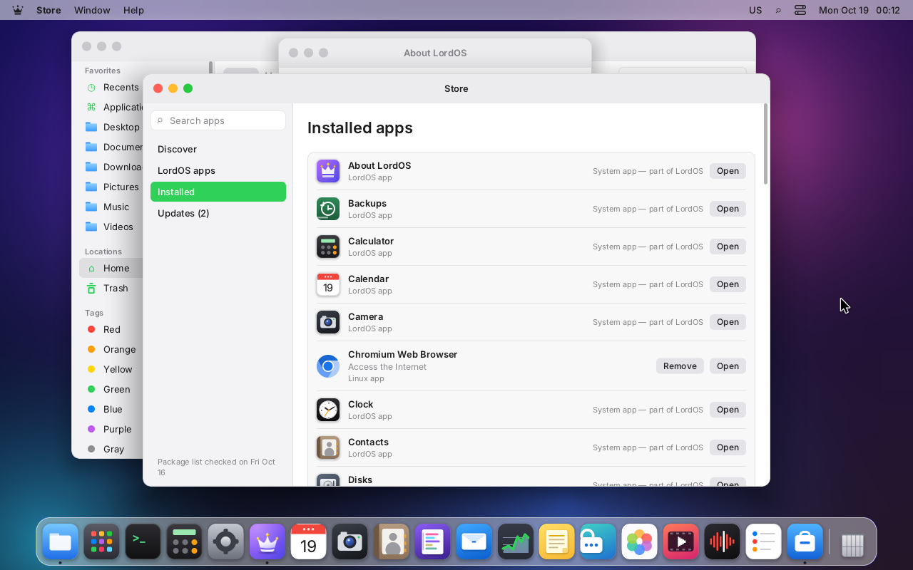
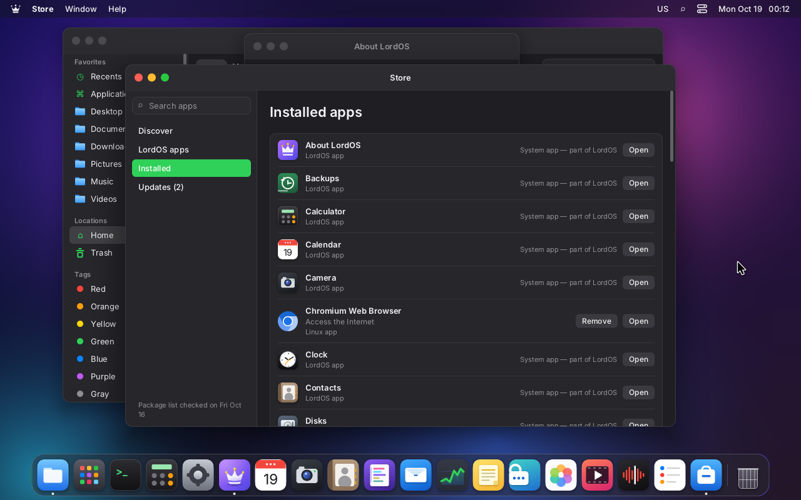

# Signing `.lpk` packages (M8)

Every LordOS app package (`.lpk`) can be **signed**. LordOS verifies the signature in C, at
install time and at load time, to detect modifications and to show where the app comes from. See
also [NATIVE-APPS.md](NATIVE-APPS.md) and [PRIVACY.md](PRIVACY.md).

## What's inside

Besides its files (`manifest.json`, `app.js`, `icon.png`…), a signed `.lpk` carries:

- **`contenido.json`** — the list of all files with their path, size and **SHA-256**:

  ```json
  {
    "format": 1,
    "id": "fractal",
    "version": "1.0.0",
    "signer": { "name": "LordOS (desarrollo)", "key": "3deb6836…" },
    "files": [
      { "path": "manifest.json", "size": 321, "sha256": "…" },
      { "path": "app.js",        "size": 2411, "sha256": "…" }
    ]
  }
  ```

- **`firma.json`** — that manifest signed with **Ed25519**:

  ```json
  { "format": 1, "alg": "ed25519", "key": "3deb6836…", "sig": "…" }
  ```

An **unsigned** `.lpk` can still carry `contenido.json` (hashes only) to detect damage; without
it, it is "Unsigned" and has no hashes.

## Our own cryptography (`server/src/sec` + `server/src/pkg/crypto.c`)

SHA-256 and Ed25519 are **our own code**, small and readable. Ed25519 follows the arithmetic of
**TweetNaCl** (public domain; field 2^255-19 in 16 words of 16 bits); **signing**
(`ed25519_sign`/`ed25519_public`) was added on top of the verification the package engine already
had. The JSON reader is our own and strict (`server/src/sec/json.c`).

**No OpenSSL:** by policy only `lord-sessiond`, `lord-maild` and (0.8.5) `lord-fetch` link it, never
`lord-server`. `.lpk` verification happens in C, at
install time (`lpk_check` in `js_sys.c`) and at load time (modification detection via
`pkg_status`).

### Tests (`make -C server test`)

- `build/sign-test` (**55/55**): SHA-256 against the **NIST** vectors (including the million
  `a`s), Ed25519 against tests 1–3 of **RFC 8032** (public key, byte-for-byte signature,
  verification, rejection of altered signature/message), the JSON reader (valid and invalid), and
  package verification: valid signature, altered file, extra file, mismatched id/version,
  signature from another key and broken signature; plus the signed catalog and revocation.
- `build/pkgstate-test` (**11/11**, VM): the full flow install → "Modified by you" → restore →
  share (signed derivative) → update-by-key rule.

## Trust levels

They are shown in the Store and in the install dialog:

| Level | When | Text |
|---|---|---|
| **LordOS** | signed with the official key (`server/src/sec/keys.h`) | "LordOS" (green) |
| **Verified author** | key listed in the signed catalog | "Verified author: <name>" (blue) |
| **Signed by <name>** | signed with an unknown key | "Signed by <name>" (gray) |
| **Unsigned** | has no `firma.json` | "Unsigned — only install from people you trust" (orange, warning) |

| | |
|---|---|
|  |  |
| An unsigned package warns before installing | A revoked package is not installed, with a clear message |

## Rules

- **Updates**: a new version must be signed with the **same key** as the installed one (like
  Android). An update with a different key is rejected (`pkg_check_update`).
- **Signed catalog** (`catalog.json` + `catalog.sig`): signed by the LordOS key, it carries the
  versions, sizes, hashes, the keys of verified authors and a **revocation list** of keys and
  packages. A revoked package is disabled with a clear message (`catalog_revoked`). The catalog in
  force is the valid one with the highest `serial` between `/usr/share/lordos/catalog.json` and
  `~/.local/share/lordos/catalog/catalog.json`.

## Modify, restore and share (the "business" idea)

- At install time, the **original `.lpk` is kept** in `~/.local/share/lordos/apps/.orig/<id>.lpk`.
- If the user **edits** the installed app, LordOS detects it through the hashes and marks it
  "**Modified by you**", showing which files changed (`pkg_status`).
- "**Restore original**" puts it back exactly as it was (`pkg_restore`).
- "**Share my version**" builds a new `.lpk` signed with the **user's own key** (generated the
  first time in `~/.local/share/lordos/keys/user.json`, permissions 600), with
  `basedOn: <id>@<version> by <author>` in the manifest, so credit is preserved (`pkg_share`).

| | |
|---|---|
|  |  |
| "Modified by you": what changed, Restore and Share | "Fractal restored to the original" |

## Tools (`tools/lpk.mjs`)

```sh
node tools/lpk.mjs keygen [--name "Nombre"] [--out archivo]   # Ed25519 key pair
node tools/lpk.mjs <carpeta> [salida.lpk] [--key clave.json | --unsigned]   # package and sign
node tools/lpk.mjs sign <paquete.lpk> --key clave.json        # (re)sign
node tools/lpk.mjs verify <paquete.lpk>                       # show signature and hashes
node tools/lpk.mjs catalog <fuente.json> --key oficial.json [carpeta]   # signed catalog
```

`lpk.mjs` signs while packaging if given `--key`, `$LPK_KEY`, or if
`~/.config/lordos/lpk-key.json` exists. With `--unsigned` the result is "Unsigned" (still with
hashes).

### The LordOS key

Official packages (bundled apps, catalog) are signed with the **LordOS key**. Today there is only
one, the **development** key:

- its **public key** is in the repository: `packaging/keys/lordos-dev.pub`, and compiled into the
  binary in `server/src/sec/keys.h` (on purpose: no file in the home folder can add an official
  key);
- its **private key is NOT in the repository**: it lives on the development machine, in
  `~/.config/lordos-dev/lordos-dev.key` (permissions 600). **Do not commit private keys.**

For a public release, the final key is added to `keys.h` and the development one is removed.

### Release files

Every GitHub release file (the `.deb`, the ISO, the Raspberry Pi image) is listed with its SHA-256
in `SHA256SUMS`, and `SHA256SUMS` is signed with the LordOS release key:

- `SHA256SUMS.sig` = base64 of the 64-byte Ed25519 signature over the exact bytes of `SHA256SUMS`.
- Public key: `tools/release/lordos-release.pub.pem`, also embedded as `RELEASE_PUBKEY_PEM` in
  `tools/install/install.sh`.
- Fingerprint (SHA-256 of the DER public key):
  `c7155b8e6bbbb180f907381994d06af76d333016cd6f3facf67cadd053ea108e`
- Signing: `tools/release/sign-release.sh <release-dir>` writes `SHA256SUMS` and `SHA256SUMS.sig`
  and checks the result against the public key. The private key lives only on the maintainer's
  machine (`~/.config/lordos-release/release-ed25519.key.pem`, mode 0600), never in the repository
  or on a build VM. Keep an offline backup of it.
- The Debian installer refuses to install when the signature is missing or invalid, before the
  `.deb` is downloaded.
- Installed systems update from the signed APT repository on lordos.org (0.8.1), which has its own
  OpenPGP key (`packaging/keys/lordos-archive-keyring.gpg`), because APT needs OpenPGP; see
  [UPDATES.md](UPDATES.md).

Checking a download by hand (OpenSSL 3):

```sh
base64 -d SHA256SUMS.sig > SHA256SUMS.sig.bin
openssl pkeyutl -verify -pubin -inkey lordos-release.pub.pem -rawin -in SHA256SUMS -sigfile SHA256SUMS.sig.bin
sha256sum -c --ignore-missing SHA256SUMS
```

Each release also carries an SPDX SBOM (`lordos_<version>_<arch>.spdx.json`, from
`tools/release/make-sbom.sh`). It goes into the release folder before signing, so `SHA256SUMS` and
its signature cover it too. See [COMPLIANCE.md](COMPLIANCE.md).

The whole release process (changelog, tag, build, SBOM, signing and `gh release create`) is in
[RELEASING.md](RELEASING.md).

## Verified system code (0.8.2)

The `.lpk` signing above covers apps installed by the user. LordOS's **own** code — the desktop,
the login screen and every native app — is checked too: lord-server refuses to run a bundle that no
longer matches the signed copy. This is phase 1 of 3 of "System apps immutable" (phase 3 brings
fs-verity and A/B system images).

### What is signed

`code-manifest.json`, at the root of the LordOS folder (`/usr/lib/lordos`; the repository root in a
development tree), lists the size and SHA-256 of every file LordOS runs as JavaScript:

| File | What it is |
|---|---|
| `themes/<theme>/theme.bundle.js` | the shell, the SDK, the React runtime and **every native app** (they are bundled into each theme), for `default`, `classic` and `greeter` (the login screen) |
| `assets/app-host.bundle.js` | React + SDK of isolated app processes (`lord-server --app <id>`) |
| `assets/sysapps/<id>/app.js` | system apps that run as their own sandboxed process (Passwords; Mail, Calendar, Contacts and Reminders since 0.8.2; System Information's Sandbox Probe `sysprobe` in 0.8.5) |

```json
{
  "format": 1,
  "kind": "lordos-system-code",
  "version": "0.8.2",
  "files": [
    { "path": "assets/app-host.bundle.js", "size": 433360, "sha256": "25d0b1ae…" },
    { "path": "themes/default/theme.bundle.js", "size": 1492265, "sha256": "f9546e6e…" }
  ]
}
```

`code-manifest.sig` is the base64 of the Ed25519 signature over the exact bytes of the manifest,
made with the **LordOS release key** (the same key as `SHA256SUMS.sig`, see "Release files" below).
The public key is compiled into lord-server (`codesig_release_key` in `server/src/sec/codesig.c`;
`build/codesig-test` checks it against `tools/release/lordos-release.pub.pem`), so no file on disk
can add a trusted key. The `kind` field keeps a signature made for another purpose from passing as
this one.

**Not listed, on purpose:** fonts, language catalogs, icons, images, Help articles, `theme.json`
and a system app's `manifest.json` (its window size; its permissions are decided by lord-server).
They are data read by bounded parsers, not code. A modified catalog can change what a text says
but cannot run anything; phase 3 (fs-verity over the whole system image) covers them.

`tools/code-manifest.mjs` writes the manifest (deterministic: the same bundles give the same bytes);
`npm run build` runs it after building, and removes a `code-manifest.sig` that no longer matches.

### How lord-server checks it (`server/src/sec/codesig.c`)

- **Once per process**, before the first bundle: read `code-manifest.json` and `.sig` from the
  LordOS folder, verify the signature with the compiled-in key, then parse the manifest with the
  strict JSON reader (format 1, the right kind, relative paths without `.`/`..`, sorted and unique,
  64 lowercase hex digits, at most 4096 files and 1 MB). An isolated app's process does this before
  its sandbox is applied.
- **Per bundle, lazily, when it is loaded:** the file is opened under the LordOS folder with
  `openat2(RESOLVE_BENEATH)` (no `..`, no link out of it), read whole from that one descriptor, and
  the SHA-256 of **exactly those bytes** is compared with the manifest; the same buffer is what
  QuickJS evaluates. Nothing is read twice, so there is no window to swap the file between the check
  and the use (no TOCTOU). Only the bundle that is used is hashed: the login screen hashes the greeter
  bundle, a session its theme, an isolated app the app host and its `app.js`.
- The SHA-256 is our own (`server/src/pkg/crypto.c`): portable C, unrolled, and on aarch64 the CPU's
  SHA-256 instructions when it has them (the Raspberry Pi 5; checked at run time, compared bit for bit
  with the C code by `build/codesig-test`). x86-64 uses the C code (its SHA extensions are not used
  until they are tested on such a CPU).

### States

| State | When | About shows |
|---|---|---|
| **Verified** | signed manifest, good signature, every loaded bundle matches | "Verified" (green) and "Signed by LordOS · N components" |
| **Development build** | no `.sig` (a development tree, `npm run build`), or no manifest at all, in a development build of lord-server | "Development build" (orange) and "Development build: the system code is not signed by LordOS." |
| **Modified** | a bundle does not match, or the manifest or its signature is bad | "Modified — not loaded" (red) |

In a development build with an unsigned manifest the hashes are still checked, so a modified bundle
is refused the same way. A **release build** (`make -C server RELEASE=1`) never accepts the
development state: without a valid signature nothing is loaded.

### When something does not match

- The bundle is **not run**. The refusal is logged (`code: REFUSED themes/default/theme.bundle.js:
  SHA-256 differs from the manifest — this LordOS component was modified and was not loaded` in the
  session log or the journal) and remembered for the session.
- **A theme:** lord-server falls back to the default theme, then the classic one, and the desktop
  shows a notification: **"This LordOS component was modified and was not loaded"**, naming the file,
  with a Details button (About). The broken theme is not offered again in this session.
- **Nothing left to load** (every theme, the login screen, or a bad manifest/signature): the built-in
  **recovery screen** — compiled into lord-server, so it is as trusted as lord-server itself — says
  what happened, lists the files and how to repair it (`sudo apt install --reinstall lordos`); in a
  session it has a Log Out button. Never a blank screen.
- **An isolated system app** (Passwords, Mail, Calendar, Contacts, Reminders): its window shows the same recovery screen instead of the app.

`lord.code.status()` (`ui/js_sec.c`) gives the SDK the state and the refusals; `sdk/codesig.js`
shows the notification. `lord-server --check-code [<folder>] [--require-signed]` checks a whole tree
the way a session would and exits 1 if anything is off (used by `tools/iso/mkdeb.sh`, and for
troubleshooting: `sudo /usr/lib/lordos/bin/lord-server --check-code`).

| | |
|---|---|
|  |  |
| One byte changed in the default theme: the Lord Classic theme loads and says so | Every theme modified: the recovery screen |
|  |  |
| About: System app, Verified | About: Development build |
|  | |
| Passwords' `app.js` modified: its window explains it | |

### System apps can't be removed

Every app in `apps/` is a **system app** (`system: true`, set by `tools/build-theme.mjs`; a
package can never claim it, `sdk/windows.js` `isSystemApp`). Store → Installed shows "System app —
part of LordOS" where a Linux app has Remove, and About shows a "System app" badge. The `lordos`
Debian package is marked `Protected: yes` (Debian's field for packages the system needs), so the
Store's package engine refuses to remove it (`pkg.removeEssential`, the same rule as essential
packages) and dpkg wants `--force-remove-protected`. This part was checked in the code
(`status.c` reads the field into `IF_PROTECTED`, `resolve.c` refuses), not yet on an installed
0.8.2 `.deb`.

| | |
|---|---|
|  |  |
| Store → Installed: system apps can't be removed | The same in dark mode |

### Threat model

- **Protects against** a process running as the user (or as any non-root account) changing
  LordOS's code: it can't write `/usr/lib/lordos` anyway, and a copy elsewhere is never loaded
  (lord-server only runs files under its own folder, checked against the signed list). It also
  catches **offline modification** of the bundles or the manifest — a disk edited from another
  system, a corrupted or tampered image — and plain corruption, and it tells the user instead of
  running it.
- **Does not protect against root.** An attacker with root can replace lord-server itself (and its
  compiled-in key), or the kernel; no check inside lord-server can stop that. A development build of
  lord-server accepts an unsigned manifest by design, so swapping in a development build also needs
  root. Full protection of the system files against offline and root-level changes comes with phase 3
  (fs-verity and A/B system images, verified from boot).
- Fonts, catalogs and images are not covered (see above).

### Startup cost

Measured with the logs lord-server prints (`code: …`), 2026-10-19:

| Machine | Signature check (once per process) | Default theme (1.46 MB) | Login screen (431 KB) | Added to a session start |
|---|---|---|---|---|
| VM 118 (Xeon Silver 4108, 1.8 GHz; C SHA-256, 118 MB/s) | 5.1 ms | 13–26 ms | 3.9 ms | **18–34 ms** |
| Raspberry Pi 5 (Cortex-A76; SHA-256 instructions, 897 MB/s; C: 169 MB/s) | 5.3 ms | ≈1.6 ms | ≈0.5 ms | **≈7 ms** |

On the Pi the hashing speed and the Ed25519 time come from `build/codesig-test` run on the board;
the per-bundle figure follows from them. Evaluating the same theme takes 550–670 ms on the VM, so the
check adds 2–5 %. Wall-clock time from start to "theme loaded" on the VM (5 runs each) was within
noise of the build without the check (727–870 ms against 745–855 ms).

### The release flow

1. On the maintainer's machine: `npm run build`, then `tools/release/sign-code.sh` (regenerates
   `code-manifest.json`, signs it with `~/.config/lordos-release/release-ed25519.key.pem` into
   `code-manifest.sig` and verifies it against `lordos-release.pub.pem`). The bundles don't depend on
   the architecture, so one signature serves amd64 and arm64.
2. The tree (with both files) goes to the build VMs; `make -C server RELEASE=1`.
3. `REQUIRE_SIGNED_CODE=1 tools/iso/mkdeb.sh` installs both files into `/usr/lib/lordos/` and runs
   `lord-server --check-code` on the staged tree: the `.deb` is not built if a bundle doesn't match
   or (release build) the signature is missing. The ISO and the Raspberry Pi image install that `.deb`
   (`tools/rpi/build-img.sh` passes `RELEASE` and `REQUIRE_SIGNED_CODE` to its arm64 chroot). An x86-64
   host packaging an `server/build` already compiled for aarch64 can't run that `lord-server`, so it
   sets `CODE_CHECK_SERVER` to a `lord-server` built for the host from the same tree: the check reads
   only the bundles and the signature, which are the same on both architectures.

See [RELEASING.md](RELEASING.md), step 3.

### Testing it (development)

- `make -C server test` runs `build/codesig-test`: the parser, signatures (good, altered, other key,
  bad encodings, wrong kind), one modified byte, truncation, unlisted files, a link out of the folder,
  the development and release policies, the SHA-256 vectors on every path and the compiled-in key.
- A **test build** can trust a throwaway key instead of the release key:
  `make -C server CODE_PUBKEY=<64 hex digits>` (refused together with `RELEASE=1`), and
  `CODE_PUB=test.pub.pem tools/release/sign-code.sh "$PWD" test.key.pem` signs with it. That is how the
  "Verified" screenshots above were taken on VM 118; the release key was not used.

## Files

| Path | What it is |
|---|---|
| `server/src/pkg/crypto.c` | SHA-256/512 and Ed25519 (verify and sign), our own |
| `server/src/sec/sign.c` | package and catalog verification, trust levels, revocation |
| `server/src/sec/pkgstate.c` | saved original, "Modified by you", restore, share, update rule |
| `server/src/sec/json.c` | strict JSON reader |
| `server/src/sec/keys.h` | official public keys |
| `server/src/ui/js_sec.c` | `lord.sign` for the SDK (status, restore, share, userKey) |
| `tools/lpk.mjs` | package, sign, verify, keygen and catalog |
| `packaging/keys/lordos-dev.pub` | development public key |
| `server/src/sec/codesig.c` | verified system code: the signed manifest and the check of each bundle at load time |
| `tools/code-manifest.mjs` | writes `code-manifest.json` (run by `npm run build`) |
| `tools/release/sign-code.sh` | signs it with the release key (maintainer's machine only) |
| `sdk/codesig.js` | the "component was modified" notification and `codeStatus()` for About |
