# Apps del sistema (M9)

Las apps nativas del sistema que vienen preinstaladas con LordOS: **Discos**, **Copias de
seguridad**, **Registros**, **Reloj** y **Ayuda**. Todas usan `t()` con es/en/pt, funcionan de
derecha a izquierda y tienen su propio ícono. Lo que necesita root pasa por acciones cerradas de
`admin.c`, con argumentos validados del lado root y programas de ruta fija.

## Discos (`apps/disks`)

La utilidad de discos de LordOS, como Utilidad de Discos de macOS o GNOME Discos.

- **A la izquierda:** los discos agrupados en Internos, Externos (USB y tarjetas) e Imágenes
  (dispositivos `loop` con un archivo detrás), cada uno con sus particiones. Un punto marca las
  que están montadas.
- **A la derecha:**
  - una barra de uso: las particiones del disco a escala, o lo usado y lo libre de una partición
    montada;
  - las acciones;
  - los datos: dispositivo, modelo, número de serie, capacidad, conexión, tipo, tabla de
    particiones, sistema de archivos, etiqueta, UUID, punto de montaje;
  - la tarjeta **Salud del disco (SMART)**.
- **Actualización sin sondeos:** la lista se renueva sola al montar, desmontar, enchufar o
  formatear.

| | |
|---|---|
|  |  |
| Un pendrive (USB) con su partición exFAT montada | Salud del disco SATA: SMART propio por SG_IO, con los atributos |
|  | 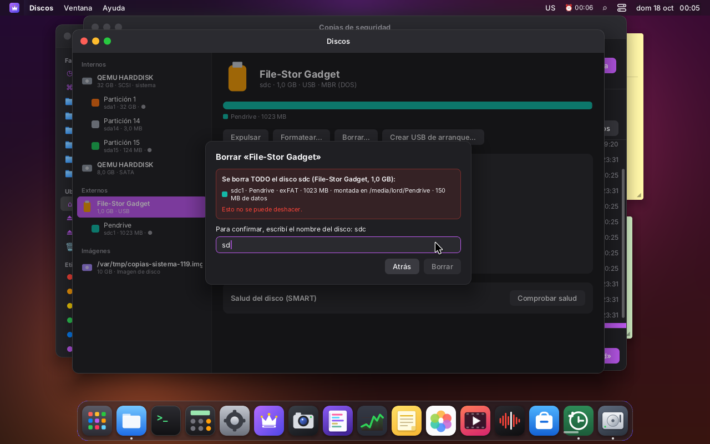 |
| Formatear: FAT32, exFAT, ext4 o NTFS (si está `mkfs.ntfs`), con la etiqueta | La confirmación dice qué se borra y pide escribir el nombre del disco |
| 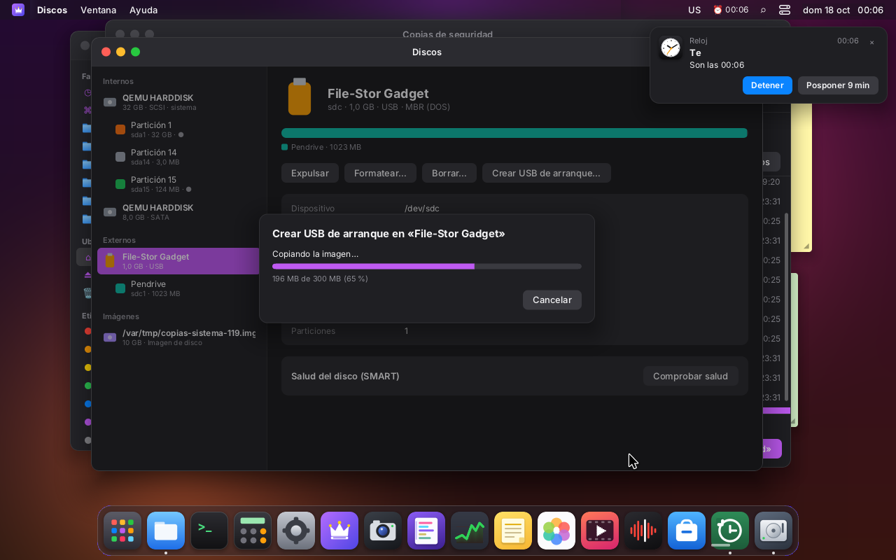 |  |
| Crear un USB de arranque: copiando, con «Cancelar» | Copiado y verificado (SHA-256 releyendo el disco); la partición de la imagen aparece sola |

### Cómo está hecho

| Pieza | Qué hace |
|---|---|
| `server/src/disk/disk.c` | Lista sin root, desde tres fuentes. **`/sys/block`:** tamaño, extraíble, solo lectura, rotacional, modelo. **La base de udev** (`/run/udev/data/b<mayor>:<menor>`): sistema de archivos, etiqueta, UUID, tabla de particiones y bus; ya lo probó udev, así que no se abre el dispositivo. **`/proc/self/mountinfo`:** dónde está montado cada uno. También reconoce el disco del sistema y escucha los cambios. |
| `server/src/disk/smart.c` | Analizadores de SMART de ATA y del registro de salud de NVMe: funciones puras, sin E/S |
| `server/src/disk/disk_admin.c` | Las acciones `disk-*` del ayudante (root) |
| `server/src/ui/js_disk.c`, `sdk/disks.js` | `lord.disks.list()`, `tools()`, `watch(on)`; en el SDK, `useDisks()` y `disks` |
| `apps/disks/` | La app: `index.jsx`, `health.jsx` (SMART), `dialogs.jsx` (formatear, renombrar, borrar, USB de arranque), `icons.jsx` |

**Avisos sin sondeo.** Mientras la app está abierta (`useDisks`), `lord.disks.watch(true)` abre un
epoll con dos cosas. Ese único fd va al bucle principal de `lord-server` (`main.c`), y JS recibe
`__lordDisks('change')`, juntado en uno cada 150 ms. Al cerrar la app se cierra todo.

- `/proc/self/mountinfo`, que avisa con `POLLPRI` cuando cambian los montajes.
- Un socket `NETLINK_KOBJECT_UEVENT` en el grupo de udev (2). Cuando llega el aviso, udev ya
  terminó de actualizar su base.

`mountinfo` tiene una trampa: su aviso se gasta al consultarlo, y el `poll` del bucle sobre el
epoll ya lo consume, así que `epoll_wait` después no lo informa. Por eso, con cada aviso se compara
una huella del contenido de mountinfo (unos KB) con la anterior.

### Acciones (`admin.run('disk-…', arg)`)

Todas están en la tabla cerrada de `admin.c` (macro `DISK_ADMIN_ACTIONS` en `disk/disk.h`).

| Acción | Argumento | Qué hace |
|---|---|---|
| `disk-smart` | `disco` | Lee la salud. `LOG smart {…}` (resumen), un `LOG attr {…}` por atributo ATA y `OK <ms>` |
| `disk-mount` | `dispositivo` | Monta en `/media/<usuario>/<etiqueta>` con `mount(2)`: `nosuid,nodev`, y en FAT, exFAT y NTFS (`ntfs3`) con `uid=`/`gid=` del usuario. ISO 9660 y UDF van de solo lectura. `OK <carpeta>` |
| `disk-unmount` | `dispositivo` o `disco` | Desmonta lo que está en `/media` o `/run/media` (`umount2`) y borra la carpeta vacía |
| `disk-eject` | `disco` | Desmonta todo, vacía cachés (`BLKFLSBUF`) y manda `START STOP UNIT` (expulsar). Por USB además apaga el dispositivo (`/sys/block/<d>/device/delete`), como «Apagar» de GNOME Discos |
| `disk-format` | `dispositivo\nfat32\|exfat\|ext4\|ntfs\netiqueta` | **Disco entero:** borra las firmas (el primer y el último MiB) y escribe una tabla MBR propia con una partición desde 1 MiB. Una imagen `loop` sin `partscan` lo recibe. Después corre el `mkfs` de ruta fija. En ext4 la raíz queda del usuario (`-E root_owner=uid:gid`) |
| `disk-label` | `partición\netiqueta` | `fatlabel`, `exfatlabel`, `e2label` o `ntfslabel`. FAT, exFAT y NTFS tienen que estar desmontados |
| `disk-erase` | `dispositivo\nquick\|zero` | `quick`: borra las firmas (primer y último MiB) y relee la tabla. `zero`: escribe ceros en todo, con progreso y cancelable |
| `disk-write-image` | `disco\nruta` | Copia una imagen ISO/IMG al disco entero y la verifica |
| `disk-cancel` | `disco` | Corta un `zero` o una copia en curso. Solo quien la empezó, o un administrador |

Las acciones largas mandan `LOG progress phase=<table|mkfs|erase|write|verify> done=<n> total=<n>`,
y la app lo muestra como barra.

### Seguridad

- **Las mismas reglas para todas, del lado root (`target()` en `disk_admin.c`):**
  - el nombre tiene que ser un dispositivo de bloque real (`sd*`, `vd*`, `hd*`, `xvd*`, `nvme*`,
    `mmcblk*`, `loop*`, solo minúsculas y dígitos);
  - `/dev/<nombre>` se comprueba con `lstat`: de bloque y con el mismo número mayor:menor que
    sysfs;
  - una acción para «disco entero» rechaza particiones, y al revés.
- **El disco del sistema nunca se toca** (`disk_is_system`). Es el disco de cualquier partición que
  aloje `/`, `/usr`, `/var`, `/home`, `/boot`, `/boot/efi`, `/efi`, el medio del live
  (`/run/live/medium`…) o una swap activa. Si es un dm/md (LVM, LUKS, RAID), se baja por `slaves/`
  hasta los discos de verdad. Solo `disk-smart` lo acepta, porque solo lee.
- **Quién puede:**
  - los discos internos, solo un administrador (grupo `sudo`);
  - los extraíbles (USB, `removable=1`, tarjetas `mmc`), cualquier usuario de la sesión, como
    udisks con las sesiones activas;
  - leer SMART, cualquiera.
- **Solo se desmonta lo de `/media` y `/run/media`.** Si algo está montado en otro lado, la acción se
  niega. Formatear, borrar y copiar abren el dispositivo con `O_EXCL`: si sigue en uso (montado o
  abierto por otro programa), el kernel responde `EBUSY` y no se hace nada. `disk-eject` tampoco
  expulsa con un borrado o una copia en curso.
- **Programas de ruta fija, sin shell:**
  - `/usr/sbin/mkfs.fat`, `/usr/sbin/mkfs.exfat`, `/usr/sbin/mkfs.ext4` y `/usr/sbin/mkfs.ntfs`;
  - `/usr/sbin/fatlabel`, `/usr/sbin/exfatlabel`, `/usr/sbin/e2label` y `/usr/sbin/ntfslabel`;
  - `/usr/bin/udevadm settle`.

  Las etiquetas se validan por formato y no pueden empezar con `-`:
  - FAT32: hasta 11 caracteres, `A-Z 0-9 espacio _ -`, en mayúsculas;
  - exFAT: hasta 15;
  - ext4: hasta 16 bytes;
  - NTFS: hasta 32;
  - en todos, sin caracteres de control ni `/ \ : * ? " < > |`.

  Montar, desmontar, particionar, borrar, copiar y expulsar son llamadas al sistema: no se lanza
  ningún programa.
- **La imagen se lee con los permisos del usuario.**
  - El ayudante hace `setfsuid`/`setfsgid` al usuario antes de `realpath` y `open`
    (`O_NOFOLLOW`). Root no lee nada que el usuario no pudiera leer.
  - Solo acepta archivos regulares de la carpeta personal, de `/media/<usuario>` o de
    `/run/media/<usuario>`. Un enlace a `/etc/shadow` o un `..` se rechazan (probado).
  - Tampoco acepta una imagen que esté en el mismo disco que se va a escribir.
- **Verificación.**
  - Se calcula el SHA-256 (`pkg/crypto.c`) mientras se copia, con `O_DIRECT`, y se hace `fsync`.
  - Después se vacía la caché (`BLKFLSBUF`), se relee el disco con `O_DIRECT` y se compara.
  - El resultado trae el hash, para compararlo con el que publica la distribución.
- **Para que el escritorio no se trabe:** borrar con ceros y copiar una imagen bajan su prioridad
  (`nice 10` e `ioprio` best-effort 7). La copia usa `O_DIRECT`, para no llenar la caché de páginas
  sucias. El borrado hace `fdatasync` cada medio segundo.
- **Cancelar.** El trabajo deja `/run/lordos/disk-<disco>.job` con su pid y su uid. `disk-cancel`
  verifica que ese pid sea un `lord-admin` (y no un pid reciclado) y que lo pida el mismo usuario o
  un administrador.
- **La confirmación de la app:** todo lo que borra (formatear, borrar, USB de arranque) termina en
  el mismo paso.
  - Dice exactamente qué se pierde: disco, modelo y tamaño, y cada partición con su nombre,
    etiqueta, sistema de archivos, tamaño, dónde está montada y cuántos datos tiene.
  - Para el disco entero hay que escribir su nombre (`sdc`).
  - El botón rojo no responde hasta que coincide.
  - De todas formas, la validación de verdad es la del lado root.

### SMART: lectura propia por ioctl (y no smartctl)

Se eligió leerlo con código propio:

- **Sin dependencias ni programas externos.** La política de dependencias pide no agregar
  programas si se puede evitar, y `smartmontools` (`smartctl`) traería otro binario de root con
  su base de discos.
- **Lo necesario es poco:** tres comandos y dos formatos de 512 bytes, bien definidos.
- **El análisis queda en funciones puras con prueba propia:** los datos que manda el disco son
  datos de afuera.

| Disco | Cómo se lee (en el ayudante, root) |
|---|---|
| SATA / ATA (`sd*`, `hd*`) | `SG_IO` con **ATA PASS-THROUGH (16)** (`0x85`). Tres comandos: **SMART READ DATA** (`B0h/D0h`, PIO de entrada, 1 sector); **READ THRESHOLDS** (`D1h`); **RETURN STATUS** (`DAh`, sin datos, con `ck_cond`). Este último se lee del descriptor «ATA Status Return» (`09h`) del sense: LBA mid/high `4Fh/C2h` = bien, `F4h/2Ch` = umbral superado |
| NVMe (`nvme*`) | `NVME_IOCTL_ADMIN_CMD`: Get Log Page `02h` (SMART / Health Information), 512 bytes |

El análisis (`smart.c`, probado en `tests/smart_test.c`):

- **ATA:**
  - los 30 atributos de 12 bytes, con su crudo de 48 bits y su umbral;
  - la suma de comprobación;
  - temperatura (194, o 190 si no está), horas (9), encendidos (12), reasignados (5), pendientes
    (197) e incorregibles (198).
- **Salud ATA:**
  - **falla** si RETURN STATUS dice umbral superado, o si un atributo *pre-falla* está en su umbral
    o debajo;
  - **advertencia** si hay sectores reasignados, pendientes o incorregibles, o si la suma no da;
  - si no, **bien**.

  Un atributo «de edad» (no pre-falla) bajo el umbral se muestra en rojo, pero no hace fallar.
- **NVMe:**
  - lee advertencia crítica, temperatura (kelvin → °C), repuesto y su umbral, % de vida usada,
    datos leídos y escritos (unidades de 512 000 bytes), ciclos, horas, apagados inseguros y
    errores de medio;
  - los contadores son de 128 bits: si no entran en 64, se saturan;
  - **falla** con los bits de repuesto, confiabilidad o solo lectura;
  - **advertencia** con la temperatura, más del 100 % de vida usada, repuesto bajo el umbral o
    errores de medio.

**Solo cuando se pide.** El botón «Comprobar salud» lee una vez y el resultado queda en memoria
mientras la app está abierta. Nunca se lee en segundo plano: no se despierta un disco dormido ni se
traba nada.

Por USB, muchos adaptadores no dejan pasar ATA PASS-THROUGH, y la app lo explica. Los discos
virtuales (virtio, loop) no tienen SMART.

### Medido en la VM 119

| | |
|---|---|
| Leer SMART (SATA de QEMU, ATA PASS-THROUGH: 3 comandos) | **0,4–0,6 ms** en el ayudante (`OK <ms>`); con el viaje de ida y vuelta por el ayudante, menos de un cuadro |
| `lord.disks.list()` (4 discos, 5 particiones) | ~3 ms (100 listas en 0,58 s con el arranque del proceso de prueba incluido; el arranque solo, 1,3 ms) |
| Avisos de cambios con la app cerrada | ningún fd ni timer |
| Imagen de 300 MB a un pendrive USB emulado (`dummy_hcd` + `g_mass_storage`) | 4,8–5,6 s escribiendo (56–65 MB/s, con el SHA-256 al vuelo), más la verificación; 10,3 s en total |
| SHA-256 propio | ~150 MB/s (4,1 s de CPU para 2 × 300 MB) |

### Cómo se prueba

```sh
make -C server build/smart-test && ./server/build/smart-test   # también lo corre `make -C server test`
make -C server build/disk-cli
./server/build/disk-cli list                         # lo mismo que lord.disks.list()
sudo ./server/build/disk-cli -u lord -n disk-format 'sdc\nexfat\nPendrive'   # -n: como no-administrador
```

`disk-cli` corre las acciones con un `admin_say` que imprime. Sirve para probar a mano: necesita
root y dispositivos de verdad, así que no está en `make test`.

En la VM 119 se probaron:

- **Un pendrive USB de verdad para el kernel**, armado con `modprobe dummy_hcd` y
  `modprobe g_mass_storage file=/var/tmp/usb-disk-sistema-119.img removable=1`
  (`sdc`, `TRAN usb`, `RM 1`), como usuario no administrador:
  - formatear el disco entero en FAT32, exFAT (etiqueta con espacio y ñ), ext4 (la raíz queda del
    usuario) y NTFS;
  - montar y escribir en los cuatro;
  - montar dos veces (rechazado);
  - renombrar montado (rechazado en FAT) y desmontado;
  - borrar rápido, y con ceros con cancelación (que se niega a otro usuario);
  - expulsar con un borrado en curso (rechazado) y sin él (el dispositivo desaparece);
  - crear el USB de arranque desde `~/Descargas`: el SHA-256 coincide con `sha256sum` de la imagen
    y del disco, y la tabla de la imagen aparece;
  - las imágenes rechazadas: `/etc/shadow`, `../../etc/passwd`, un enlace a `/etc/shadow`, una
    imagen dentro del mismo pendrive, una partición como destino y el disco del sistema.
- **El disco SATA de prueba** (`sdb`, de 8 GB, agregado como `sata1` en Proxmox; QEMU con AHCI
  responde SMART de ATA):
  - SMART: 7 atributos y RETURN STATUS «bien»;
  - como no administrador, formatear y borrar se rechazan.
- **El disco del sistema** (`sda`, virtio-scsi):
  - formatear, borrar o desmontar se rechazan, también como administrador;
  - SMART responde «este disco no informa SMART», porque `scsi-hd` de QEMU no hace ATA
    PASS-THROUGH.

### Paquetes

| Paquete | Para qué | En el ISO |
|---|---|---|
| `dosfstools` | FAT32 (`mkfs.fat`, `fatlabel`) | ya está (el instalador usa `mkfs.vfat` para la partición EFI) |
| `exfatprogs` | exFAT (`mkfs.exfat`, `exfatlabel`) | se agrega a la lista del ISO |
| `e2fsprogs` | ext4 (`mkfs.ext4`, `e2label`) | ya viene en Debian base |
| `ntfs-3g` | NTFS (`mkfs.ntfs`, `ntfslabel`) | opcional: sin él, la app no ofrece NTFS |

Para montar no hace falta ningún paquete: `vfat`, `exfat`, `ntfs3`, `ext4` e `iso9660` son módulos
del kernel de Debian.

### Pendiente

- **Discos de más de 2 TiB:** la tabla propia es MBR. Hace falta escribir GPT (con su CRC32 y la
  copia al final).
- **Particionar a mano:** crear, borrar y cambiar el tamaño de particiones. Hoy se formatea el disco
  entero con una partición, o una partición existente sin tocar su tipo en la tabla.
- **LUKS, LVM y RAID:**
  - se ven sus discos, y si están debajo del sistema se protegen;
  - no se desbloquean ni se arman desde la app.
- **Probar NVMe con un disco de verdad.** El análisis tiene prueba, pero en la VM no hay NVMe: Proxmox
  no lo ofrece sin `args`. Tampoco se probó SMART de USB con un adaptador que lo deje pasar (SAT).
- **Autotest de SMART** (corto/largo) y el historial de la salud.
- **Elegir la imagen con el selector de archivos del sistema:** hoy hay una lista de las `.iso`/`.img`
  de la carpeta personal y un campo para la ruta.

## Copias de seguridad (`apps/backup`)

Copias programadas de la carpeta personal en un disco externo o una carpeta, como Time Machine.
El motor es código propio (no usa rsync) y corre **como el usuario**, adentro de `lord-server`: para
copiar la carpeta personal no hace falta root, así que no hay ninguna acción nueva en `admin.c`.

| | |
|---|---|
| 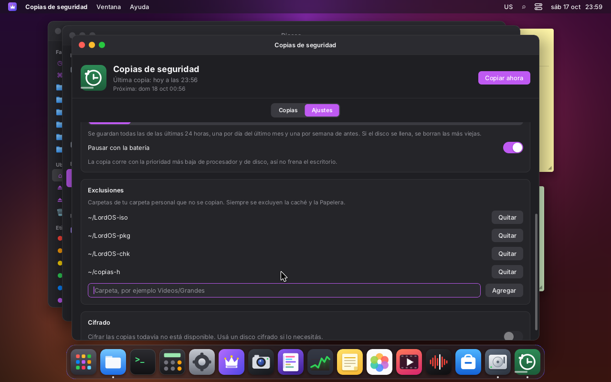 | 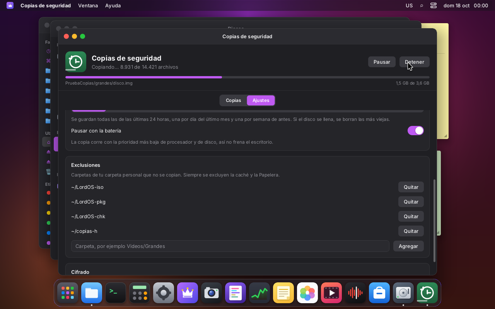 |
| Ajustes: destino (discos montados del usuario o una carpeta), frecuencia, batería y exclusiones | «Copiar ahora»: progreso por archivos y bytes, con Pausar y Detener |
| 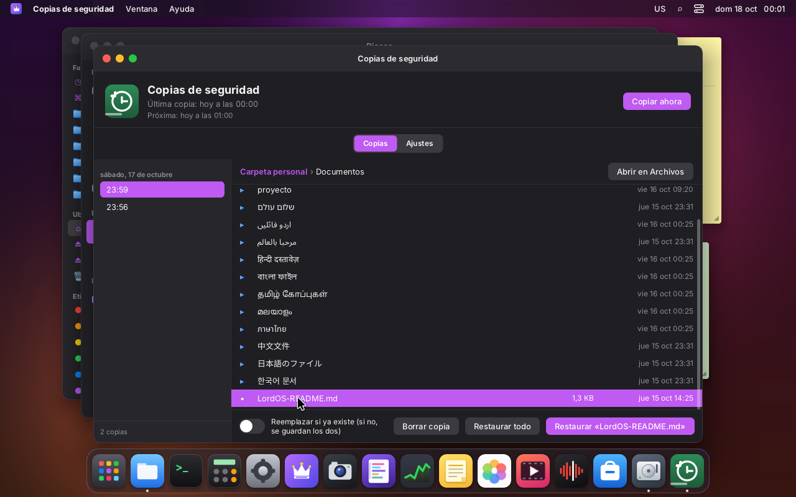 | 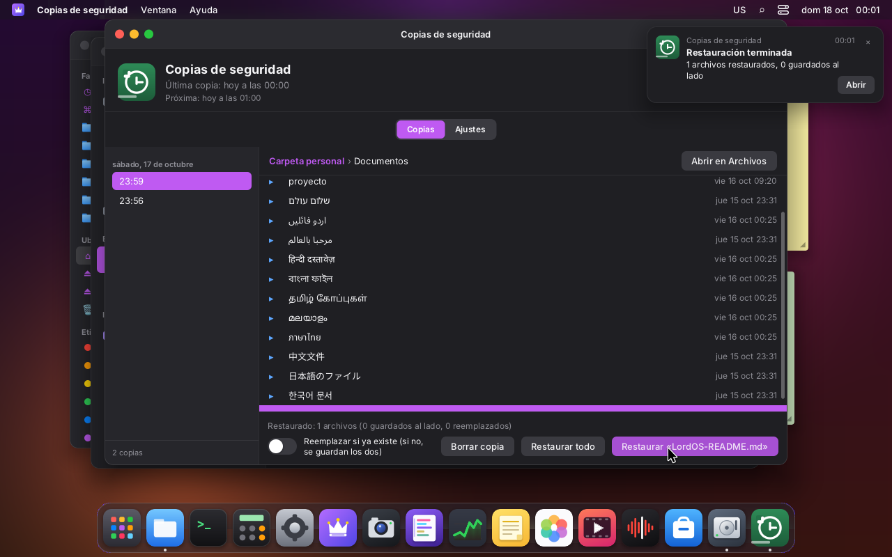 |
| Las copias por fecha y el árbol de cada una | Restaurar un archivo borrado: aviso de la sesión al terminar |
| 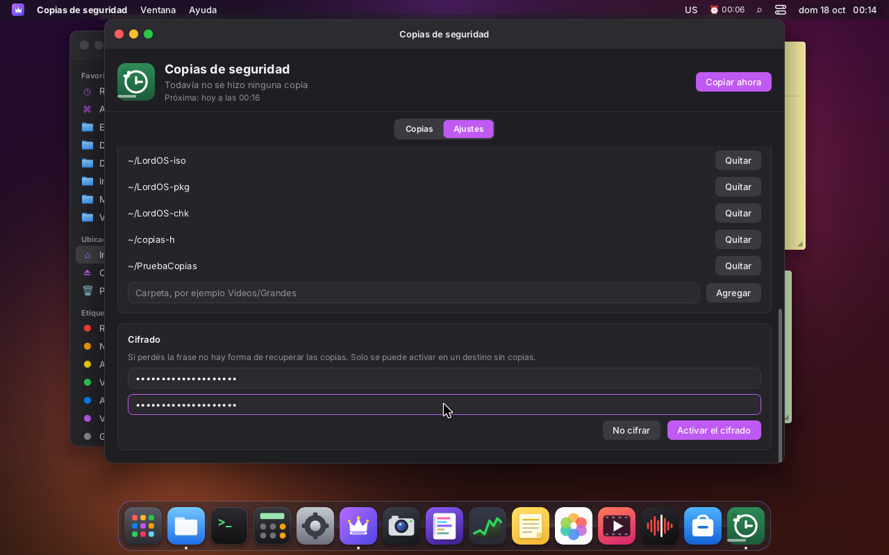 | 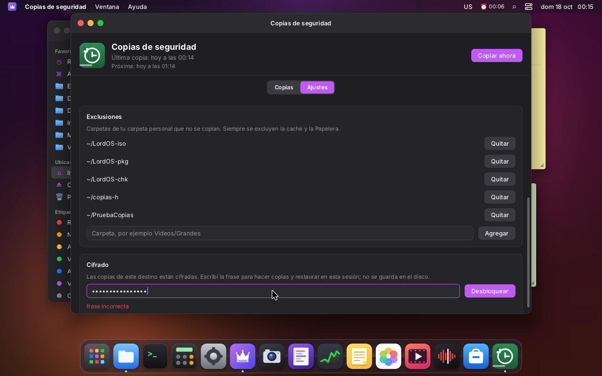 |
| Activar el cifrado en un destino nuevo | Destino cifrado y bloqueado: la frase incorrecta se rechaza |

### Cómo se guarda

```
<destino>/LordOS-Copias/<equipo>-<usuario>/
├── 2026-10-17-235656/        una instantánea: la carpeta personal entera, tal cual
├── 2026-10-18-001432/        lo que no cambió es un enlace duro a la anterior
├── .inprogress-<sello>/      la copia en curso (se renombra al terminar)
└── cifrado.json              solo si el destino está cifrado: sal y verificador
```

- **Instantáneas con enlaces duros** (`server/src/backup/engine.c`): un archivo con el mismo
  tamaño, fecha de modificación y permisos que en la instantánea anterior se enlaza (`link`); si no,
  se copia (`copy_file_range`, o `read`/`write` entre sistemas de archivos). Cada instantánea se ve
  completa —se puede abrir en Archivos— pero ocupa solo lo que cambió. En FAT/exFAT (sin enlaces
  duros) cada copia ocupa todo: la app lo avisa al lado del disco.
- **Atómica:** se escribe en `.inprogress-<sello>` y se renombra al final, después de `syncfs`.
  Cada archivo va primero a `<nombre>.bkpart~` y se renombra: un nombre final siempre es un archivo
  completo.
- **Copias cortadas** (se apaga el equipo, se desenchufa el disco, «Detener»): la próxima copia
  toma el `.inprogress` que quedó como otra fuente de enlaces —no vuelve a copiar lo que ya estaba—
  y después lo borra. Si un archivo cambia mientras se copia, se vuelve a copiar (hasta 3 veces).
- **Enlaces simbólicos:** se guardan como enlaces (el texto), nunca se siguen. El recorrido usa
  `lstat` y abre con `O_NOFOLLOW`; no cruza a otros sistemas de archivos (un disco montado adentro
  de la carpeta personal) y saltea fifos, sockets y dispositivos.
- **Exclusiones:** siempre `.cache`, `.local/share/Trash`, `.local/share/lordos/apps`,
  `.local/share/lordos/trash` y `.thumbnails`, la propia carpeta `LordOS-Copias` si el destino está
  adentro de la carpeta personal (por dispositivo e inodo), y las carpetas que agrega el usuario
  (rutas relativas validadas: sin `..`, `/` inicial ni caracteres de control).

### Retención

`bk_retention` es una función pura (probada con fechas inventadas):

- todas las instantáneas de las últimas 24 horas;
- la última de cada día hasta 30 días;
- la última de cada semana (de lunes a domingo, hora local) después;
- la más nueva siempre queda.

Si falta lugar (menos de 512 MiB libres antes de empezar, o `ENOSPC` durante la copia), se borran las
más viejas, nunca la última, y se reintenta. Borrar una instantánea primero la renombra a
`.deleting-<id>` (sale de la lista enseguida) y después la borra; solo adentro de la carpeta del
equipo y con nombres validados (`AAAA-MM-DD-HHMMSS`).

### Restaurar

En la pestaña **Copias**: las instantáneas por día, el árbol de cada una (con los tamaños reales) y
**Restaurar «archivo»**, **Restaurar esta carpeta** o **Restaurar todo** (con confirmación).

- **No se pisa nada sin querer:** si el archivo actual es distinto, el de la copia se guarda al
  lado como «nombre (restaurado).ext» (y «… 2», «… 3»). Con «Reemplazar si existe», se reemplaza
  (escribiendo a un temporal y renombrando). Si es igual, no se hace nada.
- **Las mismas reglas que `lord.fs`:** solo se escribe en la carpeta personal y los discos del
  usuario (`fsops_allowed`, con la carpeta ya resuelta), y nunca en lo protegido
  (`fsops_protected`: `~/.local/share/applications`, `~/.config/autostart`,
  `~/.local/share/lordos/apps`, `settings.json`, `permisos.json`, `backup.json`). Un `.desktop`
  plantado en una copia no se restaura; tampoco a través de un enlace de la carpeta personal que
  apunte a una carpeta protegida.
- **Sin escapes por la copia:** la ruta pedida se valida (`bk_rel_valid`) y su carpeta resuelta
  tiene que seguir adentro de la instantánea.
- **Restaurar todo** recupera la carpeta personal como estaba ese día; lo que cambió desde
  entonces queda al lado (o se reemplaza). Los archivos más nuevos no se borran.
- «Abrir en Archivos» muestra la instantánea en Archivos (es una carpeta común, de solo lectura en
  la práctica).

### Programación, prioridad y batería (`server/src/backup/backup.c`)

- **Un hilo de `lord-server`**, no un proceso aparte: así no se agrega ninguna forma de ejecutar
  programas. El hilo se pone **nice 19** (`setpriority` sobre su propio tid) y **E/S «idle»**
  (`ioprio_set`, clase 3) y bloquea todas las señales. Lo copiado se suelta de la caché de páginas
  (`posix_fadvise(DONTNEED)`), así no desplaza lo que usa el escritorio.
- **Sin sondeos:** el hilo duerme en `pthread_cond_timedwait` hasta la próxima copia (la de la
  instantánea más nueva + la frecuencia). La primera copia programada espera 5 minutos después de
  iniciar la sesión; después de un error, 15; si el disco no está, se vuelve a mirar cada 5 minutos.
- **Batería:** con «Pausar con la batería» (viene prendido), si hay una batería descargándose y
  ninguna fuente de corriente conectada (`/sys/class/power_supply`), la copia no empieza o se
  pausa entre archivos, y vuelve a mirar cada 60 s. Mientras copia, la batería se lee cada 2 s.
- **El estado llega solo a JS:** un `eventfd` en el bucle principal (`backup_fd`/`backup_dispatch`)
  llama a `__lordBackup(estado)` cuando cambia algo (a lo sumo dos veces por segundo con el
  progreso). La app no consulta.
- **Avisos** (`sdk/notify.js`), aunque la app esté cerrada: si una copia falla; si termina bien una
  que se pidió con «Copiar ahora»; al terminar de restaurar; y una vez por sesión si las copias
  están cifradas y bloqueadas.
- **Configuración:** `~/.config/lordos/backup.json` (`dest`, `interval`: `hourly|daily|weekly|manual`,
  `pauseOnBattery`, `encrypt`, `exclude`). Solo la escribe `lord.backup.configure`, que valida el
  destino (ruta real, en las raíces de `lord.fs`, escribible). Está en la lista de `fsops_protected`:
  decide a dónde van los datos, así que una app no la puede cambiar con `lord.fs.write`.

### Cifrado (opcional)

Con Monocypher 4.0.2 (vendorizado en `third_party/monocypher`, el mismo que usa Contraseñas; ver
`server/src/backup/crypt.c`):

- **Por archivo:** `LBK1` + nonce de 24 bytes + trozos de 64 KiB con XChaCha20-Poly1305. El nonce de
  cada trozo lleva su número y los datos asociados dicen si es el último: no se pueden cambiar,
  reordenar, quitar ni cortar trozos sin que falle la verificación. Restaurar escribe a un temporal
  y lo descarta si algo no verifica.
- **La clave** sale de la frase con Argon2id (64 MiB, 3 pasadas, sal de 16 bytes por destino). En
  `cifrado.json` quedan la sal y un verificador (BLAKE2b con la clave), nunca la clave.
- **Solo en memoria:** la clave vive en el proceso de la sesión (`mlock`), nunca en el disco. Al
  iniciar sesión las copias cifradas quedan **bloqueadas**: hay que escribir la frase en Ajustes
  (un aviso lo recuerda). Argon2 corre en el hilo de las copias, nunca en el compositor.
- **Los enlaces duros siguen funcionando:** el tamaño de un archivo cifrado se calcula del
  original, así que lo que no cambió se enlaza igual.
- **Qué no se cifra:** los nombres de archivos y carpetas, los textos de los enlaces simbólicos,
  los tamaños aproximados y las fechas.
- Se activa solo en un destino sin copias (no se mezclan cifradas y sin cifrar). Si se pierde la
  frase, no hay forma de recuperar las copias.
- **Pendiente:** guardar la frase en el llavero de la sesión (Contraseñas) para que las copias
  programadas no esperen a que el usuario la escriba.

### API (`lord.backup`, `server/src/ui/js_backup.c`; en el SDK, `backup` y `useBackup()`)

| Llamada | |
|---|---|
| `status()` / `useBackup()` | `{ state: idle\|running\|paused\|nodest\|restoring\|deleting\|locked\|unlocking, battery, userPause, dest, destAvailable, destFree, next, lastOk, progress: { files, totalFiles, bytes, totalBytes, file }, last: { ok, files, copied, linked, bytes, errors, secs, error }, restore: {…}, encrypted, destEncrypted, locked, unlock: {…} }` |
| `config()` / `configure(obj)` | leer y guardar la configuración (valida en C) |
| `runNow()`, `pause(on)`, `cancel()` | |
| `list()` | `[{ id, time }]` |
| `ls(id, rel)` | `[{ name, dir, link, size, mtime }]` (tamaños ya descifrados) |
| `restore(id, rel, { replace, suffix, to })` | `rel` vacío: todo |
| `remove(id)`, `path(id)` | borrar una instantánea; su ruta real para Archivos |
| `unlock(frase, crear)`, `lock()` | cifrado |

### Pruebas y medidas

`make -C server test` → `build/backup-test` (`server/tests/backup_test.c`), **220 comprobaciones**:
instantánea, exclusiones, fifo, enlaces simbólicos guardados como enlaces, el destino adentro de la
carpeta personal, enlaces duros (mismo inodo), copia cortada a mitad de un archivo de 40 MB y
retomada (lo ya copiado se enlaza, sin restos), restaurar (mantener los dos, numerar, reemplazar,
crear carpetas, `.desktop` plantado, `settings.json`, escape por un enlace de la copia y de la
carpeta personal, `..`, destino fuera de las raíces), poda por falta de lugar, retención con 90 días
de copias por hora, y el cifrado (tamaños, ida y vuelta de 0 B a 1 MiB, byte alterado, trozos de
menos, clave equivocada, frase incorrecta, instantánea cifrada con enlaces duros y restauración que
descarta una copia alterada).

Medido en la VM 119 (4 vCPU Xeon Silver 4108, disco virtio en SSD), copiando la carpeta personal
(3,8 GB, 13 436 archivos) a una imagen ext4 en loop:

| | |
|---|---|
| Primera copia completa | 24 s; el hilo usó 0,3 s de CPU de usuario y 8 s de sistema (≈34 % de un núcleo) |
| Copia siguiente sin cambios | 1,0 s (13 403 enlazados, 29 copiados) |
| Después de cambiar 1,8 GB | 12,8 s (42 copiados, 14 372 enlazados) |
| Primera copia cifrada (1,8 GB, 10 704 archivos) | 18,3 s |
| Latencia de despertar de un hilo cada 10 ms durante la copia | p50 0,1 ms, p99 0,2–2 ms (sin copia: p99 0,26 ms) |
| Lectura de 64 KiB en frío durante la copia, con `mq-deadline` | p95 59–75 ms con prioridad idle, 121 ms sin ella |
| Ídem con el planificador `none` (el de la VM) | p95 44–70 ms con idle, 61–74 ms sin ella: `none` no aplica prioridades |

`ioprio` solo tiene efecto con un planificador que lo respete (`mq-deadline`, BFQ); con `none`
(NVMe y la VM, por defecto) lo que protege al escritorio es nice 19, soltar la caché de páginas y
que el hilo no compite con el compositor por CPU (despertar con p99 de 2 ms como mucho). Con
`LORD_BACKUP_NOPRIO=1` en el entorno de la sesión se apagan nice e ioprio, solo para medir.

### Pendiente

- Probar «Pausar con la batería» en una notebook (en la VM no hay batería).
- Avisar al conectar el disco de las copias (hoy se vuelve a mirar cada 5 minutos).
- Guardar la frase del cifrado en el llavero de la sesión.
- Versiones de un archivo (todas las copias de ese archivo, como «Entrar en Time Machine»).
- El estado de RTL se revisó en el código (filas que el motor espeja, textos con `start`/`end`, la
  barra de progreso en `ltr`); no hay captura en árabe.

<!-- SECCION:REGISTROS -->

## Reloj (`apps/clock`)

Reloj mundial, alarmas, temporizador y cronómetro, como el Reloj de macOS o GNOME Reloj.

| Pestaña | Qué hace |
|---|---|
| Reloj mundial | La hora local y la de las ciudades que se agregan (buscador sobre `zone1970.tab` de tzdata), con una esfera analógica, «hoy/mañana/ayer», la diferencia en horas y la abreviatura de la zona (CEST, AEDT…) |
| Alarmas | Hora, días en que se repite (o una sola vez), nombre, prender/apagar, editar y borrar. Muestra cuánto falta para la próxima |
| Temporizador | Horas, minutos y segundos o atajos (1–30 min), pausar y seguir, barra de progreso |
| Cronómetro | Vueltas con el parcial y el total; la más rápida en verde y la más lenta en rojo |

### La hora de otra ciudad: un lector TZif propio

Para la hora de otra ciudad no se toca la zona del proceso: `setenv("TZ")` cambiaría el `Date` de
todo el tema (la barra, las otras apps). En su lugar:

- `server/src/ui/tzif.c` lee los archivos TZif de `/usr/share/zoneinfo` (RFC 8536, versiones 1 a
  4: el bloque de 64 bits, la búsqueda binaria de la transición y el pie con la regla POSIX TZ para
  las fechas después de la última transición) y evalúa reglas POSIX (`CET-1CEST,M3.5.0,M10.5.0/3`,
  `Jn`, `n`, `Mm.w.d`, horas negativas o de más de 24 h, nombres `<+0545>`).
- **Validado:** el nombre de zona solo admite `[A-Za-z0-9/_+-]`, sin `..` ni `/` inicial; la ruta
  real (tzdata usa enlaces) tiene que quedar dentro de `/usr/share/zoneinfo/`; archivos regulares de
  hasta 1 MB; todos los conteos e índices del archivo se controlan antes de leer.
- **JS:** `lord.time.zoneOffset(zona, segundosUnix)` → `{ offset, abbr, dst }` o `null`
  (`server/src/ui/js_help.c`, que lo agrega al `lord.time` de `js_sys.c`).
- **Prueba** (`make -C server test` → `build/tzif-test`, `tests/tzif_test.c`): reglas POSIX con
  instantes conocidos (Europa, Australia, EE. UU., Nepal, zonas sin verano), un TZif v2 armado en
  la prueba con **todos sus prefijos truncados** (tienen que fallar sin leer de más) y un índice de
  tipo inválido, y la comparación con glibc (`localtime_r` con `TZ`) en 24 zonas difíciles
  (Lord Howe, Chatham, Casablanca, Gaza, Santiago, Kathmandu, St Johns…) cada ~3 días de 1970 a
  2045: **216 168 instantes, 0 diferencias** en la VM 119.

### Alarmas con la app cerrada (`sdk/alarms.js`)

Las alarmas, el temporizador y el cronómetro viven en el SDK, no en la ventana: `startShell` llama
a `startAlarms()` una vez por sesión. Así suenan con el Reloj cerrado y también con la sesión en
segundo plano (cambio rápido de usuario o vista solo desde el navegador): la sesión de
`lord-server` sigue corriendo y su JS también.

- **Dónde se guardan:** `settings.clock = { alarms: [{ id, h, m, days, label, on, snooze, fired }],
  cities: [...] }` en `~/.config/lordos/settings.json`. `fired` es el instante de la última vez que
  sonó, para no repetirla al reiniciar la sesión.
- **Sin sondeos:** un solo `setTimeout` hasta lo próximo que tiene que sonar (alarma, posposición o
  fin del temporizador). Se vuelve a programar cuando cambian las alarmas (suscripción a los ajustes).
- **Cambios de hora y suspensión:** los timers de `lord-server` usan `CLOCK_MONOTONIC`, que no
  avanza suspendido. Por eso la espera se corta en tramos —1 minuto si algo suena dentro de la hora,
  10 minutos si no— y en cada despertar se recalcula con la hora real. Lo que debió sonar hace menos
  de 10 minutos suena igual; lo más viejo se da por perdido (no suena una alarma de ayer al volver
  de una suspensión larga). Sin alarmas ni temporizador no hay ningún timer.
- **Al sonar:** un [aviso](#avisos-de-la-sesión-sdknotifyjs) fijo con «Detener» y «Posponer 9 min»
  y el sonido `notify` de `lord.sound.play` cada 2,5 s durante un minuto o hasta que se toca el
  aviso. Las de una sola vez se apagan solas. El temporizador avisa igual, con «Repetir».
- **Barra de menú:** `registerStatusItem('clock', …)` muestra ⏱ con lo que falta del temporizador
  (se redibuja cada segundo solo mientras corre) o ⏰ con la hora de la próxima alarma si suena en
  las próximas 24 h. Un clic abre el Reloj en esa pestaña.

### Íconos de estado de la barra (`sdk/statusitems.js`)

`registerStatusItem(id, Componente, orden)` y `<StatusItems color />`: un registro opcional para
que las apps del sistema muestren algo en la barra del tema, como los "menu extras" de macOS. Los
temas `default` (junto a los indicadores de privacidad) y `classic` (en la barra de tareas) lo
dibujan; un tema que no lo dibuja simplemente no los muestra.

### Avisos de la sesión (`sdk/notify.js`)

LordOS no tenía avisos (solo el aviso corto del portapapeles). Ahora hay uno común para todas las
apps, montado por `startShell`, así que se ve con cualquier tema:

```js
import { notify, dismissNotification, notifyHistory } from '@lordos/sdk';
const id = notify({
  app: 'backup',                       // su ícono y su nombre (appName) en el aviso
  title: t('backup.notify.doneTitle'), // los textos llegan ya traducidos
  body: '1234 archivos',
  actions: [{ id: 'open', label: t('backup.notify.open'), primary: true, run: () => wm.open('backup') }],
  sound: true,                         // el sonido «notify» (lord.sound.play)
  sticky: false, timeout: 6000,        // sticky: queda hasta que se toca una acción o la ×
  onClose: (motivo) => {},             // 'closed', 'action' o el id de la acción
});
dismissNotification(id);
```

- Arriba, del lado del final de la línea (a la derecha; a la izquierda en árabe o hebreo), debajo
  del `workArea` del tema; hasta cuatro a la vez, el más nuevo arriba.
- Un clic en el aviso corre la primera acción; la × lo cierra.
- `notifyHistory`: los últimos 50 de la sesión, solo en memoria.
- Hasta tres acciones por aviso. La API queda estable: la usan el Reloj y las Copias de seguridad.

### Capturas

| | |
|---|---|
| 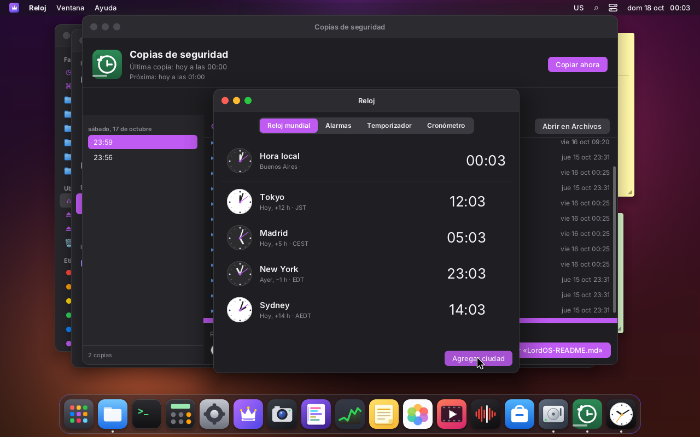 | 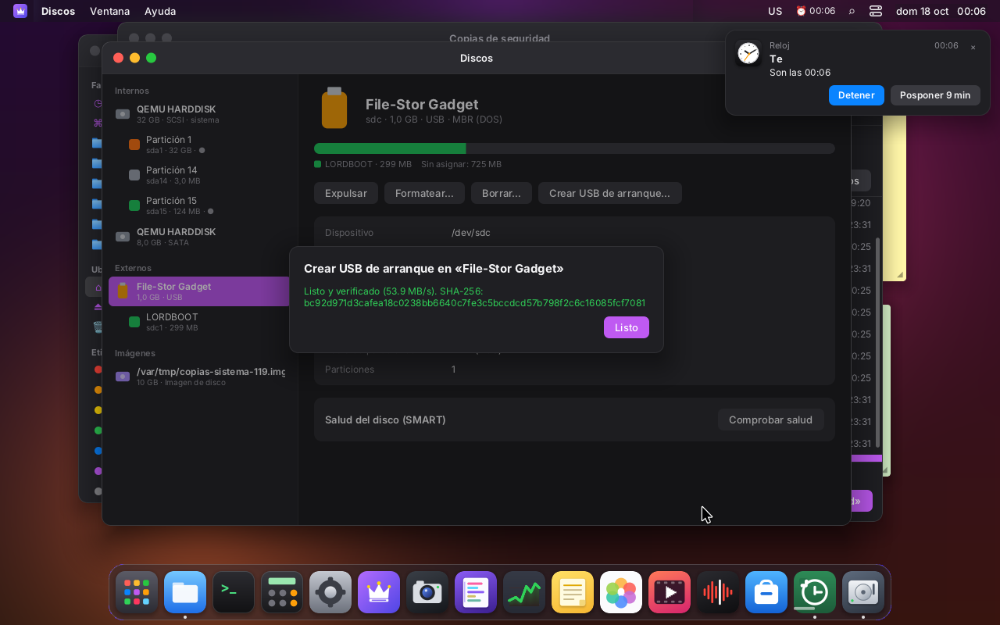 |
| Reloj mundial con varias ciudades | La alarma suena con el Reloj cerrado: aviso con Detener y Posponer, ⏰ en la barra |

## Ayuda (`apps/help`)

Ayuda y consejos de LordOS, como la app Consejos y el visor de ayuda de macOS.

- **Artículos:** uno por cada app y por cada función (escritorio, ventanas, Spotlight,
  portapapeles, teclado y métodos de entrada, apps Linux, touchpad, red, VPN, usuarios y sesiones,
  escritorio remoto, privacidad, impresión, sonido, actualizaciones, ajustes, apariencia, idioma, y
  las apps del sistema). 44 artículos en `assets/help/{es,en,pt}/<id>.md`, escritos a partir de los
  documentos de `docs/`.
- **Barra lateral** por secciones (Primeros pasos, El escritorio, Apps, Sistema, Ajustes), con el
  ícono de cada app, y **búsqueda** en títulos, palabras clave y texto, con un fragmento del
  resultado.
- **Se dibuja con el `<Markdown>` del SDK** (el mismo de Notas): títulos, listas, tablas, código.
- **Enlaces propios** dentro del texto: `[Ajustes → Red](settings:network)` abre esa sección de
  Ajustes (`wm.open('settings', { args: { section } })`, que Ajustes ya aceptaba);
  `[Archivos](app:files)` abre una app; `[VPN](help:vpn)` otro artículo. En el artículo de una app,
  un botón «Abrir <app>».
- **Menú Ayuda** del tema `default`: «Ayuda de LordOS» y «Bienvenido a LordOS».

### Formato de un artículo

```markdown
---
title: Reloj
app: clock          # la app que explica (botón «Abrir» e ícono)
section: apps       # start | desktop | apps | system | settings
order: 41
keywords: alarma, temporizador, cronómetro
---
# Reloj

Texto en markdown…
```

Si el idioma de la interfaz no tiene artículos, se usan los de inglés. Para agregar un idioma
alcanza con copiar la carpeta y traducir.

### Lectura: `lord.help` (`server/src/ui/js_help.c`)

| Llamada | Devuelve |
|---|---|
| `lord.help.list(idioma)` | `[{ id, title, app, section, order, keywords }]` (el encabezado de cada `.md`) |
| `lord.help.read(idioma, id)` | el texto del artículo o `null` |

Solo lectura, igual que `lord.locale.catalog`: el idioma y el id solo admiten `[a-z0-9-]` (sin
puntos ni barras), así que no se sale de `<assets>/help/`; `O_NOFOLLOW`, archivos regulares de
hasta 256 KB. En el SDK, `help` (`sdk/help.js`): `list`, `read`, `search`, `open(id)`,
`startTour()` y `link(url)`.

### Spotlight

`sdk/spotlight.js` tiene ahora un registro de fuentes, `registerSpotlightSource(id, fn)`. La Ayuda
registra la suya: los artículos aparecen en la sección «Ayuda» con un fragmento en la vista previa,
y Enter abre el artículo. El título de la sección sale de `shell.spotlight.section.<id>`.

### «Bienvenido a LordOS»

Un recorrido de seis pasos (bienvenida, el escritorio, Spotlight, Ajustes con botones a Apariencia,
Red y Usuarios, las apps del sistema y dónde está la ayuda), con «Omitir», «Atrás» y «Siguiente».

- Se abre solo **la primera vez** que se entra a la sesión: `startShell` llama a `maybeStartTour()`,
  que anota `welcomeShown: true` en los ajustes antes de abrirlo (aunque se cierre la ventana, no
  vuelve). En el sistema en vivo no aparece: ahí se abre el instalador.
- Se vuelve a ver desde la barra lateral de Ayuda o desde el menú Ayuda.
- Los textos están en `assets/locales/<idioma>/help.json` (`help.tour.<n>.title|body`).

### Capturas

| | |
|---|---|
|  | 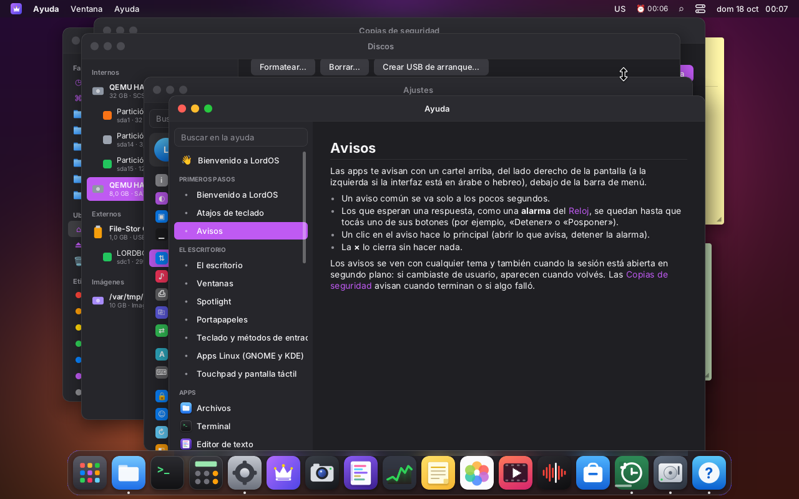 |
| «Bienvenido a LordOS» en el primer ingreso | Un artículo abierto desde Spotlight, con enlaces a otros artículos |
| 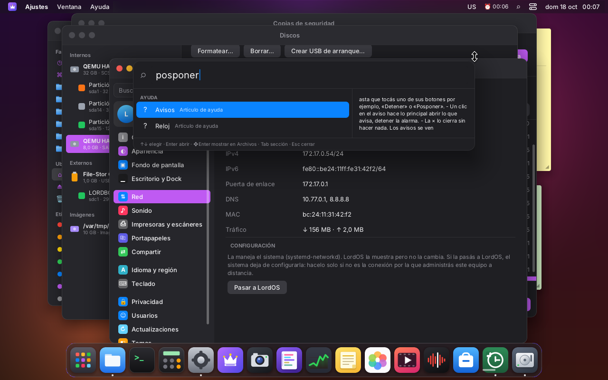 | |
| Spotlight encuentra artículos de la Ayuda | |

### Pendiente

- Imágenes dentro de los artículos (el `<Markdown>` ya las dibuja; faltan capturas por idioma).
- Un índice dentro de los artículos largos (`markdownHeadings` ya existe).
