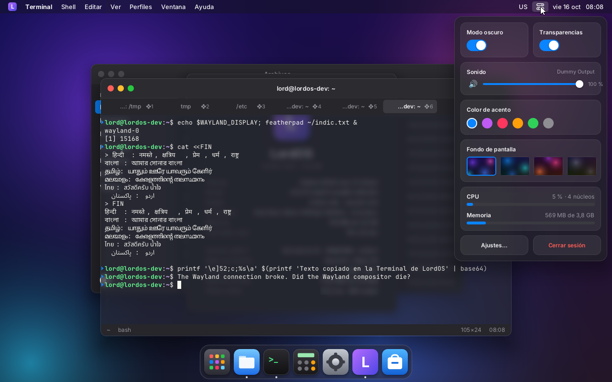
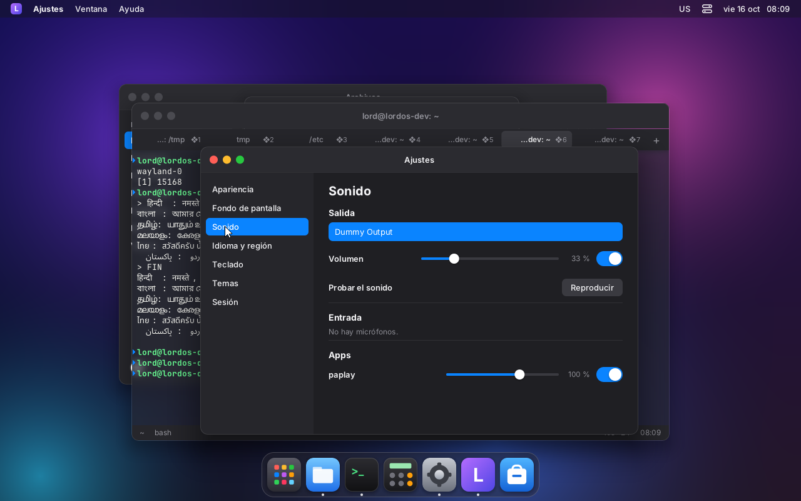
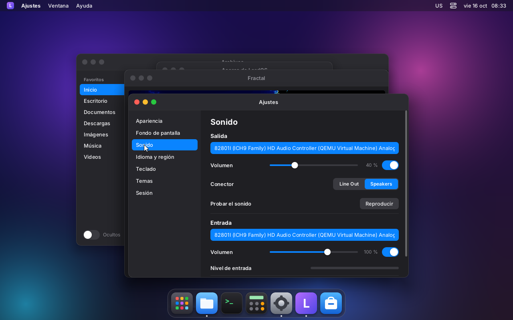

# Sound in LordOS

The sound server is **PipeWire**, the same one GTK, Qt and Firefox apps use. LordOS doesn't ship
another server or use libpipewire or libpulse: lord-server talks to PipeWire with its own C
client (`server/src/sound/`). With that client, the UI shows and changes:

- outputs and inputs;
- the volume of each channel;
- mute;
- the default device;
- each app's volume and output;
- and a microphone level meter.

| | |
|---|---|
|  |  |
| Volume in Control Center (it changes it in PipeWire: `pactl` reports the same value) | Settings → Sound: outputs, inputs, test and per-app volume (`paplay` playing) |
|  | |
| With the VM's HDA card (`audio0: ich9-intel-hda`): output, port (Line Out ↔ Speakers, tested with `pactl`) and microphone with meter | |

## Why the PulseAudio protocol

PipeWire accepts clients over two protocols:

1. **Its own** (`pipewire-0`). It is serialized as SPA *PODs*, which are nested structures with
   alignment, 64-bit types and objects with properties by id. Changing a volume there means:
   - *binding* the node;
   - building a `Props` inside an `SPA_PARAM_Props`;
   - and knowing how WirePlumber stores volumes: if the node is changed directly, WirePlumber
     doesn't remember it.

   The protocol isn't documented apart from libpipewire.
2. **PulseAudio's** (`pulse/native`), served by `pipewire-pulse`. It has been a stable protocol
   for 15 years and is documented in PulseAudio's code. It is simple: a list of typed values
   (`tagstruct`). It has high-level commands ("volume of this sink", "app to this output",
   "default output") that PipeWire translates and WirePlumber remembers. It is what pavucontrol,
   the GNOME and KDE applets, and `pactl` use.

We chose option 2: with about 1300 lines (`snd.c` and `pulse.c`) it covers everything the UI
needs. It is still talking to PipeWire: `pipewire-pulse` is a PipeWire module, not a separate
server. The format was taken from PulseAudio 17's `pulsecore/protocol-native.c` and `tagstruct.h`.
That code was only read to follow the format: it isn't linked or copied.

## How it works

- **Connection.** `snd_start()` starts after dropping privileges. It connects to
  `$PULSE_SERVER` (`unix:/path`) or to `$XDG_RUNTIME_DIR/pulse/native`. If `XDG_RUNTIME_DIR`
  isn't set, it uses `/run/user/<uid>`. It only connects if the socket belongs to the user.
- **Handshake.** It sends `AUTH` (protocol 32, without shared memory, so the data goes over the
  socket) and `SET_CLIENT_NAME` ("LordOS", `org.lordos.Server`).
- **State.** It subscribes to changes of sinks, sources, apps, server and cards, and requests the
  four lists. With each notification it requests only what changed.
- **Notifications to JS.** When something changed and all the replies have arrived, JS is
  notified with a `state` carrying the full state.
- **Reconnection.** If PipeWire crashes or restarts, `snd_fd()` becomes a timer and it retries
  every 2 s. Meanwhile, the state says `connected: false`.
- **Meter.** It is a recording stream of the chosen input: 1 float channel, at 25 Hz, with
  `PEAK_DETECT` (the same thing pavucontrol does). The server sends one peak per packet.
- **System sounds.** `pop`, `notify` and `error` are synthesized on the fly: sine waves with an
  envelope, with no files or OGG decoder. They're uploaded once to the server's sample cache and
  then played with `PLAY_SAMPLE` on the default output, with `media.role=event`.
- **Our own streams.** LordOS's streams (the meter and the sounds) don't show up in the app
  lists. Otherwise, the microphone meter would make it look like someone is recording.

## API: `lord.sound`

| Function | What it does |
|---|---|
| `state()` | the full state (shape below) |
| `setVolume(kind, index, value)` | `value` is a number (brings the loudest channel to that level and keeps the balance) or a per-channel list; 1 = 100 %, up to 1.5 |
| `setMute(kind, index, bool)` | mute |
| `setDefault('sink' \| 'source', name)` | default output or input |
| `setPort('sink' \| 'source', index, port)` | speakers ↔ headphones, etc. (a port from `ports`) |
| `move('input', app, sink)` / `move('output', app, source)` | moves an app to another output or input |
| `meter(sourceIndex)` / `meter(-1)` | turns the meter on or off; for an output, its `monitor` is used |
| `play('pop' \| 'notify' \| 'error')` | system sound |

- `kind` is `'sink'` (output), `'source'` (input), `'input'` (app playing) or `'output'`
  (app recording).
- They all return `true` if the command went out. The result shows up in the next `state`.
- They validate the type, the index (32-bit integer) and the names (no control characters,
  less than 256 bytes). Also, the index or name must exist in the current state.

Events: `globalThis.__lordSound = (type, data) => …`

- `type === 'state'`: `data` is the same as `state()`.
- `type === 'peak'`: `data` is `{ source, level }` (0..1), 25 times per second while the meter
  is on.

Shape of the state:

```js
{
  connected: true, server: 'PulseAudio (on PipeWire 1.4.2)', version: '15.0.0',
  defaultSink: 'alsa_output.pci-…', defaultSource: '…', meter: -1,
  sinks: [{ index, name, description, icon, formFactor, bus,
            volume: [1, 1], level: 1,          // per channel and the maximum; 1 = 100 %
            mute, state,                       // 0 running, 1 idle, 2 suspended
            monitor,                           // index of its "monitor" source (for the meter)
            card, default: true,
            ports: [{ name, description, priority, available }],   // available: true/false/null (unknown)
            activePort }],
  sources: [{ …the same, with monitorOf (sink index, or -1 if it is a real input) }],
  inputs:  [{ index, name, app, appId, icon, binary, role, pid, sink,
              volume, level, mute, corked, hasVolume, volumeWritable }],   // apps playing
  outputs: [{ …the same, with source instead of sink }],                    // apps recording
}
```

Inputs with `monitorOf >= 0` are the "monitor" of an output, what plays through it. The UI
normally hides them from the microphone list.

## Tests

- `make -C server test` includes `build/sound-test`: round trip of each tagstruct type,
  property lists, descriptors, truncated packets (none reads outside the buffer) and wrong
  types.
- `build/sound-cli` (`make -C server build/sound-cli`) is a command-line client over the same
  `snd.c`, against the real PipeWire: `list`, `volume`, `mute`, `default`, `port`, `move`,
  `meter`, `play`, `watch`. `LORD_SND_DEBUG=1` shows every packet.

Tested in the VM (PipeWire 1.4.2) with two virtual outputs (`module-null-sink`) and one virtual
input. The results were compared with `pactl` and `wpctl status`:

| Test | Result |
|---|---|
| List outputs, inputs, monitors and apps (`paplay` with `--client-name`) | same as `pactl list` (name, description, channels, volume, pid, binary) |
| Volume 42 %; balance 30/70; level 90 % keeping the balance | `pactl get-sink-volume`: 42 %; 30 % and 70 %; 39 % and 90 % |
| Output and app mute | `pactl`: `Mute: yes` / `no` |
| Default output and input | `pactl get-default-sink` and `wpctl status` (the `*`) |
| An app's volume (25 %) and moving it to another output | `pactl list sink-inputs`: 25 %, `Sink: 59` |
| Meter | 50 peaks in 2 s (25 Hz) with sound; level ~0 in silence |
| System sounds | `pactl list samples`: `lordos-pop`, `lordos-notify` and `lordos-error`; when played, `pactl subscribe` sees the stream appear and end |
| Changes made by another program (`pactl set-sink-volume`, `set-default-sink`) | a new `state` arrives with the value |
| `systemctl --user restart pipewire pipewire-pulse wireplumber` | "desconectado… reintentando" ("disconnected… retrying"), `connected: false`, and after 2 s it reconnects by itself |
| `lord.sound` from JS (QuickJS with the binding, without the screen) | changes volume and mute, turns on the meter and plays sounds; rejects invalid type, index or name |

lord-server builds with the client inside (`main.c` polls `snd_fd()`). The sound UI in Control
Center and Settings is built separately, on top of this API.

## Session: where PipeWire lives

PipeWire runs as a systemd user service (`pipewire`, `pipewire-pulse` and `wireplumber`, with
socket activation). Those services live in the user's `systemd --user`, which exists while the
user has a session or "linger".

- **Today in the VM:** lord-server is started with `sudo` from SSH and then drops privileges to
  `lord`. So that PipeWire is there even without an open SSH session,
  `loginctl enable-linger lord` was enabled: `systemd --user` starts with the machine and leaves
  the sockets in `/run/user/1000`. lord-server finds the socket there even though `sudo` cleared
  `XDG_RUNTIME_DIR`. The Wayland compositor already fills in that variable with
  `/run/user/<uid>`.
- **With our own session (M8):** login goes through PAM with `pam_systemd`. That creates the
  logind session with a seat (`seat0`), `XDG_RUNTIME_DIR` and the `user@<uid>.service`. That way
  PipeWire comes up via socket without linger. Also, logind gives the seat's user access to
  `/dev/snd/*` (`uaccess` ACL), which today, over SSH and without a seat, it doesn't have: `lord`
  isn't in the `audio` group.

## Packages in the VM

| Package | What for |
|---|---|
| `pipewire`, `pipewire-pulse`, `wireplumber` | the sound server (Debian 13 ships it by default on desktops) |
| `pipewire-alsa` | so apps that use ALSA directly go through PipeWire |
| `pulseaudio-utils` | testing only: `pactl` and `paplay` |
| `sound-theme-freedesktop` | testing only: `.oga` sounds for `paplay` |

Configuration: `sudo loginctl enable-linger lord` and
`systemctl --user enable --now pipewire pipewire-pulse wireplumber`. To read the format,
PulseAudio's source was downloaded with `apt-get source --download-only pulseaudio` into
`~/snd-ref`: it was only used as a reference and isn't built.

## Real time: PipeWire must not wait for anyone

Chromium's audio (YouTube) stuttered on the live ISO.

**Cause.** PipeWire ran at normal priority (`SCHED_OTHER`, nice 0), the same as lord-server, which
composites on the CPU, and as the browser. It asks for real time in two ways, and neither worked
in LordOS:

- **Through the user's limits (`RLIMIT_RTPRIO`).** It didn't have them.
- **Through RealtimeKit (`rtkit`).** The ISO ships it, but rtkit asks polkit. rtkit's rule is
  `allow_any=no`: it only gives real time to processes of an active session on a logind seat.
  `lord-sessiond` sessions run in `user@<uid>.service` without a seat, so polkit says no.
  PipeWire's log shows "can't set rt prio to 83 (try increasing rlimits)".

On a PC the quantum is small (browsers ask for ~5–10 ms). With PipeWire competing for the CPU,
any delay longer than that is a dropout. In a VM you don't notice, because PipeWire raises the
minimum to 1024 (21 ms) when it detects a VM (`vm.overrides`).

**Fix.** LordOS users are in the **`pipewire`** group:
- The `pipewire` package already ships `/etc/security/limits.d/25-pw-rlimits.conf` (`@pipewire`:
  rtprio 95, nice -19, memlock 4 MB).
- `pam_limits` is in the `systemd --user` session (`/usr/lib/pam.d/systemd-user`).

That way PipeWire takes real time by itself, without polkit: its `data-loop` threads end up at
`SCHED_FIFO` 88/83 and the main ones at nice -11. The group is added:
- to the live ISO user (`tools/iso/build.sh`);
- to the installer's first user (`server/src/install/install.c`);
- to new users from Settings → Users (`server/src/users/users_admin.c`).

A user that already existed needs to log in again, or `systemctl restart user@<uid>`.

**Test (VM 118)** with `pw-top`. "Dropouts" is the difference in the ERR counter, for the output
and for the stream:

| Test | Without real time | With the `pipewire` group |
|---|---|---|
| `paplay` at 5 ms (`PULSE_LATENCY_MSEC=5`, like a browser on a PC), 30 s, dragging windows and 6 processes burning CPU | **16 dropouts on the output, 303 on the stream** | **0 and 0** |
| The same without extra load, dragging | 0 and 2 | 0 and 0 |
| YouTube in Chromium, 3 minutes, dragging windows and 2 processes burning CPU | — | 0 and 0 |

For the "without real time" case, PipeWire's VM adjustment was removed with two test files in
`~/.config/pipewire/*.conf.d/` (deleted afterwards).

lord-server doesn't need real time and doesn't hold PipeWire back:
- its PulseAudio client is non-blocking (`O_NONBLOCK`; if the socket is full, it buffers and
  moves on);
- it uses 2 % CPU with or without audio playing.

There was no need to change `pipewire-pulse`'s quantum.

## Pending

- **Real speakers.** The VM now has an HDA card with a codec (`audio0: ich9-intel-hda`; the user
  `lord` is in the `audio` group): WirePlumber sees the analog output and microphone and
  `setPort` (Line Out ↔ Speakers) was tested with `pactl`. Whether it is actually audible can't
  be checked in a VM with no audio on the host (`driver=none`); it still needs testing on a
  physical machine.
- **Card profiles** (stereo, HDMI, duplex): `GET_CARD_INFO_LIST` and `SET_CARD_PROFILE` are
  missing.
- **Volume of virtual inputs.** The volume of a virtual input
  (`media.class=Audio/Source/Virtual`) doesn't change, not even with `pactl`: that's how it is in
  PipeWire 1.4.
- **Suspended virtual outputs.** A suspended virtual output (nothing playing) freshly created
  after restarting PipeWire ignores the volume, also with `pactl`. With something playing it
  works. It doesn't happen with real outputs.
- **System sounds from files.** freedesktop themes come in OGG Vorbis and would need a decoder.
  Today there are 3 synthesized sounds.
- **Repeated events.** Changes in our own streams (meter, sounds) generate a few extra `state`
  events, although they aren't shown. A few per second when turned on, not continuous.
