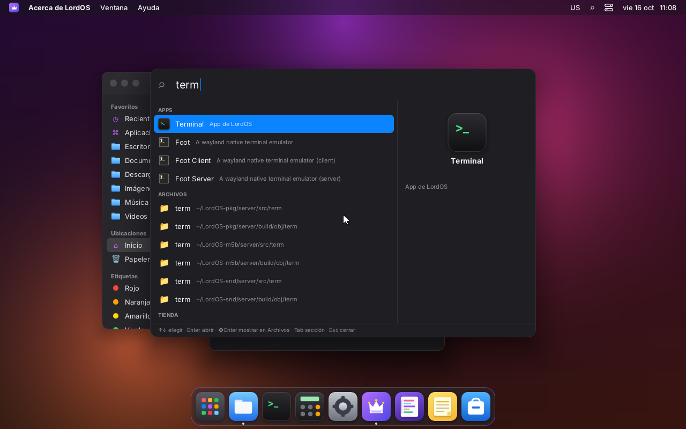
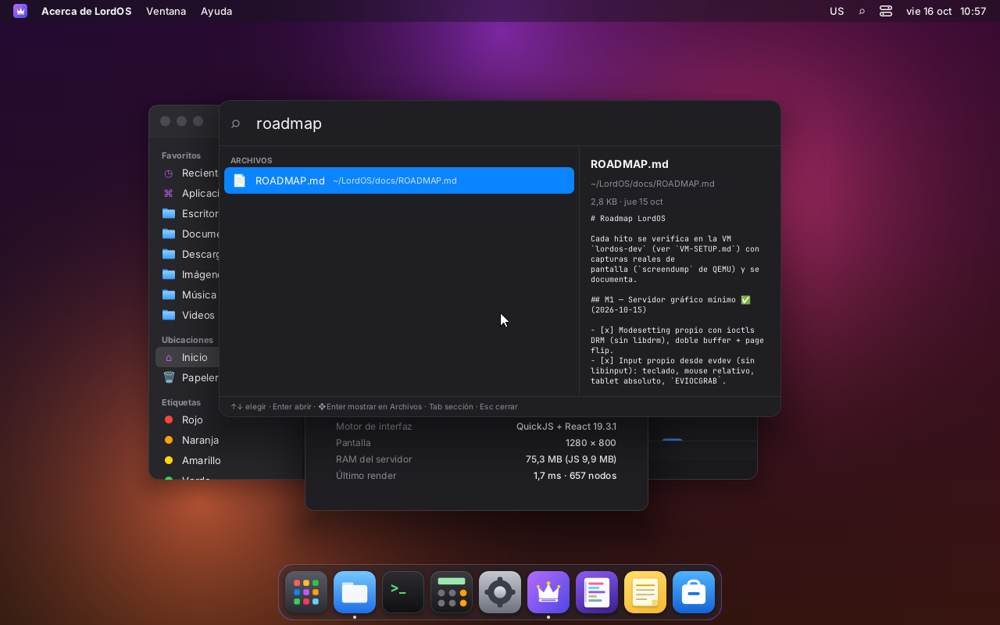
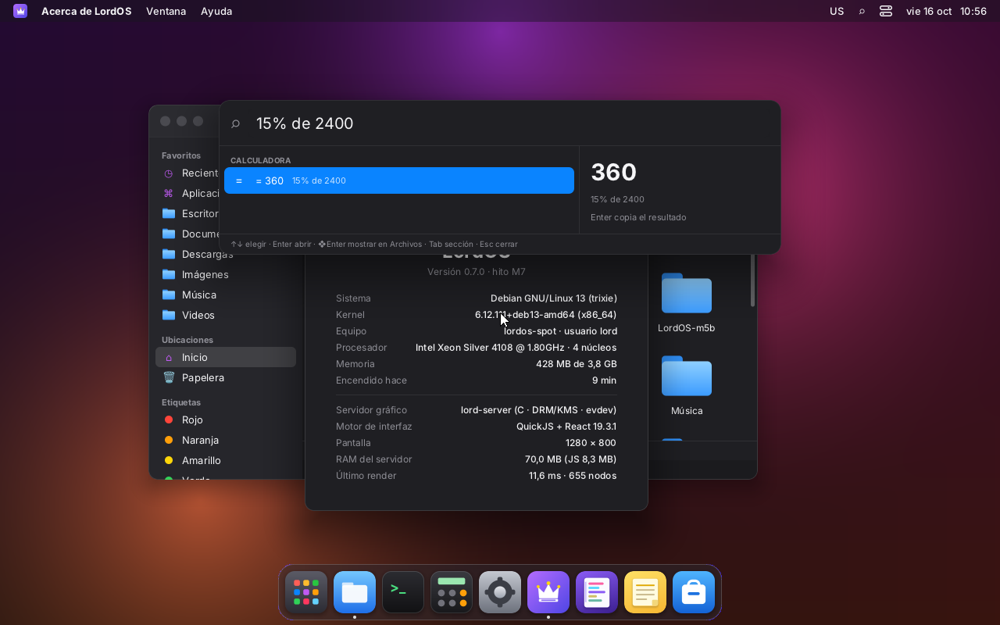
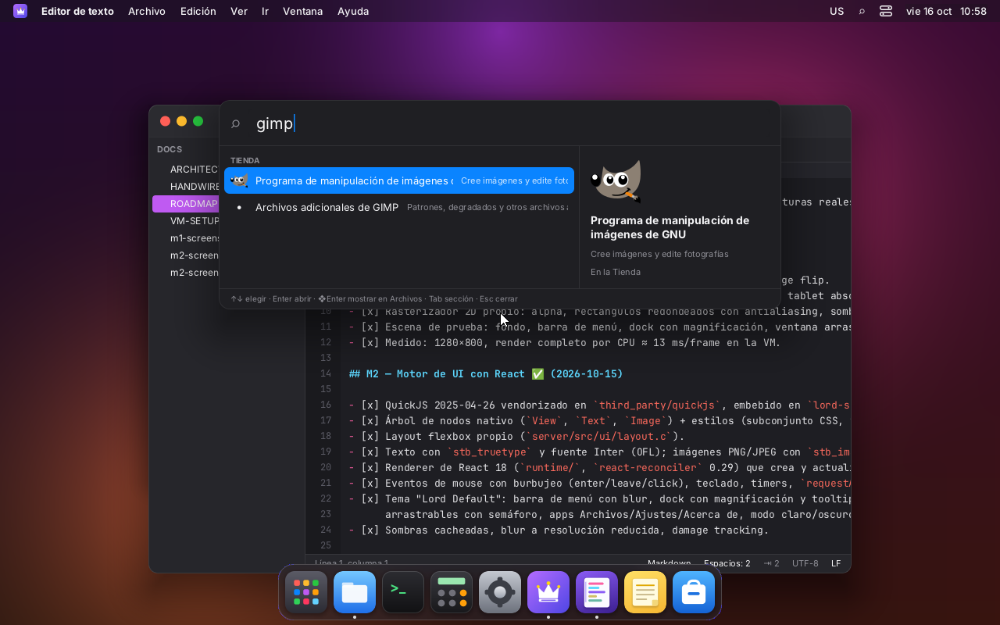
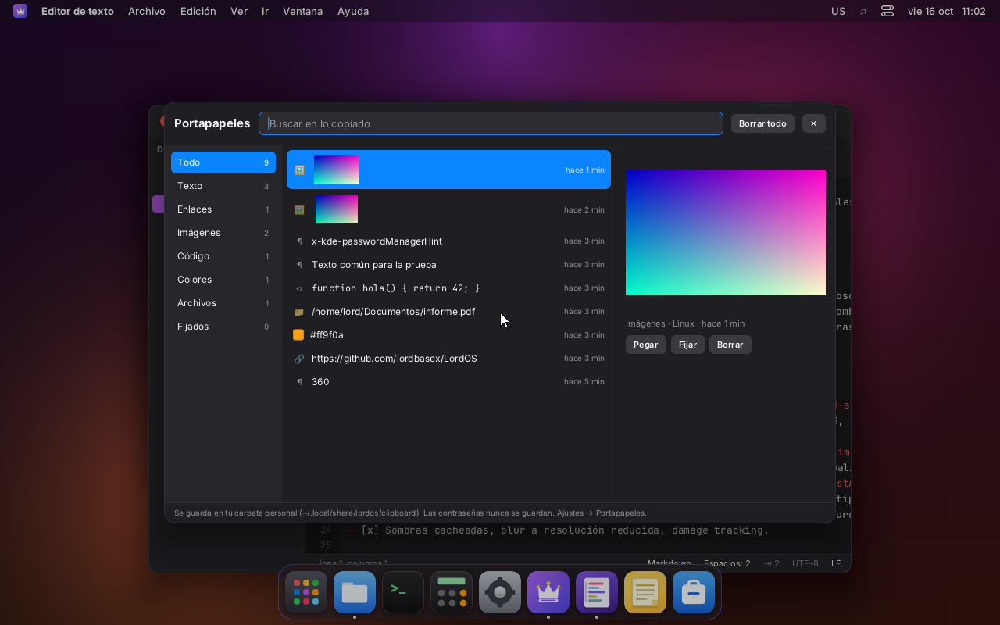
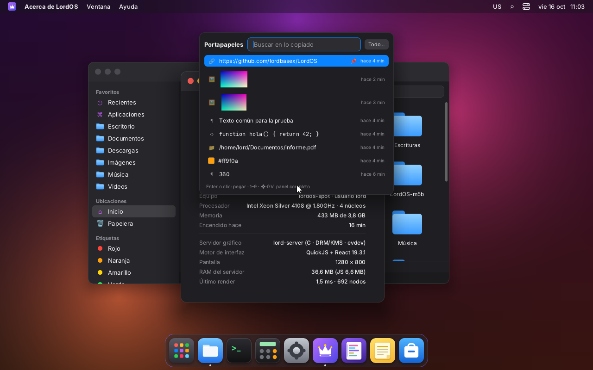
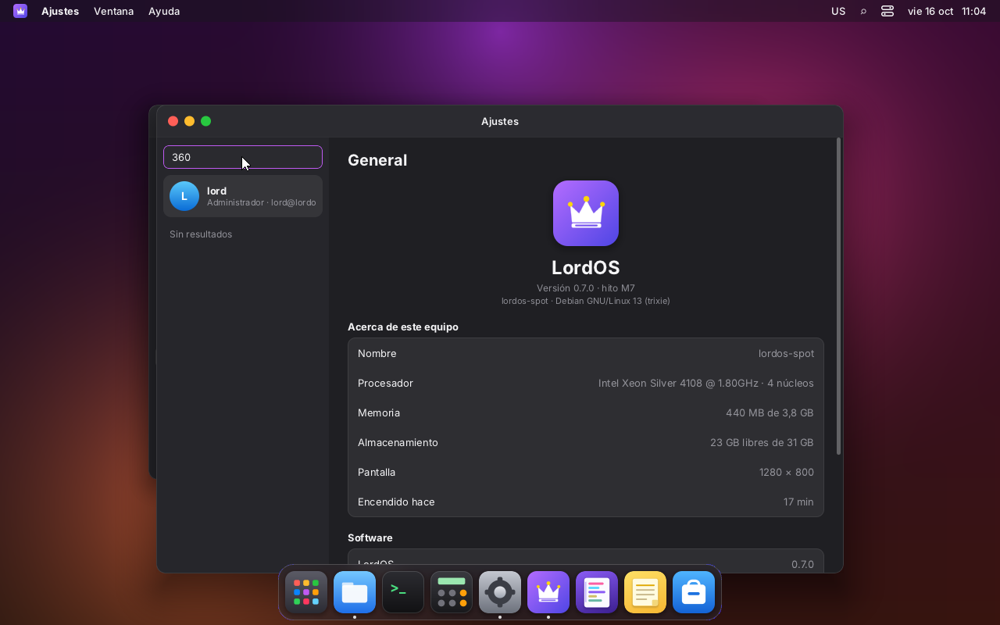
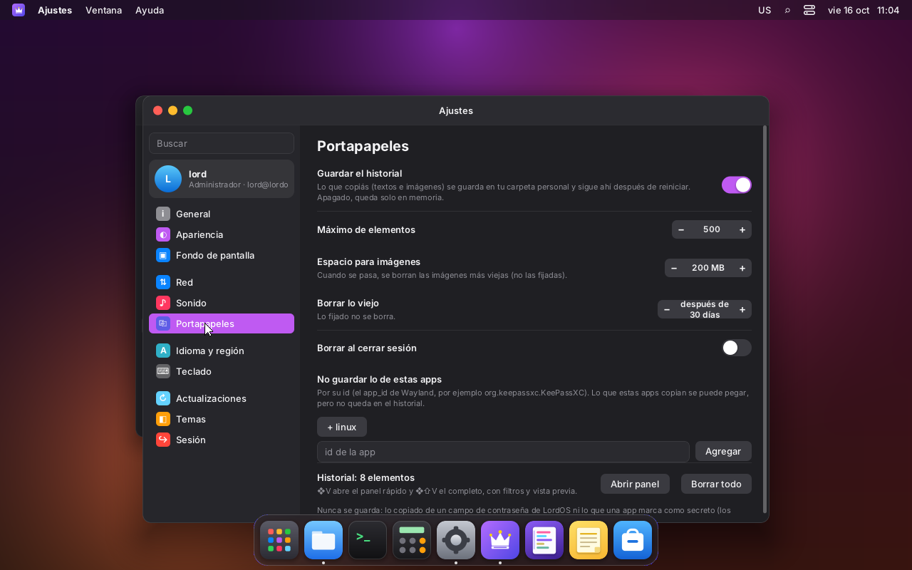

# Spotlight y portapapeles avanzado

Los dos los monta el SDK, así que **todos los temas los tienen** sin hacer nada:
`startShell` agrega `<SpotlightPanel />` y `<ClipboardPanel />`. Código: `sdk/spotlight.js` y
`sdk/clipboard.js`.

## Spotlight

| | |
|---|---|
|  |  |
| «term»: apps primero, después carpetas | «roadmap»: archivo con vista previa del texto; Enter lo abre en el Editor |
|  |  |
| «15% de 2400» → 360 (Enter lo copia) | «gimp»: apps de la Tienda que no están instaladas |
|  | |
| «yerba» encuentra la nota por su contenido | |

Se abre con **❖Espacio** o **Ctrl+Espacio**, o con la lupa ⌕ de la barra de menú del tema Lord
Default. Con la Terminal al frente, Ctrl+Espacio queda para el programa (en emacs marca una
selección); ❖Espacio funciona igual.

**Cambio de atajo:** antes ❖Espacio cambiaba de teclado o método de entrada. Ahora eso es
**❖⌥Espacio** o **Ctrl+⌥Espacio**, como ⌃⌥Espacio en macOS (`sdk/keyboard.js`).

| Tecla | Qué hace |
|---|---|
| ↑ ↓ | elegir |
| Enter | abrir (en la calculadora y en el portapapeles: copiar) |
| ❖Enter | mostrar en Archivos (archivos y carpetas) |
| Tab | ir a la sección siguiente |
| Esc | cerrar; el foco vuelve al campo de texto que lo tenía antes |

### Qué busca

Las secciones se ordenan por su mejor resultado; la calculadora va siempre arriba.

| Sección | De dónde | Al abrir |
|---|---|---|
| Calculadora | expresiones (`2*(3+4)`, `2^10`, `sqrt(2)`, `pi*2`, `15% de 2400`, coma decimal) con un parser propio, sin `eval`; conversiones (`10 km a mi`, `72 f a c`, `1,5 gb a mb`, `5 lb to kg`, `3 h en min`) | copia el resultado |
| Apps | `useLauncherApps()`: LordOS, paquetes `.lpk` y apps Linux | `launchApp` |
| Ajustes | las secciones de Ajustes y sus palabras clave traducidas (`settings.keywords.*`) | `wm.open('settings', { args: { section } })` |
| Acciones | modo oscuro o claro; cerrar sesión | la acción |
| Archivos | nombre en la carpeta personal: `lord.fs.search` del servidor (hasta 6 niveles); si no está, un recorrido propio por partes (4 niveles, 5000 entradas, sin ocultos) | carpetas en Archivos, texto en el Editor, el resto en Archivos con el archivo elegido |
| Notas | `~/Notas/*/nota.md` (título del encabezado YAML de la app Notas y el contenido); la sección solo aparece si está la app Notas | `wm.open('notes', { args: { slug } })` |
| Portapapeles | textos del historial | vuelve a copiar |
| Tienda | `lord.pkg.search`: solo apps de AppStream que no están instaladas, hasta 5 | `wm.open('store', { args: { search } })` |

**Relevancia:**
- Para el nombre: prefijo > palabra > subcadena > difuso (las letras en orden).
- La descripción y las palabras clave solo cuentan si el texto aparece de verdad, y valen menos.
- En los archivos se compara sin la extensión.
- Lo que se abre seguido sube, y el uso pierde peso a los 30 días. Se guarda en
  `~/.local/share/lordos/spotlight.json` (las últimas 300 entradas).

**Vista previa (a la derecha):**
- el ícono de la app;
- la imagen;
- las primeras líneas de un archivo de texto;
- el contenido de una carpeta;
- la nota;
- el resultado grande de la calculadora.

## Portapapeles avanzado

| | |
|---|---|
|  |  |
| ❖⇧V: filtros con contadores, muestra de color, código en monoespaciada, vista previa de la imagen y acciones | ❖V: lo último, después de reiniciar lord-server (el enlace fijado va arriba) |
|  |  |
| Elegido con ❖V y la tecla 8: «360» se pegó en el buscador de Ajustes, que tenía el foco | Ajustes → Portapapeles |

Hay uno solo para toda la sesión: la Terminal, los campos de texto de LordOS y las apps Linux (el
compositor hace de puente; ver `WAYLAND.md`). El historial guarda todo lo que se copia en
cualquiera de ellos: textos, enlaces, colores, código, rutas e imágenes. Para cada entrada guarda
el origen y la hora.

- **❖V, panel rápido:** lo último, con búsqueda. Enter, clic o 1–9 eligen.
- **❖⇧V, panel completo:**
  - filtros: Todo, Texto, Enlaces, Imágenes, Código, Colores, Archivos, Fijados;
  - vista previa, origen, fecha y largo;
  - Pegar, Fijar y Borrar; Supr borra; «Borrar todo» respeta lo fijado.
- **Pegar.** Elegir algo lo vuelve a copiar y lo pega donde estabas:
  - en el campo de texto de LordOS que tenía el foco;
  - o en la app Linux del frente, con un Ctrl+V que el compositor manda solo a esa app
    (`lord.wayland.paste`).

  Si no había dónde pegar, queda copiado y lo avisa.
- **Tipo de cada entrada** (`clipboardKind`):
  - enlace: `http(s)://`, `www.`, `mailto:`;
  - color: `#rgb`, `#rrggbb`, `rgb()`, `hsl()`;
  - archivo: una ruta absoluta o `~/…`;
  - código: varias líneas con sintaxis de código o sangría;
  - imagen o texto.

### Dónde se guarda

- **Archivos:**
  - `~/.local/share/lordos/clipboard/history.json`, con las entradas;
  - `img-*.png` al lado, con las imágenes.
- **Cómo se guardan las imágenes:** el compositor deja la última imagen en
  `$XDG_RUNTIME_DIR/lordos/clip-N.png`, que se pierde al reiniciar. Por eso
  `lord.clipboard.saveImage(ruta)` la copia a la carpeta personal. Valida la ruta con las mismas
  reglas que `lord.fs.write`: dentro de la carpeta personal y nunca en las carpetas protegidas.
- **Volver a copiar una imagen:** `lord.clipboard.useImage(ruta)` acepta solo esos dos lugares,
  las vistas previas del compositor y las imágenes del historial.
- **Borrar:** `lord.clipboard.deleteSaved(nombre)` borra solo nombres `img-*.png` de esa carpeta.
  No hay un borrado general de archivos.
- **Ajustes → Portapapeles:**

  | Opción | Por defecto |
  |---|---|
  | Guardar o no el historial (si se apaga, queda solo en memoria) | activado |
  | Máximo de elementos | 500 |
  | Espacio para imágenes | 200 MB |
  | Borrar lo viejo (lo fijado no caduca) | a los 30 días |
  | Borrar al cerrar sesión | apagado |
  | No guardar lo que copien ciertas apps (por su app_id de Wayland) | ninguna |

  Se guardan en `settings.clipboard`.

### Privacidad

Lo sensible nunca entra al historial, pero se puede pegar igual:

- **Apps Linux que marcan la copia como secreta.** Ofrecen el formato
  `x-kde-passwordManagerHint`, que es la convención de KDE y GNOME que usan KeePassXC y otros
  gestores de contraseñas. El compositor lo detecta (`wl.c`), y `lord.clipboard.state()` responde
  `sensitive: true`.
- **LordOS.** `clipboard.set(texto, { secure: true })` copia sin guardar. Los campos `secure`
  (contraseñas) de `TextInput` no permiten copiar.
- **Apps excluidas en Ajustes.** No quedan en el historial.

`lord.clipboard.state()` también devuelve `origin`: el app_id de la app Linux que copió,
`terminal` o `lordos`.

### Probado (VM 119 `lordos-spot`)

- **Copias desde una app Wayland** con `wl-copy` (`wl-clipboard`, solo para las pruebas): un
  enlace, un color, una ruta, código, texto y dos imágenes PNG. Cada una quedó con su tipo, y las
  imágenes se guardaron como `img-*.png`.
- **Secreto:** `tests/clip_secret.c` ofrece texto + `x-kde-passwordManagerHint`, como KeePassXC.
  El texto se pudo pegar con `wl-paste` y no quedó en `history.json`.
- **Reinicio:** después de reiniciar lord-server, el historial siguió ahí, con lo fijado arriba.
- **Panel completo:** los filtros, fijar y borrar funcionan.
- **Pegar:** ❖V y la tecla 8 pegaron en un campo de texto de LordOS.
- **Spotlight:** apps, ajustes, archivos (que se abrieron en el Editor), notas, la Tienda, la
  calculadora y las conversiones.

### Pendiente

- Pegar en una app Linux solo se probó por código: falta una captura con una app GTK al frente.
- Formatos que no son texto ni PNG (HTML, `text/uri-list` con archivos): hoy pasan entre apps
  Linux mientras la app de origen sigue abierta, pero no van al historial.
- Spotlight: buscar por el contenido de los archivos (hoy, solo por el nombre), contactos y
  correo, que no existen todavía, y «Bloquear pantalla», que no hay (M8).
