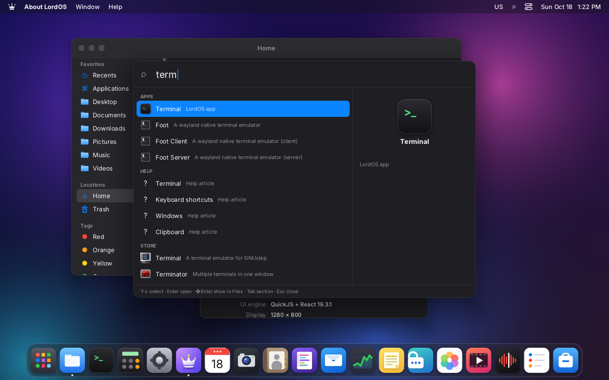
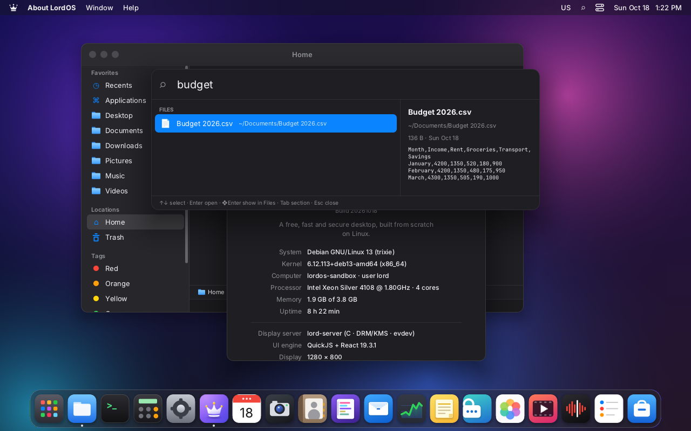
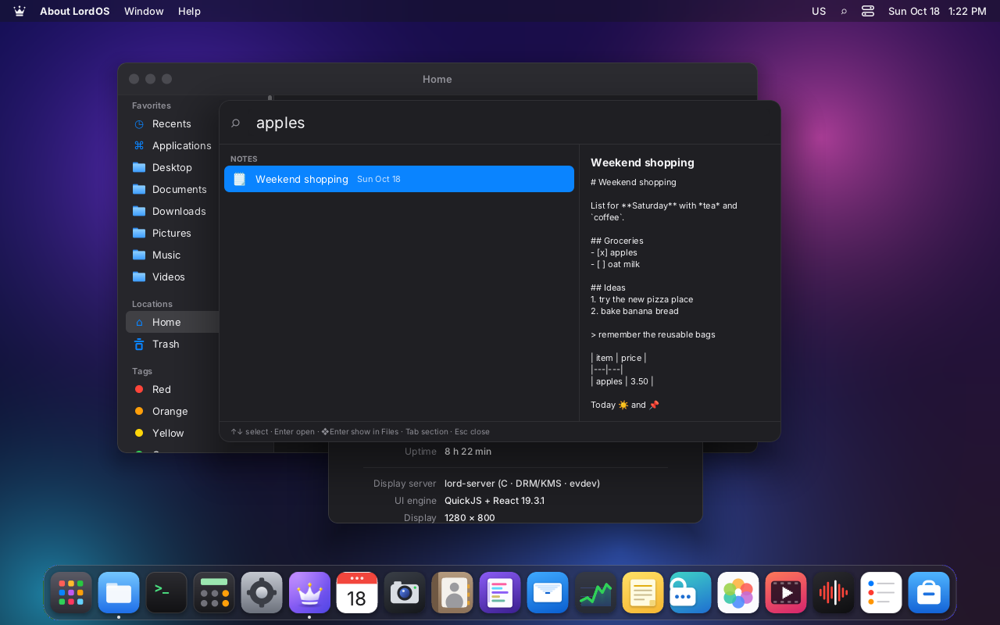
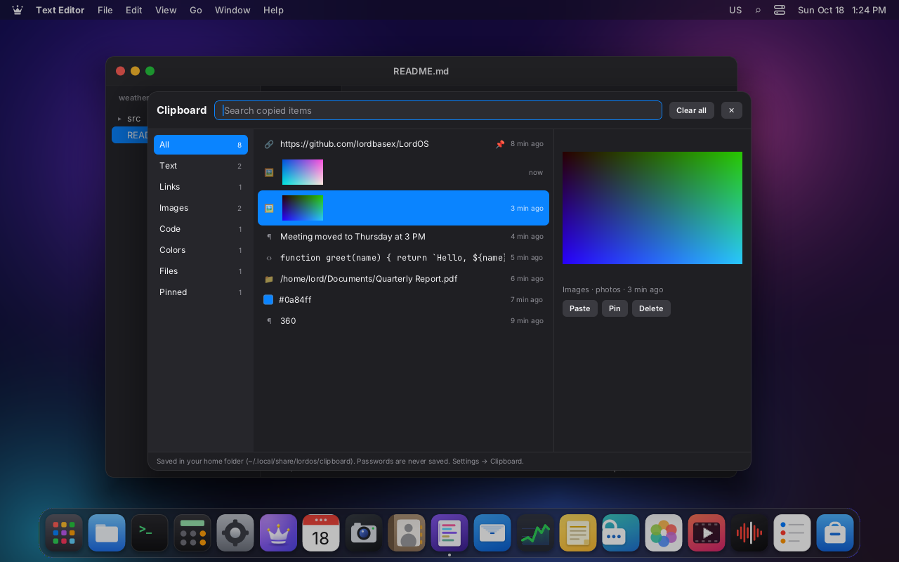
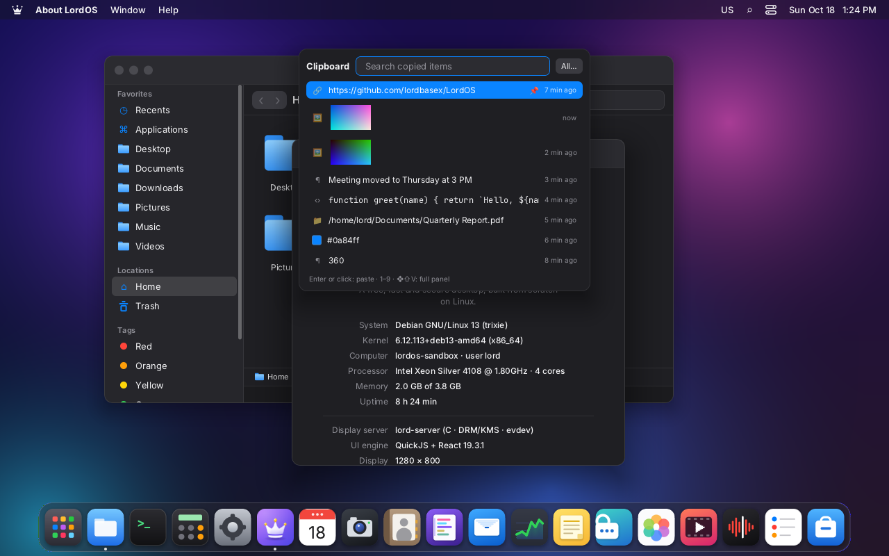
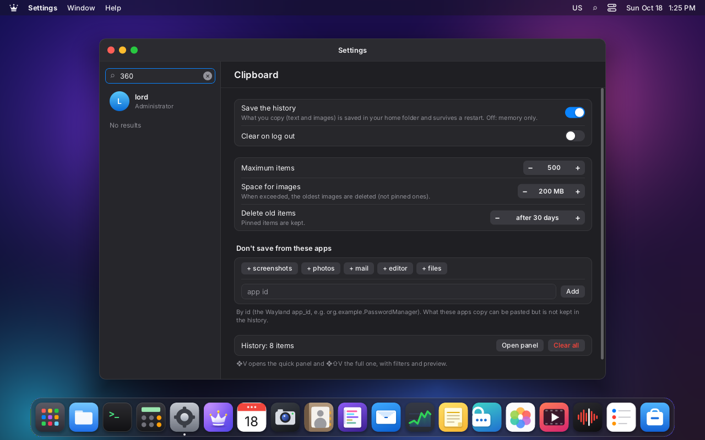
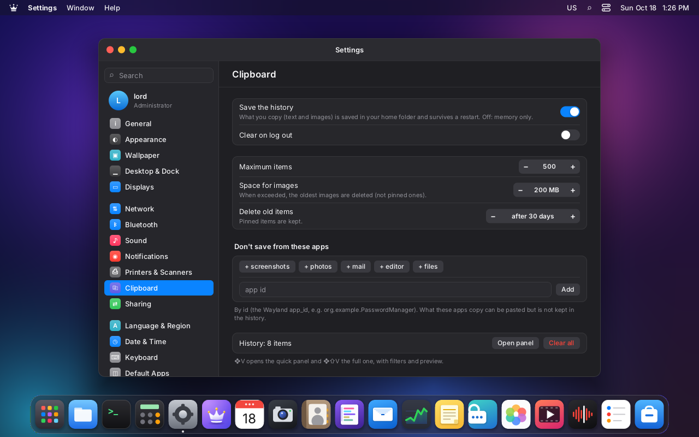

# Search and the advanced clipboard

Both are mounted by the SDK, so **every theme has them** without doing anything:
`startShell` adds `<SpotlightPanel />` and `<ClipboardPanel />`. Code: `sdk/spotlight.js` and
`sdk/clipboard.js`.

## Search

| | |
|---|---|
|  |  |
| «term»: apps first, then folders | «budget»: a file with a text preview; Enter opens it in the Editor |
|  |  |
| «15% of 2400» → 360 (Enter copies it) | «gimp»: Store apps that aren't installed |
|  | |
| «apples» finds the note by its content | |

It opens with **❖Space** or **Ctrl+Space**, or with the ⌕ magnifier in the Lord Default theme's
menu bar. With the Terminal in front, Ctrl+Space is left to the program (in emacs it sets a
mark); ❖Space works the same.

**Shortcut change:** ❖Space used to switch the keyboard or input method. Now that is
**❖⌥Space** or **Ctrl+⌥Space** (`sdk/keyboard.js`).

| Key | What it does |
|---|---|
| ↑ ↓ | choose |
| Enter | open (in the calculator and the clipboard: copy) |
| ❖Enter | show in Files (files and folders) |
| Tab | go to the next section |
| Esc | close; focus returns to the text field that had it before |

### What it searches

Sections are ordered by their best result; the calculator always goes on top.

| Section | Source | On open |
|---|---|---|
| Calculator | expressions (`2*(3+4)`, `2^10`, `sqrt(2)`, `pi*2`, `15% de 2400`, decimal comma) with our own parser, no `eval`; conversions (`10 km a mi`, `72 f a c`, `1,5 gb a mb`, `5 lb to kg`, `3 h en min`) | copies the result |
| Apps | `useLauncherApps()`: LordOS, `.lpk` packages and Linux apps | `launchApp` |
| Settings | the Settings sections and their translated keywords (`settings.keywords.*`) | `wm.open('settings', { args: { section } })` |
| Actions | dark or light mode; log out | the action |
| Files | name in the home folder: the server's `lord.fs.search` (up to 6 levels); if unavailable, our own walk in chunks (4 levels, 5000 entries, no hidden files) | folders in Files, text in the Editor, the rest in Files with the file selected |
| Notes | `~/Notes/*/nota.md` (title from the Notes app's YAML header, and the content); the section only appears if the Notes app is present | `wm.open('notes', { args: { slug } })` |
| Clipboard | texts from the history | copies again |
| Store | `lord.pkg.search`: only AppStream apps that aren't installed, up to 5 | `wm.open('store', { args: { search } })` |

**Relevance:**
- For the name: prefix > word > substring > fuzzy (the letters in order).
- The description and the keywords only count if the text really appears, and they weigh less.
- Files are compared without the extension.
- What is opened often moves up, and usage loses weight after 30 days. It is stored in
  `~/.local/share/lordos/spotlight.json` (the last 300 entries).

**Preview (on the right):**
- the app's icon;
- the image;
- the first lines of a text file;
- the contents of a folder;
- the note;
- the calculator's result, large.

## Advanced clipboard

| | |
|---|---|
|  |  |
| ❖⇧V: filters with counters, color swatch, code in monospace, image preview and actions | ❖V: the latest items, after restarting lord-server (the pinned link is on top) |
|  |  |
| Chosen with ❖V and the 8 key: «360» was pasted into the Settings search box, which had focus | Settings → Clipboard |

There is a single one for the whole session: the Terminal, LordOS's text fields and Linux apps
(the compositor acts as the bridge; see `WAYLAND.md`). The history stores everything copied in
any of them: texts, links, colors, code, paths and images. For each entry it stores the origin
and the time.

- **❖V, quick panel:** the latest items, with search. Enter, click or 1–9 choose.
- **❖⇧V, full panel:**
  - filters: All, Text, Links, Images, Code, Colors, Files, Pinned;
  - preview, origin, date and length;
  - Paste, Pin and Delete; Del deletes; «Delete all» keeps the pinned items.
- **Paste.** Choosing something copies it again and pastes it where you were:
  - into the LordOS text field that had focus;
  - or into the frontmost Linux app, with a Ctrl+V that the compositor sends only to that app
    (`lord.wayland.paste`).

  If there was nowhere to paste, it stays copied and says so.
- **Kind of each entry** (`clipboardKind`):
  - link: `http(s)://`, `www.`, `mailto:`;
  - color: `#rgb`, `#rrggbb`, `rgb()`, `hsl()`;
  - file: an absolute path or `~/…`;
  - code: several lines with code syntax or indentation;
  - image or text.

### Where it is stored

- **Files:**
  - `~/.local/share/lordos/clipboard/history.json`, with the entries;
  - `img-*.png` next to it, with the images.
- **How images are stored:** the compositor leaves the latest image in
  `$XDG_RUNTIME_DIR/lordos/clip-N.png`, which is lost on reboot. That's why
  `lord.clipboard.saveImage(path)` copies it to the home folder. It validates the path with the
  same rules as `lord.fs.write`: inside the home folder and never in the protected folders.
- **Copying an image again:** `lord.clipboard.useImage(path)` only accepts those two places, the
  compositor's previews and the history's images.
- **Deleting:** `lord.clipboard.deleteSaved(name)` deletes only `img-*.png` names in that folder.
  There is no general file deletion.
- **Settings → Clipboard:**

  | Option | Default |
  |---|---|
  | Save the history or not (if off, it stays in memory only) | on |
  | Maximum number of items | 500 |
  | Space for images | 200 MB |
  | Delete old items (pinned ones don't expire) | after 30 days |
  | Clear on log out | off |
  | Don't save what certain apps copy (by their Wayland app_id) | none |

  They are stored in `settings.clipboard`.

### Privacy

Sensitive content never enters the history, but it can still be pasted:

- **Linux apps that mark the copy as secret.** They offer the `x-kde-passwordManagerHint`
  format, the KDE and GNOME convention used by KeePassXC and other password managers. The
  compositor detects it (`wl.c`), and `lord.clipboard.state()` answers `sensitive: true`.
- **LordOS.** `clipboard.set(text, { secure: true })` copies without saving. `TextInput`'s
  `secure` fields (passwords) don't allow copying.
- **Apps excluded in Settings.** They don't end up in the history.

`lord.clipboard.state()` also returns `origin`: the app_id of the Linux app that copied,
`terminal` or `lordos`.

### Tested (VM 119 `lordos-spot`)

- **Copies from a Wayland app** with `wl-copy` (`wl-clipboard`, for the tests only): a link, a
  color, a path, code, text and two PNG images. Each one got its kind, and the images were saved
  as `img-*.png`.
- **Secret:** `tests/clip_secret.c` offers text + `x-kde-passwordManagerHint`, like KeePassXC.
  The text could be pasted with `wl-paste` and didn't end up in `history.json`.
- **Restart:** after restarting lord-server, the history was still there, with the pinned items
  on top.
- **Full panel:** filters, pin and delete work.
- **Paste:** ❖V and the 8 key pasted into a LordOS text field.
- **Search:** apps, settings, files (which opened in the Editor), notes, the Store, the
  calculator and the conversions.

### Pending

- Pasting into a Linux app was only tested through code: a screenshot with a GTK app in front is
  still missing.
- Formats that aren't text or PNG (HTML, `text/uri-list` with files): today they pass between
  Linux apps while the source app stays open, but they don't go into the history.
- Search: searching file contents (today, names only), contacts and mail, which don't exist
  yet, and «Lock screen», which doesn't exist (M8).
