# System apps (M9)

The native system apps that ship preinstalled with LordOS: **Disks** (Discos), **Backups** (Copias
de seguridad), **Logs** (Registros), **Clock** (Reloj) and **Help** (Ayuda). All of them use `t()`
with es/en/pt, work right to left and have their own icon. Anything that needs root goes through
closed `admin.c` actions, with arguments validated on the root side and programs at fixed paths.

## Disks (`apps/disks`)

The LordOS disk utility, like GNOME Disks.

- **On the left:** disks grouped into Internal, External (USB and cards) and Images (`loop`
  devices backed by a file), each with its partitions. A dot marks the mounted ones.
- **On the right:**
  - a usage bar: the disk's partitions to scale, or used and free space of a mounted partition;
  - the actions;
  - the details: device, model, serial number, capacity, connection, type, partition table, file
    system, label, UUID, mount point;
  - the **Disk health (SMART)** card and, with smartmontools, the self-tests, the error log, the
    temperature history and every attribute (see "SMART with smartmontools").
- **Refresh without polling:** the list updates by itself on mount, unmount, plug-in or format.

| | |
|---|---|
| 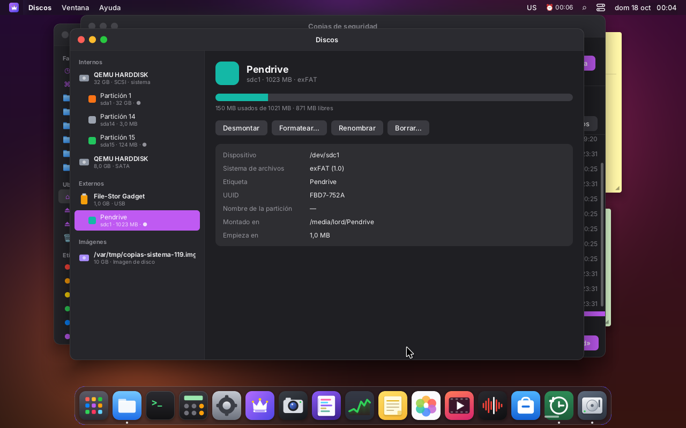 | 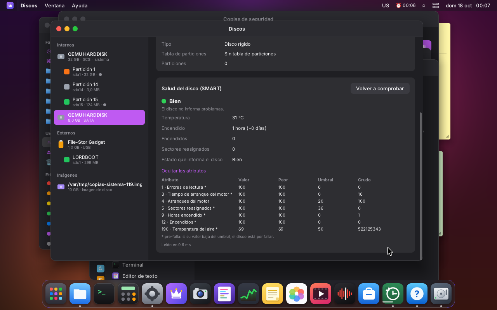 |
| The system disk and its partitions (protected: no format, erase or unmount) | Health of the SATA disk: our own SMART over SG_IO, with the attributes |
| 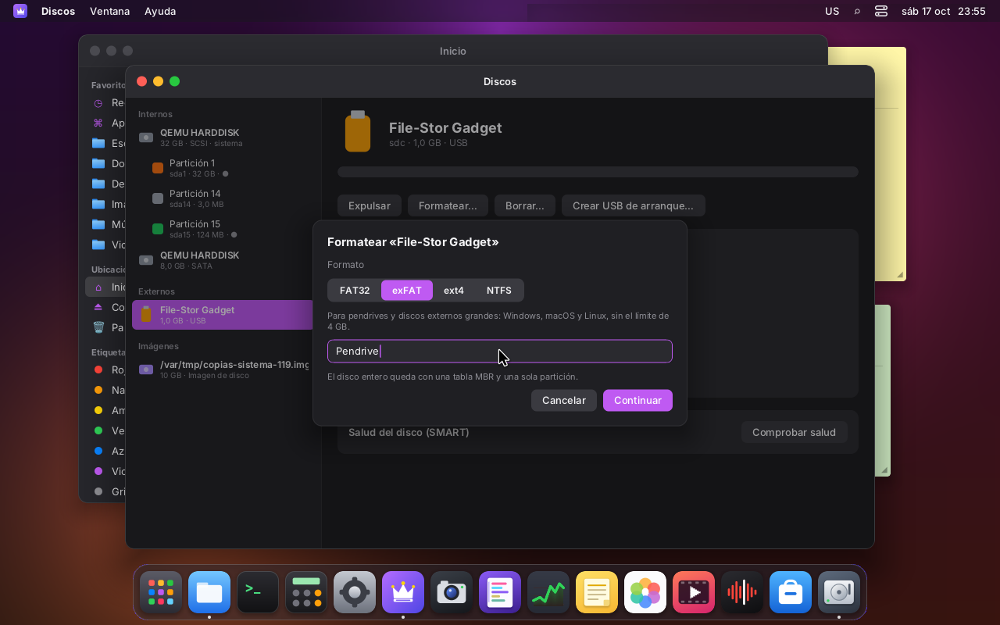 |  |
| Format: FAT32, exFAT, ext4 or NTFS (if `mkfs.ntfs` is present), with the label | The confirmation says what gets erased and asks to type the disk name |
|  |  |
| Create a bootable USB: copying, with "Cancel" | Copied and verified (SHA-256 by reading the disk back); the image's partition shows up on its own |

### How it is built

| Piece | What it does |
|---|---|
| `server/src/disk/disk.c` | The list, without root, from three sources. **`/sys/block`:** size, removable, read-only, rotational, model. **The udev database** (`/run/udev/data/b<major>:<minor>`): file system, label, UUID, partition table and bus; udev already probed them, so the device is never opened. **`/proc/self/mountinfo`:** where each one is mounted. It also recognizes the system disk and watches for changes. |
| `server/src/disk/smart.c` | ATA SMART and NVMe health log parsers: pure functions, no I/O |
| `server/src/disk/disk_admin.c` | The helper's `disk-*` actions (root) |
| `server/src/disk/smartctl_admin.c`, `smartctl.c` | The helper's `smart-*` actions (smartmontools, root) and their pure checks |
| `sdk/smart.js`, `sdk/smartparse.js` | `smart.info/health/test/abort/install`, the summaries the Monitor shows, and smartctl's JSON turned into one model |
| `server/src/ui/js_disk.c`, `sdk/disks.js` | `lord.disks.list()`, `tools()`, `watch(on)`; in the SDK, `useDisks()` and `disks` |
| `apps/disks/` | The app: `index.jsx`, `health.jsx` (SMART), `dialogs.jsx` (format, rename, erase, bootable USB), `icons.jsx` |

**Notifications without polling.** While the app is open (`useDisks`), `lord.disks.watch(true)`
opens an epoll with two things. That single fd goes into the `lord-server` main loop (`main.c`),
and JS gets `__lordDisks('change')`, coalesced into one every 150 ms. Closing the app closes
everything.

- `/proc/self/mountinfo`, which signals `POLLPRI` when mounts change.
- A `NETLINK_KOBJECT_UEVENT` socket on the udev group (2). When the event arrives, udev has
  already finished updating its database.

`mountinfo` has a catch: its event is consumed by polling it, and the main loop's `poll` on the
epoll already consumes it, so `epoll_wait` afterwards does not report it. So on every event a
fingerprint of the mountinfo content (a few KB) is compared with the previous one.

### Actions (`admin.run('disk-…', arg)`)

All are in the closed table of `admin.c` (macro `DISK_ADMIN_ACTIONS` in `disk/disk.h`).

| Action | Argument | What it does |
|---|---|---|
| `disk-smart` | `disk` | Reads health. `LOG smart {…}` (summary), one `LOG attr {…}` per ATA attribute and `OK <ms>` |
| `disk-mount` | `device` | Mounts at `/media/<user>/<label>` with `mount(2)`: `nosuid,nodev`, and on FAT, exFAT and NTFS (`ntfs3`) with the user's `uid=`/`gid=`. ISO 9660 and UDF are read-only. `OK <folder>` |
| `disk-unmount` | `device` or `disk` | Unmounts whatever is under `/media` or `/run/media` (`umount2`) and removes the empty folder |
| `disk-eject` | `disk` | Unmounts everything, flushes caches (`BLKFLSBUF`) and sends `START STOP UNIT` (eject). Over USB it also powers the device off (`/sys/block/<d>/device/delete`), like "Power Off" in GNOME Disks |
| `disk-format` | `device\nfat32\|exfat\|ext4\|ntfs\nlabel` | **Whole disk:** wipes the signatures (first and last MiB) and writes our own MBR table with one partition from 1 MiB. A `loop` image without `partscan` gets it turned on. Then the fixed-path `mkfs` runs. On ext4 the root belongs to the user (`-E root_owner=uid:gid`) |
| `disk-label` | `partition\nlabel` | `fatlabel`, `exfatlabel`, `e2label` or `ntfslabel`. FAT, exFAT and NTFS must be unmounted |
| `disk-erase` | `device\nquick\|zero` | `quick`: wipes the signatures (first and last MiB) and rereads the table. `zero`: writes zeros everywhere, with progress, cancellable |
| `disk-write-image` | `disk\npath` | Copies an ISO/IMG image to the whole disk and verifies it |
| `disk-cancel` | `disk` | Stops a `zero` erase or a copy in progress. Only whoever started it, or an administrator |
| `smart-info` | `disk` | (0.8.2) `smartctl -j -x`: the full report. Anyone |
| `smart-health` | `disk` | (0.8.2) `smartctl -j -n standby -i -H -A -c -l selftest`: the summary, without waking a resting disk. Anyone |
| `smart-test` | `disk\nshort\|long` | (0.8.2) `smartctl -j -t short\|long`: starts a self-test. Internal disks: an administrator; removable: any session user |
| `smart-abort` | `disk` | (0.8.2) `smartctl -j -X`: stops a running self-test. Same rule as `smart-test` |

Long actions send `LOG progress phase=<table|mkfs|erase|write|verify> done=<n> total=<n>`, which
the app shows as a bar.

Since 0.8.5 Files' sidebar lists every disk too and uses the same actions:
`disk-mount` when an unmounted one is clicked (an internal disk asks for an administrator, as here),
and `disk-eject` or `disk-unmount` from its ⏏ (`FILES.md`).

### Security

- **The same rules for all of them, on the root side (`target()` in `disk_admin.c`):**
  - the name must be a real block device (`sd*`, `vd*`, `hd*`, `xvd*`, `nvme*`, `mmcblk*`,
    `loop*`, lowercase letters and digits only);
  - `/dev/<name>` is checked with `lstat`: a block device with the same major:minor as sysfs;
  - a "whole disk" action refuses partitions, and vice versa.
- **The system disk is never touched** (`disk_is_system`). It is the disk of any partition that
  holds `/`, `/usr`, `/var`, `/home`, `/boot`, `/boot/efi`, `/efi`, the live medium
  (`/run/live/medium`…) or an active swap. For a dm/md (LVM, LUKS, RAID), `slaves/` is followed
  down to the real disks. Only `disk-smart` and the `smart-*` actions accept it: they only read,
  or start the disk's own self-test, which does not change data.
- **Who can:**
  - internal disks, only an administrator (groups `sudo`, `admin` or `wheel`);
  - removable ones (USB, `removable=1`, `mmc` cards), any session user, like udisks with active
    sessions;
  - reading SMART, anyone.
- **Only `/media` and `/run/media` are unmounted.** If something is mounted elsewhere, the action
  refuses. Format, erase and the image copy open the device with `O_EXCL`: if it is still in use
  (mounted or opened by another program), the kernel answers `EBUSY` and nothing is done.
  `disk-eject` does not eject with an erase or a copy in progress either.
- **Fixed-path programs, no shell:**
  - `/usr/sbin/mkfs.fat`, `/usr/sbin/mkfs.exfat`, `/usr/sbin/mkfs.ext4` and `/usr/sbin/mkfs.ntfs`;
  - `/usr/sbin/fatlabel`, `/usr/sbin/exfatlabel`, `/usr/sbin/e2label` and `/usr/sbin/ntfslabel`;
  - `/usr/bin/udevadm settle`.

  Labels are validated per format and cannot start with `-`:
  - FAT32: up to 11 characters, `A-Z 0-9 space _ -`, uppercased;
  - exFAT: up to 15;
  - ext4: up to 16 bytes;
  - NTFS: up to 32;
  - in all of them, no control characters and none of `/ \ : * ? " < > |`.

  Mount, unmount, partition, erase, copy and eject are system calls: no program is launched.
- **The image is read with the user's permissions.**
  - The helper does `setfsuid`/`setfsgid` to the user before `realpath` and `open`
    (`O_NOFOLLOW`). Root reads nothing the user could not read.
  - It only accepts regular files from the home folder, `/media/<user>` or `/run/media/<user>`. A
    link to `/etc/shadow` or a `..` is refused (tested).
  - It also refuses an image stored on the disk that is about to be written.
- **Verification.**
  - The SHA-256 (`pkg/crypto.c`) is computed while copying, with `O_DIRECT`, followed by `fsync`.
  - Then the cache is dropped (`BLKFLSBUF`), the disk is read back with `O_DIRECT` and compared.
  - The result includes the hash, to compare with the one the distribution publishes.
- **Keeping the desktop smooth:** zero erase and image copy lower their priority (`nice 10` and
  best-effort `ioprio` 7). The copy uses `O_DIRECT` so it does not fill the page cache with dirty
  pages. The erase calls `fdatasync` every half second.
- **Cancelling.** The job leaves `/run/lordos/disk-<disk>.job` with its pid and uid.
  `disk-cancel` checks that the pid is a `lord-admin` (not a recycled pid) and that the request
  comes from the same user or an administrator.
- **The app's confirmation:** everything that erases (format, erase, bootable USB) ends in the same
  step.
  - It says exactly what is lost: disk, model and size, and each partition with its name, label,
    file system, size, mount point and how much data it holds.
  - For a whole disk you have to type its name (`sdc`).
  - The red button does nothing until it matches.
  - Either way, the real validation is the one on the root side.

### SMART: our own reader over ioctl (not smartctl)

We chose to read it with our own code:

- **No dependencies or external programs.** The dependency policy asks not to add programs when
  avoidable, and `smartmontools` (`smartctl`) would bring another root binary with its drive
  database.
- **What is needed is small:** three commands and two well-defined 512-byte formats.
- **The parsing stays in pure functions with their own test:** the data the disk sends is
  outside data.

| Disk | How it is read (in the helper, root) |
|---|---|
| SATA / ATA (`sd*`, `hd*`) | `SG_IO` with **ATA PASS-THROUGH (16)** (`0x85`). Three commands: **SMART READ DATA** (`B0h/D0h`, PIO data-in, 1 sector); **READ THRESHOLDS** (`D1h`); **RETURN STATUS** (`DAh`, non-data, with `ck_cond`). The last one is read from the "ATA Status Return" descriptor (`09h`) of the sense data: LBA mid/high `4Fh/C2h` = good, `F4h/2Ch` = threshold exceeded |
| NVMe (`nvme*`) | `NVME_IOCTL_ADMIN_CMD`: Get Log Page `02h` (SMART / Health Information), 512 bytes |

The parsing (`smart.c`, tested in `tests/smart_test.c`):

- **ATA:**
  - the 30 attributes of 12 bytes, with their 48-bit raw value and their threshold;
  - the checksum;
  - temperature (194, or 190 if missing), hours (9), power cycles (12), reallocated (5), pending
    (197) and uncorrectable (198).
- **ATA health:**
  - **failing** if RETURN STATUS says threshold exceeded, or if a *pre-fail* attribute is at or
    below its threshold;
  - **warning** if there are reallocated, pending or uncorrectable sectors, or if the checksum
    does not add up;
  - otherwise **good**.

  An "old-age" (non-pre-fail) attribute below its threshold is shown in red but does not make it
  fail.
- **NVMe:**
  - reads critical warning, temperature (kelvin → °C), spare and its threshold, % life used, data
    read and written (units of 512 000 bytes), cycles, hours, unsafe shutdowns and media errors;
  - counters are 128-bit: if they don't fit in 64, they saturate;
  - **failing** with the spare, reliability or read-only bits;
  - **warning** with the temperature bit, more than 100 % life used, spare below its threshold or
    media errors.

**Only on request.** The "Check health" button reads once and the result stays in memory while
the app is open. It is never read in the background: a sleeping disk is not woken up and nothing
stalls.

Over USB, many adapters don't pass ATA PASS-THROUGH, and the app explains that. Virtual disks
(virtio, loop) have no SMART.

### SMART with smartmontools (0.8.2)

| | |
|---|---|
| 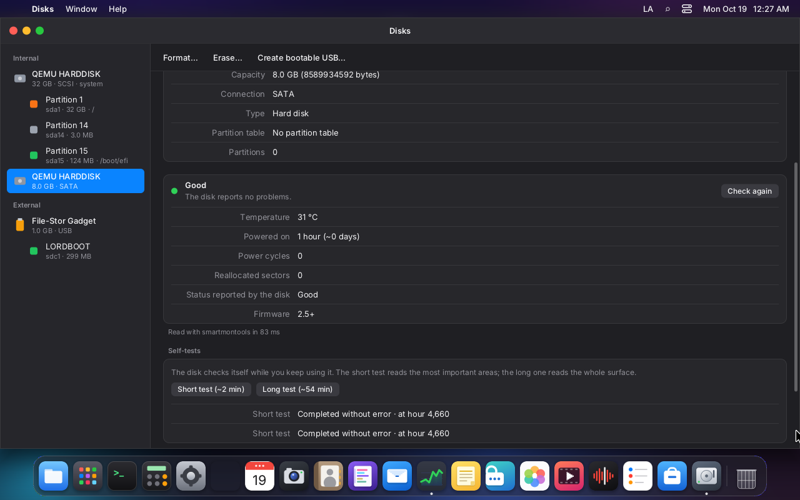 | 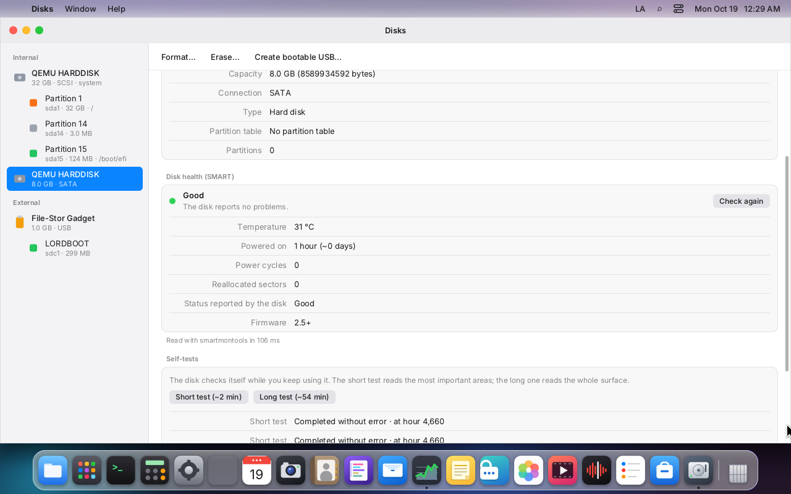 |
| The full report through smartmontools, dark | The same, light |
| 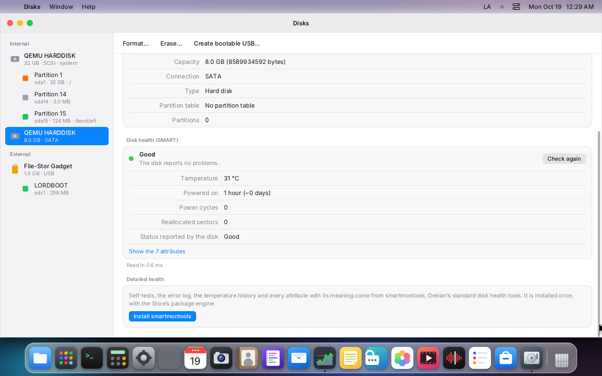 | 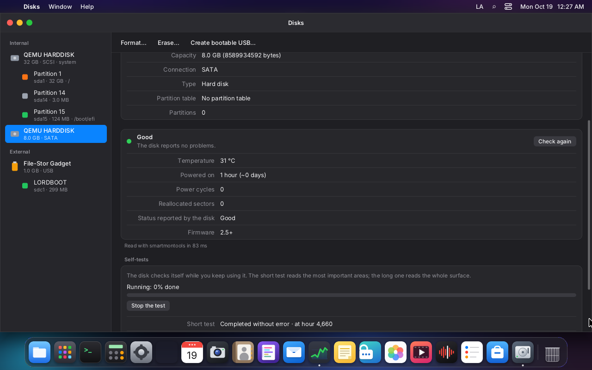 |
| First use: "Install smartmontools" (an administrator) | A short self-test running, with its progress |

Our own reader (above) stays: it needs nothing installed and gives the basic health. The rest — the
self-tests, the error log, the SCT temperature history, the drive database that names each
vendor's attributes, USB bridges — is what Debian's **smartmontools** (`smartctl`) already does well,
so 0.8.2 uses it instead of growing our own:

- **Installed on first use.** If `/usr/sbin/smartctl` is missing (`lord.disks.tools().smartctl`),
  the card offers **Install smartmontools**, which goes through the Store's package engine
  (`admin.run('pkg-install', 'smartmontools')`, fetching the package lists first if there are none),
  exactly like Settings → Sharing installs the SSH server. Only an administrator can. Once installed,
  the full report is read right away.
- **Four closed actions** in the root helper (`server/src/disk/smartctl_admin.c`, table above).
  - The disk name must be a whole disk smartctl understands: `sd<letters>`, `hd<letters>` or
    `nvme<N>n<M>` (`smartctl_valid_disk`). Partitions, `loop`, `dm-*`, `md*`, `zram*`, `mmcblk*`,
    `sr*` and anything with a path character are refused before anything runs.
  - Then the same `target()` check as the `disk-*` actions: it exists in sysfs, it is not a
    partition, and `/dev/<disk>` is a block device (`lstat`) with the same major:minor.
  - One program at a fixed path, `/usr/sbin/smartctl`, with an argument list built in C; the only
    variable parts are the validated `/dev/<disk>` and `short`/`long`. No shell, no generic runner,
    no options from the app.
  - A USB disk whose bridge smartctl does not know ("Unknown USB bridge") is retried once with
    `-d sat`.
  - The JSON (`-j`) is compacted (whitespace outside strings dropped, `smartctl_compact`) and sent as
    `LOG` lines of at most 900 bytes cut on UTF-8 boundaries, like `proc-info`; `OK <lines> <exit
    status>` ends it (smartctl's exit status is a bit mask the app reads: bit 3 is "disk failing").
    Output is capped at 1 MiB.
- **Parsing in the session**, not as root: `sdk/smartparse.js` turns smartctl's JSON into one model
  (every number checked, every string cut and only shown as text):
  - overall health and why, in plain words: **Failing** if the disk says so (overall status, a
    pre-fail attribute below its threshold now, NVMe "reliability degraded" or "read-only"); **Check**
    (shown as "With warnings") with reallocated, pending or uncorrectable sectors, grown defects, NVMe
    spare below its threshold, temperature or backup warnings, media errors, a pre-fail attribute
    that failed in the past, or more than 90 % of the rated life used. A device that says it has no
    SMART gets no verdict;
  - temperature and the drive's limits, power-on hours, power cycles, data read and written;
  - **SSD wear** (% of the rated life used): the NVMe health log, the ATA device statistics
    ("Percentage Used Endurance Indicator"), or attributes 231/233/202/177 counting down from 100;
  - every attribute with a plain name (by smartctl's attribute name, not by id: vendors reuse ids
    and smartctl's drive database already knows them), with smartctl's own name under it;
  - for NVMe, the whole health log (spare, % used, data units, commands, busy time, unsafe
    shutdowns, media errors, time above the warning and critical temperatures);
  - the error log (NVMe drives also log harmless events, so its count does not change the health),
    the SCT temperature history (ATA) as a small bar chart, and the self-test log;
  - **self-tests**: Short and Long buttons with the drive's own estimate in minutes; while one runs,
    `smart-health` every 15 s gives the progress (ATA: "remaining percent"; NVMe: "completion
    percent"), with **Stop the test**; when it ends, the full report is read again.
- The result also updates the Monitor's cached summary (see `MONITOR.md`).
- **Tests:** `tests/smart_parse_test.mjs` (92 checks, in `make test` when node is there) with real
  smartctl 7.4 output captured on VM 119 (`tests/smart/`: a QEMU SATA disk before and after two
  self-tests, the health command, a virtio-scsi disk, a USB gadget with an unknown bridge and the
  `-d sat` retry, a started test) and, in the same schema with edited values, a worn SSD, a failing
  disk, a running self-test, a disk in standby and NVMe drives (healthy, and failing with a test
  running). `build/smartctl-test` checks the names (48 cases) and the compaction.

**smartd:** the package also brings Debian's `smartd` monitoring daemon. Its maintainer script
enables `smartmontools.service`, which starts at the next boot (on VM 119 it was enabled but not
started right after the install). Debian's default configuration checks each disk every 30
minutes with `-n standby` (a resting disk is not woken) and mails root, which goes nowhere on a
desktop. LordOS's own notices (`MONITOR.md`) don't need it, so since 0.8.3 it stays off: the
`lordos` package ships `/usr/lib/systemd/system/smartmontools.service.d/lordos.conf` with
`ConditionPathExists=/etc/lordos/smartd-enabled`, and migration `004-0.8.3-smartd-off.sh` stops a
smartd already running from an earlier install. An administrator who wants it creates that file
and runs `systemctl start smartmontools`.

### Measured on VM 119

| | |
|---|---|
| Reading SMART (QEMU SATA, ATA PASS-THROUGH: 3 commands) | **0.4–0.6 ms** in the helper (`OK <ms>`); with the round trip through the helper, less than a frame |
| `lord.disks.list()` (4 disks, 5 partitions) | ~3 ms (100 lists in 0.58 s including the test process start; the start alone, 1.3 ms) |
| Change notifications with the app closed | no fd and no timer |
| 300 MB image to an emulated USB stick (`dummy_hcd` + `g_mass_storage`) | 4.8–5.6 s writing (56–65 MB/s, with SHA-256 on the fly), plus the verification; 10.3 s in total |
| Our own SHA-256 | ~150 MB/s (4.1 s of CPU for 2 × 300 MB) |

### How to test it

```sh
make -C server build/smart-test && ./server/build/smart-test   # `make -C server test` runs it too
make -C server build/disk-cli
./server/build/disk-cli list                         # the same as lord.disks.list()
sudo ./server/build/disk-cli -u lord -n disk-format 'sdc\nexfat\nPendrive'   # -n: as a non-administrator
```

`disk-cli` runs the actions with an `admin_say` that prints. It is for manual testing: it needs
root and real devices, so it is not in `make test`.

Tested on VM 119:

- **A USB stick that is real for the kernel**, built with `modprobe dummy_hcd` and
  `modprobe g_mass_storage file=/var/tmp/usb-disk-sistema-119.img removable=1`
  (`sdc`, `TRAN usb`, `RM 1`), as a non-administrator user:
  - format the whole disk as FAT32, exFAT (label with a space and ñ), ext4 (the root belongs to
    the user) and NTFS;
  - mount and write on all four;
  - mounting twice (refused);
  - renaming while mounted (refused on FAT) and unmounted;
  - quick erase, and zero erase with cancellation (refused for another user);
  - eject with an erase in progress (refused) and without one (the device disappears);
  - create the bootable USB from `~/Descargas`: the SHA-256 matches `sha256sum` of the image and
    of the disk, and the image's partition table shows up;
  - the refused images: `/etc/shadow`, `../../etc/passwd`, a link to `/etc/shadow`, an image
    inside the same stick, a partition as target and the system disk.
- **The SATA test disk** (`sdb`, 8 GB, added as `sata1` in Proxmox; QEMU with AHCI answers ATA
  SMART):
  - SMART: 7 attributes and RETURN STATUS "good";
  - as a non-administrator, format and erase are refused.
- **The system disk** (`sda`, virtio-scsi):
  - format, erase or unmount are refused, also as administrator;
  - SMART answers "this disk does not report SMART", because QEMU's `scsi-hd` does not do ATA
    PASS-THROUGH.

### Packages

| Package | For | In the ISO |
|---|---|---|
| `dosfstools` | FAT32 (`mkfs.fat`, `fatlabel`) | already there (the installer uses `mkfs.vfat` for the EFI partition) |
| `exfatprogs` | exFAT (`mkfs.exfat`, `exfatlabel`) | added to the ISO list |
| `e2fsprogs` | ext4 (`mkfs.ext4`, `e2label`) | already in Debian base |
| `ntfs-3g` | NTFS (`mkfs.ntfs`, `ntfslabel`) | optional: without it, the app does not offer NTFS |
| `smartmontools` | the full SMART report and self-tests (`smartctl`) | no: installed from the app the first time (0.8.2) |

Mounting needs no package: `vfat`, `exfat`, `ntfs3`, `ext4` and `iso9660` are Debian kernel
modules.

### Pending

- **Disks over 2 TiB:** our table is MBR. GPT has to be written (with its CRC32 and the backup
  at the end).
- **Manual partitioning:** create, delete and resize partitions. Today the whole disk is
  formatted with one partition, or an existing partition without changing its type in the table.
- **LUKS, LVM and RAID:**
  - their disks are shown, and protected if the system sits on them;
  - they are not unlocked or assembled from the app.
- **Test NVMe with a real disk.** The parser has a test, but the VM has no NVMe: Proxmox does not
  offer it without `args`. SMART over a USB adapter that passes it through (SAT) was not tested
  either.
- **SMART on real hardware** (0.8.2): the smartctl path is tested on VM 119 (QEMU SATA, virtio-scsi,
  a USB gadget). A real NVMe drive, a real SATA SSD and HDD, a self-test that takes minutes and a USB
  enclosure that passes SAT through are still to be checked. Health history over time is not kept.
- **Pick the image with the system file picker:** today there is a list of the `.iso`/`.img` files
  in the home folder and a field for the path.

## Backups (`apps/backup`)

Scheduled backups of the home folder to an external disk or a folder. The
engine is our own code (no rsync) and runs **as the user**, inside `lord-server`: backing up the
home folder needs no root, so no new action was added to `admin.c`.

| | |
|---|---|
| 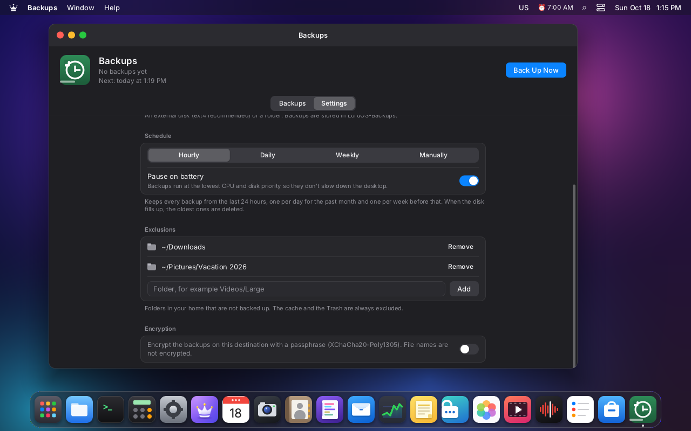 | 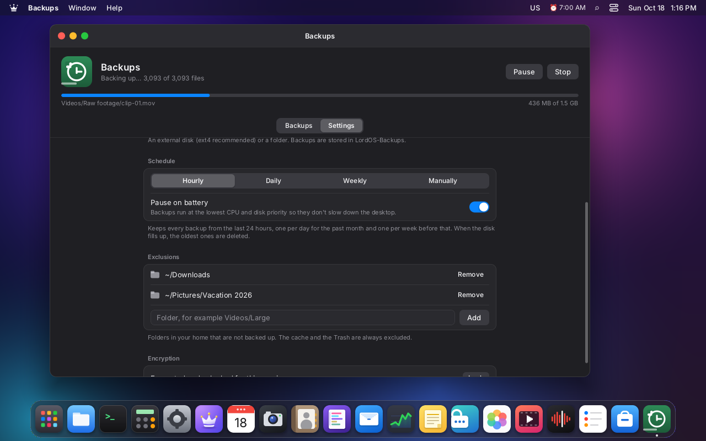 |
| Settings: destination (the user's mounted disks or a folder), schedule, battery and exclusions | "Back Up Now": progress by files and bytes, with Pause and Stop |
| 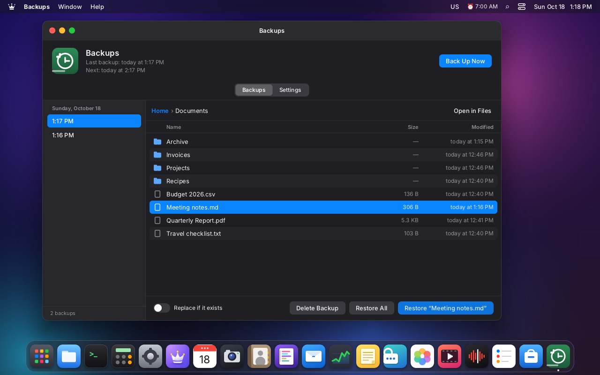 | 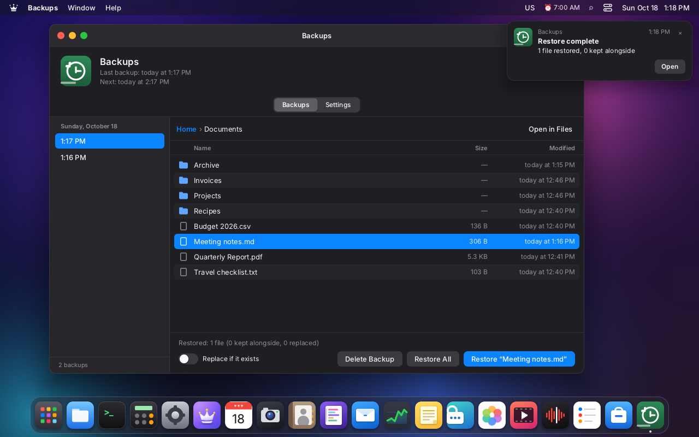 |
| Backups by date and the tree of each one | Restoring a deleted file: session notification when done |
|  | 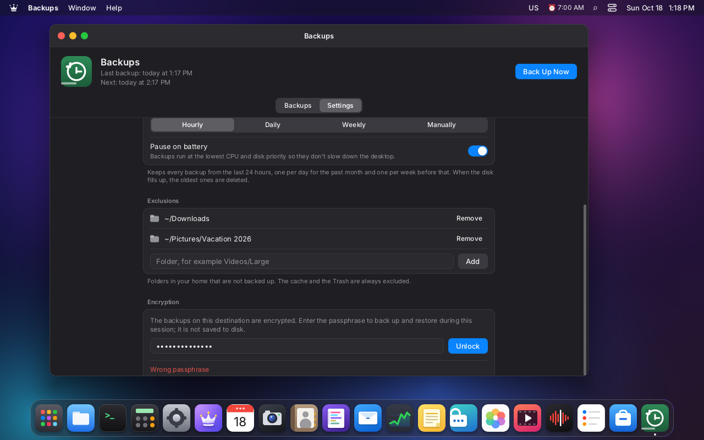 |
| Turning on encryption for a new destination | Encrypted and locked destination: a wrong passphrase is rejected |


### On-disk layout

```
<destination>/LordOS-Backups/<host>-<user>/
├── 2026-10-17-235656/        a snapshot: the whole home folder, as it was
├── 2026-10-18-001432/        what did not change is a hard link to the previous one
├── .inprogress-<stamp>/      the run in progress (renamed when it finishes)
└── encryption.json           only if the destination is encrypted: salt and key check
```

- **Hard-linked snapshots** (`server/src/backup/engine.c`): a file with the same size,
  modification time and mode as in the previous snapshot is hard-linked (`link`); otherwise it is
  copied (`copy_file_range`, or `read`/`write` across filesystems). Every snapshot looks complete
  (it can be opened in Files) but only takes the space of what changed. On FAT/exFAT (no hard
  links) every backup takes full space; the app warns about it next to the disk.
- **Atomic:** a run writes to `.inprogress-<stamp>` and renames it at the end, after `syncfs`.
  Each file is first written to `<name>.bkpart~` and renamed, so a final name is always a complete
  file.
- **Interrupted runs** (power off, unplugged disk, "Stop"): the next run uses the leftover
  `.inprogress` as another link source (what was already copied is not copied again) and then
  deletes it. A file that changes while being copied is copied again (up to 3 times).
- **Symbolic links** are stored as links (their text) and never followed. The walk uses `lstat`
  and opens with `O_NOFOLLOW`; it does not cross into other filesystems (a disk mounted inside the
  home folder) and skips fifos, sockets and devices.
- **Exclusions:** always `.cache`, `.local/share/Trash`, `.local/share/lordos/apps`,
  `.local/share/lordos/trash` and `.thumbnails`; the `LordOS-Backups` folder itself when the
  destination is inside the home folder (by device and inode); and the folders the user adds
  (validated relative paths: no `..`, leading `/` or control characters).

### Retention

`bk_retention` is a pure function (tested with made-up dates):

- every snapshot from the last 24 hours;
- the newest of each day up to 30 days;
- the newest of each week (Monday to Sunday, local time) after that;
- the newest snapshot always stays.

When space runs low (less than 512 MiB free before starting, or `ENOSPC` while copying), the
oldest snapshots are deleted, never the newest, and the copy is retried. Deleting a snapshot first
renames it to `.deleting-<id>` (it leaves the list at once) and then removes it; only inside the
machine folder and with validated names (`YYYY-MM-DD-HHMMSS`).

### Restore

In the **Backups** tab: snapshots by day, the tree of each one (with real sizes), and
**Restore "file"**, **Restore This Folder** or **Restore All** (with confirmation).

- **Nothing is overwritten by accident:** if the current file differs, the backed-up one is saved
  next to it as "name (restored).ext" (then "… 2", "… 3"; the suffix is translated). With
  "Replace if it exists" it is replaced (written to a temporary file and renamed). If it is
  identical, nothing happens.
- **The same rules as `lord.fs`:** it only writes in the home folder and the user's disks
  (`fsops_allowed`, on the resolved folder), never in protected places (`fsops_protected`:
  `~/.local/share/applications`, `~/.config/autostart`, `~/.local/share/lordos/apps`,
  `settings.json`, `permisos.json`, `backup.json`, and also `firewall.json`, the blocklists, the
  Mail accounts and cache and the Passwords vaults, the whole list in `server/src/fsops.c`). A `.desktop` file planted in a backup is not
  restored, not even through a link in the home folder that points to a protected folder.
- **No escapes through the backup:** the requested path is validated (`bk_rel_valid`) and its
  resolved folder must stay inside the snapshot.
- **Restore All** brings the home folder back as it was that day; whatever changed since then is
  kept alongside (or replaced). Newer files are not deleted.
- "Open in Files" shows the snapshot in Files (it is a regular folder).

### Scheduling, priority and battery (`server/src/backup/backup.c`)

- **A `lord-server` thread**, not a separate process, so no new way to run programs is added. The
  thread sets **nice 19** (`setpriority` on its own tid) and **idle I/O** (`ioprio_set`, class 3)
  and blocks all signals. What it copies is dropped from the page cache
  (`posix_fadvise(DONTNEED)`), so it does not evict what the desktop uses.
- **No polling:** the thread sleeps in `pthread_cond_timedwait` until the next backup (newest
  snapshot + interval). The first scheduled backup waits 5 minutes after the session starts;
  after an error, 15; if the disk is missing, it checks again every 5 minutes.
- **Battery:** with "Pause on battery" (on by default), if a battery is discharging and no power
  source is connected (`/sys/class/power_supply`), the backup does not start, or pauses between
  files, and checks again every 60 s. While copying, the battery is read every 2 s.
- **The status is pushed to JS:** an `eventfd` in the main loop (`backup_fd`/`backup_dispatch`)
  calls `__lordBackup(status)` when something changes (at most twice a second with progress). The
  app never polls.
- **Notifications** (`sdk/notify.js`), even with the app closed: when a backup fails; when a "Back
  Up Now" run succeeds; when a restore finishes; and once per session when backups are encrypted
  and locked.
- **Configuration:** `~/.config/lordos/backup.json` (`dest`, `interval`:
  `hourly|daily|weekly|manual`, `pauseOnBattery`, `encrypt`, `exclude`). Only
  `lord.backup.configure` writes it, and it validates the destination (real path, inside the
  `lord.fs` roots, writable). It is on the `fsops_protected` list: it decides where the data goes,
  so an app cannot change it with `lord.fs.write`.
- Errors that reach the UI as codes (`wrong-passphrase`, `not-encrypted`, `plain-backups-exist`,
  `setup-failed`, `no-destination`, `locked`, `interrupted`) are translated by the app
  (`backup.err.*`); other engine messages are in English.

### Encryption (optional)

With Monocypher 4.0.2 (vendored in `third_party/monocypher`, the same copy Passwords uses; see
`server/src/backup/crypt.c`):

- **Per file:** `LBK1` + a 24-byte nonce + 64 KiB chunks of XChaCha20-Poly1305. Each chunk's nonce
  carries its number and the associated data says whether it is the last one: chunks cannot be
  changed, reordered, removed or truncated without failing verification. Restore writes to a
  temporary file and discards it if anything fails to verify.
- **The key** is derived from the passphrase with Argon2id (64 MiB, 3 passes, a 16-byte salt per
  destination). `encryption.json` stores the salt and a key check (BLAKE2b keyed with the key),
  never the key.
- **Memory only:** the key lives in the session process (`mlock`) and never on disk. At login,
  encrypted backups are **locked**: the passphrase has to be entered in Settings (a notification
  reminds the user). Argon2 runs in the backup thread, never in the compositor.
- **Hard links still work:** an encrypted file's size is computed from the original's, so
  unchanged files are still linked.
- **Not encrypted:** file and folder names, symlink targets, approximate sizes and dates.
- It can only be turned on for a destination without backups (encrypted and unencrypted backups
  are never mixed). If the passphrase is lost, the backups cannot be recovered.
- **Pending:** storing the passphrase in the session keyring (Passwords) so scheduled backups do
  not wait for the user to type it.

### API (`lord.backup`, `server/src/ui/js_backup.c`; in the SDK, `backup` and `useBackup()`)

| Call | |
|---|---|
| `status()` / `useBackup()` | `{ state: idle\|running\|paused\|nodest\|restoring\|deleting\|locked\|unlocking, battery, userPause, dest, destAvailable, destFree, next, lastOk, progress: { files, totalFiles, bytes, totalBytes, file }, last: { ok, files, copied, linked, bytes, errors, secs, error }, restore: {…}, encrypted, destEncrypted, locked, unlock: {…} }` |
| `config()` / `configure(obj)` | read and save the configuration (validated in C) |
| `runNow()`, `pause(on)`, `cancel()` | |
| `list()` | `[{ id, time }]` |
| `ls(id, rel)` | `[{ name, dir, link, size, mtime }]` (sizes already decrypted) |
| `restore(id, rel, { replace, suffix, to })` | empty `rel`: everything |
| `remove(id)`, `path(id)` | delete a snapshot; its real path for Files |
| `unlock(passphrase, create)`, `lock()` | encryption |

### Tests and measurements

`make -C server test` → `build/backup-test` (`server/tests/backup_test.c`), **220 checks**:
snapshot, exclusions, fifo, symlinks stored as links, the destination inside the home folder, hard
links (same inode), a run interrupted in the middle of a 40 MB file and resumed (already copied
files are linked, no leftovers), restore (keep both, numbering, replace, creating folders, a
planted `.desktop`, `settings.json`, escapes through a link in the backup and in the home folder,
`..`, a destination outside the roots), pruning for space, retention over 90 days of hourly
backups, and encryption (sizes, round trips from 0 B to 1 MiB, a tampered byte, missing chunks,
the wrong key, a wrong passphrase, an encrypted snapshot with hard links, and a restore that
discards a tampered backup).

Measured on VM 119 (4 vCPU Xeon Silver 4108, virtio disk on SSD), backing up the home folder
(3.8 GB, 13,436 files) to an ext4 image on a loop device:

| | |
|---|---|
| First full backup | 24 s; the thread used 0.3 s of user CPU and 8 s of system CPU (≈34 % of one core) |
| Next backup with no changes | 1.0 s (13,403 linked, 29 copied) |
| After changing 1.8 GB | 12.8 s (42 copied, 14,372 linked) |
| First encrypted backup (1.8 GB, 10,704 files) | 18.3 s |
| Wakeup latency of a thread every 10 ms during the backup | p50 0.1 ms, p99 0.2–2 ms (no backup: p99 0.26 ms) |
| Cold 64 KiB read during the backup, with `mq-deadline` | p95 59–75 ms at idle priority, 121 ms without it |
| Same with the `none` scheduler (the VM's) | p95 44–70 ms at idle, 61–74 ms without: `none` ignores priorities |

`ioprio` only has an effect with a scheduler that honours it (`mq-deadline`, BFQ); with `none`
(NVMe and the VM, by default) what protects the desktop is nice 19, dropping the page cache and
the thread not competing with the compositor for CPU (wakeup p99 of 2 ms at most). Setting
`LORD_BACKUP_NOPRIO=1` in the session environment turns off nice and ioprio, for measuring only.

### Pending

- Test "Pause on battery" on a laptop (the VM has no battery).
- Notice when the backup disk is plugged in (today it checks again every 5 minutes).
- Store the encryption passphrase in the session keyring.
- File versions (every backup of one file, browsable in Backups).
- RTL was reviewed in code (rows the engine mirrors, text with `start`/`end`, the progress bar in
  `ltr`); there is no Arabic screenshot.

## Logs (`apps/logs`)

LordOS's log viewer.

- **Sources** (sidebar):
  - **My logs:** the user's own systemd journal (`user-<uid>.journal` and its archived files);
  - **System:** the system journal. If the user can read it directly (group `systemd-journal` or
    `adm`) it is read like the user's own; otherwise an administrator gets it through the closed
    action `logs-system`; anyone else is told it needs an administrator;
  - **Kernel:** the kernel's messages (`_TRANSPORT=kernel`) from the readable journal;
  - **LordOS:** the session's own logs, `~/.cache/lordos/<name>.log` (`session.log`,
    `greeter.log`…).
- **Filters:** level (all, info and above, warnings and above, errors), time range (15 min, 1 hour,
  24 h, everything), process or unit (`[A-Za-z0-9@._:-]`, the same check as the C side), and free-text
  search in the message.
- **Live:** follows new entries as they arrive (see below) and keeps the view pinned to the bottom
  until the user scrolls up.
- **Detail:** the selected entry with its time, level, process, PID, UID, unit and boot id.
- **Export:** the filtered view as text, to the user's Documents folder (`userDirs()`, so
  `~/Documentos` in Spanish) through `fs.write`.
- A virtualized list (only the visible rows are drawn); at most 3000 entries per query and
  10,000 kept while following (older ones are dropped). The status bar shows counts and query time.

### Our own journal reader (`server/src/logs/journal.c`)

No libsystemd and no `journalctl`. The files are read with `pread` and a small block cache, never
`mmap`: journald can shrink or rewrite a file and `mmap` would turn that into `SIGBUS` inside
lord-server.

- **Format:** header `LPKSHHRH`, the entry-array chain, ENTRY and DATA objects, in both the regular
  and the **compact** layout (Debian 13's systemd 257 writes compact files). Fields used: `MESSAGE`,
  `PRIORITY`, `SYSLOG_IDENTIFIER`, `_COMM`, `_PID`, `_UID`, `_SYSTEMD_UNIT`, `_SYSTEMD_USER_UNIT`,
  `_BOOT_ID`, `_TRANSPORT`; the time comes from the entry header.
- **Compression:** XZ through our own decoder (`server/src/pkg/xz.c`) and LZ4 with a small block
  decoder of its own. **ZSTD is not decoded yet:** those fields show as `[zstd-compressed]`. journald
  compresses only fields over 512 bytes, so it is rare (8 of 39,504 entries on VM 119).
- **Hostile input:** every offset and size is checked against the file size, the entry-array chain
  must always move forward (no loops), and sizes are capped (1 MiB per object, 16 KiB per message).
- **Several files:** active and archived (`*.journal~`, `@…`) files from `/var/log/journal` and
  `/run/log/journal`, merged by time.

### Permissions

- **The user's own logs** are read by lord-server **as the user**: the kernel and journald's ACLs
  decide. `user-<uid>.journal` is readable by its owner; the system journal only by
  `systemd-journal`/`adm`.
- **System logs for administrators** go through `logs-system` (`server/src/logs/logs_admin.c`,
  `LOGS_ADMIN_ACTIONS`, administrators only, `A_FORK`):
  - the argument is `key=value` lines validated as root (`jq_parse`): `since`/`until` (seconds or
    µs), `prio` 0–7, `kernel` 0/1, `match` (`[A-Za-z0-9@._:-]`, up to 95), `grep` (no control
    characters), `limit` 1–5000;
  - the paths don't come from the user: `/var/log/journal/<machine-id>/system*.journal*`;
  - it runs no program; it streams one JSON `LOG` line per entry and `OK <n>`.
- `lord.logs.tail(name)` only reads `~/.cache/lordos/<name>.log` with a validated name.

### Live follow without polling

`lord.logs.follow(true)` adds inotify watches on the journal directories and `~/.cache/lordos`.
Queries run in a lord-server thread; the thread and inotify share one epoll fd in the main loop
(`logs_fd()`), so the compositor never waits for a read. When something changes, JS gets
`__lordLogs('journal')` or `__lordLogs('file', name)` and asks only for the entries after the
newest one it has (at most about once a second). With the app closed there is no watch and no
thread work.

### API (`lord.logs`, `sdk/logs.js`)

| Call | Returns |
|---|---|
| `logs.sources()` | `{ user, system, uid }`: how many user files, whether the system journal is readable directly |
| `logs.query({ scope: 'user'\|'system', since, until, prio, kernel, match, grep, limit })` | promise of `[{ t (µs), s, p, pid, uid, k, id, u, b, m }]`, oldest first |
| `logs.system(query)` | the same through `logs-system` (administrators) |
| `logs.files()`, `logs.tail(name, bytes)` | the LordOS logs and the end of one of them (up to 1 MB) |
| `logs.follow(on)`, `logs.onChange(fn)` | live follow (`'journal'` or `'file'`, name) |

### Tests and measurements

- `make -C server test` → `build/journal-test`: synthetic journal files written by the test (regular
  and compact, an LZ4 field and an XZ field, a ZSTD field that must show the marker), queries and
  filters, JSON, every truncation of a file, 3000 random corruptions and an entry-array loop; none
  may crash or read out of bounds.
- **Against `journalctl`** on VM 119 (`build/journal-test dump <file>` vs `journalctl --file <file>
  -o json`), all the real journal files: **39,504 entries, 0 differences** in count, time and
  message; 8 messages compressed with ZSTD show the marker.

  | File | Entries | Differences |
  |---|---|---|
  | `system.journal` + 2 archived | 12,394 + 7,733 + 10,361 | 0 (8 ZSTD) |
  | `user-1000.journal` + 2 archived | 3,639 + 2,427 + 2,950 | 0 |
- **Speed** (`build/journal-test bench`): `system.journal` with 12,403 entries opens in 0.6 ms,
  decodes all in 14 ms (**~880,000 entries/s**) and returns the newest 1000 in 3.1 ms; the user
  journal (3,655 entries) in 0.3 / 5.5 / 3.5 ms.

### Screenshots (VM 119)

| | |
|---|---|
| 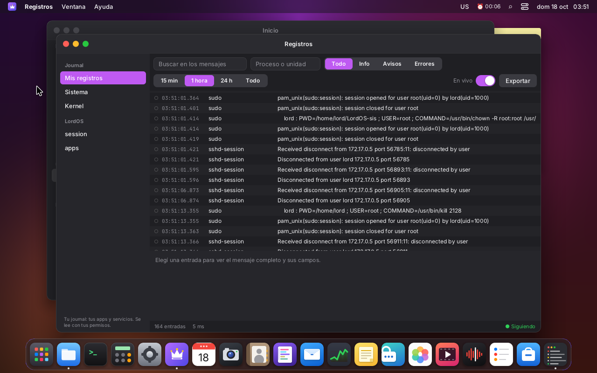 | 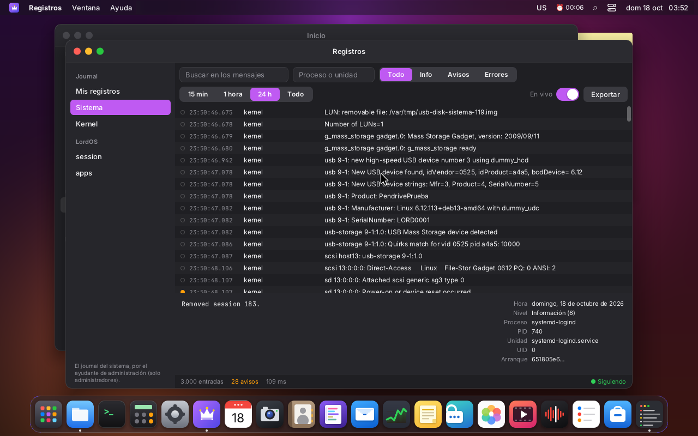 |
| My logs: the user's journal, read as the user (164 entries in 5 ms) | System, 24 h, through `logs-system` (lord is in `sudo` but not in `adm`): 3000 entries in 109 ms, with the detail of an entry |
| 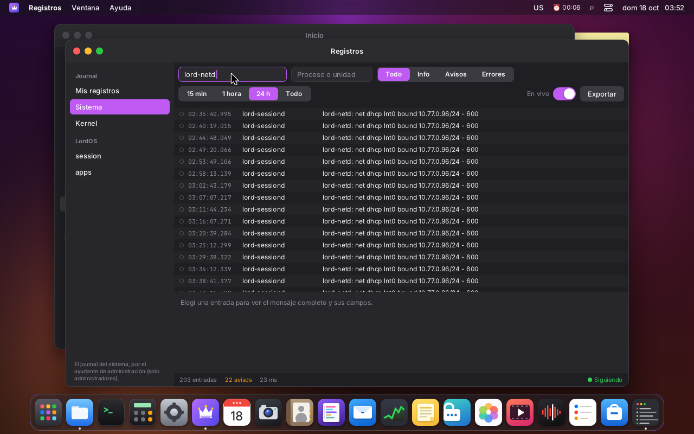 | 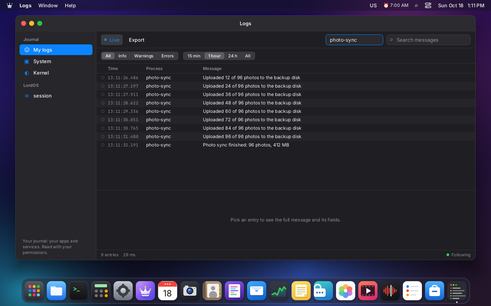 |
| Search "lord-netd": its DHCP renewals every ~4.5 min (T1 of a 10 min lease) | Live: `logger` lines sent over ssh after the view opened (7 and 8) appear without reloading |

Export of the "lord-netd" view: `~/Documentos/Registros-20261018-035235.txt`, 203 lines.

### Pending

- A ZSTD decoder of our own (or showing those fields in full).
- RTL screenshot (the layout uses `start`/`end`; checked in code only).


## Clock (`apps/clock`)

World clock, alarms, timer and stopwatch, like GNOME Clocks.

| Tab | What it does |
|---|---|
| World clock | Local time plus the cities you add (search over tzdata's `zone1970.tab`), with an analog face, "today/tomorrow/yesterday", the hour difference and the zone abbreviation (CEST, AEDT…) |
| Alarms | Time, repeat days (or just once), label, on/off, edit and delete. Shows how long until the next one |
| Timer | Hours, minutes and seconds or presets (1–30 min), pause and resume, progress bar |
| Stopwatch | Laps with split and total; the fastest in green and the slowest in red |

### Another city's time: our own TZif reader

The process time zone is never touched to compute another city's time: `setenv("TZ")` would change
the `Date` of the whole theme (the bar, the other apps). Instead:

- `server/src/ui/tzif.c` reads the TZif files in `/usr/share/zoneinfo` (RFC 8536, versions 1 to 4:
  the 64-bit block, binary search for the transition, and the footer with the POSIX TZ rule for
  dates after the last transition) and evaluates POSIX rules (`CET-1CEST,M3.5.0,M10.5.0/3`, `Jn`,
  `n`, `Mm.w.d`, negative or >24 h times, `<+0545>` names).
- **Validated:** zone names only allow `[A-Za-z0-9/_+-]`, no `..` and no leading `/`; the real path
  (tzdata uses links) must stay inside `/usr/share/zoneinfo/`; regular files up to 1 MB; every count
  and index in the file is checked before reading.
- **JS:** `lord.time.zoneOffset(zone, unixSeconds)` → `{ offset, abbr, dst }` or `null`
  (`server/src/ui/js_help.c`, which adds it to the `lord.time` object created by `js_sys.c`).
- **Test** (`make -C server test` → `build/tzif-test`, `tests/tzif_test.c`): POSIX rules at known
  instants (Europe, Australia, the US, Nepal, zones without DST), a TZif v2 built inside the test
  with **every truncated prefix** (each must fail without over-reading) and an invalid type index,
  and a comparison against glibc (`localtime_r` with `TZ`) in 24 tricky zones (Lord Howe, Chatham,
  Casablanca, Gaza, Santiago, Kathmandu, St Johns…) every ~3 days from 1970 to 2045:
  **216,168 instants, 0 differences** on VM 119.

### Alarms with the app closed (`sdk/alarms.js`)

Alarms, the timer and the stopwatch live in the SDK, not in the window: `startShell` calls
`startAlarms()` once per session. So they ring with Clock closed and also with the session in the
background (fast user switching, or viewed only from the browser): the `lord-server` session keeps
running, and so does its JS.

- **Storage:** `settings.clock = { alarms: [{ id, h, m, days, label, on, snooze, fired }],
  cities: [...] }` in `~/.config/lordos/settings.json`. `fired` is the instant it last rang, so it
  does not ring again when the session restarts.
- **No polling:** a single `setTimeout` until the next thing due (alarm, snooze or end of the
  timer). It is re-armed when the alarms change (settings subscription).
- **Clock changes and suspend:** `lord-server` timers use `CLOCK_MONOTONIC`, which does not advance
  while suspended. So the wait is cut into slices —1 minute if something is due within the hour,
  10 minutes otherwise— and each wake-up recomputes with the real time. Anything that should have
  rung less than 10 minutes ago still rings; older ones are dropped (yesterday's alarm does not ring
  after a long suspend). With no alarms and no timer there is no timer at all.
- **When it rings:** a sticky [notification](#session-notifications-sdknotifyjs) with "Stop" and
  "Snooze 9 min", plus the `notify` sound from `lord.sound.play` every 2.5 s for one minute or until
  the notification is touched. One-time alarms switch themselves off. The timer notifies the same
  way, with "Repeat".
- **Menu bar:** `registerStatusItem('clock', …)` shows ⏱ with the time left on the timer (redrawn
  every second only while it runs) or ⏰ with the time of the next alarm if it rings within 24 h.
  A click opens Clock on that tab.

### Menu bar status items (`sdk/statusitems.js`)

`registerStatusItem(id, Component, order)` and `<StatusItems color />`: an optional registry so
system apps can show something in the theme's bar, like the "menu extras" of popular desktop systems. The `default` theme
(next to the privacy indicators) and `classic` (in the taskbar) draw it; a theme that does not draw
it simply doesn't show them.

### Session notifications (`sdk/notify.js`)

LordOS had no notifications (only the short clipboard toast). Now there is one shared by every app,
mounted by `startShell`, so it shows with any theme:

```js
import { notify, dismissNotification, notifyHistory } from '@lordos/sdk';
const id = notify({
  app: 'backup',                       // its icon and name (appName) in the banner
  title: t('backup.notify.doneTitle'), // texts arrive already translated
  body: '1234 files',
  actions: [{ id: 'open', label: t('backup.notify.open'), primary: true, run: () => wm.open('backup') }],
  sound: true,                         // the "notify" sound (lord.sound.play)
  sticky: false, timeout: 6000,        // sticky: stays until an action or the × is pressed
  onClose: (reason) => {},             // 'closed', 'action' or the action id
});
dismissNotification(id);
```

- At the top, on the end side of the line (right; left in Arabic or Hebrew), below the theme's
  `workArea`; up to four at a time, newest on top.
- Clicking the banner runs the first action; the × closes it.
- `notifyHistory`: the last 50 of the session, in memory only.
- Up to three actions per notification. The API is stable: Clock and Backups use it.
- Linux apps reach the same banners through the session's `org.freedesktop.Notifications` server
  (`server/src/hw/notifyd.c`), with per-app settings in Settings → Notifications (`SETTINGS.md`).

### Screenshots

| | |
|---|---|
| 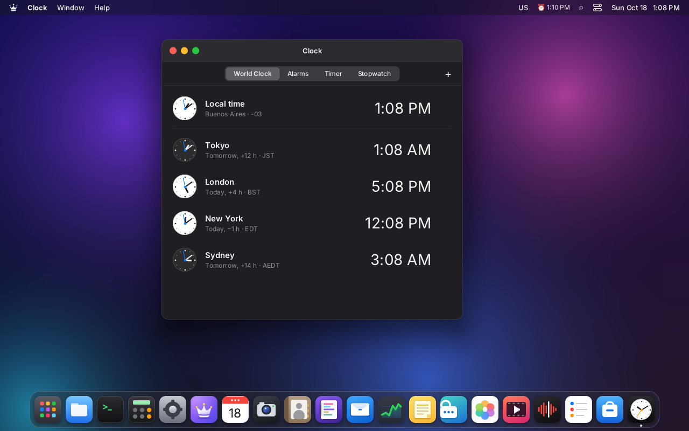 |  |
| World clock with several cities | The alarm rings with Clock closed: notification with Stop and Snooze, ⏰ in the bar |

## Help (`apps/help`)

LordOS help and tips: a help viewer and a tips app.

- **Articles:** one per app and per feature (desktop, windows, Search, clipboard, keyboard and
  input methods, Linux apps, touchpad, network, VPN, users and sessions, remote desktop, privacy,
  printing, sound, updates, settings, appearance, language, and the system apps). 44 articles in
  `assets/help/{en,es,pt}/<id>.md`, written from the documents in `docs/`. English is the default;
  es and pt are translations.
- **Sidebar** by section (Getting started, The desktop, Apps, System, Settings), with each app's
  icon, and **search** over titles, keywords and text, with a snippet of the match.
- **Rendered with the SDK's `<Markdown>`** (the same as Notes): headings, lists, tables, code.
- **Custom links** in the text: `[Settings → Network](settings:network)` opens that Settings
  section (`wm.open('settings', { args: { section } })`, which Settings already accepted);
  `[Files](app:files)` opens an app; `[VPN](help:vpn)` another article. An app's article has an
  "Open <app>" button.
- **Help menu** in the `default` theme: "LordOS Help" and "Welcome to LordOS".

### Article format

```markdown
---
title: Clock
app: clock          # the app it explains ("Open" button and icon)
section: apps       # start | desktop | apps | system | settings
order: 41
keywords: alarm, timer, stopwatch
---
# Clock

Markdown text…
```

**Fallback to English:** the list is the English one plus any extra articles of the interface
language; each article is read in the interface language and, if that file is missing, in English.
To add a language, copy the `en` folder and translate.

### Reading: `lord.help` (`server/src/ui/js_help.c`)

| Call | Returns |
|---|---|
| `lord.help.list(lang)` | `[{ id, title, app, section, order, keywords }]` (each `.md` header) |
| `lord.help.read(lang, id)` | the article text or `null` |

Read-only, like `lord.locale.catalog`: language and id only allow `[a-z0-9-]` (no dots or
slashes), so nothing outside `<assets>/help/` can be reached; `O_NOFOLLOW`, regular files up to
256 KB. In the SDK, `help` (`sdk/help.js`): `list`, `read`, `search`, `open(id)`, `startTour()` and
`link(url)`.

### Search

`sdk/spotlight.js` now has a source registry, `registerSpotlightSource(id, fn)`. Help registers
its own: articles appear in the "Help" section with a snippet in the preview, and Enter opens the
article. The section title comes from `shell.spotlight.section.<id>`.

### "Welcome to LordOS"

A six-step tour (welcome, the desktop, Search, Settings with buttons to Appearance, Network and
Users, the system apps, and where help is), with "Skip", "Back" and "Next".

- It opens by itself **the first time** the session starts: `startShell` calls `maybeStartTour()`,
  which writes `welcomeShown: true` to the settings before opening it (it doesn't come back even if
  the window is closed). It doesn't appear on the live system, where the installer opens instead.
- It can be watched again from the Help sidebar or the Help menu.
- Its texts live in `assets/locales/<lang>/help.json` (`help.tour.<n>.title|body`).

### Screenshots

| | |
|---|---|
| 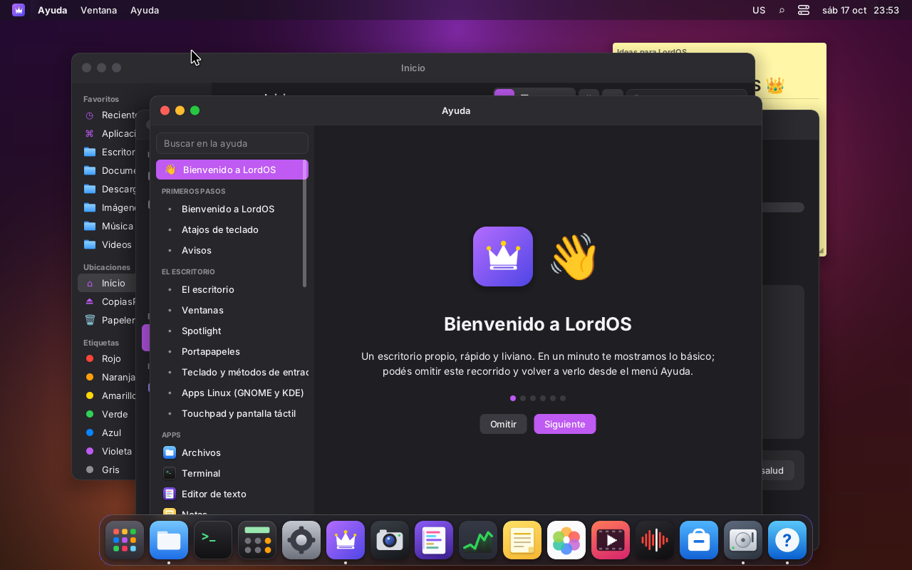 |  |
| "Welcome to LordOS" on first login | An article opened from Search, with links to other articles |
| 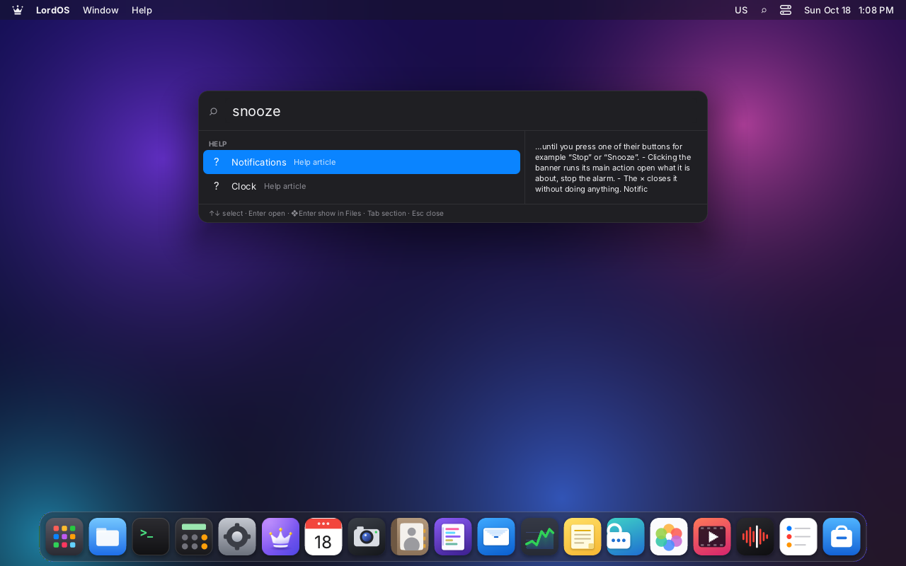 | |
| Search finds Help articles | |

### Pending

- Images inside articles (`<Markdown>` already draws them; per-language screenshots are missing).
- A table of contents in long articles (`markdownHeadings` already exists).
