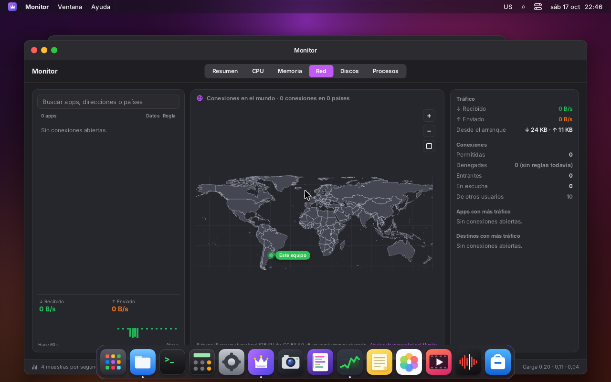
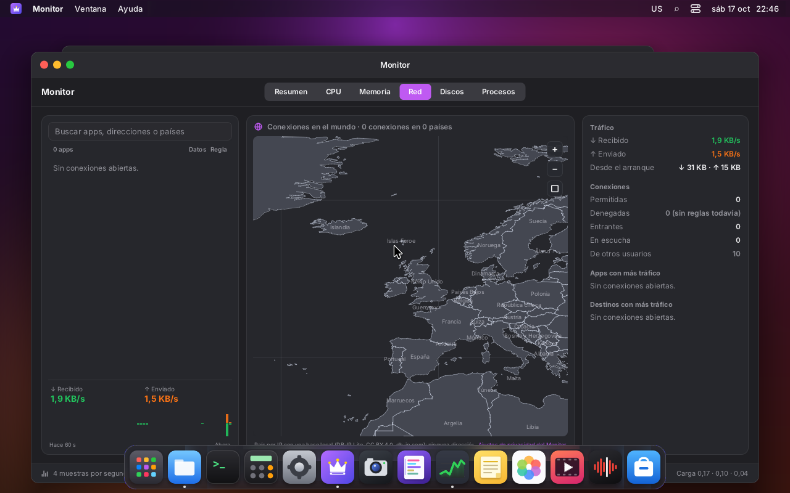
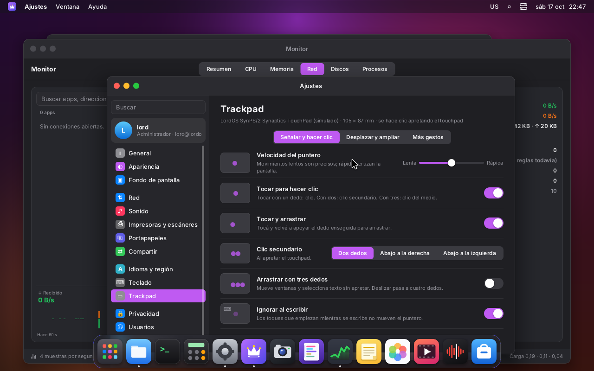
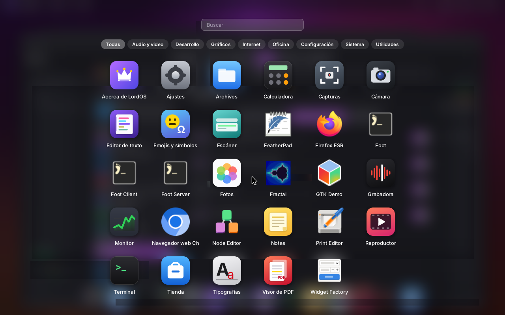
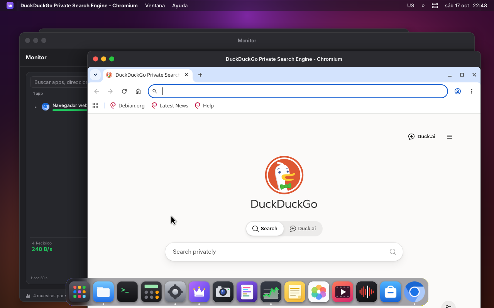
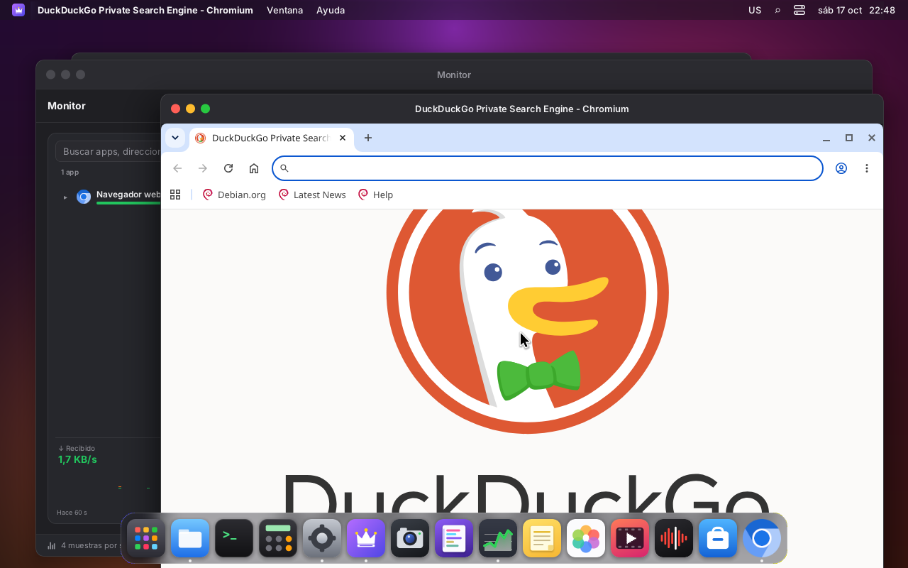
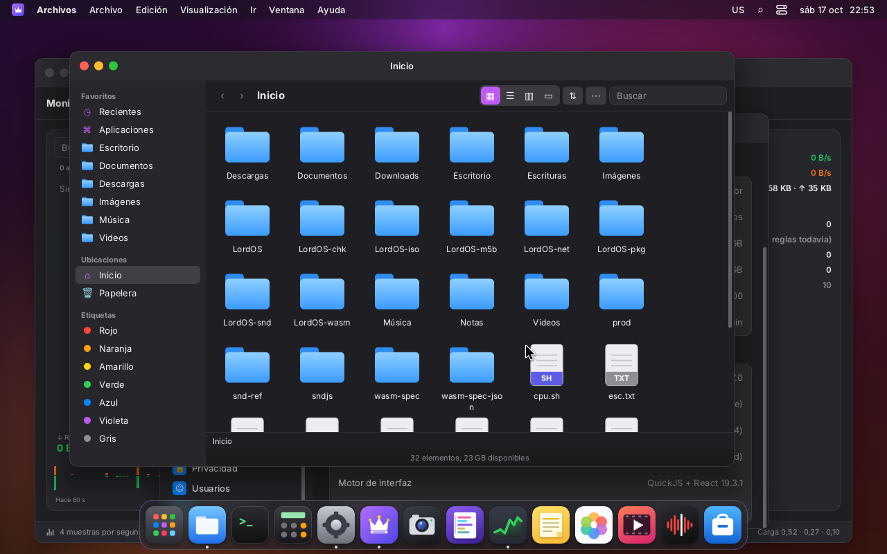
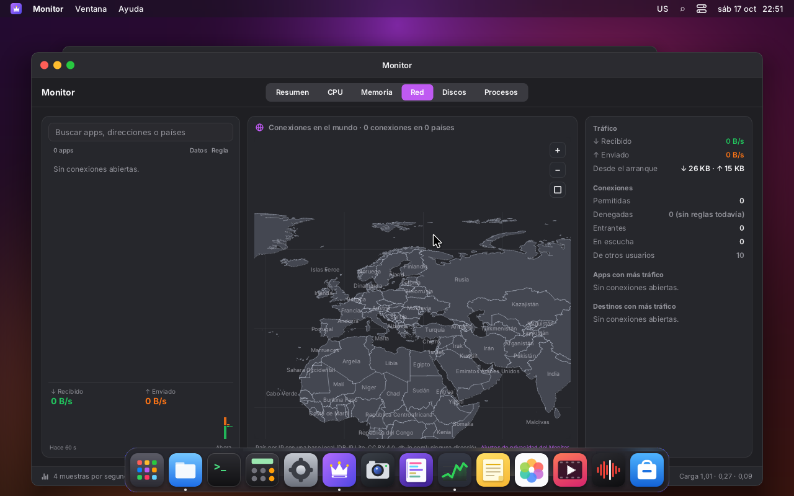
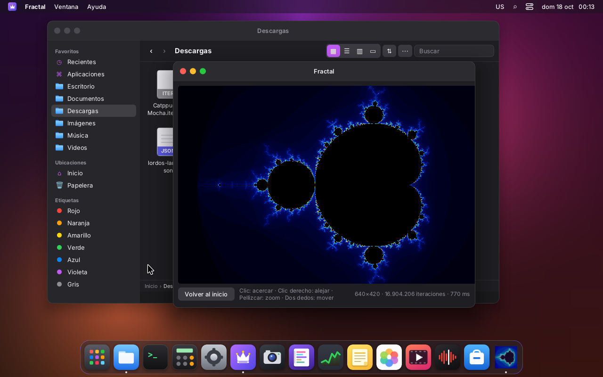
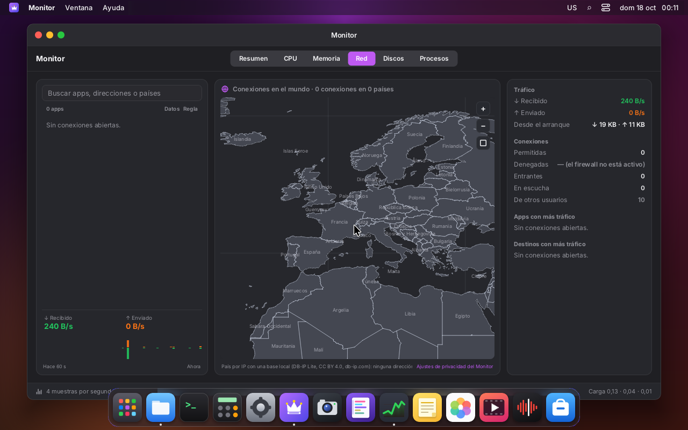

# Touchpad, gestos y pantallas táctiles

LordOS maneja los touchpads y las pantallas táctiles con un **driver propio** que lee evdev
directo (multitouch, protocolo B). No usa libinput: la política de dependencias lo prohíbe (ver
`ARCHITECTURE.md`). El driver hace lo que se espera de una notebook, al estilo de macOS:

- puntero con aceleración;
- tocar para hacer clic y clic con dos dedos;
- scroll con inercia y desplazamiento natural;
- pellizcar para hacer zoom;
- deslizar con tres dedos para las acciones del escritorio.

Los gestos llegan a la interfaz de LordOS (eventos nuevos del SDK) y a las apps Linux, por los
protocolos de Wayland. Así funciona, por ejemplo, el zoom de Chromium con el pellizco.

## Antes

Hasta ahora no había nada para multitouch:

- `input.c` tomaba un touchpad por una **tablet**, porque tiene `ABS_X/ABS_Y`;
- el puntero saltaba a la posición absoluta del dedo (la esquina del touchpad era la esquina de
  la pantalla);
- no había scroll, ni tocar para hacer clic, ni gestos.

El botón físico del clickpad sí andaba, porque es un `BTN_LEFT`. En una notebook se podía usar,
pero mal.

## Capturas (VM 123, touchpad simulado con uinput)

| | |
|---|---|
|  |  |
| Monitor → Red: el mapa antes del pellizco, con el puntero sobre el Atlántico Norte | Después de `pinch-out` (escala ×6): zoom hacia el puntero; las islas Feroe quedaron bajo el cursor |
|  |  |
| Ajustes → Trackpad (solo aparece si hay un touchpad) | Deslizar con tres dedos hacia arriba abre el Launchpad del tema |
|  |  |
| Chromium 155 (Wayland) antes | Pellizco: Chromium amplía la página por `zwp_pointer_gestures_v1` |
|  |  |
| Tres dedos a la izquierda: la ventana de atrás (Archivos) pasa al frente | Pellizco del escritorio remoto (`RP_PINCH`, como lo manda el navegador): zoom ×3 en el mapa |

## Piezas

| Archivo | Qué hace |
|---|---|
| `server/src/tp/tp.c`, `tp.h` | El driver: contactos, palmas, puntero, tocar, clics, scroll, inercia, gestos, pantalla táctil. Lógica pura: recibe eventos con su hora y produce salida. Lo prueba `tests/tp_test.c` |
| `server/src/tp/tp_route.c` | Reparte la salida: el movimiento y los botones van al puntero de siempre (`dispatch_pointer`); el scroll y los gestos van a la app Wayland con el puntero o al nodo de la interfaz |
| `server/src/wl/wl_input.c` | Para las apps Wayland: `zwp_pointer_gestures_v1`, el scroll fino de `wl_pointer` y `wl_touch` |
| `server/src/input.c` | Detecta el dispositivo y le crea su `TpDevice` |
| `server/src/main.c` | Mínimo: los eventos del touchpad van al driver, y los temporizadores al bucle |
| `server/src/ui/js_input.c` | `lord.input.devices()`, `config()`, `configure(obj)` |
| `runtime/events.js` | `__lordGesture` → `onWheel` fino, `onPinch`, `onSwipe` |
| `sdk/trackpad.js` | Aplica los ajustes en vivo, y las acciones del escritorio al deslizar |
| `apps/settings/Trackpad.jsx` | Ajustes → Trackpad |
| `tests/touchpad-sim/` | Touchpad simulado con uinput y los gestos guionados |

## Detección

- **Touchpad:**
  - `ABS_MT_POSITION_X/Y`, `ABS_MT_SLOT` y `BTN_TOOL_FINGER`;
  - además, `INPUT_PROP_POINTER`, un `BTN_LEFT` o `INPUT_PROP_BUTTONPAD`.
- **Clickpad:** `INPUT_PROP_BUTTONPAD` (todo el touchpad es el botón).
- **Pantalla táctil:** `ABS_MT_*` con `INPUT_PROP_DIRECT`.
- **Tamaño en mm:** sale de `resolution` en absinfo, en unidades por mm. Si no viene, se supone
  un touchpad de 100 mm de ancho (300 mm una pantalla).
- **Reloj:** se pide `CLOCK_MONOTONIC` para los eventos (`EVIOCSCLOCKID`), así los tiempos se
  comparan con los del bucle.
- **Más dedos que contactos:** si el dispositivo informa más dedos que contactos (`BTN_TOOL_TRIPLETAP`
  con 2 slots), se cuenta por `BTN_TOOL_*`.

Los presta `lord-sessiond` igual que los mouses (ver `SESIONES.md`). El registro de la sesión
(`~/.cache/lordos/session.log`) dice qué encontró:

```
tp: LordOS SynPS/2 Synaptics TouchPad (simulado): touchpad (clickpad), 105×87 mm, 5 contactos
```

## Cómo reconoce cada cosa

En cada `SYN_REPORT` el driver mira los contactos en milímetros.

**Contactos que no cuentan:**

- **Palmas:**
  - contacto de más de 22 mm (`ABS_MT_TOUCH_MAJOR`);
  - presión por encima del 85 % del rango en los primeros 150 ms;
  - un toque que empieza en el borde izquierdo o derecho (7 mm, o el 7 % del ancho) y no sale
    del borde en 300 ms.
- **Pulgar de un clickpad:** un contacto que empieza en la franja de abajo (12 mm, o el 15 %
  del alto) no cuenta mientras haya otros dedos, hasta que se mueve más de 4 mm. Así, apretar con
  el pulgar mientras el índice está apoyado da clic izquierdo.
- **Ignorar al escribir:** los toques que empiezan hasta 500 ms después de una tecla no cuentan.
  Las teclas modificadoras no cuentan como escritura, así Ctrl+clic sigue andando.

**Según cuántos dedos hay:**

| Dedos | Estado | Qué produce |
|---|---|---|
| 1 | puntero | movimiento suavizado (media móvil exponencial) con `tp_accel` |
| 2 | sin decidir → scroll o pellizco | **scroll** si los dedos van juntos (coseno > 0,3); **pellizco** si van opuestos o cruzados (separar, juntar, girar). Con un dedo quieto: pellizco si cambia la distancia |
| 3 | deslizar (o arrastrar) | deslizar después de 3 mm; con «Arrastrar con tres dedos», botón apretado y puntero |
| 4 | deslizar | igual, con 4 dedos |

Al apoyar 1 o 2 dedos empieza un **mantener** (`hold`), que se cancela al moverlos. GTK lo usa
para frenar su propia inercia.

**Aceleración** (`tp_accel`, en px por mm según la velocidad del dedo):

- a menos de 12 mm/s, 2,4 px/mm: un píxel cada 0,4 mm;
- a 170 mm/s o más, 15 px/mm;
- en el medio, una curva suave;
- el ajuste de velocidad multiplica todo entre ×0,5 y ×2.

**Scroll:**

- ~5 px por mm, hasta ×3 si los dedos van rápido;
- natural por defecto (como macOS): subir los dedos baja en el documento;
- si va casi derecho, se traba a un eje.

**Inercia:**

- al soltar, con la velocidad de los últimos 80 ms (si los dedos no estaban quietos);
- arranca si pasa de 200 px/s;
- sigue a ~60 Hz y frena con una constante de 325 ms;
- termina debajo de 25 px/s;
- la cancela apoyar un dedo.

**Tocar:**

| Gesto | Resultado |
|---|---|
| Tocar 1, 2 o 3 dedos | izquierdo, derecho o medio. Hasta 200 ms y sin moverse más de 1,5 mm |
| Tocar y arrastrar | tocar, y volver a apoyar antes de 180 ms: el botón queda apretado hasta levantar |
| Doble toque | dos clics |

El clic de un toque se suelta a los 180 ms (por si sigue un arrastre), como en libinput. Con
«Tocar y arrastrar» apagado se suelta enseguida.

**Clic físico (clickpad):**

- se cuentan los dedos: 1 izquierdo, 2 derecho, 3 medio (como macOS);
- o, según el ajuste, la esquina de abajo a la derecha (o a la izquierda) es el clic derecho;
- mientras está apretado solo se mueve el puntero (con el dedo que más se mueve).

## La interfaz de LordOS (SDK)

Los eventos nuevos de `View` están en `apps/README.md` y `themes/README.md`:

- **`onWheel`** con `e.precise: true`:
  - `e.deltaX/deltaY` en píxeles exactos;
  - `e.phase`: `'update'`, `'end'`, `'momentum'` (la inercia), `'momentum-end'`;
  - `e.notches`, para lo que avanza de a renglón: la Terminal, y el zoom de Fotos y del Visor
    de PDF.
- **`onPinch({ scale, rotation, x, y, dx, dy, phase })`**:
  - `scale` es relativa al comienzo;
  - el destino queda fijo durante el gesto, y el zoom se hace hacia la posición del puntero.
- **`onSwipe({ dx, dy, fingers, phase, system })`**.

Usos en las apps:

| App | Qué hace |
|---|---|
| Monitor | el mapa amplía con el pellizco hacia el centro del gesto, y dos dedos lo mueven |
| Fotos | el pellizco amplía |
| `ScrollView` y las vistas con `deltaY` (Editor, Notas, PDF, Tipografías) | scroll con píxeles exactos e inercia |

**Acciones del escritorio** (deslizar con 3 dedos; con 4 si está «Arrastrar con tres dedos» o
«Deslizar con cuatro dedos»):

- el tema elige con `registerGestureActions({ up, down, left, right })`:
  - tema `default`: arriba abre el Launchpad, abajo lo cierra;
  - tema `classic`: lo mismo con el menú de inicio;
- sin acción del tema, izquierda y derecha cambian de ventana (la de más atrás pasa al frente,
  o la del frente va atrás).

## Ajustes → Trackpad

Está en el grupo de Idioma y Teclado, y solo aparece si hay un touchpad. Se guarda en
`settings.trackpad` (`~/.config/lordos/settings.json`) y se aplica en vivo:
`sdk/trackpad.js` llama a `lord.input.configure`.

Cada fila trae un dibujito del gesto que se anima al pasar el mouse.

| Pestaña | Ajuste (clave) | Por defecto |
|---|---|---|
| Señalar y hacer clic | Velocidad del puntero (`speed`, 0..1) | 0,5 |
| | Tocar para hacer clic (`tap`) | sí |
| | Tocar y arrastrar (`tapDrag`) | sí |
| | Clic secundario (`secondary`: `two-fingers`, `bottom-right`, `bottom-left`) | dos dedos |
| | Arrastrar con tres dedos (`threeDrag`) | no |
| | Ignorar al escribir (`dwt`) | sí |
| Desplazar y ampliar | Desplazamiento natural (`natural`) | sí |
| | Desplazar con dos dedos (`scroll`) | sí |
| | Inercia (`kinetic`) | sí |
| | Pellizcar para ampliar (`pinch`) | sí |
| Más gestos | Deslizar con tres dedos (`swipe3`) | sí |
| | Deslizar con cuatro dedos para el escritorio (`swipe4`; apagado, van a las apps) | no |

## Apps Linux (Wayland)

Los protocolos están en `WAYLAND.md`.

- **`zwp_pointer_gestures_v1` v3:**
  - pellizco (con `scale`, giro y centro), deslizar y mantener;
  - van a la app que tenía el puntero al empezar el gesto.
  - Chromium amplía la página (ver la captura); GTK lo usa en mapas, visores e inercia.
- **`wl_pointer`** (seat v9):
  - el scroll fino del touchpad va con `axis_source(finger)` y valores fraccionarios, y
    `axis_stop` en los dos ejes al levantar los dedos (la app hace su propia inercia, así que la
    de LordOS no le llega);
  - `axis_relative_direction` dice si el desplazamiento es natural;
  - la rueda del mouse manda `axis_source(wheel)` y `axis_value120` (v8+), o `axis_discrete`
    (v5–7).
- **`wl_touch`:** la capacidad se anuncia solo si hay una pantalla táctil. Los toques van a la
  superficie que está debajo del primer dedo, y si la app no escucha `wl_touch`, se emula el
  puntero.

Verificado en la VM con `WAYLAND_DEBUG=1 foot`:

- touchpad: `axis_source(1)`, `axis(…, -19.578125)`, `axis_stop` en los dos ejes y
  `axis_value120(0, -120)` de la rueda;
- pantalla táctil: `wl_seat.capabilities(7)` y `wl_touch.down/motion/up/frame`.

## Pantallas táctiles

- Con una app Wayland debajo que escucha `wl_touch`, recibe los toques.
- Si no, se emula el puntero:
  - el puntero va adonde se toca;
  - tocar es un clic;
  - arrastrar es arrastrar: el botón se aprieta si el dedo se mueve 2 mm o se queda 90 ms;
  - dos dedos hacen scroll directo (el contenido sigue al dedo, siempre) y pellizco, con el
    puntero en el centro del gesto.
- Se usa una sola pantalla: la posición de 0 a 1 se lleva a toda la pantalla de LordOS.

## Escritorio remoto

El navegador manda el trackpad como scroll fino y pellizco (`REMOTO.md`). Chrome y Firefox
entregan el pellizco como rueda con `ctrlKey`, Safari como `gesturechange`, y Ctrl+rueda de un
mouse también es pellizco. La sesión los trata igual que los del touchpad local, por
`tp_route_scroll` y `tp_route_pinch`.

## Pruebas

### `make -C server test` → `build/tp-test`

Le pasa al driver las mismas secuencias evdev que reproduce el touchpad simulado, con sus
tiempos, y revisa lo que reconoce. Hay 51 comprobaciones:

- puntero y curva;
- tocar con 1, 2 y 3 dedos, doble toque, tocar y arrastrar;
- clic físico con 1, 2 y 3 dedos, pulgar, esquina;
- scroll en los dos sentidos, natural o no, con y sin inercia;
- pellizco hacia afuera y adentro, giro de 60°;
- deslizar con 3 dedos (4 direcciones) y con 4, arrastrar con tres dedos;
- palma, borde, ignorar al escribir (Ctrl no bloquea), mantener;
- pantalla táctil: tocar, arrastrar, scroll, pellizco y toque a una app.

`build/tp-test --replay archivo.ev` reproduce una grabación (por ejemplo, de un touchpad real con
`tpsim record`) y muestra qué salió.

### Touchpad simulado (`tests/touchpad-sim/tpsim`)

```sh
cc -O2 -Wall -Wextra -o tpsim tests/touchpad-sim/tpsim.c tests/touchpad-sim/gestures.c -lm
./tpsim list                                     # gestos: move, tap, tap2, tap3, doubletap, tapdrag,
                                                 # click, click2, click3, thumbclick, scroll, scroll-down,
                                                 # scroll-slow, pinch-out, pinch-in, rotate, swipe3-up/
                                                 # down/left/right, swipe4-up, palm, edge, threedrag
./tpsim dump pinch-out > pinch.ev                # la secuencia en texto
sudo ./tpsim play --wait 2 move tap              # crea el dispositivo y reproduce
sudo ./tpsim serve /run/tpsim.fifo &             # queda esperando: echo pinch-out > /run/tpsim.fifo
sudo ./tpsim serve --touchscreen /run/tpsim-ts.fifo &   # una pantalla táctil
sudo ./tpsim record /dev/input/event5 20 > real.ev       # grabar un touchpad real 20 s
```

El dispositivo imita un clickpad Synaptics de notebook:

- 105 × 87 mm, con resolución 42 unidades/mm;
- 5 contactos y presión de 0 a 255;
- `INPUT_PROP_POINTER` y `INPUT_PROP_BUTTONPAD`;
- emula un solo dedo (`ABS_X/Y`) y manda `BTN_TOOL_*`.

Los gestos van a 80 Hz.

Como `lord-sessiond` presta los dispositivos al mostrar la sesión, el simulado tiene que existir
antes. En la VM 123 lo crea un servicio de prueba antes de `lordos.service` (ver `VM-SETUP.md`).

## Enchufar en caliente, ruedas y apps aisladas

- **Enchufar y desenchufar:** un touchpad, teclado o mouse enchufado con la sesión en el monitor
  anda enseguida (`lord-sessiond` lo detecta con inotify y le pasa el fd, ver `SESIONES.md`).
  Desenchufarlo cierra solo ese dispositivo; la sesión no deja la pantalla.
- **Rueda de alta resolución y horizontal:**
  - `REL_WHEEL_HI_RES` y `REL_HWHEEL_HI_RES` (o `REL_HWHEEL`) van como scroll fino;
  - a las apps Wayland les llega `axis_source(wheel)`, `axis_value120` y el valor fraccionario
    (de cada 120, 10 unidades);
  - la interfaz recibe `deltaX/deltaY` con `precise` (120 = 48 px, sin fases);
  - en los mouses que la tienen, el paso entero (`REL_WHEEL`) se ignora para no contar dos veces.

  Probado con `tpsim play --mouse wheel-up hwheel-right`: foot recibió `axis_value120` ±30 en los
  dos ejes.
- **Apps `.lpk` aisladas:** el proceso de la app (`app/appclient.c`):
  - pide `zwp_pointer_gestures_v1` y entrega `onPinch` y `onSwipe` a su JS;
  - recibe el scroll del touchpad con fases (`axis_source finger` / `axis_stop`).

  Fractal (`examples/apps/fractal`, 1.1.0) amplía con el pellizco y se mueve con dos dedos.

| | |
|---|---|
|  |  |
| Fractal, app instalada y aislada | Pellizco: amplía hacia el puntero |

## Mover el mapa del Monitor con dos dedos

Al principio costaba 57,5 % de CPU. Los cambios:

- **La app:**
  - mientras se mueve, corre la imagen del último cuadro con `lord.setStyle`, sin pasar por
    React, como mucho 30 veces por segundo;
  - pide un cuadro nuevo cada 100 ms (a media resolución si cambió el zoom) y el bueno al quedar
    quieto;
  - esconde las etiquetas mientras se mueve.
- **El motor**, que también ayuda al scroll de cualquier lista:
  - el área dañada se recorta con los ancestros `overflow: hidden`;
  - se empieza a pintar desde el nodo opaco que tapa todo lo que cambió (no se pinta el fondo de
    pantalla ni lo que está atrás);
  - las medidas de los textos se recuerdan;
  - una imagen a dos tamaños (el ícono de LordOS en el Dock y en la barra) ya no se reescala en
    cada cuadro;
  - las imágenes que caen afuera no se reescalan;
  - una imagen 1:1 se copia directo;
  - la franja recta de un rectángulo redondeado se pinta de corrido.

Con eso, mover el mapa ampliado sin parar durante 10 s (dos dedos con inercia) cuesta 19–21 %
(15,9 % el hilo principal, 3 % el del mapa), contra 4 % quieto. Lo que queda más grande es copiar
la pantalla entera en cada cuadro (`canvas_copy`, en `main.c`).



## Mediciones (VM 123: Xeon Silver 4108 a 1,8 GHz, 4 núcleos, sin GPU, 1280×800, composición por CPU)

**Driver:**

| Qué | Resultado |
|---|---|
| Procesar un cuadro (`tp-test`) | 0,25–0,41 µs |
| Reconocer el scroll | en el primer cuadro con los dos dedos moviéndose (12 ms de gesto) |
| Reconocer el pellizco y el deslizar | ~62 ms de gesto (5 cuadros: hasta que cada dedo se movió 1 mm, o el centro 3 mm) |

**Latencia**, desde la hora del evento del kernel hasta que lo recibió JS o la app Wayland. La
sesión la escribe en su registro, una línea por gesto:

```
tp: scroll: 19 cuadros, latencia media 2.94 ms, máx 30.17 ms (lectura → JS/Wayland)
```

| Qué | Media | Máxima |
|---|---|---|
| Scroll sobre Ajustes (`ScrollView`) | 3–9 ms | 17–30 ms |
| Scroll sobre el mapa del Monitor (cada cuadro vuelve a dibujar el mapa) | 9–14 ms | 28–35 ms |
| Pellizco sobre el mapa | 7–15 ms | 20–37 ms |

La máxima es un cuadro que justo se estaba dibujando por CPU.

**CPU de `lord-server`** (`~/cpu.sh`, % de un núcleo, con el Monitor abierto):

| Qué | CPU |
|---|---|
| Quieto | 4,2–4,6 % |
| Scroll con dos dedos sin parar sobre Ajustes, con inercia (10 s) | 13,8 % |
| Mover el mapa ampliado con dos dedos sin parar (10 s) | 57,5 % al principio; 19–21 % ahora (ver «Mover el mapa del Monitor») |

## Lista para probar en hardware real (notebook, Raspberry Pi 5 con touchpad USB o pantalla táctil)

1. `session.log` muestra `tp: … touchpad (clickpad), N×M mm` con medidas reales. Si dice `0×0` o
   medidas raras, falta resolución en el absinfo: grabar con `tpsim record` y mandarlo.
2. **Puntero:**
   - lento es preciso (se puede apuntar a un botón de la barra de menú);
   - rápido cruza la pantalla con un movimiento;
   - el control de velocidad de Ajustes cambia en vivo.
3. **Sin saltos:** el puntero no salta al apoyar ni al levantar un dedo, ni cuando se apoya un
   segundo dedo.
4. **Tocar:**
   - 1, 2 y 3 dedos dan clic izquierdo, derecho y medio;
   - el doble toque abre una carpeta en Archivos;
   - tocar y arrastrar mueve una ventana.
5. **Clic físico:**
   - con un dedo, izquierdo; con dos, derecho; con el pulgar abajo y el índice apoyado,
     izquierdo;
   - el modo «Abajo a la derecha» funciona.
6. **Scroll con dos dedos:**
   - en Ajustes, Archivos, Editor y el Visor de PDF;
   - natural y al revés;
   - la inercia se corta al apoyar un dedo;
   - en Firefox y Chromium (Wayland), su propia inercia;
   - en la Terminal, de a renglón.
7. **Pellizco:**
   - el mapa del Monitor, Fotos, Chromium (zoom de página);
   - un visor GTK 4, si hay.
8. **Deslizar con 3 dedos:** arriba abre el Launchpad (default) o el menú de inicio (clásico);
   izquierda y derecha cambian de ventana.
9. **Arrastrar con tres dedos:** mueve una ventana; el deslizar pasa a 4 dedos.
10. **Palmas:** al escribir en el Editor con la palma sobre el touchpad, el puntero no se mueve ni
    hay clics. Mirar también la palma apoyada en el borde.
11. **Pantalla táctil, si hay:**
    - tocar es clic, arrastrar mueve, dos dedos hacen scroll y pellizco;
    - en una app GTK, los toques le llegan como `wl_touch`.
12. **Si algo anda mal:** grabar el gesto (`sudo tpsim record /dev/input/eventN 10 > g.ev`) y
    reproducirlo con `build/tp-test --replay g.ev`.

## Pendiente

- **Apps aisladas:** no tienen inercia propia en el scroll fino (las apps Wayland la hacen solas;
  la de LordOS es para la interfaz del tema).
- **Composición por CPU:** cada cuadro copia la pantalla entera al búfer de la placa
  (`canvas_copy` en `main.c`). Copiar solo lo que cambió bajaría más el costo de mover el mapa.
- **Gestos que faltan:**
  - bloqueo del arrastre (tocar y arrastrar que sigue al levantar el dedo un momento);
  - scroll por el borde para touchpads de un solo dedo;
  - pellizco con 4 o 5 dedos (Launchpad de macOS);
  - clic derecho por mantener apretado en la pantalla táctil.
- **Palma por tamaño:** solo funciona en los dispositivos que informan `TOUCH_MAJOR` en las mismas
  unidades que la posición. Los demás dependen de la presión y los bordes.
- **Probado solo en la VM**, con el touchpad y la pantalla simulados. Falta hardware real (la
  lista de arriba).
