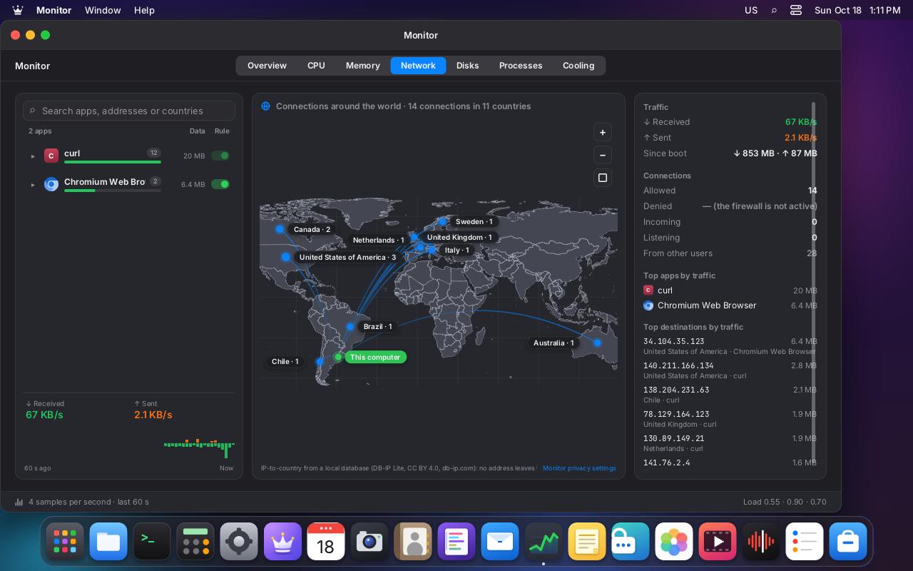
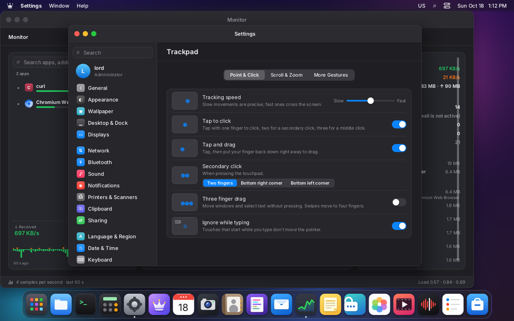
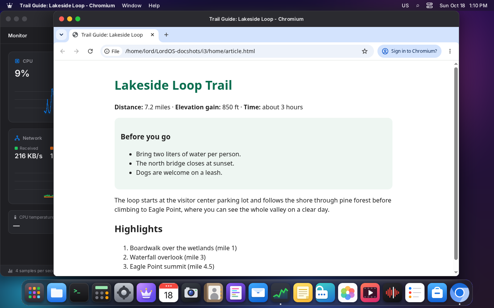
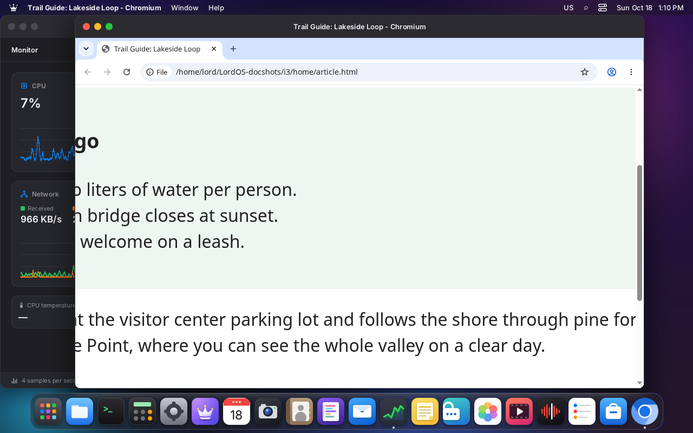
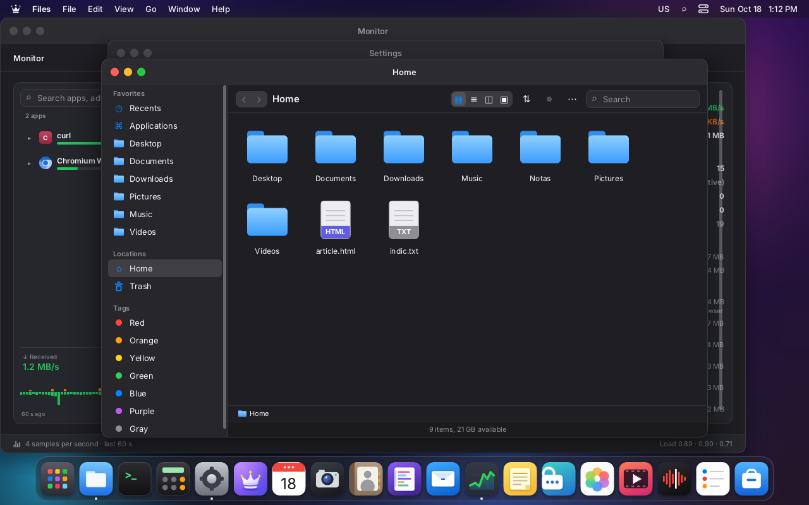
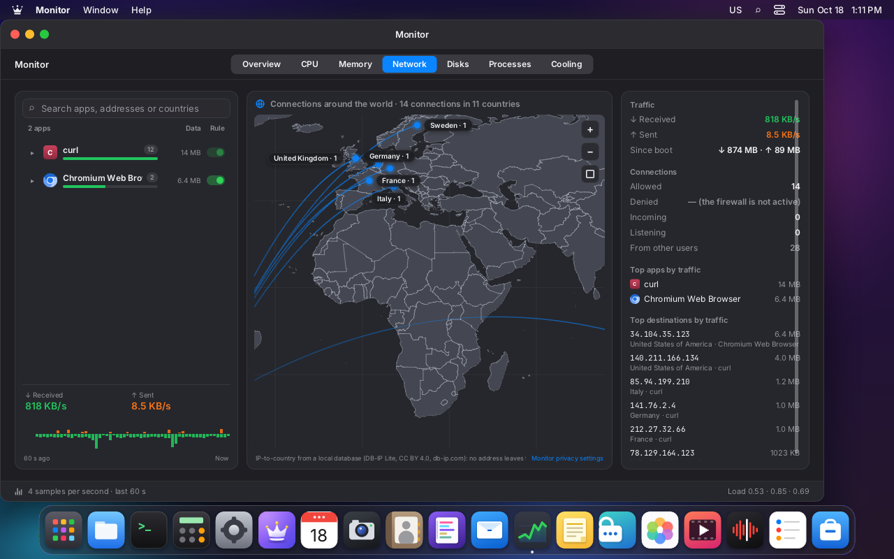
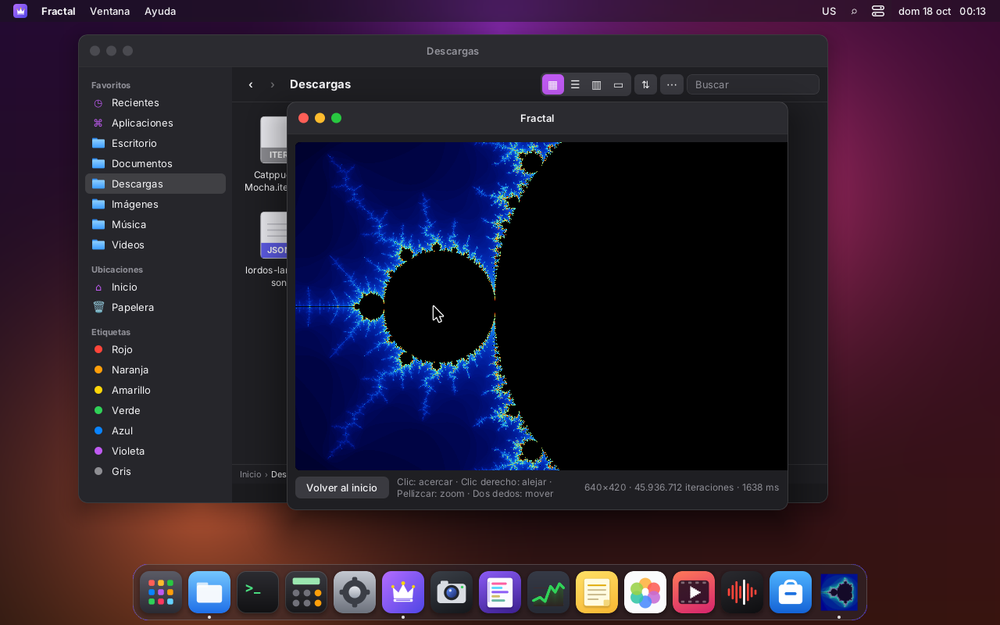
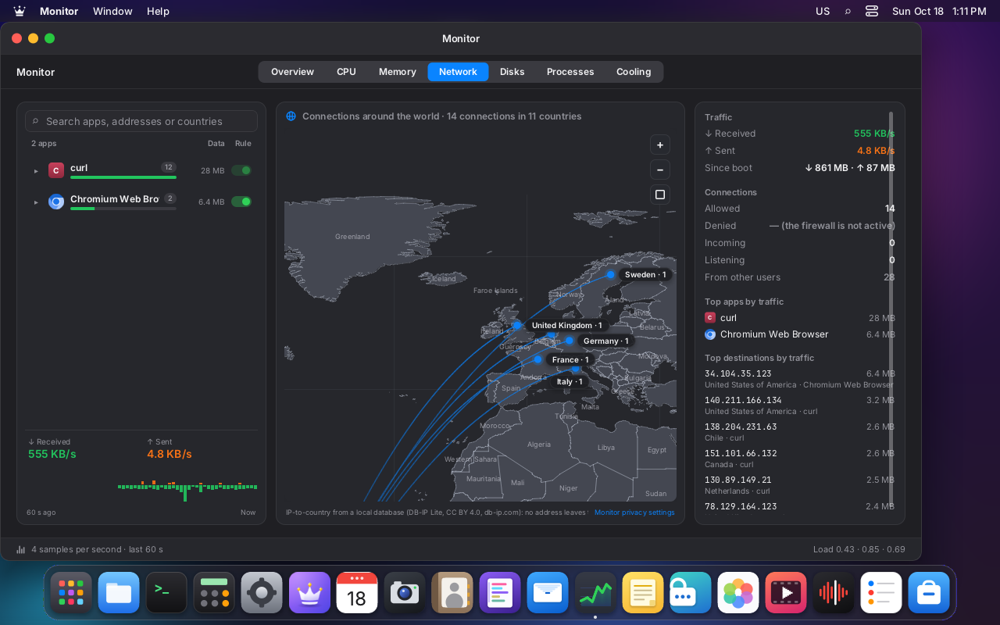

# Touchpad, gestures and touchscreens

LordOS handles touchpads and touchscreens with its **own driver** that reads evdev directly
(multitouch, protocol B). It doesn't use libinput: the dependency policy forbids it (see
`ARCHITECTURE.md`). The driver does what you expect from a modern laptop:

- pointer with acceleration;
- tap to click and two-finger click;
- scrolling with inertia and natural scrolling;
- pinch to zoom;
- three-finger swipe for desktop actions.

Gestures reach the LordOS interface (new SDK events) and Linux apps, through the Wayland protocols.
That's how, for example, Chromium's pinch zoom works.

## Before

Until now there was nothing for multitouch:

- `input.c` took a touchpad for a **tablet**, because it has `ABS_X/ABS_Y`;
- the pointer jumped to the finger's absolute position (the touchpad's corner was the screen's
  corner);
- there was no scrolling, no tap to click, and no gestures.

The clickpad's physical button did work, because it is a `BTN_LEFT`. On a laptop it was usable,
but badly.

## Screenshots (VM 123, touchpad simulated with uinput)

| | |
|---|---|
|  |  |
| Monitor → Network: the map before the pinch, with the pointer over Europe | After a pinch-out (scale ×3): zoom toward the pointer, which stays over the same place |
|  |  |
| Settings → Trackpad (only appears if there is a touchpad) | Swiping up with three fingers opens the theme's app launcher |
|  |  |
| Chromium 155 (Wayland) before | Pinch: Chromium zooms the page via `zwp_pointer_gestures_v1` |
|  |  |
| Three fingers to the left: the window behind (Files) comes to the front | Remote desktop pinch (`RP_PINCH`, as the browser sends it): ×2.2 zoom on the map |

## Pieces

| File | What it does |
|---|---|
| `server/src/tp/tp.c`, `tp.h` | The driver: contacts, palms, pointer, tap, clicks, scroll, inertia, gestures, touchscreen. Pure logic: it receives timestamped events and produces output. Tested by `tests/tp_test.c` |
| `server/src/tp/tp_route.c` | Distributes the output: motion and buttons go to the usual pointer (`dispatch_pointer`); scroll and gestures go to the Wayland app under the pointer or to the interface node |
| `server/src/wl/wl_input.c` | For Wayland apps: `zwp_pointer_gestures_v1`, `wl_pointer` fine scrolling and `wl_touch` |
| `server/src/input.c` | Detects the device and creates its `TpDevice` |
| `server/src/main.c` | Minimal: touchpad events go to the driver, and timers to the loop |
| `server/src/ui/js_input.c` | `lord.input.devices()`, `config()`, `configure(obj)` |
| `runtime/events.js` | `__lordGesture` → fine `onWheel`, `onPinch`, `onSwipe` |
| `sdk/trackpad.js` | Applies settings live, and the desktop actions on swipe |
| `apps/settings/Trackpad.jsx` | Settings → Trackpad |
| `tests/touchpad-sim/` | Touchpad simulated with uinput, and the scripted gestures |

## Detection

- **Touchpad:**
  - `ABS_MT_POSITION_X/Y`, `ABS_MT_SLOT` and `BTN_TOOL_FINGER`;
  - in addition, `INPUT_PROP_POINTER`, a `BTN_LEFT` or `INPUT_PROP_BUTTONPAD`.
- **Clickpad:** `INPUT_PROP_BUTTONPAD` (the whole touchpad is the button).
- **Touchscreen:** `ABS_MT_*` with `INPUT_PROP_DIRECT`.
- **Size in mm:** comes from `resolution` in absinfo, in units per mm. If it's missing, a touchpad
  100 mm wide is assumed (300 mm for a screen).
- **Clock:** `CLOCK_MONOTONIC` is requested for the events (`EVIOCSCLOCKID`), so times can be
  compared with the loop's.
- **More fingers than contacts:** if the device reports more fingers than contacts
  (`BTN_TOOL_TRIPLETAP` with 2 slots), counting goes by `BTN_TOOL_*`.

`lord-sessiond` lends them just like mice (see `SESSIONS.md`). The session log
(`~/.cache/lordos/session.log`) says what it found:

```
tp: LordOS SynPS/2 Synaptics TouchPad (simulado): touchpad (clickpad), 105×87 mm, 5 contacts
```

## How it recognizes each thing

On every `SYN_REPORT` the driver looks at the contacts in millimeters.

**Contacts that don't count:**

- **Palms:**
  - a contact larger than 22 mm (`ABS_MT_TOUCH_MAJOR`);
  - pressure above 85 % of the range during the first 150 ms;
  - a touch that starts at the left or right edge (7 mm, or 7 % of the width) and doesn't leave
    the edge within 300 ms.
- **Clickpad thumb:** a contact that starts in the bottom strip (12 mm, or 15 % of the height)
  doesn't count while there are other fingers, until it moves more than 4 mm. That way, pressing with
  the thumb while the index finger is resting gives a left click.
- **Disable while typing:** touches that start up to 500 ms after a key don't count. Modifier keys
  don't count as typing, so Ctrl+click still works.

**Depending on how many fingers there are:**

| Fingers | State | What it produces |
|---|---|---|
| 1 | pointer | smoothed motion (exponential moving average) with `tp_accel` |
| 2 | undecided → scroll or pinch | **scroll** if the fingers move together (cosine > 0.3); **pinch** if they move in opposite or crossed directions (spread, pinch, rotate). With one finger still: pinch if the distance changes |
| 3 | swipe (or drag) | swipe after 3 mm; with "Three-finger drag", button pressed and pointer |
| 4 | swipe | same, with 4 fingers |

Resting 1 or 2 fingers starts a **hold** (`hold`), which is cancelled when they move. GTK uses it to
stop its own inertia.

**Acceleration** (`tp_accel`, in px per mm depending on finger speed):

- below 12 mm/s, 2.4 px/mm: one pixel every 0.4 mm;
- at 170 mm/s or more, 15 px/mm;
- in between, a smooth curve;
- the speed setting multiplies everything by ×0.5 to ×2.

**Scroll:**

- ~5 px per mm, up to ×3 if the fingers move fast;
- natural by default: moving the fingers up moves down in the document;
- if it goes almost straight, it locks to one axis.

**Inertia:**

- on release, with the velocity of the last 80 ms (if the fingers weren't still);
- starts if it exceeds 200 px/s;
- runs at ~60 Hz and slows down with a 325 ms time constant;
- ends below 25 px/s;
- resting a finger cancels it.

**Tap:**

| Gesture | Result |
|---|---|
| Tap with 1, 2 or 3 fingers | left, right or middle. Up to 200 ms and without moving more than 1.5 mm |
| Tap and drag | tap, and touch again within 180 ms: the button stays pressed until lifting |
| Double tap | two clicks |

A tap's click is released after 180 ms (in case a drag follows), as in libinput. With "Tap and
drag" off it's released immediately.

**Physical click (clickpad):**

- fingers are counted: 1 left, 2 right, 3 middle (the usual convention);
- or, depending on the setting, the bottom-right (or bottom-left) corner is the right click;
- while it's pressed only the pointer moves (with the finger that moves the most).

## The LordOS interface (SDK)

The new `View` events are in `apps/README.md` and `themes/README.md`:

- **`onWheel`** with `e.precise: true`:
  - `e.deltaX/deltaY` in exact pixels;
  - `e.phase`: `'update'`, `'end'`, `'momentum'` (inertia), `'momentum-end'`;
  - `e.notches`, for things that advance line by line: the Terminal, and the zoom in Photos and in
    the PDF Viewer.
- **`onPinch({ scale, rotation, x, y, dx, dy, phase })`**:
  - `scale` is relative to the start;
  - the target stays fixed during the gesture, and the zoom goes toward the pointer's position.
- **`onSwipe({ dx, dy, fingers, phase, system })`**.

Uses in the apps:

| App | What it does |
|---|---|
| Monitor | the map zooms with the pinch toward the gesture's center, and two fingers pan it |
| Photos | the pinch zooms |
| `ScrollView` and views with `deltaY` (Editor, Notes, PDF, Fonts) | scrolling with exact pixels and inertia |

**Desktop actions** (three-finger swipe; with 4 if "Three-finger drag" or "Four-finger swipe" is
on):

- the theme chooses with `registerGestureActions({ up, down, left, right })`:
  - `default` theme: up opens the app launcher, down closes it;
  - `classic` theme: the same with the start menu;
- without a theme action, left and right switch windows (the rearmost comes to the front, or the
  front one goes to the back).

## Settings → Trackpad

It's in the Language & Keyboard group, and only appears if there is a touchpad. It's saved in
`settings.trackpad` (`~/.config/lordos/settings.json`) and applied live:
`sdk/trackpad.js` calls `lord.input.configure`.

Each row has a small drawing of the gesture that animates on mouse hover.

| Tab | Setting (key) | Default |
|---|---|---|
| Point & Click | Pointer speed (`speed`, 0..1) | 0.5 |
| | Tap to click (`tap`) | yes |
| | Tap and drag (`tapDrag`) | yes |
| | Secondary click (`secondary`: `two-fingers`, `bottom-right`, `bottom-left`) | two fingers |
| | Three-finger drag (`threeDrag`) | no |
| | Disable while typing (`dwt`) | yes |
| Scroll & Zoom | Natural scrolling (`natural`) | yes |
| | Two-finger scrolling (`scroll`) | yes |
| | Inertia (`kinetic`) | yes |
| | Pinch to zoom (`pinch`) | yes |
| More Gestures | Three-finger swipe (`swipe3`) | yes |
| | Four-finger swipe for the desktop (`swipe4`; when off, they go to the apps) | no |

## Linux apps (Wayland)

The protocols are in `WAYLAND.md`.

- **`zwp_pointer_gestures_v1` v3:**
  - pinch (with `scale`, rotation and center), swipe and hold;
  - they go to the app that had the pointer when the gesture started.
  - Chromium zooms the page (see the screenshot); GTK uses it in maps, viewers and inertia.
- **`wl_pointer`** (seat v9):
  - touchpad fine scrolling goes with `axis_source(finger)` and fractional values, and `axis_stop`
    on both axes when the fingers lift (the app does its own inertia, so LordOS's doesn't reach
    it);
  - `axis_relative_direction` says whether scrolling is natural;
  - the mouse wheel sends `axis_source(wheel)` and `axis_value120` (v8+), or `axis_discrete`
    (v5–7).
- **`wl_touch`:** the capability is only announced if there is a touchscreen. Touches go to the
  surface under the first finger, and if the app doesn't listen to `wl_touch`, the pointer is
  emulated.

Verified in the VM with `WAYLAND_DEBUG=1 foot`:

- touchpad: `axis_source(1)`, `axis(…, -19.578125)`, `axis_stop` on both axes and
  `axis_value120(0, -120)` from the wheel;
- touchscreen: `wl_seat.capabilities(7)` and `wl_touch.down/motion/up/frame`.

## Touchscreens

- With a Wayland app underneath that listens to `wl_touch`, it receives the touches.
- Otherwise, the pointer is emulated:
  - the pointer goes where you touch;
  - a tap is a click;
  - dragging is dragging: the button is pressed if the finger moves 2 mm or stays 90 ms;
  - two fingers do direct scrolling (the content follows the finger, always) and pinch, with the
    pointer at the gesture's center.
- A single screen is used: the position from 0 to 1 is mapped to the whole LordOS screen.

## Remote desktop

The browser sends the trackpad as fine scrolling and pinch (`REMOTE.md`). Chrome and Firefox deliver
the pinch as a wheel with `ctrlKey`, WebKit browsers as `gesturechange`, and Ctrl+wheel on a mouse is also a
pinch. The session treats them the same as the local touchpad's, via `tp_route_scroll` and
`tp_route_pinch`.

## Tests

### `make -C server test` → `build/tp-test`

It feeds the driver the same evdev sequences the simulated touchpad replays, with their timing, and
checks what it recognizes. There are 51 checks:

- pointer and curve;
- tap with 1, 2 and 3 fingers, double tap, tap and drag;
- physical click with 1, 2 and 3 fingers, thumb, corner;
- scrolling in both directions, natural or not, with and without inertia;
- pinch out and in, 60° rotation;
- three-finger swipe (4 directions) and four-finger, three-finger drag;
- palm, edge, disable while typing (Ctrl doesn't block), hold;
- touchscreen: tap, drag, scroll, pinch and touch to an app.

`build/tp-test --replay archivo.ev` replays a recording (for example, of a real touchpad with
`tpsim record`) and shows what came out.

### Simulated touchpad (`tests/touchpad-sim/tpsim`)

```sh
cc -O2 -Wall -Wextra -o tpsim tests/touchpad-sim/tpsim.c tests/touchpad-sim/gestures.c -lm
./tpsim list                                     # gestures: move, tap, tap2, tap3, doubletap, tapdrag,
                                                 # click, click2, click3, thumbclick, scroll, scroll-down,
                                                 # scroll-slow, pinch-out, pinch-in, rotate, swipe3-up/
                                                 # down/left/right, swipe4-up, palm, edge, threedrag
./tpsim dump pinch-out > pinch.ev                # the sequence as text
sudo ./tpsim play --wait 2 move tap              # creates the device and replays
sudo ./tpsim serve /run/tpsim.fifo &             # keeps waiting: echo pinch-out > /run/tpsim.fifo
sudo ./tpsim serve --touchscreen /run/tpsim-ts.fifo &   # a touchscreen
sudo ./tpsim record /dev/input/event5 20 > real.ev       # record a real touchpad for 20 s
```

The device imitates a laptop Synaptics clickpad:

- 105 × 87 mm, with a resolution of 42 units/mm;
- 5 contacts and pressure from 0 to 255;
- `INPUT_PROP_POINTER` and `INPUT_PROP_BUTTONPAD`;
- emulates a single finger (`ABS_X/Y`) and sends `BTN_TOOL_*`.

Gestures run at 80 Hz.

Since `lord-sessiond` lends the devices when showing the session, the simulated one has to exist
beforehand. In VM 123 a test service creates it before `lordos.service` (see `VM-SETUP.md`).

## Hotplug, wheels and isolated apps

- **Plugging and unplugging:** a touchpad, keyboard or mouse plugged in while the session is on the
  display works right away (`lord-sessiond` detects it with inotify and passes it the fd, see
  `SESSIONS.md`). Unplugging it closes only that device; the session doesn't leave the screen.
- **High-resolution and horizontal wheel:**
  - `REL_WHEEL_HI_RES` and `REL_HWHEEL_HI_RES` (or `REL_HWHEEL`) go as fine scrolling;
  - Wayland apps get `axis_source(wheel)`, `axis_value120` and the fractional value (10 units per
    120);
  - the interface receives `deltaX/deltaY` with `precise` (120 = 48 px, no phases);
  - on mice that have it, the whole step (`REL_WHEEL`) is ignored so it isn't counted twice.

  Tested with `tpsim play --mouse wheel-up hwheel-right`: foot received `axis_value120` ±30 on both
  axes.
- **Isolated `.lpk` apps:** the app process (`app/appclient.c`):
  - requests `zwp_pointer_gestures_v1` and delivers `onPinch` and `onSwipe` to its JS;
  - receives touchpad scrolling with phases (`axis_source finger` / `axis_stop`).

  Fractal (`examples/apps/fractal`, 1.1.0) zooms with the pinch and pans with two fingers.

| | |
|---|---|
|  |  |
| Fractal, an installed and isolated app | Pinch: zooms toward the pointer |

## Panning the Monitor map with two fingers

At first it cost 57.5 % CPU. The changes:

- **The app:**
  - while moving, it shifts the last frame's image with `lord.setStyle`, without going through
    React, at most 30 times per second;
  - it asks for a new frame every 100 ms (at half resolution if the zoom changed) and the good one
    once it's still;
  - it hides the labels while moving.
- **The engine**, which also helps scrolling any list:
  - the damaged area is clipped by `overflow: hidden` ancestors;
  - painting starts from the opaque node that covers everything that changed (the wallpaper and
    whatever is behind aren't painted);
  - text measurements are cached;
  - an image at two sizes (the LordOS icon in the Dock and in the bar) is no longer rescaled every
    frame;
  - images that fall outside aren't rescaled;
  - a 1:1 image is copied directly;
  - the straight strip of a rounded rectangle is painted in one run.

With that, panning the zoomed map nonstop for 10 s (two fingers with inertia) costs 19–21 %
(15.9 % the main thread, 3 % the map's), versus 4 % when still. The biggest remaining cost is copying
the whole screen every frame (`canvas_copy`, in `main.c`).



## Measurements (VM 123: Xeon Silver 4108 at 1.8 GHz, 4 cores, no GPU, 1280×800, CPU compositing)

**Driver:**

| What | Result |
|---|---|
| Processing a frame (`tp-test`) | 0.25–0.41 µs |
| Recognizing scroll | on the first frame with both fingers moving (12 ms of gesture) |
| Recognizing pinch and swipe | ~62 ms of gesture (5 frames: until each finger moved 1 mm, or the center 3 mm) |

**Latency**, from the kernel event's timestamp until JS or the Wayland app received it. The session
writes it to its log, one line per gesture:

```
tp: scroll: 19 frames, average latency 2.94 ms, max 30.17 ms (read → JS/Wayland)
```

| What | Average | Maximum |
|---|---|---|
| Scrolling over Settings (`ScrollView`) | 3–9 ms | 17–30 ms |
| Scrolling over the Monitor map (each frame redraws the map) | 9–14 ms | 28–35 ms |
| Pinch over the map | 7–15 ms | 20–37 ms |

The maximum is a frame that was being drawn on the CPU at that exact moment.

**`lord-server` CPU** (`~/cpu.sh`, % of one core, with the Monitor open):

| What | CPU |
|---|---|
| Idle | 4.2–4.6 % |
| Nonstop two-finger scrolling over Settings, with inertia (10 s) | 13.8 % |
| Nonstop two-finger panning of the zoomed map (10 s) | 57.5 % at first; 19–21 % now (see "Panning the Monitor map") |

## Checklist for real hardware (laptop, Raspberry Pi 5 with a USB touchpad or touchscreen)

1. `session.log` shows `tp: … touchpad (clickpad), N×M mm` with real dimensions. If it says `0×0` or
   odd dimensions, the absinfo lacks a resolution: record with `tpsim record` and send it.
2. **Pointer:**
   - slow is precise (you can aim at a menu bar button);
   - fast crosses the screen in one movement;
   - the speed control in Settings changes live.
3. **No jumps:** the pointer doesn't jump when resting or lifting a finger, or when a second finger
   rests.
4. **Tap:**
   - 1, 2 and 3 fingers give left, right and middle click;
   - double tap opens a folder in Files;
   - tap and drag moves a window.
5. **Physical click:**
   - with one finger, left; with two, right; with the thumb at the bottom and the index resting,
     left;
   - the "Bottom right" mode works.
6. **Two-finger scrolling:**
   - in Settings, Files, Editor and the PDF Viewer;
   - natural and reversed;
   - inertia stops when a finger rests;
   - in Firefox and Chromium (Wayland), their own inertia;
   - in the Terminal, line by line.
7. **Pinch:**
   - the Monitor map, Photos, Chromium (page zoom);
   - a GTK 4 viewer, if there is one.
8. **Three-finger swipe:** up opens the app launcher (default) or the start menu (classic); left and
   right switch windows.
9. **Three-finger drag:** moves a window; swiping moves to 4 fingers.
10. **Palms:** while typing in the Editor with the palm on the touchpad, the pointer doesn't move and
    there are no clicks. Also check a palm resting on the edge.
11. **Touchscreen, if there is one:**
    - tap is a click, dragging moves, two fingers scroll and pinch;
    - in a GTK app, touches arrive as `wl_touch`.
12. **If something goes wrong:** record the gesture (`sudo tpsim record /dev/input/eventN 10 > g.ev`)
    and replay it with `build/tp-test --replay g.ev`.

## Pending

- **Isolated apps:** they don't have their own inertia for fine scrolling (Wayland apps do it
  themselves; LordOS's is for the theme's interface).
- **CPU compositing:** each frame copies the whole screen to the graphics card's buffer
  (`canvas_copy` in `main.c`). Copying only what changed would further lower the cost of panning the
  map.
- **Missing gestures:**
  - drag lock (tap and drag that continues when the finger lifts for a moment);
  - edge scrolling for single-finger touchpads;
  - 4- or 5-finger pinch (to open the app launcher);
  - right click by long press on the touchscreen.
- **Palm by size:** only works on devices that report `TOUCH_MAJOR` in the same units as the
  position. The others rely on pressure and edges.
- **Tested only in the VM**, with the simulated touchpad and screen. Real hardware is still missing
  (the checklist above).
