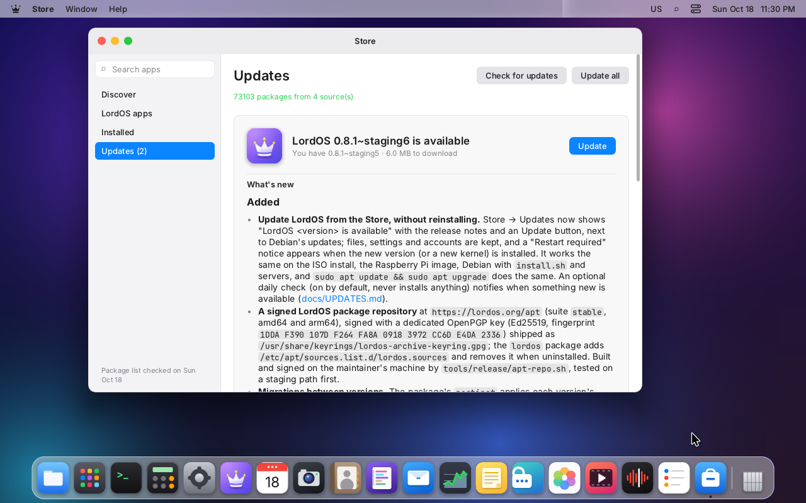
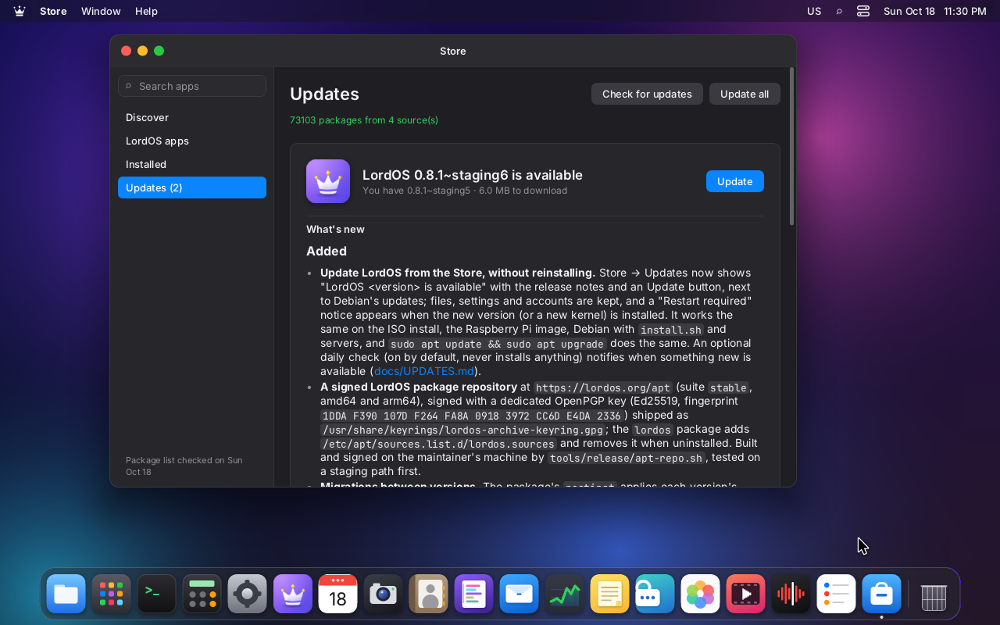
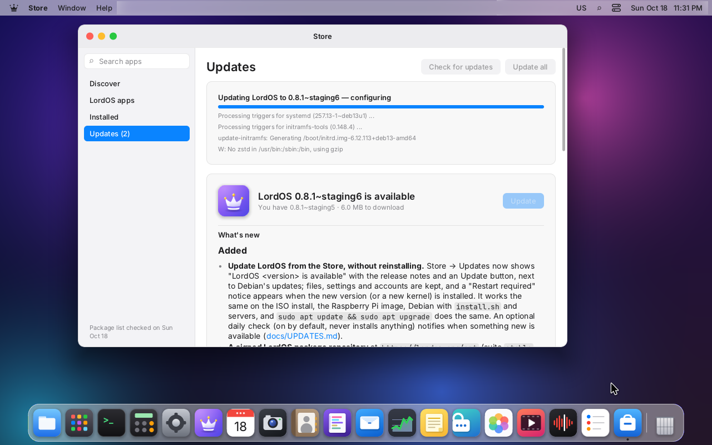
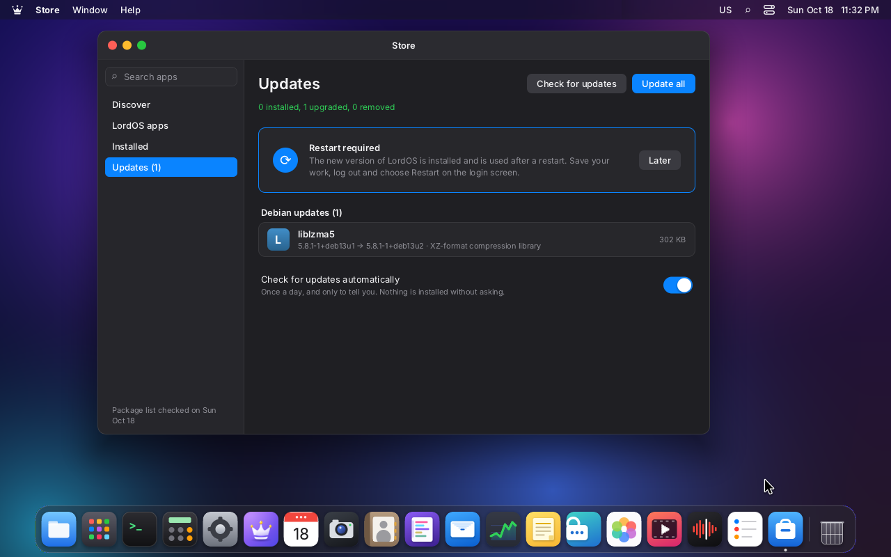
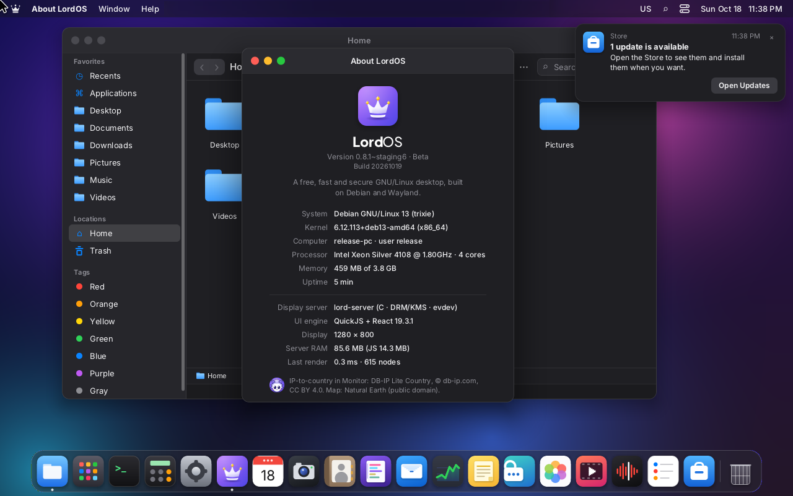

# Updating LordOS in place

From 0.8.1, a LordOS system moves to a new version without reinstalling: the Store shows
"LordOS <version> is available" with the release notes, installs it with the same package engine
it uses for Debian packages, applies whatever the new version changes in the system (the
migrations below) and asks for a restart. Files, settings and accounts are kept. It works the same
on a PC installed from the ISO, on the Raspberry Pi 5 image, on Debian 13 with `install.sh` and on
a server or VPS, and `apt` sees the same repository.

| Piece | Where |
|---|---|
| The signed repository | `https://lordos.org/apt`, suite `stable`, component `main`, amd64 and arm64 |
| Its source on every system | `/etc/apt/sources.list.d/lordos.sources` (deb822, `Signed-By:`) |
| Its key on every system | `/usr/share/keyrings/lordos-archive-keyring.gpg` (in the `lordos` package) |
| Building, signing and uploading it | `tools/release/apt-repo.sh` (on the maintainer's Mac) |
| The Store's side | `apps/store/debian.js` (`Updates`), `sdk/updates.js`, `lord.pkg.releaseNotes` and `lord.pkg.rebootRequired` (`server/src/ui/js_pkg.c`) |
| Version-to-version changes | `packaging/migrations/` (system, as root) and `MIGRATIONS` in `sdk/settings.js` (each user's settings) |

## The repository

```
https://lordos.org/apt/
  dists/stable/InRelease               signed (clear-signed Release)
  dists/stable/Release, Release.gpg    the same, with a detached signature
  dists/stable/main/binary-amd64/Packages(.xz, .gz)
  dists/stable/main/binary-arm64/Packages(.xz, .gz)
  dists/stable/main/notes/ReleaseNotes(.xz)   release notes of each lordos version (below)
  pool/main/l/lordos/lordos_<version>_<arch>.deb
  lordos.sources                       the same file the package installs
https://lordos.org/keys/lordos-archive-keyring.gpg (.asc)   the public key
https://lordos.org/apt-staging/        the same layout, for tests before anything goes live
```

- **One suite, `stable`,** with every published release (until 1.0 every release is a beta, and the
  betas are what users run). Origin and Label are `LordOS`. Test builds go to `apt-staging`, never to
  `apt`. A `beta` suite can be added later for opt-in previews.
- **The pool only grows.** A published `.deb` is never replaced (`apt-repo.sh` refuses a version that
  already exists with other contents); the previous versions stay, so `apt install lordos=<version>`
  can go back. Versions follow dpkg's order, so a test build named `0.8.1~staging1` sorts after
  `0.8.0` and before `0.8.1` (checked by `build/pkg-test`).
- **Built with Debian's tools.** `apt-ftparchive` writes `Packages` and `Release` (in a
  `debian:trixie` container on the Mac, or natively on a Debian host); `gpg` signs on the Mac.
- **Release notes.** `main/notes/ReleaseNotes` is a deb822 file covered by the signed `Release`:
  one stanza per lordos version with `Package`, `Version` and `Notes` (the version's section of
  [CHANGELOG.md](../CHANGELOG.md) as Markdown, through `tools/release/release-notes.sh` without its
  footer; continuation lines start with a space, ` .` is an empty line). Our package engine downloads
  it in `pkg-update`, checks its SHA-256 against `InRelease` like any index and keeps it in
  `/var/lib/lordos/pkg/notes`; `lord.pkg.releaseNotes(name, version)` returns the Markdown. `apt`
  ignores the file.

### Serving it (CDN)

`lordos.org` is S3 behind CloudFront. Two things the website's defaults do would break APT, so the
repository paths need their own CloudFront cache behaviors, `apt/*` and `apt-staging/*`:

1. **Plain HTTP must be served, not redirected.** Our package engine has no TLS of its own (see
   [PACKAGES.md](PACKAGES.md), "HTTP instead of HTTPS") and reads `https://` sources over `http://`,
   exactly like `http://deb.debian.org`: what protects the files is the signature and the SHA-256
   of every file, not the transport. `apt` itself uses HTTPS. Viewer protocol policy: **HTTP and
   HTTPS** (`allow-all`).
2. **No URL rewriting.** The site's `lordos-router` function (viewer request) turns a path without
   an extension into `<path>/index.html`, and APT's files `InRelease`, `Release` and `Packages` have
   none. The two behaviors have **no function association**.

Everything else is copied from the default behavior: origin `s3-lordos.org`, GET/HEAD, the same
cache policy and response headers policy. `keys/*` needs nothing special (HTTPS, files with an
extension). `tools/web/cdn-apt-behaviors.sh <admin-profile>` makes this change (once, by the
account's administrator: the deploy profile cannot change the distribution). The website's deploy
script (`tools/web/deploy.sh`) never touches `apt/`, `apt-staging/` or `keys/`.
`apt-repo.sh verify <target>` checks all of this from the outside.

## The keys

| Key | Private part | Public part |
|---|---|---|
| **APT archive key** (signs `InRelease`/`Release.gpg`): OpenPGP v4, Ed25519, sign only, `LordOS Archive Signing Key`, fingerprint `1DDA F390 107D F264 FA8A  0918 3972 CC6D E4DA 2336`, expires 2031-10-18 | the maintainer's Mac only: GnuPG home `~/.config/lordos-release/apt-gnupg` (0700) and an armored export `~/.config/lordos-release/apt-archive-signing.secret.asc` (0600); backup copies of both in `~/.ssh/ssh/lordos-release/`, the same place as the release key's | `packaging/keys/lordos-archive-keyring.gpg` (and `.asc`), installed as `/usr/share/keyrings/lordos-archive-keyring.gpg`, published at `https://lordos.org/keys/` |
| **Release key** (signs `SHA256SUMS` of a GitHub release; raw Ed25519) | `~/.config/lordos-release/release-ed25519.key.pem` | see [SIGNING.md](SIGNING.md) |

APT needs OpenPGP, so the repository has its own key instead of reusing the raw Ed25519 release key.
Neither private key is ever copied to a VM, a build machine, a server or the repository. Keep an
offline copy of `~/.config/lordos-release/` (the whole folder) as well.

**Before 2031-10-18**, extend the key's expiry on the Mac (`gpg --quick-set-expire <fingerprint> 5y`
with `GNUPGHOME=~/.config/lordos-release/apt-gnupg`), export it again into `packaging/keys/` and ship
it in a release some months before the old date: a system that has not updated by then needs
`install.sh` again. To replace the key, ship the new one in the keyring file next to the old one for
at least one release before signing with it.

## How a system gets the repository

- **The `lordos` package** carries the source as `/usr/lib/lordos/apt/lordos.sources`. Its
  `postinst` copies it to `/etc/apt/sources.list.d/lordos.sources` when that file is missing, and
  its `postrm` removes it with the package (otherwise `apt update` would fail on a repository whose
  key is gone). It is not a conffile: an administrator's change, such as `Enabled: no` to stop
  LordOS updates, is kept on every upgrade.
- **New installs** from the 0.8.1 ISO, the Raspberry Pi image and `install.sh` get it with the
  package; none of them needs a step of its own.
- **LordOS 0.8.0** (one time): its package has no repository yet. Either run the installer again,
  which upgrades in place (it keeps the login setup, the users and their settings). A system
  installed from the 0.8.0 ISO has no `curl`, so install it first:

  ```sh
  sudo apt update && sudo apt install -y curl
  curl -fsSL https://lordos.org/install.sh | sh
  ```

  or add the repository by hand and upgrade with apt (or with Store → Updates afterwards):

  ```sh
  sudo curl -fsSLo /usr/share/keyrings/lordos-archive-keyring.gpg https://lordos.org/keys/lordos-archive-keyring.gpg
  gpg --show-keys /usr/share/keyrings/lordos-archive-keyring.gpg    # 1DDA F390 107D F264 FA8A  0918 3972 CC6D E4DA 2336
  sudo curl -fsSLo /etc/apt/sources.list.d/lordos.sources https://lordos.org/apt/lordos.sources
  sudo apt update && sudo apt install lordos
  ```

  That file is byte for byte the one the package would write, so the package keeps it as it is.

```
# /etc/apt/sources.list.d/lordos.sources
Types: deb
URIs: https://lordos.org/apt
Suites: stable
Components: main
Signed-By: /usr/share/keyrings/lordos-archive-keyring.gpg
```

## Store → Updates

| | |
|---|---|
|  |  |
| "LordOS <version> is available", with the release notes | The same in dark mode |
|  |  |
| Updating (the plan, then the progress of `pkg-install lordos`) | Installed: "Restart required" |
|  | |
| The daily check found an update and says so once (here a Debian update; after the restart, About shows the new version) | |

(Screenshots from the staging test on VM 120: the test builds are called `0.8.1~staging5` and
`~staging6`, and their notes are 0.8.1's unreleased changelog.)

- **"Check for updates"** runs `pkg-update`: every source's signed `InRelease`, Debian's and
  LordOS's, then the indexes and the release notes.
- **"LordOS <version> is available"** appears when the candidate of the `lordos` package is newer
  than the installed one: the installed version, the download size, **What's new** (the release
  notes, the first lines with "Show all") and **Update**. Update shows the plan first
  (`lord.pkg.plan({ install: ['lordos'] })`: lordos and any new dependency), then runs
  `pkg-install lordos` through the administration helper, with the same progress bar as any
  install. Only administrators (the `sudo` group) can update.
- **Debian updates** are listed below with "Update all" (`pkg-upgrade`, which also takes lordos if
  it is pending).
- **"Restart required"** appears when an installed update needs it: the running `lord-server` is
  not the installed `lordos` version, or `/run/reboot-required` exists (the Debian convention: the
  lordos `postinst` writes it on an upgrade, and its kernel hook
  `/etc/kernel/postinst.d/zz-lordos-reboot-required` on every new kernel). "Restart Now…" opens the
  session's Restart dialog (with its countdown and the open apps; [SESSIONS.md](SESSIONS.md)) when
  the session can restart; otherwise it says to log out and choose Restart on the login screen.
  "Later" hides it. Nothing restarts on its own: the update replaces the files under the running
  session, which keeps working with what it already loaded until the restart.
- **Check for updates automatically** (on by default, per user, `settings.json` → `updates.autoCheck`):
  five minutes after login and then every hour, if the lists are more than a day old and the user is
  an administrator, the session runs `pkg-update` quietly and, when the set of available updates is
  new, shows one notification ("LordOS 0.8.2 is available", or "3 updates are available") that
  opens Updates. It never installs anything. When nothing changed it costs a few small requests
  (`If-Modified-Since`, 304). LordOS has no metered-connection setting yet; turning the check off
  is the way to avoid it on a metered link.
- **Local repositories.** The engine also reads `file:/path` sources (a copy of the repository on a
  disk or USB stick, for machines without internet), checked the same way.

The whole path is our own engine ([PACKAGES.md](PACKAGES.md)): the `InRelease` signature is checked
by `server/src/pkg/pgp.c` (Ed25519 v4, SHA-512) against the keyring named in `Signed-By`, every
file by its SHA-256, and dpkg installs. `apt` and the Store share dpkg's lock and see the same
state, so either can be used.

## Migrations

What changes between versions in the installed system (not in the files the package ships) is a
migration. Two kinds:

**System migrations** (root), `packaging/migrations/NNN-<version>-<name>.sh`, installed in
`/usr/lib/lordos/migrations/` and run by `/usr/lib/lordos/migrate` from the package's `postinst`:

- each one runs **once**, in `NNN` order; `/var/lib/lordos/migrations/<name>` records it (the time
  it ran). So 0.8.1 → 0.8.2 → 0.8.3 and 0.8.0 → 0.8.3 in one step run the same migrations and end
  in the same state;
- it gets the version it upgrades from in `LORDOS_OLD_VERSION` (empty on a new install, where
  most migrations have nothing to do) and runs under `sh -eu`;
- it must be **idempotent** and safe without systemd (a chroot building an image), must not touch
  the users' home folders, and must keep what an administrator changed;
- if one fails, the ones after it don't run, `dpkg` leaves lordos unconfigured and says so, and the
  next `dpkg --configure -a` or Store update runs it again.

Today's migrations:

| Migration | What it does |
|---|---|
| `001-0.8.1-network-permissions` | Enables `lord-netperm.service` (per-app network permissions) where `lordos.service` is enabled. The ISO, the Pi image and `install.sh` already did; a system set up with `apt` alone had it off. Runs once: disabling it later sticks. |
| `002-0.8.1-root-ssh-keys` | 0.8.1 adds `PermitRootLogin no` (`/etc/ssh/sshd_config.d/10-lordos.conf`). On an **upgrade** from 0.8.0 with SSH installed and keys in `/root/.ssh/authorized_keys` (a VPS run as root), it writes `09-lordos-root-keys.conf` with `PermitRootLogin prohibit-password`, so root keeps logging in with keys (never passwords) instead of being locked out at the next restart. New installs never get it; delete the file to apply LordOS's default. |
| `003-0.8.2-drivetemp` | 0.8.2 ships `/usr/lib/modules-load.d/lordos-drivetemp.conf` (SATA disk temperatures in Monitor → Disks, read at boot). On a running system it loads `drivetemp` once, so the temperatures show without a restart. Does nothing without systemd (an image being built) or where the kernel has no `drivetemp`. |
| `004-0.8.3-smartd-off` | 0.8.3 ships a drop-in that keeps Debian's smartd (`smartmontools.service`) off unless `/etc/lordos/smartd-enabled` exists ([SYSTEM.md](SYSTEM.md), "smartd"). A condition is only checked at start, so a smartd already running from an earlier smartmontools install is stopped once. Does nothing without systemd, without smartmontools or where an administrator opted in. |
| `005-0.8.4-browser-frames` | 0.8.4 makes the preinstalled browsers draw their own bar with LordOS's window buttons (`WAYLAND.md`, "The browsers by default"). Where `/etc/chromium/master_preferences` still has the 0.8.3 ISO's `"custom_chrome_frame": false` it becomes `true` and the GTK theme is added (new Chromium profiles only); where `/etc/firefox-esr/lordos.js` is still exactly the 0.8.3 file it becomes `inTitlebar` 1 (every Firefox profile whose user didn't change «Title Bar»). Anything an administrator changed is kept; home folders are not touched. |

**Settings migrations** (each user), in `sdk/settings.js`: `MIGRATIONS` is a list of
`[schema, (settings) => newSettings]` applied in order when the session loads
`~/.config/lordos/settings.json`; the file records the last one in `schema`. 0.8.1 starts recording
it (schema 1, nothing changes). A setting renamed or reshaped in a release gets an entry here, so a
user who skips versions still converges.

Things that only need new files (a new unit, a new default config) ship in the package as usual; a
new unit that must be enabled on upgraded systems needs a migration, since `postinst` only enables
`lord-fand`.

## Raspberry Pi firmware packages

Since 0.8.4.1 the repository also carries, **for arm64 only**, the Raspberry Pi bootloader updater
and exactly what its `Depends` need that Debian 13 doesn't have, copied unchanged from Raspberry
Pi's archive (`archive.raspberrypi.com/debian`, trixie, main):

| Package | Why |
|---|---|
| `rpi-eeprom` | the bootloader images (`/usr/lib/firmware/raspberrypi/bootloader-2712/…`) and `rpi-eeprom-update`, used by Settings → Board firmware (`SETTINGS.md`) |
| `raspi-utils`, `raspi-utils-core`, `-dt`, `-eeprom`, `-otp`, `raspinfo`, `libgpiolib0`, `libdtovl0` | `rpi-eeprom` depends on `raspi-utils` (`vcgencmd`, used to read the running bootloader), which depends on these |
| `kms++-utils`, `libkms++0` | `raspinfo` depends on them |

Their recommendations (`flashrom`, `rpieepromab`) are not mirrored: without them a Pi 5 stages the
update for the bootloader to apply at the next boot. Raspberry Pi's whole archive is never added to a
system by LordOS's packages.

- **Pinned and verified.** `tools/release/rpi-mirror.list` names each package, version, architecture
  and SHA-256 (with its licence). `apt-repo.sh build <target> --rpi …` fetches Raspberry Pi's
  `InRelease`, verifies it with `gpgv` against `tools/release/raspberrypi-archive-keyring.pgp` (the
  key from Raspberry Pi's `raspberrypi-archive-keyring` package; the script checks its fingerprint,
  `CF8A 1AF5 02A2 AA2D 763B  AE7E 82B1 2992 7FA3 303E`), checks `main/binary-arm64/Packages.gz`
  against it, and takes a file only when its SHA-256 matches both the index and the pinned line.
  Verified files are kept in `~/.local/share/lordos-apt/rpi-cache`, so a pinned version can still be
  published after Raspberry Pi's archive keeps only a newer one (it keeps one version per package).
  `apt-repo.sh rpi-fetch <target>` only fetches and verifies. A new upstream version is a new line
  in the list, reviewed like code; the pool only grows.
- **Only on arm64.** They live under `pool/rpi/` and only the `binary-arm64` index lists them (most
  are `Architecture: all`, which would otherwise appear on every PC's Store).
- **Licences** (each package's `debian/copyright`, shipped inside it): the scripts and `raspi-utils`
  are BSD-3-Clause; the bootloader images are under Raspberry Pi's binary licence (redistribution in
  unmodified binary form, for use with Raspberry Pi devices, with the notice: the `.deb` is copied
  as is); `kms++` is MPL-2.0, its source is Raspberry Pi's `kms++` source package of the pinned version
  ([COMPLIANCE.md](COMPLIANCE.md)).
- **Which source wins.** On the LordOS Pi image, which also lists Raspberry Pi's archive with
  priority 990 for these packages (`/etc/apt/preferences.d/raspberrypi`), apt takes the newest
  version among the 990 sources; ours mirrors the same files, so it only matters when a newer version
  is in one of them. No pin is needed for our copy: on a board without Raspberry Pi's archive it is
  the only candidate (priority 500), and our package engine takes the highest version of any
  source. A newer `rpi-eeprom` reaches a board through Store → Updates or `apt upgrade` like any
  other package.

## The Raspberry Pi kernel

The LordOS kernel for the Pi 5 (`linux-image-<version>-lordos-rpi-2712`, from
`tools/rpi/build-kernel.sh`) is **not** in the repository yet: kernel updates on the Pi come with a
new image for now. Its package installs exactly like Raspberry Pi's own (`raspi-firmware`'s hook
copies the newest kernel to `kernel_2712.img`), with no `tryboot` fallback, so a broken kernel would
leave the board unbootable with no way back from the Store. It goes into the repository when the
image boots new kernels through the firmware's `tryboot` first and keeps the previous one as the
fallback. The `lordos` package itself updates on the Pi like anywhere else (arm64).

Since `6.18.57-3+lordos` (0.8.4) each kernel revision is its own release and package
(`linux-image-6.18.57-lordos.3-rpi-2712`), so a new one installs next to the previous one instead of
over it, and the previous one stays bootable from its own folder on `bootfs` (`RASPBERRY.md`,
"Switching kernels on a board"). That is the package side of the repository path; the automatic
`tryboot` first boot is still missing, so the kernel stays out of the repository (staging and live)
for now.

## Release tests

- **0.8.4 (2026-10-25):** 0.8.3 → 0.8.4 from the Store and with `apt` on VM 120, and with `apt` on the
  Raspberry Pi 5: migration 005 only, the two new libraries (`libsrtp2-1`, `libusrsctp2`) installed
  as dependencies, settings byte-identical; `apt-get upgrade` keeps `lordos` back (new
  dependencies). A staging package re-published under the same version was refused by the Store's
  size check while the CDN still served the old file: staging is append-only too, and a re-upload
  needs a CloudFront invalidation of its path ([ISO.md](ISO.md), "Release test (0.8.4 Beta)").

## Tests (2026-10-18)

- **Staging** (`https://lordos.org/apt-staging`, built and signed on the Mac with `apt-repo.sh`):
  lordos 0.8.0 (amd64, arm64, from the 0.8.0 release, checked against its signed `SHA256SUMS`) and
  test builds `0.8.1~staging*`.
- **Signatures:** `InRelease` verifies with LordOS's own code (`build/pkg-test pgp
  packaging/keys/lordos-archive-keyring.gpg InRelease`: 1 key, 1 valid signature) and with Debian
  13's `apt` (`sqv`); one changed byte is rejected (`pkg.pgp.badSignature`).
- **apt, VM 120 (0.8.0 installed from the ISO, user logged in):** the 0.8.0 one-time step, then
  `apt install lordos`: 0.8.0 → 0.8.1~staging in 29 s with the session open; migration 001
  applied; `lordos`, `lord-netperm`, `lord-fand` active; `settings.json` byte for byte the same;
  `/run/reboot-required.pkgs` = `lordos`; after the restart the login screen came back with the new
  version. That run found the `PermitRootLogin no` lock-out (the VM is administered as root with a
  key), which migration 002 now prevents.
- **`install.sh` on an installed LordOS** (VM 120 back at 0.8.0, session running): with the
  staging package (`--deb`) it upgraded in place to 0.8.1~staging5, kept `session.conf`, the users,
  groups and settings, ran migrations 001 and 002, and reported "LordOS is running and was upgraded
  in place"; running it again reinstalls the same version and changes nothing else.
- **Store → Updates, VM 120 at 0.8.1~staging5,** the repository as a `file:` source (the same
  signed tree as staging): Check for updates verified LordOS's `InRelease` with our own code
  (73,103 packages from 4 sources), showed "LordOS 0.8.1~staging6 is available" with its notes and
  liblzma5 under Debian updates; Update showed the plan (1 to update, 6.0 MB) and installed it with
  progress; "Restart required" appeared; after the restart the session came back on staging6 with
  the user's settings (and `schema: 1` recorded). **Daily check:** with the lists aged two days,
  five minutes after login the session ran `pkg-update` on its own and showed "1 update is
  available" once (`updates.notified` recorded in `settings.json`). **Second upgrade:** a build with a third
  migration ran only that one (`old version: 0.8.1~staging3`); `apt install --reinstall lordos` and
  running `/usr/lib/lordos/migrate` again applied nothing.
- **Raspberry Pi 5 (arm64, lordos 0.8.0):** `apt-get update` against a copy of staging in a
  temporary `Dir::State::Lists` (nothing on the board changed; removed afterwards): signature good,
  `binary-arm64/Packages` read, `lordos 0.8.0 arm64` listed with the right `Filename` and SHA-256.
- `make -C server test` (21 suites passed, 5 skipped for missing tools; `pkg-test` 83/83 with the
  release-notes reader and pre-release version order), `node tools/i18n-check.mjs`, the brand
  check and `shellcheck` on every new script.
- **Not yet:** the CDN change above, so `https://lordos.org/apt-staging` is uploaded and signed but
  `InRelease` still answers 404 (the router) and http 301; `apt-repo.sh verify staging` passes
  only after `tools/web/cdn-apt-behaviors.sh` is run by the account administrator.
