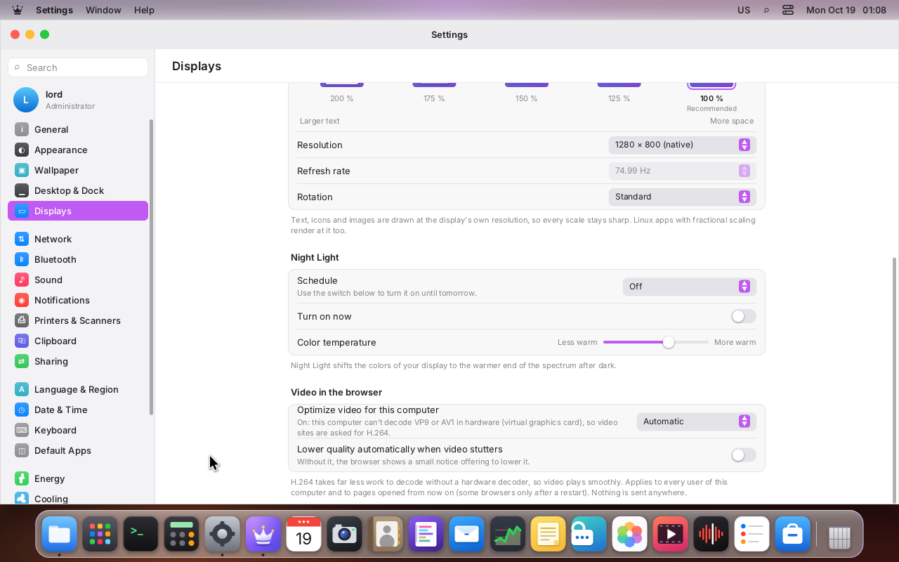
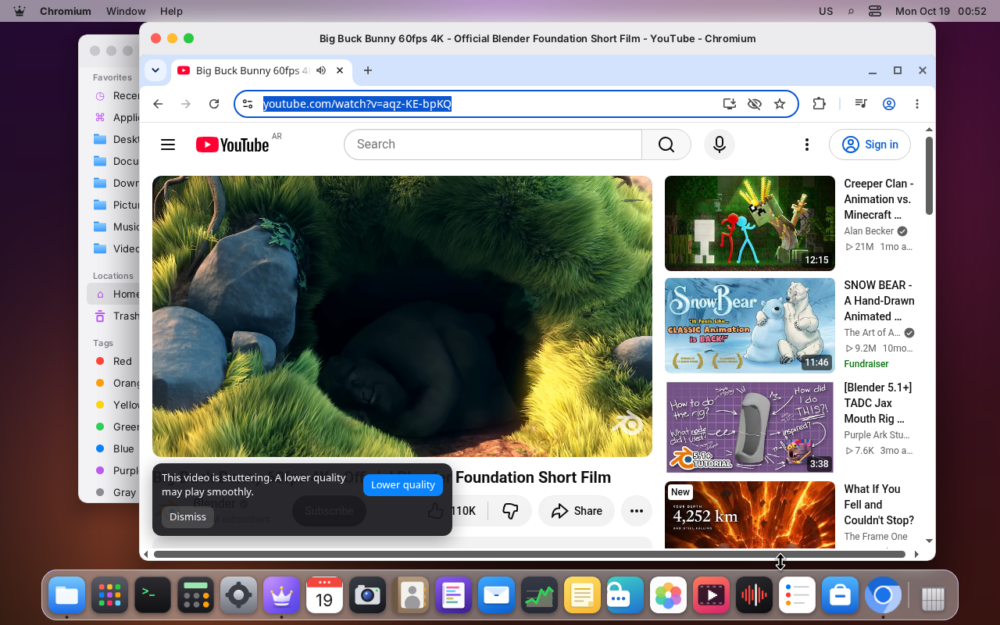
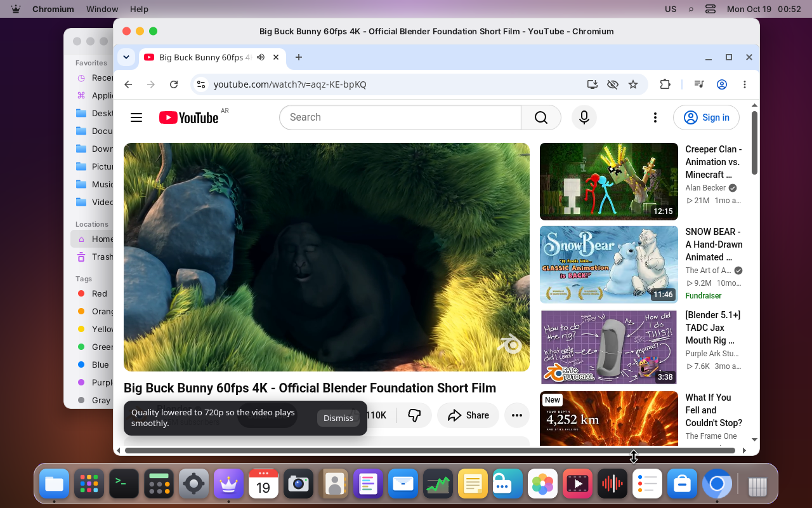

# Video in the browser without hardware decoding

Video sites send VP9 or AV1 when the browser says it can play them. Without a hardware decoder
for those codecs the browser decodes them on the processor, and on a slow or shared processor the
video stutters. The real case that started this: a LordOS virtual machine on VMware, YouTube at
1080p in AV1, decoded by Chromium in software (`media-internals`: `kIsPlatformVideoDecoder` false,
`Dav1dVideoDecoder`), the tab at about 68 % CPU and the video choppy. The Raspberry Pi 5 has no
hardware decoder for H.264, VP9 or AV1 (only HEVC), and many older PCs lack VP9 or AV1 decoding.

H.264 costs far less to decode in software. Since 0.8.2 LordOS finds out at every boot what the
hardware decodes and, when VP9 or AV1 is missing, asks the browsers for H.264 instead. When a video
still drops frames, a small notice offers a lower quality.

| Settings → Displays → Video in the browser | The notice when a video stutters | After "Lower quality" |
|---|---|---|
|  |  |  |

Nothing here touches the network or reports anything: the decision is made on the computer and the
browsers read it from local files.

## How it fits together

```
 boot ──▶ lord-server (session)                       lord-media (sandboxed helper)
          media/hwdec.c ── render nodes (open fds) ──▶ lm_hwprobe.c: VA-API profiles with the
            · virtual GPU? (DRM driver name)           decode (VLD) entrypoint → JSON
            · V4L2 m2m decoders (/dev/videoN)
            · cache ~/.cache/lordos/video-hw.json (per boot_id)
                │  lord.media.hwDecode()
                ▼
          sdk/video.js (at login and when the setting changes)
                │  admin.run('video-optimize', '<mode> <on|off> <vp9 yes|no> <av1 yes|no>')
                ▼
          admin helper (root, hw/hw_admin.c): fixed text only
            /etc/chromium/policies/managed/lordos-video.json   ── managed storage of the extension
            /etc/firefox-esr/lordos-video.js                    ── a default pref (AV1 off)
                │
                ▼
          Chromium + /usr/share/chromium/extensions/lordos-video (Debian loads every folder there)
            stutter.js (extension world) ── reads the policy ── tells page.js which codecs to hold back
            page.js (page world)        ── MediaSource / canPlayType / mediaCapabilities say "no"
```

## 1. Detecting hardware decoding (`server/src/media/hwdec.c`)

Asked once per boot (the first `lord.media.hwDecode()` call starts it; `sdk/video.js` makes that
call at login) and cached in `~/.cache/lordos/video-hw.json` with `/proc/sys/kernel/random/boot_id`,
because a live USB boots on a different computer each time.

1. **Virtual GPU:** each `/dev/dri/renderD*` is opened and its DRM driver asked with
   `DRM_IOCTL_VERSION`. `virtio_gpu`, `vmwgfx`, `qxl`, `bochs-drm`, `cirrus`, `hyperv_drm`,
   `vboxvideo`, `simpledrm`, `vkms` are virtual: no hardware decoding, without asking further. A
   virtual machine with a real GPU passed through (`i915`, `amdgpu`, …) is probed like any other
   computer. The machine's own name (DMI vendor and product, the CPU `hypervisor` flag) is only
   reported (`"vm"`), not used for the decision.
2. **VA-API:** the real render nodes (up to four) go as open descriptors to `lord-media` (job
   `MK_HWPROBE`, `server/src/media/helper/lm_hwprobe.c`), the only binary that links libva. It
   locks itself in its usual sandbox first (`sandbox_apply_helper`, with the DRM ioctls), then
   lists the profiles and keeps those with the `VAEntrypointVLD` (decode) entrypoint: VP9 profile
   0/2, AV1 profile 0, H.264 and HEVC. A helper that doesn't answer within 5 s counts as "no".
3. **V4L2 (ARM boards):** every `/dev/videoN` with the memory-to-memory capability is asked for
   the formats of its OUTPUT queue: `VP9F`/`AV1F`/`S264`/`S265` (stateless) and
   `VP90`/`AV01`/`H264`/`HEVC` (stateful). On the Raspberry Pi 5 only HEVC shows up. Cameras and
   other capture devices don't have that capability and are closed right away.

The answer (`lord.media.hwDecode()`):

```json
{"boot":"f31202b8-…","vm":"qemu","gpu":"virtio_gpu","virtualGpu":true,"vaapi":false,"vendor":"",
 "v4l2":false,"vp9":false,"av1":false,"h264":false,"hevc":false,"reason":"virtualGpu"}
```

`reason` is `ok`, `virtualGpu`, `noDriver` (no VA-API driver and no V4L2 decoder) or `noProfiles`.
`LORD_MEDIA_HW=0` (no hardware decoding for LordOS's own player) also makes this answer "no".

`build/hwdec-test` checks the virtual GPU list and the virtual machine names.

## 2. The setting (Settings → Displays → Video in the browser)

- **Optimize video for this computer:** **Automatic** (default: on only for the codecs the
  hardware can't decode), **Always** (hold back VP9 and AV1), **Never**. The line under it says
  what is happening and why ("On: this computer can't decode VP9 or AV1 in hardware (virtual
  graphics card), so video sites are asked for H.264").
- **Lower quality automatically when video stutters:** off by default; without it the browser
  only shows the notice.

Stored per user in `settings.json` as `video: { mode, autoLower }` (`sdk/video.js`). The browsers'
files are system-wide, so the setting applies to every user of the computer; the last session to
log in or change it wins. Code: `apps/settings/Video.jsx`.

### The admin action `video-optimize`

`video-optimize <auto|always|never> <on|off> <yes|no> <yes|no>` (the last two: hardware VP9 and AV1
decoding found this boot), marked `A_ANYONE` like `power-profile`: it only chooses between fixed
texts, so it needs no administrator. Every value is checked against its closed list on the root side
(`hw_video_files` in `server/src/hw/hw_admin.c`, tested in `build/settings-hw-test`), and it writes,
through a temporary file and `rename`, only when the text changes:

- `/etc/chromium/policies/managed/lordos-video.json`: the extension's managed storage
  (`"3rdparty" → "extensions" → kadhcpnkalbaminbojfmbmlgoheicmjo`): `mode`, `autoLower`, `hwVp9`,
  `hwAv1`. The extension makes the decision.
- `/etc/firefox-esr/lordos-video.js` (only if `/etc/firefox-esr` exists): `pref("media.av1.enabled",
  false);` when AV1 is held back, nothing otherwise.

Neither is a conffile: the package doesn't ship them, and its `postrm` removes them.

## 3. The extension (`assets/browser/video/`)

Written for LordOS (MIT), no third-party code. Installed by the `lordos` package into
`/usr/share/chromium/extensions/lordos-video/`; Debian's Chromium wrapper (`/etc/chromium.d/extensions`)
passes every folder there to `--load-extension`, the same way Debian's own `webext-*` packages
work. The manifest carries a public `key`, so its id is always `kadhcpnkalbaminbojfmbmlgoheicmjo`
(the id the policy names). No background page, no network permission, only `storage`.

| File | World | What it does |
|---|---|---|
| `page.js` | the page's, at `document_start` | wraps `MediaSource.isTypeSupported` (and `ManagedMediaSource`), `HTMLMediaElement.canPlayType` and `navigator.mediaCapabilities.decodingInfo` so they answer "not supported" for the held-back codecs (`vp09`/`vp9`, `av01`/`av1`); lowers the player's quality one step when asked |
| `policy.js` | the extension's | reads the managed policy and decides: Never → nothing, Always → VP9 and AV1, Automatic → the codecs with `hwVp9`/`hwAv1` false; without a policy (another system) → nothing |
| `stutter.js` | the extension's, at `document_start` | tells `page.js` the decision (a `lordos-video-codecs` event: the page's world can't read the policy), then watches the playing video's `getVideoPlaybackQuality()` |

**Scope: YouTube only** (`www.`, `m.`, `music.` and `youtube-nocookie.com`, also embedded in other
sites through its iframe). It is where the problem shows up most and where we can test it; the
quality can only be lowered where the player has an API for it. Other sites can be added to the
manifest's `matches` once tested.

The decision reaches `page.js` a few milliseconds after the page starts, long before the site's
player script loads and asks; tested by starting Chromium straight on a YouTube address. A policy
change is picked up by Chromium while it runs (it watches its policy folder) and counts from the
next page load; tested going from Always to Never within 5 s.

**Stutter detection.** Every 2 s, while a video plays in a visible tab: if more than 15 % of the
frames of the last 2 s were dropped, three samples in a row (6 s), and at least 20 frames went by
per sample, the video stutters. Playing, seeking or a size change (a new quality) restarts the
count after 6 s. Then:

- **Lower quality automatically off (default):** a small card at the bottom of the page (or of the
  player in fullscreen), "This video is stuttering. A lower quality may play smoothly." with
  **Lower quality** and **Dismiss**. Dismissed, it doesn't come back in that tab.
- **On:** the quality goes one step down by itself (at most every 20 s, never below 360p) and a
  short card says "Quality lowered to 720p so the video plays smoothly."

The card is built node by node in a closed shadow root (the site's Trusted Types policy refuses
HTML strings, and the site's styles don't reach it). Its texts come from the extension's own
`_locales/{en,es,pt}`, following the browser's language.

## 4. Firefox ESR

Debian's `firefox-esr` only installs signed extensions. Tested on VM 122 with Firefox ESR 153:
the same extension (`manifest.firefox.json`, id `video@lordos.org`) forced through
`/usr/lib/firefox-esr/distribution/policies.json` (`ExtensionSettings`, `force_installed`, a local
`file://` XPI) is refused, and
`about:policies` shows "Not fully applied"; with `xpinstall.signatures.required` set to false it
installs and runs. LordOS doesn't turn signature checking off for every extension to get this.

So for now Firefox gets only what a preference can do: `media.av1.enabled = false` (a default
pref in `/etc/firefox-esr/lordos-video.js`, which the user can still change in `about:config`).
YouTube then sends VP9, which costs less than AV1. VP9 has no switch of its own in Firefox:
`media.mediasource.vp9.enabled` doesn't change what `MediaSource.isTypeSupported` answers for WebM,
and `media.webm.enabled` would turn off every WebM video. There is no stutter notice in Firefox.

**Follow-up:** sign the extension on addons.mozilla.org as an unlisted add-on (self-distribution;
needs the maintainer's account), ship the signed XPI and force it with Firefox's `policies.json`
(`ExtensionSettings` with a local `install_url`; the distribution folder above is the one this
Firefox was seen reading), and its
settings with `"3rdparty": {"Extensions": {"video@lordos.org": {…}}}` in the same file (the root
action would then write that file). To build the XPI to sign:

```sh
cd assets/browser/video && mkdir -p /tmp/xpi && cp -r _locales *.js *.png schema.json /tmp/xpi/ &&
  cp manifest.firefox.json /tmp/xpi/manifest.json && (cd /tmp/xpi && zip -r ../lordos-video.xpi .)
```

## Measurements (VM 122)

Proxmox q35 VM, 4 vCPUs of a Xeon Silver 4108 (1.8 GHz), virtio-gpu without 3D (so: no hardware
decoding, `reason: virtualGpu`), LordOS compositing on the CPU, the browser window not maximized. YouTube, quality
forced through the player. CPU is the whole browser process tree over 20 s, in % of one core
(400 % = all four). Decoder names from Chromium's media-internals (DevTools `Media` domain), codecs
from the player's own statistics. The host is shared with other VMs, so runs vary; each cell lists
every run.

| Browser | Video | Without (Never) | With (Automatic) |
|---|---|---|---|
| Chromium 155 | 1080p60 (Big Buck Bunny) | AV1, `Dav1dVideoDecoder`: 147, 143, 125, 98 % | H.264, `FFmpegVideoDecoder`: 108, 99, 92 % |
| Chromium 155 | 1080p25 (music video) | AV1, `Dav1dVideoDecoder`: 88, 74, 73 % | H.264, `FFmpegVideoDecoder`: 64, 61, 59 % |
| Firefox ESR 153 | 1080p60 | AV1: 112 % | VP9: 88 % |
| Firefox ESR 153 | 1080p25 | AV1: 64 % | VP9: 47 % |

`kIsPlatformVideoDecoder` is false in every case (there is no hardware decoder here). On this
processor (AVX-512, where dav1d is fast) H.264 saves about a fifth to a quarter of the browser's CPU;
the gain is larger on older processors without wide vector units, where AV1 in software is much
slower. At 1080p60 this VM drops 40–55 % of the frames with either codec, because the composition of
a full-HD 60 fps window on the CPU is the bigger cost there: that is where the notice and "Lower
quality automatically" help (tested: the notice appears within about 15 s, and "Lower quality" and
the automatic mode both go from 1080p to 720p). At 25 fps both play smoothly (1–2 % dropped).

## Limitations

- Only YouTube. Other sites keep VP9/AV1 until they are added and tested.
- Firefox: AV1 off only (VP9 stays, no notice) until the extension is signed.
- Automatic trusts the system probe: if VA-API lists VP9/AV1 but the browser doesn't actually use
  the hardware decoder, the video is still decoded in software; choose **Always** there.
  Not tested on a machine with real hardware decoding (no GPU on the test host).
- H.264 on YouTube stops at 1080p; with the optimization on, higher resolutions aren't offered.
- The setting is system-wide (the browsers read system files); several users share it.
- A policy change counts from the next page load; Firefox needs a restart.

## Testing

```sh
make -C server test          # settings-hw-test (video-optimize), hwdec-test
node tools/i18n-check.mjs
```

On a VM: log in, then `cat ~/.cache/lordos/video-hw.json` and the two files above. On a YouTube
page in Chromium, `MediaSource.isTypeSupported('video/webm; codecs="vp9"')` answers false when VP9
is held back.
