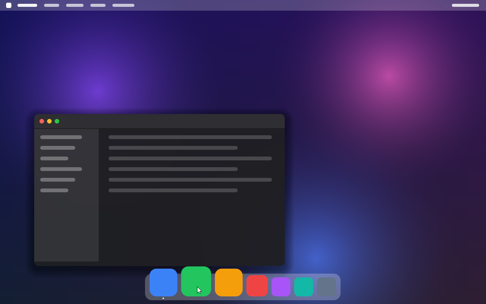

# VM de desarrollo LordOS (Proxmox)

Registro reproducible de cada paso aplicado a la VM. Regla: partir de Debian 13 mínimo
y anotar aquí **todo** paquete o cambio que se agregue.

## Datos

| Campo    | Valor                                   |
|----------|-----------------------------------------|
| Host     | Proxmox VE 9.1 (`172.17.0.2`)           |
| VMID     | 115 — `lordos-dev`                      |
| IP       | `172.17.0.51/24`, gw `172.17.0.1`       |
| Usuario  | `lord` (solo clave SSH, sudo sin clave) |
| Recursos | 4 vCPU (`host`), 4 GB RAM, 32 GB disco  |
| Video    | `virtio` (virtio-gpu → `/dev/dri/card0`)|

Acceso: `ssh -i ~/.ssh/ssh/sshkey/lord.basex.pem lord@172.17.0.51`
Pantalla: consola noVNC de Proxmox (VM 115).

## Paso 1 — Crear la VM (en el host Proxmox)

Imagen base: `debian-13-genericcloud-amd64.qcow2` (Debian oficial, sin escritorio ni
paquetes extra; ~320 paquetes base).

```sh
# /var/lib/vz/snippets/lordos-dev.yaml
#cloud-config
hostname: lordos-dev
users:
  - name: lord
    groups: [sudo, video, input, render]
    shell: /bin/bash
    sudo: ALL=(ALL) NOPASSWD:ALL
    lock_passwd: true
    ssh_authorized_keys: [ "<clave pública>" ]
package_update: true
packages: [qemu-guest-agent]
runcmd:
  - systemctl enable --now qemu-guest-agent
```

```sh
qm create 115 --name lordos-dev --machine q35 --cpu host --cores 4 --memory 4096 \
  --ostype l26 --agent enabled=1 --net0 virtio,bridge=vmbr0 \
  --scsihw virtio-scsi-pci --vga virtio --serial0 socket
qm importdisk 115 /var/lib/vz/template/iso/debian-13-genericcloud-amd64.qcow2 local-lvm
qm set 115 --scsi0 local-lvm:vm-115-disk-0 --boot order=scsi0 --ide2 local-lvm:cloudinit \
  --cicustom user=local:snippets/lordos-dev.yaml \
  --ipconfig0 ip=172.17.0.51/24,gw=172.17.0.1 --nameserver 8.8.8.8
qm resize 115 scsi0 32G
qm start 115
```

Resultado: Debian 13.7, kernel `6.12.111+deb13-cloud-amd64`, 323 paquetes.

## Paso 2 — Kernel genérico (necesario para gráficos)

El kernel `-cloud` **no incluye drivers DRM**: no existe `/dev/dri`, así que un compositor
Wayland no puede arrancar. Se cambia por el kernel genérico de Debian:

```sh
sudo apt-get install -y --no-install-recommends linux-image-amd64
sudo apt-get purge -y 'linux-image-*-cloud-amd64' linux-image-cloud-amd64
sudo reboot
```

Resultado: kernel `6.12.111+deb13-amd64`, módulo `virtio_gpu` cargado,
`/dev/dri/card0` y `/dev/dri/renderD128` presentes.

## Versiones disponibles en Debian 13 (verificado)

| Paquete                 | Versión     | Uso                              |
|-------------------------|-------------|----------------------------------|
| `libwlroots-0.18-dev`   | 0.18.2      | base del compositor en C         |
| `libwpewebkit-2.0-dev`  | 2.48.3      | motor web embebido (shell React) |
| `cog`                   | 0.18.4      | lanzador WPE de referencia       |
| `libwebkitgtk-6.0-dev`  | 2.54.0      | alternativa a WPE                |
| `nodejs`                | 20.19.2     | build de la shell React          |
| `foot`                  | 1.21.0      | terminal Wayland de prueba       |

> Nota: estas versiones se relevaron antes de decidir la arquitectura propia. LordOS **no**
> usa wlroots, WebKit ni cog (ver `ARCHITECTURE.md`). `foot` servirá para probar M4.

## Paso 3 — Toolchain (única instalación de M1)

```sh
sudo apt-get install -y --no-install-recommends build-essential
```

Trae gcc 14.2, make, libc6-dev y linux-libc-dev (headers `drm/drm_mode.h`, `linux/input.h`).
No hace falta nada más: `lord-server` solo enlaza `libc` y `libm` (verificado con `ldd`).
No hay `rsync` en la VM; el código se copia con `tar` por SSH:

```sh
COPYFILE_DISABLE=1 tar czf - --exclude build server | \
  ssh lord@172.17.0.51 'mkdir -p ~/LordOS && cd ~/LordOS && tar xzf - && make -C server'
```

## Paso 4 — Probar M1 y capturar la pantalla

```sh
# en la VM
sudo ./build/lord-server --timeout 60 [--debug]
```

Desde el host Proxmox:

```sh
echo "screendump /tmp/lord.png -f png" | qm monitor 115          # captura real
python3 /root/lord-qmp-input.py 115 1280 800 move 600 190 down move 380 320 up
```

`tools/lord-qmp-input.py` (copiado a `/root/` del host) envía mouse **absoluto** por QMP
(`input-send-event`), igual que noVNC. El `mouse_move` del monitor HMP no sirve: manda
movimiento relativo, que el tablet USB de QEMU ignora.

## Paso 5 — Zona horaria (M2)

El reloj del tema usa la hora local del sistema:

```sh
sudo timedatectl set-timezone America/Argentina/Buenos_Aires
```

## Paso 6 — Desplegar y correr M2

En el Mac: `npm install && npm run build` (genera `themes/default/theme.bundle.js`). Luego:

```sh
COPYFILE_DISABLE=1 tar czf - --no-xattrs --exclude build --exclude node_modules --exclude legacy \
  server third_party assets themes | ssh lord@172.17.0.51 'cd ~/LordOS && tar xzf - && make -C server -j4'
# en la VM, desde ~/LordOS/server:
sudo ./build/lord-server [--profile]      # --profile: tiempos por primitiva y % repintado
```

No se instaló ningún paquete nuevo para M2: QuickJS, stb e Inter van dentro del repo.

## Paso 7 — M3: carpetas del usuario y despliegue

Carpetas estándar para que Archivos tenga contenido (el servidor solo puede leer `$HOME`):

```sh
mkdir -p ~/Escritorio ~/Documentos ~/Descargas ~/Imágenes ~/Música ~/Videos
```

Despliegue: igual que el paso 6. No hace falta copiar `apps/`, `sdk/` ni `runtime/` a la VM
porque van dentro del bundle de cada tema; sí copiar `themes/` completo. `sudo ./build/lord-server` arranca como
root y pasa a `lord` (se ve en el log: `corriendo como lord (uid 1000)`). Ajustes del usuario:
`~/.config/lordos/settings.json`.

Pruebas con QMP: `tools/lord-qmp-input.py` ahora acepta `rdown`/`rup` (clic derecho) y
`wheelup`/`wheeldown`. Teclado: `echo "sendkey f4" | qm monitor 115` (HMP `sendkey`
manda scancodes; con distribución latam, `semicolon` = ñ y `bracket_left` = tilde).

No se instaló ningún paquete nuevo para M3.

## Paso 8 — M4: terminal nativa

No se instaló ningún paquete: la terminal es parte de `lord-server` y usa el `bash` que ya
trae Debian. Hay que copiar `assets/` completo (fuentes JetBrains Mono y
`assets/shell/lord-bash.sh`) además de `server/` y `themes/`.

Prueba del emulador sin pantalla (dentro de la VM):

```sh
make -C server test
printf '123456789日本語\r\n' | server/build/vt-dump 10 3 7 3    # reflujo con caracteres anchos
```

Escribir en la VM desde el host Proxmox (`tools/lord-type.py`, copiado a `/root/`; requiere
la distribución US en LordOS, botón ES/US de la barra de menú):

```sh
python3 /root/lord-type.py 115 'ls --color=always\n'
python3 /root/lord-type.py 115 '{meta_l-d}'          # Super+D: dividir panel
```

`sendkey` del monitor pierde teclas con ráfagas largas: el script las manda en tandas de 40.

Dispositivos detectados en la VM: teclado AT (`event0`), VMMouse (`event1`/`event2`) y
QEMU USB Tablet (`event3`, el que usa la consola noVNC).



## Paso 9 — M4: terminal completa (fuentes, shells, tmux)

Paquetes instalados **solo para probar** funciones de la Terminal (LordOS no los necesita
para funcionar; si no están, esas funciones no se ofrecen o caen en un respaldo):

```sh
sudo apt-get install -y --no-install-recommends zsh fish tmux \
  fonts-noto-color-emoji fonts-dejavu-core fonts-firacode
```

| Paquete | Para qué |
|---|---|
| `zsh` 5.9, `fish` 4.0.2 | probar la integración con esos shells (`sudo chsh -s /usr/bin/zsh lord`; volver con `/bin/bash`) |
| `tmux` 3.5a | probar `tmux -CC` |
| `fonts-noto-color-emoji` | emoji a color (CBDT) |
| `fonts-firacode`, `fonts-dejavu-core` | elegir otra fuente monoespaciada, ligaduras de Fira Code, respaldo de símbolos |

Para zsh se creó un `~/.zshrc` mínimo (si no existe, zsh abre su asistente de primera vez).

Reiniciar el servidor **sin perder las terminales** (los shells quedan en sus guardianes):

```sh
sudo pkill -x lord-server        # SIGTERM: guarda pantallas y deja los shells vivos
cd ~/LordOS/server && sudo setsid -f sh -c "./build/lord-server > /tmp/lord.log 2>&1 < /dev/null"
ls /run/user/1000/lordos-term/   # un .sock (y .state) por sesión viva
```

Archivos de prueba de iTerm2 en `~/Descargas`: `Dracula.itermcolors` y
`Catppuccin Mocha.itermcolors` (del repositorio iTerm2-Color-Schemes), un `Profiles.json` y
un `com.googlecode.iterm2.plist` binario armados con el formato de iTerm2.

## Paso 10 — M5: idioma y región

```sh
sudo apt-get install -y --no-install-recommends libxkbcommon-dev xkb-data libx11-data
```

| Paquete | Versión | Para qué |
|---|---|---|
| `libxkbcommon-dev` (trae `libxkbcommon0`) | 1.7.0 | teclado: lord-server enlaza `-lxkbcommon` |
| `xkb-data` | 2.42 | todas las distribuciones de teclado |
| `libx11-data` | 1.8.12 | solo datos: tablas de compose (teclas muertas) en `/usr/share/X11/locale` |

Instalado **desde LordOS** (Ajustes → Idioma y región, por el ayudante privilegiado), durante
las pruebas: regiones `pt_BR.UTF-8` y `es_AR.UTF-8` (`locale-gen`), `/etc/default/locale` =
`es_AR.UTF-8`, y los paquetes `manpages-pt-br`, `hunspell-pt-br`, `aspell-pt-br`, `hyphen-pt-br`
y `mythes-pt-br`. La zona horaria se probó cambiándola a America/Sao_Paulo y se volvió a
America/Argentina/Buenos_Aires.

El ayudante (`lord-server` hijo que queda como root) solo existe si el servidor arrancó con
sudo; el usuario `lord` está en el grupo `sudo`, que es lo que exige para atender.

## Paso 11 — M5b: escrituras complejas y métodos de entrada

```sh
sudo apt-get install -y fonts-noto-core fonts-noto-cjk skkdic rime-data-pinyin-simp
```

| Paquete | Versión | Para qué |
|---|---|---|
| `fonts-noto-core` | 20201225-2 | Noto Sans/Naskh Arabic, Hebrew y el resto de las escrituras (42 MB) |
| `fonts-noto-cjk` | 1:20240730 | Noto Sans CJK y Noto Sans Mono CJK (JP, KR, SC, TC) en `.ttc` (91 MB) |
| `skkdic` | 20230109-1 | diccionario japonés SKK-JISYO.L (método kana) |
| `rime-data-pinyin-simp` | 0.0~git20241229 | diccionario de pinyin simplificado (método pinyin); trae `rime-data-stroke` |

Son solo datos (fuentes y diccionarios), sin bibliotecas nuevas. En una instalación normal los
instala el paquete de idioma desde Ajustes (japonés: fuentes CJK + skkdic; chino: + pinyin).
`iconv` para EUC-JP (el formato de SKK) ya viene en `libc6`.

Pruebas en la VM (`make -C server test`):

```sh
./build/bidi-test BidiCharacterTest.txt      # https://www.unicode.org/Public/15.1.0/ucd/
./build/ime-test kana "toukyou_"             # _ = Espacio, ^ = Enter, < = Retroceso
./build/shape-test /usr/share/fonts/truetype/noto/NotoSansArabic-Regular.ttf ui arab 1 "مرحبا"
```

La comparación con HarfBuzz (`shape-test` contra `uharfbuzz`) se corrió en la máquina de
desarrollo con las mismas fuentes copiadas de la VM.

## Paso 12 — M6: apps Linux (Wayland)

```sh
sudo apt-get install -y --no-install-recommends libwayland-dev wayland-protocols libwayland-bin
```

| Paquete | Versión | Para qué |
|---|---|---|
| `libwayland-dev` (trae `libwayland-server0`) | 1.23.1 | lord-server enlaza `-lwayland-server` |
| `wayland-protocols` | 1.44 | XML de xdg-shell y xdg-decoration |
| `libwayland-bin` | 1.23.1 | `wayland-scanner`: genera el código de los protocolos al compilar |

Apps de prueba (no hacen falta para LordOS):

```sh
sudo apt-get install -y --no-install-recommends foot gtk-4-examples featherpad qt6-wayland
```

`foot` (terminal Wayland), `gtk4-demo` (GTK 4.18) y `featherpad` (Qt 6.8, con el plugin
Wayland de `qt6-wayland`). Se abren desde una pestaña nueva de la Terminal de LordOS (o por ssh
con `WAYLAND_DISPLAY=wayland-0 XDG_RUNTIME_DIR=/run/user/1000`).

## Paso 13 — M7: apps, paquetes y servicios del sistema

**Sonido** (`SOUND.md`):

```sh
sudo apt-get install -y --no-install-recommends pipewire pipewire-pulse wireplumber pipewire-alsa
sudo loginctl enable-linger lord
systemctl --user enable --now pipewire pipewire-pulse wireplumber
```

| Paquete | Para qué |
|---|---|
| `pipewire`, `pipewire-pulse`, `wireplumber` | servidor de sonido; lord-server le habla por el protocolo de PulseAudio |
| `pipewire-alsa` | las apps que usan ALSA directo pasan por PipeWire |
| `pulseaudio-utils`, `sound-theme-freedesktop` | solo para probar (`pactl`, `paplay` y sonidos `.oga`) |

**WebAssembly** (`WASM.md`), solo para compilar las pruebas y la app de ejemplo:

```sh
sudo apt-get install -y --no-install-recommends clang lld wabt git ca-certificates
```

`clang` y `lld` compilan C a wasm32 (`tests/wasm/demo.c`, `examples/apps/fractal/src/mandel.c`);
`wabt` convierte la suite oficial de la especificación (`~/wasm-spec`).

**Portapapeles**: `librsvg2-common`, solo para probar. Sin él, `gtk4-demo --run=clipboard` no
arranca, porque sus íconos son SVG.

**Placa de sonido** (para probar con hardware y no solo salidas virtuales): en Proxmox,
`qm set 115 --audio0 device=ich9-intel-hda,driver=none` con la VM apagada; en la VM,
`sudo usermod -aG audio lord && sudo systemctl restart user@1000` (sin sesión con asiento,
`/dev/snd` solo es del grupo `audio`).

**Red y VPN** (`NETWORK.md`):

```sh
sudo apt-get install -y --no-install-recommends wpasupplicant openvpn
# solo para las pruebas (punto de acceso, DHCP, radios y peer WireGuard de comparación):
sudo apt-get install -y --no-install-recommends hostapd dnsmasq-base iw wireguard-tools
```

LordOS lanza `wpa_supplicant` y `openvpn` con su ruta fija y una config generada por él. Las
pruebas de Wi-Fi usan el módulo `mac80211_hwsim` y las de VPN y DHCP, network namespaces: nunca
tocan eth0.

**Paquetes de Debian** (`PACKAGES.md`): no hace falta instalar nada. El motor propio usa las
fuentes de apt que ya están y `dpkg`, y guarda su índice en `/var/lib/lordos/pkg`
(~98 MB con trixie, updates, backports y security).

**Escrituras de M5b** (`LANGUAGES.md`): `libthai-data` y `fonts-noto-core` ya estaban;
`libthai-dev` solo para comparar el corte del tailandés contra libthai.

## VM 116 `lordos-gpu` (camino GPU)

Clon completo de la 115 para probar la composición por GPU sin tocar la de desarrollo:

```sh
# en el host Proxmox
sed "s/^hostname: lordos-dev/hostname: lordos-gpu/" /var/lib/vz/snippets/lordos-dev.yaml > /var/lib/vz/snippets/lordos-gpu.yaml
qm clone 115 116 --name lordos-gpu --full
qm set 116 --vga virtio,memory=64 --ipconfig0 ip=172.17.0.52/24,gw=172.17.0.1 --cicustom user=local:snippets/lordos-gpu.yaml
qm start 116
# en la VM (172.17.0.52)
sudo apt-get install -y --no-install-recommends libgbm-dev libegl-dev libgles-dev libegl-mesa0 libgl1-mesa-dri
# solo pruebas
sudo apt-get install -y --no-install-recommends mesa-utils mesa-utils-bin mesa-vulkan-drivers vulkan-tools glmark2-es2-wayland neverball
sudo usermod -aG kvm lord          # /dev/udmabuf para build/dmabuf-client
```

`vga: virtio-gl` (virgl) no arranca en este host: solo tiene la placa ASPEED, sin render node
(se instalaron `libgl1` y `libegl1` en el host al probarlo). Adentro de la VM, Mesa usa llvmpipe
sobre virtio-gpu 2D. Detalle y mediciones en `GPU.md`.

## Paso 14 — M8: ISO live, GPU y VMs de prueba

**ISO live** (`ISO.md`). Al principio se armaba en la VM 115. Desde el ISO con lord-sessiond
(16 de octubre) se arma en la **VM 116**, en `~/LordOS-iso`, porque la 115 es la VM de
desarrollo del usuario:

```sh
sudo apt-get install -y --no-install-recommends debootstrap squashfs-tools xorriso grub-pc-bin \
  grub-efi-amd64-bin grub-common mtools dosfstools lintian libssl-dev
make -C server -j4 && sudo tools/iso/build.sh /var/tmp/lordos-iso      # ~8 min, ISO de 651 MB
```

En la VM 116 se instalaron el 16 de octubre: `libssl-dev`, para compilar `lord-sessiond` (lo
pide `mkdeb.sh`), y los paquetes de build del ISO de arriba. `libgbm-dev libegl-dev libgles-dev`
ya estaban.

**GPU** (`GPU.md`): `libgbm-dev libegl-dev libgles-dev` para compilar con el camino por GPU.
Solo para las pruebas: `mesa-utils mesa-vulkan-drivers vulkan-tools glmark2-es2-wayland
neverball`. En el host Proxmox se instalaron `libgl1` y `libegl1`, cuando se intentó usar virgl;
no sirvió, porque el host no tiene GPU.

**VMs de prueba en Proxmox:**

| VMID | Nombre | Para qué |
|---|---|---|
| 115 | `lordos-dev` | desarrollo (172.17.0.51) |
| 116 | `lordos-gpu` | clon de la 115 para el camino de GPU (172.17.0.52, `vga: virtio`); el usuario `lord` está en el grupo `kvm` (`/dev/udmabuf`) |
| 118 | `lordos-notes` | clon de la 115 para probar Notas (172.17.0.53; snippet `local:snippets/lordos-notes.yaml`); `wl-clipboard` solo para las pruebas del portapapeles |
| 116 | `lordos-gpu` | además, desde M8: arma el ISO live (`~/LordOS-iso`, `/var/tmp/lordos-iso`) |
| 117 | `lordos-live` | arranca el ISO live (4 GB, q35, `vga: virtio`, `audio0: ich9-intel-hda`, OVMF con efidisk o SeaBIOS). Arranca primero del CD. Tiene un disco `scsi0` de 24 GB con una instalación vieja de una prueba anterior |
| 121 | `lordos-install-tmp` | temporal, ya borrada: 24 GB, OVMF, `boot: order=scsi0;ide2`; ahí se instaló el ISO y se probó la pantalla de ingreso del sistema instalado (`qm destroy 121 --purge 1 --destroy-unreferenced-disks 1`) |

ISOs en `local:iso`: `lordos-live-0.7.0-amd64.iso` es el actual. Los anteriores se guardan con
su fecha, por ejemplo `lordos-live-0.7.0-amd64-20261016-1529.iso`, el último con `lordos-session`.

Scripts de prueba en `/root` del host, además de `lord-qmp-input.py`:
- `lordos-latam-type.py`: como `lord-type.py`, pero para la distribución latam, que es la del
  ISO. `/` es `shift-7` y `-` es `slash`.
- `lordos-typecmd.sh <vm> <archivo>`: escribe una línea sacada de un archivo, para no pelear con
  las comillas.
- `lordos-grubsel.sh <vm> <n> <captura>`: reinicia la VM y elige la entrada `n` de grub. Manda
  `home` repetido para frenar la cuenta regresiva.

**VM 119 `lordos-spot`** (Spotlight y portapapeles, `SPOTLIGHT.md`): clon completo de la 115
(`qm clone 115 119 --name lordos-spot --full`), IP 172.17.0.54 por cloud-init (snippet
`local:snippets/lordos-spot.yaml`, igual al de la 116 con otro hostname) y MAC nueva. Solo para
las pruebas: `wl-clipboard` (`wl-copy`/`wl-paste`) y `tests/clip_secret.c`
(`cc -o clip-secret tests/clip_secret.c -lwayland-client`).

## Paso 15 — M8: sesiones, pantalla de ingreso y escritorio remoto

Ver `SESSIONS.md` y `REMOTE.md`. En la VM 118 (172.17.0.53):

```sh
sudo apt-get install -y --no-install-recommends libssl-dev      # para compilar lord-sessiond
sudo apt-get install -y --no-install-recommends libgbm-dev libegl-dev libgles-dev libgl1-mesa-dri   # camino GPU
make -C server -j4                                              # lord-server y lord-sessiond
# instalación de prueba, de root (lord-sessiond solo arranca sesiones con binarios de root):
sudo install -d /usr/local/lib/lordos/bin
sudo install -m 755 -o root -g root server/build/lord-sessiond server/build/lord-server /usr/local/lib/lordos/bin/
sudo cp -r themes assets /usr/local/lib/lordos/ && sudo chown -R root:root /usr/local/lib/lordos
```

- `lordos.service` (`/etc/systemd/system`): `ExecStart=/usr/local/lib/lordos/bin/lord-sessiond`,
  `ExecReload=/bin/kill -HUP $MAINPID`, `KillMode=process`, `Conflicts=getty@tty1.service`.
  Habilitado.
- Se sacaron el `lordos-remote.service` de la primera versión y el `lord-server` lanzado a mano.
- `/etc/default/keyboard` con `XKBLAYOUT="us"`: es la distribución de la pantalla de ingreso.
  Sin ese archivo usa `latam`, la de LordOS.
- **Usuarios de prueba:**
  - `bob` (`useradd -m -s /bin/bash -c "Bob Prueba" bob`);
  - las contraseñas de `lord` y `bob` son solo de prueba, para ingresar por el monitor y la web.
- `lordos-greeter` lo crea `lord-sessiond`.
- La placa es `virtio_gpu` sin 3D: por defecto la sesión del monitor compone por CPU, igual que
  el lord-server de antes. Para probar el camino por GPU con llvmpipe se usa
  `/etc/systemd/system/lordos.service.d/gpu.conf` con `Environment=LORD_GPU=1`.
- `/etc/lordos/remote/config`: `enabled=1` después de la prueba de Ajustes → Compartir,
  `port=5673`.

**VM 119** (172.17.0.54) como cliente:

- `chromium`, para probar desde un navegador real;
- los clientes de prueba del scratchpad (`ws_test.py`), que hablan TLS y WebSocket con la
  librería estándar de Python.

No se abrió ningún puerto ni regla de firewall: las VMs están en la misma LAN.

## Paso 16 — M8: privacidad, aislamiento y firma de apps

Ver `PRIVACY.md` y `SIGNING.md`. VM propia, clon completo de la 115:

```sh
# en el host Proxmox
sed "s/^hostname: lordos-spot/hostname: lordos-sandbox/" /var/lib/vz/snippets/lordos-spot.yaml \
  > /var/lib/vz/snippets/lordos-sandbox.yaml
qm clone 115 122 --name lordos-sandbox --full
qm set 122 --ipconfig0 ip=172.17.0.56/24,gw=172.17.0.1 --cicustom user=local:snippets/lordos-sandbox.yaml
qm start 122
```

| VMID | Nombre | Para qué |
|---|---|---|
| 122 | `lordos-sandbox` | M8 privacidad/firma (172.17.0.56); clon de la 115, con `lord-sessiond` instalado (`Delegate=yes`) |

- **Kernel**: `6.12.111+deb13-amd64` con Landlock ABI 6 (`/usr/include/linux/landlock.h`), seccomp
  y cgroup v2 (`cpu memory pids` delegados en `user@1000.service`). No hizo falta instalar nada
  para el aislamiento: es todo del kernel y la libc.
- `libssl-dev` solo para compilar `lord-sessiond` (como en la 118); `lord-server` no lo enlaza.
- **`lord-sessiond` con cgroups delegados** (como en la 118, más `Delegate=yes`):

  ```sh
  sudo install -d /usr/local/lib/lordos/bin
  sudo install -m 755 -o root -g root server/build/lord-sessiond server/build/lord-server /usr/local/lib/lordos/bin/
  sudo cp -r themes assets /usr/local/lib/lordos/ && sudo chown -R root:root /usr/local/lib/lordos
  echo "AUTOLOGIN=lord" | sudo tee /etc/lordos/session.conf
  ```

  `/etc/systemd/system/lordos.service`: igual al de la 118 (`ExecStart=/usr/local/lib/lordos/bin/lord-sessiond`,
  `KillMode=process`, `Conflicts=getty@tty1.service`) **más `Delegate=yes`**; habilitado.
  `assets/` lleva también `app-host.bundle.js` (el «app host» de las apps aisladas).
- **Usuarios y escritorio remoto, solo para las pruebas:** `bob` (`useradd -m -s /bin/bash -c "Bob Prueba" bob`);
  `lord` y `bob` tienen una contraseña de prueba (letras y números, así se escribe igual con la
  distribución latam de la pantalla de ingreso); `/etc/lordos/remote/config` con `enabled=1`,
  `port=5673`. Los ingresos por el navegador se probaron con el cliente `ws_test.py` (TLS +
  WebSocket con la biblioteca estándar de Python).
- **Sin `lord-sessiond`** (`lord-server` suelto con sudo, como en el desarrollo) no hay subárbol
  delegado: las apps corren sin cgroup, con un aviso (respaldo esperado).
- **Apps de prueba instaladas:** `tests/lpk-evil` (sin firma) y `tests/lpk-legit` (firmada con la
  clave de desarrollo), más Fractal; FeatherPad y foot ya estaban (de la 115).
- **Pruebas** (`make -C server test` y aparte): `build/sign-test` (55/55), `build/pkgstate-test`
  (11/11, con un `.lpk` de prueba) y `build/sandbox-test` (13/13 app, 13/13 con red, 17/17
  `helper`; necesita `XDG_RUNTIME_DIR` para la prueba del socket de Wayland).
- **Sincronizar** desde el Mac con un script de nombre propio (`sync-sandbox-122.sh`), nunca uno
  genérico: otro agente llegó a mandar su árbol a esta VM por un `sync.sh` compartido.
- **Clave de firma de desarrollo**: en el Mac, `~/.config/lordos-dev/lordos-dev.key` (privada, no
  se commitea); la pública está en `packaging/keys/lordos-dev.pub` y en `server/src/sec/keys.h`.

No tocar las VMs 115, 117, 118, 119, 120 ni 123.

## Paso 17 — M8: Monitor

Ver `MONITOR.md`. VM propia, clon completo de la 115:

```sh
# en el host Proxmox
sed "s/^hostname: lordos-spot/hostname: lordos-monitor/" /var/lib/vz/snippets/lordos-spot.yaml \
  > /var/lib/vz/snippets/lordos-monitor.yaml
qm clone 115 123 --name lordos-monitor --full
qm set 123 --ipconfig0 ip=172.17.0.55/24,gw=172.17.0.1 --cicustom user=local:snippets/lordos-monitor.yaml
qm start 123
```

| VMID | Nombre | Para qué |
|---|---|---|
| 123 | `lordos-monitor` | M8 Monitor (172.17.0.55, MAC `BC:24:11:03:28:0F`); clon de la 115 con `lord-sessiond` como la 118 |

En la VM (172.17.0.55):

```sh
sudo apt-get install -y --no-install-recommends libssl-dev     # lord-sessiond
sudo apt-get install -y --no-install-recommends libgbm-dev libegl-dev libgles-dev libgl1-mesa-dri   # camino GPU (prueba de LORD_GPU=1)
sudo apt-get install -y --no-install-recommends bc             # solo para las mediciones (~/cpu.sh)
make -C server -j4 && make -C server test
sudo install -d /usr/local/lib/lordos/bin /etc/lordos
sudo install -m 755 -o root -g root server/build/lord-sessiond server/build/lord-server /usr/local/lib/lordos/bin/
sudo cp -r themes assets /usr/local/lib/lordos/ && sudo chown -R root:root /usr/local/lib/lordos
```

- **`lordos.service`:** igual al de la 118 (`ExecStart=/usr/local/lib/lordos/bin/lord-sessiond`,
  `KillMode=process`, `Conflicts=getty@tty1.service`). Está habilitado.
- **Inicio de sesión:**
  - `/etc/lordos/session.conf` con `AUTOLOGIN=lord`: entra solo después de cada reinicio, para
    las capturas;
  - `/etc/default/keyboard` con `XKBLAYOUT="us"`.
- **GPU:** `/etc/systemd/system/lordos.service.d/gpu.conf` (`LORD_GPU=1`) se usó una vez para
  probar el camino por GPU con llvmpipe y se sacó. Las mediciones son por CPU.
- **Solo para las pruebas** (no se instaló nada):
  - conexiones reales con `curl --limit-rate 30k` a espejos de Debian de varios países
    (`ftp.<país>.debian.org`);
  - Firefox ESR (ya estaba en la 115) abriendo `www.bbc.co.uk`;
  - carga con `dd` y bucles de shell.
- **Scripts de medición:**
  - `~/cpu.sh SEG`: % de CPU de `lord-server`;
  - `~/thr.sh SEG`: lo mismo, por hilo.
- **Ninguna red tocada:** no se abrió ningún puerto ni se cambió la red de `eth0` (solo la IP por
  cloud-init al clonar).

No tocar las VMs 115, 117, 118, 119, 120 ni 122.

## Paso 18 — Touchpad, gestos y pantallas táctiles (VM 123)

Ver `TRACKPAD.md`. En la VM 123 (172.17.0.55):

- `chromium` (155, de Debian) ya estaba en la VM y se usó para probar el pellizco por Wayland;
- `/dev/uinput` viene en el kernel de Debian;
- se instaló `linux-perf` (`apt-get install --no-install-recommends linux-perf`), solo para medir
  en qué gasta CPU `lord-server` al mover el mapa (`perf record --call-graph dwarf`);
- `tpsim play --mouse ...` simula un mouse con rueda de alta resolución; enchufar y desenchufar en
  caliente se prueba con `tpsim play` (crea el dispositivo, reproduce y lo quita);
- Fractal 1.1.0 (`examples/apps/fractal`, sin firma) se instaló desde Archivos → Tienda, para
  probar los gestos en una app aislada.

Solo para las pruebas:

```sh
make -C server -j4 && make -C server test && server/build/tp-test
cc -O2 -Wall -Wextra -o tests/touchpad-sim/tpsim tests/touchpad-sim/tpsim.c tests/touchpad-sim/gestures.c -lm
sudo install -m 755 tests/touchpad-sim/tpsim /usr/local/bin/tpsim
```

- **Servicios de prueba**, con `Before=lordos.service` para que `lord-sessiond` preste los
  dispositivos simulados a la sesión al arrancar:
  - `tpsim-trackpad-123.service`: `tpsim serve /run/tpsim.fifo`;
  - `tpsim-ts-trackpad-123.service`: `tpsim serve --touchscreen /run/tpsim-ts.fifo`.

  Quedaron **deshabilitados** al terminar (`systemctl disable`). Para volver a probar,
  `sudo systemctl enable tpsim-trackpad-123` y reiniciar la VM.
- **Gestos:** `echo pinch-out > /run/tpsim.fifo`.
- **Capturas:** por el host Proxmox, `echo "screendump /tmp/x.png -f png" | qm monitor 123`.
- **Posición del puntero:** el mouse absoluto (la tablet USB de QEMU), con
  `tools/lord-qmp-input.py 123 1280 800 move X Y`.
- **Escritorio remoto sin navegador:** `RP_PINCH`/`RP_SCROLL` directo al socket de la sesión
  (`/run/user/1000/lordos/remote.sock`), con un script de Python del scratchpad.
- **Red:** no se tocó la red de `eth0`.

## Paso 16 — M9: documentos, impresión y escáner (VM 116)

En la **VM 116** (172.17.0.52), en una carpeta aparte, `~/LordOS-m9`: `~/LordOS-iso` y su entorno
de armado no se tocaron.

**Para compilar `lord-doc`** (el ayudante de documentos, `DOCUMENTS.md`):

```sh
sudo apt-get install -y --no-install-recommends libpoppler-glib-dev libarchive-dev pkg-config
```

| Paquete | Versión | Para qué |
|---|---|---|
| `libpoppler-glib-dev` (trae `libpoppler-glib8t64`, `libcairo2-dev`, `libglib2.0-dev`, FreeType y fontconfig) | 25.03.0 | `lord-doc`: PDF |
| `libarchive-dev` (trae `libarchive13t64`) | 3.7.4 | `lord-doc`: comprimidos |

Sin esos `-dev`, `make -C server` arma todo lo demás y no arma `build/lord-doc` (`DOCHELPER=0`).

**Para imprimir** (`PRINTING.md`):

```sh
sudo apt-get install -y --no-install-recommends cups printer-driver-cups-pdf cups-ipp-utils avahi-daemon avahi-utils
sudo usermod -aG lpadmin lord        # administrar impresoras (los administradores de LordOS lo tienen)
```

| Paquete | Versión | Para qué |
|---|---|---|
| `cups` (`cups-daemon`, `cups-client`, `cups-filters`…) | 2.4.10 | la cola y los controladores; LordOS le habla IPP por `/run/cups/cups.sock` |
| `printer-driver-cups-pdf` | 3.0.2 | solo pruebas: la impresora virtual «PDF» (deja los trabajos en `~/PDF/`) |
| `cups-ipp-utils` | 2.4.10 | solo pruebas: `ippeveprinter`, una impresora IPP Everywhere «de la red» |
| `avahi-daemon`, `avahi-utils` | 0.8 | CUPS anuncia y encuentra impresoras; en las pruebas, anunciar el escáner (`avahi-publish`). El mDNS de LordOS no lo necesita |
| `libarchive-tools`, `zstd` | 3.7.4, 1.5.7 | solo pruebas: armar `.7z` y `.tar.zst` en `tests/doc_evil.sh` |
| `strace` | — | solo para depurar el ayudante |

**Emuladores de prueba** (unidades de systemd temporales, como el usuario `lord`):

```sh
sudo systemd-run --unit=lord-test-ipp --uid=lord ippeveprinter -p 8631 -M LordOS \
  -m "Impresora IPP de prueba" -l "Oficina 2" -f application/pdf,image/pwg-raster,image/jpeg \
  -d /tmp/ippeve "Impresora de la oficina"
sudo systemd-run --unit=lord-test-escl --uid=lord python3 -I ~/LordOS-m9/server/tests/escl_server.py 8090
sudo systemd-run --unit=lord-test-escl-mdns --uid=lord avahi-publish -s "Escáner de prueba" \
  _uscan._tcp 8090 "rs=eSCL" "ty=Escáner de prueba LordOS"
```

**La sesión en la VM 116**, como en el paso 15:

- se instaló `lordos.service` (lord-sessiond) con `Delegate=yes`;
- los binarios van en `/usr/local/lib/lordos/bin`: `lord-sessiond`, `lord-server` y
  **`lord-doc`**, que tiene que estar al lado de `lord-server`;
- `/etc/default/keyboard` con `XKBLAYOUT="us"`;
- la contraseña de `lord` es solo de prueba, para entrar por la pantalla de ingreso.

Con `KillMode=process`, para reiniciar hay que parar también las sesiones:

```sh
sudo systemctl stop lordos; sudo pkill -x lord-server; sudo pkill -x lord-sessiond
sudo systemctl reset-failed lordos; sudo systemctl start lordos
```

Si no, systemd no vuelve a arrancar el servicio («Device or resource busy»), porque quedan
procesos en su cgroup.

**Archivos de prueba** en la carpeta de `lord`:

- `~/Documentos/WebAssembly-2.0.pdf`: 224 páginas, con índice y enlaces;
- `~/Documentos/Formulario.pdf`: el formulario de `/usr/share/cups/data`;
- `~/Descargas`: los comprimidos de `tests/make_evil_archives.py`;
- `Lobster-Regular.ttf`: fuente OFL de google/fonts, para instalar.
- Mediciones: el archivo `~/.cache/lordos/doc-trace` activa el registro de tiempos de lord-doc.

## Paso 19 — M9: medios (VM 119 `lordos-spot`)

Ver `MEDIA.md`. La VM 119 (172.17.0.54), clon de la de desarrollo, quedó para los medios.

**Compilar** (`lord-media`; sin estos `-dev`, `make` compila todo lo demás sin él):

```sh
sudo apt-get install -y --no-install-recommends libavcodec-dev libavformat-dev libavutil-dev \
  libswscale-dev libswresample-dev libva-dev
```

En tiempo de ejecución: `libavcodec61 libavformat61 libavutil59 libswscale8 libswresample5 libva2
libva-drm2`. Para VA-API con AMD o Intel, también `mesa-va-drivers` (en la VM no sirve: virtio-gpu
2D no tiene driver, y `vainfo` falla).

**Instalación como el `.deb`:** `lord-sessiond`, `lord-server` y `lord-media` (de root) en
`/usr/lib/lordos/bin`, con los temas y `assets` en `/usr/lib/lordos`.
- `lordos.service` es el de `tools/iso/rootfs`, sin `ExecStartPre`, más
  `lordos.service.d/delegate.conf` con `Delegate=yes`.
- La contraseña de prueba de `lord` es para la pantalla de ingreso.
- El escritorio remoto se prendió solo para la prueba de la ventana protegida
  (`/etc/lordos/remote/config`) y volvió a `enabled=0`.

**Solo para las pruebas:**

| Paquete o cambio | Para qué |
|---|---|
| `ffmpeg`, `vainfo`, `v4l-utils` | armar muestras, alimentar la cámara virtual, ver formatos |
| `linux-headers-amd64` + `v4l2loopback-dkms` | cámara virtual. Los headers trajeron el kernel 6.12.113 (se reinició para usarlo) |
| `/etc/modprobe.d/lordos-test-cam.conf`, `/etc/modules-load.d/lordos-test-cam.conf` | `v4l2loopback devices=1 video_nr=10 card_label="Camara virtual (v4l2loopback)" exclusive_caps=1` |
| `/etc/udev/rules.d/70-lordos-test-video.rules` | `/dev/video*` del grupo `video` (con una webcam real lo da logind/`uaccess`) |
| servicio transitorio `lordos-test-camfeed` (`/usr/local/bin/lordos-test-camfeed`) | `ffmpeg` → `testsrc2` 1280×720 YUYV con la hora → `/dev/video10` |
| `module-null-sink` `lordos_prueba` + `module-remap-source` `mic_virtual` («Micrófono virtual», predeterminado) y el servicio `lordos-test-micfeed` | micrófono virtual con un clip en bucle (`paplay`) |
| `python3-pil` | `remote_shot.py` (scratchpad): cliente del escritorio remoto que arma la pantalla en PNG |
| `gdb` | encontrar el desborde de la cola de cuadros al final del archivo |
| `pulseaudio-utils`, `wl-clipboard` | `pactl` (streams y fuentes), `wl-paste` (portapapeles) |

**Muestras** (licencias libres; detalle en `~/Música/LICENCIAS.txt`):
- `~/Videos/Big Buck Bunny (1080p).mp4` (+ `.srt`), `Prueba de sincronía.mkv` (con una pista de
  subtítulos);
- dos EP CC BY 3.0 de archive.org en `~/Música`, con carátula incrustada;
- `~/Imágenes/Muestras`: PNG, JPEG, WebP, BMP, HEIC, AVIF y un GIF animado;
- `~/media-src/sync.mp4`: el clip de sincronía.

Medir: `python3 server/tests/media_cpu.py 30` y `server/build/media-test play <archivo> …`.

Los servicios de prueba son transitorios y quedaron parados. Se vuelven a crear con
`sudo systemd-run --unit=lordos-test-camfeed --uid=lord -p Restart=always /usr/local/bin/lordos-test-camfeed`
y lo mismo con `lordos-test-micfeed`.

## Paso 18 — Ventanas fluidas, bordes, cursores y sonido (VM 118)

Ver `WINDOWS.md` y `SOUND.md` (Tiempo real). En la VM 118 (172.17.0.53):

- **Escritorio remoto apagado** (`/etc/lordos/remote/config`: `enabled=0`), para que la sesión no
  componga por CPU por tener alguien mirando.
- **`/etc/lordos/session.conf`: `AUTOLOGIN=lord`**, para reiniciar la sesión con un script
  (`rm /run/lordos/autologin-done; systemctl restart lordos.service`).
- **Paquetes:**
  - **`rtkit`**, el mismo que trae el ISO. Sirvió para comprobar que con polkit no da tiempo real a
    las sesiones de `lord-sessiond`.
  - **`chromium` 155** ya estaba instalado. Se abre en la sesión con
    `WAYLAND_DISPLAY=wayland-0 XDG_RUNTIME_DIR=/run/user/1000 chromium --ozone-platform=wayland
    --user-data-dir=~/.cache/chromium-ventanas`, para YouTube.
- **`lord` en el grupo `pipewire`** (`usermod -aG pipewire lord` y `systemctl restart user@1000`):
  PipeWire en tiempo real, como en el ISO.
- **Tableta virtual para medir:** `~/uinput-ventanas-118.py`, que corre como root. Crea la tableta
  «LordOS prueba tableta» y se la maneja por `/run/uinput-ventanas` (`move X Y`, `down`, `up`,
  `drag X Y seg hz radio`). Tiene que existir antes de que la sesión tome el monitor.
  - El mouse por QMP pierde eventos a más de ~20 por segundo.
  - Con `mouse_set 3` (monitor de QEMU) el mouse de QMP es la tableta USB y no el VMMouse.
- **Archivos para las pruebas:**
  - `~/tono-ventanas.wav` (tono de 5 minutos);
  - `~/antes-ventanas/` (los temas de antes, para medir el «antes»);
  - `~/LordOS-antes` (el árbol sin juntar el movimiento).
- **Camino GPU con llvmpipe:**
  `/etc/systemd/system/lordos.service.d/gpu-ventanas.conf` con `Environment=LORD_GPU=1`. Se puso
  solo para medir y se sacó.

## Paso 20 — M8: firewall por app, `lord-netperm` (VM 122 `lordos-sandbox`)

Ver `FIREWALL.md`, paso 2. En la VM 122 (172.17.0.56), que ya tenía `lord-sessiond` con
`Delegate=yes`:

- **Paquetes:** ninguno nuevo. `clang` 19 ya estaba y compila `server/src/netperm/np.bpf.c`
  (`BPF=1` sale solo si hay clang). El kernel `6.12.111+deb13-amd64` trae `CONFIG_BPF_SYSCALL`,
  `CONFIG_CGROUP_BPF` y `CONFIG_BPF_JIT`. systemd-resolved 257 corre y `nsswitch.conf` usa
  `resolve`.
- **Instalación:**

  ```sh
  make -C server -j4 && make -C server test
  sudo install -m 755 -o root -g root server/build/lord-netperm server/build/lord-server /usr/local/lib/lordos/bin/
  sudo install -m 644 lord-netperm.service /etc/systemd/system/      # la unidad de FIREWALL.md (ExecStart en /usr/local/lib/lordos/bin)
  sudo systemctl daemon-reload && sudo systemctl enable --now lord-netperm
  ```

  La unidad es la misma que va en el ISO (el texto se le pasó a la sesión principal). Tiene
  `RestrictAddressFamilies=AF_UNIX AF_PACKET`, capacidades `CAP_BPF CAP_NET_ADMIN CAP_PERFMON
  CAP_DAC_READ_SEARCH CAP_NET_RAW`, `ProtectSystem=strict`, `ProtectHome=read-only`,
  `ProtectControlGroups=yes` y `RuntimeDirectory=lordos` con `RuntimeDirectoryPreserve=yes`.
- **Reiniciar `lordos.service`:** con `KillMode=process`, un `systemctl restart` deja procesos de las
  sesiones y systemd no puede volver a arrancar el servicio ("Device or resource busy"). Se hizo
  `systemctl kill -s KILL --kill-whom=all lordos`, `reset-failed` y `start`. Para que vuelva a
  entrar solo, se borró `/run/lordos/autologin-done`. `lord-netperm` se vuelve a enganchar solo
  en la cgroup nueva.
- **Solo para las pruebas:**
  - `~/.local/share/applications/nptest.desktop` ("Prueba de red"): `foot -e ~/bin/nptest-loop.sh`,
    un bucle de `curl` a example.com y www.debian.org y `/dev/tcp` a la puerta de enlace cada 3 s;
  - `server/tests/netperm_integration.sh` (18/18), `server/tests/netperm_measure.sh`;
  - destinos: la puerta de enlace (TCP 53), 127.0.0.1, example.com y www.debian.org. No se bajó
    nada grande de internet.
- **Ninguna red tocada:** ni eth0 ni reglas de nftables. Los ganchos son de cgroup y solo
  alcanzan a las apps de las sesiones de LordOS.
- **`systemd-run --user` escape (M8 follow-up, no new packages).** `lord-netperm` now also attaches
  to each session user's `user@<uid>.service` and applies the per-user restriction union there (see
  `FIREWALL.md`, «Escape via `systemd-run --user`»). Tested as the restricted app `desktop:aisla`
  ("no internet"): `systemd-run --user --scope curl`, `systemd-run --user curl` (service) and
  `setsid curl` all blocked, a normal process unaffected, and `bob`'s restriction not leaking into
  `lord`'s. Scratch scripts (outside the repo): `~/bin/escape-aisla-122.sh`,
  `~/union-escape-122.sh`, `~/bob-escape-122.sh`, `~/bin/run-escape-shot-122.sh` and
  `~/bin/escape-wait-122.sh`. The screenshot `docs/m8-firewall-escape-blocked.png` is a `foot`
  window opened on the compositor (`WAYLAND_DISPLAY=wayland-0`) running the escape test inside the
  restricted scope, captured with `qm monitor 122` `screendump`. The lock screen was cleared by a
  full `lordos.service` restart with autologin (`rm /run/lordos/autologin-done`), not by changing
  any password.
- **Capturas** con `qm monitor 122` (`screendump`) desde el host. El mouse va por
  `/root/lord-qmp-input.py 122`.
- **Marco y colores de las apps Linux** (`WAYLAND.md`):
  - paquetes **`gnome-calculator`** (GTK 4/libadwaita) y **`mousepad`** (GTK 3), solo para probar;
  - `/etc/chromium/master_preferences` con `"custom_chrome_frame": false` (la original quedó en
    `master_preferences.orig-ventanas`);
  - `/etc/firefox-esr/lordos.js` con `pref("browser.tabs.inTitlebar", 0)`;
  - `assets/gtk/LordOS*` copiados a `/usr/share/themes/`.


## Step — M9: Passwords and the system keyring (VM 116 `lordos-gpu`)

See `PASSWORDS.md`. Everything was built in a new folder, `~/LordOS-pw` (the workers used
`~/LordOS-pw-ctap`, `~/LordOS-pw-dbus`, `~/LordOS-pw-kdbx` and `~/LordOS-pw-qr`); `~/LordOS-iso`
and `~/LordOS-m9` were not touched.

- **Deploy:** `make -C server` in `~/LordOS-pw`, then `lord-server`, `lord-sessiond`,
  `lord-vault` (new) and `lord-doc` installed into `/usr/local/lib/lordos/bin` (root, 755), and
  `themes/` and `assets/` copied to `/usr/local/lib/lordos/`. Restarting the service needs the
  sessions killed first (`KillMode=process`): `systemctl stop lordos`, `pkill -x lord-server`,
  `reset-failed`, `start`.
- **Test user** `pwtest` (`useradd -m -s /bin/bash -c "Prueba Contraseñas" pwtest`, test-only
  password) so the login password path (`RP_KEYRING` → `login.lvault`) could be tested without
  touching `lord`'s password; added to `plugdev` for the FIDO2 rule.
- **Packages, test-only:**

  | Package | Version | Why |
  |---|---|---|
  | `libsecret-tools` (+ `libsecret-1-0`) | 0.21.7-1 | `secret-tool` against our Secret Service |
  | `chromium` | 155.0.8059.79-1~deb13u1 | saving and autofilling a login through the Secret Service |
  | `keepassxc-minimal` | 2.7.10+dfsg1-1 | creating the KDBX test files (`server/tests/import/`) |
  | `python3-venv` | 3.13.5-1 | a venv in `~/LordOS-pw-kdbx/venv` with pykeepass 4.2.0 for KDBX 4 variants |
  | `libavcodec-dev`, `libavformat-dev`, `libavutil-dev`, `libswscale-dev`, `libswresample-dev` | Debian 13 | building `lord-media`, so LordOS screenshots work for the protected-window capture |

- **FIDO2:** `/etc/udev/rules.d/71-lordos-fido.rules` (the rule in `PASSWORDS.md`); the software
  authenticator `server/build/softfido` (from `tests/fido-soft/softfido.c`) runs as root on
  `/dev/uhid` and shows up as `/dev/hidrawN` (`root:plugdev 0660`). No real key was available.
- **Fake USB stick:** `/var/tmp/pendrive-pw-116.img` (32 MB ext4, label `PENDRIVE`) loop-mounted at
  `/media/pwtest/PENDRIVE` (owned by `pwtest`) for the key-file screenshots.
- **Remote desktop** was turned on for a while (`/etc/lordos/remote/config`: `enabled=1`,
  `port=5673`) and turned off again afterwards (file removed). The fake USB stick is unmounted,
  `softfido`, the local web page and Chromium were stopped at the end.
- **Demo data:** `server/build/vault-demo lordos foto.jpg`, run as `pwtest`, creates a vault with
  invented items of every template (test-only master password `lordos`); `/tmp/sitio-pw/` is a
  local login page served on 127.0.0.1:8080 for the Chromium test.
- **Screenshots** with `qm monitor 116` (`screendump`) from the Proxmox host; mouse via
  `/root/lord-qmp-input.py 116`, keys via `sendkey` (`/root/lord-type.py`, and
  `/root/lordos-latam-type.py` once the session uses the latam layout).
- No network configuration was changed.

## Step 20 — App polish pass (VM 120 `lordos-video`)

See `DESIGN.md` and `docs/polish/`. VM 120 boots the **live ISO** (`lordos-live-0.7.0-amd64.iso`);
its disk is empty. Nothing persistent was changed: everything below lives in the live session's
RAM and disappears on reboot.

- **Network:** untouched (DHCP, it got `172.17.0.22`). No SSH or listening service was added.
- **Boot order:** set to `scsi0;ide2` for one boot to check the disk (empty), then restored to
  `ide2;scsi0`.
- **Deploying a build:** the tree goes into a raw `tar` file that is hot-plugged as a read-only
  USB disk from the Proxmox monitor (`drive_add` + `device_add usb-storage`, removed with
  `device_del`). It's installed from the session's Terminal (`sudo tar xf /dev/sdX -C /tmp` and
  `instalar-pulido-120.sh`, which copies `bin`, `themes` and `assets` to `/usr/lib/lordos` and
  restarts `lordos.service`).
- **Libraries:** the 0.7.0 ISO doesn't have the runtime libraries of the current `lord-doc` and
  `lord-media` (Poppler, libarchive, FFmpeg and their dependencies), so the PDF Viewer, Fonts and the
  Photos thumbnails failed (`libpoppler-glib.so.8: cannot open shared object file`). The libraries
  that were missing were copied from a Debian 13 container (`cp -n` into
  `/usr/lib/x86_64-linux-gnu`, then `ldconfig`). They aren't installed with `apt`.
- **Binaries:** built in a `debian:trixie` container with the `-dev` packages of steps 16 and 19.
- **Sample content** in `/home/lordos`: generated photos in `Imágenes` (with `Viajes` and `Familia`
  subfolders), `Documentos/Guia-LordOS.pdf` (5 pages with an outline), five notes in `Notas`, a
  small project in `Proyectos/lordos-demo`, and the Arabic test pack in
  `~/.local/share/lordos/locales/ar`.
- **Screenshots:** a scratch-only harness (never in the repo) bundled into the test theme. F9/F8
  step through 30 scenarios (6 apps × dark, light, RTL, minimum size, large), F7 opens a Terminal
  and F6 shows a glyph test. Captured with `screendump` from the Proxmox monitor.
- **Second pass (11 apps):** same workflow, with the server binaries rebuilt from the current tree
  in the `debian:trixie` container and a second scratch harness (12 targets × dark, light, RTL,
  minimum size; the emoji picker is opened with `emoji.open()`). Extra sample content in
  `/home/lordos`: generated, tagged MP3 albums with covers in `Música` (three artists), three test
  videos in `Videos` and three voice memos in `Música/Grabaciones` (renamed to `Recordings` for the
  Arabic scenario, whose UI falls back to English). Nothing is installed with `apt`.
- **Third pass (Settings page by page, Files, Terminal Preferences, Store):** same workflow, server
  binaries rebuilt from the tree of 2026-10-18 in the `debian:trixie` container, and a third scratch
  harness (122 scenarios; F10 skips one without opening it so a subset can be re-shot). The "after"
  build is the "before" snapshot plus only this batch's files, so other agents' unfinished work
  doesn't leak into the comparison. The live system has no Debian index, so the Store scenarios
  replace `lord.pkg` in the harness with sample data (16 apps, 5 other packages). Extra sample
  content: `Documentos/muestra.zip`. Nothing is installed with `apt`.

- **UI engine pass (ellipsis, per-side borders, transforms):** same workflow on the live session
  (`docs/WINDOWS.md`, "The UI engine pass"). Server binaries from the `debian:trixie` container; a
  scratch-only demo app and harness bundled into the test theme (F9 steps through Files in list and
  icon view in English and Arabic, the demo in LTR and RTL, the Dock's minimize effect slowed down to 6 s,
  and the Player); sample files with long English, Arabic, Hebrew, Thai and emoji names in
  `Documentos/Largos`. The drag was measured with a small static C uinput tablet (the live ISO has no
  `python3`) run with `sudo` from the Terminal, switching only `lord-server` between the two builds.
  Nothing is installed with `apt`. Once a React error in the scratch demo app (no `Icon` export) left the
  session black; `system_reset` from the Proxmox monitor brought the live ISO back and the build was
  deployed again.

## Step 21 — M8 app isolation: root-owned scopes, camera, several windows (VM 122 `lordos-sandbox`)

See `PRIVACY.md` («Root-owned app scopes», «Camera for isolated apps», «Several windows per
isolated app»). On VM 122 (172.17.0.56):

- **Packages:**
  - `v4l2loopback-dkms` 0.15.0-2 and `linux-headers-6.12.111+deb13-amd64` (the cloud kernel
    doesn't ship v4l2loopback; DKMS built and signed it);
  - `ffmpeg` 7.1.5 and `v4l-utils` 1.30.1, to feed and inspect the virtual camera;
  - `libavcodec-dev libavformat-dev libavutil-dev libswscale-dev libswresample-dev libva-dev`, to
    build `lord-media` (as in step 19).
- **Virtual camera:** `/etc/modules-load.d/v4l2loopback.conf` (`v4l2loopback`) and
  `/etc/modprobe.d/v4l2loopback.conf` (`video_nr=10 card_label="Camara virtual (v4l2loopback)"
  exclusive_caps=1`) → `/dev/video10` (group `video`). The service
  `/etc/systemd/system/lordos-test-camfeed.service` (enabled) runs `ffmpeg -re -f lavfi -i
  testsrc2=size=1280x720:rate=30 -pix_fmt yuyv422 -f v4l2 /dev/video10`.
- **`lordos.service`:** added `DelegateSubgroup=supervisor` (as in the ISO's unit).
  `/usr/local/lib/lordos/bin` now also has `lord-media`.
- **Test apps and files (test only):**
  - `~/.local/share/applications/aisla.desktop` («Prueba de aislamiento»): `foot -e
    ~/bin/escape-aisla-122.sh`, which tries to leave its scope and checks the network before and
    after; `~/.config/lordos/firewall.json` restricts `desktop:aisla` (no internet, no incoming);
  - `tests/lpk-legit` 1.1.0 (camera, «New window») unpacked into
    `~/.local/share/lordos/apps/grabadora`;
  - `~/foto.jpg` and `~/video.mp4`, saved through the powerbox during the test.
- **Scripts:** `~/deploy-aisla-122.sh [full]` (installs the build; `full` stops/kills
  `lordos.service`, clears `/run/lordos/autologin-done` and starts it) and
  `~/vmbuild-aisla-122.sh` (runs `make`; while another agent's `src/hw` work was half done it added
  those sources and `-include stddef.h` to the VM's copy only). From the Mac:
  `sync-aisla-122.sh`, kept outside the repo.
- **Screenshots:** `qm monitor 122` (`screendump`) on the Proxmox host; the mouse through
  `/root/lord-qmp-input.py 122`, typing through `/root/lord-type.py 122`.
- **Network:** untouched (no eth0 change, no nftables).

## Step 22 — Settings: displays, Bluetooth, energy, date and time (VM 118)

See `SETTINGS.md`. On VM 118 (172.17.0.53), which already had `lord-sessiond` with
`AUTOLOGIN=lord` (step 18):

- **Tree and install:** a copy in `~/LordOS-ajustes` (sent with `tar` over ssh; the VM has no
  rsync), built there and installed as root into `/usr/local/lib/lordos/{bin,themes,assets}`; the
  session restarts with `systemctl kill -s KILL --kill-whom=all lordos`, `reset-failed`,
  `rm /run/lordos/autologin-done` and `start`.
- **Packages:**
  - **`bluez`** and **`bluez-test-tools`** (`btvirt`). `modprobe hci_vhci` and `btvirt -l2` (as
    root, in the background, log in `/tmp/btvirt-ajustes-118.log`) create two virtual controllers
    on one virtual radio: hci0 is the computer, hci1 plays a headset (alias "Auriculares de prueba",
    `btmgmt --index 1 class 4 4`, discoverable, a `bluetoothctl` agent fed through the FIFO
    `/tmp/btctl-ajustes-118.in`, script `~/btpeer-ajustes-118.sh`). Not persistent across reboots.
  - **`libspa-0.2-bluetooth`**: PipeWire's BlueZ support, so the headset shows up in Sound.
  - **`power-profiles-daemon`** (placeholder driver in the VM: power-saver and balanced).
  - `systemd-timesyncd` was already installed.
- **WirePlumber:** `~/.config/wireplumber/wireplumber.conf.d/lordos-bluez.conf` with
  `monitor.bluez.seat-monitoring = disabled` (lord-sessiond sessions are not logind seat sessions;
  without it WirePlumber never enables Bluetooth audio). The ISO needs the same file in
  `/etc/wireplumber/wireplumber.conf.d/`.
- **Files written by the tests:** `/etc/systemd/logind.conf.d/lordos.conf` (power button back to
  `poweroff`, lid `suspend`: logind's defaults), `~/.config/lordos/displays.json` (1280×800),
  `~/.config/mimeapps.list` (Firefox ESR as browser, Mousepad as text editor),
  `~/Escritorio/nota-ajustes.txt`. NTP was turned off and on again; the clock was set by hand once.
- **Screenshots** with `qm monitor 118` (`screendump`, converted to PNG on the Mac) and the mouse
  through `/root/lord-qmp-input.py 118`.

## Step 23 — M9 system apps and `lord-netd` (VM 119 `lordos-spot`)

See `SYSTEM.md` (Disks, Backups, Logs, Clock, Help) and `NETWORK.md` ("The network belongs to the
system"). VM 119 still runs LordOS installed like the `.deb` (step 19). It was not reinstalled from
the ISO.

**Deploy:** the tree is copied to `~/LordOS-sis` (only changed files, so `make` never keeps stale
objects), built with `make -C server -j4`, and `lord-server`, `lord-sessiond`, `lord-media` and the
new `lord-netd` are installed root-owned in `/usr/lib/lordos/bin`, with the themes and `assets`.

**Proxmox change (approved by main):** `qm set 119 --sata1 local-lvm:8`, an 8 GB SATA disk (`sdb`,
"QEMU HARDDISK" on AHCI). QEMU's SATA disk answers ATA SMART; the virtio-scsi `sda` doesn't. It
**stays** attached for the Disks tests. Remove it with `qm set 119 --delete sata1` and free
`local-lvm:vm-119-disk-1`. The boot order is unchanged (`scsi0`).

**Service:** `/etc/systemd/system/lordos.service.d/delegate.conf` now has
`DelegateSubgroup=supervisor` next to `Delegate=yes` (without it `systemctl restart lordos` failed
while processes survived; see `SESSIONS.md`).

**Packages:**

| Package | For |
|---|---|
| `exfatprogs` | Disks: format and label exFAT (`mkfs.exfat`, `exfatlabel`); also for the ISO |
| `ntfs-3g` | Disks: NTFS (optional; without `mkfs.ntfs` the app doesn't offer it) |

`dosfstools` and `e2fsprogs` were already installed.

**Test-only setup (not part of LordOS):**

| Item | For |
|---|---|
| `/usr/local/sbin/lordos-test-netns` + `lordos-test-netns.service` (enabled, `Before=lordos.service`) | netns `lnt` with `dnsmasq` (`10.77.0.50-99`, no router, `--leasefile-ro`) behind the veth `lnt0`, so `lord-netd` has a NIC of its own to bring up at boot; `eth0` (netplan) is never touched |
| `/etc/lordos/net/if/lnt0.conf` (`method=dhcp`) | the saved profile `lord-netd` restores at boot |
| `/etc/lordos/remote/config` `enabled=1` | remote desktop reachable before login (the test); set back to `enabled=0` after the tests |
| user `ana` ("Ana Prueba", created in Settings → Users, test password) | second user for the login/logout test and the home-folder check |
| `dummy_hcd` + `g_mass_storage file=/var/tmp/usb-disk-sistema-119.img removable=1 stall=0` | a real USB mass-storage stick inside the VM (sdc, TRAN usb, RM 1) for Disks; remove with `sudo rmmod g_mass_storage dummy_hcd` |
| `~/Descargas/lordos-prueba.img` (300 MB) | image for the bootable-USB test |
| ext4 image on a loop device under `/media/lord` | Backups destination during the tests (deleted afterwards) |

To undo the network test: `sudo systemctl disable --now lordos-test-netns`, `sudo ip netns del lnt`,
`sudo rm /etc/lordos/net/if/lnt0.conf /usr/local/sbin/lordos-test-netns
/etc/systemd/system/lordos-test-netns.service`.

**Screenshots** with `qm monitor 119` (`screendump … -f png`) and the mouse through
`/root/lord-qmp-input.py 119`, holding `flock /tmp/sistema-119-screen.lock` on the host while
driving the screen.

**Polish pass 4 (system apps, `docs/polish/{disks,backup,logs,clock,help}-*.png`):** a scratch-only
harness theme (never in the repo) was installed as `/usr/lib/lordos/themes/polish4`, chosen once in
Settings → Themes; it opened each app at a fixed frame in dark, light, Arabic (RTL) and minimum size
from a JSON command file, with no code evaluation. Sample content: the same journal entries
(`systemd-cat`) before each Logs capture, and a 3 GB ext4 image on a loop device mounted at
`/media/lord/CopiasPrueba` with two snapshots for Backups (`backup.json` saved and restored). Nothing
was installed. Afterwards the theme went back to `default` and the harness, the image, the loop
device and the temporary locale files were removed.

## Step 24 — M9 Mail, Calendar, Contacts and Reminders (VM 123 `lordos-monitor`)

Local test servers only, all on 127.0.0.1 inside the VM; no real accounts. Details in `MAIL.md`.

1. **Packages:** `dovecot-imapd dovecot-lmtpd postfix radicale apache2-utils python3-bcrypt openssl
   ca-certificates` (and `gdb` for debugging). To build `lord-maild`: `libssl-dev`.
2. **Names:** `127.0.0.1 mail.lordos.test dav.lordos.test lordos.test` in `/etc/hosts`.
3. **Test CA:** in `/etc/lordos-test-mail/`, a CA (`ca.crt`) and a server certificate for those
   three names (SAN, `extendedKeyUsage=serverAuth`), plus a self-signed `bad.crt` to try the
   certificate warning. The CA goes to `/usr/local/share/ca-certificates/lordos-test-mail-ca.crt`
   and `update-ca-certificates`. (It has no `keyUsage`: Python ≥ 3.13 clients need
   `ctx.verify_flags &= ~ssl.VERIFY_X509_STRICT`; OpenSSL in `lord-maild` accepts it.)
4. **Dovecot 2.4** (`/etc/dovecot/local.conf`): `listen = 127.0.0.1`, `protocols = imap lmtp`,
   virtual users from `/etc/dovecot/users` (passwd-file, SHA512-CRYPT, uid/gid 5000 `vmail`,
   `mail_home = /var/vmail/%{user | username}`, Maildir), `ssl = required`,
   `auth_allow_cleartext = no`, special-use mailboxes Drafts/Sent/Trash/Junk/Archive with
   `auto = subscribe`, LMTP and auth sockets inside Postfix's spool, and
   `protocol lmtp { auth_username_format = %{user | lower} }` (without it LMTP rejects
   `user@domain`). Raise `mail_max_userip_connections` (Mail opens one connection per account
   plus one per send).
5. **Postfix:** `virtual_mailbox_domains = lordos.test`, `virtual_transport =
   lmtp:unix:private/dovecot-lmtp`, `relay_transport = error:…` (nothing leaves the VM),
   submission on 587 (STARTTLS) and 465 (TLS) with Dovecot SASL, the test certificate.
6. **Radicale** (`/etc/radicale/config`): `127.0.0.1:5232`, `ssl = True` with the test
   certificate, `htpasswd` with bcrypt (`/etc/radicale/users`), `owner_only`, and
   `predefined_collections` for a calendar (VEVENT + VTODO) and an address book.
7. **Test users:** `ana@lordos.test` and `beto@lordos.test`, password `prueba123` (test only).
8. **Data:** scratch scripts (not in the repo) seed the conversations, a newsletter with remote
   images and a tracking pixel, a phishing-style message, an invitation, a 10,000-message folder,
   and Radicale events, to-dos and contacts with photos.
9. **Accounts in the session:** add them in Mail (*Add Account* → *Set the servers by hand*:
   `mail.lordos.test`, 993 / 465, and a CalDAV/CardDAV account
   `https://dav.lordos.test:5232/`). With autologin there is no keyring: Mail shows ⚠ next to the
   account; click it and type the password once per session.
10. **Tests:** `make -C server test` (includes `mail-test`, `mailc-test` and, with `libssl-dev`,
    `mailnet-test`); `make -C server mail-asan`.

## Step — Several displays and HiDPI (VM 118 `lordos-notes`)

See `DISPLAYS.md`.

- **Second virtual monitor** (Proxmox host, VM 118 only; needs a power cycle):

  ```
  qm set 118 --args "-global virtio-vga.max_outputs=2 -vnc unix:/run/lord-vm118-head1.vnc,id=head1,display=vga,head=1"
  ```

  The second head (Virtual-2) starts disconnected. An RFB client that sends ExtendedDesktopSize
  `SetDesktopSize W H` to `/run/lord-vm118-head1.vnc` plugs it in with that preferred mode; `0 0`
  unplugs it (scratchpad `head-monitors-118.sh`). Screendump of each head:
  `screendump file.ppm vga 0|1` in `qm monitor 118`.
- **Package** (tests only): `wayland-utils` (`wayland-info`, to check `wl_output`, xdg-output and
  fractional-scale).
- The GPU path was tested by adding `Environment=LORD_GPU=1` to `lordos.service` in a temporary
  drop-in, removed afterwards.

## Step 25 — Pre-ISO integration QA (VM 122 `lordos-sandbox`, October 18)

Clean build of the whole tree, the `.deb` installed with apt, and a smoke test from the login
screen. Results and screenshots: `docs/qa/` (`all-apps.png`, `settings-pages.png`, one PNG per app).

- **Packages** (build deps from `ISO.md`, "Build packages"): `libgbm-dev libegl-dev libgles-dev
  libssl-dev libpoppler-glib-dev libarchive-dev libavcodec-dev libavformat-dev libavutil-dev
  libswscale-dev libswresample-dev libva-dev clang lintian` (most were already there), plus
  `linux-headers-6.12.113+deb13-amd64`: an apt run had upgraded the kernel to 6.12.113 and DKMS needed
  the headers to rebuild `v4l2loopback` for the virtual camera (`/dev/video10`).
- **The package instead of `/usr/local`:** `tools/iso/mkdeb.sh /tmp/lordos-qa-122.deb` and
  `apt-get install /tmp/lordos-qa-122.deb` (this validates `Depends`). The VM's own units in
  `/etc/systemd/system` (`lordos.service`, `lord-netperm.service`, pointing at `/usr/local/lib/lordos`)
  were moved aside to `*.qa-122.bak` so the package's units in `/usr/lib/systemd/system` are used;
  both enabled. `/usr/local/lib/lordos` is left in place, unused.
- **Login screen instead of autologin:** `/etc/lordos/session.conf` is `AUTOLOGIN=` (the previous
  file is `session.conf.qa-122.bak`).
- **Test user:** `qa` («Qa Tester», standard), created from Settings → Users to check a new user's
  defaults.
- **Tree and scripts:** the tree is synced to `~/LordOS-qa` by the Mac's scratch script
  `sync-qa-122.sh`; screenshots via `qm monitor 122` (`screendump`), mouse via
  `/root/lord-qmp-input.py 122`, typing via `/root/lord-type.py 122`. Network untouched.
- **QA fixes (login screen, `make test` runner):** `unicode-data` installed with apt so
  `tests/run_suites.sh` finds `/usr/share/unicode/BidiCharacterTest.txt` (the bidi conformance suite).
  The fixes were built in a separate copy, `~/LordOS-qafix-122`. The new `lord-sessiond` and the
  greeter bundle are installed in `/usr/lib/lordos` (the package's originals are kept as
  `*.qafix-122.bak`). To test "last user", `qa` was shown once through a one-time
  `AUTOLOGIN=qa` (restored to `AUTOLOGIN=` right away) and its session was then ended, which follows
  the same path in `lord-sessiond` as a logout. `/var/lib/lordos/last-user` now exists.
