# Apps Linux en LordOS (Wayland)

lord-server es también un **compositor Wayland**: las apps GTK, Qt y cualquier otra que hable
Wayland se abren como ventanas de LordOS, dentro del tema, junto a las apps propias. No hay
X11, Weston, wlroots ni Mutter: solo `libwayland-server` (serializa el protocolo; está en la
política de dependencias desde M1) y el código que `wayland-scanner` genera desde los XML de
`wayland-protocols`. El compositor está en `server/src/wl/wl.c`.

## Capturas (VM, lord-server real)

| | |
|---|---|
| 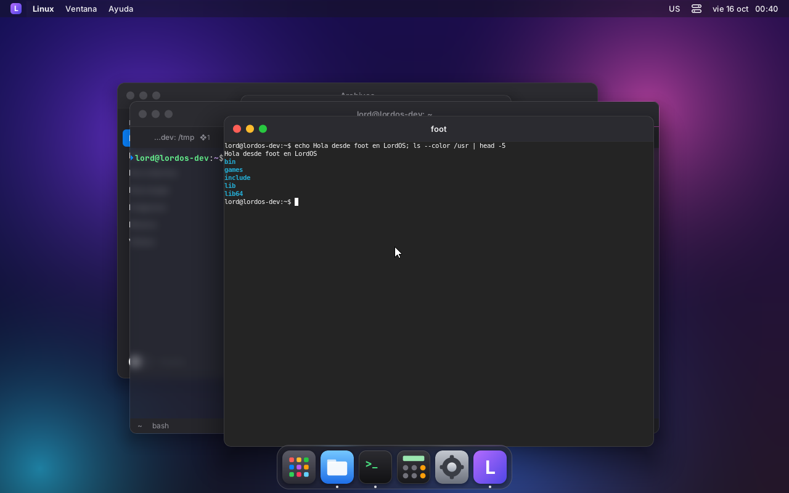 | 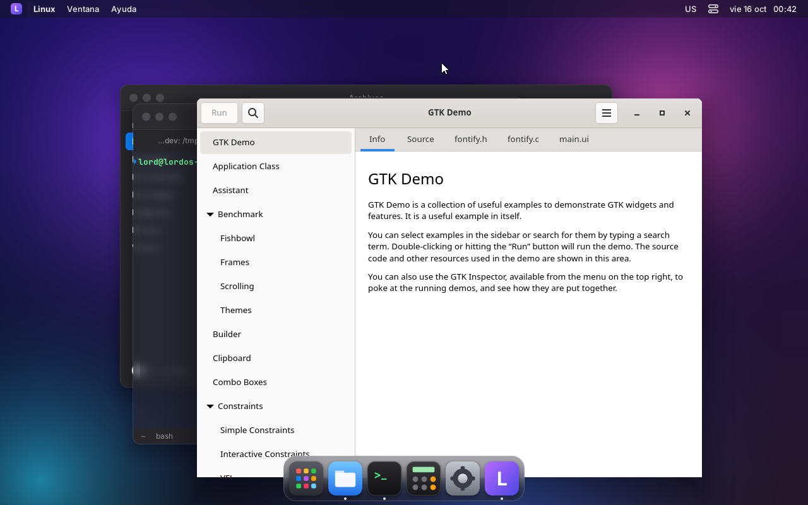 |
| foot (terminal Wayland) con el marco del tema: pide decoración del servidor | GTK Demo (GTK 4.18): dibuja su propio marco; LordOS recorta su sombra |
|  |  |
| Menú emergente de GTK (xdg_popup), ubicado con su posicionador | Arrastrada desde su propia barra (xdg_toplevel.move): sigue al puntero |
| 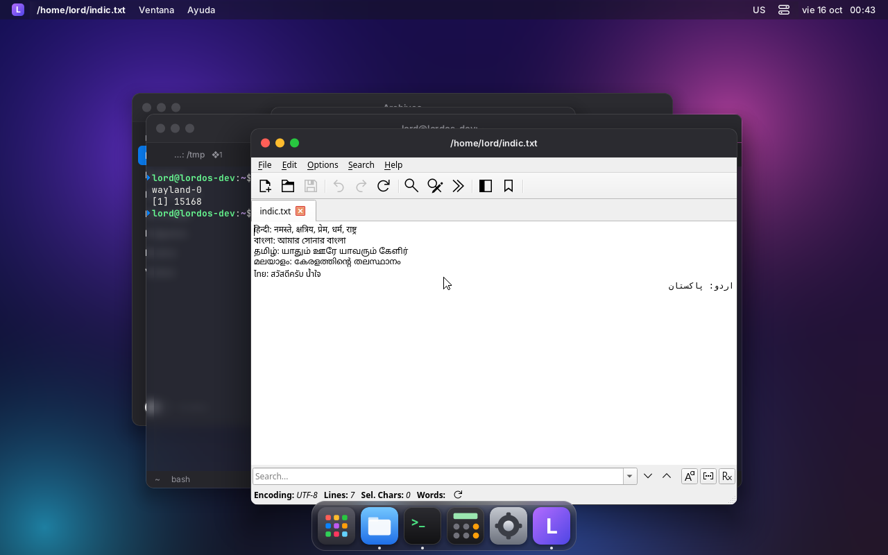 |  |
| FeatherPad (Qt 6.8) abierto desde la Terminal de LordOS, con el marco del tema | Menú Archivo de Qt |
|  | 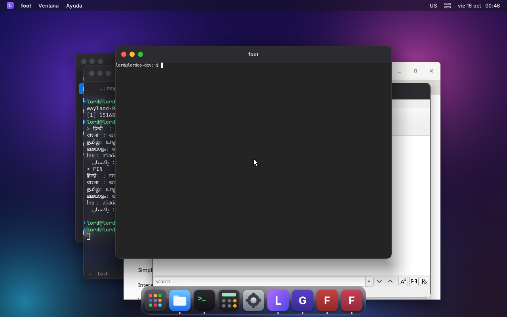 |
| Copiado en FeatherPad (Ctrl+C) y pegado en la Terminal de LordOS | Tres apps Linux abiertas; cada una con su ícono en el Dock |

## Qué hay

| Protocolo | Versión | Qué hace |
|---|---|---|
| `wl_compositor`, `wl_region` | 6 | superficies; el búfer se copia al hacer commit y se suelta enseguida |
| `wl_shm` | (libwayland) | memoria compartida ARGB8888/XRGB8888 |
| `wl_subcompositor` | 1 | subsuperficies (se componen sobre su padre) |
| `wl_output` | 4 | la pantalla, escala 1 |
| `wl_seat` | 9 | puntero (entrar, salir, mover, botones, rueda con `axis_source` y `axis_value120`; scroll fino del touchpad con `axis_source finger`, `axis_stop` y `axis_relative_direction` para el desplazamiento natural), teclado con el mapa de XKB de LordOS (`keyboard.c`), modificadores y repetición, y `wl_touch` si hay una pantalla táctil |
| `zwp_pointer_gestures_v1` | 3 | gestos del touchpad: pellizco (zoom en Chromium, GTK, Firefox), deslizar y mantener (`wl_input.c`, ver `TRACKPAD.md`) |
| `wl_data_device_manager` | 3 | portapapeles compartido con el de LordOS en los dos sentidos (ver abajo) |
| `xdg_wm_base` | 6 | ventanas (`xdg_toplevel`: título, mover, cambiar tamaño, maximizar, minimizar, cerrar) y menús emergentes (`xdg_popup` con `xdg_positioner`: ancla, gravedad, dar vuelta y deslizar dentro de la pantalla) |
| `zxdg_decoration_manager_v1` | 1 | las apps que lo usan (Qt, foot, Kitty, Alacritty) dejan el marco al tema |
| `wp_cursor_shape_manager_v1` | 1 | la app pide el cursor por nombre (Chromium, GTK 4, Qt 6) y LordOS dibuja el suyo (`cursor.c`, ver `VENTANAS.md`) |

Las ventanas entran al gestor de ventanas del SDK (`sdk/wayland.js`) con la app interna
`linux` (id `linux#<superficie>`): el tema las ve como cualquier otra, con su título, foco,
maximizar, minimizar y Dock. Las que dibujan su propio marco (GTK) llegan con `args.csd` y el
tema muestra solo el contenido (los dos temas incluidos ya lo hacen). El teclado va a la app
Linux del frente; las combinaciones con ❖ siguen siendo de LordOS.

## Cómo abrir una app

Desde la Terminal de LordOS: cada pestaña nueva tiene `WAYLAND_DISPLAY`, `XDG_SESSION_TYPE=wayland`,
`GDK_BACKEND=wayland` y `QT_QPA_PLATFORM=wayland`, así que alcanza con `featherpad &`,
`gtk4-demo &` o `foot &`. Las apps reciben también el idioma y la región de LordOS (`LANG`,
`LC_*`, ver `IDIOMAS.md`).

También aparecen en el **Launchpad**, en el menú de inicio del tema Clásico y en la Tienda (ver
`APPS-NATIVAS.md` y `PAQUETES.md`): son las apps con un `.desktop` en
`/usr/share/applications` o `~/.local/share/applications`. Se abren con un clic, y su ventana
lleva en el Dock el mismo ícono que en el Launchpad (se las reconoce por el app id de Wayland o
por `StartupWMClass`).

| | |
|---|---|
| 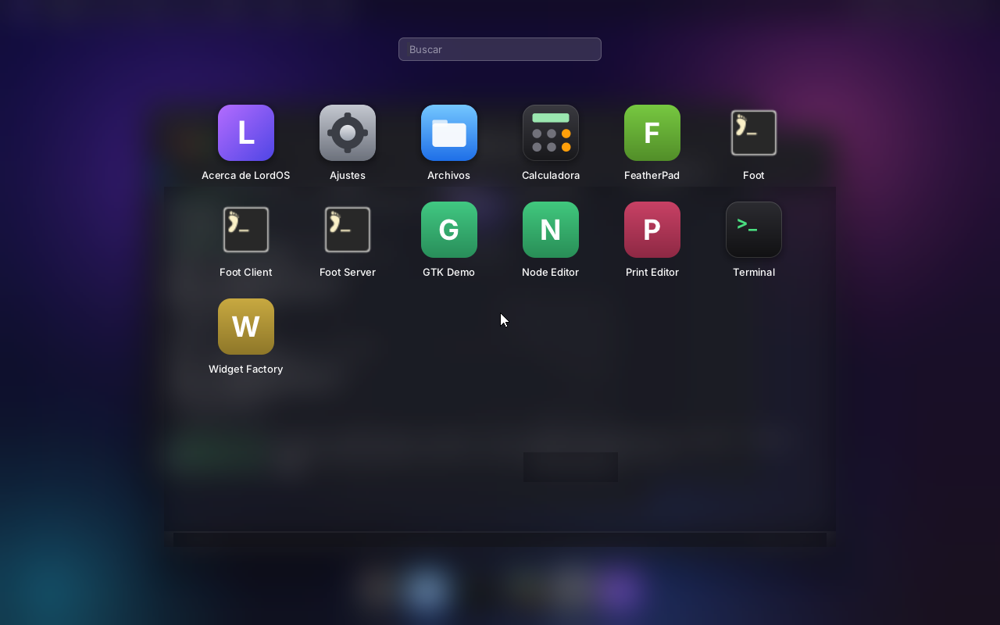 |  |
| El Launchpad con las apps Linux instaladas (foot con su PNG; las que solo traen SVG, con su inicial) | FeatherPad abierta con un clic; en el Dock lleva el mismo ícono |
| 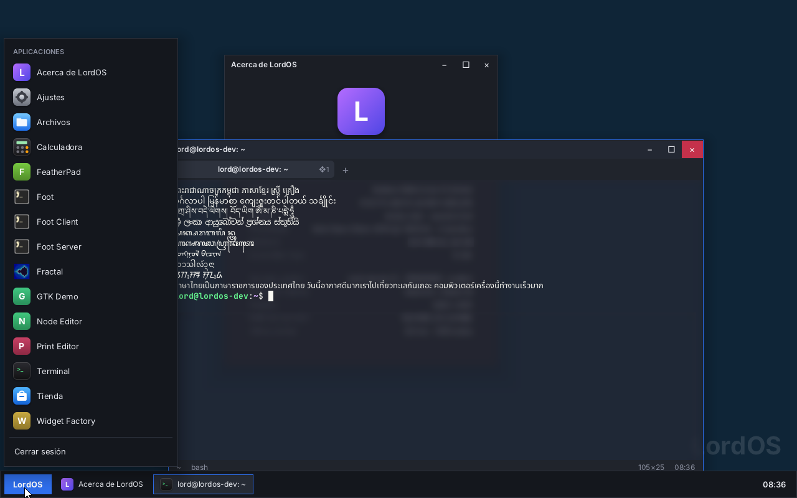 | 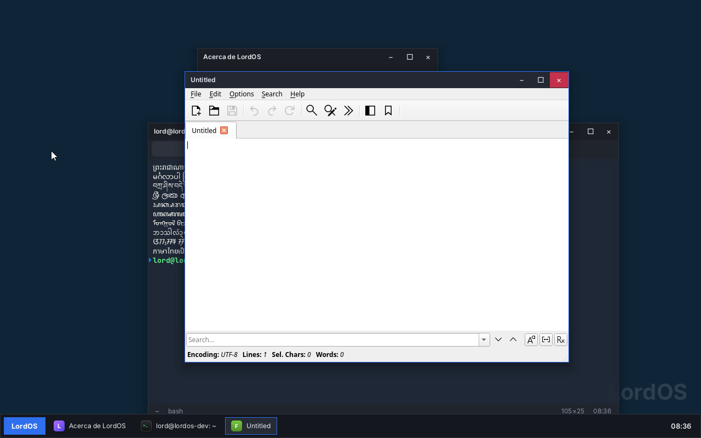 |
| Tema Clásico: el menú de inicio con apps LordOS, Linux y Fractal (instalada como paquete) | FeatherPad lanzada desde ahí, con su ícono en la barra de tareas |

### El lanzador (`server/src/apps.c`)

Es la segunda excepción a "el servidor no ejecuta comandos"; la primera es el shell de la
Terminal. La aprobó el usuario para M7. Límites:

- `lord.apps.launch(id)` recibe solo el id de un `.desktop` de esas dos carpetas, que además
  pase los filtros:
  - `Type=Application`;
  - sin `NoDisplay` ni `Hidden`;
  - `OnlyShowIn`/`NotShowIn` con `LordOS`;
  - el `TryExec` existe;
  - no es una app de terminal.
- El comando es la línea `Exec` de ese archivo, releída al lanzar:
  - se arma `argv` según la especificación (comillas y escapes);
  - se quitan los códigos de archivo (`%f %u %F %U`) y no se pasan argumentos del llamador;
  - con `lord.apps.launchWith(id, ruta)` (el «Abrir con» de Archivos), la ruta va como un único
    argumento en el primer `%f`/`%F` (o como `file://…` en `%u`/`%U`), y solo si la app declara
    `MimeType` en su `.desktop`; la ruta se resuelve con realpath y tiene que estar en la carpeta
    personal o en un disco montado del usuario (`/media/$USER`, `/run/media/$USER`);
  - se ejecuta con `execve`, sin shell;
  - el programa se busca en un PATH fijo (`/usr/local/bin`, `/usr/bin`, `/bin`, juegos, y
    `~/.local/bin` solo para los `.desktop` del usuario).
- La app arranca como nieta huérfana, en su propia sesión, con las señales normales y sin otros
  descriptores. Su salida va a `~/.cache/lordos/apps.log`, que se recorta al pasar 1 MB.
- Desde JS no se puede crear un `.desktop`:
  - `lord.fs.write` rechaza `~/.local/share/applications` y `~/.config/autostart`, también a
    través de un symlink (ver `EDITOR.md`);
  - los paquetes `.lpk` se instalan en otra carpeta.

  Así, la interfaz no puede inventar un comando: solo puede elegir una app que ya está instalada.

Íconos: se usa el PNG de `hicolor` (64, 48, 128… px) o de `/usr/share/pixmaps`. Las apps que solo traen
SVG (FeatherPad, GTK Demo) usan el PNG de 64 px que publica Debian en AppStream, que el motor de
paquetes ya baja (`/var/lib/lordos/pkg/icons/64`, ver `PAQUETES.md`). Si tampoco está ahí, se
muestra la inicial: LordOS todavía no dibuja SVG.

## Portapapeles

Hay uno solo para toda la sesión:

- **Texto.** Lo que se copia en una app Linux pasa a LordOS (Terminal, campos de texto), y lo
  que se copia en LordOS lo recibe la app con foco.
- **Otros formatos (imágenes, HTML…).** Mientras la app que copió sigue abierta, las otras apps
  Linux reciben de ella cualquier formato que ofrezca (hasta 32).
- **Imágenes.** Si lo copiado es solo una imagen (`image/png`), LordOS la guarda: sigue
  disponible después de cerrar la app de origen y aparece en el historial.
- **Sin bloqueos.** Las copias grandes (hasta 16 MB) se envían de a partes, sin que una app que
  lee despacio frene al servidor.

| | |
|---|---|
| 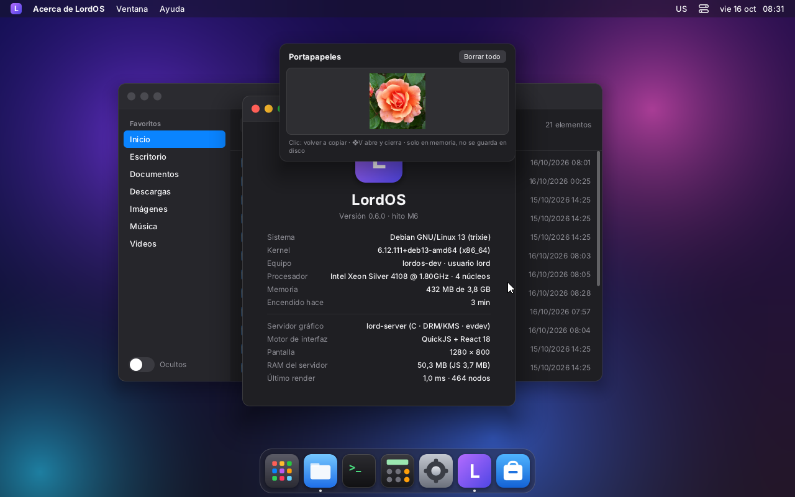 | 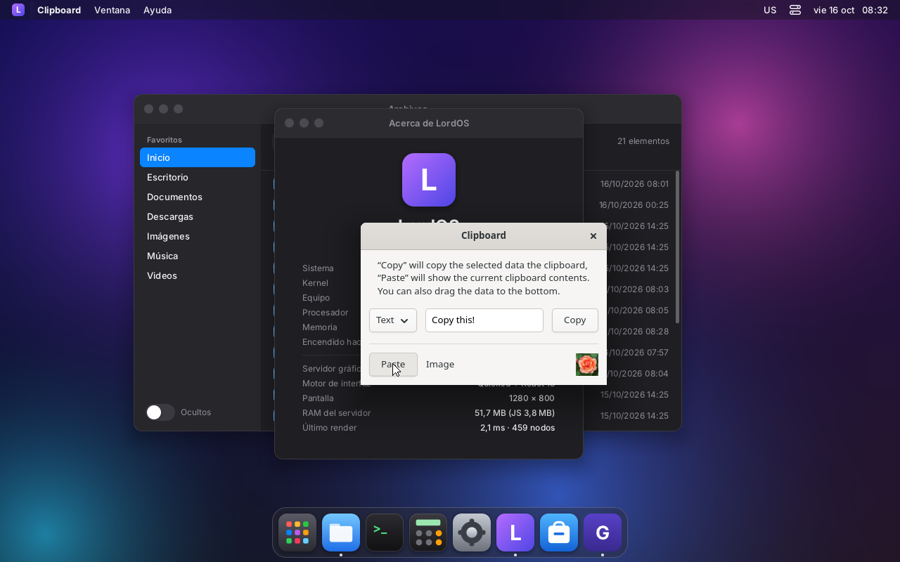 |
| Imagen copiada en GTK Demo, ya cerrada: sigue en el historial (❖V) | GTK Demo abierta de nuevo: «Paste» la recibe de LordOS |

**Historial (❖V rápido, ❖⇧V completo):** guarda todo lo copiado en cualquier lado: textos,
enlaces, colores, código, rutas e imágenes, con el origen (el app_id de la app Linux que copió).
Se guarda en la carpeta personal y sobrevive al reinicio. Las vistas previas de las imágenes se
guardan primero en `$XDG_RUNTIME_DIR/lordos` (quedan las últimas 10) y el historial las copia a
`~/.local/share/lordos/clipboard`. Lo que una app marca como secreto
(`x-kde-passwordManagerHint`, como KeePassXC) se puede pegar, pero no se guarda. Detalle en
`SPOTLIGHT.md`.

## Cómo funciona

1. `wl_start()` (después de soltar privilegios) crea `$XDG_RUNTIME_DIR/wayland-0` y los
   globales; el fd de la cola de eventos entra al `poll` de `main.c`.
2. Primer commit de una ventana: se le manda `configure` (0×0: elige la app). Con el primer
   búfer pasa a "mapeada" y JS recibe `map` con título, app id, tamaño y si dibuja su marco.
3. La UI la dibuja como un nodo `surface` (`<Surface surface={id} />`): `paint.c` copia los
   píxeles en la caja del nodo, recortando la sombra con la *window geometry*. Si el tema
   cambia el tamaño del nodo (redimensionar, maximizar), se le manda un `configure` con el
   tamaño nuevo y la app vuelve a dibujar.
4. Los menús emergentes se dibujan después de todo el árbol, encima de cualquier ventana; un
   clic afuera los cierra (`popup_done`).
5. Después de presentar cada cuadro se responden los `frame` de las apps (así no dibujan más
   rápido que la pantalla).

Memoria: con foot, FeatherPad y GTK Demo abiertos, lord-server pasa de ~51 a 53 MB de RSS
(cada ventana guarda una copia de su búfer).

**Mover y agrandar** (`xdg_toplevel.move`/`resize`) lo sigue lord-server en C, sin JS por cuadro, igual que
las ventanas de LordOS; mientras dura, la app no recibe el puntero. Todas las ventanas Linux, también las
de marco propio, tienen los bordes invisibles del tema para agrandarlas (ver `VENTANAS.md`).

## Marco y colores: Chromium, Firefox, GTK y GNOME

| | |
|---|---|
| 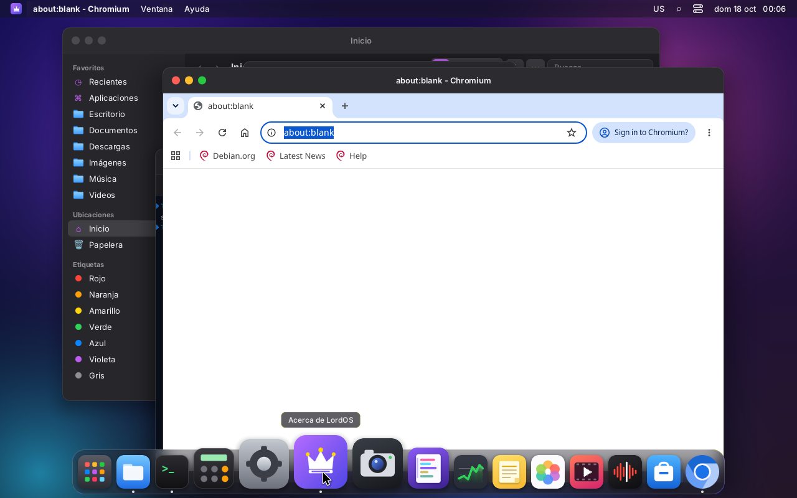 | 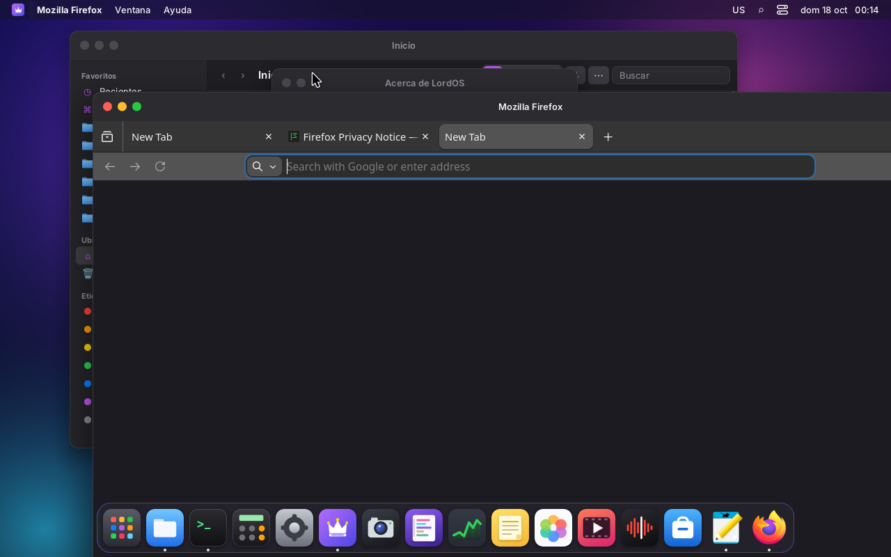 |
| Chromium con el marco de LordOS (sin sus propios botones de ventana) | Firefox ESR con el marco de LordOS, oscuro |
| 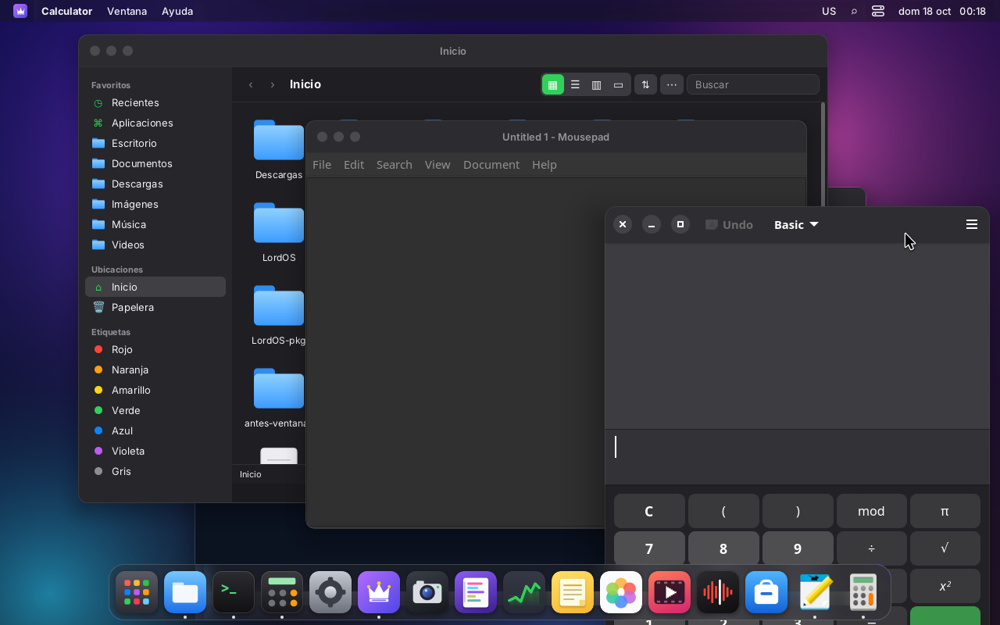 | 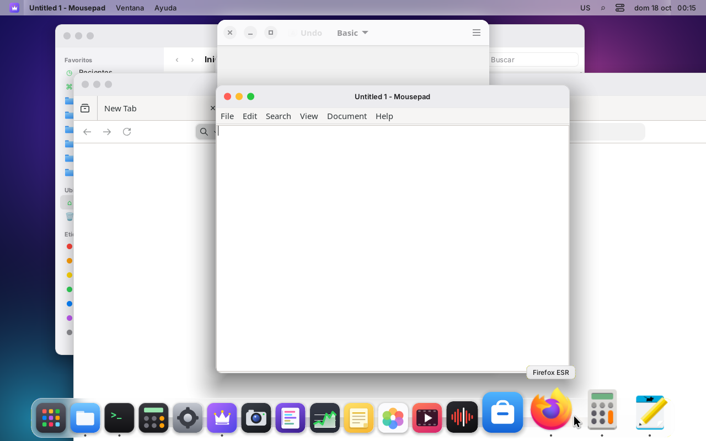 |
| Mousepad (GTK 3, tema «LordOS-dark») y GNOME Calculadora (GTK 4/libadwaita, acento verde y botones a la izquierda), oscuro | Lo mismo en claro: cambian en vivo al tocar el modo en Ajustes |
| 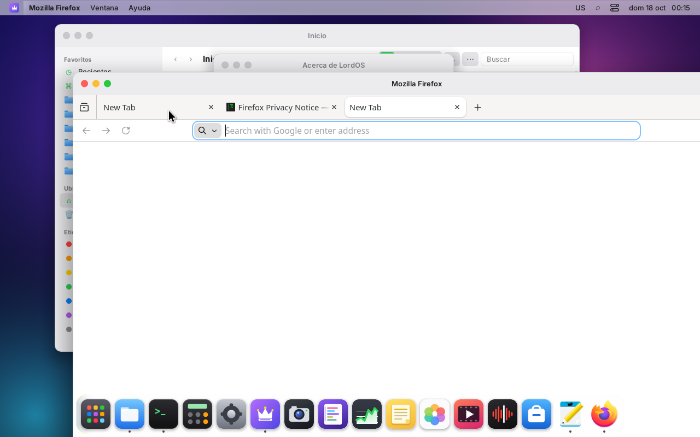 | |
| Firefox cambió a claro en vivo | |

- **Chromium.** Usa el marco del tema si pide decoración del servidor (`zxdg_decoration`). El ISO trae
  `"browser": { "custom_chrome_frame": false }` en `/etc/chromium/master_preferences` («Usar la barra
  de título y los bordes del sistema»), que vale para los perfiles nuevos. Se vuelve a su barra
  propia en Configuración → Apariencia.
- **Firefox ESR.** El ISO trae `/etc/firefox-esr/lordos.js` con `pref("browser.tabs.inTitlebar", 0)`.
  Firefox dibuja con GTK 3, que no habla xdg-decoration: lord-server también anuncia
  **`org_kde_kwin_server_decoration_manager`** (el de KDE) con el modo «servidor» por defecto. Así
  GTK 3 le pide el marco a LordOS para las ventanas sin barra propia (Firefox, Mousepad). Las tablas
  del protocolo están escritas a mano en `wl.c`, sin el XML de plasma-wayland-protocols. Se vuelve a
  la barra de Firefox en Personalizar barra de herramientas → «Barra de título».
- **GTK 4 / libadwaita (GNOME).** Leen el modo, el acento y el orden de los botones de
  **`org.freedesktop.portal.Settings`**. Lo atiende lord-server mismo (`server/src/ui/portal.c`) en el
  bus de la sesión, sin xdg-desktop-portal, con el cliente D-Bus propio de Contraseñas
  (`server/src/vault/dbus.c`). Claves:
  - `org.freedesktop.appearance`: `color-scheme`, `accent-color`, `contrast`;
  - `org.gnome.desktop.interface`: `color-scheme`, `accent-color`, `gtk-theme`;
  - `org.gnome.desktop.wm.preferences`: `button-layout`.

  Cuando cambian se manda `SettingChanged`. Si otro programa ya tiene el nombre
  `org.freedesktop.portal.Desktop`, LordOS no lo pisa y lo dice en el registro.
- **GTK 3.** Fuera de Flatpak no lee el portal: lee GSettings.
  - lord-server les pasa a las apps `GSETTINGS_BACKEND=keyfile` y escribe las mismas claves en
    `~/.config/glib-2.0/settings/keyfile`, sin borrar lo que guardan las apps. GLib vigila ese archivo,
    así que GTK 3 también cambia en vivo.
  - El tema `LordOS`/`LordOS-dark` (`assets/gtk/`, se instala en `/usr/share/themes`) es Adwaita con
    los colores, la barra y los semáforos de LordOS.
  - GTK 3 no tiene acento: el suyo queda azul.
- **Los botones** van a la izquierda en el orden de los semáforos (`close,minimize,maximize:`). El
  tema Clásico los pide a la derecha con el token `gtkButtons` (`:minimize,maximize,close`).
- **Qt/KDE.** Usan el marco del tema (xdg-decoration). Qt 6 también lee `color-scheme` del portal; no
  se probó.
- **El JS.** `ThemeProvider` del SDK manda modo, acento y botones con `lord.portal.set` cuando cambian.

En la VM 118 se probó con Chromium 155, Firefox ESR 153, Mousepad (GTK 3) y GNOME Calculadora
(GTK 4, libadwaita).

## Pendiente

- Íconos SVG de las apps (la mayoría de las apps GTK/Qt modernas solo traen SVG).
- Abrir archivos con una app Linux (`%f`/`%u`), acciones de los `.desktop` y apps de terminal.
- Ya están (ver `GPU.md`): `linux-dmabuf` v4, composición por GPU (Mesa, opcional), scanout
  directo a pantalla completa, `wp_presentation`, `wp_viewporter`, `relative-pointer`,
  `pointer-constraints`, pantalla completa de verdad (❖Esc sale) y los cursores de las apps
  (imagen u oculto).
- Arrastrar y soltar, selección primaria (clic del medio), `text-input` (los métodos de entrada
  de LordOS dentro de apps Wayland), escala fraccional, activación (`xdg-activation`).
- Xwayland, para apps que solo hablan X11.
