# Linux apps in LordOS (Wayland)

lord-server is also a **Wayland compositor**: GTK, Qt and any other app that speaks Wayland open
as LordOS windows, inside the theme, next to the native apps. There's no X server of its own, Weston,
wlroots or Mutter: only `libwayland-server` (it serializes the protocol; it's been in the dependency policy
since M1) and the code `wayland-scanner` generates from the `wayland-protocols` XML files. The
compositor lives in `server/src/wl/wl.c`.
Apps that only speak X11 open through Xwayland, started on demand, with our own X window manager
(see "X11 apps (Xwayland)" below).

## Screenshots (VM, real lord-server)

| | |
|---|---|
| 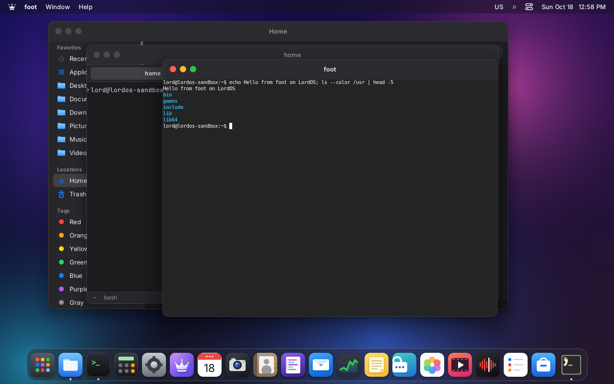 |  |
| foot (Wayland terminal) with the theme's frame: it asks for server-side decoration | GTK Demo (GTK 4.18): draws its own frame; LordOS clips its shadow |
| 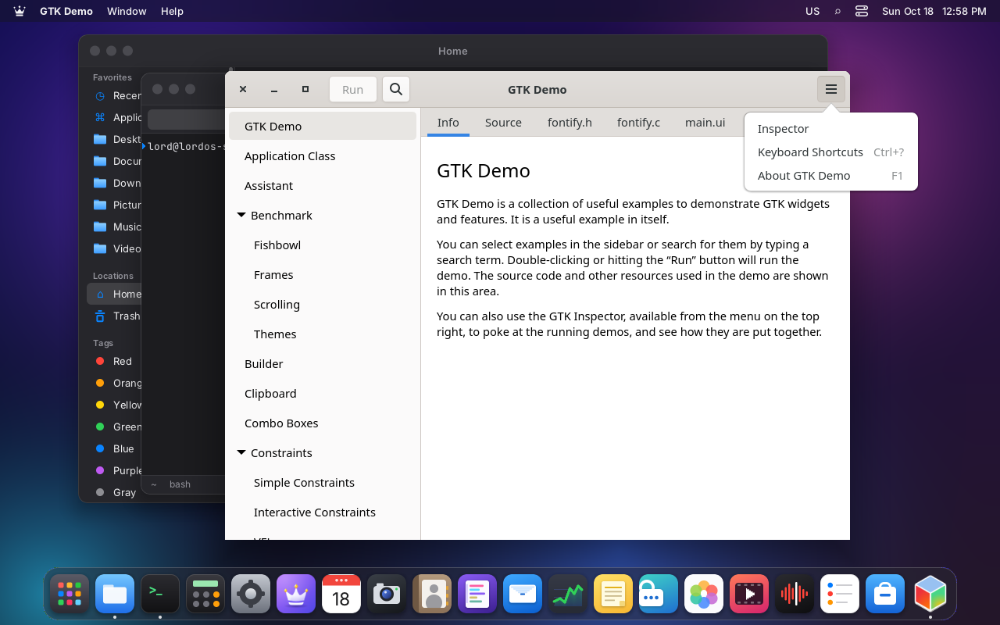 | 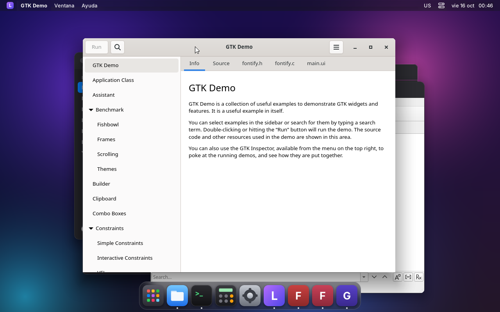 |
| GTK popup menu (xdg_popup), placed with its positioner | Dragged from its own bar (xdg_toplevel.move): it follows the pointer |
| 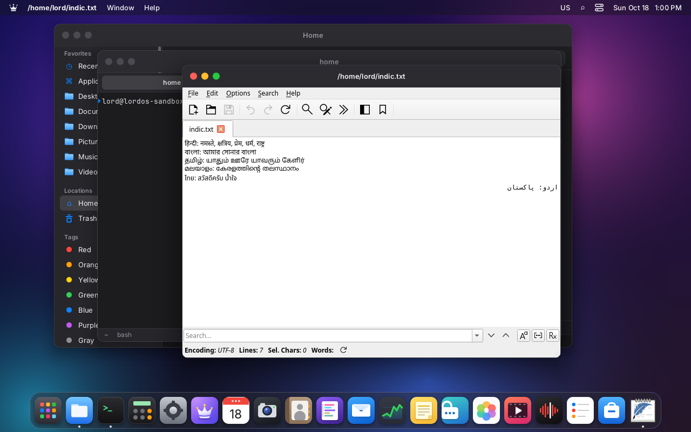 | 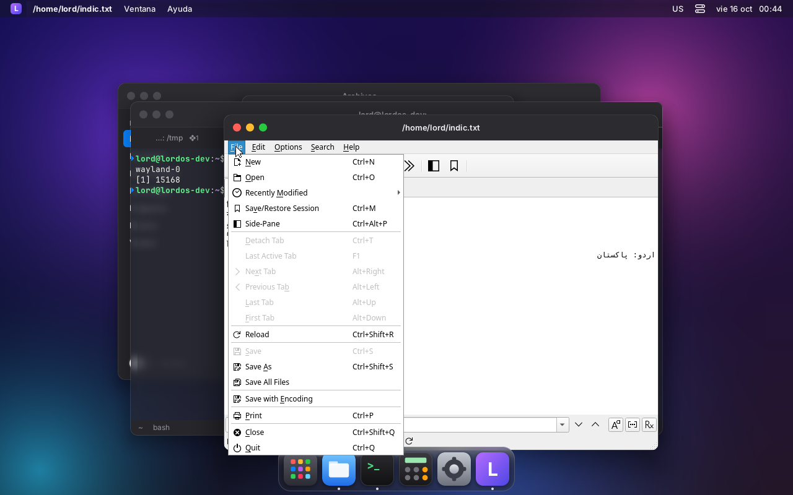 |
| FeatherPad (Qt 6.8) opened from the LordOS Terminal, with the theme's frame | Qt's File menu |
| 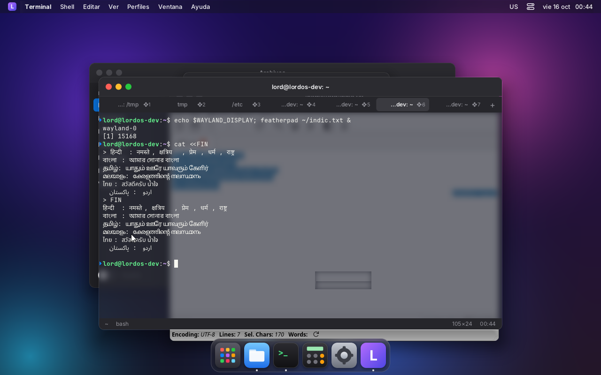 | 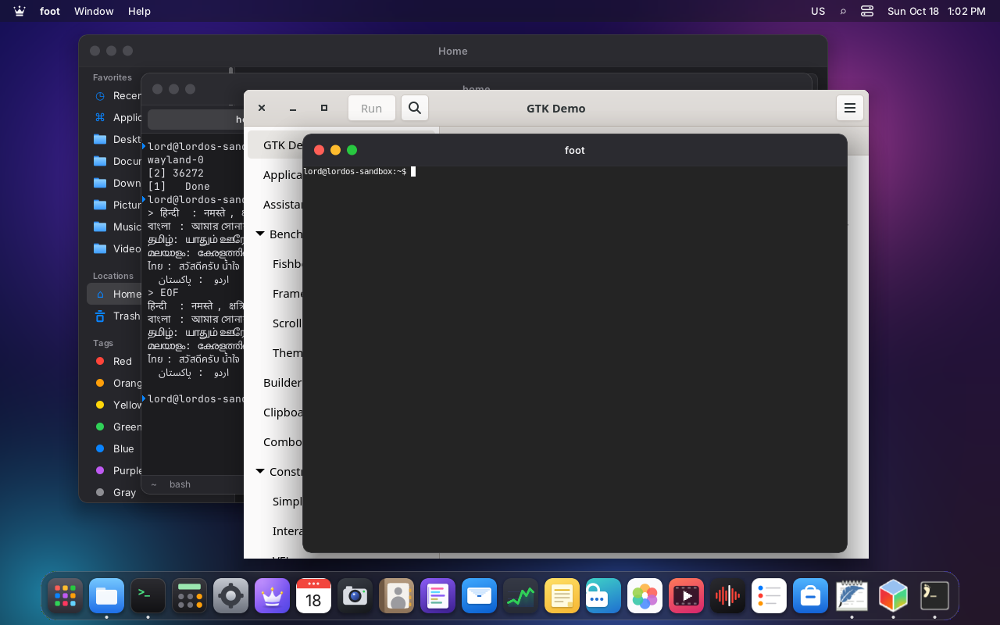 |
| Copied in FeatherPad (Ctrl+C) and pasted in the LordOS Terminal | Three Linux apps open; each with its icon in the Dock |

## What's there

| Protocol | Version | What it does |
|---|---|---|
| `wl_compositor`, `wl_region` | 6 | surfaces; the buffer is copied on commit and released right away |
| `wl_shm` | (libwayland) | ARGB8888/XRGB8888 shared memory |
| `wl_subcompositor` | 1 | subsurfaces (composited on top of their parent) |
| `wl_output` | 4 | one per display: logical position, physical mode, scale rounded up, name and description (`DISPLAYS.md`) |
| `zxdg_output_manager_v1` | 3 | logical position and size of each display |
| `wp_fractional_scale_v1` | 1 | the exact scale of the display(s) a surface is on (GTK 4, Qt 6, Chromium render sharp at 125–175 %) |
| `wl_seat` | 9 | pointer (enter, leave, motion, buttons, wheel with `axis_source` and `axis_value120`; fine touchpad scrolling with `axis_source finger`, `axis_stop` and `axis_relative_direction` for natural scrolling), keyboard with LordOS's XKB keymap (`keyboard.c`), modifiers and repeat, and `wl_touch` if there's a touchscreen |
| `zwp_pointer_gestures_v1` | 3 | touchpad gestures: pinch (zoom in Chromium, GTK, Firefox), swipe and hold (`wl_input.c`, see `TRACKPAD.md`) |
| `wl_data_device_manager` | 3 | clipboard shared with LordOS's in both directions (see below) |
| `zwp_primary_selection_device_manager_v1` | 1 | primary selection: select to copy, middle click to paste (0.8.3, see "X11 apps") |
| `xdg_wm_base` | 6 | windows (`xdg_toplevel`: title, move, resize, maximize, minimize, close) and popup menus (`xdg_popup` with `xdg_positioner`: anchor, gravity, flip and slide within the screen) |
| `zxdg_decoration_manager_v1` | 1 | apps that use it (Qt, foot, Kitty, Alacritty) leave the frame to the theme |
| `wp_cursor_shape_manager_v1` | 1 | the app asks for the cursor by name (Chromium, GTK 4, Qt 6) and LordOS draws its own (`cursor.c`, see `WINDOWS.md`) |

Windows enter the SDK's window manager (`sdk/wayland.js`) as the internal app `linux` (id
`linux#<surface>`): the theme sees them like any other, with their title, focus, maximize,
minimize and Dock. Those that draw their own frame (GTK) arrive with `args.csd` and the theme
shows only the content (both bundled themes already do). The keyboard goes to the frontmost Linux
app; ❖ combinations still belong to LordOS.

## How to open an app

From the LordOS Terminal: every new tab has `WAYLAND_DISPLAY`, `XDG_SESSION_TYPE=wayland`,
`GDK_BACKEND=wayland` and `QT_QPA_PLATFORM=wayland`, so `featherpad &`, `gtk4-demo &` or
`foot &` is enough. Apps also receive LordOS's language and region (`LANG`, `LC_*`, see
`LANGUAGES.md`).

They also appear in the **app launcher**, in the Classic theme's start menu and in the Store (see
`NATIVE-APPS.md` and `PACKAGES.md`): they are the apps with a `.desktop` in
`/usr/share/applications` or `~/.local/share/applications`. They open with one click, and their
window carries the same icon in the Dock as in the app launcher (they're recognized by the Wayland
app id or by `StartupWMClass`).

| | |
|---|---|
| 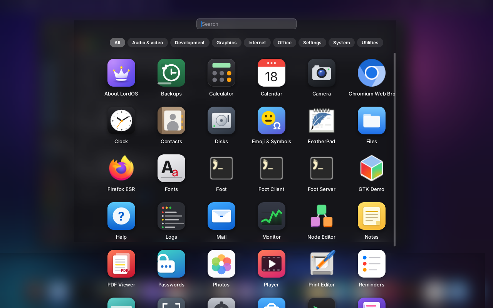 | 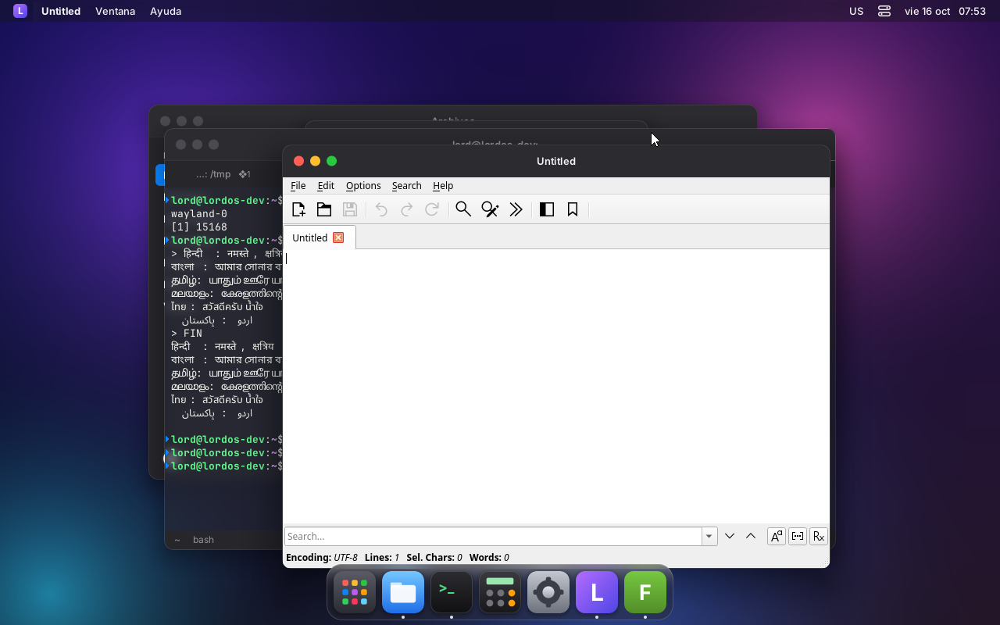 |
| The app launcher with the installed Linux apps next to the LordOS apps, each with its own icon | FeatherPad opened with one click; it carries the same icon in the Dock |
| 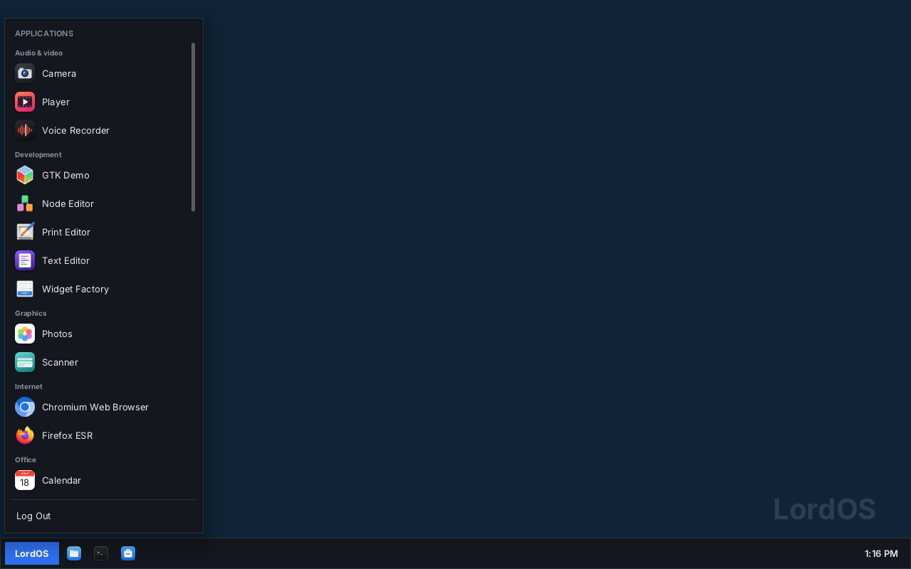 |  |
| Classic theme: the start menu with LordOS apps and Linux apps, grouped by category | FeatherPad running in the classic theme, with its icon in the taskbar |

### The launcher (`server/src/apps.c`)

It's the second exception to "the server doesn't run commands"; the first is the Terminal's
shell. The user approved it for M7. Limits:

- `lord.apps.launch(id)` only receives the id of a `.desktop` in those two folders, which must
  also pass the filters:
  - `Type=Application`;
  - no `NoDisplay` or `Hidden`;
  - `OnlyShowIn`/`NotShowIn` with `LordOS`;
  - the `TryExec` exists;
  - it isn't a terminal app.
- The command is that file's `Exec` line, re-read at launch time:
  - `argv` is built according to the specification (quotes and escapes);
  - file codes (`%f %u %F %U`) are removed and no caller arguments are passed;
  - with `lord.apps.launchWith(id, path)` (Files' «Open With»), the path goes as a single
    argument in the first `%f`/`%F` (or as `file://…` in `%u`/`%U`), and only if the app declares
    `MimeType` in its `.desktop`; the path is resolved with realpath and must be in the home
    folder or on a disk mounted by the user (`/media/$USER`, `/run/media/$USER`);
  - it's run with `execve`, without a shell;
  - the program is looked up in a fixed PATH (`/usr/local/bin`, `/usr/bin`, `/bin`, games, and
    `~/.local/bin` only for the user's `.desktop` files).
- **Desktop actions (0.8.1):** the Dock's right-click menu lists the `Actions=` of an app's
  `.desktop` (a browser's "New Private Window", for instance). `lord.apps.actions(id, language)`
  returns `[{ id, name }]` and `lord.apps.launchAction(id, action)` runs one, through the **same**
  launcher (`apps_launch_action` → `launch()`): same id rules and filters, same scope, restrictions
  and fixed PATH, no shell, no caller arguments, no file. Only that action's `Exec` line replaces the
  main one, and only if:
  - the action is listed in the main group's `Actions=` key;
  - its name is `[A-Za-z0-9-]`, at most 63 characters;
  - its `[Desktop Action <name>]` group has a `Name` and an `Exec`.

  Anything else (an unlisted group, a bad name, no `Exec`) is refused. Tested by
  `build/apps-actions-test` (in `make test`).
- The app starts as an orphaned grandchild, in its own session, with normal signals and no other
  descriptors. Its output goes to `~/.cache/lordos/apps.log`, which is trimmed when it passes 1 MB.
- A `.desktop` can't be created from JS:
  - `lord.fs.write` rejects `~/.local/share/applications` and `~/.config/autostart`, also
    through a symlink (see `EDITOR.md`);
  - `.lpk` packages are installed in another folder.

  So the interface can't invent a command: it can only pick an app that's already installed.

Icons: the `hicolor` PNG (64, 48, 128… px) or the one in `/usr/share/pixmaps` is used. Apps that
only ship SVG (FeatherPad, GTK Demo) use the 64 px PNG Debian publishes in AppStream, which the
package engine already downloads (`/var/lib/lordos/pkg/icons/64`, see `PACKAGES.md`). If it's not
there either, the initial is shown: LordOS doesn't draw SVG yet.

## Clipboard

There's a single one for the whole session:

- **Text.** What's copied in a Linux app goes to LordOS (Terminal, text fields), and what's
  copied in LordOS is received by the focused app.
- **Other formats (images, HTML…).** While the app that copied is still open, the other Linux
  apps receive from it any format it offers (up to 32).
- **Images.** If what was copied is only an image (`image/png`), LordOS stores it: it stays
  available after the source app is closed and shows up in the history.
- **No blocking.** Large copies (up to 16 MB) are sent in chunks, without a slow-reading app
  stalling the server.

| | |
|---|---|
| 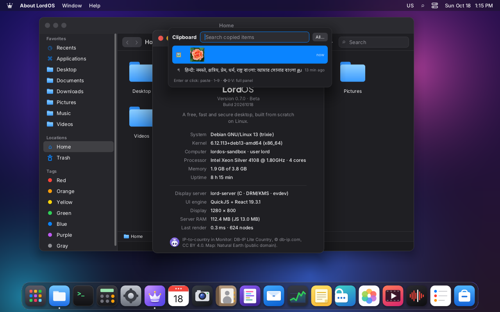 | 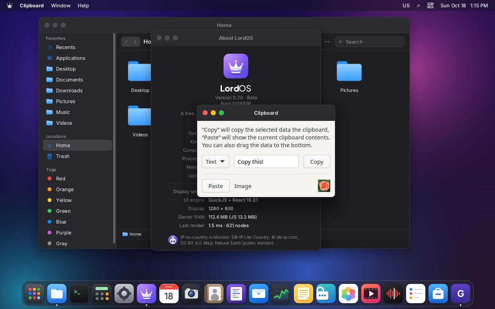 |
| Image copied in GTK Demo, now closed: it's still in the history (❖V) | GTK Demo opened again: «Paste» receives it from LordOS |

**History (❖V quick, ❖⇧V full):** it keeps everything copied anywhere: text, links, colors,
code, paths and images, with the source (the app_id of the Linux app that copied). It's stored in
the home folder and survives reboots. Image previews are first stored in
`$XDG_RUNTIME_DIR/lordos` (the last 10 are kept) and the history copies them to
`~/.local/share/lordos/clipboard`. Whatever an app marks as secret
(`x-kde-passwordManagerHint`, like KeePassXC) can be pasted, but isn't stored. Details in
`SPOTLIGHT.md`.

## How it works

1. `wl_start()` (after dropping privileges) creates `$XDG_RUNTIME_DIR/wayland-0` and the
   globals; the event queue's fd joins `main.c`'s `poll`.
2. A window's first commit: it gets a `configure` (0×0: the app chooses). With the first buffer
   it becomes "mapped" and JS receives `map` with title, app id, size and whether it draws its
   own frame.
3. The UI draws it as a `surface` node (`<Surface surface={id} />`): `paint.c` copies the pixels
   into the node's box, clipping the shadow with the *window geometry*. If the theme changes the
   node's size (resize, maximize), it gets a `configure` with the new size and the app redraws.
4. Popup menus are drawn after the whole tree, above any window; a click outside closes them
   (`popup_done`).
5. After each frame is presented, the apps' `frame` callbacks are answered (so they don't draw
   faster than the screen).

Memory: with foot, FeatherPad and GTK Demo open, lord-server goes from ~51 to 53 MB of RSS
(each window keeps a copy of its buffer).

**Moving and resizing** (`xdg_toplevel.move`/`resize`) is tracked by lord-server in C, with no JS
per frame, just like LordOS windows; while it lasts, the app doesn't receive the pointer. All
Linux windows, including those with their own frame, have the theme's invisible borders for
resizing (see `WINDOWS.md`).

## Frame and colors: Chromium, Firefox, GTK and GNOME

| | |
|---|---|
| 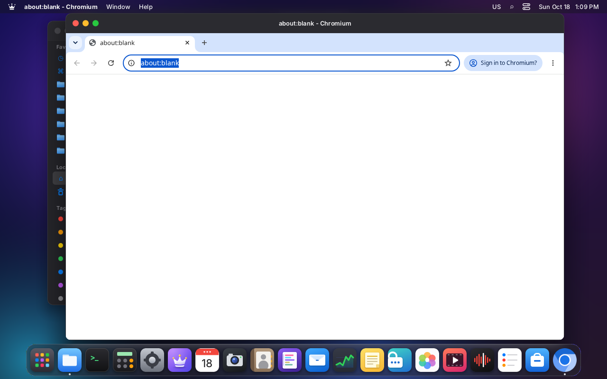 | 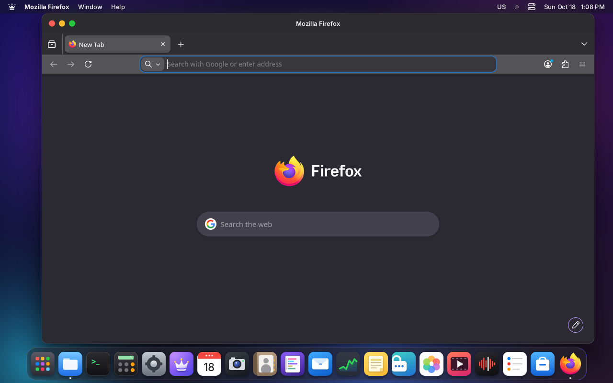 |
| Chromium with the LordOS frame (without its own window buttons) | Firefox ESR with the LordOS frame, dark |
|  |  |
| Mousepad (GTK 3, «LordOS-dark» theme) and GNOME Calculator (GTK 4/libadwaita, green accent and buttons on the left), dark | The same in light: they change live when the mode is switched in Settings |
| 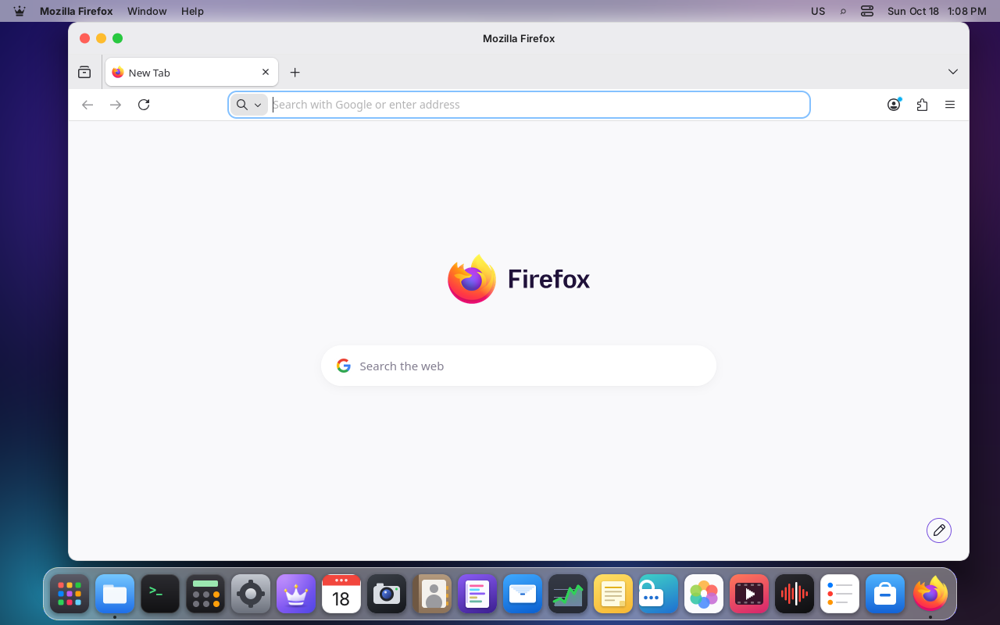 | |
| Firefox switched to light live | |

- **Chromium.** It uses the theme's frame if it asks for server-side decoration
  (`zxdg_decoration`). The ISO ships `"browser": { "custom_chrome_frame": false }` in
  `/etc/chromium/master_preferences` («Use system title bar and borders»), which applies to new
  profiles. It goes back to its own bar in Settings → Appearance.
- **Firefox ESR.** The ISO ships `/etc/firefox-esr/lordos.js` with
  `pref("browser.tabs.inTitlebar", 0)`. Firefox draws with GTK 3, which doesn't speak
  xdg-decoration: lord-server also advertises **`org_kde_kwin_server_decoration_manager`**
  (KDE's) with «server» mode as the default. So GTK 3 asks LordOS for the frame for windows
  without their own bar (Firefox, Mousepad). The protocol tables are hand-written in `wl.c`,
  without plasma-wayland-protocols' XML. Firefox's bar comes back in Customize Toolbar →
  «Title Bar».
- **GTK 4 / libadwaita (GNOME).** They read the mode, the accent and the button order from
  **`org.freedesktop.portal.Settings`**. lord-server itself serves it (`server/src/ui/portal.c`)
  on the session bus, without xdg-desktop-portal, with Passwords' own D-Bus client
  (`server/src/vault/dbus.c`). Keys:
  - `org.freedesktop.appearance`: `color-scheme`, `accent-color`, `contrast`;
  - `org.gnome.desktop.interface`: `color-scheme`, `accent-color`, `gtk-theme`;
  - `org.gnome.desktop.wm.preferences`: `button-layout`.

  When they change, `SettingChanged` is sent. If another program already owns the name
  `org.freedesktop.portal.Desktop`, LordOS doesn't take it over and says so in the log.
- **GTK 3.** Outside Flatpak it doesn't read the portal: it reads GSettings.
  - lord-server passes `GSETTINGS_BACKEND=keyfile` to the apps and writes the same keys to
    `~/.config/glib-2.0/settings/keyfile`, without deleting what the apps store. GLib watches that
    file, so GTK 3 also changes live.
  - The `LordOS`/`LordOS-dark` theme (`assets/gtk/`, installed in `/usr/share/themes`) is Adwaita
    with LordOS's colors, bar and traffic lights.
  - GTK 3 has no accent: its own stays blue.
- **The buttons** go on the left in traffic-light order (`close,minimize,maximize:`). The Classic
  theme asks for them on the right with the `gtkButtons` token (`:minimize,maximize,close`).
- **Qt/KDE.** They use the theme's frame (xdg-decoration). Qt 6 also reads `color-scheme` from the
  portal; not tested.
- **The JS.** The SDK's `ThemeProvider` sends mode, accent and buttons with `lord.portal.set` when
  they change.

Tested in VM 118 with Chromium 155, Firefox ESR 153, Mousepad (GTK 3) and GNOME Calculator
(GTK 4, libadwaita).

## X11 apps (Xwayland)

Apps that only speak X11 (xterm, Java/Swing, many games and older tools) open through **Xwayland**
(Debian's `xwayland` package), started only when one of them connects. They get the theme's frame,
their icon in the Dock, LordOS's cursor and the shared clipboard, and they run in their app's scope
like any other Linux app.

| | |
|---|---|
| 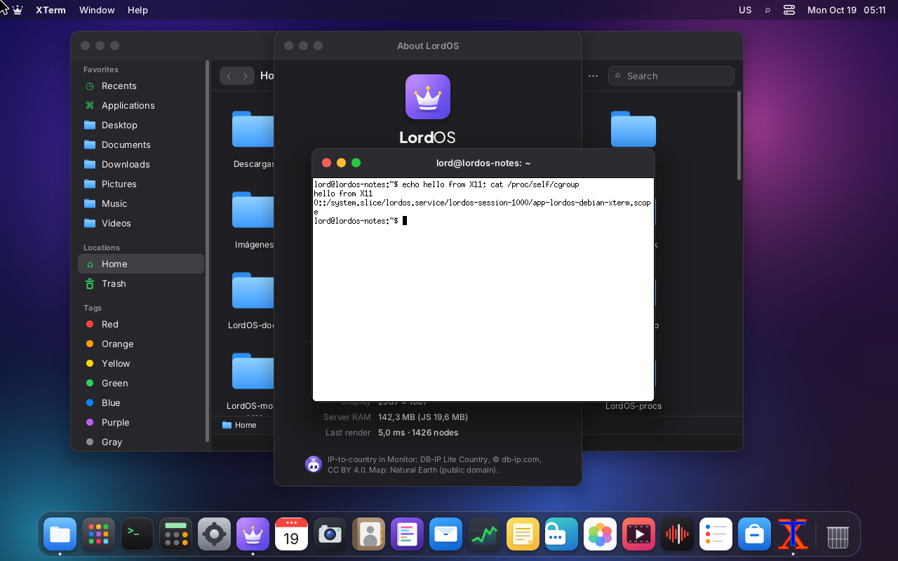 | 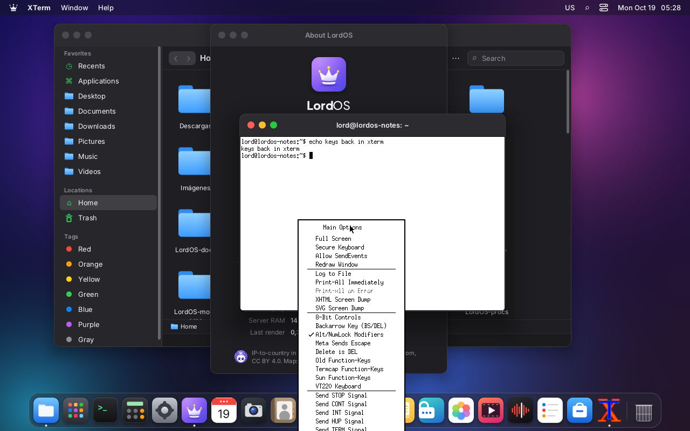 |
| XTerm opened from search: the theme's frame, its icon in the Dock (`StartupWMClass=XTerm`), the menu bar, and its process in `app-lordos-debian-xterm.scope` | XTerm's Ctrl+click menu: an override-redirect X window, drawn above the Dock |
| 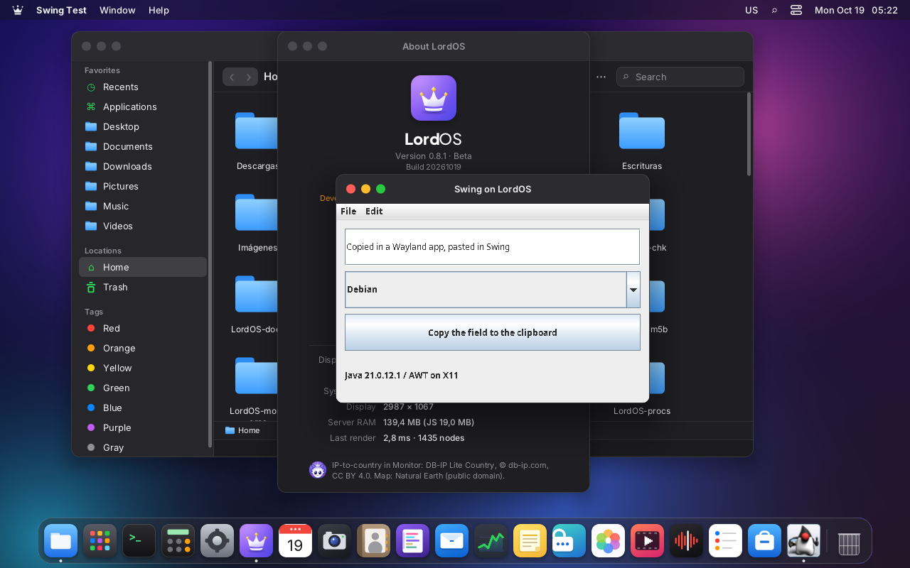 | 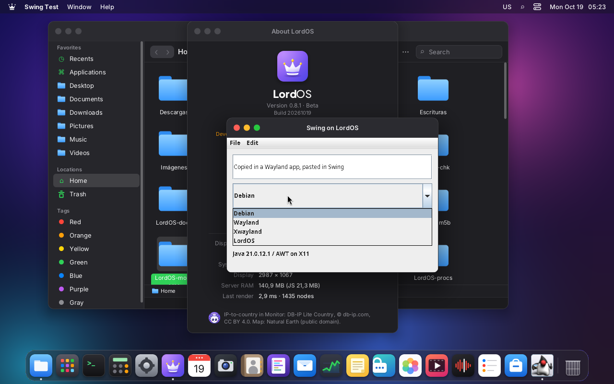 |
| A Swing app (OpenJDK 21): pasted with Ctrl+V what a Wayland app copied | Its list, the pointer at the right place |
| 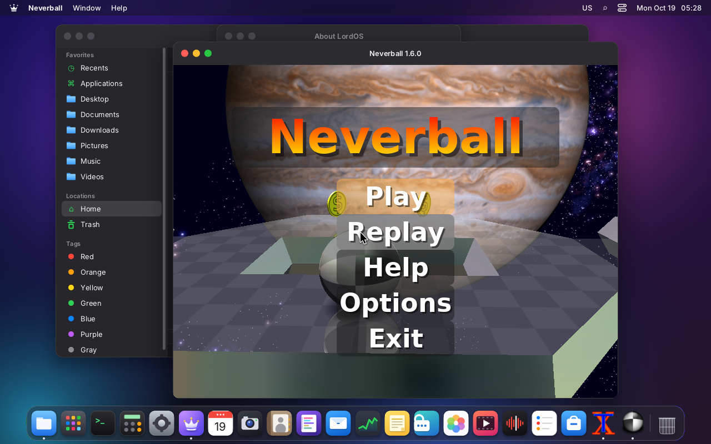 | 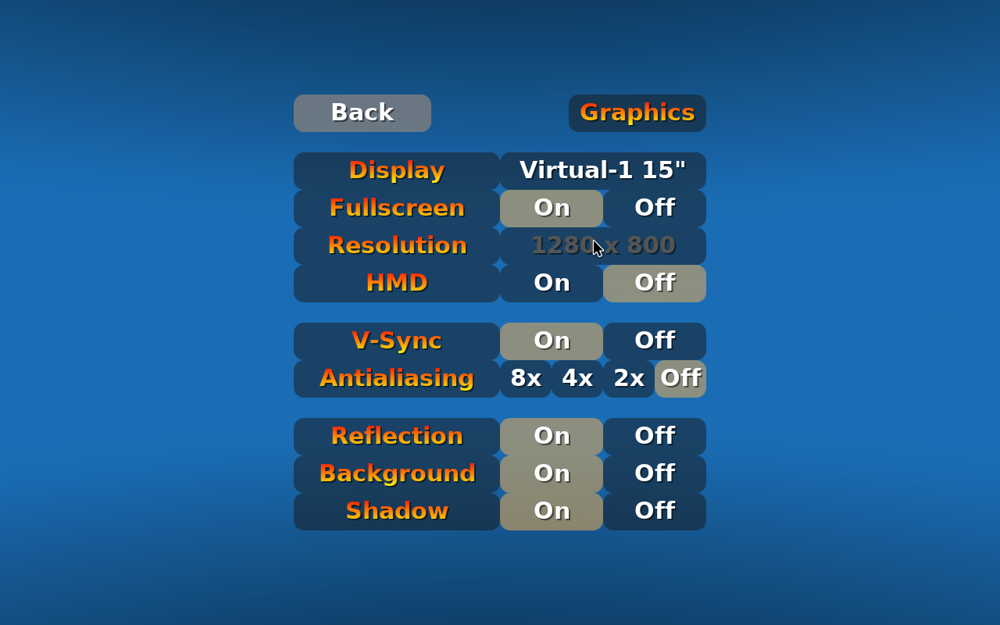 |
| Neverball with `SDL_VIDEODRIVER=x11` (OpenGL through Mesa) | Its "Fullscreen" option: `_NET_WM_STATE_FULLSCREEN`, presented by the compositor |
| 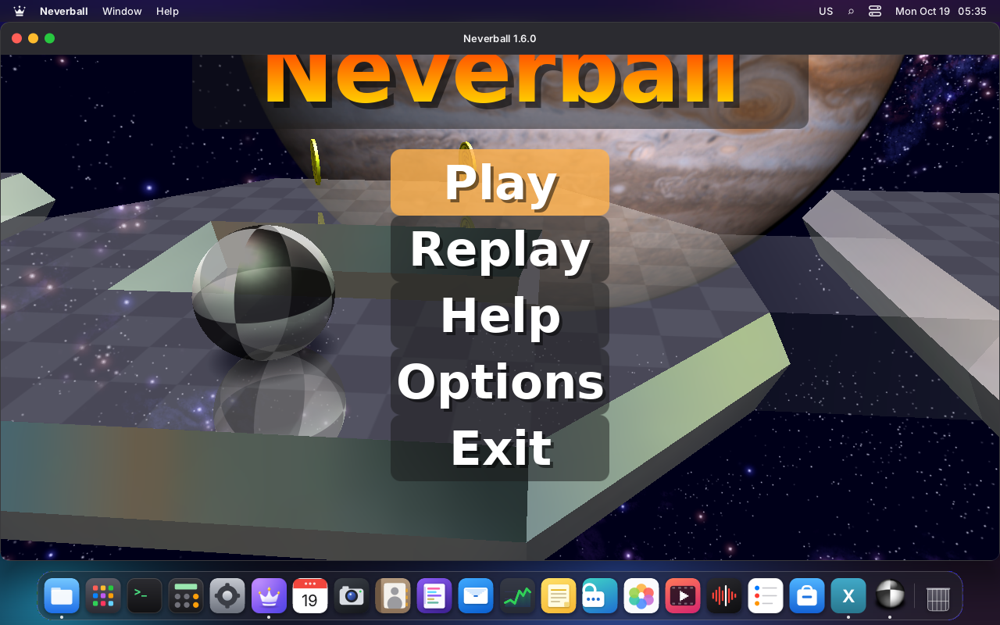 | 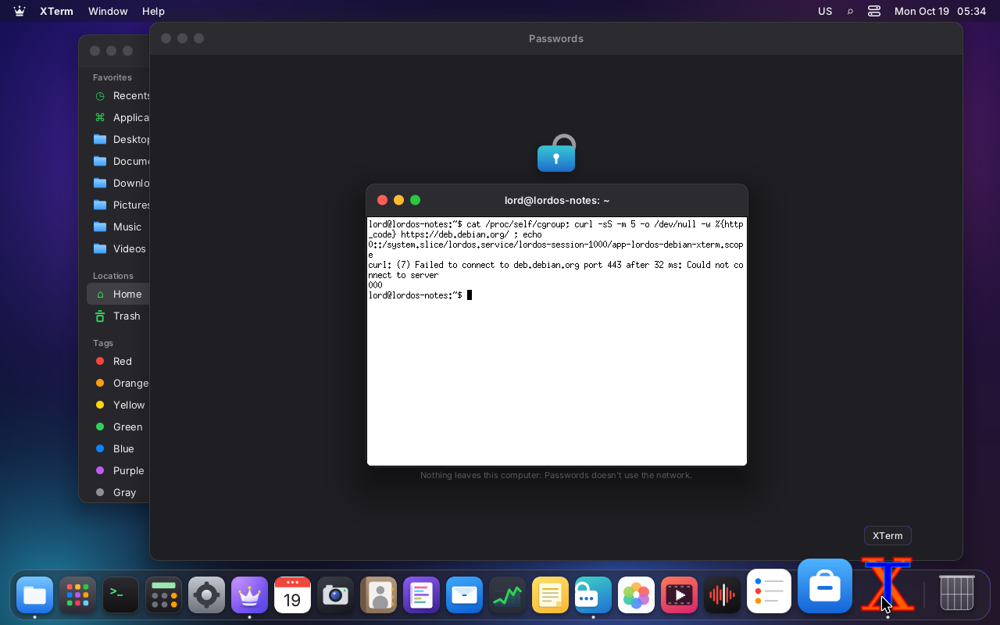 |
| The same on the GPU composition path (`LORD_GPU=1`) | XTerm restricted to no internet (Settings → Firewall): its `curl` is refused, the per-app rules apply to X11 apps |

### How it starts (`server/src/wl/xwayland.c`)

- At the start of a user session (not the login screen, not app mode), if `/usr/bin/Xwayland`
  exists, lord-server reserves a display: the lock file `/tmp/.X<n>-lock` and the socket
  `/tmp/.X11-unix/X<n>` with mode **0600** (only this user's programs can connect; no abstract
  socket, no TCP). It sets `DISPLAY=:<n>` (and `_JAVA_AWT_WM_NONREPARENTING=1`, see below) for the
  apps it starts. **Nothing else runs.**
- When the first X11 client connects, lord-server starts Xwayland with a fixed argument list:

  ```
  /usr/bin/Xwayland :<n> -rootless -listenfd 3 -wm 5 -nolisten tcp -extension XTEST
  ```

  fd 3 is the listening socket (Xwayland accepts that first connection), fd 4 its Wayland connection
  (`WAYLAND_SOCKET`, a socketpair, so the compositor knows which client is Xwayland) and fd 5 the
  window manager's connection. This is the fourth launcher exception (`AGENTS.md`): the binary must
  be a root-owned file nobody else can write; there are no arguments from JS or from anyone; the
  only trigger is a connection to the session's own X socket.
- Xwayland runs in its own scope (`lordos-xwayland.scope`, never lord-server's), in an empty network
  namespace inside a user namespace that maps only the user (it has no network at all), with
  `no_new_privs`, a minimal environment and its log in `~/.cache/lordos/xwayland.log`. **XTEST is
  off**: an X11 app can't type or click into another one with synthetic input.
- **Off when unused.** The window manager is an X client too, so Xwayland's own `-terminate` never
  fires: 10 s after the last X window closes, the window manager asks the X-Resource extension
  whether any other client is still connected (a clipboard tool without windows) and, if none,
  stops Xwayland. The socket stays in lord-server, so the next X11 app starts it again (about a
  second). Three failed starts in a row → X11 apps are refused for a minute (logged).

### The window manager (`server/src/wl/xwm.c`, `x11wire.c`)

Our own, in C: it speaks the X11 protocol itself (no libxcb or libX11, dependency policy), fully
asynchronously, so lord-server never waits on Xwayland while Xwayland waits on the compositor.

- **Windows.** It redirects the root's children (Composite, manual: rootless Xwayland then gives each
  top-level window a `wl_surface` and says which with `WL_SURFACE_ID`), takes SubstructureRedirect
  and maps the windows that ask. A normal window becomes a LordOS window (`linux#<surface>`, like
  Wayland apps) with its title (`_NET_WM_NAME` or `WM_NAME`, Latin-1 converted), and its app from
  `WM_CLASS`: the class, or the instance if only that names a `.desktop` (`StartupWMClass` or the
  desktop id), so the Dock groups it with its launcher icon. Motif "no decorations" (or a splash)
  gets no theme frame. Override-redirect windows and menus, tooltips, combo lists, notifications
  and drag icons are drawn above everything at the place X gave them.
- **Place, stacking and focus.** The X position of a window is its content's position on screen
  (updated as the theme moves it), so Xwayland routes the pointer right; the focused window is put
  on top of X's stack and a minimized one at the bottom (iconic). Focus uses `SetInputFocus` and
  `WM_TAKE_FOCUS` (ICCCM); an X app can't move the keyboard to another X app's window (that
  `FocusIn` is reverted); `_NET_ACTIVE_WINDOW` from an app is ignored (no focus stealing).
- **Requests.** Close (`WM_DELETE_WINDOW`, else `KillClient`), maximize and fullscreen
  (`_NET_WM_STATE`, also set before mapping), minimize (`WM_CHANGE_STATE`), and moves and resizes
  asked by apps that draw their own frame (`_NET_WM_MOVERESIZE`) go to the theme like a Wayland
  app's. A resize of the frame becomes `ConfigureWindow`; an app may change its own size, never its
  place.
- **Cursor.** The root window's cursor is LordOS's arrow (a Render ARGB cursor), so X apps that
  don't set one show ours; those that do (xterm's I-beam) show theirs, like Wayland apps.
- **Java.** AWT guesses the insets of a reparenting window manager; ours doesn't reparent, so
  `_JAVA_AWT_WM_NONREPARENTING=1` is set for the session's apps (without it Swing windows are blank).

### Clipboard and primary selection

Both ways, for **CLIPBOARD** and **PRIMARY** (select to copy, middle click to paste):

- **X11 → LordOS.** XFixes tells when an X app takes a selection; the window manager reads it once
  (`TARGETS`, then the best text — `UTF8_STRING`, `text/plain;charset=utf-8`, `STRING` — or
  `image/png`; `INCR` for large ones, up to 16 MB) and it becomes LordOS's: the Wayland apps, the
  Terminal and the history (with the X app's class as its source) see it.
- **LordOS → X11.** LordOS's selection is put in X **only while an X window has the keyboard** and
  only if it's newer than what an X app copied; when the keyboard goes to a LordOS or Wayland
  window, the window manager gives the selection up. Large pastes go in `INCR` chunks.
- **Secrets never go to X.** What Passwords (or a password field) copies is marked sensitive and is
  not offered to X11 apps at all: in X, the pasted text is written to a window property any X client
  can read.
- **Primary selection for Wayland apps** (`zwp_primary_selection_v1`, new in 0.8.3): what the app
  with the keyboard selects is kept and offered to the app that gets the keyboard next, and to X.
- **Offers are bound to their selection.** A `wl_data_offer` (and a primary offer) carries the
  generation it was made for and only gives data for that selection, and only to its client while
  it has the keyboard: an app can't keep an old offer to read later copies (`build/clip-offers`).
- **Drag and drop** between X11 and Wayland apps: not yet (LordOS has no Wayland drag and drop
  yet). Inside X (X app to X app) it's X's own protocol; not tested.

### HiDPI and displays

X11 apps work in logical pixels at scale 1: the X screen is the bounding box of the displays'
logical rectangles (Xwayland reads them from `xdg_output`), and on a display above 100 % the
compositor scales their buffers up (sharp text needs the app's own scaling, e.g. `GDK_SCALE`, Java's
`-Dsun.java2d.uiScale`). Tested at 100 % on two displays (2987×1067 logical); not tested on a HiDPI
display.

### Tests

- `build/xwm-test` (in `make -C server test`): request encoding, the setup reply, packet framing,
  sequence numbers, `WM_CLASS`, titles (UTF-8, Latin-1, invalid), Motif hints, size hints,
  `WM_HINTS`, `_NET_WM_MOVERESIZE`, text targets, the same-client check and the display choice.
- `tests/xwayland/selections.sh` (inside a session on a test VM, with `build/clip-offers`): X11 →
  Wayland for both selections, offers bound to their selection, and a Wayland copy not readable by
  X apps while no X window has the keyboard.
- `tests/xwayland/keysnoop.sh`: an X keylogger (polling the X keyboard state) sees the keys typed
  into an X window, and **none** of those typed into Passwords.
- On VM 118 (CPU path and `LORD_GPU=1` with llvmpipe): xeyes, XTerm, a Swing app (OpenJDK 21),
  Neverball with `SDL_VIDEODRIVER=x11` (windowed and fullscreen), menus, move and resize from the
  frame, close, the Dock icons, Xwayland stopping 10 s after the last app and starting again, the
  firewall restriction on XTerm, and the protected-window checks in `PRIVACY.md`.

## Pending

- SVG app icons (most modern GTK/Qt apps only ship SVG).
- Opening files with a Linux app (`%f`/`%u`), `.desktop` actions and terminal apps.
- Already done (see `GPU.md`): `linux-dmabuf` v4, GPU composition (Mesa, optional), direct
  fullscreen scanout, `wp_presentation`, `wp_viewporter`, `relative-pointer`,
  `pointer-constraints`, real fullscreen (❖Esc exits) and app cursors (image or hidden).
- Drag and drop, `text-input` (LordOS input methods inside Wayland apps), activation
  (`xdg-activation`). (Fractional scale and several outputs: done, see `DISPLAYS.md`; primary
  selection and Xwayland: done in 0.8.3, above.)
