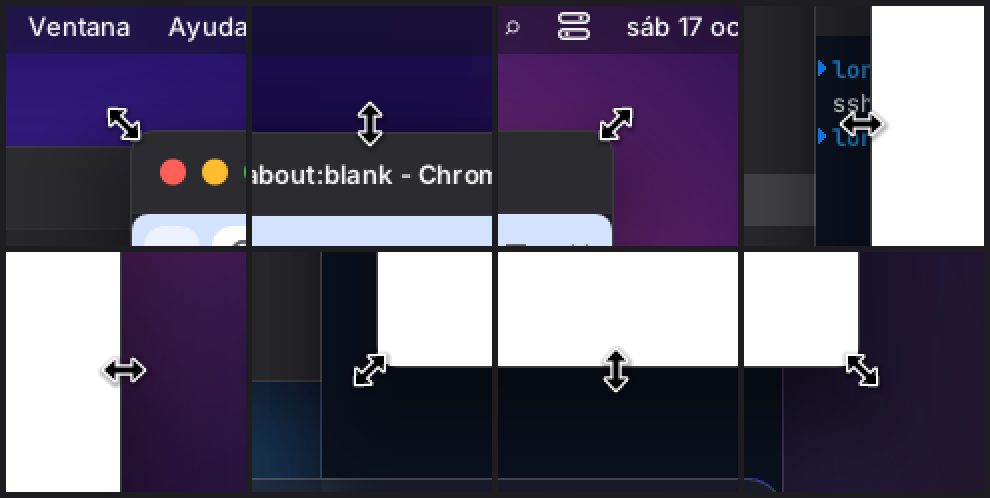
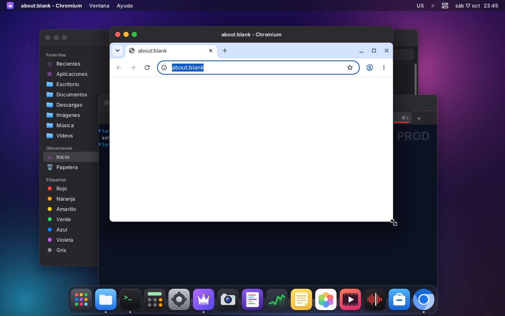
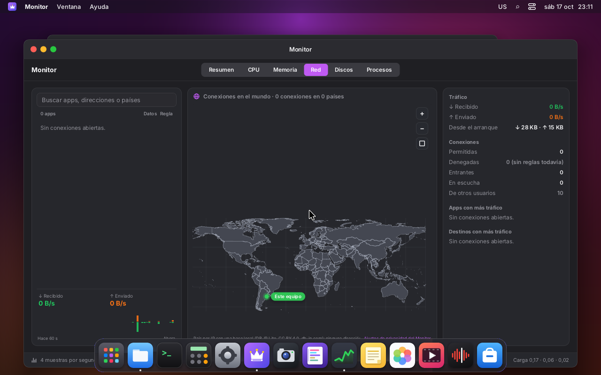
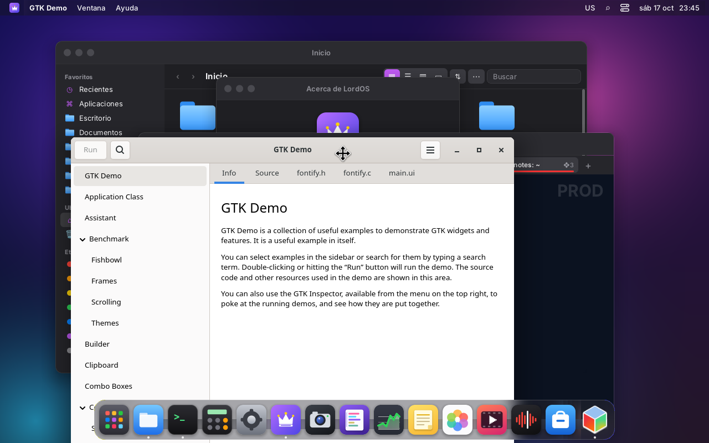
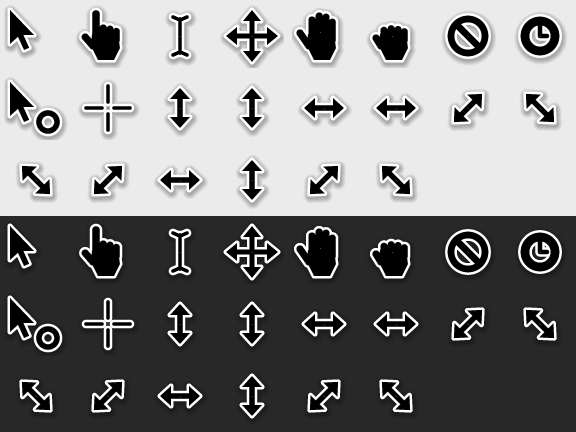
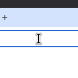

# Windows: moving, resizing and cursors

Moving a window has to look smooth even on a small machine and on the CPU path, which is the default
in the VMs and on the live ISO. Also, every window can be resized from its 4 sides and 4 corners,
and the cursor shows the arrow for each direction.

| | |
|---|---|
|  |  |
| The 8 invisible edges of a window (Chromium with the theme's frame): ↖ ↕ ↗ ↔ ↔ ↙ ↕ ↘ | Resizing from the corner: Chromium redraws at the new size while dragging |
|  |  |
| Moving a window: move cursor, the Dock stays on top | GTK Demo (own frame, CSD) moved from its bar: lord-server follows `xdg_toplevel.move` in C |
|  |  |
| LordOS cursors (`server/src/cursor.c`) at 2x over light and dark backgrounds; the red dot is the hotspot | The I-beam in Chromium's address bar: it asks for it via `cursor-shape-v1` and LordOS draws it |

The screenshots are from VM 118 on the CPU path (on the GPU path the cursor goes through the cursor
plane and `screendump` doesn't show it).

## Why it wasn't smooth (before)

Every mouse event called into JS and JS moved the window with React:

1. `pointermove` → `wm.move` → the window store changes → **the whole shell was re-rendered**: the
   desktop, every window, the Dock and the menu bar (about 38 ms per event in QuickJS);
2. then, layout and repaint of everything below and above the window in the old and new regions:
   background, other windows, the window's content, the terminal, shadows and the Dock's blur
   (about 17 ms);
3. with a 125 Hz or faster mouse an event arrived every 8 ms: events piled up in evdev (they got
   lost, sometimes the "release" too) and the screen updated at 15–18 frames per second.

## What was done

### One motion per frame (`main.c`)

Pointer motion is no longer sent on every evdev `SYN`: it is coalesced and sent **once per frame**,
when the page flip completes (`motion_pending`). Buttons and the wheel are sent immediately (with
whatever motion has accumulated up to that moment). That way a 1000 Hz mouse doesn't call JS or the
Linux apps a thousand times per second. Raw motion for games (`relative-pointer`) and the cursor
plane are still per event.

### C does the dragging (`ui/grab.c`, `lord.wm`)

The theme starts the drag and lord-server follows it on its own:

```js
wm.beginMove(id)              // in the title bar's onMouseDown
wm.beginResize(id, edges)     // edges as in xdg_toplevel.resize: 1 top, 2 bottom, 4 left, 8 right
```

- Per frame, C shifts the window's node (`left`/`top`, and `width`/`height` when resizing) and redoes
  the layout. **JS is not called and React doesn't re-render.**
- While it lasts, Linux apps don't receive the pointer (`wl_pointer_grab`: `leave`), as in Weston.
- On release, JS receives `__lordWm('end', { node, dx, dy, dw, dh })` and the SDK stores the geometry
  in the window manager. React sets the same value the node already had, and `lord.setStyle` no
  longer invalidates anything if the style didn't change (`js.c`).
- Limits: the minimum size is the manifest's `minSize` (Linux apps, 160×100). The frame doesn't go
  above the work area (the menu bar) and 48 px always remain visible.
- `xdg_toplevel.move` and `xdg_toplevel.resize` from apps that draw their own frame (GTK, Chromium
  with CSD) use the same thing (`sdk/wayland.js`).
- If the theme didn't mark the window's node (`wm.frameRef`), or the window is maximized,
  `beginMove` returns `false` and the theme can fall back to its old JS dragging.

### The moving window is a layer (`ui/paint.c`)

- **The layer.** When a move starts, the window's tree (with its shadow) is painted once into a
  separate buffer. Each frame it is just copied to the new position: text, terminal, images and
  shadow are not repainted.
  - It is painted in its screen coordinates (a canvas with a shifted origin). That way the terminal
    and Linux apps keep recording where they are.
- **If something inside changes,** like a terminal line or the blinking cursor, only that part of
  the layer is repainted. If a style inside changes, the whole layer is repainted.
- **What's below** (everything painted before the window: background, desktop, the other windows)
  is also saved once. Per frame:
  1. the region that changed is copied;
  2. the layer goes on top;
  3. what is above (menu bar, Dock) is painted normally, because its blur depends on what lies
     beneath it.
- **If something below changes** (a clock, a video), the below part is rebuilt. If it changes very
  often, it stops being used.
- **When resizing** the window is repainted every frame (its content reflows), but what's below is
  still saved.
- **The damage** is the window's old region plus its new one.
- **On the GPU path:**
  - the below part records its app windows again every frame (`wl_paint_keep`/`wl_paint_kept`);
  - the layer remembers where the app holes are: exact alpha 0, distinguished from an empty
    background thanks to a sentinel value. They are reopened over the blend and the app is recorded
    at its new place (`wl_paint_holes(0)`).
- **There's no layer** if there is a backdrop blur inside (`backdropFilter`), or a video on the GPU
  path.
- **A `canvas_blit` detail:** opaque pixels are copied directly (same result as blending, without
  the math).

### Resize edges (`sdk/windowshell.jsx`)

`<WindowShell>` is the window's node: the frame goes inside and around it there are 8 invisible
zones. They are 6 px outside the frame and 3 px inside, as in macOS. The sides carry
`ns-resize`/`ew-resize` and the corners (16 px) `nwse-resize`/`nesw-resize`. Both themes use it,
also for Linux apps with their own frame (CSD): their resize edge is in the shadow, which LordOS
crops.

```jsx
<WindowShell win={w} onMouseDown={() => wm.focus(w.id)} style={{ borderRadius: 12, overflow: 'hidden', boxShadow }}>
  <View onMouseDown={() => wm.beginMove(w.id)}>…title bar…</View>
  <AppHost id={w.id} focused={focused} />
</WindowShell>
```

### Cursors (`server/src/cursor.c`)

- **Own cursor set, drawn by LordOS.** They are vector shapes (polygons, capsules, rings with signed
  distance), rasterized with 4×4 samples per pixel at 1x (32 px) and 2x (64 px, on screens from
  2560×1440). Black fill, white outline and a soft shadow.
- **No system theme is read.** Debian doesn't install Adwaita or DMZ on the ISO, so there's no new
  dependency.
- **Shapes:** `default`, `pointer` (hand), `text`, `move`, `grab`, `grabbing`, `not-allowed`, `wait`,
  `progress`, `crosshair` and the 8 resize directions, plus `ew`, `ns`, `nesw` and `nwse`.
- **`cursor` style (CSS) on any node:** the one from the first node upward that has it applies.
  Example: `style={{ cursor: 'pointer' }}`.
- **Which cursor is shown:**
  1. during a drag, the drag's cursor: `move` or the edge arrow;
  2. over a Linux app, whatever it asks for: `wl_pointer.set_cursor` (image or hidden) or
     **`wp_cursor_shape_manager_v1`** (shape by name, used by Chromium, GTK 4 and Qt 6), drawn with
     these same shapes;
  3. otherwise, the node's.
- **Where it is drawn:** on the CPU path over the frame; on the GPU path through the KMS cursor
  plane (or as a texture if the driver has no plane). Remote desktop and recordings receive the
  image (`mirror_cursor`, `media_composed`).

### Presenting on the CPU: only what changed

Each KMS buffer receives only what changed since the last time it was drawn into. That's the region
repainted in this frame and in the previous one (double buffering), plus where the cursor was;
before, it was the whole scene (4 MB at 1280×800). They copy everything:

- the two frames after a resize or after coming back from the GPU;
- a fullscreen app.

With the Terminal being dragged, "present" went down from 0.66 to 0.35 ms per frame (and dragging
reached 95–103 frames per second: virtio-gpu completes the flip before the refresh).

## Measurements (VM 118, 1280×800 at 75 Hz, 4 vCPU)

Continuous 6 s drag in circles with a virtual tablet (uinput, 125 events/s). lord-server writes one
line per drag to `~/.cache/lordos/session.log`:

```
arrastre: 464 cuadros en 6011 ms = 77.2 FPS (464 movimientos); por cuadro: trabajo 12.80 ms (máx 36.83;
JS 0.20, layout 0.56, pintado 11.43, presentar 0.61), intervalo máx 36.9 ms; capa: 1023 pintadas, 467 copiadas (CPU)
```

"trabajo" (work) is what lord-server spends per frame: the pointer and timer JS, layout, painting
("pintado") and presentation ("presentar").

| Path | Window | Before | After |
|---|---|---|---|
| CPU | Terminal | 17.9 FPS, 55.6 ms per frame (JS 38.2) | **77.2 FPS** (the cap is the 75 Hz refresh), 12.8 ms (JS 0.2) |
| CPU | Chromium (SSD, 900×600) | 17.1 FPS, 58.2 ms (JS 35.9) | **50.7–67 FPS**, 15–20 ms (JS 0.3) |
| GPU (`LORD_GPU=1`, llvmpipe) | Terminal | 15.3 FPS, 64.5 ms (JS 38.3) | **40 FPS**, 24 ms (JS 0.4; present with llvmpipe 10 ms) |
| GPU (`LORD_GPU=1`, llvmpipe) | Chromium | 11.5 FPS, 85.9 ms (JS 47.0) | **30 FPS**, 32 ms (JS 0.4; present with llvmpipe 12.7 ms) |
| CPU | Chromium, resizing | — | 19.5 FPS: set by Chromium, which redraws at every size |

- **"Before"** is the same tree, but with uncoalesced motion and the original themes (dragging in
  JS). The "before" lost events: out of 720 motions about 110 arrived.
- **What remains in "painting"** is mostly what's above the window: the Dock's blur and icons
  (about 4–7 ms when the window passes underneath) and copying the layer.
- **With a real GPU** (AMD), "present" is almost 0. In the VM it's llvmpipe in software.
- **Spikes of about 35 ms:**
  - the first frame (it builds the below part, which means painting the whole screen once);
  - an occasional rebuild if something below changed.

**How it was measured** (scratchpad scripts, one per VM):
- `uinput-ventanas-118.py`: runs in the VM as root and creates the tablet «LordOS prueba tableta». It
  is driven through `/run/uinput-ventanas`.
- The QMP mouse (`input-send-event`) is no good for measuring: QEMU's USB tablet has a 16-event queue
  and at 120 Hz it loses motions and even the "release".

## Several displays and HiDPI (2026-10-18)

With several displays (`DISPLAYS.md`) the layer and "what is below" belong to the display with
most of the window (`paint_layer_view`) and are in that display's physical pixels; the other
displays paint the window normally while it crosses. Dragging uses each display's work-area top
(`lord.wm.grab(…, { areas })`), so a window never goes under a menu bar. Re-measured on VM 118
(About window, 6 s circles at 125 events/s, one 1280×800 display, CPU): 6.38–6.51 ms of work per
frame before, 6.73–6.94 ms after (≈ +5 %, the per-display bookkeeping); the layer still renders
once and is then only copied. Numbers with two displays and at 150 %: `DISPLAYS.md`.

## Pending

- A real GPU layer (the window as its own texture that is only shifted), so nothing is painted on the
  CPU when moving with a real graphics card.
- The Dock's blur is recomputed when a window passes underneath.
- The first frame of a drag builds the below part (about 35 ms).
- `xdg_toplevel.resize` requested by a GTK app from its edge: the edge is in the shadow that LordOS
  crops, so in practice it is resized with the theme's edges (tested with Chromium; GTK Demo was
  tested by moving it).
- System cursor themes (Xcursor) and the cursor size in Settings.
