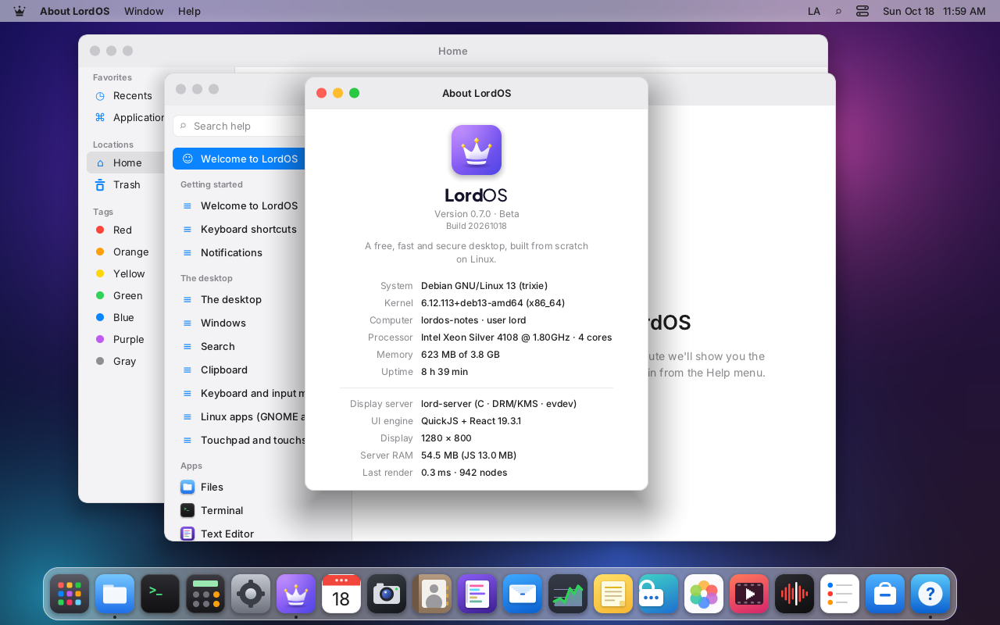
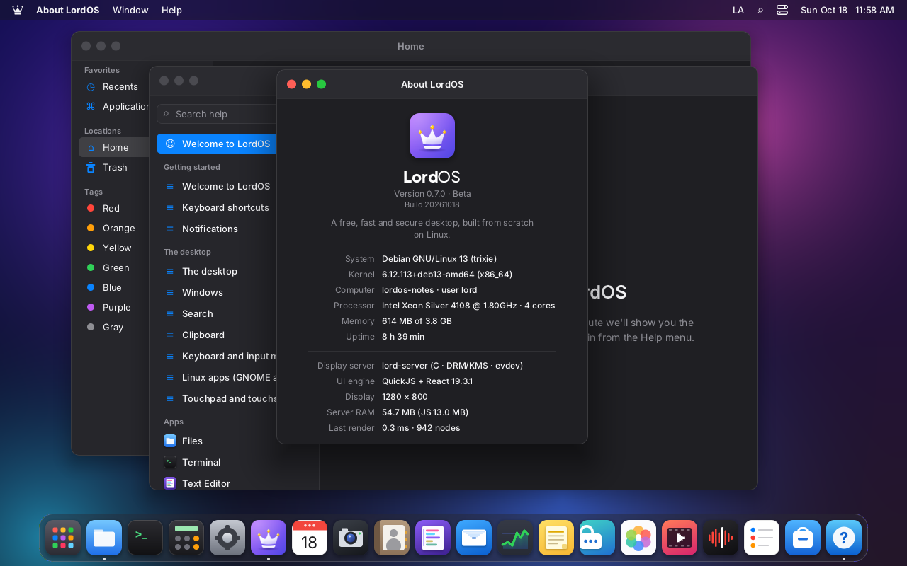
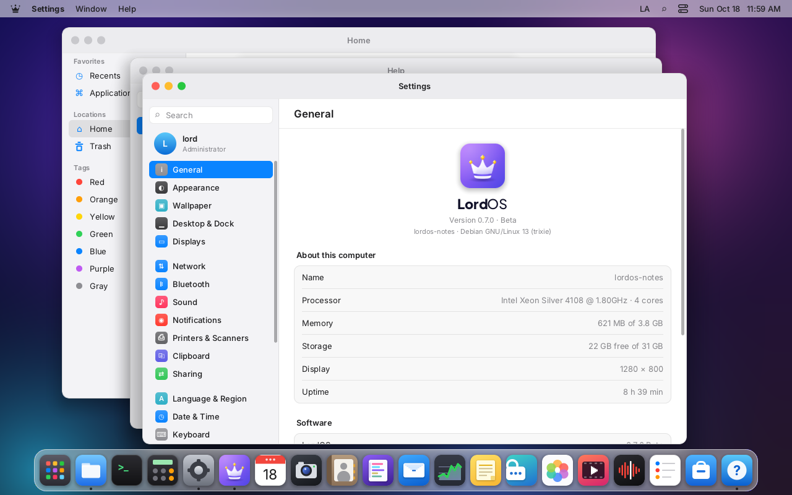
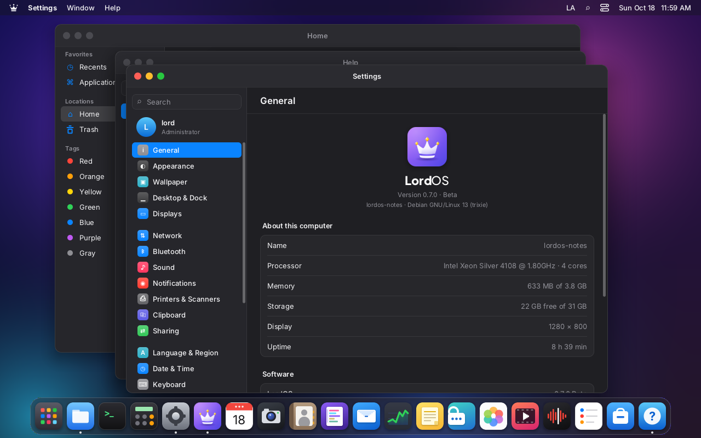
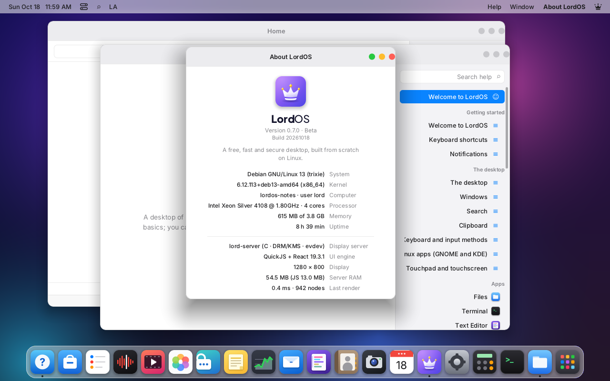
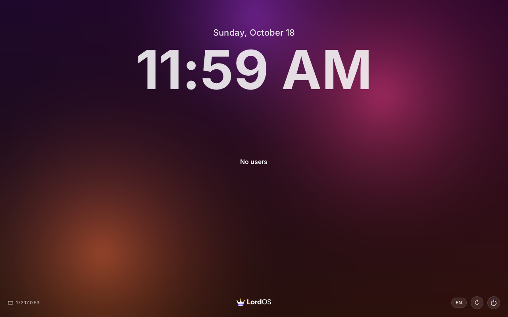
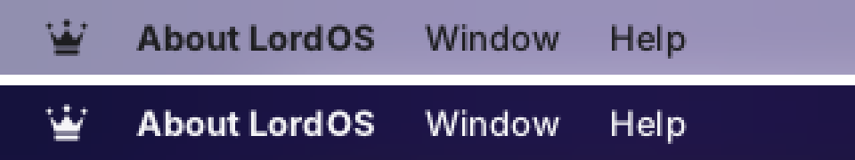
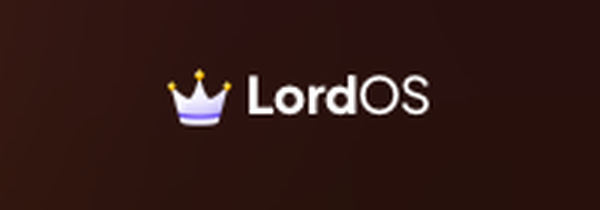
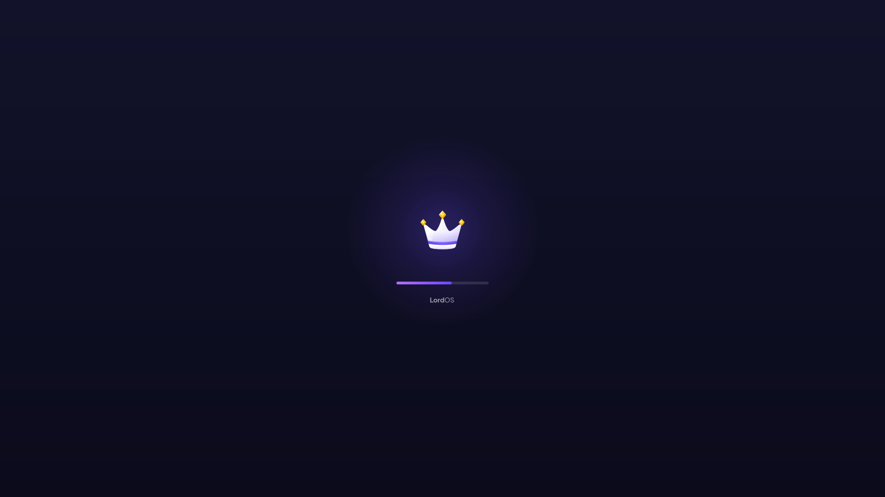
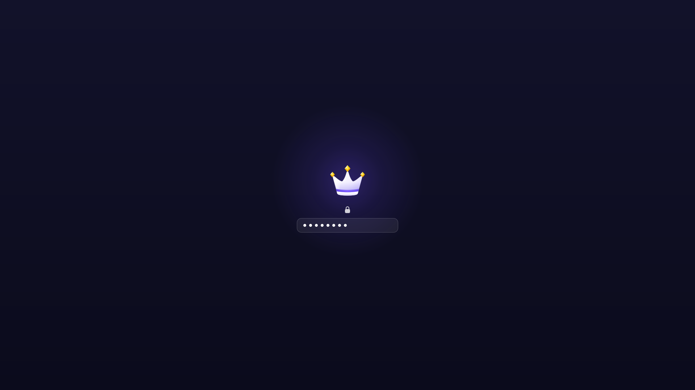

# LordOS brand files

LordOS is a Debian-based GNU/Linux distribution with a desktop built from scratch.

The brand identity (logo usage, colours, typography, the mascot) is described in
[`../LORDOS-BRAND.md`](../LORDOS-BRAND.md). This page is the file index.

The LordOS logo is a soft white crown with three peaks, a violet band and a yellow gem on each tip,
next to the wordmark **Lord**OS. Everything here is generated by `tools/gen-brand.py` from the
vector sources in `assets/brand/`, so it stays in sync:

```sh
python3 tools/gen-brand.py          # PNG renders (assets/icons/ and this folder); needs rsvg-convert
python3 tools/gen-brand.py --svg    # also rewrite the SVGs first; needs fontTools (pip install fonttools)
```

The SVGs are real vectors drawn by hand (no embedded bitmaps). The crown is one mirrored half, so
it is exactly symmetric. Its shapes have no strokes, the gloss comes from three gradient layers, and
each gem is a set of separate facet polygons in three tones. Each file is under 6 KB.

| Light | Dark |
|---|---|
|  |  |
|  |  |
|  |  |

The menu bar glyph (light and dark menu bars, 3x) and the login screen wordmark (3x):




The screenshots come from a headless `lord-server` on VM 118, rendered offscreen at 1280 × 800.
The RTL one uses a test language pack: the English texts marked right to left.

## Files

### Vectors (`svg/`, copies of `assets/brand/`)

| File | What it is | Use it for |
|---|---|---|
| `svg/logo-horizontal-light.svg` | Crown and wordmark, navy text, transparent | Web headers and documents on light backgrounds; the README header (light) |
| `svg/logo-horizontal-dark.svg` | Crown and wordmark, white text, transparent | Web headers on dark backgrounds; the README header (dark, via `<picture>`) |
| `svg/logo-mono-black.svg` | One colour, black | Print, fax, engraving, light backgrounds where colour isn't possible |
| `svg/logo-mono-white.svg` | One colour, white | Photos and dark or busy backgrounds |
| `svg/app-icon.svg` | The crown on the violet rounded square (22 % radius) | App icon, store listings, avatars, 48 px and up |
| `svg/app-icon-small.svg` | The icon redrawn on a 32 px grid | 16 to 32 px: tabs, lists, the favicon |
| `svg/crown.svg` | The crown alone, transparent | A symbol next to other content, splash screens |
| `svg/crown-mono.svg` | The crown, one colour (gaps cut out) | Glyphs and stamps from 24 px up |
| `svg/crown-mono-small.svg` | The one-colour crown on a 16 px grid | Menu bars and toolbars at 12 to 20 px |
| `svg/social-card.svg` | 1200 × 630, the dark lockup on the violet gradient | Link previews (Open Graph, social posts) |

### Renders (`png/`, `favicon/`)

| File | Use it for |
|---|---|
| `png/app-icon-{16,32,64,128,256,512,1024}.png` | App icon at fixed sizes (16 and 32 come from the small variant) |
| `png/logo-horizontal-{light,dark}-{400,800}.png` | Web headers at 1x (400 px wide) and 2x (800 px) |
| `png/logo-mono-{black,white}-800.png` | One-colour lockup |
| `png/crown-{256,512}.png` | The crown alone |
| `png/social-card-1200x630.png` | `og:image` / social card |
| `favicon/favicon.svg` | `<link rel="icon" type="image/svg+xml">` (the pixel-grid icon: sharp in a tab) |
| `favicon/favicon-32.png` | PNG favicon fallback |
| `favicon/apple-touch-icon-180.png` | Home screen icon on phones |
| `favicon/favicon-512.png` | Web app manifest |

```html
<link rel="icon" href="/favicon.svg" type="image/svg+xml">
<link rel="icon" href="/favicon-32.png" sizes="32x32">
<link rel="apple-touch-icon" href="/apple-touch-icon-180.png">
<meta property="og:image" content="/social-card-1200x630.png">
```

### Inside the OS (`assets/icons/`, `sdk/logo.js`)

| What | Where |
|---|---|
| `LordOSLogo` (the app icon; `lordos-icon-*.png`, it picks the right size) | About, Settings → General, Monitor, Help, the Dock |
| `LordOSGlyph` (the one-colour crown, `lordos-glyph-{light,dark}-{16,32}.png`) | The menu bar logo menu; it follows the menu text colour |
| `LordOSWordmark` (the crown as `lordos-crown.png` plus live text in the brand face) | About and Settings → General (text only, under the icon); the login screen (with the crown) |
| `lordos-crown.png` (256) / `lordos-crown-512.png` | The crown for other consumers (`tools/demo`) |

## Colours

| Name | Hex | Where |
|---|---|---|
| Violet light | `#B46CFF` | Icon gradient, top left |
| Indigo | `#4F46E5` | Icon gradient, bottom right |
| Band violet | `#5B3FE0` → `#7C5CFF` | The crown's band |
| Gem yellow | `#FFD60A`, `#FFC300`, `#FFB000`, highlight `#FFF1A8` | The gems |
| Crown white | `#FFFFFF` → `#EEEAFF` → `#BDB1F5` | The crown body |
| Navy ink | `#12122A` | The wordmark on light backgrounds |
| White ink | `#FFFFFF` | The wordmark on dark backgrounds |

## Typeface

The wordmark is set in **Plus Jakarta Sans** (SIL Open Font License 1.1, release 2.7.1 from
github.com/tokotype/PlusJakartaSans): "Lord" in **ExtraBold (800)** and "OS" in **Medium (500)**,
letter spacing −0.01 em, no space between them. The two font files are in `assets/fonts/`
(`PlusJakartaSans-ExtraBold.ttf`, `PlusJakartaSans-Medium.ttf`, license in
`PlusJakartaSans-LICENSE.txt`).

- **In the OS** it is live text: the engine loads the two files as the `brand` font family
  (`fontFamily: 'brand'`, `server/src/ui/text.c`) the first time it's used, so it's sharp at any size
  and scale. Use `LordOSWordmark` instead of setting it by hand.
- **In the SVGs** the text is outlined from those same files by `tools/gen-brand.py --svg`, so the
  SVGs look identical without the font installed.

Plus Jakarta Sans was chosen after comparing it with Inter (the UI font), Outfit, Manrope, Sora and
Urbanist against the original artwork. It matched the letter shapes (round `o` and `d`, short `r`,
open `S`) and the weight contrast best.

## Clear space and sizes

- **Clear space:** keep free space around the logo at least as large as **half the cap height** of
  the wordmark (around the icon: 10 % of its size). Nothing else (text, edges, other logos)
  goes inside it.
- **Proportions:** in the lockup the crown is 1.6 times the cap height, centred on the capitals, and
  the gap between the crown and the text is 0.27 em. Use the files as they are.
- **Minimum sizes:**
  - horizontal logo, 96 px wide (24 mm in print); below 120 px prefer the one-colour version;
  - app icon, 16 px (use `app-icon-small.svg` up to 32 px);
  - crown alone, 24 px (`crown-mono-small.svg` for 12 to 20 px glyphs);
  - live wordmark, 13 px font size.

## Don'ts

- Don't stretch, skew, rotate or re-proportion the logo, and don't move the crown to another side
  of the text (it stays on the left, also in right-to-left languages).
- Don't recolour the crown, the band or the gems, and don't put the full-colour crown on a busy
  photo: use the one-colour version.
- Don't set the wordmark in another font or weight, add a space ("Lord OS"), or change the case
  ("LORDOS", "Lordos").
- Don't add effects: outlines, drop shadows, glows, bevels or textures (the app icon's own soft
  shadow is part of it).
- Don't place the light lockup on a dark background or the dark one on a light background.
- Don't use the detailed icon below 32 px or the detailed crown below 24 px; use the small variants.
- Don't redraw or trace the logo from screenshots. Edit `tools/gen-brand.py` and regenerate.

## Boot splash and boot menu

What the screen shows from power-on to the login screen (`docs/ISO.md`, "Boot splash and boot menu";
`docs/RASPBERRY.md`, "Boot splash"). Calm and minimal: no text messages, nothing that moves except
the bar.

| Splash, mid-boot (static preview, 1x) | Splash, encrypted disk |
|---|---|
|  |  |

| Part | Spec (1x, for 1080p; @2x files for 4K) |
|---|---|
| Background | vertical gradient `#12122A` (top) → `#0B0B1C` (bottom) |
| Crown | `crown.svg` at 112 px, centred, 40 px above the middle |
| Glow | a 420 px radial gradient of `#6E4BFF` behind the crown, 30 % → 12 % → 0 alpha. It is light *behind* the logo on the background, not an effect on the logo (see "Don'ts") |
| Progress bar | 200 × 6 px, 56 px under the crown; track white at 12 %; fill `#B46CFF` → `#6E4BFF` with round caps; eased, never goes back |
| Wordmark | the lockup's outlined Plus Jakarta Sans text, 12 px high, white at 55 %, 28 px under the bar |
| Password field | 280 × 40 px, 12 px radius, white at 7 % with a 22 % hairline; white dots and a small lock above |
| Boot menu (GRUB) | the same background with a soft glow, the crown at 96 px, entries in Inter 16 (`#B9B6D9`, selected white on a rounded violet band `#6E4BFF` at 34 % with a `#B46CFF` hairline), the bar as the countdown |

The files are generated, never edited by hand: `python3 tools/boot/gen-boot-assets.py` renders
`tools/boot/plymouth/lordos/*.png` (1x and @2x) and `tools/iso/grub/lordos/*.png` from
`assets/brand/crown.svg` and `logo-horizontal-dark.svg` with rsvg-convert; `--preview` writes the
previews above. The script lays the theme out at run time (`lordos.script`).

## Lumo, the mascot (`mascot/`)

Lumo, the guardian of LordOS: a small celestial fox with white fur and violet highlights, who wears
the LordOS crown and a violet cape as symbols of protection, freedom and control. Big pointed fox
ears; abundant fluffy white fur, like an arctic fox; a short, fluffy, slightly curved tail; a round,
kitten-like face with big expressive eyes; a small, compact fantasy-creature body. The story, the
pose table, the palette and the do's and don'ts are in [LORDOS-BRAND.md](../LORDOS-BRAND.md#6-lumo-the-guardian-of-lordos).

- `mascot/*.svg`: copies of `assets/brand/mascot/` (views: front, three-quarter, back; poses: wave,
  shield, run, sleep, celebrate, confused; `lumo-avatar` and `lumo-avatar-small` for 24–32 px).
- `mascot/png/`: 512 and 1024 px renders of the views and poses; 64/128/256 of the avatar and
  24/32/64 of the small avatar.
- `mascot/screens/`: Lumo inside LordOS.

They are generated by `python3 tools/gen-mascot.py` from the parts in
`assets/brand/mascot/src/lumo-parts.svg` (`--parts` rewrites that file from the script). The UI
draws the renders in `assets/mascot/` through `sdk/mascot.js`.
